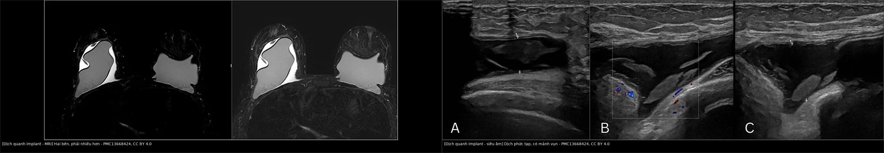
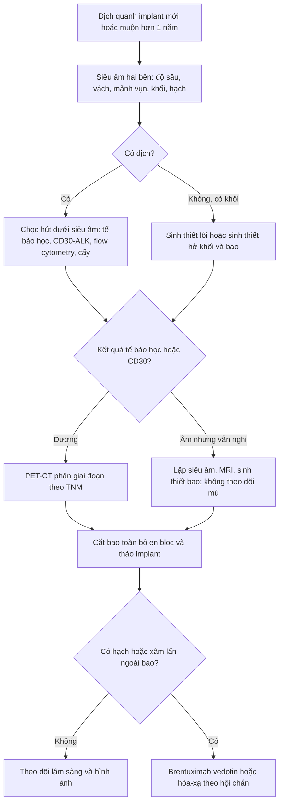
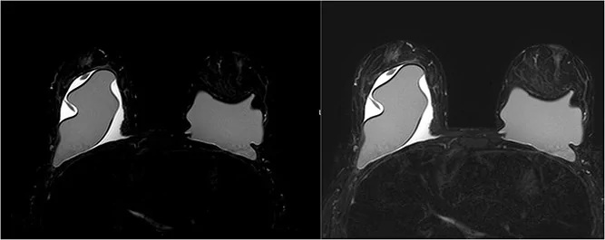
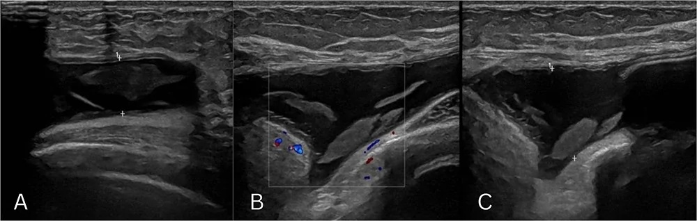
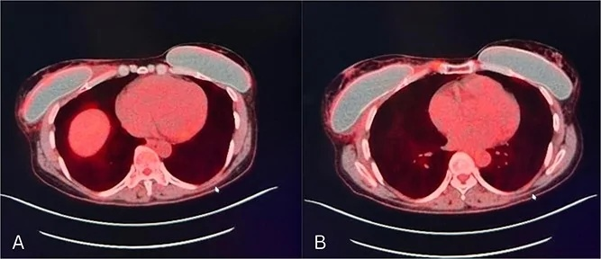

# 1654 — Dịch quanh implant muộn & u lympho tế bào T liên quan implant (BIA-ALCL) / Late peri-implant effusion and breast implant-associated anaplastic large cell lymphoma

**Tags:** `pattern:dich-quanh-implant` `pattern:khoi-bao-xo` `vung:vu` `score:TNM-BIA-ALCL` `protocol:MRI-vu` `protocol:PET-CT` `protocol:sieu-am-vu` `incidentaloma:dich-quanh-implant`
**Mức chắc chắn (certainty):** tổng hợp y văn (literature synthesis) — biên từ 6 nguồn toàn văn mở: ca bệnh hai bên có hình ảnh MRI/siêu âm/PET-CT (PMC13668424, CC BY 4.0), tổng quan biến chứng implant (PMC12067747, CC BY-NC 4.0), tổng quan BIA-ALCL (PMC9678239, CC BY 4.0), ca bệnh tế bào học âm (PMC11595676, CC BY 4.0), tổng quan PET/CT và bảng TNM (PMC12734642, CC BY 4.0), nghiên cứu dịch tễ học quốc gia (PMC13158419, CC BY-NC 4.0). Ca trong quiz là **ca nguyên văn** của PMC13668424 — ghi rõ trong đáp án.

## 1. Tổng quan — vì sao dịch "quanh implant" lại là dấu hiệu phải loại trừ ung thư

- **Bản chất bệnh học:** **BIA-ALCL** là u lympho tế bào T ngoại vi, **CD30 dương mạnh, ALK âm**, phát sinh trong **dịch quanh implant hoặc bao xơ**. Vỏ implant nhám (textured) làm tăng diện tiếp xúc và màng sinh học (biofilm), tạo viêm mạn tính → tăng sinh tế bào T và tích lũy đột biến. Bệnh thường **một bên**, nhưng **hai bên đồng thời** vẫn xảy ra (ca trong bài).
- **TẠI SAO biểu hiện lại là "dịch muộn":** bao xơ quanh implant có lớp lót giống màng hoạt dịch, tiết dịch và hấp thu qua bạch mạch. Khi có viêm/ác tính, **dịch tích tụ trong khoang kín** — bệnh nhân thấy **sưng, căng, đau âm ỉ** nhiều tháng, không sốt. Tế bào u **bong vào dịch**, nên **chọc hút dịch là sinh thiết lỏng** — đây là điểm mấu chốt của toàn bộ quy trình.
- **TẠI SAO hình ảnh phản ánh được:** dịch là nước → **siêu âm trống âm, MRI T2 rất sáng, CT khoảng 0–20 HU**; trên DWI dịch tự do **không hạn chế khuếch tán (ADC cao)**, còn khối u đặc **hạn chế khuếch tán (ADC thấp)**. Khi có **mảnh vụn tế bào/fibrin** → dịch "phức tạp", có echo trong lòng, vách, không tăng sinh mạch. Khối u trong bao là mô đặc → **echo dày, ngấm thuốc, hạn chế khuếch tán**. Vì vậy siêu âm là **phương thức đầu tay** để phát hiện dịch/khối và hướng dẫn chọc hút.
- **Số liệu nằm lòng:**
  - **Seroma muộn** (sau 1 năm) gặp ở **0,8–1,8%** bệnh nhân đặt implant (PMC12067747).
  - **BIA-ALCL** trong đoàn hệ 10.339 phụ nữ Đan Mạch: **2,83/100.000 người–năm** (95% CI 0,77–7,26) ở implant textured thẩm mỹ; **3,44/100.000** (0,09–19,16) ở nhóm tái tạo; theo dõi trung vị **17,3–17,4 năm** (PMC13158419). Ước tính dao động rộng giữa các nghiên cứu vì khác **mẫu số (số implant được theo dõi), thời gian phơi nhiễm và cách ghi nhận** — không dùng một con số để tư vấn nguy cơ tuyệt đối cho từng người.
  - FDA ghi nhận **1.130 ca** và **31 tử vong** trên toàn cầu (tính đến 2022) (PMC12067747).
  - Thời gian tiềm tàng trung bình **7–10 năm** sau đặt implant; sống sót **97,9%** khi không có hạch, giảm còn **75%** khi có di căn hạch (PMC9678239).
  - Trong ca nguyên văn: nữ **51 tuổi**, sưng vú phải **6 tháng**, đặt implant **20 năm** trước và **sửa lại 3 năm** trước; dịch **20 mL đục**, tế bào ác tính, **CD30+/ALK−**, hai bên, **T3N0M0 — giai đoạn IC** (PMC13668424).

## 2. Mẫu hình + chẩn đoán phân biệt theo thời gian và vị trí (Gamut)

- **Mẫu hình cốt lõi:** **sưng/căng vú một bên (hoặc hai bên) muộn hơn 1 năm sau đặt implant**, đau âm ỉ, không sốt; siêu âm có **dịch quanh implant**, có thể kèm **khối trong bao hoặc dày bao không đều**. Chẩn đoán **không thể** dựa vào hình ảnh đơn thuần — phải có **tế bào học/mô bệnh học**.
- **Gamut theo thời gian:**
  - **Sớm (< 1 năm):** seroma hậu phẫu (thường tự hấp thu), máu tụ, nhiễm trùng cấp, rò dịch, phản ứng viêm do phẫu thuật.
  - **Muộn (> 1 năm):** **BIA-ALCL** (luôn phải loại trừ), **seroma muộn lành tính**, **BIA-SCC**, nhiễm trùng mạn, rách vỏ implant, máu tụ muộn sau chấn thương, tái phát ung thư vú, galactocele, u hạt silicone.
- **Gamut theo vị trí:**
  - **Trong lòng bao (pericapsular):** BIA-ALCL, BIA-SCC, seroma, máu tụ, nhiễm trùng, u hạt silicone.
  - **Vỏ implant:** rách trong bao (linguine/salad oil), rách ngoài bao (snowstorm), gel bleed.
  - **Ngoài bao/thành ngực:** tái phát ung thư, di căn hạch nách, xơ hóa cơ ngực sau xạ (bài 1653).
- **Mnemonic "FLUID" cho dịch quanh implant muộn:** **F**luid lành tính (seroma muộn), **L**ymphoma (BIA-ALCL), **U**nusual malignancy (BIA-SCC), **I**nfection, **D**evice failure (rách vỏ/máu tụ). Nếu **L** hoặc **U** không loại trừ được bằng tế bào học → **không được theo dõi đơn thuần**.

## 3. Bảng so sánh phân biệt (ma trận đối chiếu)

| Thực thể (entity) | Hình ảnh / lâm sàng điển hình | Chốt vào (rule-in) | Chốt loại (rule-out) | Gợi ý xác nhận |
|---|---|---|---|---|
| **BIA-ALCL** | Dịch muộn > 1 năm, có thể phức tạp/mảnh vụn; khối trong bao; dày bao không đều; hạch nách | **Tế bào ác tính CD30 dương/ALK âm trong dịch hoặc bao**; khối xâm lấn bao | Dịch trong < 1 năm, đơn giản, không có tế bào lạ và không có khối → ít nghĩ | Chọc hút dịch tươi: tế bào học, CD30/ALK, flow cytometry; sinh thiết khối; PET/CT phân giai đoạn |
| **Seroma muộn lành tính** | Dịch đơn giản, không khối, không dày bao khu trú; bệnh nhân chỉ sưng nhẹ | **Dịch trong, không có tế bào ác tính, tự giảm/ổn định khi theo dõi** | Dịch phức tạp, có mảnh vụn, khối, dày bao → phải loại trừ ALCL | Siêu âm lặp 4–8 tuần; chọc hút tế bào nếu không giảm hoặc > 1 năm |
| **Nhiễm trùng bao/implant** | Đỏ nóng, sốt, đau tăng nhanh; dịch đục, vách dày, tăng sinh mạch; CRP/bạch cầu tăng | **Sốt + đỏ nóng + mủ/cấy dương** | Không sốt, dịch trong, cấy âm → loại | Chọc hút cấy + kháng sinh; dẫn lưu/tháo implant nếu nặng |
| **Rách vỏ implant** | Siêu âm "snowstorm" (ngoài bao), MRI "linguine"/"salad oil" (trong bao); có thể kèm dịch | **MRI chuỗi silicone-only thấy silicone ngoài vỏ** | Vỏ liên tục, không silicone ngoài vỏ → loại | MRI có chuỗi silicone; siêu âm bổ sung |
| **Máu tụ muộn** | Khởi phát đột ngột sau chấn thương; CT tăng tỷ trọng, T1 sáng; dịch không đặc | **Dịch máu, có cục, không tế bào ác tính; tự tiêu theo thời gian** | Dịch dai dẳng, có mảnh vụn/khối → loại | Siêu âm/CT/MRI; chọc hút nếu không rõ |
| **BIA-SCC** | Khối trong bao, có thể dày bao, xâm lấn; tiến triển nhanh hơn ALCL | **Mô bệnh: ung thư biểu mô vảy, p63 dương, keratin** | Chỉ dịch, không có khối/mô bệnh → loại | Sinh thiết bao/khối; cắt bao toàn bộ |
| **Tái phát ung thư vú** | Khối đặc ngoài bao, bờ không đều, xâm lấn cơ/thành ngực; hạch nách | **Tế bào học/sinh thiết ác tính, không phải tế bào lympho CD30+** | Tổn thương chỉ trong bao, CD30+ → BIA-ALCL | MRI + sinh thiết; so phim cũ |
| **Galactocele** | Đang cho con bú; dịch sữa, mức béo–dịch trên MRI/CT; không khối | **Mức béo–dịch + bối cảnh tiết sữa** | Không có mức béo–dịch, không liên quan cho bú → loại | Siêu âm + MRI; chọc hút sữa |

*Trái: MRI — dịch quanh implant hai bên, bên phải nhiều hơn, chèn ép implant phải, dày bao không đều. Phải: siêu âm — dịch quanh implant phức tạp, có mảnh vụn echo trong lòng (A, C), không tăng sinh mạch trên Doppler (B). Nguồn: J Surg Case Rep 2026;2026(10) (PMC13668424), CC BY 4.0. Ảnh ghép letterbox, giữ nguyên tỷ lệ, không crop.*

### Ba con số quyết định thái độ

- **Thời gian:** dịch **> 1 năm** sau đặt implant là **"dịch muộn"** — không được coi là seroma hậu phẫu thông thường (PMC12067747).
- **Thể tích:** **không có ngưỡng thể tích an toàn**; ca nguyên văn chỉ **20 mL dịch đục** đã là BIA-ALCL. Vì vậy **mọi dịch muộn mới** đều phải gửi tế bào học, không dựa vào lượng dịch.
- **Độ dày bao:** **không có ngưỡng mm được đồng thuận cho BIA-ALCL**; dày bao **khu trú > 5 mm** là ngưỡng của thang SIGBIC cho **xơ hóa** (bài 1653), không phải tiêu chuẩn chẩn đoán u. Dấu hiệu **khối trong bao, dày bao không đều, nốt** có giá trị hơn độ dày đơn thuần.

## 4. Protocol chẩn đoán – phân giai đoạn – điều trị

**Bước 1 — siêu âm tuyến vú (đầu tay, mọi ca nghi):**
- Đầu dò **tuyến tính 12–18 MHz**, khảo sát **cả hai bên** dù triệu chứng một bên; đo **độ sâu dịch**, mô tả **vách, mảnh vụn, thành phần đặc**, tìm **khối trong bao**, dày bao khu trú, hạch nách.
- Đánh dấu vị trí dịch để chọc hút; **không chọc xuyên qua vỏ implant**.

**Bước 2 — chọc hút dịch dưới siêu âm (bước chốt):**
- Dịch **mới, muộn > 1 năm**, hoặc dịch phức tạp/tái phát → **chọc hút vô khuẩn**, lấy **dịch tươi**, ghi thể tích và màu.
- Gửi tối thiểu: **tế bào học**, **hóa mô miễn dịch CD30 và ALK** trên khối tế bào (cell block), **flow cytometry**, **cấy** nếu nghi nhiễm. Nếu tế bào học âm nhưng lâm sàng/hình ảnh nghi → **sinh thiết bao hoặc cắt bao chẩn đoán**, không bỏ theo dõi.
- Nếu **khối đặc, không có dịch** → **sinh thiết lõi/hở** khối và bao.

**Bước 3 — MRI khi cần đánh giá bao, khối, thành ngực:**
- Protocol: **T2 fat-sat/STIR**, **T1 trước và sau gadolinium**, **chuỗi silicone-only**; đánh giá dịch, khối trong bao, dày bao, xâm lấn cơ/thành ngực, hạch.
- MRI **không thay thế tế bào học**; giá trị chính là **bản đồ tổn thương** và **loại trừ rách vỏ/tái phát**.

**Bước 4 — PET/CT phân giai đoạn (không dùng để chẩn đoán):**
- **NCCN v2.2025 ưu tiên 18F-FDG PET/CT** để phân giai đoạn trước mổ, đặc biệt với thể có khối; PET/CT phát hiện hạch vùng và di căn xa (PMC12734642).
- **Cạm bẫy:** sau mổ, viêm/hoại tử và phản ứng dị vật có thể **ngấm FDG giả** — ca nguyên văn có PET sau mổ "patchy" nhưng sinh thiết chỉ là **phản ứng đại bào dị vật**, không còn u (PMC13668424).

**Bước 5 — phân giai đoạn TNM và điều trị:**

| Giai đoạn | T – xâm lấn bao | N – hạch | M – di căn |
|---|---|---|---|
| IA | T1: chỉ trong dịch/mặt trong bao | N0 | M0 |
| IB | T2: xâm lấn nông mặt trong bao | N0 | M0 |
| IC | T3: tế bào/đám tế bào **xuyên qua bao** | N0 | M0 |
| IIA | T4: xâm lấn **ra ngoài bao** | N0 | M0 |
| IIB | T1–T3 | N1: một hạch vùng | M0 |
| III | T4 | N1–N2 | M0 |
| IV | bất kỳ T | bất kỳ N | M1: di căn xa |

*Nguồn bảng: PMC12734642 (TNM cho BIA-ALCL).*

**Điều trị và theo dõi — số liệu để tư vấn:**
- **Cắt toàn bộ bao en bloc + tháo implant** là điều trị chuẩn cho bệnh khu trú; cắt bao từng phần làm sót tế bào và tăng tái phát (PMC12067747).
- **Brentuximab vedotin** (kháng thể–thuốc nhắm CD30) là lựa chọn hàng đầu cho bệnh tiến xa/không mổ được, có thể dùng bổ trợ ở ca nguy cơ cao (PMC12067747).
- **Tiên lượng:** sống sót **97,9%** khi không có hạch so với **75%** khi có hạch; xâm lấn ngoài bao và khối lớn là yếu tố xấu (PMC9678239).
- **Không tháo implant dự phòng** ở người không triệu chứng, kể cả implant textured — FDA không khuyến cáo (PMC12067747); nhưng **mọi dịch muộn phải được đánh giá tế bào học**.

## 5. Biến thể bình thường và cạm bẫy

- **Biến thể bình thường:** một lượng **dịch rất ít** quanh implant ngay sau mổ là phản ứng lành tính; **seroma sớm < 1 năm** thường tự hấp thu. Không chọc hút tràn lan dịch nhỏ, không triệu chứng, trong năm đầu.
- **Cạm bẫy 1 — "seroma muộn lành tính" bị mặc định:** tỷ lệ 0,8–1,8% là thật, nhưng **BIA-ALCL cũng khởi đầu đúng như vậy**. Quy tắc an toàn: **dịch muộn = chọc hút + tế bào học**, không theo dõi mù (PMC12067747).
- **Cạm bẫy 2 — tế bào học âm một lần:** đã có ca **tế bào học âm nhưng vẫn là BIA-ALCL**; nếu dịch tái phát, khối, dày bao không đều → **sinh thiết bao/cắt bao chẩn đoán**, không kết luận lành (PMC11595676).
- **Cạm bẫy 3 — PET/CT sau mổ dương giả:** viêm, phản ứng dị vật, mô hạt ngấm FDG; **luôn sinh thiết xác nhận** trước khi coi là còn u — ca nguyên văn minh họa đúng (PMC13668424).
- **Cạm bẫy 4 — chỉ khám một bên:** triệu chứng một bên nhưng **bệnh hai bên** đã gặp; siêu âm/MRI **cả hai bên** khi đã xác định ALCL (PMC13668424).
- **Cạm bẫy 5 — dùng thể tích dịch để loại trừ:** **20 mL** đã đủ chẩn đoán; không có ngưỡng "quá ít để loại trừ".
- **Cạm bẫy 6 — dùng độ dày bao như tiêu chuẩn:** không có ngưỡng mm cho ALCL; **khối/nốt/dày không đều** mới là dấu hiệu định hướng, còn chốt vẫn là mô học.
- **Cạm bẫy 7 — bỏ sót tiền sử implant xa:** bệnh nhân có thể đặt implant **20 năm** trước, đã sửa nhiều lần, hoặc đặt ở nước ngoài; phải hỏi **loại vỏ (textured/smooth), năm đặt, lần sửa**.
- **Cạm bẫy 8 — chọc xuyên vỏ implant:** có thể làm vỡ vỏ, giải phóng silicone và làm mất khả năng đánh giá bao; luôn chọc dưới hướng dẫn siêu âm, đường vào tránh vỏ.

## 6. Tự lượng giá — Blind Quiz

**Ca 1 — Nữ 51 tuổi, sưng vú phải 6 tháng, đặt implant hai bên 20 năm trước, sửa lại 3 năm trước. Không sốt, không sờ thấy khối, không hạch nách.**

- Gợi ý: chú ý dịch quanh **cả hai** implant; bên phải chèn ép implant và dày bao không đều.
- Câu hỏi: (1) Mô tả findings. (2) Ba chẩn đoán phân biệt hàng đầu? (3) Bước tiếp theo ngay hôm nay, và gửi xét nghiệm gì?

<b>Bấm để hiện đáp án (findings + chẩn đoán)</b>

- **Findings:** **dịch quanh implant hai bên**, bên phải nhiều hơn, **chèn ép implant phải**, **dày bao không đều** hai bên; không có khối nhu mô vú, không hạch nách.
- **Chẩn đoán phân biệt:** (1) **BIA-ALCL** — dịch muộn 6 tháng sau 20 năm đặt implant; (2) **seroma muộn lành tính**; (3) **nhiễm trùng bao** hoặc **rách vỏ implant**; thêm **BIA-SCC** nếu có khối.
- **Bước tiếp theo:** **chọc hút dịch dưới siêu âm**, gửi **tế bào học, CD30/ALK, flow cytometry, cấy**; nếu âm mà vẫn nghi → sinh thiết bao. Không điều trị kháng sinh đơn thuần rồi theo dõi.
- **Kết quả ca gốc:** dịch **20 mL đục**, tế bào ác tính; **CD30 dương, ALK âm**, hai bên; **T3N0M0 — giai đoạn IC**; cắt bao toàn bộ en bloc hai bên (PMC13668424).
- **Nguồn:** *J Surg Case Rep* 2026;2026(10) (PMC13668424), CC BY 4.0 — ca nguyên văn.

**Ca 2 — Cùng bệnh nhân, siêu âm vùng sưng: dịch quanh implant có mảnh vụn echo, không tăng sinh mạch.**

- Gợi ý: (A) dịch có mảnh vụn, độ sâu ~1,0 cm; (B) Doppler không có mạch trong lòng; (C) dịch và bao không đều.
- Câu hỏi: (1) Dịch "phức tạp" khác dịch đơn giản ở điểm nào? (2) Vì sao không được chỉ theo dõi? (3) Nếu chọc ra dịch đục 20 mL, bạn làm gì tiếp?

<b>Bấm để hiện đáp án (findings + chẩn đoán)</b>

- **Findings:** **dịch quanh implant phức tạp**, có **mảnh vụn echo trong lòng**, vách/bao không đều, **không tăng sinh mạch** trên Doppler; độ sâu tới **1,7 cm** trong mô tả bài gốc.
- **Vì sao nguy hiểm:** mảnh vụn có thể là **tế bào u, fibrin, mảnh vỏ**; không tăng sinh mạch **không loại trừ** ALCL. Dịch phức tạp + muộn > 1 năm = **phải chọc hút tế bào học**.
- **Nếu dịch đục 20 mL:** gửi **tế bào học + CD30/ALK + flow cytometry + cấy**, đánh giá **cả hai bên**, và **PET/CT phân giai đoạn** nếu tế bào học dương; chuẩn bị **cắt bao toàn bộ en bloc**.
- **Nguồn:** cùng ca PMC13668424, CC BY 4.0.

**Ca 3 — Cùng bệnh nhân, PET/CT trước mổ: không thấy ổ FDG tập trung ở hạch hay cơ quan xa.**

- Gợi ý: ảnh hợp nhất PET/CT axial hai mức; implant hai bên, không có hạch nách/trung thất FDG dương.
- Câu hỏi: (1) PET/CT dùng để làm gì trong BIA-ALCL? (2) Với kết quả này, giai đoạn là gì? (3) Sau mổ, PET còn "ngấm nhẹ" thì xử trí thế nào?

<b>Bấm để hiện đáp án (findings + chẩn đoán)</b>

- **Findings:** không có **hạch vùng** hoặc **di căn xa** tăng FDG; tổn thương khu trú quanh implant.
- **Vai trò PET/CT:** **phân giai đoạn** (NCCN v2.2025 ưu tiên), phát hiện hạch/di căn, hướng điều trị; **không dùng để chẩn đoán** thay tế bào học (PMC12734642).
- **Giai đoạn:** T3 (xuyên bao) N0 M0 → **IC**; điều trị **cắt bao toàn bộ en bloc + tháo implant**.
- **Sau mổ:** ngấm FDG "patchy" có thể là **viêm/phản ứng dị vật**; **sinh thiết xác nhận** trước khi coi là tái phát — ca gốc đã làm đúng và kết quả là phản ứng đại bào dị vật, không còn u (PMC13668424).
- **Nguồn:** PMC13668424 (CC BY 4.0) và PMC12734642 (CC BY 4.0).

## Bài liên quan chéo
- [500 – Tổng quan Hệ Vú & Sản Phụ khoa](../500-tong-quan-vu-san-phu-khoa/lesson.md)
- [510 – Vú: BI-RADS trên nhũ ảnh, siêu âm, MRI](../510-vu-BIRADS-nhu-anh-sieu-am-MRI/lesson.md)
- [516 – Hình ảnh vú sau điều trị](../516-hinh-anh-vu-sau-dieu-tri/lesson.md)
- [522 – Theo dõi sau điều trị ung thư vú & tái phát muộn](../522-theo-doi-sau-dieu-tri-ung-thu-vu/lesson.md)
- [523 – Sarcoma mạch do xạ vú (AVL) vs tổn thương mạch lành](../523-sarcoma-mach-do-xa-vu/lesson.md)
- [1613 – Viêm tuyến vú, u hạt và áp-xe vú](../1613-viem-tuyen-vu-u-hat-va-ap-xe-vu/lesson.md)
- [1653 – Co rút bao xơ implant & xơ hóa cơ ngực lớn](../1653-co-rut-bao-xo-implant-nguc-xo-hoa-co-nguc/lesson.md)
- [517 – Sinh thiết định vị vú và quản lý clip](../517-sinh-thiet-dinh-vi-vu-va-quan-ly-clip/lesson.md)

> Không dùng để chẩn đoán độc lập khi chưa có người hướng dẫn.
