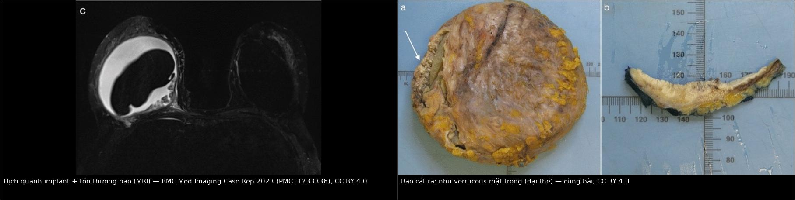
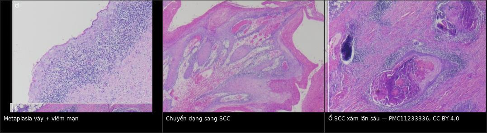
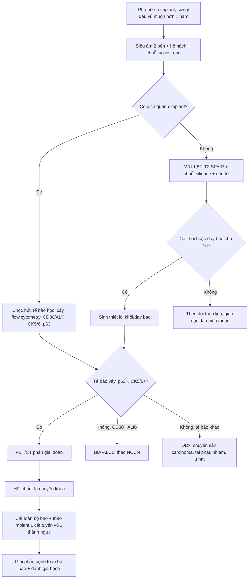
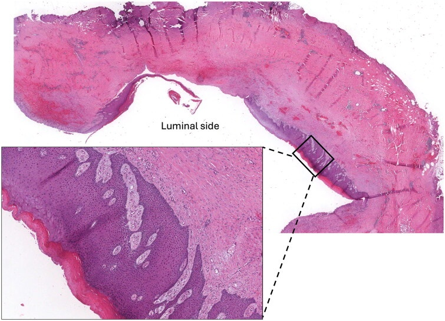
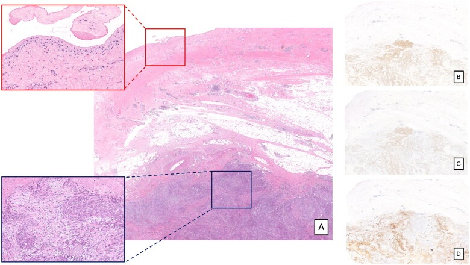
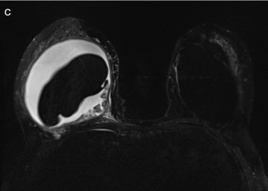
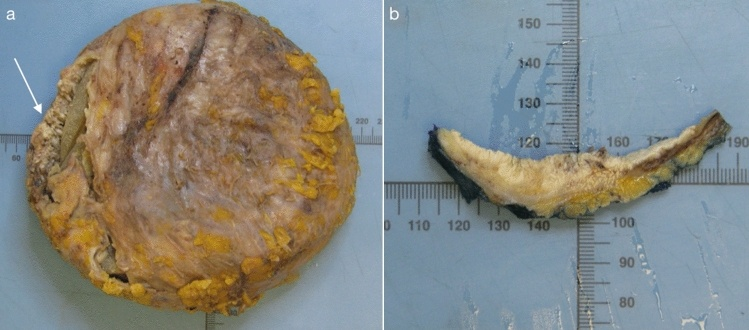

# 1655 — Ung thư biểu mô vảy trong bao implant ngực (BIA-SCC) / Breast implant capsule-associated squamous cell carcinoma

**Tags:** `pattern:khoi-bao-implant` `pattern:day-bao` `pattern:dich-quanh-implant` `vung:vu` `protocol:MRI-vu` `protocol:PET-CT` `protocol:sieu-am-vu` `incidentaloma:dich-quanh-implant`
**Mức chắc chắn (certainty):** tổng hợp y văn (literature synthesis) — biên từ 4 bài toàn văn mở: tổng quan hệ thống 18 ca (Niraula S và cs, *Cancers* 2023, PMC10526244, CC BY 4.0), tổng quan hệ thống + ca nguyên văn (Badri D, Copertino N, *Aesthetic Plast Surg* 2024, PMC11233336, CC BY 4.0), ca nguyên văn + bảng 21 ca (Villegas-Gomez GA và cs, *J Med Case Rep* 2026, PMC13685378, CC BY-NC-ND — chỉ dẫn link, không tái sử dụng ảnh), và bài phân biệt với ung thư biểu mô chuyển sản (Rogges E và cs, *Case Reports Plast Surg Hand Surg* 2025, PMC11995762, CC BY 4.0). Số liệu **không đồng nhất giữa các tổng quan** — ghi rõ nguồn từng con số.

## 1. Tổng quan — vì sao bao implant lại sinh ra ung thư vảy, và vì sao hình ảnh hay bị đọc nhầm

- **Bản chất bệnh học:** bao xơ quanh implant là mô sẹo do phản ứng dị vật. Lớp lót trong bao có thể **biểu mô hóa (epithelialization) → chuyển sản vảy (squamous metaplasia) → loạn sản → ung thư biểu mô vảy xâm lấn**. Đây là **ung thư sinh ra từ bao**, không phải từ nhu mô tuyến vú — điểm này quyết định cả chẩn đoán lẫn phân biệt với ung thư biểu mô chuyển sản (metaplastic carcinoma) của tuyến vú.
- **TẠI SAO viêm mạn tính lại là động lực:** ma sát cơ học + màng sinh học vi khuẩn (biofilm) trên vỏ implant + rò gel vi thể → viêm mạn tại chỗ, tăng sinh tế bào lát và tích lũy đột biến. Giả thuyết "vỏ implant phải rách trước" **không đứng vững**: trong các ca báo cáo đủ dữ liệu, **~80% implant còn nguyên vỏ** khi mổ (PMC11233336). Vỏ nhám (textured) không phải điều kiện bắt buộc: **27,2% textured, 36,4% smooth, 36,4% không ghi** (PMC11233336).
- **TẠI SAO hình ảnh khó:** tổn thương nằm **sát mặt trong bao**, dày vài mm tới vài cm, **cùng tín hiệu thấp với bao xơ** trên T1/T2 → dễ bị coi là "bao dày do xơ hóa" (bài 1653). Trên MRI, SCC là **mô đặc giàu tế bào**: T1 trung bình/thấp, T2 trung bình–thấp, **hạn chế khuếch tán (ADC thấp)**, **ngấm thuốc không đều**, khác với **dịch (T2 rất sáng, ADC cao, không ngấm)**.
- **TẠI SAO hay có dịch:** tế bào vảy bong vào khoang quanh implant + phản ứng viêm → **dịch đục, trắng, sệt như kem**; nhưng **dịch không phải lúc nào cũng có** (xem số liệu dưới).
- **Số liệu nằm lòng:**
  - Ung thư biểu mô vảy **nguyên phát của tuyến vú** (không liên quan implant) chỉ chiếm **0,04–0,1%** mọi ung thư vú (PMC13685378).
  - **BIA-SCC cực hiếm:** 18 ca trong tổng quan hệ thống đến 10/2022 (PMC10526244); 19 ca trong tổng quan của Niraula; **~20–21 ca** trong y văn đến 2025–2026 (PMC13685378). FDA ra thông báo an toàn **9/2022**, cập nhật **3/2023**.
  - **Tuổi:** trung bình **56** (40–81) (PMC10526244) · trung vị **52** (IQR 46–60) (Niraula).
  - **Thời gian tiềm tàng:** trung bình **21 năm** (10–35) (PMC10526244) · trung vị **20 năm** (IQR 15–35) (Niraula) · trung bình **24,9 năm** (PMC11233336) — đây là bệnh của **implant đã nằm > 15 năm**, không phải biến chứng sớm.
  - **Triệu chứng:** sưng **84,2%**, đau **73,7%**, đỏ da **21,1%** (Niraula); tổng quan 18 ca: sưng **16/18**, đau **15/18**.
  - **Loại implant:** silicone **58,8%** (trong đó **42,9% textured**); 18 ca đầu: silicone 10, silicone lỏng 2, saline 5.
  - **Khối:** ở 13 ca có số đo, đường kính lớn nhất trung bình **4,9 cm (SD 1,9)**, khoảng **1,5–8 cm**; ca PMC11233336 có tổn thương **100 mm** — lớn nhất trong y văn.
  - **Dịch quanh implant trên hình ảnh: KHÔNG có ở bất kỳ ca nào** trong 18 ca của PMC10526244 — trái với định kiến "seroma muộn = ALCL/SCC".
  - **Tiên lượng:** tử vong 6 tháng **11,1% (95% CI 0,5–40,6)**, 12 tháng **23,8% (2,8–56,1)** (PMC10526244); ASPS công bố **43,8% ở 6 tháng** — chênh lệch lớn vì khác phương pháp ước tính, cần nói rõ khi tư vấn. Sống toàn bộ 1 năm **80,8%**, sống không bệnh 1 năm **53,0%** (Niraula, theo dõi trung vị 9 tháng).

## 2. Mẫu hình + chẩn đoán phân biệt theo vị trí (Gamut)

- **Mẫu hình cốt lõi:** phụ nữ có implant **> 10–15 năm**, **sưng/đau vú một bên** tiến triển, siêu âm/MRI thấy **dịch quanh implant ± khối/dày bao khu trú mặt trong bao**; có thể **không có dịch** mà chỉ có khối.
- **Gamut theo vị trí:**
  - **Mặt trong bao (capsule lining):** BIA-SCC, BIA-ALCL, xơ hóa bao (bài 1653), mảnh vỏ gãy (bài 1656), u hạt silicone, viêm mạn.
  - **Trong khoang quanh implant:** seroma muộn, máu tụ muộn, dịch nhiễm, dịch do rò gel.
  - **Ngoài bao/thành ngực:** SCC xâm lấn cơ ngực – thành ngực, tái phát ung thư vú, di căn hạch nách/ngực trong.
  - **Nhu mô tuyến vú (không phải bao):** ung thư biểu mô chuyển sản thể vảy (metaplastic carcinoma) — **bắt chước mô bệnh học số 1**, nhưng xuất phát từ nhu mô, không từ bao.
- **Mnemonic "CAPSULE" cho khối/dày bao muộn:** **C**arcinoma vảy (BIA-SCC), **A**LCL, **P**seudo-capsule xơ hóa, **S**ilicone granuloma, **U**lcer/viêm mạn, **L**eak/rupture (bài 1656), **E**xtension của ung thư vú tái phát.
- **Điểm phân nhánh quyết định:** có **tế bào vảy** trong dịch/sinh thiết hay không. Tế bào vảy **không có** trong bao bình thường — thấy là **cờ đỏ**, kể cả khi tế bào học "chưa kết luận ác tính" (đã có ca coi là "nhiễm bẩn" rồi chẩn đoán muộn — PMC11233336).

## 3. Bảng so sánh phân biệt (ma trận đối chiếu)

| Thực thể (entity) | Hình ảnh điển hình | Chốt vào (rule-in) | Chốt loại (rule-out) | Gợi ý xác nhận |
|---|---|---|---|---|
| **BIA-SCC** | Dịch quanh implant **±** khối/dày bao khu trú mặt trong bao; nhú verrucous; MRI: tổn thương bám bao, ngấm thuốc, hạn chế khuếch tán; có thể xâm lấn cơ ngực | **Tế bào vảy điển hình/ác tính + p63 dương + CK5/6 dương**, tổn thương **xuất phát từ bao** | CD30 dương mạnh/ALK−, chỉ có tế bào lympho → ALCL; tổn thương trong nhu mô, cách bao → chuyển sản | FNA dịch (tế bào học, cấy, flow cytometry, CD30/ALK, CK5/6, p63) + sinh thiết lõi khối; PET/CT |
| **BIA-ALCL** | **Dịch muộn > 1 năm** thường là dấu hiệu chính; khối trong bao; dày bao; hạch nách | **Tế bào lympho ác tính CD30 dương mạnh, ALK âm** trong dịch/bao | Có tế bào vảy/p63 dương → SCC; dịch trong, không tế bào lạ | Tế bào học dịch + flow cytometry + CD30/ALK (bài 1654) |
| **Ung thư biểu mô chuyển sản thể vảy (metaplastic carcinoma)** | Khối trong **nhu mô tuyến vú**, có thể hoại tử/nang; không bám bao implant | **Mô bệnh: thành phần vảy + thành phần biểu mô tuyến/trung mô**, vị trí trong nhu mô | Tổn thương **chỉ ở mặt trong bao**, không có thành phần tuyến → BIA-SCC | Sinh thiết đủ lớn + IHC (p63, CK5/6, ER/PR/HER2); đối chiếu vị trí trên MRI |
| **Xơ hóa bao (capsular contracture)** | Bao dày **đều**, không có khối rời, không ngấm thuốc bất thường; Baker III–IV trên lâm sàng | **Dày đều, đối xứng, không tổn thương khu trú** | Dày **khu trú > 5 mm**, bờ không đều, ngấm thuốc → phải loại u | So phim cũ; MRI; nếu khu trú → sinh thiết (bài 1653) |
| **Seroma muộn lành tính** | Dịch đơn giản, không khối, không dày bao khu trú | **Dịch trong, không tế bào lạ, không khối, ổn định khi theo dõi** | Dịch phức tạp, có mảng/mảnh vụn, khối, dày bao → loại | Siêu âm lặp 4–8 tuần; FNA nếu > 1 năm hoặc không giảm |
| **Nhiễm trùng bao/implant** | Đỏ nóng, sốt, đau tăng nhanh; dịch đục, vách; CRP/bạch cầu tăng | **Sốt + đỏ nóng + cấy dương/mủ** | Không sốt, cấy âm, dịch trong → loại | Chọc hút cấy; kháng sinh; dẫn lưu/tháo nếu nặng |
| **Rách vỏ implant (bài 1656)** | US "stepladder"/"snowstorm"; MRI "linguine"/"teardrop" | **Bằng chứng vỏ gãy trên MRI/US** | Vỏ liên tục trên MRI chuỗi silicone → loại | MRI 1,5T chuỗi silicone; US |
| **U hạt silicone/siliconoma** | Khối giảm âm, có thể vôi hóa; **FDG dương giả** trên PET; hạch "snowstorm" | **Tiền sử rò gel/rách vỏ + mô bệnh u hạt dị vật, không tế bào ác** | Tế bào vảy/p63 dương → SCC; tổn thương bám bao tiến triển → loại | Mô bệnh + Raman/X-quang tán sắc; PET không đủ loại trừ |
| **Tái phát ung thư vú** | Khối ngoài bao, bờ không đều, xâm lấn cơ/thành ngực; hạch nách | **Mô bệnh ung thư vú, ER/PR/HER2 theo u cũ** | Tổn thương chỉ trong bao, p63+/CK5/6+ → BIA-SCC | MRI + sinh thiết; so hồ sơ xạ trị/mổ cũ |

*Trái: MRI axial — dịch quanh implant phải với **tổn thương bám mặt trong bao, bờ không đều**; implant trái bình thường. Phải: bao cắt ra — **nhú verrucous vàng** mặt trong bao, có vùng xơ dày. Nguồn: *Aesthetic Plast Surg* 2024 (PMC11233336), CC BY 4.0. Ảnh ghép letterbox, giữ nguyên tỷ lệ, không crop.*

*Trái: chuyển sản vảy + thâm nhiễm viêm mạn; giữa: vùng chuyển dạng sang ung thư vảy; phải: ổ tế bào vảy xâm lấn sâu trong bao. Cùng bài PMC11233336, CC BY 4.0. Đây là **cơ sở mô bệnh** cho "hiệu ứng trường" (field effect): chuyển sản, loạn sản và ung thư nằm cạnh nhau trong cùng một bao.*

### Ba con số quyết định thái độ

- **> 15 năm:** thời gian tiềm tàng trung vị 20 năm — một khối/dày bao ở implant 20 năm **không được** mặc định là xơ hóa.
- **4,9 cm:** đường kính khối trung bình khi được chẩn đoán — đa số đến muộn, nên **khối nhỏ bất thường vẫn phải sinh thiết**.
- **0 ca hạch gác dương tính** trong 18 ca đầu (PMC10526244) — nhưng **hạch nách/ngực trong vẫn có thể dương trên PET** và đã có ca di căn hạch (PMC13685378), nên **không được bỏ qua đánh giá hạch**.

## 4. Protocol chụp + hệ phân độ/điểm chuẩn hóa

- **Siêu âm (đầu tay):** 2 bên + **hố nách + chuỗi ngực trong**; mô tả dịch (đơn giản/phức tạp), **khối/dày bao khu trú**, nhú trong lòng, vôi hóa; Doppler mô tả mạch nuôi. Siêu âm là phương thức được dùng nhiều nhất trong các ca BIA-SCC (PMC10526244).
- **MRI 1,5T trở lên, coil vú:** T2 SPAIR ± **chuỗi chọn silicone (silicone-only, ức chế nước)** + **chuỗi ức chế silicone**; **tiêm cản từ** khi có khối/dày bao khu trú (đánh giá ngấm thuốc, xâm lấn cơ ngực/thành ngực). MRI **đánh giá tốt hơn CT/US** mức lan và thành ngực — nhiều ca phải mổ lại vì xâm lấn ngoài bao chỉ phát hiện khi mổ (PMC10526244, PMC13685378).
- **Chọc hút dịch quanh implant (bắt buộc khi có dịch):** gửi **tế bào học + cấy + flow cytometry + hóa mô miễn dịch (CD30, ALK, CK5/6, p63)**. Dịch thường **trắng, sệt, đục**; tế bào vảy **không phải "nhiễm bẩn"**.
- **Sinh thiết lõi** khối/dày bao khu trú (không chỉ FNA) để có mô đủ phân biệt SCC với chuyển sản carcinoma và ALCL.
- **PET/CT toàn thân** trước mổ khi đã xác định BIA-SCC (phân giai đoạn xa, hạch ngực trong); **không dùng PET để chẩn đoán** vì u hạt/viêm cũng tăng FDG.
- **Không có RADS riêng cho BIA-SCC.** Khung xử lý hiện hành là **khuyến cáo sơ bộ của ASPS** (2023) + thực hành trong các tổng quan; dùng **BI-RADS** cho tổn thương nhu mô kèm theo, không dùng để phân độ BIA-SCC.
- **Mô bệnh sau mổ:** mọi bao cắt ra **phải gửi giải phẫu bệnh** — kể cả bao "trông bình thường", vì chuyển sản/loạn sản có thể khu trú.

- **Điều trị (theo y văn, không có RCT):** **cắt toàn bộ bao (total capsulectomy) + tháo implant** là nền tảng; **~63,6%** ca được **cắt tuyến vú bổ sung**; một số cần **cắt thành ngực**. Hóa–xạ **không chứng minh lợi ích rõ** trong các ca đã báo cáo; quyết định theo giai đoạn và hội chẩn (PMC10526244, PMC11233336, PMC13685378).
- **Theo dõi:** lâm sàng + hình ảnh vú/thành ngực **3–6 tháng/lần trong 2–3 năm đầu** (thực hành trong các ca), vì tái phát sớm **2 tháng** đã được báo cáo; sống không bệnh 1 năm chỉ **53,0%**.

## 5. Biến thể bình thường và cạm bẫy

- **Chuyển sản vảy KHÔNG phải ung thư:** bao implant bình thường hoặc viêm mạn **rất hay có chuyển sản vảy** (xem ảnh dưới). Chẩn đoán SCC đòi **xâm lấn qua màng đáy + dị dạng nhân + mất cực tính**, không chỉ "thấy tế bào vảy".

*Mặt trong bao (luminal side) phủ lớp chuyển sản vảy trưởng thành, không xâm lấn — **bắt chước lành tính** của BIA-SCC. Nguồn: *Case Reports Plast Surg Hand Surg* 2025 (PMC11995762), CC BY 4.0.*

- **Cạm bẫy 1 — coi tế bào vảy trong dịch là "nhiễm bẩn":** đã có ca tế bào vảy bị bỏ qua, chẩn đoán chậm (PMC11233336). Tế bào vảy **không thuộc** bao vú bình thường.
- **Cạm bẫy 2 — "không có dịch thì không phải SCC":** trong 18 ca tổng quan, **không ca nào có dịch quanh implant trên hình ảnh**; thể điển hình là **khối/dày bao**, có ca chỉ có **khối nang có nhú** (PMC13685378). Bỏ qua khối vì "không có seroma" là bỏ sót.
- **Cạm bẫy 3 — đổ cho rách vỏ:** **80%** ca có implant **nguyên vỏ**; rách vỏ (bài 1656) là bệnh cảnh khác, không loại trừ và không giải thích SCC.
- **Cạm bẫy 4 — nhầm với chuyển sản carcinoma:** cả hai đều **p63+/CK5/6+**. Chốt là **vị trí xuất phát** (mặt trong bao vs nhu mô) + có thành phần biểu mô tuyến/trung mô hay không. Cần sinh thiết đủ và đối chiếu MRI.

*Khối tế bào vảy xâm lấn mô mỡ, **cách mặt trong bao** (A), kèm hóa mô miễn dịch (B–D) — tức tổn thương **xuất phát từ nhu mô**, không phải từ bao. Đây là lý do phải mô tả **vị trí** trên hình ảnh trước khi gọi BIA-SCC. Nguồn: PMC11995762, CC BY 4.0.*

- **Cạm bẫy 5 — PET dương giả:** u hạt silicone, viêm bao, hạch phản ứng đều tăng FDG; PET chỉ dùng **phân giai đoạn**, không dùng để chẩn đoán.
- **Cạm bẫy 6 — đánh giá thấp xâm lấn:** MRI có thể **không thấy** xâm lấn cơ ngực; đã có ca mổ mới phát hiện (PMC13685378). Cần **hội chẩn + chuẩn bị phương án cắt rộng** trước mổ.

## 6. Tự lượng giá — Blind Quiz

**Ca 1 — Nữ 56 tuổi, implant silicone textured đặt 22 năm, sưng và đau vú phải 6 tháng.**

- Gợi ý lâm sàng: không sốt, không chấn thương; siêu âm trước đó chỉ "dịch quanh implant".
- Câu hỏi: Mô tả tổn thương? Ba chẩn đoán phân biệt? Bước tiếp theo **bắt buộc** trước khi mổ?

<b>Bấm để hiện đáp án (findings + chẩn đoán)</b>

- Dấu hiệu (findings): **dịch quanh implant phải**, thành phần **tổn thương dày, bờ không đều bám mặt trong bao** ở phía sau–trong; implant trái bình thường. Dịch **không đơn thuần** — có mô đặc bám bao.
- Chẩn đoán (diagnosis): **BIA-SCC** (xác nhận bằng mô bệnh: SCC biệt hóa vừa, p63+/CK5/6+). Phân biệt: **BIA-ALCL** (dịch muộn là dấu hiệu chính, CD30+/ALK−), **xơ hóa bao**, **u hạt silicone**.
- Bước bắt buộc: **chọc hút dịch + sinh thiết lõi khối**, gửi tế bào học, cấy, flow cytometry, **CD30/ALK, CK5/6, p63**; sau đó **PET/CT** trước mổ.
- Nguồn ảnh: *Aesthetic Plast Surg* 2024 (PMC11233336), Fig. 1c, CC BY 4.0 — cắt panel từ hình gốc.

**Ca 2 — Cùng bệnh nhân, bao implant sau cắt.**

- Câu hỏi: Mô tả bất thường đại thể? Vì sao **phải** gửi toàn bộ bao giải phẫu bệnh?

<b>Bấm để hiện đáp án (findings + chẩn đoán)</b>

- Dấu hiệu: mặt trong bao có **nhú/giả nhú verrucous vàng, xơ dày không đều**; mặt cắt thấy **tổn thương kem, xâm lấn vào bao**.
- Chẩn đoán: **BIA-SCC**; tổn thương lan **100 mm** — lớn nhất trong y văn tại thời điểm báo cáo.
- Vì sao gửi toàn bộ bao: chuyển sản/loạn sản/ung thư có thể **khu trú cạnh vùng lành** (hiệu ứng trường); cắt bỏ một mảnh có thể bỏ sót ổ xâm lấn hoặc bỏ sót diện cắt.
- Nguồn ảnh: PMC11233336, Fig. 1a–b, CC BY 4.0 — cắt panel.

**Ca 3 — Hai tiêu bản của hai bệnh nhân khác nhau, cùng "tế bào vảy" trong bao.**

- Gợi ý: bệnh nhân A cắt bao vì xơ hóa, không khối, không dịch; bệnh nhân B có khối bám bao tiến triển.
- Câu hỏi: Tiêu bản này của ai? Ba tiêu chí mô bệnh **phân biệt chuyển sản vảy lành tính với SCC**?

<b>Bấm để hiện đáp án (findings + chẩn đoán)</b>

- Dấu hiệu: lớp **chuyển sản vảy trưởng thành, cực tính giữ**, **không xâm lấn** qua màng đáy, không có nhân dị dạng — của **bệnh nhân A** (lành tính).
- Ba tiêu chí phân biệt SCC: **(1) xâm lấn qua màng đáy vào mô bao/mỡ; (2) dị dạng nhân, mất cực tính, nhân chia bất thường; (3) mất sắp xếp lớp + hoại tử/keratin bất thường**. Chỉ "thấy tế bào vảy" **không đủ**.
- Cạm bẫy: cả hai đều **p63+/CK5/6+** → IHC không tự phân biệt được; phải dựa **hình thái + vị trí**.
- Nguồn ảnh: *Case Reports Plast Surg Hand Surg* 2025 (PMC11995762), Fig. 2, CC BY 4.0.

## Bài liên quan chéo
- [1654 — Dịch quanh implant muộn & BIA-ALCL](../1654-dich-quanh-implant-nguc-va-bia-alcl/lesson.md) (bệnh cảnh "dịch muộn" kinh điển, CD30)
- [1656 — Rách vỏ implant & gel bleed](../1656-rach-vo-implant-nguc-va-gel-bleed/lesson.md) (vỏ gãy, linguine, snowstorm)
- [1653 — Cơ rút bao xơ implant ngực (xơ hóa cơ ngực)](../1653-co-rut-bao-xo-implant-nguc-xo-hoa-co-nguc/lesson.md) (dày bao lành tính)
- [510 — Vú: BI-RADS nhũ ảnh – siêu âm – MRI](../510-vu-BIRADS-nhu-anh-sieu-am-MRI/lesson.md) (ngôn ngữ BI-RADS cho tổn thương nhu mô kèm theo)

## Ảnh
- Tên file: `1655_BIA-SCC_MRI_PMC11233336-Fig1c.jpg`, `1655_BIA-SCC_dai-the_PMC11233336-Fig1ab.jpg`, `1655_metaplasia-vay_vi-the_PMC11995762-Fig2.jpg`, `1655_ung-thu-bieu-mo-sap-vi-the_PMC11995762-Fig1.jpg`, `composite_1655_MRI-va-dai-the.jpg`, `composite_1655_vi-the.jpg`.
- Nguồn + giấy phép từng ảnh: `images/CREDITS.md`. Các panel được **cắt từ figure gốc CC BY 4.0** (CC BY cho phép phái sinh; đã ghi rõ "cắt panel").
- Bài PMC13685378 (CC BY-NC-ND) **chỉ dẫn link**, không tái sử dụng ảnh: https://europepmc.org/article/PMC/PMC13685378

> Không dùng để chẩn đoán độc lập khi chưa có người hướng dẫn.
