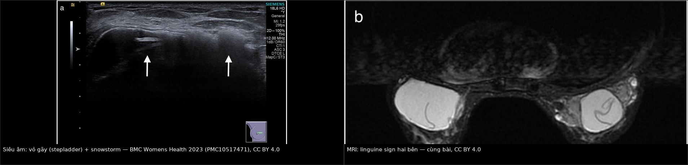
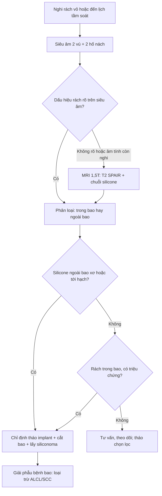
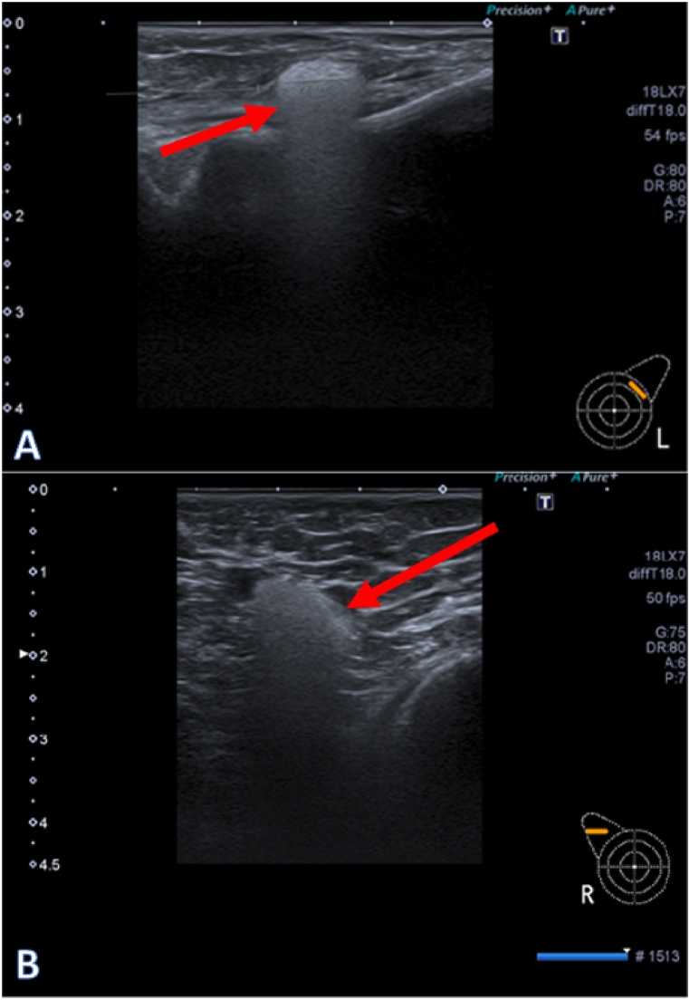
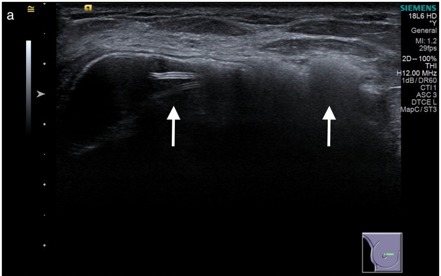
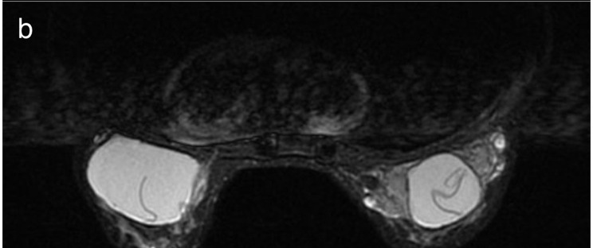
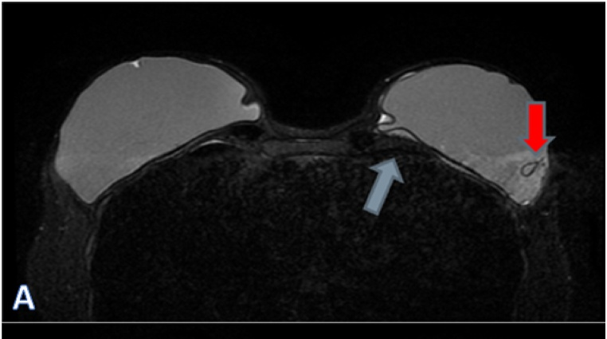

# 1656 — Rách vỏ implant ngực & rò gel (gel bleed) / Silicone breast implant rupture and gel bleed

**Tags:** `pattern:rach-vo-implant` `pattern:linguine` `pattern:snowstorm` `vung:vu` `protocol:MRI-vu` `protocol:sieu-am-vu` `incidentaloma:vo-implant` `score:Baker`
**Mức chắc chắn (certainty):** tổng hợp y văn (literature synthesis) — biên từ 3 bài toàn văn mở: ca nguyên văn implant 40 năm có cả siêu âm và MRI (Wu HH và cs, *BMC Geriatr* 2023, PMC10517471, CC BY 4.0), nghiên cứu đối chiếu siêu âm – MRI trên 205 implant (Spit KA và cs, *Heliyon* 2024, PMC11253520, CC BY 4.0), và loạt 111 implant rách có đối chiếu giải phẫu bệnh (Kim JH và cs, *Medicina (Kaunas)* 2024, PMC10890578, CC BY 4.0); nền protocol lấy từ tổng quan hình ảnh implant (Giovannini E và cs, *Diagnostics (Basel)* 2023, PMC10217528, CC BY 4.0).

## 1. Tổng quan — vật lý của silicone quyết định toàn bộ hình ảnh

- **Bản chất:** implant gel silicone gồm **vỏ elastomer** + **gel** (chuỗi siloxane liên kết ngang). Vỏ là hàng rào vật lý; khi vỏ **gãy** gel thoát ra — **trong bao** (intracapsular) hay **ra ngoài bao** (extracapsular). **Rò gel (gel bleed)** là silicone **thấm qua vỏ còn nguyên** ở mức vi thể, không có lỗ gãy nhìn thấy.
- **TẠI SAO MRI là chuẩn vàng:** silicone có **tần số cộng hưởng khác mỡ và nước**, nên có thể chọn tần số để tạo **chuỗi chỉ hiện silicone (silicone-only, ức chế nước)** và **chuỗi ức chế silicone**. Trên T1W silicone **tối**, T2W **trung bình–sáng**; trên **T2 có ức chế mỡ**, mỡ tối nhưng **silicone vẫn sáng** → gel nằm ngoài vỏ nổi bật trên nền mô mỡ tối.
- **TẠI SAO siêu âm thấy "snowstorm":** tốc độ âm trong silicone **chậm hơn nhiều** so với mô (~1.000–1.100 m/s so với ~1.540 m/s), chênh trở kháng âm lớn → **bóng lưng mạnh, "bão tuyết" (snowstorm)**, che mờ phía sau. Đây là dấu hiệu **silicone tự do** — nhưng cũng chính là lý do siêu âm **không đánh giá được** gì nằm sau vùng silicone.
- **TẠI SAO "rách im lặng" lại phổ biến:** gel **có tính cố kết (cohesive)** nên khi vỏ gãy, gel **vẫn nằm trong bao xơ**, thể tích vú gần như không đổi → **không triệu chứng**. Vì vậy tỷ lệ rách phát hiện trên hình ảnh cao hơn nhiều so với tỷ lệ nhập viện.
- **Số liệu nằm lòng:**
  - **Tỷ lệ rách lũy tích 10 năm: 10–15%** sau đặt implant thẩm mỹ, **20–25%** sau tái tạo vú (PMC11253520).
  - **3/4 rách là trong bao, 1/4 ra ngoài bao** (PMC11253520).
  - Rách gặp ở **8% phụ nữ không triệu chứng** và **33% phụ nữ có triệu chứng** (PMC10517471).
  - Thời gian rách trung bình **~12 năm**; khoảng rộng **3–20 năm** (PMC10517471).
  - Trong loạt 111 implant rách được mổ: **88,8% rách trong vòng 10 năm**, **88,3% không triệu chứng**, **75,3% một bên**, **72,1% có snowstorm** trên siêu âm (PMC10890578).
  - **MRI: độ nhạy 80–90%, độ đặc hiệu 90–97%** (PMC10217528). **Siêu âm tại trung tâm chuyên sâu: Se 96% (80–100), Sp 95% (91–98), độ chính xác 95%** trên 205 implant/104 phụ nữ, so với MRI là chuẩn (PMC11253520) — lưu ý đây là **bác sĩ chuyên vú**, không đại diện tuyến đầu.
  - **Hạch nách chứa silicone:** siêu âm **Se 87,5%** so với **MRI 20%** trong một nghiên cứu có xác nhận mô bệnh; trong loạt của PMC11253520, MRI chỉ **Se 44% (25–65)**, **Sp 100%**, độ chính xác 93%.
  - **FDA:** chụp kiểm tra định kỳ lần đầu **5–6 năm** sau đặt, sau đó **mỗi 2–3 năm**; tỷ lệ tuân thủ thực tế chỉ **5,9%** (PMC11253520).

## 2. Mẫu hình + chẩn đoán phân biệt theo vị trí (Gamut)

- **Mẫu hình cốt lõi:** implant **đã nằm nhiều năm**, có thể **không triệu chứng**; hình ảnh cho thấy **đường viền vỏ gấp nếp bên trong gel** (linguine), **túi khí/nếp gấp dạng teardrop**, **mất liên tục vỏ**, hoặc **silicone ngoài bao** (snowstorm, khối giảm âm trong mô mỡ, hạch "bão tuyết").
- **Gamut theo vị trí:**
  - **Trong lòng vỏ (intracapsular, gel vẫn trong bao):** linguine, teardrop/keyhole, subcapsular line, "salad oil", vỏ gãy khu trú; **silicone ngoài vỏ nhưng trong bao xơ**.
  - **Ngoài bao xơ (extracapsular):** snowstorm trong nhu mô/mô mỡ, siliconoma, silicone trong hạch nách/ngực trong, di chuyển xa (thành ngực, bụng, phổi, gan).
  - **Không có vỏ gãy:** **gel bleed** (silicone qua vỏ nguyên), "internal degradation" (giọt nước trong gel), xơ hóa bao, viêm mạn.
  - **Bắt chước tổn thương đặc:** u hạt silicone, hạch phản ứng, tái phát ung thư vú, BIA-ALCL (bài 1654) — **silicone tự do có thể trông như khối đặc và tăng FDG**.
- **Phân loại giải phẫu bệnh 3 bậc (đối chiếu siêu âm – mô bệnh, 111 implant):** **dưới bao (subcapsular) 27,9%**, **trong bao (intracapsular) 52,3%**, **ngoài bao (extracapsular) 19,8%** (PMC10890578). Điểm cần nhớ: **"snowstorm" không đồng nghĩa đã ra ngoài bao** — nó chỉ nói **silicone đã ngấm vào thành bao**; dấu hiệu **di chuyển tới mô kề/hạch** mới là ngoài bao.
- **Mnemonic "SILICONE" cho dấu hiệu MRI:** **S**ubcapsular line, **I**nternal degradation, **L**inguine, **I**ntracapsular fold (teardrop/keyhole), **C**ontour bulge, **O**utside capsule (extracapsular), **N**o signal on silicone-suppressed, **E**xtension to nodes.

## 3. Bảng so sánh phân biệt (ma trận đối chiếu)

| Thực thể (entity) | Hình ảnh điển hình | Chốt vào (rule-in) | Chốt loại (rule-out) | Gợi ý xác nhận |
|---|---|---|---|---|
| **Rách trong bao (intracapsular)** | **Linguine**: nhiều đường mảnh tối, lượn sóng **bên trong** gel sáng; teardrop/keyhole; subcapsular line; "salad oil" | **Nếp vỏ lơ lửng trong gel, không chạm chu vi** trên ≥ 2 mặt phẳng | Đường tối **chạm chu vi, cong đều, thấy trên mọi chuỗi** → nếp gấp sinh lý | MRI chuỗi silicone; siêu âm bổ sung |
| **Rách ngoài bao (extracapsular)** | Silicone ra ngoài bao xơ: **snowstorm**, khối giảm âm trong mô mỡ, hạch "bão tuyết", co kéo da | **Silicone ngoài đường bao xơ** trên MRI/US ± hạch chứa silicone | Silicone chỉ trong bao xơ → trong bao | MRI + siêu âm hố nách; đối chiếu mô bệnh |
| **Gel bleed** | Vỏ **nguyên**, không có lỗ gãy; silicone vi thể trong bao/hạch; có thể chỉ thấy hạch "snowstorm" | **Silicone trong hạch/bao khi vỏ nguyên** (mổ xác nhận vỏ liền) | Có lỗ gãy/nếp vỏ lơ lửng → rách thật | Siêu âm hạch (Se cao) ± MRI; không có tiêu chuẩn định lượng |
| **Nếp gấp sinh lý (radial fold)** | Đường tối **cong đều, mảnh, ở ngoại vi**, chạm chu vi, thấy ở mọi chuỗi, đối xứng | **Nếp gấp thay đổi theo tư thế, không có mảnh vỏ tự do** | Nhiều đường trong gel, không chạm chu vi → linguine | MRI 2 tư thế; so phim cũ |
| **Internal degradation ("giọt nước")** | Nhiều ổ nhỏ tín hiệu nước trong gel, vỏ nguyên | **Ổ dịch nhỏ rải rác trong gel, vỏ liên tục** | Có đường vỏ gãy lơ lửng → rách | MRI chuỗi nước/silicone |
| **Siliconoma/u hạt silicone** | Khối giảm âm, có thể vôi hóa; **FDG dương giả**; hạch to | **Tiền sử rách/rò + mô bệnh u hạt dị vật, không tế bào ác** | Tế bào ác tính → u; bờ xâm lấn → loại | Mô bệnh; PET không đủ loại trừ |
| **BIA-ALCL / BIA-SCC (bài 1654, 1655)** | Dịch quanh implant muộn, khối bám bao, dày bao khu trú | **Tế bào học/mô bệnh: CD30+ (ALCL) hoặc tế bào vảy/p63+ (SCC)** | Chỉ có dấu hiệu vỏ gãy, không khối, không tế bào lạ → loại | Chọc dịch + sinh thiết (bài 1654, 1655) |
| **Nhiễm trùng bao/implant** | Dịch có vách, dày bao, đỏ nóng, sốt; khí trong bao (hiếm) | **Sốt + cấy dương/mủ** | Không sốt, dịch trong → loại | Chọc hút cấy; CRP |
| **Máu tụ muộn** | Khởi phát đột ngột sau chấn thương; T1 sáng, CT tăng tỷ trọng | **Dịch máu, không tế bào ác, tự tiêu** | Dịch dai dẳng + khối → loại | MRI/CT; chọc hút |

*Trái: siêu âm — **vỏ gãy (stepladder)** với mảnh vỏ trong lòng implant, và **snowstorm** phía ngoài vỏ (silicone tự do). Phải: MRI — **linguine sign** hai bên, vỏ gấp nếp lơ lửng trong gel. Nguồn: *BMC Geriatr* 2023 (PMC10517471), CC BY 4.0. Ảnh ghép letterbox, giữ nguyên tỷ lệ, không crop.*

### Ba con số quyết định thái độ

- **10–15% ở 10 năm:** rách là **quy luật theo thời gian**, không phải biến cố ngẫu nhiên — nên lịch kiểm tra theo tuổi implant quan trọng hơn triệu chứng.
- **88,3% không triệu chứng:** nếu chỉ chụp khi có triệu chứng, **bỏ sót phần lớn** ca rách (PMC10890578).
- **5,9% tuân thủ:** khuyến cáo MRI định kỳ gần như **không được thực hiện** trên thực tế — lý do thực hành để **siêu âm làm bước đầu** ở nơi không có MRI.

## 4. Protocol chụp + hệ phân độ/điểm chuẩn hóa

- **Siêu âm (bước đầu, theo FDA chấp nhận):** đầu dò tuyến tính **7–18 MHz**, khảo sát **6 điểm chuẩn mỗi vú** (khoang, phần trên, bên, trong, dưới, bề mặt vỏ) + **hai hố nách**; ghi nhận: vỏ liên tục/gãy, mảnh vỏ trong lòng, "gel fracture", **snowstorm**, hạch chứa silicone.
  - Checklist tham chiếu: **KoSBIR** (Hàn Quốc) — dùng trong loạt 5.557 implant (PMC10890578).
- **MRI 1,5T trở lên, coil vú, không cần cản từ nếu chỉ đánh giá vỏ:** **T2 SPAIR sagittal**, **chuỗi ức chế silicone (silicone low)** và **chuỗi ức chế nước/chỉ silicone (silicone high)**; thêm **T1 ± cản từ** khi có khối/dịch phức tạp để loại u (bài 1654, 1655).
- **Phân loại trên MRI:** nguyên vẹn → **thoái hóa nội bộ (giọt nước)** → **rách trong bao** (keyhole, teardrop, dấu bao, linguine) → **rách ngoài bao**.
- **Chỉ định chụp:** (1) tầm soát theo lịch **5–6 năm, sau đó 2–3 năm/lần**; (2) triệu chứng: thay đổi kích thước/hình dạng, đau, co kéo, sờ thấy bất thường; (3) trước mổ thay/tháo implant; (4) sau chấn thương ngực.
- **Không có RADS cho implant.** Dùng **Baker I–IV** cho co rút bao (lâm sàng, không phải hình ảnh) và mô tả **giải phẫu** cho rách.
- **Xử trí (chia sẻ quyết định):**
  - **Rách ngoài bao, siliconoma, hạch chứa silicone, hoặc có triệu chứng** → **tháo implant + cắt bao** (ưu tiên **cắt toàn bộ bao**), lấy mô silicone tự do.
  - **Rách trong bao không triệu chứng** → **tư vấn tháo chọn lọc** (không cấp cứu); theo dõi nếu bệnh nhân chọn chưa mổ, nhưng **không hứa "an toàn vĩnh viễn"** vì silicone có thể di chuyển.
  - **Gel bleed đơn thuần** → chưa có tiêu chuẩn chẩn đoán/ngưỡng điều trị; quyết định theo triệu chứng + lo lắng của bệnh nhân (PMC11253520).

- **Điểm cần nói với bệnh nhân:** rách **không đồng nghĩa ung thư**; nhưng **mọi bao cắt ra nên gửi giải phẫu bệnh**, vì BIA-ALCL/BIA-SCC có thể nằm trong bao (bài 1654, 1655).

## 5. Biến thể bình thường và cạm bẫy

- **Nếp gấp sinh lý (radial folds) vs linguine:** nếp gấp **cong đều, mảnh, ở ngoại vi, chạm chu vi**, thay đổi theo tư thế và thấy trên mọi chuỗi; **linguine** là **nhiều đường trong lòng gel, không chạm chu vi, chỉ thấy rõ trên chuỗi gel**. Đọc linguine trên một lát duy nhất là nguyên nhân dương tính giả phổ biến nhất.
- **Keyhole/teardrop:** là **nếp vỏ lồng vào gel** — dấu hiệu rách **khi nó không nằm ở vùng van/van một chiều** và có kèm đường vỏ khác. Đừng gọi rách chỉ vì một "miệng túi" đơn độc.
- **"Snowstorm" ≠ ngoài bao:** trong loạt 111 implant, **80/111 (72,1%) có snowstorm** nhưng mô bệnh chỉ **19,8% ngoài bao** — phần lớn là silicone **ngấm trong thành bao**. Kết luận "đã vỡ ra ngoài" cần **silicone ngoài đường bao xơ hoặc trong hạch**.
- **Gel bleed vs rách:** gel bleed **không có lỗ gãy**; đã có 6 phụ nữ implant nguyên vẹn vẫn có silicone trong hạch nách, 5/6 thấy tín hiệu silicone trên MRI, và **vỏ còn nguyên khi mổ** (PMC11253520). Vì vậy **có silicone trong hạch không chứng minh được rách**.

*Siêu âm: (A) ổ silicone trong mô vú; (B) hạch nách phải với **"snowstorm"** điển hình — silicone trong hạch. Ở bệnh nhân này vỏ implant còn nguyên khi mổ → bằng chứng của **gel bleed**, không phải rách. Nguồn: *Heliyon* 2024 (PMC11253520), CC BY 4.0.*
- **Siêu âm phụ thuộc người làm:** Se 96% đạt được ở trung tâm chuyên sâu; tuyến đầu thấp hơn nhiều. Kết quả "âm tính" trên siêu âm **không loại trừ** rách khi lâm sàng nghi.
- **MRI ở người không triệu chứng:** độ chính xác giảm, và một số tác giả cho rằng **MRI không có chỉ định khi không triệu chứng** (PMC10217528) — mâu thuẫn với khuyến cáo tầm soát của FDA. Cần nêu rõ quan điểm khi tư vấn.
- **PET dương giả:** u hạt silicone và hạch phản ứng tăng FDG mạnh, có thể bị đọc là di căn/tái phát — **không sinh thiết hạch chỉ vì PET dương** khi chưa đối chiếu siêu âm.

## 6. Tự lượng giá — Blind Quiz

**Ca 1 — Nữ 70 tuổi, implant silicone gel đặt 40 năm, không theo dõi; khối 3 cm vùng trên–trong vú phải, da đỏ.**

- Gợi ý: không sốt; khối đau ít, lớn dần; không chấn thương.
- Câu hỏi: Hai dấu hiệu trên siêu âm? Chúng nói gì về vị trí silicone (trong hay ngoài bao)?

<b>Bấm để hiện đáp án (findings + chẩn đoán)</b>

- Dấu hiệu: **mảnh vỏ gãy lơ lửng trong lòng implant (stepladder)** — mũi tên trái; **bóng lưng mạnh "snowstorm"** phía ngoài vỏ — mũi tên phải.
- Ý nghĩa: stepladder = **rách trong bao**; snowstorm = **silicone đã ra ngoài vỏ** (ít nhất vào thành bao; cần MRI để xác định ngoài bao xơ).
- Nguồn ảnh: *BMC Geriatr* 2023 (PMC10517471), Fig. 2a, CC BY 4.0 — cắt panel.

**Ca 2 — Cùng bệnh nhân, MRI vú.**

- Câu hỏi: Dấu hiệu tên gì? Vì sao nó chứng minh rách **trong bao** mà không nói gì về **ngoài bao**?

<b>Bấm để hiện đáp án (findings + chẩn đoán)</b>

- Dấu hiệu: **linguine sign** — nhiều đường mảnh tối, lượn sóng **bên trong** gel sáng, không chạm chu vi; thấy hai bên.
- Lý do: đường đó là **vỏ gấp nếp lơ lửng trong gel** → vỏ đã gãy nhưng **gel vẫn nằm trong bao xơ** (intracapsular). Muốn nói "ngoài bao" phải thấy **silicone vượt qua đường bao xơ** hoặc vào hạch.
- Nguồn ảnh: PMC10517471, Fig. 2b, CC BY 4.0 — cắt panel.

**Ca 3 — Nữ 52 tuổi, implant 15 năm, không triệu chứng; MRI tình cờ thấy hình dưới.**

- Gợi ý: bệnh nhân đi khám vì lo lắng, không đau, không thay đổi kích thước.
- Câu hỏi: Hai dấu hiệu được đánh dấu? Chúng có giá trị gì khi bệnh nhân **không triệu chứng**?

<b>Bấm để hiện đáp án (findings + chẩn đoán)</b>

- Dấu hiệu: **teardrop/keyhole** (mũi tên đỏ) và **subcapsular line** (mũi tên xanh) — cả hai là dấu hiệu **rách trong bao**.
- Giá trị: chẩn đoán rách **không triệu chứng**; nhưng độ chính xác MRI giảm ở người không triệu chứng, nên cần **xác nhận trên ≥ 2 mặt phẳng/chuỗi**, tránh mổ oan vì nếp gấp sinh lý. Quyết định tháo implant là **chia sẻ quyết định**, không cấp cứu.
- Nguồn ảnh: *Heliyon* 2024 (PMC11253520), Fig. 2A, CC BY 4.0 — cắt panel.

## Bài liên quan chéo
- [1654 — Dịch quanh implant muộn & BIA-ALCL](../1654-dich-quanh-implant-nguc-va-bia-alcl/lesson.md) (dịch muộn, khối trong bao)
- [1655 — Ung thư biểu mô vảy trong bao implant (BIA-SCC)](../1655-ung-thu-vay-trong-bao-implant-nguc-bia-scc/lesson.md) (khối bám bao, tế bào vảy)
- [1653 — Cơ rút bao xơ implant ngực (xơ hóa cơ ngực)](../1653-co-rut-bao-xo-implant-nguc-xo-hoa-co-nguc/lesson.md) (Baker, dày bao)
- [510 — Vú: BI-RADS nhũ ảnh – siêu âm – MRI](../510-vu-BIRADS-nhu-anh-sieu-am-MRI/lesson.md) (protocol MRI vú, ngôn ngữ BI-RADS)

## Ảnh
- Tên file: `1656_rach-vo_US_PMC10517471-Fig2a.jpg`, `1656_rach-vo_MRI_PMC10517471-Fig2b.jpg`, `1656_rach-vo_MRI_PMC10517471-Fig2c.jpg`, `1656_rach-vo_MRI_PMC11253520-Fig2A.jpg`, `1656_rach-vo_MRI_PMC11253520-Fig2B.jpg`, `1656_gel-bleed_US_PMC11253520-Fig1.jpg`, `composite_1656_US-va-MRI.jpg`.
- Nguồn + giấy phép từng ảnh: `images/CREDITS.md`. Panel được **cắt từ figure gốc CC BY 4.0** (ghi rõ "cắt panel").
- Ảnh siêu âm hạch "snowstorm" (gel bleed) dùng trong mục (5) và quiz nếu cần: `1656_gel-bleed_US_PMC11253520-Fig1.jpg`.

> Không dùng để chẩn đoán độc lập khi chưa có người hướng dẫn.
