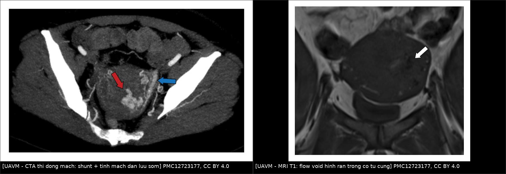
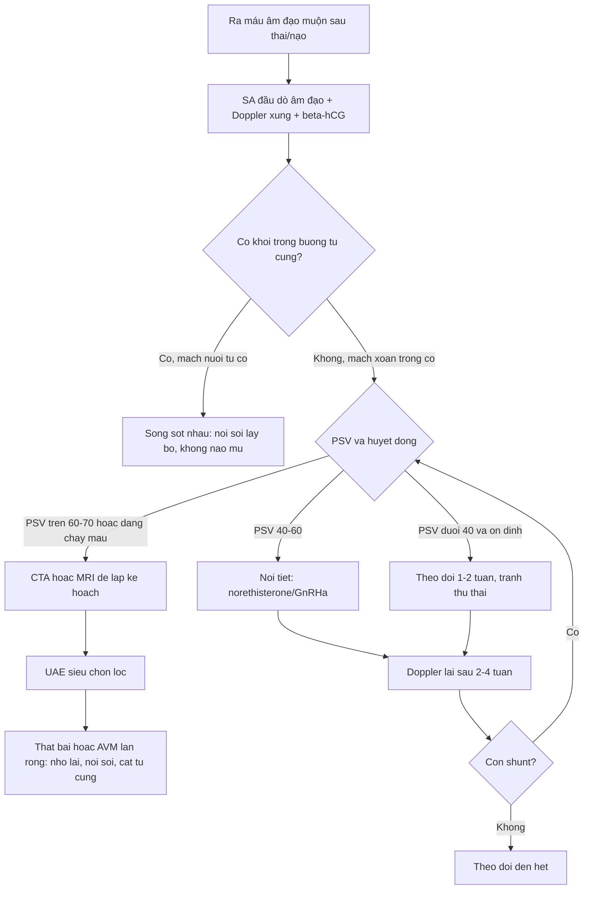
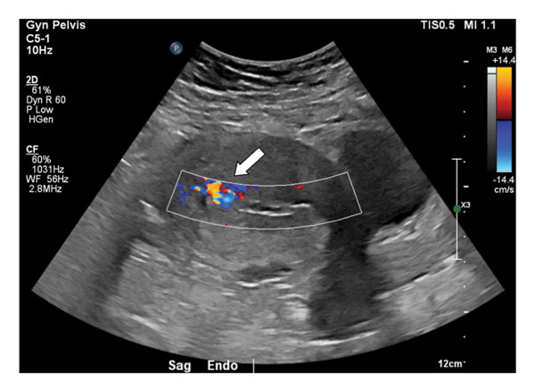
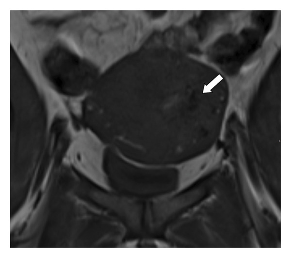
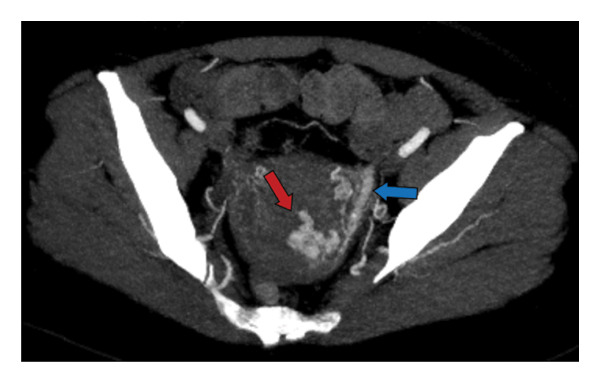
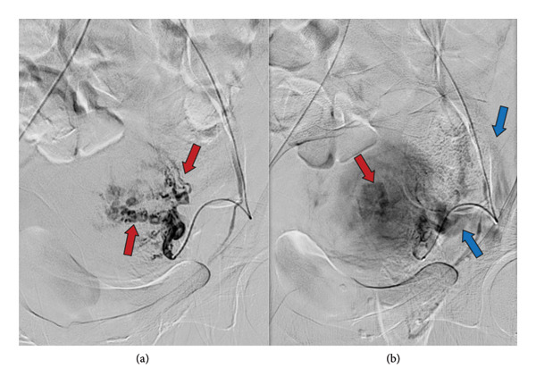

# 1657 — Dị dạng động–tĩnh mạch tử cung & tăng sinh mạch cơ tử cung / Uterine arteriovenous malformation and enhanced myometrial vascularity

**Tags:** `pattern:tang-sinh-mach` `pattern:di-dang-dong-tinh-mach` `pattern:chay-mau-au-dao` `pattern:khoi-long-tu-cung` `vung:tu-cung` `vung:tieu-khung` `score:PSV-Doppler` `protocol:SA-Doppler` `protocol:CTA` `protocol:DSA` `protocol:UAE` `incidentaloma:EMV`
**Mức chắc chắn (certainty):** tổng hợp y văn (literature synthesis) — 1 bài tổng quan có ngưỡng Doppler định lượng (PMC11172076), 1 loạt 5 ca + thuật toán xử trí (PMC12723177), 1 bài tổng quan về EMV sau sảy thai (PMC11626903), 1 loạt 3 ca can thiệp nội mạch (PMC11238751) và các ca nguyên văn có ảnh. Câu nào là suy luận được ghi **[suy luận]**.

## 1. Tổng quan bệnh học – cơ chế hình ảnh

- **Bản chất:** dị dạng động–tĩnh mạch tử cung (uterine arteriovenous malformation, UAVM) là **những shunt trực tiếp giữa nhánh động mạch trong cơ tử cung và đám rối tĩnh mạch cơ tử cung**, không qua giường mao mạch. Có 2 loại:
  - **Bẩm sinh (congenital):** sai biệt hóa bó mạch nguyên thủy, tổn thương lan rộng, có thể ăn thông với mạch chậu; hiếm và **khó điều trị hơn**.
  - **Mắc phải (acquired — đa số):** fistula thật sau **nạo/hút thai, mổ lấy thai, bóc u xơ, thai trứng, nhiễm trùng**. Đây là nhóm gặp hằng ngày ở khoa sản.
- **Thuật ngữ đang đổi:** nhiều trường hợp sau thai kỳ chỉ là **tăng sinh mạch cơ tử cung (enhanced myometrial vascularity, EMV)** — mạch giãn do tái tạo sau thai — và **tự thoái triển**, không phải dị dạng thật. Vì vậy đọc Doppler phải **phân tầng theo mức độ**, không gọi tất cả là "AVM" rồi can thiệp.
- **TẠI SAO Doppler là chốt:** shunt động–tĩnh mạch làm **sức cản ngoại vi giảm** → dòng **tốc độ cao, sức cản thấp, xoáy** ("mosaic"/hỗn loạn màu). Định lượng (PMC11172076):
  - Cơ tử cung bình thường: **PSV 9–40 cm/s, RI 0,6–0,8**.
  - UAVM: **PSV 25–110 cm/s, trung bình 60 cm/s; RI 0,27–0,75, trung bình 0,41**.
  - Phân độ theo PSV: **nhẹ < 40 cm/s** (theo dõi) · **vừa 40–60 cm/s** (nội tiết) · **nặng > 60–70 cm/s** (can thiệp mạch/mổ). PSV **> 83 cm/s** thường phải can thiệp.
- **TẠI SAO MRI thấy "dòng trống tín hiệu":** máu chảy nhanh trong mạch giãn tạo **flow void** trên T1/T2 spin-echo (proton đã ra khỏi lát cắt trước khi thu tín hiệu) → hình **con rắn/hình xoáy tối** trong cơ tử cung, ngấm thuốc mạnh thì động mạch. Trên **CTA**, shunt làm **tĩnh mạch cản quang sớm ngay thì động mạch** — dấu hiệu chốt.
- **TẠI SAO nguy hiểm:** shunt áp lực cao + mô cơ tử cung mỏng manh → **băng huyết ồ ạt**, có ca cần truyền máu tới **30%** (PMC11172076). UAVM chiếm **1–2%** các ca rong huyết (PMC11172076); **1–2%** thai sớm có biến chứng (thai lưu, thai trứng, thai trên sẹo mổ) có bất thường mạch kiểu này (PMC11626903).
- **Ngưỡng định lượng về EMV sau thai (rất quan trọng để tránh điều trị oan):** tỷ lệ EMV được báo cáo **1,5–6,3%**; trong một nghiên cứu tiến cứu 93 phụ nữ sau sinh đủ tháng, EMV gặp **50,5% ở ngày 3** nhưng chỉ còn **3,9% ở 6 tuần** (PMC11626903) → **phần lớn tự hết**.
- **Số liệu ca nguyên văn:**
  - Nữ **41 tuổi**, sau nạo thai lưu 10 tuần **4 tuần** vẫn ra máu không cầm; Hb **12 → 9 g/dL**; siêu âm Doppler nghi AVM, MRI thấy **nhiều flow void hình rắn** ở thành tử cung trái và buồng tử cung; chụp mạch xác nhận **nhánh xoắn nhỏ + hồi lưu tĩnh mạch sớm**; nút mạch bằng hạt (particle) → cầm máu, ra viện hôm sau (PMC12723177).
  - Nữ **35 tuổi**, sau sinh thường có **lấy nhau thủ công**; ngày 27 sau sinh ra máu ồ ạt; trước đó đã bị **nạo vì nghi sót nhau, chảy máu 1,2 L, phải truyền 4 đơn vị hồng cầu + 3 đơn vị huyết tương tươi** — đúng kịch bản "nạo trên AVM" (PMC12723177).
  - Nữ **16 tuổi** được điều trị bảo tồn sinh sản thành công (PMC8457299) — UAVM không chỉ ở người đã sinh nở.
  - Ca **AVM + sót nhau cùng tồn tại**: hình ảnh chồng lấp, cần phân biệt trước khi can thiệp (PMC12991638).

## 2. Mẫu hình + chẩn đoán phân biệt theo VỊ TRÍ và BỐI CẢNH (Gamut)

Mẫu hình là **"khối/tổn thương trong cơ tử cung + tăng sinh mạch mạnh trên Doppler sau một biến cố sản khoa"**. Bối cảnh (sau nạo? sau sinh? thai trứng? chưa từng có thai?) quyết định thứ tự chẩn đoán.

- **Sau nạo/hút thai hoặc sau sinh — gamut chính:**
  1. **Sót nhau (retained products of conception, RPOC)** — nguyên nhân **hay gặp nhất** của ra máu muộn sau thai; cần **lấy bỏ**.
  2. **EMV/UAVM mắc phải** — tăng sinh mạch, **không được nạo**.
  3. **Giả phình động mạch tử cung (uterine artery pseudoaneurysm)** — túi mạch khu trú, có **cổ**, hình "yin–yang", thường sau mổ/nạo.
  4. **Thai trứng/ung thư nguyên bào nuôi (GTD)** — β-hCG rất cao, "bão tuyết", có thể kèm AVM.
  5. **Nhau cài răng lược (placenta accreta spectrum)** — rau bám sâu, mạch tăng sinh, sau sinh chảy máu.
  6. **Rách cổ tử cung/âm đạo, đảo ngược tử cung, rối loạn đông máu** — nguyên nhân ngoài tử cung.
- **Chưa từng có thai:** nghĩ **AVM bẩm sinh**, **u mạch máu**, **sarcoma tử cung**, **giãn tĩnh mạch tiểu khung**.
- **Theo vị trí tổn thương:**
  - **Trong buồng tử cung (intracavitary):** RPOC, thai trứng, polyp mạch máu — nội soi buồng tử cung vừa chẩn đoán vừa điều trị.
  - **Trong cơ tử cung (myometrial):** UAVM, giả phình, sarcoma — can thiệp mạch ưu tiên.
  - **Dưới thanh mạc/đoạn eo:** giả phình sau mổ lấy thai, thai ở sẹo mổ.
- **Gợi nhớ 3 câu hỏi:** **(1) Có thai/biến cố sản khoa gần đây không? (2) β-hCG bao nhiêu? (3) PSV/RI trên Doppler là bao nhiêu?** — trả lời 3 câu này là ra hướng xử trí.

## 3. Bảng so sánh phân biệt (ma trận đối chiếu)

| Thực thể (entity) | Hình ảnh điển hình (SA/CTA/MRI) | Chốt vào (rule-in) | Chốt loại (rule-out) | Gợi ý xác nhận |
|---|---|---|---|---|
| **Sót nhau (RPOC)** | Khối trong buồng tử cung, hồi âm hỗn hợp, **chân mạch từ cơ tử cung đi vào khối**, PSV thường thấp hơn AVM | **Khối trong buồng tử cung + mạch nuôi rõ từ cơ + β-hCG thấp/giảm** | Không thấy khối trong buồng, chỉ có mạch trong cơ → không phải RPOC | SA đầu dò âm đạo + Doppler; nội soi buồng tử cung |
| **UAVM/EMV** | Vùng **hỗn loạn màu** trong cơ tử cung, nhiều mạch xoắn; **PSV 25–110 cm/s, RI 0,27–0,75**; MRI **flow void**; CTA **hồi lưu tĩnh mạch sớm** | **PSV > 60–70 cm/s + RI thấp + hồi lưu tĩnh mạch sớm** | Không có shunt: phổ Doppler sức cản bình thường (RI 0,6–0,8) → không phải AVM | Doppler xung; CTA/MRI; DSA khi định can thiệp |
| **Giả phình động mạch tử cung** | Túi mạch **khu trú**, có **cổ**, hình **"yin–yang"**, không có đám rối mạch lan tỏa | **Túi + cổ rõ + dòng xoáy trong túi** | Mạng mạch xoắn lan tỏa không có túi → nghĩ AVM | CTA lát mỏng; DSA |
| **Thai trứng/GTD** | Buồng tử cung "bão tuyết", nang nhỏ nhiều; mạch tăng sinh; có thể di căn phổi | **β-hCG rất cao + hình bão tuyết + nang hoàng thể hai bên** | β-hCG âm/thấp → không phải GTD | β-hCG, siêu âm, X-quang ngực |
| **Nhau cài răng lược (PAS)** | Rau bám sâu, **mất lớp sáng**, mạch xuyên qua cơ tử cung, bánh nhau dày | **Mất lớp sáng + mạch xuyên + tiền sử mổ lấy thai** | Rau bám bình thường, không xuyên cơ → không phải PAS | MRI tiểu khung; siêu âm Doppler |
| **Sarcoma tử cung** | Khối đặc lớn, hoại tử, ngấm thuốc không đều, **không có shunt sớm** | **Khối đặc có hoại tử + không hồi lưu tĩnh mạch sớm** | Chỉ có mạch giãn, không có khối đặc → không phải sarcoma | MRI có tiêm; sinh thiết/mổ |
| **Giãn tĩnh mạch tiểu khung** | Nhiều cấu trúc ống giãn hai bên, **giảm khi nằm**, tăng khi đứng/rặn | **Giãn hai bên + thay đổi theo tư thế + không có PSV cao** | Mạch một bên, PSV cao, có shunt → nghĩ AVM | SA tư thế; MRI; CTA thì muộn |

*Trái: CTA thì động mạch (MIP axial) — đám mạch xoắn tăng ngấm ở thành tử cung trái (mũi tên đỏ) với **tĩnh mạch dẫn lưu cản quang sớm** (mũi tên xanh). Phải: MRI T1 coronal — **nhiều flow void hình rắn** trong cơ tử cung và buồng tử cung (mũi tên trắng). Nguồn: PMC12723177, Fig. 5 và Fig. 2 (CC BY 4.0), ảnh ghép letterbox giữ nguyên tỷ lệ.*

## 4. Protocol chụp + ngưỡng xử trí

### 4.1 Chụp gì, theo thứ tự nào

1. **Siêu âm đầu dò âm đạo + Doppler màu + Doppler xung** — bước đầu tiên, luôn làm **trước mọi nạo** khi ra máu muộn sau thai:
   - Đo **kích thước tổn thương**, ghi **PSV (cm/s)**, **RI**, có/không có **tĩnh mạch dẫn lưu sớm**.
   - Đặt **cửa sổ Doppler nhỏ**, góc Doppler **≤ 60°**, chỉnh PRF thấp để không "răng cưa" giả; đo **3 lần lấy cao nhất**.
2. **β-hCG** song song — loại trừ GTD/thai còn tiếp diễn.
3. **CTA tiểu khung** (nếu chẩn đoán chưa rõ, bệnh nhân không ổn định, hoặc chuẩn bị can thiệp): tìm **hồi lưu tĩnh mạch sớm** và bản đồ động mạch nuôi (tử cung, buồng trứng, mạch chậu trong).
4. **MRI tiểu khung** (T2, T1, T1 fat-sat sau tiêm): phân biệt AVM với RPOC/GTD/sarcoma, thấy **flow void**, đánh giá lan vào cơ và tạng lân cận; hữu ích khi mang thai lại sau điều trị.
5. **DSA** — không làm chỉ để "xem cho biết": chỉ định **khi định điều trị nội mạch** (nút mạch). DSA là chuẩn vàng: thấy **nhánh xoắn + hồi lưu tĩnh mạch sớm**.

### 4.2 Ngưỡng và lựa chọn điều trị

- **Theo dõi (expectant):** tổn thương **nhỏ, PSV < 40 cm/s**, bệnh nhân ổn định, không thiếu máu. Hợp lý vì EMV **tự thoái triển** (50,5% ngày 3 → **3,9% ở 6 tuần**). Hẹn Doppler lại **1–2 tuần**; dặn **tránh giao hợp, tránh thụ thai** trong thời gian theo dõi.
- **Nội tiết:** **norethisterone** làm ngừng chảy máu và giảm tổn thương ở **90%** ca; thuốc tránh thai phối hợp hoặc GnRHa dùng cầm máu/tạm thời. Nhóm **PSV 40–60 cm/s** là nhóm hợp lý nhất cho nội tiết.
- **Nút mạch tử cung (uterine artery embolization, UAE):** lựa chọn đầu cho **PSV > 60–70 cm/s**, chảy máu nặng, huyết động chưa ổn định mà còn mong con. Tỷ lệ thành công **71–93%** (có thể phải nút lại); ưu tiên **nút siêu chọn lọc/giảm lưu lượng** để giữ tưới máu tử cung.
- **Nội soi buồng tử cung (hysteroscopy):** hiệu quả khi tổn thương **trong buồng tử cung** (RPOC, AVM dạng khối nội mạc); đốt/cắt bằng điện lưỡng cực. Tỷ lệ có thai sau điều trị bằng nội soi được báo cáo **tới 55%**, cao hơn sau UAE.
- **Cắt tử cung:** biện pháp cuối — chảy máu không kiểm soát, đã hết mong con, hoặc AVM bẩm sinh lan rộng không thể nút.
- **Sau UAE:** có thai **17,4%** (nghiên cứu quan sát) đến **27%** (ca báo cáo); thai kỳ cần theo dõi vì nguy cơ nhau bám bất thường/sinh non [suy luận từ cơ chế giảm tưới máu].
- **Tuyệt đối không nạo khi chưa loại trừ AVM:** ca PMC12723177 đã mất **1,2 L máu** và cần **4 đơn vị hồng cầu** vì nạo trên tổn thương mạch.

### 4.3 Sơ đồ quyết định

## 5. Biến thể bình thường và cạm bẫy

- **Gọi mọi tăng sinh mạch là "AVM" → điều trị oan.** EMV sau sinh gặp **50,5% ở ngày 3** và chỉ còn **3,9% ở 6 tuần**; nếu bệnh nhân ổn định, **chờ + Doppler lại** là xử trí đúng. Chỉ can thiệp khi **PSV cao, chảy máu nặng hoặc thiếu máu tiến triển**.
- **AVM và sót nhau có thể cùng tồn tại** (PMC12991638): thấy khối trong buồng tử cung **không loại trừ** AVM, và ngược lại. Luôn đo Doppler trước khi quyết định nạo.
- **Nạo trên AVM = thảm họa:** ca 35 tuổi chảy **1,2 L**, truyền **4 đơn vị hồng cầu + 3 đơn vị huyết tương**; nếu nghi ngờ, **nội soi có dao lưỡng cực và có can thiệp mạch dự phòng** thay vì nạo mù.
- **Giả phình ≠ AVM:** giả phình có **cổ và túi khu trú**, điều trị bằng **coil/nút chọn lọc**; nút cả hai động mạch tử cung cho giả phình nhỏ là quá tay. Ngược lại, AVM là **mạng mạch lan tỏa** nên nút phải phủ **ổ shunt**.
- **PSV thấp không loại trừ AVM** ở bệnh nhân đang sốc/tụt áp (dòng chảy giảm); và **PSV cao giả** nếu góc Doppler sai hoặc cửa sổ đặt vào nhánh mạch lớn bình thường. Đo lại khi bệnh nhân ổn định.
- **"Bão tuyết" + mạch mạnh:** nghĩ **thai trứng** trước AVM; β-hCG là chốt, và GTD có phác đồ hóa trị riêng — nút mạch chỉ để cầm máu.
- **Cạm bẫy mặt cắt:** trên CTA axial, tĩnh mạch dẫn lưu sớm có thể bị đọc là "động mạch thứ hai"; phải so **thì động mạch với thì tĩnh mạch**, và dùng **MIP/coronal** để thấy rõ hướng dòng. Trên MRI, **flow void** có thể bị nhầm với khí hoặc vôi hóa — đối chiếu T1/T2 và ảnh có tiêm.

## 6. Tự lượng giá — Blind Quiz

**Ca 1 — Nữ 41 tuổi, ra máu không cầm 4 tuần sau nạo thai lưu 10 tuần; Hb 12 → 9 g/dL. Siêu âm Doppler trước tiên.**

- Câu hỏi: (1) Mô tả vùng tăng sinh mạch. (2) Ba chẩn đoán phân biệt? (3) Vì sao **không được nạo**? (4) Bước tiếp theo?

<b>Bấm để hiện đáp án (findings + chẩn đoán)</b>

- **Dấu hiệu:** vùng **hỗn loạn màu (mosaic)** trong cơ tử cung/buồng tử cung (mũi tên trắng), nhiều nhánh mạch xoắn — nghi UAVM hoặc RPOC tăng sinh mạch.
- **Ba phân biệt:** **RPOC**, **UAVM/EMV**, **giả phình động mạch tử cung** (thêm GTD nếu β-hCG cao).
- **Vì sao không nạo:** nạo trên shunt áp lực cao gây **băng huyết ồ ạt**, có thể phải cắt tử cung cấp cứu.
- **Bước tiếp theo:** đo **PSV/RI**; MRI để xác nhận flow void; nếu PSV cao/chảy máu tiếp → **DSA + nút mạch**. Ca này MRI thấy flow void hình rắn, DSA xác nhận và nút bằng hạt → cầm máu, ra viện hôm sau.
- Nguồn: PMC12723177, Fig. 1 (CC BY 4.0).

**Ca 1 (tiếp) — MRI xác nhận trước khi can thiệp.**

- Câu hỏi: Cấu trúc tối hình rắn trong cơ tử cung là gì? Vì sao nó tối trên T1?

<b>Bấm để hiện đáp án</b>

- Nhiều **flow void hình rắn** ở thành tử cung trái, buồng tử cung và cạnh tử cung (mũi tên) — tương ứng mạng mạch của UAVM.
- **Vì sao tối:** máu chảy **tốc độ cao** ra khỏi lát cắt giữa lúc kích thích và lúc thu tín hiệu (hiệu ứng bay hơi/thời gian lưu) → không có tín hiệu; đây là dấu hiệu **dòng chảy nhanh**, không phải khí/vôi.
- Nguồn: PMC12723177, Fig. 2 (CC BY 4.0).

**Ca 2 — Nữ 35 tuổi, ngày 27 sau sinh, ra máu ồ ạt; trước đó đã nạo vì nghi sót nhau và mất 1,2 L máu.**

- Câu hỏi: (1) Dấu hiệu chốt trên CTA? (2) Vì sao phải nhìn **thì tĩnh mạch**? (3) Xử trí?

<b>Bấm để hiện đáp án (findings + chẩn đoán)</b>

- **Dấu hiệu chốt:** đám nhánh động mạch tử cung trái tăng ngấm, xoắn (mũi tên đỏ) với **tĩnh mạch dẫn lưu cản quang sớm** (mũi tên xanh) — shunt động–tĩnh mạch.
- **Vì sao nhìn thì tĩnh mạch:** bình thường tĩnh mạch chỉ ngấm ở thì muộn; **ngấm sớm ngay thì động mạch** chứng minh có shunt (máu đi tắt qua giường mao mạch).
- **Xử trí:** huyết động ổn định → **UAE** (nút mạch tử cung) ± nội tiết; theo dõi Hb; tránh nạo lần nữa.
- Nguồn: PMC12723177, Fig. 5 (CC BY 4.0).

**Ca 3 — Cùng bệnh nhân ca 1: hình chụp mạch trước và sau nút.**

- Câu hỏi: Mũi tên đỏ và mũi tên xanh chỉ gì? Vì sao DSA vừa là chuẩn vàng vừa là điều trị?

<b>Bấm để hiện đáp án</b>

- **Đỏ:** các nhánh xoắn nhỏ xuất phát từ động mạch tử cung; **xanh:** **hồi lưu tĩnh mạch sớm** — xác nhận shunt.
- **DSA vừa chẩn đoán vừa điều trị:** qua cùng catheter, đưa **hạt/keo/coil** bít ổ shunt; ca này nút bằng hạt, cầm máu ngay và ra viện hôm sau.
- Nguồn: PMC12723177, Fig. 3 (CC BY 4.0).

## Bài liên quan chéo
- [1624 – Polyp nhau & khối trong buồng tử cung sau sinh/sảy: hCG âm không loại trừ, mạch 0–3+ & UAE trước TCR](../1624-polyp-nhau-khoi-buong-tu-cung-sau-sinh/lesson.md)
- [1604 – Thai kỳ sau điều trị chửa ở sẹo mổ lấy thai](../1604-thai-ky-sau-chua-seo-mo-lay-thai/lesson.md)
- [1640 – Xoắn tử cung trong thai kỳ](../1640-xoan-tu-cung-trong-thai-ky/lesson.md)
- [1634 – Hẹp cổ tử cung, ứ máu sau xạ](../1634-hep-co-tu-cung-u-mau-sau-xa/lesson.md)
- [920 – Nút mạch cầm máu: thoát hoạt tính vs giả phình](../920-vascular-embolization-gi-bleed/lesson.md)
- [550 – Thai sớm: SRU, ngoài tử cung & vòng lửa](../550-thai-som-say-thai-thai-ngoai-tu-cung/lesson.md)
- [1661 – Lạc nội mạc tử cung niệu quản](../1661-lac-noi-mac-tu-cung-nieu-quan/lesson.md)

> Không dùng để chẩn đoán độc lập khi chưa có người hướng dẫn.
