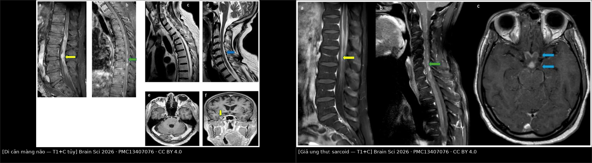
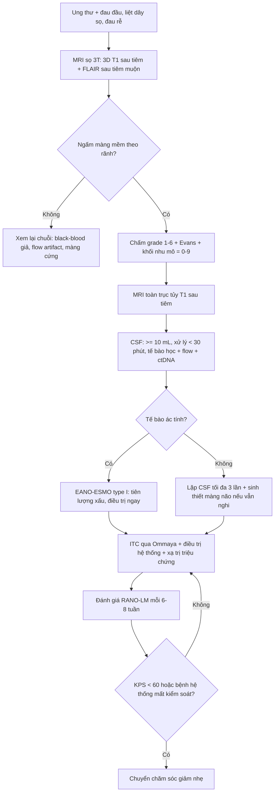
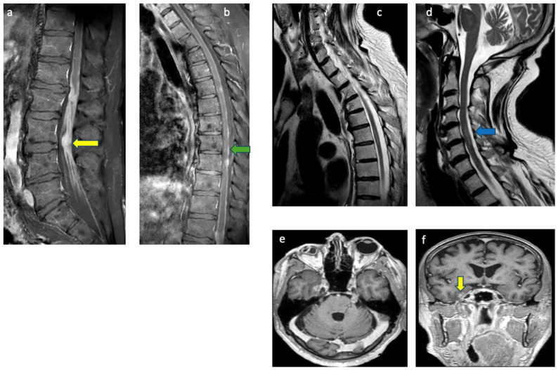
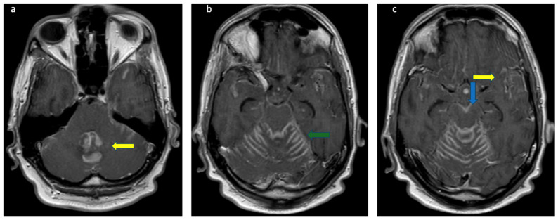
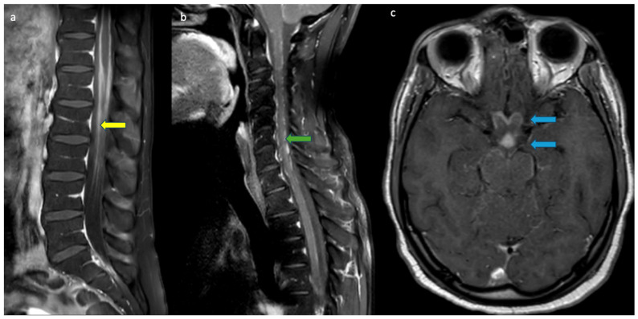

# 1659 — Di căn màng não – nội tủy (leptomeningeal metastasis): "ung thư đi theo dịch não tủy" / Leptomeningeal metastasis (LM)

**Tags:** `pattern:ngam-mang-nao` `pattern:ngam-mang-tuy` `pattern:not-mang-nao` `pattern:giay-day-than-kinh` `pattern:ung-thuy-nao` `pattern:gia-ung-thu` `vung:nao` `vung:cot-song` `vung:ong-song` `score:MRI-LMD-grade` `score:Evans` `score:LM-molGPA` `score:RANO-LM` `protocol:MRI-3D-T1C` `protocol:FLAIR-sau-tiem` `protocol:MRI-toan-truc` `protocol:DNT-te-bao` `incidentaloma:ngam-mang-nao`
**Mức chắc chắn (certainty):** tổng hợp y văn (literature synthesis) — đọc trực tiếp toàn văn 5 bài mở qua Europe PMC/PMC (*Brain Sciences* 2026; *Neuroradiology* 2026; *Current Oncology* 2023; *Thoracic Cancer* 2025; *Frontiers in Oncology* 2026), **có 3 ca nguyên văn** dùng cho Blind Quiz (ảnh CC BY 4.0, cùng một loạt ca). Số liệu dịch tễ và ngưỡng lấy từ phần Introduction/Results/Discussion của các bài gốc.

## 1. Tổng quan — vì sao ung thư "đi theo dịch não tủy", và vì sao hình ảnh trông chỉ là "màng não sáng lên"

- **Định nghĩa:** di căn màng não – nội tủy (leptomeningeal metastasis, LM; còn gọi leptomeningeal carcinomatosis / leptomeningeal disease – LMD) là tình trạng **tế bào ung thư xâm nhập màng mềm (pia mater) và màng nhện (arachnoid)**, rồi **phát tán trong khoang dưới nhện (subarachnoid space) theo dòng dịch não tủy (cerebrospinal fluid, CSF)**. Đây là **một bệnh khác về bản chất, tiên lượng và điều trị** so với di căn nhu mô não (brain metastasis) — không được gộp chung khi đọc phim và khi quyết định điều trị (*Thoracic Cancer* 2025, Đồng thuận 1).
- **Ba đường lan (sinh lý bệnh):** (1) **xâm nhập trực tiếp** từ màng não cứng, xương hoặc dây thần kinh kế cận; (2) **lan theo đường máu** qua đám rối tĩnh mạch; (3) **vào qua lỗ thủng của đám rối mạch mạc (choroid plexus)** — nơi hàng rào máu–dịch não tủy mỏng nhất, cho phép tế bào và chất tan đi vào CSF. Đây là lý do **tổn thương hay gặp ở bể nền, mặt dưới não, dây thần kinh sọ và rễ thần kinh tủy** — tức nơi CSF chảy chậm và "đọng".
- **Vì sao CSF là "nơi trú ẩn" (sanctuary):** thuốc hệ thống khó vào CSF vì **hàng rào máu–não và hàng rào máu–CSF**; vì thế LM có thể **tiến triển trong khi di căn ngoài thần kinh đang đáp ứng** — đã gặp ở ca lymphoma sau CAR-T trong loạt ca của bài này. Cũng vì vậy **điều trị nội tủy (intrathecal)** là một trục riêng.
- **TẠI SAO màng não "sáng lên" khi tiêm gadolinium (vật lý):**
  - Gadolinium **rút ngắn T1** của nước xung quanh → tín hiệu **tăng trên T1**. Bình thường màng mềm **không có hàng rào máu–não** (mạch máu của pia là mạch có lỗ thủng), nên chỉ cần **một lượng nhỏ** thuốc rò ra là màng đã ngấm — vì thế **màng mềm bình thường vẫn có thể ngấm mỏng, mảnh, đối xứng** ở một số vị trí.
  - Khi có tế bào u, **hàng rào bị phá vỡ + tăng sinh mạch + ứ trệ CSF** → ngấm **dày hơn, không đều, dạng nốt hoặc lan theo rãnh**. **Điểm mấu chốt định vị:** màng mềm **lách vào đáy rãnh não (sulci) và quanh dây thần kinh**, còn màng não cứng (dura/pachymeninges) **chỉ áp vào mặt trong xương sọ và không đi vào rãnh**. Đây là quy tắc "theo rãnh = màng mềm" — dùng để phân biệt leptomeningeal với pachymeningeal.
  - **FLAIR sau tiêm (post-contrast FLAIR):** FLAIR **xóa tín hiệu CSF** (nên CSF đen), do đó **một vệt thuốc rất mỏng trong rãnh nổi bật hơn hẳn** so với nền đen; độ tương phản này tăng khi **chụp muộn 5–10 phút** sau tiêm (*Neuroradiology* 2026 mô tả đúng giao thức này). Báo cáo so sánh cho thấy **FLAIR sau tiêm nhạy hơn T1 sau tiêm** cho tổn thương màng não, với độ nhạy **71,4% (T1 2D) – 71,4% (FLAIR 2D) – 82,9% (FLAIR sau tiêm)** trong một nghiên cứu, và **34% (FLAIR) vs 66% (T1 sau tiêm)** trong nghiên cứu khác (*Thoracic Cancer* 2025, Đồng thuận 3) — tức **hai chuỗi bổ trợ nhau, không thay thế nhau**.
  - **Bẫy chuỗi đen máu (black-blood, ví dụ T1-SPACE):** kỹ thuật **xóa tín hiệu máu** có thể tạo **vệt/nốt tăng tín hiệu giả** đúng ở vị trí màng mềm → **giả "LM độ 2"**. Loạt ca 2026 **cố ý không dùng** chuỗi này khi chẩn đoán vì lý do đó.
- **Tần suất và tiên lượng (định lượng):**
  - LM gặp ở **5–15%** bệnh nhân u đặc; **vú 5–35%**, **phổi 10–26%**, **melanoma 5–15%**; ước tính **~110.000 ca mới/năm tại Hoa Kỳ** (*Neuroradiology* 2026). Tổng quan khác ghi **1–8%** toàn bộ bệnh nhân ung thư (*Current Oncology* 2023).
  - **Sống trung bình 3–6 tháng** dù có điều trị (*Neuroradiology* 2026); **melanoma 17–22 tuần**; **NSCLC 3–11 tháng**; **vú 16 tuần – 2 năm** (*Current Oncology* 2023).
  - **Thời gian từ chẩn đoán ung thư nguyên phát đến LM: 1,2–2 năm** (u đặc), **11 tháng** (ung thư máu).
  - **U nguyên bào thần kinh đệm (glioblastoma):** LM **có triệu chứng ~2%**, nhưng **tới 25%** trong nghiên cứu tử thiết (*J Korean Soc Radiol* 2025, PMC12710264) — nghĩa là **phần lớn LM bị bỏ sót khi còn sống**.
  - **Triệu chứng (150 ca u đặc):** đau đầu **39%**, buồn nôn/nôn **25%**, yếu chi dưới **21%** (*Thoracic Cancer* 2025) — **không đặc hiệu**, nên hình ảnh + CSF mới là trục chẩn đoán.
- **Vì sao "âm tính" vẫn không loại trừ:** **MRI sau tiêm: độ nhạy 70–87%, độ đặc hiệu 75–94%; CT chỉ 23–38%** (*Thoracic Cancer* 2025). **Tế bào học CSF: lần chọc đầu 50–60%, lặp lại 75–85%**, độ đặc hiệu **> 95%** (*Neuroradiology* 2026; *Thoracic Cancer* 2025). Vì vậy **chẩn đoán LM là chẩn đoán phối hợp**, không phải một xét nghiệm duy nhất.

## 2. Mẫu hình (pattern) + chẩn đoán phân biệt theo vị trí (gamut)

- **Khuôn 1 — Ngấm màng mềm DẠNG ĐƯỜNG (linear/curvilinear) men theo rãnh não, đối xứng hoặc không.** Gamut: **LM** vs **viêm màng não do thuốc/hóa chất** vs **viêm màng não nhiễm trùng** vs **giả tiến triển sau xạ (pseudoprogression)**. Chốt: **có nốt/dày > 2 mm, không đối xứng, kèm dây thần kinh sọ** → nghi LM; **trong trường xạ, tự hết < 6 tháng** → giả tiến triển.
- **Khuôn 2 — Ngấm DẠNG NỐT (nodular) ở bể nền, mặt dưới não, màng não thất.** Gamut: **LM** vs **lymphoma thần kinh trung ương** vs **lao màng não** vs **nấm (cryptococcus)** vs **sarcoidosis thần kinh**. Chốt: **nốt + phù não kèm khối nhu mô + tế bào học dương** → LM; **nốt bể nền + giãn não thất + giảm glucose CSF nặng** → lao/nấm.
- **Khuôn 3 — Dây thần kinh sọ dày/ngấm (V, VII, VIII, dây thị giác, giao thoa).** Gamut: **LM** vs **sarcoidosis** vs **lymphoma** vs **bệnh Lyme thần kinh** vs **viêm mạch tế bào khổng lồ (giả u dây thị giác)**. Chốt: **ngấm lan tới giao thoa + u phổi/vú đã biết** → LM; **ngấm dây thị + phì đại tuyến lệ/màng não cứng dày** → sarcoid.
- **Khuôn 4 — Rễ thần kinh đuôi ngựa dày, "dính chùm", ngấm dạng hạt đường (sugar coating).** Gamut: **LM (drop metastasis)** vs **lymphoma** vs **viêm rễ do CMV** vs **hội chứng Guillain–Barré** vs **sarcoidosis** vs **viêm màng nhện dính sau mổ/xạ**. Chốt: **nốt > 3 mm + tế bào ác tính trong CSF** → LM; **ngấm đối xứng, chỉ rễ trước, không nốt, có yếu chi tiến triển cấp** → GBS.
- **Khuôn 5 — Ngấm màng não thất (ependymal) ± giãn não thất.** Gamut: **LM** vs **nhiễm trùng não thất (ventriculitis, đặc biệt có EVD/shunt)** vs **u màng não thất nguyên phát**. Chốt: **mủ hạn chế khuếch tán (DWI sáng/ADC tối) + sốt + dịch não thất đục** → nhiễm trùng; **ngấm mỏng + nốt + không sốt** → LM.
- **Khuôn 6 — "Giả bể nước" (pseudocisternogram): toàn bộ CSF trong bể nền sáng trên FLAIR sau tiêm.** Gamut: **viêm màng não do HIV** vs **LM lan rộng** vs **viêm màng não do lao**. Chốt: **đối xứng + không nốt + HIV + tế bào học âm** → HIV; **không đối xứng + nốt + tế bào học dương** → LM.
- **Khuôn 7 — Màng não CỨNG dày, nhẵn, không vào rãnh (pachymeningeal).** Gamut: **viêm màng não cứng do IgG4** vs **di căn màng cứng (vú/tuyến tiền liệt)** vs **hạ áp lực nội sọ** vs **viêm màng não cứng do sarcoid**. Chốt: **dày > 2/3 chu vi + vào rãnh** → màng mềm; **dày màng cứng đối xứng + tụt não + đau đầu tư thế** → hạ áp lực.
- **Gợi nhớ "RÃNH – NỐT – DÂY – RỄ":** **R**ãnh (ngấm theo rãnh = màng mềm) · **Ã** (nốt > 2 mm bể nền) · **N**ốt ở màng não thất · **H**ỏi bệnh ung thư đã biết · **D**ây thần kinh sọ dày · **Â**m tính CSF **không** loại trừ · **Y**êu cầu chụp **toàn trục** (não + tủy) · **R**ễ đuôi ngựa dày/dính · **Ễ** (FLAIR sau tiêm muộn 5–10 phút).

## 3. Bảng so sánh phân biệt (ma trận đối chiếu)

| Thực thể (entity) | Hình ảnh điển hình (MRI sau tiêm) | Chốt vào (rule-in) | Chốt loại (rule-out) | Gợi ý xác nhận |
|---|---|---|---|---|
| **Di căn màng não (LM)** | Ngấm màng mềm dày, không đều, **dạng nốt hoặc đường**, theo rãnh, bể nền, dây thần kinh sọ, rễ đuôi ngựa; có thể kèm giãn não thất | **Nốt > 2 mm hoặc ngấm dày lan nhiều vùng + tế bào ác tính trong CSF** | **Không loại trừ được bằng MRI âm hay CSF âm lần đầu** (nhạy chỉ 50–60%) | CSF ≥ 10 mL, lặp lại; ctDNA; sinh thiết màng não khi vẫn nghi |
| **Lymphoma thần kinh trung ương** | Nốt bể nền/quanh não thất, ngấm đồng nhất, hạn chế khuếch tán rõ (tế bào đặc) | **ADC rất thấp + ngấm đồng nhất + đáp ứng nhanh với steroid** | **Ngấm dạng đường mảnh chỉ ở rãnh, không khối** → ít gợi ý lymphoma | Flow cytometry CSF, sinh thiết não |
| **Lao màng não** | Ngấm **bể nền dày**, có ổ nhu mô (tuberculoma), giãn não thất, nhồi máu do viêm mạch | **Ngấm bể nền + giảm glucose CSF nặng + protein rất cao + ổ nhu mô** | **Không có ổ nhu mô, ngấm lan mặt lồi đối xứng** → ít lao | PCR lao, AFB, nội soi não thất lấy mẫu |
| **Sarcoidosis thần kinh** | Ngấm **nhẵn tới dạng nốt**, bể nền, **dây thị/giao thoa**, màng não cứng dày, hay tái phát | **Ngấm dây thị + giao thoa + phì đại tuyến lệ/tuyến mang tai + ACE CSF tăng** | **Nốt lan rộng mặt lồi không kèm dây thị** → ít sarcoid | Sinh thiết (mô hạt không hoại tử), ACE, PET |
| **Nấm (cryptococcus)** | Giãn khoang quanh mạch (gelatinous pseudocyst) ở hạch nền, ngấm màng mềm nhẹ | **Giãn khoang Virchow–Robin + kháng nguyên cryptococcus dương** | **Chỉ ngấm màng mềm không giãn khoang quanh mạch** → ít nấm | Kháng nguyên CSF, cấy nấm |
| **Viêm màng não do HIV** | Ngấm lan tỏa, **"giả bể nước"** đối xứng, không nốt | **HIV + ngấm đối xứng lan tỏa + tế bào học âm** | **Nốt không đối xứng hoặc dày khu trú** → ít HIV | HIV RNA, CD4, loại trừ nhiễm trùng cơ hội |
| **Giả tiến triển / thay đổi sau xạ–mổ** | Ngấm mới **trong trường xạ**, dạng đường, có thể kèm phù | **Xuất hiện trong 6 tháng sau hóa–xạ, tự giảm không đổi điều trị** | **Nốt mới ngoài trường xạ hoặc tăng dần** → nghi tái phát/LM | Theo dõi 6–12 tuần, perfusion/DSC, sinh thiết |
| **Viêm màng não cứng (pachymeningitis, IgG4)** | Dày màng cứng **nhẵn, đối xứng, không vào rãnh** | **Dày màng cứng + IgG4 huyết thanh/CSF tăng + đáp ứng steroid** | **Ngấm lách vào rãnh hoặc quanh dây thần kinh** → màng mềm, không phải màng cứng | Sinh thiết màng cứng, IgG4 |
| **CAA-ri (viêm do bệnh mạch amyloid)** | Ngấm màng mềm **khu trú, không đối xứng** + **giảm tín hiệu SWI nhiều ổ** + tổn thương chất trắng hai bên | **Nhiều vi chảy máu thùy trên SWI + ngấm màng não + không tế bào ác tính** | **Không có vi chảy máu trên SWI** → ít CAA-ri | SWI, APOE, sinh thiết não (ca nguyên văn PMC13605293) |

- Ảnh ghép đối chiếu: `` — tạo bằng `tools/make_composite.py` (letterbox, giữ tỷ lệ gốc), dải đen ghi tên bệnh + attribution.

## 4. Protocol chụp + hệ phân độ/điểm chuẩn hóa

**4.1. Giao thức MRI (não + toàn trục tủy)**

| Bước | Chuỗi (sequence) | Thông số/ngưỡng then chốt | Vì sao |
|---|---|---|---|
| 1 | MRI sọ **3.0 T**, **3D T1 sau tiêm** (MPRAGE/BRAVO/VIBE) | Lát **≤ 1 mm** đẳng hướng, dựng lại 3 mặt phẳng; dày lát tối đa **3 mm** khi chỉ có 2D | Tổn thương màng mềm rất mỏng; 3D cho phép dựng lại theo trục vuông góc với rãnh |
| 2 | **T2 FLAIR** trước tiêm + **FLAIR sau tiêm muộn 5–10 phút** | Chụp muộn là bắt buộc — nồng độ thuốc trong CSF tăng dần | CSF bị xóa tín hiệu → vệt thuốc mỏng "nổi" trên nền đen; nhạy hơn T1 ở một số nghiên cứu |
| 3 | **T1 sau tiêm toàn bộ cột sống** (sagittal, chia 3 đoạn cổ–ngực–thắt lưng) | Không bỏ đoạn nào; thêm **axial T1 sau tiêm** qua chỗ bất thường | LM hay ở **rễ đuôi ngựa** và mặt sau tủy; bỏ tủy = bỏ 1/3 chẩn đoán |
| 4 | **T2 sagittal tủy** | Tìm **tăng tín hiệu trong tủy** (phù do chèn ép/xâm nhập) | Phân biệt tổn thương nội tủy với ngấm màng |
| 5 | DWI/ADC, SWI (não) | ADC thấp = tế bào đặc (lymphoma/mủ); SWI = vi chảy máu | Phân biệt lymphoma, nhiễm trùng, CAA-ri |
| 6 | **KHÔNG dùng chuỗi đen máu** khi chẩn đoán LM | T1-SPACE có thể tạo vệt/nốt giả | Tránh "giả LM độ 2" |

- **Chỉ định chụp:** mọi bệnh nhân ung thư có **đau đầu mới, liệt dây thần kinh sọ, đau rễ/yếu chi dưới, rối loạn tri giác không giải thích**; **chụp toàn trục** khi đã thấy tổn thương ở một nơi, vì LM thường đa ổ.
- **Nguyên tắc "chụp muộn, chụp 3D, chụp cả tủy":** đây là 3 thay đổi làm tăng tỷ lệ phát hiện nhiều nhất; CT **chỉ 23–38%** nên **không dùng CT để loại trừ**.

**4.2. Giao thức dịch não tủy (CSF)**

| Hạng mục | Ngưỡng / quy tắc | Số liệu |
|---|---|---|
| Thể tích | **≥ 10 mL**, lấy ống 3–4 (ít tế bào nhất) | 2–5 mL: dương tính **30,5%**; > 5 mL: **55,5%** |
| Thời gian xử lý | **< 30 phút** sau lấy, hoặc cố định ngay | Tế bào thoái hóa nhanh → âm giả |
| Số lần chọc | Lặp lại **tối đa 3 lần** | Lần 1 **50–60%**, lặp lại **75–85%**; > 3 lần **không tăng thêm** |
| Tế bào học | Độ đặc hiệu **> 95%**, độ nhạy **45–90%** | Âm không loại trừ |
| Sinh hóa | Tăng tế bào, **protein tăng**, **glucose giảm** | Bộ ba này nhạy **50–70%** |
| Phân tử | ctDNA/CTC trong CSF | Gộp 668 bệnh nhân: độ nhạy **87,0–97,9%**, độ đặc hiệu **89,0–93,8%** |
| Áp lực mở | Đo và ghi lại | Tăng áp lực = chỉ định xem xét dẫn lưu |

**4.3. Hệ phân độ MRI-LMD (Msherghi 2026) — thoát khỏi "có/không"**

- **Thang chính (grade 1–6)** dựa trên **ngấm/tăng tín hiệu màng mềm**:
  - **1** = không có bằng chứng LM;
  - **2** = **nghi ngờ, ngấm mỏng khu trú**;
  - **3** = **ngấm mỏng lan tỏa**;
  - **4** = **ngấm dày/nốt khu trú**;
  - **5** = **dày dạng nốt lan tỏa**;
  - **6** = **xâm nhập nhu mô + bệnh nốt lan rộng**.
- **Điểm cộng thêm:** **Evans index > 0,25 → +1**; **khối di căn nhu mô: 1 khối +1, nhiều khối +2**. **Tổng 0–9**.
- **Ngưỡng dùng:** **grade ≥ 2** mới tính điểm phụ; **grade 1 = âm**.
- **Hiệu lực (32 bệnh nhân, 2 bác sĩ độc lập):** **ICC = 0,953** (p < 0,001); **tử vong theo nhóm: 8,6% (grade 1–2) · 50% (grade 3–4) · 80,0% (grade ≥ 5)**; khác biệt sống còn **p = 0,00011**.
- **Phân loại EANO–ESMO (bắt buộc nhớ):** **type I = có bằng chứng tế bào học/mô bệnh học trong CSF**; **type II = chỉ có hình ảnh hoặc triệu chứng, không có bằng chứng tế bào**. **Type I tiên lượng xấu hơn type II** (một số nghiên cứu NSCLC không lặp lại được khác biệt này — phản biện ở mục 5).

**4.4. Phân tầng tiên lượng và điều trị**

- **Hình thái trên MRI (71 ca NSCLC):** **dạng đường (linear, n = 41)** vs **hỗn hợp (mixed, n = 30)**; **gánh nặng tổn thương 26,86 ± 26,72 vs 7,25 ± 10,95** (p < 0,001); **> 3 vùng não: sống trung bình 14 vs 24 tháng** (p = 0,016); **xâm nhập thùy thái dương: HR 1,96 (1,07–3,58)**; **số tổn thương: HR 1,02 (1,01–1,03)**.
- **LM-molGPA (NSCLC):** ba nhóm nguy cơ sống **0,3 · 3,5 · 15,9 tháng**.
- **Điều trị (khung, không thay thế quyết định của bác sĩ điều trị):**
  - **Nội tủy (intrathecal chemotherapy, ITC):** **methotrexate, cytarabine, thiotepa**; **Ommaya được ưu tiên** (đồng thuận mức II, **97%** chuyên gia đồng ý) so với chọc dòng thắt lưng lặp lại.
  - **Cytarabine liposome nội tủy + hóa trị hệ thống: tăng sống thêm ~3 tháng** (pha II). **Trastuzumab nội tủy ở HER2+: kiểm soát tiến triển thần kinh 75% ở tuần 10**, độc tính không đáng kể.
  - **Xạ trị:** **WBRT** cho tổn thương sọ có triệu chứng; **xạ toàn trục (craniospinal irradiation, CSI) 20–40 Gy/5–20 phân liều**; xạ proton CSI có thể kéo dài PFS/OS so với photon.
  - **Dẫn lưu CSF (shunt/Ommaya dẫn lưu)** khi **tăng áp lực nội sọ kháng trị hoặc giãn não thất có triệu chứng** — giảm triệu chứng nhanh, tạo điều kiện điều trị tiếp.
  - **Khi nào dừng/không điều trị tích cực:** **KPS < 60** ít đáp ứng; bệnh nhân **hôn mê, bệnh hệ thống không kiểm soát, không còn lựa chọn hệ thống** → chuyển chăm sóc giảm nhẹ. **Mục tiêu điều trị LM là giảm nhẹ**, không phải chữa khỏi.

## 5. Biến thể bình thường và cạm bẫy

- **Biến thể bình thường dễ gọi nhầm là LM:**
  - **Ngấm mỏng màng mềm ở đỉnh não và quanh thân não** ở người trẻ, **đối xứng, mảnh < 1 mm** — bình thường.
  - **Hạt nhện (arachnoid granulations)** ở xoang dọc trên/xoang ngang: **nốt nhỏ, đồng tín hiệu CSF, không ngấm hoặc ngấm viền** — không phải nốt u.
  - **Đám rối mạch mạc (choroid plexus)** ngấm mạnh bình thường ở não thất — đừng gọi là "ngấm màng não thất".
  - **Ngấm màng cứng sau chọc dò/mở sọ/rò CSF**: **dày màng cứng nhẵn, đối xứng, không vào rãnh**, kèm **tụt não, màng não căng, xoang hang giãn** — bộ ba của **hạ áp lực nội sọ**, không phải LM.
  - **Ngấm rễ thần kinh nhẹ sau xạ trị hoặc sau mổ cột sống** — đối xứng, không nốt, ổn định qua các lần chụp.
- **Cạm bẫy (pitfall) hay gặp nhất:**
  1. **Bỏ tủy vì "não đã bình thường"** — LM có thể **chỉ ở tủy** (thể đuôi ngựa). Luôn chụp toàn trục khi nghi.
  2. **Tin CSF âm lần đầu** — lần đầu chỉ dương **50–60%**; ca 1 của bài này có **3 lần tế bào học âm** mà vẫn là LM (chẩn đoán bằng sinh thiết màng não).
  3. **Chuỗi đen máu (T1-SPACE) tạo vệt giả** — đúng vị trí màng mềm, dễ chấm "grade 2"; xác nhận bằng T1 3D thường + FLAIR sau tiêm.
  4. **FLAIR sau tiêm chụp quá sớm** — trước 5 phút, nồng độ thuốc trong CSF chưa đủ → âm giả. Chụp muộn 5–10 phút.
  5. **Nhầm màng cứng với màng mềm** — màng cứng **không lách vào rãnh**; nếu thấy ngấm **theo rãnh** thì là màng mềm.
  6. **Bỏ sót "giả ung thư" ở bệnh nhân đã có ung thư:** ca nguyên văn CAA-ri (82 tuổi, vừa mổ adenocarcinoma phổi) có **ngấm màng mềm nhiều ổ** nhưng **SWI nhiều vi chảy máu thùy** → chẩn đoán **CAA-ri**, không phải LM (PMC13605293). **SWI là chuỗi quyết định** ở đây.
  7. **Ảo giác do dòng CSF (flow artifact) trong ống sống** — thường gặp ở T2, **giảm khi đổi chuỗi/đổi hướng**, không ngấm trên T1 sau tiêm.
  8. **Sai số "satisfaction of search":** thấy 1 khối di căn nhu mô rồi dừng, không nhìn màng não/rễ thần kinh → bỏ LM đi kèm.
- **Phản biện trung thực nguồn:** phân loại EANO–ESMO cho rằng **type I (tế bào học dương) xấu hơn type II**, nhưng **một nghiên cứu NSCLC không tìm thấy khác biệt OS** (*Thoracic Cancer* 2025 dẫn lại) — nên **không dùng type để tiên lượng cá nhân** khi chưa có dữ liệu đặc hiệu loại ung thư. Tương tự, thang grade 1–6 mới là **nghiên cứu khám phá 32 ca**, **chưa ngoại kiểm** — dùng để **chuẩn hóa mô tả và theo dõi**, chưa dùng như tiêu chuẩn chẩn đoán.

## 6. Tự lượng giá — Blind Quiz ngay trên trang tĩnh

**Ca 1 — Yếu hai chi dưới tiến triển + liệt dây VII hai bên**

- Gợi ý lâm sàng: nam **76 tuổi**, yếu hai chi dưới tăng dần tới liệt, bí tiểu, mất cảm giác tới **T10**, liệt dây VII hai bên; CSF **38 tế bào lympho**, **protein 281 mg/dL**, glucose thấp; **3 lần tế bào học âm**, các panel tự miễn/nhiễm âm.
- Câu hỏi: (a) Mô tả dấu hiệu chính trên T1 sau tiêm cột sống và sọ? (b) Ba chẩn đoán phân biệt? (c) Dấu hiệu nào khiến phải **sinh thiết màng não** thay vì theo dõi?

<b>Bấm để hiện đáp án (findings + chẩn đoán)</b>

- Dấu hiệu (findings): **dày dạng nốt + ngấm mạnh màng mềm rễ đuôi ngựa** (mũi tên vàng, a); **ngấm màng cứng lan dọc tủy cổ–ngực + nốt khu trú đoạn ngực thấp** (mũi tên xanh lá, b); **tăng tín hiệu trong tủy trên T2** (mũi tên xanh dương, c, d); **ngấm dây thần kinh V** (e); **tổn thương dựa màng cứng thùy thái dương phải** (mũi tên vàng, f).
- Chẩn đoán (diagnosis): **di căn màng não – nội tủy do u tế bào hình thoi/glioblastoma** — vì tế bào u lan theo CSF, phá hàng rào máu–màng mềm nên gadolinium rò ra thành **nốt dọc rễ và màng não**, trong khi **tế bào học CSF vẫn âm** (độ nhạy lần đầu chỉ 50–60%).
- Bài học: **CSF âm lặp lại không loại trừ LM**; hình ảnh dày–nốt lan nhiều tầng + thất bại với IVIG/steroid/plasma exchange là lý do **sinh thiết màng não**.
- Nguồn ảnh: *Brain Sciences* 2026, Figure 1 — PMC13407076, CC BY 4.0 (Hani M et al.).

**Ca 2 — Mất thăng bằng, nói khó, rung giật nhãn cầu**

- Gợi ý lâm sàng: nam **42 tuổi**, nuốt khó + sụt **~18 kg**, đã chẩn đoán **adenocarcinoma thực quản di căn hạch**; sau đó **nói khó, yếu, mất thăng bằng, nôn không cầm**; **CT sọ không phát hiện bất thường**.
- Câu hỏi: (a) Vì sao CT âm mà vẫn có bệnh? (b) Mô tả phân bố ngấm thuốc? (c) Nêu 2 việc phải làm tiếp theo.

<b>Bấm để hiện đáp án (findings + chẩn đoán)</b>

- Dấu hiệu (findings): **ngấm dày lan tỏa màng mềm** ở **thùy nhộng tiểu não, các lá tiểu não, mặt thân não** (mũi tên vàng/xanh lá/xanh dương), **khe Sylvius, bể trên yên và bể nền, rãnh thái dương trước**; kèm **nhiều dây thần kinh sọ (V, VII, VIII)** và tổn thương xương sọ.
- Chẩn đoán (diagnosis): **di căn màng não do adenocarcinoma thực quản/dạ dày** — tế bào u theo CSF tới các bể và lá tiểu não; **CT chỉ nhạy 23–38%** nên **CT âm không loại trừ**.
- Việc phải làm: **MRI toàn trục tủy T1 sau tiêm** + **CSF ≥ 10 mL tế bào học/flow/ctDNA**; đánh giá **grade MRI-LMD** để phân tầng.
- Nguồn ảnh: *Brain Sciences* 2026, Figure 3 — PMC13407076, CC BY 4.0 (Hani M et al.).

**Ca 3 — Đau lưng–hông hai bên rồi yếu chi dưới ở người trẻ**

- Gợi ý lâm sàng: nam **29 tuổi**, khỏe mạnh, đau lưng–hông–gối đột ngột 2 tháng, rồi **tê/yếu hai chi dưới**, bí tiểu; CSF **231 tế bào lympho**, **protein 742 mg/dL**, **glucose 15 mg/dL**, các xét nghiệm nhiễm trùng âm.
- Câu hỏi: (a) Hình ảnh gợi ý ung thư hay viêm? (b) Dấu hiệu nào trên ảnh giúp phân biệt? (c) Chẩn đoán nào phải đứng đầu danh sách?

<b>Bấm để hiện đáp án (findings + chẩn đoán)</b>

- Dấu hiệu (findings): **ngấm màng mềm nhẵn tới dạng nốt** dọc **tủy ngực thấp, nón tủy, rễ đuôi ngựa** (mũi tên vàng, a; xanh lá, b); **ngấm bể trên yên dọc phức hợp thị giác và cuống tuyến yên** (mũi tên xanh dương, c).
- Chẩn đoán (diagnosis): **sarcoidosis thần kinh (neurosarcoidosis) — "giả ung thư"**; ngấm **nhẵn** hơn LM (LM thường **dày, nốt, không đều**), kèm **ngấm dây thị/giao thoa + cuống tuyến yên** là chìa khóa; CSF **giảm glucose mạnh + protein rất cao** gặp ở cả lao, nấm và sarcoid.
- Bài học: **ung thư không phải là chẩn đoán duy nhất** ở bệnh nhân có ngấm màng mềm; cần **ACE CSF, CT ngực, PET, sinh thiết** trước khi điều trị ung thư.
- Nguồn ảnh: *Brain Sciences* 2026, Figure 6 — PMC13407076, CC BY 4.0 (Hani M et al.).

## Bài liên quan chéo
- [213 – U não](../213-u-nao/lesson.md)
- [214 – Nhiễm trùng thần kinh trung ương](../214-nhiem-trung-tktw/lesson.md)
- [218 – Thoát vị não & não úng thủy (thang Evans)](../218-thoat-vi-nao-ung-thuy/lesson.md)
- [216 – Dị dạng mạch & huyết khối xoang tĩnh mạch não](../216-di-dang-mach-CVST/lesson.md)
- [3029 – ARIA khi dùng kháng thể kháng amyloid](../3029-aria-khang-the-khang-amyloid/lesson.md)
- [3030 – Tụ máu dưới màng cứng mạn tính](../3030-tu-mau-duoi-mang-cung-man/lesson.md)

## Ảnh
- `images/1659_di-can-mang-nao_MRI_brainsci-g001.jpg` — T1 sau tiêm cột sống + sọ, ca glioblastoma (Figure 1).
- `images/1659_di-can-mang-nao_MRI_brainsci-g003.jpg` — T1 sau tiêm sọ trục ngang, ca adenocarcinoma (Figure 3).
- `images/1659_di-can-mang-nao_MRI_brainsci-g006.jpg` — T1 sau tiêm cột sống + bể trên yên, ca sarcoidosis (Figure 6).
- `images/composite_lm-vs-sarcoid_T1C.jpg` — ảnh ghép đối chiếu (di căn màng não vs sarcoid), tạo bằng `tools/make_composite.py`.
- Nguồn + giấy phép từng ảnh: `images/CREDITS.md`; link gốc: `sources.md`.

> Không dùng để chẩn đoán độc lập khi chưa có người hướng dẫn.
