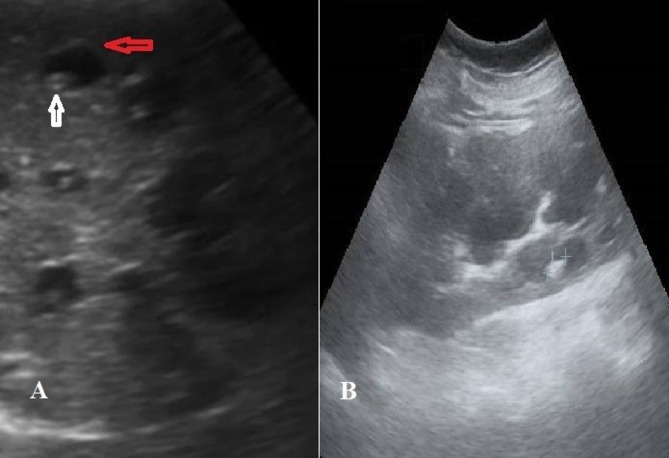
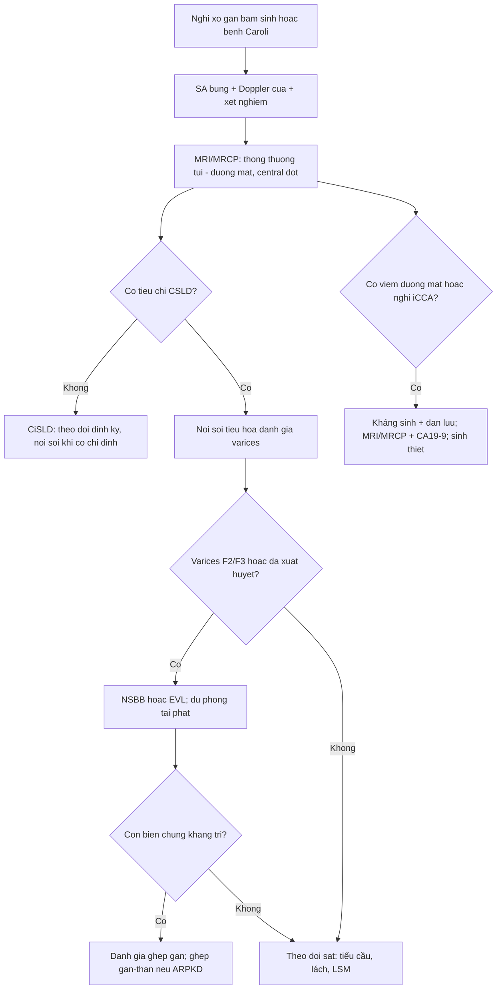
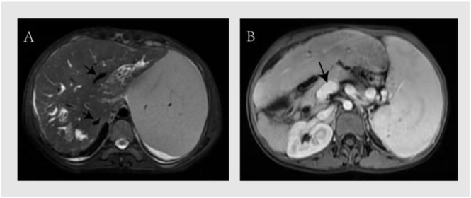
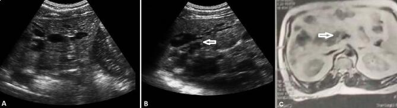
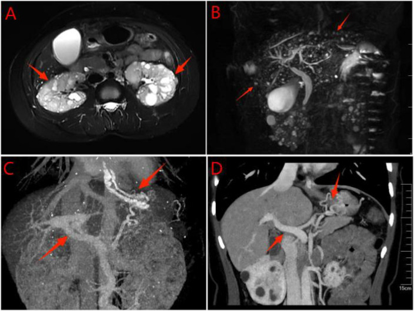

# 166 — Tăng áp lực cửa trong xơ hóa gan bẩm sinh (CHF) & bệnh Caroli: phân độ CSLD/CiSLD, tầm soát giãn tĩnh mạch, chỉ định ghép gan

**Tags:** `pattern:xo-quanh-ong-mat` `vung:gan` `score:CSLD-CiSLD` `protocol:MRCP` `incidentaloma:nang-gan`
**Mức chắc chắn (certainty):** tổng hợp y văn (literature synthesis) — nhóm tự biên từ y văn mở (Front Pediatr 2026, Sci Rep 2026, SAGE Open Med Case Rep 2026, Front Gastroenterol 2026, Orphanet J Rare Dis 2025) và đối chiếu Baveno VII; không gắn một ca nguyên văn duy nhất.

## 1. Tổng quan bệnh học – cơ chế hình ảnh

- **Xơ hóa gan bẩm sinh (congenital hepatic fibrosis — CHF)** là bệnh phát triển đường mật hiếm, di truyền **lặn NST thường**, ước tính **1/10.000–1/20.000**; y văn mới chỉ ghi nhận **vài trăm ca**, nên chẩn đoán muộn là quy luật (PMC13581711). Tổn thương nằm ở **đường mật nhỏ** (đường mật trong gan) với bộ ba mô học: **xơ hóa khoảng cửa lan rộng**, **tăng sinh ống mật bất thường**, **kiến trúc tiểu thùy gan còn nguyên** (không có pseudolobule như xơ gan).
- **Hệ quả huyết động:** xơ hóa khoảng cửa làm tăng sức cản **trước xoang (presinusoidal)** → **tăng áp lực cửa** trong khi **chức năng tổng hợp gan còn tốt trong nhiều năm**. Vì vậy bệnh nhân thường đến vì **xuất huyết tiêu hóa do giãn tĩnh mạch**, không phải vàng da/suy gan: **45,8%** bệnh nhân CHF khởi đầu bằng xuất huyết tiêu hóa trên, **69,6%** người lớn có lách to, và **45,8%** có ít nhất một đợt viêm đường mật tích lũy (PMC13581711).
- **Bệnh Caroli (Caroli disease — CD)** là **giãn dạng túi, từng đoạn, không do tắc nghẽn** của đường mật trong gan, **thông với cây đường mật**; **dấu chấm trung tâm (central dot sign)** là nhánh tĩnh mạch cửa bị bao quanh bởi túi mật giãn, thấy rõ trên siêu âm và MRCP (PMC13031803). **Hội chứng Caroli (Caroli syndrome — CS)** = Caroli + CHF/tăng áp lực cửa, thường kèm bệnh nang thận (ARPKD hoặc ADPKD).
- **Tiên lượng và biến chứng:** trong một đoàn hệ 19 bệnh nhân, **CS có trung vị sống 45 tháng so với 59 tháng ở CD** (p = 0,020); toàn bộ ca giãn tĩnh mạch thực quản, mất bù gan, **ung thư đường mật trong gan (intrahepatic cholangiocarcinoma — iCCA)** và tử vong đều nằm trong nhóm CS; **3/12 ca CS (25%)** có iCCA (PMC13031803). Nguy cơ iCCA ở Caroli được báo cáo **tăng tới ~100 lần** so với dân số chung (PMC12492817).
- **Ghép gan:** 20 ca CS ghép gan có tỷ lệ sống **1/3/5 năm = 90%/85%/78,5%**, theo dõi trung vị **74,6 tháng**; chỉ định chủ yếu là xơ gan mất bù/biến chứng tăng áp lực cửa, một số ca viêm đường mật kháng trị (PMC12492817).
- **TẠI SAO đọc được trên hình ảnh (vật lý + mô bệnh):**
  - **Siêu âm:** gan to, **tăng âm lan tỏa**, **dải xơ quanh cửa (periportal fibrotic bands)**, lách to, giãn tĩnh mạch cửa; Caroli có **túi dịch thông với đường mật** và **chấm trung tâm**.
  - **CT:** gan to, bờ gan biến dạng, **giãn đường mật trong gan**, lách to, tuần hoàn bàng hệ; Caroli có **giãn dạng túi** và có thể thấy **sỏi trong gan** hoặc **iCCA**.
  - **MRI/MRCP:** chuẩn không xâm lấn để chứng minh **sự thông thương với cây đường mật**; Caroli cho hình **“phễu”/túi từng đoạn**, phân biệt với nang không thông (bệnh gan đa nang, u mô đệm đường mật von Meyenburg).
  - **Đàn hồi gan (transient elastography):** **LSM > 15 kPa** được dùng làm tiêu chí **bệnh gan có ý nghĩa lâm sàng (CSLD)** trong phân độ đề xuất cho ARPKD (PMC13398733); tuy nhiên LSM cao cũng phản ánh **ứ máu/xơ**, không đồng nghĩa xơ gan.
  - **HVPG:** đo qua xoang gan nên **thường bình thường trong tăng áp lực cửa trước xoang**; chỉ **tới 30%** ca (đặc biệt có thành phần xoang/nốt tái tạo) có HVPG > 10 mmHg — **không dùng HVPG bình thường để loại trừ tăng áp lực cửa** (PMC13566686).

### Phân độ CSLD / CiSLD (đề xuất cho bệnh gan trong ARPKD, 2026)
- **CSLD — bệnh gan có ý nghĩa lâm sàng (clinically significant liver disease):** chỉ cần **MỘT** trong ba tiêu chí: (1) **giãn tĩnh mạch thực quản cần can thiệp VÀ tiểu cầu < 150 × 10⁹/L**; (2) **≥ 1 đợt viêm đường mật**; (3) **LSM > 15 kPa**.
- **CiSLD — bệnh gan không có ý nghĩa lâm sàng (clinically insignificant liver disease):** phải có **TẤT CẢ**: (1) giãn tĩnh mạch **không cần can thiệp**; (2) tiểu cầu **≥ 150 × 10⁹/L**; (3) **không** có đợt viêm đường mật; (4) **LSM ≤ 15 kPa** (PMC13398733).
- Đây là **phân độ đề xuất, đang được validate**, không phải tiêu chuẩn quốc tế bắt buộc; dùng để chuẩn hóa báo cáo và phân tầng theo dõi.

## 2. Mẫu hình + chẩn đoán phân biệt theo vị trí (gamut)

- **Mẫu hình 1 — tăng áp lực cửa nhưng chức năng gan còn tốt:** CHF, hội chứng Caroli, **bệnh mạch xoang cửa (porto-sinusoidal vascular disorder — PSVD)**, sán máng, huyết khối tĩnh mạch cửa, tắc tĩnh mạch lách; phân biệt với xơ gan (men gan/bilirubin bất thường rõ, pseudolobule).
- **Mẫu hình 2 — nhiều “nang” gan:** bệnh gan đa nang (polycystic liver disease — PLD, nang **không thông** đường mật), **u mô đệm đường mật von Meyenburg** (biliary hamartoma, nốt **< 1,5 cm**, “starry sky”, không thông), **Caroli** (túi **thông** đường mật + central dot), nang sán, nang ống mật chủ (extrahepatic).
- **Mẫu hình 3 — giãn đường mật trong gan:** Caroli, **viêm đường mật mủ tái phát (recurrent pyogenic cholangitis — RPC)**, xơ gan mật nguyên phát (PSC), **u nhầy nhú nội ống mật (IPNB)**, iCCA, hẹp lành tính sau can thiệp.
- **Mẫu hình 4 — lách to + giảm tiểu cầu:** tăng áp lực cửa, bệnh lý tủy xương, lymphoma, nhiễm trùng mạn; ở CHF, lách to thường kèm **giãn tĩnh mạch dạ dày–thực quản** và **tuần hoàn bàng hệ**.
- **Mnemonic “FIBRO–CYST–DUCT”:** **FIBRO** (xơ khoảng cửa), **CYST** (nang/PLD/von Meyenburg), **DUCT** (giãn đường mật Caroli/IPNB/CCA).

## 3. Bảng so sánh phân biệt (ma trận đối chiếu)

| Thực thể (entity) | Hình ảnh điển hình (US/CT/MRI) | Chốt vào (rule-in) | Chốt loại (rule-out) | Gợi ý xác nhận |
|---|---|---|---|---|
| **CHF** | Gan to, tăng âm, **dải xơ quanh cửa**; lách to, giãn tĩnh mạch cửa; **không có túi mật giãn lớn** | **Xơ khoảng cửa + ống mật bất thường + kiến trúc tiểu thùy còn nguyên** trên mô học; tăng áp lực cửa **không tương xứng** với chức năng gan | Pseudolobule/xơ gan lan tỏa → nghĩ xơ gan; nang lớn không thông → PLD | Sinh thiết gan + gen **PKHD1**; MRCP; đo LSM |
| **Caroli disease (CD)** | **Giãn dạng túi từng đoạn**, **thông với cây đường mật**, **central dot sign**; có thể sỏi trong gan | **Túi mật giãn thông đường mật + central dot** trên US/MRCP | Nang **không thông** → PLD/von Meyenburg; giãn do tắc → RPC/hẹp | MRCP là chuẩn; CT tĩnh mạch cửa; theo dõi iCCA |
| **Caroli syndrome (CS)** | Caroli + **lách to, giãn tĩnh mạch, tuần hoàn bàng hệ**, gan biến dạng | **Caroli + bằng chứng tăng áp lực cửa** (varices, collaterals, lách to) | Caroli đơn thuần **không** có tăng áp lực cửa → CD | Nội soi tiêu hóa; MRCP; đo LSM; đánh giá ghép |
| **PLD** | Nhiều nang gan **không thông** đường mật, kích thước lớn, thận đa nang kèm | **≥ 10 nang gan + nang thận (ADPKD)**; nang không thông | Túi thông đường mật + central dot → Caroli | MRI/MRCP; xem bài 123/157 |
| **Von Meyenburg (biliary hamartoma)** | Nốt **< 1,5 cm**, T2 “starry sky”, **không thông** đường mật, rải rác | **Nhiều nốt nhỏ T2 sáng, không thông mật, không ngấm** | Túi lớn thông mật → Caroli; nang lớn → PLD | MRI/MRCP; sinh thiết nếu không điển hình |
| **PSVD / tăng áp lực cửa không xơ gan** | Gan bình thường/loang lổ, lách to, collaterals; **không có xơ gan** | **Tăng áp lực cửa + sinh thiết không xơ gan + loại trừ nguyên nhân khác** | Xơ gan (pseudolobule, men gan bất thường) | Sinh thiết; loại trừ huyết khối, sán máng, bệnh máu |
| **Cirrhosis** | Gan co nhỏ, bờ gồ ghề, pseudolobule, dịch báng, varices | **Pseudolobule + xơ cầu** trên mô học; Child-Pugh/MELD tiến triển | Kiến trúc tiểu thùy còn nguyên → nghĩ CHF | Sinh thiết; đàn hồi; loại trừ virus/rượu |

*Siêu âm: túi giãn đường mật (mũi tên trắng) chứa **central dot** (nhánh tĩnh mạch cửa), xung quanh là các nhánh đường mật giãn (mũi tên đỏ); thận có nhiều nang. Nguồn: Hanafy AS et al., Sci Rep 2026 (PMC13031803), CC BY 4.0.*

## 4. Protocol chụp + phân độ + hướng xử trí

- **Siêu âm bụng + Doppler cửa:** bước đầu tiên; đo gan, lách, đường kính tĩnh mạch cửa, vận tốc/chiều dòng chảy, dịch báng, collaterals. Ở trẻ, siêu âm là tuyến đầu vì không xạ.
- **MRI/MRCP gan–mật:** **T2 3D MRCP + DWI + chuỗi động sau tiêm**; mục tiêu là chứng minh **thông thương túi–đường mật**, tìm **central dot**, sỏi, hẹp, và **iCCA**. MRCP là chuẩn không xâm lấn cho Caroli (PMC13031803).
- **CT bụng có cản quang:** thì tĩnh mạch cửa để đánh giá **tuần hoàn bàng hệ, varices, lách, huyết khối cửa**, và can thiệp (TIPS/TAE) khi cần.
- **Đàn hồi gan (LSM):** **> 15 kPa = CSLD** theo phân độ đề xuất; nhưng LSM cao có thể do **ứ máu** (bệnh Caroli có tăng áp lực cửa) — đọc cùng lách to, varices, tiểu cầu, không đọc đơn độc.
- **Nội soi tiêu hóa (UGIE):** **nội soi chỉ điểm ngay khi chẩn đoán**; Baveno VII: không giãn/giãn nhỏ F1 → theo dõi; **F2/F3 → chẹn beta không chọn lọc (propranolol/carvedilol) hoặc EVL**; xuất huyết cấp → hồi sức + kháng sinh dự phòng + **terlipressin** + **EVL trong 12 giờ**; dự phòng tái phát = **NSBB + EVL** (PMC13581711).
- **Xét nghiệm:** công thức máu (tiểu cầu **< 150 × 10⁹/L**), bilirubin, albumin, INR, creatinine, **CA 19-9**; cấy máu khi sốt.
- **Viêm đường mật:** kháng sinh theo Tokyo Guidelines 2018, bao phủ Gram âm + kỵ khí; **dẫn lưu đường mật** khi có tắc/áp-xe; một số ca viêm đường mật **không có hẹp thực thể** vẫn tái diễn do ứ mật (PMC13581711).
- **Tầm soát iCCA:** MRI/MRCP định kỳ + CA 19-9; **không bỏ sót khối/túi mới, thành dày, tắc mật tiến triển** — nguy cơ tăng tới **~100 lần** (PMC12492817).
- **Chỉ định ghép gan:** biến chứng tăng áp lực cửa kháng trị (xuất huyết tái diễn, báng khó điều trị), **viêm đường mật tái diễn**, suy gan thứ phát, **nghi iCCA**, **hội chứng gan–phổi**; khi CHF + ARPKD giai đoạn cuối → **ghép gan–thận đồng thời**; có thể **ghép gan trước, ghép thận sau** (PMC13581711).
- **Lưu ý MELD/Child-Pugh:** bệnh nhân có thể **Child-Pugh A, MELD 9,9** nhưng vẫn có **LSM 49,4 kPa** và giãn tĩnh mạch độ III/tái xuất huyết — đánh giá ghép phải dựa trên **biến chứng tăng áp lực cửa + viêm đường mật + chất lượng sống**, không chỉ điểm số gan (PMC13356321).

## 5. Biến thể bình thường và cạm bẫy

- **HVPG bình thường không loại trừ tăng áp lực cửa:** CHF là **trước xoang**, HVPG đo qua xoang nên thường thấp; chỉ **~30%** ca có HVPG > 10 mmHg. Đừng vì HVPG 6–8 mmHg mà bỏ nội soi (PMC13566686).
- **Chức năng gan tốt không có nghĩa bệnh nhẹ:** bilirubin/albumin/INR có thể bình thường trong nhiều năm; **xuất huyết tiêu hóa là biểu hiện đầu tiên ở 45,8%**. Chỉ số MELD thấp không được trì hoãn đánh giá ghép (PMC13581711, PMC13356321).
- **LSM cao do ứ máu, không chỉ xơ:** trong Caroli/CHF có tăng áp lực cửa, đàn hồi gan có thể rất cao (**49,4 kPa**) dù Child-Pugh A; đọc cùng lách, varices, tiểu cầu.
- **CHF không phải xơ gan:** mô học có **xơ khoảng cửa + ống mật bất thường nhưng kiến trúc tiểu thùy còn nguyên**, không pseudolobule; đừng chẩn đoán “xơ gan do virus/rượu” khi chưa loại trừ.
- **Caroli vs PLD/von Meyenburg:** điểm quyết định là **có thông với cây đường mật** và **central dot**; nang PLD/von Meyenburg **không thông**. MRCP là chìa khóa, không dựa vào “nhiều nang”.
- **Viêm đường mật có thể không do hẹp:** ứ mật do dị dạng ống mật gây viêm tái diễn **không có chỗ hẹp thấy được**; đừng chờ “phải có sỏi/hẹp” mới điều trị.
- **Central dot sign:** rất gợi ý nhưng không tuyệt đối; có thể gặp ở giãn đường mật do nguyên nhân khác, nên luôn đối chiếu MRCP và bối cảnh.
- **Sau cắt lách:** nguy cơ nhiễm khuẩn bao vây và huyết khối tĩnh mạch cửa; cần tiêm phòng, theo dõi. **Nút mạch lách bán phần (PSE)** là lựa chọn giữ chức năng miễn dịch nhưng có thể gây sốt/đau/tràn dịch màng phổi (PMC13581711).
- **Ghép gan không chỉ vì “xơ gan”:** chỉ định gồm **viêm đường mật tái diễn, nghi iCCA, hội chứng gan–phổi**, ngay cả khi chức năng gan còn tương đối tốt.

## 6. Tự lượng giá — Blind Quiz

**Ca 1 — Bệnh nhân nữ trưởng thành, đau hạ sườn phải tái diễn. Siêu âm bụng có nhiều “nang” gan. Nhìn ảnh, mô tả trước.**

- Gợi ý: không vàng da; xét nghiệm gan nhẹ; thận có nang hai bên.
- Hỏi: “nang” có thông với đường mật không? Dấu chấm trung tâm là gì? Cần chụp gì tiếp?

<b>Bấm để hiện đáp án (findings + chẩn đoán)</b>

- **Dấu hiệu:** túi giãn đường mật trong gan, bên trong có **chấm trung tâm** (nhánh tĩnh mạch cửa); xung quanh là các nhánh mật giãn; thận nhiều nang.
- **Chẩn đoán:** **bệnh Caroli** — giãn dạng túi từng đoạn, thông với cây đường mật; central dot là dấu hiệu đặc hiệu.
- **Bước tiếp:** **MRCP** để xác nhận thông thương, tìm sỏi/hẹp và tầm soát iCCA; nội soi tiêu hóa nếu có tăng áp lực cửa.
- Nguồn ảnh: Hanafy AS et al., Sci Rep 2026 (PMC13031803), CC BY 4.0.

**Ca 2 — Nữ 29 tuổi, Caroli đã biết, nôn máu, lách to, tiểu cầu giảm, bilirubin bình thường. MRI bụng.**

- Gợi ý: Child-Pugh A, MELD thấp; đã dùng propranolol nhưng còn tái xuất huyết.
- Hỏi: vì sao MELD thấp mà bệnh nặng? Phân độ CSLD/CiSLD? Khi nào gửi ghép?

<b>Bấm để hiện đáp án (findings + chẩn đoán)</b>

- **Dấu hiệu:** (A) nhiều nhánh đường mật trong gan giãn; (B) **tĩnh mạch cửa giãn**; lách to, varices trên nội soi.
- **Chẩn đoán:** **hội chứng Caroli** có tăng áp lực cửa. Với **tiểu cầu < 150 × 10⁹/L + varices cần can thiệp**, bệnh nhân đạt **CSLD** (chỉ cần một tiêu chí).
- **Vì sao MELD thấp:** chức năng tổng hợp gan còn tốt; biến chứng tăng áp lực cửa mới quyết định tiên lượng. **Gửi đánh giá ghép gan** khi xuất huyết tái diễn/kháng trị, báng khó điều trị, viêm đường mật tái diễn hoặc nghi iCCA.
- **Tầm soát iCCA** bằng MRI/MRCP + CA 19-9; nguy cơ tăng tới ~100 lần.

- Nguồn ảnh: Meng H et al., SAGE Open Med Case Rep 2026 (PMC13356321), CC BY-NC 4.0; Hanafy AS et al., Sci Rep 2026 (PMC13031803), CC BY 4.0.

**Ca 3 — Nữ 31 tuổi, xuất huyết tiêu hóa trên, mẹ có bệnh thận đa nang. MRI cho thấy thận nhiều nang và gan có nhiều nốt nhỏ.**

- Gợi ý: MRCP không thấy các nốt thông với đường mật; tĩnh mạch cửa 17,5 mm, varices.
- Hỏi: các nốt gan là gì? Có phải Caroli không? Chẩn đoán hợp nhất?

<b>Bấm để hiện đáp án (findings + chẩn đoán)</b>

- **Dấu hiệu:** (A) thận hai bên nhiều nang; (B) nhiều nốt gan T2 sáng **không thông đường mật**, dạng “starry sky”; (C–D) tĩnh mạch cửa giãn ~17,5 mm + varices.
- **Chẩn đoán:** **CHF + u mô đệm đường mật von Meyenburg + ADPKD** (thể kết hợp do PKD1); **không phải Caroli** vì nốt không thông mật.
- **Xử trí:** điều trị tăng áp lực cửa (NSBB/EVL), tầm soát iCCA, đánh giá **ghép gan–thận** nếu suy cả gan và thận.
- Nguồn ảnh: Ren X et al., Front Gastroenterol (Lausanne) 2026 (PMC13447153), CC BY 4.0.

## Bài liên quan chéo
- [157 – Bệnh thận đa nang ADPKD/ARPKD & gan đa nang](../157-benh-than-da-nang-adpkd-arpkd/lesson.md)
- [123 – Nang gan & bệnh gan đa nang (PLD, Caroli) vs nang đường mật](../123-nang-gan-va-benh-gan-da-nang/lesson.md)
- [126 – Đo thể tích gan & điều trị nội khoa PLD](../126-the-tich-gan-dieu-tri-noi-khoa-PLD/lesson.md)
- [132 – Hẹp đường mật không xác định & cholangioscopy](../132-hop-duong-mat-khong-xac-dinh/lesson.md)
- [176 – TIPS/DIPS: chỉ định, kỹ thuật & theo dõi shunt](../176-tips-dips-theo-doi-shunt/lesson.md)
- [127 – Gan tim & tăng áp lực cửa trước xoang](../127-gan-tim-suy-tim-phai/lesson.md)

> Không dùng để chẩn đoán độc lập khi chưa có người hướng dẫn.
