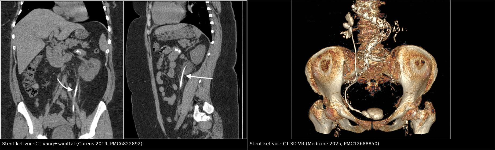
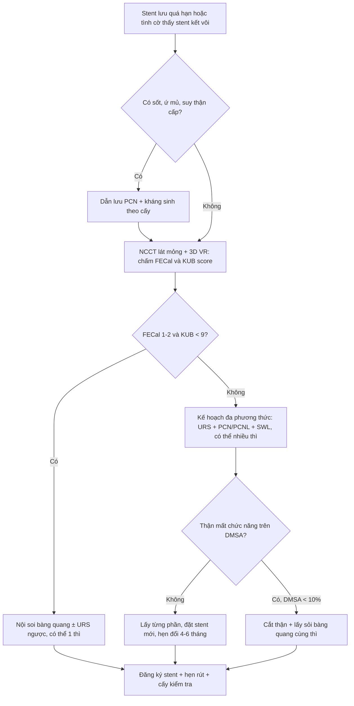
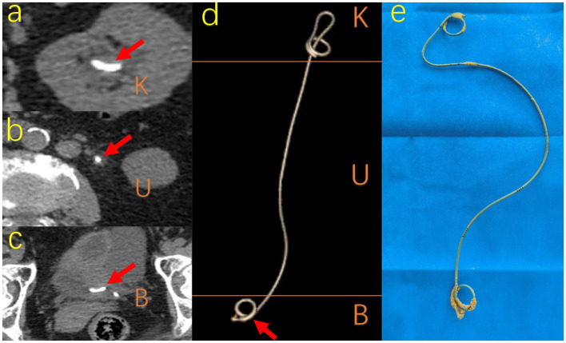
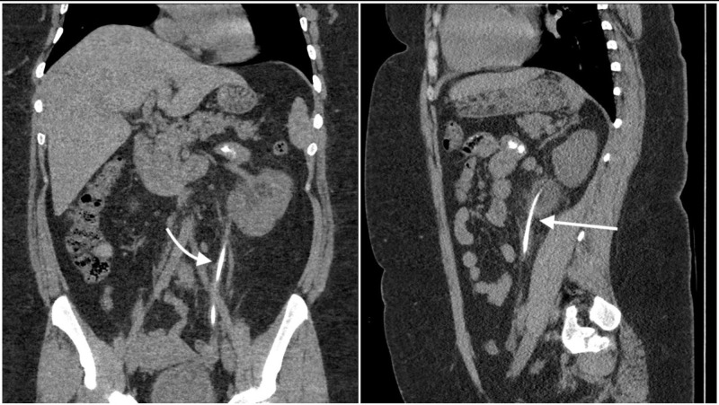
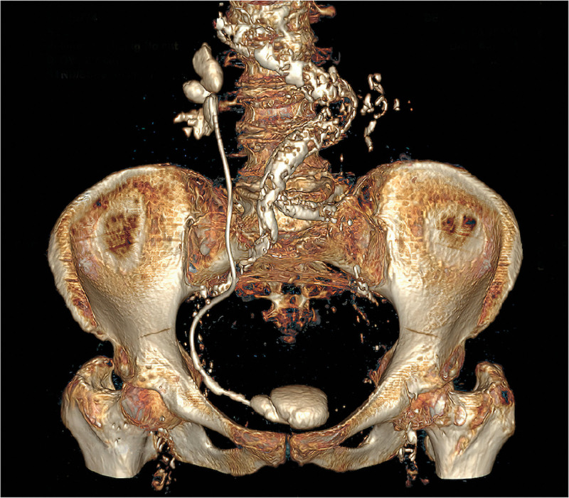

# 1660 — Stent niệu quản lưu quên & kết vôi (forgotten/retained encrusted ureteral stent)

**Tags:** `pattern:di-vat` `pattern:ket-voi` `pattern:voi-hoa` `vung:nieu-quan` `vung:bang-quang` `vung:than` `score:FECal` `score:KUB-score` `score:V-GUES` `protocol:CT-KUB-khong-can-quang` `protocol:dan-luu-qua-da` `incidentaloma:stent-luu-quen`

**Mức chắc chắn (certainty):** tổng hợp y văn (literature synthesis) — tổng quan có hệ thống 147 nghiên cứu/1.292 ca stent lưu quên (BMC Urology 2024, PMC10913558), hướng dẫn thực hành + thuật toán của nhóm EAU Young Academic Urology (Central European Journal of Urology 2021, PMC8771125), chuẩn thực hành CIRSE 2026 về đặt/đổi stent niệu quản (PMC12963180), đoàn hệ 354 ca có CT trước rút stent (Frontiers in Medicine 2023, PMC10433756), loạt 33 ca đối chiếu thời gian lưu – độ kết vôi (J Clin Med 2025, PMC12194611), cùng các ca nguyên văn có ảnh (PMC6822892, PMC12688850, PMC13544750). Số nào chỉ là suy luận của người viết đều được ghi rõ.

> **Câu chốt:** stent niệu quản lưu quên **không phải** "một dị vật lành tính chờ rút", mà là **quả bom kết vôi theo thời gian**: nguy cơ kết vôi **9,2% ở 6 tuần → 47,5% ở 6–12 tuần → 76,3% sau 12 tuần**, và **76–90% sau 12 tháng**. CT không cản quang lát mỏng là **chuẩn vàng để đo gánh nặng vôi hóa**, phân độ **FECal (1–5)** / **KUB score (3–15)** rồi mới chọn đường can thiệp. Ba bẫy chết người: **cố rút stent "thấy dễ" trên đài → gãy stent/đứt niệu quản**, **bỏ sót mảnh stent gãy còn lại**, và **nhầm cản quang tồn dư trong niệu quản với stent kết vôi**.

## 1. Tổng quan bệnh học – cơ chế hình ảnh

### 1.1 Định nghĩa và dịch tễ

- **Stent lưu quên (forgotten ureteral stent, FUS):** stent được đặt đúng chỉ định nhưng **không được rút đúng hẹn**; tổng quan hệ thống định nghĩa là lưu **> 2 tháng** (PMC10913558). Không đồng nghĩa với "stent hỏng" — stent vẫn có thể thông.
- **Tần suất:** **0,9–12%** bệnh nhân đặt stent bị lưu quên (PMC10913558; PMC13544750).
- **Thời gian lưu trung bình 33,5 tháng**, dao động **3 tháng – 32 năm** (147 nghiên cứu, 1.292 ca; PMC10913558). Ca dài nhất: nữ 59 tuổi, **hai stent kết vôi nặng lưu 32 năm**, đặt "dự phòng" khi cắt tử cung.
- **Nguyên nhân quên: phía bệnh nhân 83,9%** (kém tuân thủ, quên, hiểu sai là "không cần rút"), phần còn lại do **hệ thống y tế không có sổ theo dõi/không hẹn rút** (PMC10913558).
- **Triệu chứng khi đến:** đau mạn sườn **37,3%**, triệu chứng đường tiểu dưới **33,3%**, đái máu **22,8%**, sốt/nhiễm khuẩn **19,2%**, **không triệu chứng 10,8%** (PMC10913558) — nghĩa là **một phần đáng kể chỉ phát hiện tình cờ trên CT**.
- **Biến chứng gặp:** kết vôi **80,8%**, nhiễm khuẩn niệu **40,2%**, suy giảm chức năng thận, gãy stent, di trú, thủng niệu quản, **cắt thận** khi thận mất chức năng (PMC10913558; PMC13544750).
- **Tới 10%** bệnh nhân lưu stent vẫn **mất theo dõi và không được rút** dù đã tư vấn (PMC10913558).
- **Hệ quả pháp lý:** stent lưu quên từng chiếm **tới 16%** các vụ kiện trong lĩnh vực nội soi tiết niệu (PMC10433756).

### 1.2 Sinh lý bệnh: vì sao stent "mọc đá"

1. Trong **vài giờ** sau đặt, bề mặt polymer bị phủ **màng sinh học (conditioning film)** gồm protein, ion và tế bào — đây là "keo dính" cho tinh thể.
2. **Vi khuẩn bám và tạo biofilm**; loài sinh **urease** (*Proteus*, *Klebsiella*, *Pseudomonas*) thủy phân urê → **NH₃** → nước tiểu **kiềm** → kết tủa **struvite (MgNH₄PO₄)** và **carbonate apatite**.
3. Song song, **calci oxalat/phosphate** kết tủa trực tiếp trên bề mặt và trong lớp biofilm — đây là thành phần chính của lớp vôi hóa nhìn thấy trên CT.
4. **Thời gian lưu là yếu tố nguy cơ mạnh nhất** (PMC8771125). Các yếu tố khác: tiền sử sỏi, nước tiểu nhiễm khuẩn, thai kỳ (giãn niệu quản sinh lý + kết vôi nhanh), stent kim loại, bệnh thận mạn.
5. **Đổi màu đen** của stent sau rút gắn chặt với nhiễm **E. coli/Klebsiella/Enterococcus** (p < 0,001) và với thời gian lưu dài (p < 0,001) — dấu hiệu đại thể, không thấy trên hình ảnh (PMC12194611).

### 1.3 TẠI SAO hình ảnh trông như vậy (vật lý + mô bệnh)

- **Stent polymer được pha chất cản quang** nên luôn **tăng đậm độ** trên X-quang/CT, kể cả khi chưa kết vôi. Lớp kết vôi là **muối calci** (Z hiệu dụng và mật độ cao) → **cực sáng trên CT**, tương đương sỏi canxi; vì vậy trên **cửa sổ xương** lớp vôi hóa **nổi bật hơn hẳn** thân stent.
- **Vì sao CT thắng X-quang:** phim KUB là **ảnh chiếu (projection)** — vôi hóa stent, sỏi niệu quản và vôi hóa động mạch chậu **chồng lên nhau**, không định khu được theo chiều sâu; phim **thường không lập bản đồ chính xác vị trí vôi hóa** (PMC8771125). CT **lát mỏng** cho **đậm độ định lượng + định vị 3 chiều**, đo được **độ dày lớp vôi** và dựng **3D VR** để thấy toàn bộ stent. Trong tổng quan 147 nghiên cứu, **CT là phương thức được ưu tiên ở 76,1%** ca (PMC10913558).
- **Vì sao lớp vôi mỏng dễ bị bỏ sót:** thể tích lớp vôi nhỏ + **hiệu ứng một phần thể tích (partial volume)** với nước tiểu/thành niệu quản → trên lát dày 5 mm, lớp 1 mm có thể chỉ làm "dày nhẹ" thân stent. Lát **≤ 1–2 mm** làm giảm hiệu ứng này (khuyến cáo kỹ thuật, không phải ngưỡng từ thử nghiệm).
- **Vì sao 3D VR hữu ích:** tái tạo bề mặt theo ngưỡng đậm độ **tách thân stent khỏi xương chậu** → thấy **đoạn kết vôi, chỗ gãy, đầu coil lạc chỗ** trong một ảnh, đúng như hình 1660-C3D.
- **Ngưỡng định lượng:** nguy cơ kết vôi **9,2% ở 6 tuần · 47,5% ở 6–12 tuần · 76,3% sau 12 tuần** (Dyer, trích trong PMC10433756); **56,8% ở 6–12 tuần và 75,9% sau 12 tuần** (Kawahara), **76,6% sau 12 tuần** (el-Faqih) (PMC8771125); **76–90% sau 12 tháng, gần 100% sau 18 tháng** (báo cáo ca 2026, PMC13544750). Tỷ lệ kết vôi thực tế trong hai đoàn hệ có CT trước rút: **37,4% (101/270)** và **38,1% (32/84)** (PMC10433756).

### 1.4 Gánh nặng lâm sàng – can thiệp

- **59,0%** ca cần **nhiều thì hoặc nhiều phương thức** để sạch stent/sỏi (PMC10913558).
- Đường can thiệp thường dùng: **nội soi bàng quang ± tán sỏi bàng quang 64,8%**, **niệu quản soi ngược 43,4%**, **lấy xuôi qua PCNL 31,6%**, **sóng xung kích hỗ trợ 30,4%**, **mổ nội soi/mở 6,7%** (gồm cả **cắt thận**) (PMC10913558).
- Loạt 12 ca kết vôi cả hai đầu: rút **trọn trong 1 thì** bằng **phối hợp xuôi + ngược đồng thời**, thời gian mổ **72,9 ± 45,9 phút**, **1 biến chứng Clavien–Dindo II**, không truyền máu (PMC12688850) — cho thấy ca chọn lọc có thể "1 thì", nhưng **không được mặc định**.
- **Kháng sinh:** nhóm này có tỷ lệ **E. coli kháng quinolone > 90%**; cấy nước tiểu **trước** can thiệp là bắt buộc (PMC8771125).

## 2. Mẫu hình + chẩn đoán phân biệt theo vị trí (gamut)

**Mẫu hình chính:** **cấu trúc dạng ống, bờ đều, tăng đậm độ, chạy đúng đường niệu quản**, có **lớp vôi hóa bám không đều** (dày ở coil, mỏng ở thân) ± **sỏi lớn ở đầu coil bàng quang**.

| Vị trí (theo FECal) | Hình ảnh chốt | Gamut cần loại trừ |
|---|---|---|
| **K — coil thận** (FECal 1 phần) | Vôi hóa dạng vòng/cụm ở **bể thận**, dính vào đầu stent | Sỏi bể thận, vôi hóa động mạch thận, **cặn cản quang tồn dư**, u thận vôi hóa, nang canxi sữa |
| **U — thân niệu quản** | **Đường vôi hóa mảnh, liên tục** dọc niệu quản, "như sợi chỉ đá" | Sỏi niệu quản, vôi hóa động mạch chậu/vôi hóa mạch, xơ hóa lao – sán máng, cục máu vôi hóa, **mảnh stent gãy** |
| **B — coil bàng quang** | **Sỏi lớn bám đầu coil** ("đá cuội" trong bàng quang) ± sỏi bàng quang tự do | Sỏi bàng quang, u bàng quang vôi hóa, **vôi hóa bóng Foley**, dị vật, sỏi quanh stent khác |
| **Toàn bộ stent** | Vôi hóa **cả 3 đoạn**, có thể **gãy nhiều đoạn**, di trú | Gãy stent đơn thuần (không kết vôi), stent di trú vào bể thận/bàng quang, stent xuyên thủng niệu quản |

- **Phân bố vị trí thực tế** (101 ca kết vôi): **U 60 · B 24 · K 4 · KB 7 · UB 5 · KUB 1** (PMC10433756) — thân niệu quản và coil bàng quang là nơi hay gặp nhất, không phải coil thận.
- **Phân biệt theo bối cảnh:** đau mạn sườn + tiền sử đặt stent + **không có sỏi thận mới** → nghĩ stent lưu quên trước khi nghĩ "sỏi tái phát".

## 3. Bảng so sánh phân biệt (ma trận đối chiếu)

| Thực thể (entity) | Hình ảnh điển hình (CT KUB lát mỏng) | Chốt vào (rule-in) | Chốt loại (rule-out) | Gợi ý xác nhận |
|---|---|---|---|---|
| **Stent kết vôi (encrusted stent)** | Cấu trúc **dạng ống liên tục**, đậm độ cao, **lớp vôi bám quanh thân**, chạy đúng đường niệu quản, hai đầu cuộn | **Hình dạng ống + hai coil + vôi hóa bám không đều theo đoạn K/U/B** | **Có đầu coil trong bể thận và bàng quang** loại trừ sỏi đơn thuần; **không có cấu trúc ống** loại trừ stent | CT 3D VR + FECal/KUB score; đối chiếu hồ sơ đặt stent |
| **Sỏi niệu quản** | Cục tăng đậm độ **khu trú**, ± "đuôi sao", dừng dòng nước tiểu, giãn niệu quản trên | **Vị trí 3 điểm hẹp sinh lý** (khớp thắt lưng–cùng, bắt chéo mạch chậu, lỗ niệu quản) + **không có ống stent** | **Có bóng stent xuyên qua** loại trừ sỏi đơn thuần (nhưng có thể **sỏi bám stent**) | So sánh với hồ sơ; xem toàn bộ chiều dài niệu quản trên MPR |
| **Cản quang tồn dư (residual IV contrast)** | Dịch **tăng đậm độ trong lòng niệu quản**, bờ mềm, **không có cấu trúc ống cứng**, thay đổi giữa các lát | **Tiền sử chụp cản quang trong 24 giờ** + đậm độ giảm dần theo thời gian | **Không có coil, không có vỏ canxi**; đậm độ **không đều kiểu "vệt nước"** | Hỏi tiền sử chụp; chụp lại sau 24–48 giờ nếu cần (ca 53 tuổi bị nhầm là "stent canxi hóa", PMC12909285) |
| **Vôi hóa động mạch chậu/mạch máu** | Đường vôi hóa **theo thành mạch**, có thể **hai bên đối xứng**, không đi vào bể thận | **Đường đi theo mạch + không có coil** | **Không liên tục tới bể thận/bàng quang** | MPR theo trục mạch; so sánh với ĐM chậu đối bên |
| **Sỏi bàng quang** | Sỏi **tròn/lớn trong lòng bàng quang**, có thể **không dính stent** | **Không có tiếp nối với ống stent**; bờ sỏi tròn đều | **Có "đuôi" vôi hóa chạy lên niệu quản** → sỏi bám stent | Xem đầu coil dưới trên MPR; đổi tư thế/so sánh nếu cần |
| **Stent gãy/di trú (fractured/migrated)** | **Mất liên tục** thân stent, mảnh rời trong niệu quản/bể thận/bàng quang | **Đoạn stent không liên tục** + mảnh rời cùng đậm độ | **Stent liền một khối** loại trừ gãy | 3D VR; đếm đủ **hai coil**; kiểm tra mảnh dưới bóng Foley |

- **Ảnh ghép đối chiếu:**  — trái: CT vành + sagittal thấy **lớp vôi hóa bám thân stent** (mũi tên); phải: **CT 3D VR** thấy toàn bộ stent + **sỏi lớn ở coil bàng quang**. Tạo bằng `tools/make_composite.py` (letterbox, giữ tỉ lệ).

## 4. Protocol chụp + hệ phân độ/điểm chuẩn hóa

### 4.1 Protocol

- **Bước 1 — X-quang KUB:** rẻ, dễ làm, phát hiện **stent và sỏi lớn**, nhưng **không lập bản đồ chính xác** vị trí/độ dày vôi hóa (PMC8771125).
- **Bước 2 — CT không cản quang (NCCT) toàn bộ hệ tiết niệu:** **phương thức được chọn** để đánh giá kết vôi, di trú, gãy stent và **thận đối bên** (PMC8771125; PMC10913558). Kỹ thuật gợi ý: **lát ≤ 1–2 mm**, tái tạo **mặt phẳng vành/sagittal**, **cửa sổ xương** để đo vôi hóa + **cửa sổ mô mềm** để đánh giá thận/niệu quản, dựng **3D VR** khi nghi kết vôi toàn bộ.
- **Bước 3 — chức năng thận:** khi nghi thận mất chức năng (teo, ứ nước nặng, vỏ mỏng) → **xạ hình DMSA** trước khi quyết định cắt thận; ca báo cáo dùng **DMSA < 10%** làm ngưỡng cắt thận (PMC13544750).
- **Bước 4 — nhiễm khuẩn:** **cấy nước tiểu trước can thiệp**, điều trị theo kháng sinh đồ; nếu **ứ mủ + nhiễm trùng toàn thân** → **dẫn lưu qua da (PCN) trước** rồi mới lấy stent (PMC8771125).
- **Bước 5 — theo dõi sau can thiệp:** KUB/CT kiểm tra sạch sỏi + **đăng ký stent (stent register)** với ngày hẹn rút (PMC12963180).

### 4.2 Hệ phân độ

| Hệ | Cấu trúc | Ngưỡng / ý nghĩa |
|---|---|---|
| **FECal** (Forgotten Encrusted CALcified) | **5 độ** theo vị trí vôi hóa: **1** = chỉ coil dưới; **2** = coil dưới + thân niệu quản dưới; **3** = lan tới niệu quản giữa, cả hai coil vôi một phần; **4** = kết vôi **toàn bộ** stent (cả hai coil + thân); **5** = **kết vôi hoàn toàn + gánh nặng sỏi lớn + suy chức năng thận** | Công cụ **gốc và dùng nhiều nhất**, giúp lập kế hoạch **đa phương thức**; FECal 4–5 = **can thiệp phức tạp, nhiều thì** (PMC8771125; PMC13544750) |
| **KUB score** | Chấm **3 đoạn**: K (coil thận), U (thân), B (coil bàng quang), mỗi đoạn **1–3 điểm** → tổng **3–15** | **≥ 9 điểm** liên quan **nguy cơ cần nhiều lần mổ, nhiều phương thức và thời gian mổ > 3 giờ** (PMC8771125) |
| **V-GUES** | Phân độ **A–D** theo khả năng lấy được stent + sỏi | Dùng để **tiên lượng thành công**, bổ sung cho FECal (PMC8771125) |
| **Clavien–Dindo** | Biến chứng sau can thiệp | Loạt 12 ca: **1 biến chứng độ II**, không có độ III–V (PMC12688850) |

### 4.3 Thuật toán xử trí

- **Nguyên tắc vàng:** **không kéo mạnh** khi stent "không ra" — lực kéo là nguyên nhân **gãy stent và đứt niệu quản**; phải dừng, chụp lại và chuyển kế hoạch (PMC10433756; PMC8771125).
- **Số thì:** đa số loạt báo cáo cần **1–3 lần mổ**; một số ca chọn lọc làm **1 thì** (PMC8771125; PMC12688850).
- **Phòng ngừa (quan trọng hơn điều trị):** **đổi stent định kỳ 4–6 tháng** với stent polymer lưu lâu; **tối đa 2–3 tháng** nếu còn sỏi hoạt động cùng bên; **3–6 tháng** để phòng stent nhiễm; **tránh đặt stent trong thai kỳ** nếu có lựa chọn khác; **sổ đăng ký stent + nhắc hẹn** cho mọi bệnh nhân (PMC12963180; PMC10913558).
- **Tư vấn bệnh nhân:** nói rõ **stent phải được rút**, ghi ngày hẹn bằng văn bản, và cảnh báo triệu chứng quay lại (PMC10913558).

## 5. Biến thể bình thường và cạm bẫy

- **"Stent không kết vôi" ≠ "không quên":** stent vẫn nằm đúng vị trí, không có lớp canxi → hình ảnh **bình thường**; chẩn đoán lưu quên dựa vào **hồ sơ/ngày đặt**, không dựa vào hình ảnh.
- **Cản quang tồn dư trong niệu quản** sau CT có cản quang 24 giờ trước đó: bờ mềm, đậm độ không đều, **không có coil**; ca 53 tuổi bị nhầm là "stent canxi hóa" và phải hội chẩn chuyên khoa (PMC12909285). **Luôn hỏi tiền sử chụp cản quang** trước khi gọi "dị vật".
- **Vôi hóa mạch chậu** chạy song song niệu quản đoạn xa: trên lát trục, vôi hóa thành **động mạch** có thể trông như "sỏi niệu quản"; theo dõi trên MPR và so sánh với mạch đối bên.
- **Sỏi bám stent vs sỏi bàng quang tự do:** sỏi tự do **không có "đuôi" vôi hóa** nối lên niệu quản; phải đếm đủ **hai coil** và xem toàn bộ chiều dài stent.
- **Stent gãy để lại mảnh:** mảnh **không cản quang?** — không, mọi stent đều cản quang, nhưng **mảnh nhỏ có thể bị bỏ qua** khi chỉ nhìn ảnh trục; **luôn dựng 3D/MPR** và đếm lại. Ca gãy + thoát ra niệu đạo đã được báo cáo (PMC13594378).
- **Bỏ sót thận đối bên:** nguyên tắc **"satisfaction of search"** — thấy stent kết vôi một bên rồi dừng; phải xem **thận/niệu quản đối bên**, vì **stent hai bên** đã gặp và gây **mất chức năng thận** (PMC13544750).
- **Thai kỳ:** giãn niệu quản sinh lý + kết vôi nhanh; stent **dễ di trú và nhiễm khuẩn** — hạn chế đặt, nếu buộc phải đặt thì **theo dõi sát và đổi sớm** (PMC12963180).
- **"Rút được" trên đài ≠ an toàn:** nội soi thấy đầu coil dễ → kéo; nếu lớp vôi bám thân, lực kéo truyền vào niệu quản. **Dừng ngay khi thấy căng**, chuyển CT/3D và kế hoạch đa phương thức.

## 6. Tự lượng giá — Blind Quiz

**Ca 1 — Nữ 69 tuổi, đặt stent niệu quản 322 ngày, "quên" rút**

- Gợi ý lâm sàng: không triệu chứng rõ, đến vì kiểm tra định kỳ; tiền sử sỏi thận.
- Câu hỏi: (1) Mô tả lớp tăng đậm độ bám quanh stent ở 3 mức K/U/B. (2) Chấm **FECal** và **KUB score**. (3) Vì sao CT lát mỏng tốt hơn KUB ở ca này?

<b>Bấm để hiện đáp án (findings + chẩn đoán)</b>

- Dấu hiệu: (A) **coil thận** có vôi hóa dạng cụm; (B) **thân niệu quản** có lớp vôi mảnh chạy dọc; (C) **coil bàng quang** có sỏi lớn bám; (D) **3D VR** thấy toàn bộ stent; (E) **stent sau rút** lộ rõ các cục vôi ở hai đầu.
- Chẩn đoán: **stent kết vôi toàn bộ 3 đoạn (FECal 4)** — vôi hóa cả K, U, B; gánh nặng vôi ở coil bàng quang lớn nhất.
- Vì sao: muối calci đậm độ cao; **CT định vị 3 chiều + đo độ dày**, còn KUB chiếu chồng các cấu trúc.
- Nguồn ảnh: *Frontiers in Medicine* 2023, Figure 3 — **PMC10433756**, CC BY 4.0 (nguyên bản, không crop).

**Ca 2 — Nữ 29 tuổi, đau hông lưng trái 2 tuần, tiểu buốt, nôn**

- Gợi ý lâm sàng: sỏi thận đã biết; đặt stent niệu quản **hơn 1 năm trước** ở cơ sở khác; bệnh nhân **không biết phải rút**; WBC 11,21 × 10³/µL, niệu máu 2+.
- Câu hỏi: (1) Vì sao thận trái ứ nước nặng dù "đã có stent"? (2) Dấu hiệu nào trên CT xác nhận stent kết vôi? (3) Bước xử trí đầu tiên?

<b>Bấm để hiện đáp án (findings + chẩn đoán)</b>

- Dấu hiệu: **thận trái ứ nước nặng**, stent **mất chức năng dẫn lưu** vì **kết vôi bám thân** (mũi tên trắng); lớp vôi hóa chạy dọc niệu quản trên mặt phẳng vành và sagittal.
- Chẩn đoán: **stent lưu quên > 1 năm, kết vôi gây tắc** + **nhiễm khuẩn niệu** (WBC tăng, niệu máu).
- Xử trí: **cấy nước tiểu + kháng sinh**, hội chẩn tiết niệu; nếu **ứ mủ/sốt** → **dẫn lưu PCN trước**, rồi lấy stent theo kế hoạch (không kéo mù).
- Vì sao: lớp vôi làm **hẹp lòng stent** → mất dẫn lưu; hình ảnh **"stent vẫn nằm đúng chỗ"** không đồng nghĩa stent còn tác dụng.
- Nguồn ảnh: *Cureus* 2019, Figure 1 — **PMC6822892**, CC BY 4.0 (nguyên bản, không crop).

**Ca 3 — CT 3D VR của một stent "đã quên"**

- Gợi ý lâm sàng: loạt 12 bệnh nhân kết vôi cả hai coil, thời gian lưu trung bình **17,1 ± 12,8 tháng**.
- Câu hỏi: (1) Mô tả hai ổ vôi hóa lớn nhất. (2) Vì sao 3D VR hữu ích trước mổ? (3) FECal dự kiến?

<b>Bấm để hiện đáp án (findings + chẩn đoán)</b>

- Dấu hiệu: stent chạy từ **bể thận phải** xuống **bàng quang**; **coil trên** có cụm vôi nhỏ; **coil dưới** có **sỏi lớn dạng "đá cuội"** trong bàng quang; thân stent **dày, không đều** do lớp vôi.
- Chẩn đoán: **stent kết vôi cả hai đầu (FECal 3–4)**, cần **kế hoạch đa phương thức**; loạt này đã rút **trọn 1 thì** bằng phối hợp xuôi–ngược ở ca chọn lọc.
- Vì sao: 3D VR **tách stent khỏi xương chậu**, thấy **đoạn kết vôi + sỏi đầu coil** trong một ảnh → lập kế hoạch dụng cụ/thì mổ.
- Nguồn ảnh: *Medicine* 2025, Figure 1 — **PMC12688850**, CC BY 4.0 (nguyên bản, không crop).

## Bài liên quan chéo
- [1620 – Ứ nước thận, urinoma & khối tiểu khung lành tính](../1620-u-nuoc-than-urinoma-khoi-tieu-khung-lanh-tinh/lesson.md)
- [152 – Sỏi niệu, ứ nước & nhiễm trùng niệu trên](../152-soi-nieu/lesson.md)
- [190 – Sỏi đường niệu trên & sỏi thận ghép ở bàng quang thần kinh](../190-soi-nieu-quan-than-ghep-bang-quang-than-kinh/lesson.md)
- [137 – Theo dõi stent/dẫn lưu đường mật: di trú, tắc, nhiễm trùng](../137-theo-doi-stent-dan-luu-duong-mat-di-tru-tac-nhiem-trung/lesson.md) — cùng nguyên lý "dị vật lưu lâu = nhiễm + tắc + di trú", khác khoang.

## Ảnh
- `images/1660_stent-luu-quen_CT_PMC10433756-F3.jpg` — CT 3 mức K/U/B + 3D + stent sau rút; *Front Med* 2023 (PMC10433756), CC BY 4.0.
- `images/1660_stent-luu-quen_CT_PMC6822892-F1.jpg` — CT vành + sagittal; *Cureus* 2019 (PMC6822892), CC BY 4.0.
- `images/1660_stent-luu-quen_CT3D_PMC12688850-F1.jpg` — CT 3D VR; *Medicine* 2025 (PMC12688850), CC BY 4.0.
- `images/composite_stent-luu-quen_CT.jpg` — ảnh ghép 2 ô (CT vành/sagittal + CT 3D VR), tạo bằng `tools/make_composite.py`.
- Ghi công đầy đủ + giấy phép từng file: `images/CREDITS.md`.

> Không dùng để chẩn đoán độc lập khi chưa có người hướng dẫn.
