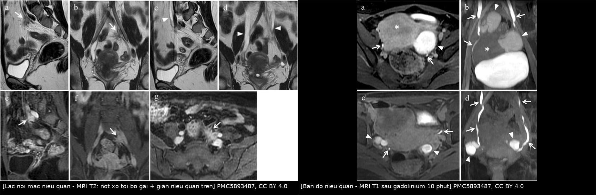
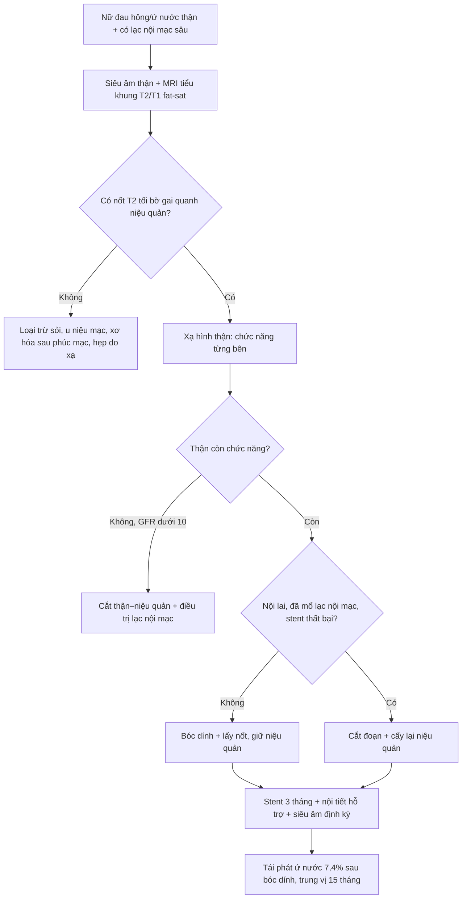
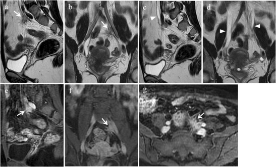
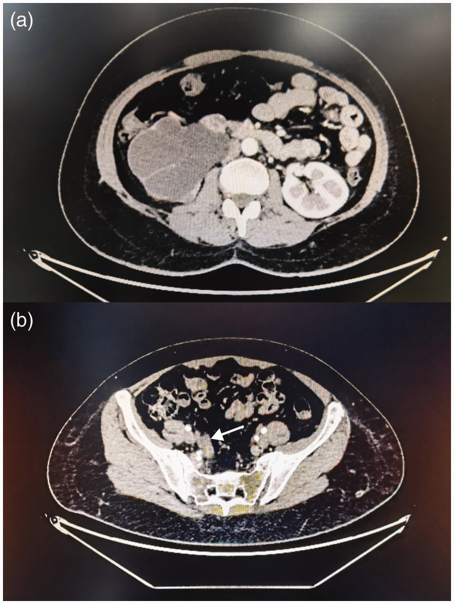
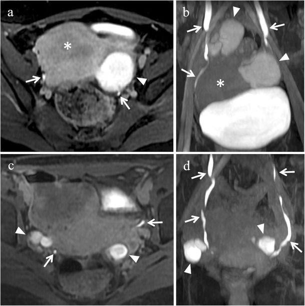

# 1661 — Lạc nội mạc tử cung niệu quản: ứ nước thận im lặng / Ureteral endometriosis

**Tags:** `pattern:u-nuoc-than` `pattern:hep-nieu-quan` `pattern:not-xo` `pattern:tang-sinh-mach` `vung:nieu-quan` `vung:tieu-khung` `vung:than` `score:split-renal-function` `protocol:MRI-tieu-khung` `protocol:CT-urography` `protocol:stent-nieu-quan` `incidentaloma:u-nuoc-than`
**Mức chắc chắn (certainty):** tổng hợp y văn (literature synthesis) — dựa trên 1 đoàn hệ 74 ca có theo dõi trung vị 9 năm (PMC13637158), 1 bài tổng quan MRI–mô bệnh có ảnh (PMC5893487) và 5 ca nguyên văn có ảnh/số liệu (PMC11869247, PMC13379677, PMC12506785, PMC11350447, PMC4899875). Câu nào là suy luận từ bằng chứng gián tiếp được ghi **[suy luận]**.

## 1. Tổng quan bệnh học – cơ chế hình ảnh

- **Định nghĩa:** lạc nội mạc tử cung niệu quản (ureteral endometriosis, UE) là mọi tình trạng mô nội mạc tử cung **hoặc mô xơ đi kèm** chèn ép/làm biến dạng niệu quản — kể cả khi **chưa có ứ nước** (PMC5893487). Đây là lý do "niệu quản bình thường trên CT" không loại trừ bệnh ở giai đoạn sớm.
- **Vì sao hiếm mà vẫn nguy hiểm:** đường niệu–sinh dục chiếm tới **20%** các ca lạc nội mạc sâu (deep infiltrating endometriosis, DIE), trong đó **bàng quang 85% · niệu quản 9% · thận 4% · niệu đạo 2%** (PMC5893487). Riêng niệu quản chỉ chiếm **0,01–1%** tổng số lạc nội mạc, nhưng trong quần thể DIE lại tới **10–48%** (PMC13637158; PMC5893487). UE chiếm khoảng **5%** lạc nội mạc đường niệu (PMC11350447).
- **Hai thể mô bệnh — quyết định cách mổ:**
  - **Ngoại lai (extrinsic, ~80–82,4%):** mô lạc nội mạc xâm lấn **adventitia** niệu quản rồi xơ hóa bóp từ ngoài vào. Đoàn hệ 74 ca: **82,4%** ngoại lai, **17,6%** nội lai (PMC13637158).
  - **Nội lai (intrinsic, ~18–20%):** xâm lấn **lớp cơ** niệu quản, có thể loét niêm mạc → khó tách, dễ tái hẹp sau bóc. Cả **13/13** tổn thương nội lai trong đoàn hệ đều phải cắt đoạn–nối (p < 0,001).
- **TẠI SAO nốt có T2 tối:** mô xơ (collagen) và cơ trơn chiếm phần lớn nốt, ít proton linh động → **T2 ngắn, tín hiệu thấp**; bờ **gai (spiculated)** vì sợi xơ kéo vào mỡ quanh niệu quản. Ổ xuất huyết cũ (hemosiderin/methemoglobin) tạo **điểm T1 cao** và **T2* trống tín hiệu**. Phần tuyến và mô đệm có mạch ngấm thuốc → **ngấm thuốc sau tiêm** trên T1 fat-sat (PMC5893487, Fig. 10).
- **TẠI SAO ứ nước mà bệnh nhân "không biết":** tắc tiến triển từ từ nên bể thận – đài thận **giãn trước** (Laplace: sức căng thành ∝ áp lực × bán kính), áp lực truyền vào nhu mô tăng chậm; thận đối bên bù hoàn toàn. Hệ quả là **nửa số ca không có triệu chứng niệu**, creatinine có thể bình thường. Đoàn hệ 74 ca: chỉ **25,7%** có triệu chứng niệu (tiểu nhiều, tiểu buốt, tiểu khó, đái máu); **39,2%** đau lưng/hông/mặt sau đùi (PMC13637158).
- **Ngưỡng định lượng về mất chức năng thận (đọc kỹ — đây là điểm chết người):**
  - Chụp nhấp nháy thận trước mổ ở **45/74 ca**: **68,9%** có giảm chức năng thận từng bên, chia **giảm nhẹ 32,3% · vừa 29,0% · nặng 22,6% · mất chức năng 16,1%** (PMC13637158).
  - Phân độ theo GFR một bên: bình thường **≥ 40 mL/phút/1,73 m²**; giảm nhẹ **30–40**; vừa **20–30**; nặng **10–20**; mất chức năng **< 10** (tiêu chuẩn của nhóm tác giả, PMC13637158).
  - Ứ nước/niệu quản giãn gặp ở **10,8–54,4%** ca UE (PMC13637158 dẫn y văn).
- **Số liệu hình thái từ đoàn hệ 74 ca:** niệu quản **trái 37,8% · phải 43,2% · hai bên 18,9%**; đoạn **xa 86,5%**, giữa 13,5%; **75,7%** có endometrioma kèm (trong đó **85,7% cùng bên**); **82,4%** có DIE ở vị trí khác; **64,9%** có adenomyosis; tất cả đều FIGO/ASRM **độ IV**, điểm ASRM trung vị **68**.
- **Số liệu ca nguyên văn (dùng cho quiz):**
  - Nữ **39 tuổi**, đau hông phải tái diễn, ứ nước–niệu quản phải + endometrioma phải; soi niệu quản **không thực hiện được vì lỗ niệu quản hẹp nhiều**; xạ hình thận: **thận phải mất chức năng**, thận trái còn tốt → cắt thận–niệu quản phải + cắt bán phần bàng quang + cắt phần phụ phải; mô bệnh **hỗn hợp nội lai + ngoại lai**, viêm thận mạn giai đoạn cuối (PMC13379677).
  - Nữ **35 tuổi**, đau hông phải 4 năm + đái máu đại thể; **thận trái đã mất chức năng 4 năm mà không triệu chứng**, phát hiện tình cờ; sau đó thận phải ứ nước tái diễn buộc đặt stent rồi cấy lại niệu quản (PMC12506785).
  - Bệnh nhân "ngoài 50 tuổi": ứ nước phải nặng + **nốt mô mềm 1,2 × 2,1 × 2,4 cm** ở mức S1/S2, chẩn đoán ban đầu là **u niệu quản**, chỉ sau mổ mới ra lạc nội mạc (PMC11869247).

## 2. Mẫu hình + chẩn đoán phân biệt theo VỊ TRÍ (Gamut)

Mẫu hình là **"nốt xơ quanh niệu quản + giãn niệu quản–bể thận phía trên"**. Việc đầu tiên: **xác định mức tắc** rồi mới đo độ giãn.

- **Theo đoạn niệu quản:**
  - **Đoạn xa, 3–4 cm trên lỗ niệu quản** — vị trí hay gặp nhất (86,5% đoàn hệ 74 ca; PMC5893487). Thường kèm DIE dây chằng tử cung–cùng, vách trực tràng–âm đạo, endometrioma cùng bên.
  - **Đoạn giữa** — hiếm hơn (13,5%), dễ nhầm với xơ hóa sau phúc mạc hoặc hạch.
  - **Khúc nối bể thận–niệu quản (UPJ)** — hiếm; nếu chỉ thấy ứ nước không thấy nốt, phải nghĩ nguyên nhân khác.
- **Theo cơ chế chèn ép:**
  - **Từ ngoài (extrinsic):** nốt DIE bóp/dính niệu quản — đa số.
  - **Trong thành (intrinsic):** mô lạc nội mạc trong lớp cơ → dày thành, hẹp lòng, dễ chảy máu niêm mạc.
  - **Xơ hóa đơn thuần (fibrotic pattern ~23%):** chỉ có xơ, không thấy tuyến — **không đáp ứng nội tiết**, phải mổ (PMC5893487 dẫn Seracchioli 77 ca).
- **Gamut của "nốt quanh niệu quản + ứ nước" (theo thứ tự cần loại trừ):**
  1. **Ung thư biểu mô niệu mạc (urothelial carcinoma)** — tổn thương **trong lòng**, bờ không đều, ngấm thuốc, thường ở người lớn tuổi/hút thuốc.
  2. **Ung thư cổ tử cung xâm lấn niệu quản** — khối cổ tử cung + thâm nhiễm dây chằng rộng, hẹp niệu quản **một đoạn dài** (đây là phân biệt chính mà PMC5893487 nêu).
  3. **Xơ hóa sau phúc mạc (retroperitoneal fibrosis)** — dải xơ **bao cả hai niệu quản**, kéo trung thất, thường ở ngang mức động mạch chủ; không có ổ xuất huyết T1 cao.
  4. **Hẹp do xạ trị tiểu khung** — tiền sử xạ, hẹp dài, nhẵn, không có nốt ngấm thuốc dạng gai.
  5. **Sỏi niệu quản** — cản quang > 200 HU, không có nốt mô mềm.
  6. **Tổn thương do can thiệp (thắt/buộc niệu quản sau mổ phụ khoa)** — **biến chứng niệu khoa hay gặp nhất của mổ tiểu khung, 1–10%** (PMC5893487).
  7. **Lạc nội mạc hóa ung thư** (endometriosis-associated carcinoma) — hiếm; khối lớn, ngấm thuốc mạnh, phá vỡ cấu trúc (PMC6590549).
  8. **Lạc nội mạc ở hậu mãn kinh** — vẫn xảy ra, thường im lặng, hay bị bỏ qua (PMC4899875).
- **Gợi nhớ theo tầng:** *nốt + giãn trên nốt + không có tổn thương trong lòng → nghĩ lạc nội mạc; tổn thương trong lòng/niêm mạc → nghĩ ung thư niệu mạc; hẹp dài hai bên → nghĩ xơ hóa sau phúc mạc hoặc xạ.*

## 3. Bảng so sánh phân biệt (ma trận đối chiếu)

| Thực thể (entity) | Hình ảnh điển hình (MRI/CT) | Chốt vào (rule-in) | Chốt loại (rule-out) | Gợi ý xác nhận |
|---|---|---|---|---|
| **Lạc nội mạc niệu quản ngoại lai** | Nốt **T2 rất tối, bờ gai**, bao quanh niệu quản; giãn niệu quản **ngay trên nốt**; ngấm thuốc sau tiêm; ± điểm T1 cao do xuất huyết | **Nốt T2 tối bờ gai + giãn trên nốt + endometrioma/DIE cùng bên** | Niêm mạc niệu quản nguyên vẹn, **không có tổn thương trong lòng** | MRI T2 lát mỏng 3 mm + T1 fat-sat + T1 sau gadolinium |
| **Lạc nội mạc nội lai** | **Dày thành niệu quản** từng đoạn, lòng hẹp, có thể thấy điểm T1 cao trong thành; niêm mạc có thể loét | **Dày thành + hẹp lòng + có máu cũ trong thành** | Khối ngoài thành đơn thuần, thành mỏng đều → ngoại lai | Soi niệu quản + sinh thiết; cắt đoạn nếu không tái thông |
| **Ung thư biểu mô niệu mạc** | Khối **trong lòng** niệu quản, bờ không đều, ngấm thuốc; ± hạch; thường không có DIE | **Tổn thương trong lòng + bờ không đều + hạch** | Nốt **ngoài** thành, niêm mạc trơn → nghĩ lạc nội mạc | CT urography thì bài tiết; nội soi + tế bào học |
| **Ung thư cổ tử cung xâm lấn** | Khối cổ tử cung lớn, thâm nhiễm dây chằng rộng, hẹp niệu quản **một đoạn dài**, có hạch chậu | **Khối cổ tử cung nguyên phát + hẹp dài + hạch** | Cổ tử cung bình thường, chỉ có nốt khu trú → không phải | MRI tiểu khung có tiêm; sinh thiết cổ tử cung |
| **Xơ hóa sau phúc mạc** | Dải/tấm xơ **T2 tối, bao hai niệu quản**, dọc trục ĐMC–chậu, có thể kéo niệu quản vào trong | **Bao hai bên + dọc ĐMC + không có ổ T1 cao** | Tổn thương khu trú một bên, có endometrioma → nghĩ lạc nội mạc | CT bụng–chậu; MRI; sinh thiết khi không điển hình |
| **Hẹp do xạ trị** | Hẹp dài, nhẵn, thành dày đều, **không có nốt ngấm thuốc**; mỡ quanh niệu quản xơ | **Tiền sử xạ đúng trường chiếu + hẹp dài nhẵn** | Có nốt bờ gai ngấm thuốc → không phải xạ đơn thuần | So sánh bản đồ xạ trị; CT urography |
| **Sỏi niệu quản** | Nốt **cản quang > 200 HU**, ± dấu viền mô mềm; không có nốt mô mềm | **Cản quang cao + ứ nước cùng bên** | Không thấy sỏi, có nốt mô mềm T2 tối → không phải sỏi | CT không cản quang lát mỏng 1–3 mm |
| **Lạc nội mạc hóa ung thư** | Khối lớn, ngấm thuốc mạnh, phá vỡ thành niệu quản, có thể xâm lấn mỡ/tạng lân cận | **Khối phá cấu trúc + ngấm mạnh không đồng nhất** | Nốt nhỏ, bờ gai, ngấm thuốc ít → lành tính | Sinh thiết/mổ; hóa mô miễn dịch |

*Trái: MRI T2 — nốt ngoài phúc mạc **T2 tối, bờ gai** (mũi tên trắng) sát mạch chậu trái, kèm **giãn niệu quản phía trên** (đầu mũi tên); các ô (e–g) là T1 fat-sat sau tiêm: nốt **ngấm thuốc**. Phải: MRI T1 fat-sat sau gadolinium ~10 phút — **niệu quản ngấm thuốc** (mũi tên) dùng để vẽ đường đi niệu quản trước mổ. Nguồn: PMC5893487 (CC BY 4.0), ảnh ghép letterbox giữ nguyên tỷ lệ.*

## 4. Protocol chụp + ngưỡng xử trí

### 4.1 Chụp gì, theo thứ tự nào

1. **Siêu âm thận – đường tiết niệu** (đầu tiên, rẻ, không bức xạ): đo **đường kính trước–sau bể thận**, độ dày nhu mô, so hai bên. Trong đoàn hệ 74 ca, siêu âm đo được **niệu quản rộng 1,0 cm (0,7–1,2)** và **bể thận 1,6 cm (1,2–2,3)** (PMC13637158).
2. **MRI tiểu khung** (chuẩn vàng để đánh giá DIE và niệu quản — PMC5893487):
   - **T2 độ phân giải cao, lát 3 mm**, mặt phẳng axial/oblique và coronal: tìm nốt **T2 tối bờ gai** dọc niệu quản, đo **kích thước 3 chiều** và **khoảng cách tới lỗ niệu quản**.
   - **T1 fat-sat**: điểm **T1 cao** = ổ xuất huyết cũ.
   - **T1 fat-sat sau gadolinium, chụp muộn ~10 phút**: **niệu quản ngấm thuốc** giúp vẽ đường niệu quản và đo khoảng cách nốt–lỗ niệu quản (PMC5893487). Với bể thận giãn, chụp thì niệu đồ ở **tư thế nằm sấp**.
   - Bàng quang **căng vừa** khi chụp: bàng quang quá căng che các ngách, quá rỗng không thấy niệu quản.
3. **CT urography (có thì bài tiết)** khi cần đánh giá giải phẫu – mức tắc và loại trừ sỏi/u niệu mạc; lát **1–3 mm**. Trong đoàn hệ, **85,1%** bệnh nhân được đặt **stent Double-J** trước hoặc trong mổ.
4. **Xạ hình thận (MAG3/DMSA) — bắt buộc trước khi quyết định cắt thận:** cho **chức năng thận từng bên**. Đây là xét nghiệm phân tầng mất chức năng (**16,1% mất chức năng** trong 45 ca được đo).
5. **Xét nghiệm:** creatinine/eGFR, tổng phân tích nước tiểu (đái máu vi thể), CA-125 (theo dõi bệnh, **không dùng để chẩn đoán**).

### 4.2 Ngưỡng và lựa chọn phẫu thuật

- **Bóc dính – lấy nốt, giữ niệu quản (ureterolysis + nodule excision)** là lựa chọn đầu cho **đa số**: 73% (54/74) trong đoàn hệ; tái phát ứ nước **7,4%** (4/54, trung vị **15 tháng**, 12–24 tháng), rò niệu quản **1,9%** (1/54) ở theo dõi trung vị **9 năm**.
- **Cắt đoạn niệu quản – nối lại (segmental ureterectomy + ureteroneocystostomy/ureteroureterostomy)**: dành cho **tổn thương nội lai**, **đã mổ lạc nội mạc trước đó** (OR **4,413**; KTC 1,138–17,108), **đặt stent trước mổ thất bại** (OR **7,833**; KTC 1,946–31,522). Nhóm này **không tái phát, không biến chứng** trong đoàn hệ, nhưng mổ dài hơn (**175 vs 120 phút**) và nằm viện lâu hơn (**14 vs 6 ngày**).
- **Stent thất bại không phải "thủ thuật hỏng"** mà là **dấu hiệu niệu quản bị biến dạng nặng** → nên chuẩn bị phương án cắt đoạn.
- **Rút stent sau 3 tháng**, siêu âm niệu trước và sau rút; theo dõi **3 tháng/lần trong năm đầu** rồi **6 tháng/lần đến 2 năm**, sau đó **hằng năm** (lịch của đoàn hệ).
- **Nội tiết đơn thuần không đủ** khi có xơ hóa/tắc: mô xơ **không đáp ứng hormone**, và tắc kéo dài làm mất thận **không hồi phục**. Hormone dùng **hỗ trợ sau mổ** (GnRHa, dienogest, LNG-IUS) — 4 ca tái phát trong đoàn hệ đều được xử trí bằng stent ± nội tiết.
- **Cắt thận** chỉ khi thận **đã mất chức năng** (GFR < 10 mL/phút) và/hoặc có biến chứng (nhiễm trùng, đau không kiểm soát, tăng huyết áp do thận) — như ca PMC13379677 và PMC11869247.

### 4.3 Sơ đồ quyết định

## 5. Biến thể bình thường và cạm bẫy

- **"Creatinine bình thường = thận ổn"** là cạm bẫy chết người: thận đối bên bù hoàn toàn nên xét nghiệm máu bình thường dù **một thận đã mất chức năng** (ca PMC12506785: thận trái mất chức năng **4 năm**, không triệu chứng). Phải có **xạ hình thận** khi đã xác định UE.
- **Chẩn đoán nhầm thành u niệu quản:** nốt mô mềm **1,2 × 2,1 × 2,4 cm** ở mức S1/S2 trên CT của ca PMC11869247 bị đọc là u, dẫn tới cắt thận–niệu quản. Nốt lạc nội mạc **T2 rất tối và bờ gai**, khác u niệu mạc (trong lòng, ngấm thuốc); nếu nghi ngờ, **MRI trước khi quyết định cắt tạng**.
- **Bỏ sót tổn thương hai bên:** **10–20%** ca UE có tổn thương hai bên (PMC5893487); đoàn hệ 74 ca là **18,9%**. Luôn đánh giá **cả hai niệu quản** và **cả hai thận** trên cùng một lần chụp.
- **Hậu mãn kinh không loại trừ:** vẫn có ca lạc nội mạc niệu quản ở phụ nữ đã mãn kinh, biểu hiện bằng **mất chức năng thận im lặng** (PMC4899875).
- **Bỏ sót DIE đi kèm:** **82,4%** ca có DIE ở vị trí khác, **75,7%** có endometrioma; chỉ nhìn niệu quản mà bỏ dây chằng tử cung–cùng/vách trực tràng–âm đạo là **mổ không triệt để** → tái phát.
- **Cạm bẫy mặt cắt:** trên CT/MRI axial, niệu quản đi **trước động mạch chậu ở bờ tiểu khung**, **ngoài tĩnh mạch sinh dục**; muốn chứng minh mức tắc phải **lần theo niệu quản trên chuỗi lát** từ thận xuống, không đoán theo một lát. Nang cạnh bể thận và bể thận ngoài xoang là hai "bản sao" hay đọc nhầm thành ứ nước.
- **Rủi ro khi mổ:** tổn thương niệu quản là **biến chứng niệu khoa hay gặp nhất của mổ phụ khoa, 1–10%**; với UE đã xơ hóa, nguy cơ còn cao hơn → luôn có **bản đồ niệu quản** trước mổ.

## 6. Tự lượng giá — Blind Quiz

**Ca 1 — Nữ 35 tuổi, đau bụng dưới – đau lưng chu kỳ, nhiều ổ lạc nội mạc sâu. Xem 2 mặt phẳng T2 trước.**

- Câu hỏi: (1) Nốt nằm ở đâu, tín hiệu gì? (2) Vì sao có giãn niệu quản? (3) Ba chẩn đoán phân biệt? (4) Cần thêm chuỗi xung nào để quyết định mổ?

<b>Bấm để hiện đáp án (findings + chẩn đoán)</b>

- **Dấu hiệu:** (a) sagittal và (b) coronal T2 — nốt đặc **ngoài phúc mạc, tín hiệu thấp, bờ gai** (mũi tên trắng), sát mạch chậu trái. (c, d) T2 — **giãn niệu quản phía trên** và cả niệu quản đối bên (đầu mũi tên trắng).
- **Vì sao giãn:** nốt xơ bao quanh niệu quản → hẹp lòng → ứ nước – niệu quản phía trên.
- **Chẩn đoán:** **lạc nội mạc tử cung niệu quản** (thể ngoại lai) trong bệnh cảnh DIE đa ổ.
- **Chuỗi xung cần thêm:** **T1 fat-sat** (tìm ổ xuất huyết T1 cao) và **T1 fat-sat sau gadolinium ~10 phút** — các ô (e–g) cho thấy nốt **ngấm thuốc**, đồng thời thấy rõ đường niệu quản để đo khoảng cách tới lỗ niệu quản trước mổ.
- Nguồn: PMC5893487, Fig. 10 (CC BY 4.0).

**Ca 2 — Bệnh nhân "ngoài 50 tuổi", đau lưng trái, CT có cản quang vì nghi u niệu quản.**

- Câu hỏi: (1) Mô tả (a) và (b). (2) Vì sao ban đầu nghĩ u niệu quản? (3) Dấu hiệu nào trên MRI giúp phân biệt? (4) Điều gì quyết định cắt thận hay giữ thận?

<b>Bấm để hiện đáp án (findings + chẩn đoán)</b>

- **(a)** thận phải **ứ nước rất nặng**, nhu mô mỏng, bể thận – đài thận giãn; thận trái bình thường. **(b)** nốt mô mềm **1,2 × 2,1 × 2,4 cm** ở mức **S1/S2** (mũi tên) làm hẹp niệu quản.
- **Vì sao nghĩ u:** nốt mô mềm khu trú + ứ nước trên + không có tiền sử lạc nội mạc điển hình → hình ảnh giống u niệu quản.
- **MRI giúp phân biệt:** nốt lạc nội mạc **T2 rất tối, bờ gai, bao quanh niệu quản**, có thể có **điểm T1 cao**; u niệu mạc là **tổn thương trong lòng**, ngấm thuốc, bờ không đều.
- **Quyết định:** nếu thận đã **mất chức năng** (GFR < 10 mL/phút) và bệnh nhân có triệu chứng → cắt thận–niệu quản; nếu còn chức năng → bóc nốt/cắt đoạn – cấy lại niệu quản để **giữ thận**.
- Nguồn: PMC11869247, Fig. 1 (CC BY-NC).

**Ca 3 — Cùng bệnh nhân ca 1: vì sao phải tiêm gadolinium và chụp muộn?**

- Câu hỏi: Cấu trúc tăng tín hiệu hình ống là gì? Nó giúp gì cho phẫu thuật viên?

<b>Bấm để hiện đáp án</b>

- Cấu trúc **tăng tín hiệu hình ống** là **niệu quản chứa nước tiểu có gadolinium** (thuốc bài tiết qua thận), thấy rõ trên **T1 fat-sat chụp muộn ~10 phút**; coronal MIP cho hình ảnh toàn chiều dài.
- **Giá trị:** vẽ **đường đi niệu quản** và tương quan với endometrioma/ổ DIE — giúp tránh **tổn thương niệu quản do mổ (1–10%)** và lập kế hoạch bóc nốt hay cắt đoạn.
- Nguồn: PMC5893487, Fig. 2 (CC BY 4.0).

## Bài liên quan chéo
- [1620 – Ứ nước thận & urinoma do khối tiểu khung lành tính ở nữ](../1620-u-nuoc-than-urinoma-khoi-tieu-khung-lanh-tinh/lesson.md)
- [531 – U xơ cổ tử cung, u xơ ký sinh & u xơ dây chằng rộng](../531-u-xo-co-tu-cung-ky-sinh-va-day-chang-rong/lesson.md)
- [582 – Biến chứng tiêu hóa–niệu sau xạ trị phụ khoa](../582-bien-chung-tieu-hoa-nieu-sau-xa-tri-phu-khoa/lesson.md)
- [564 – Rò bàng quang–âm đạo & rò niệu quản–âm đạo sau mổ phụ khoa](../564-ro-bang-quang-am-dao-sau-mo-phu-khoa/lesson.md)
- [500 – Tổng quan hệ Vú & Sản Phụ khoa](../500-tong-quan-vu-san-phu-khoa/lesson.md)
- [1657 – Dị dạng động–tĩnh mạch tử cung](../1657-di-dang-dong-tinh-mach-tu-cung/lesson.md)

> Không dùng để chẩn đoán độc lập khi chưa có người hướng dẫn.
