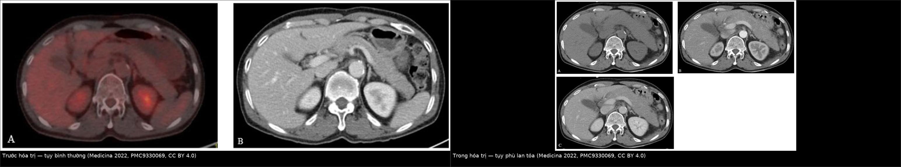
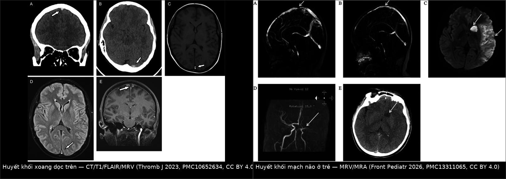
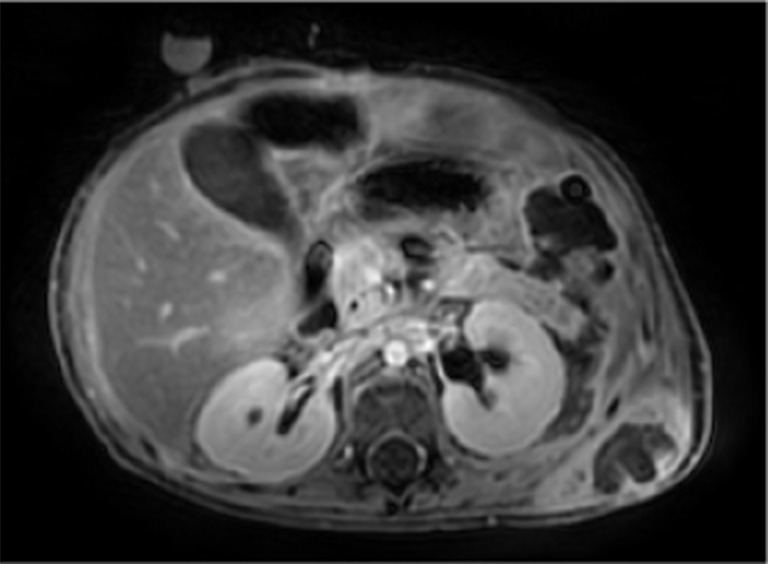
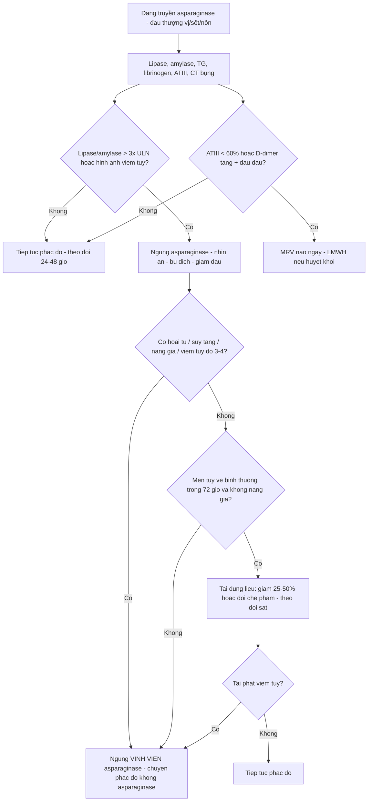
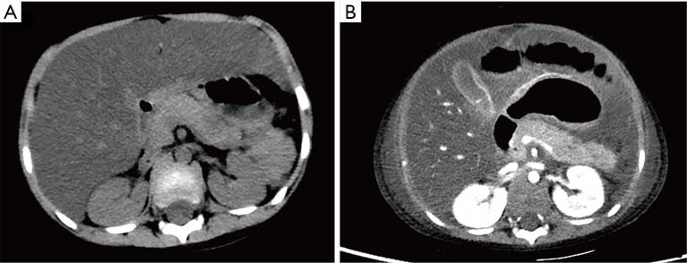
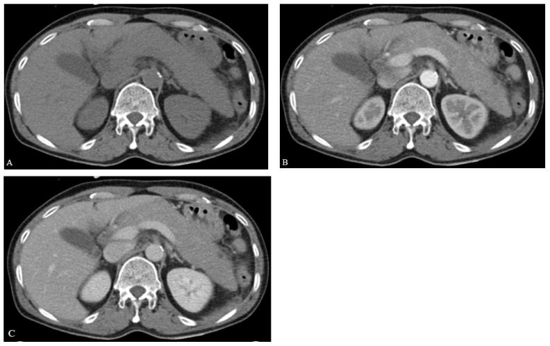
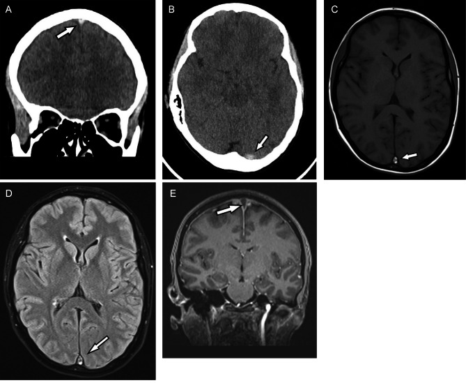

# 1662 — Độc tính asparaginase trong u lympho T/NK ngoại hạch (ENKTL): viêm tụy hoại tử, huyết khối xoang–tĩnh mạch & quy trình giữ – ngừng – tái dùng

**Tags:** `pattern:viem-tuy-cap` `pattern:hoai-tu-tuy` `pattern:huyet-khoi-xoang` `pattern:giam-fibrinogen` `vung:tuy` `vung:mach-nao` `score:Atlanta` `score:CTCAE` `protocol:CT-bung` `protocol:MRI-tuy` `protocol:MRV`

**Mức chắc chắn (certainty):** tổng hợp y văn (literature synthesis) — số liệu độc tính **theo phác đồ ENKTL** lấy từ bảng thử nghiệm lâm sàng của tổng quan CA Cancer J Clin 2026 (PMC13313535) + loạt P-GDP 57 bệnh nhân ENKTL (PMC6214348) + ca ENKTL **xâm lấn tụy giả viêm tụy do asparaginase** (Medicina 2022, PMC9330069) + 2 ca nguyên văn có ảnh viêm tụy/hoại tử (Transl Pediatr 2025, PMC12163796) + ca huyết khối xoang (Thromb J 2023, PMC10652634) + loạt huyết khối mạch não ở trẻ (Front Pediatr 2026, PMC13311065) + nghiên cứu AAP và tái dùng liều (Haematologica 2026, PMC12775779; J Cancer Res Clin Oncol 2025, PMC12480329). **Không có thử nghiệm ngẫu nhiên nào về ngưỡng ngừng/tái dùng trong ENKTL** — các ngưỡng dưới đây là tổng hợp thực hành, chỗ suy luận được ghi rõ.

> **Câu chốt:** trong ENKTL, asparaginase (L-asparaginase/pegaspargase) là **thuốc sống còn** nhưng có **hai mặt nạ hình ảnh**: (1) **tụy phù/hoại tử** — và trong ENKTL **tụy phù không đồng nghĩa viêm tụy do thuốc**, vì **u lympho T/NK có thể xâm lấn tụy lan tỏa** đúng lúc đang truyền asparaginase (ca nguyên văn: lipase **1.437 U/L**, amylase **683 U/L**, EUS-FNB lại ra **tế bào u lympho**); (2) **huyết khối** do asparaginase làm **giảm antithrombin III, fibrinogen, protein S** — biểu hiện sớm nhất thường là **huyết khối xoang tĩnh mạch não**, xuất hiện **5–17 ngày sau liều PEG-asparaginase**. Ngưỡng phải thuộc: **lipase/amylase > 3 × ULN** là tiêu chuẩn Atlanta (không phải "amylase tăng nhẹ"), **hoại tử tụy chỉ thấy rõ trên CT sau 72 giờ**, và **fibrinogen < 100 mg/dL (1,0 g/L)** là ngưỡng thay thế bằng huyết tương tươi đông lạnh/kết tủa lạnh.

## 1. Tổng quan bệnh học – cơ chế hình ảnh

### 1.1 Vì sao ENKTL lại phụ thuộc asparaginase

- Tế bào ENKTL **thiếu asparagine synthetase (ASNS)** → không tự tổng hợp đủ asparagine → chết khi asparagine huyết tương bị thủy phân. Vì vậy **mọi phác đồ hiệu quả** (SMILE, P-GemOx, DDGP, MESA, GELAD, AspaMetDex) đều chứa **L-asparaginase hoặc pegaspargase**.
- Cũng chính vì thế, **độc tính là giá phải trả bắt buộc**, không phải "tác dụng phụ hiếm": trong bảng thử nghiệm ENKTL, **hạ fibrinogen độ 3/4 gặp 11–28,8%**, **tăng amylase 19%**, **tăng đường huyết 18%**, **viêm tụy 7,5%**, **tăng triglyceride 8,6%** tùy phác đồ (PMC13313535).

### 1.2 Viêm tụy do asparaginase: TẠI SAO và TẠI SAO hình ảnh khó

- **Cơ chế:** ức chế tổng hợp protein ở tế bào nang tụy → **không tổng hợp được enzym tiêu hóa dạng tiền chất** → rối loạn bài tiết, **tự tiêu hóa mô tụy** (autodigestion) → phù, hoại tử mỡ, hoại tử nhu mô. Yếu tố cơ địa: **biến thể PRSS1–PRSS2** làm tăng nguy cơ (Haematologica 2019, PMC6395330 — trích số).
- **Diễn tiến hình ảnh theo thời gian (rất quan trọng):**
  - **< 72 giờ:** CT có thể **bình thường hoặc chỉ phù nhẹ** — hoại tử **chưa** biểu hiện rõ; đây là lý do **không được kết luận "không viêm tụy" bằng CT sớm**.
  - **Sau 72 giờ:** vùng **giảm đậm độ không bờ** trong tụy = **hoại tử**; dịch quanh tụy, **dịch màng phổi – ổ bụng**.
  - **Sau 4 tuần:** **nang giả tụy (pseudocyst)** — vỏ xơ, dịch trong; **tới 60% ca AAP** có nang giả, trung bình **26%** (Haematologica 2026, PMC12775779).
- **Ngưỡng Atlanta 2012** (2 trong 3): (1) đau thượng vị lan sau lưng; (2) **amylase/lipase > 3 × ULN**; (3) **hình ảnh điển hình**. Trong AAP, **men tụy có thể bình thường hoặc thấp giả** do lipemia — nên **hình ảnh có quyền quyết định**.
- **Tần suất – kết cục (số liệu dùng được):**
  - AAP ở ALL: **1–7,4%**; trong một đoàn hệ 586 trẻ: **9,7% (57/586)**, khởi phát **trung vị ngày 195** (IQR 112–236), **59% độ 2, 34% độ 3, 6% độ 4, 1 ca tử vong**.
  - **43% ca AAP có di chứng hình ảnh** (hoại tử **4**, nang giả **8**, cả hai **10** trong 39 ca có phim theo dõi).
  - Một loạt khác: **39,5% (17/43)** có **suy tạng hoặc hoại tử tụy**, trong đó **27,9% (12/43)** hoại tử **ngay tuần đầu**.
  - Trong ENKTL: **viêm tụy 7,5%** (MESA, n=40), **tăng amylase 19%** (SMILE, n=20), loạt P-GDP 57 bệnh nhân **không có ca viêm tụy nào** nhưng **26,5% hạ fibrinogen độ 3** (PMC6214348).

### 1.3 Huyết khối do asparaginase: TẠI SAO và đọc hình ảnh thế nào

- **Cơ chế:** gan giảm tổng hợp **antithrombin III (ATIII)**, **fibrinogen**, **protein S** → **tăng đông**; đồng thời tăng triglyceride làm **tăng độ nhớt** (xem 684 cho ngưỡng TG). Kết quả: **huyết khối tĩnh mạch** chiếm ưu thế, đặc biệt **xoang tĩnh mạch não**.
- **Số liệu định lượng:**
  - Trẻ ALL: **huyết khối mạch não 6/1.138 = 0,53%**; **5 CVST + 1 nhồi máu động mạch**; **5/6 ca xảy ra 5–17 ngày sau PEG-asparaginase**; **ATIII hồi phục chậm 5–13 ngày**, D-dimer giảm trong **1–3 ngày** (Front Pediatr 2026, PMC13311065).
  - Đoàn hệ ALL người lớn/trẻ ở Ethiopia: **11,2% có biến cố huyết khối**, **toàn bộ là tĩnh mạch**, **huyết khối tĩnh mạch não 41,2%** các biến cố (PMC11883476).
  - ENKTL: **2/57 (3,5%)** phải ngừng pegaspargase vì huyết khối trong phác đồ P-GDP (PMC6214348).
  - Ca nguyên văn MPAL: CVST **ngày 26** (6 ngày sau PEG-asparaginase **3.340 IU**), **ATIII 54%** (bình thường 83–128%), **protein S tự do giảm**, fibrinogen thấp; LMWH + bù ATIII → cải thiện sau **3 ngày** (PMC10652634).
- **TẠI SAO hình ảnh trông như vậy:**
  - **CT không cản quang:** máu đông trong xoang **tăng đậm độ** (dấu **"dense sinus"/"dense cord"**) — **chỉ thấy trong ~1 tuần đầu**, sau đó đẳng tỷ trọng → **CT âm không loại trừ**.
  - **T1W:** **methemoglobin nội bào** ở huyết khối bán cấp → **T1 sáng** trong xoang; **FLAIR** cũng sáng.
  - **Sau cản từ:** **dấu tam giác rỗng (empty delta sign)** — thành xoang ngấm thuốc, lòng xoang không ngấm.
  - **MRV/CTV:** **mất tín hiệu dòng chảy** trong xoang bị tắc — đây là chuỗi xung **chốt chẩn đoán**; **không dùng TOF-MRA** để loại trừ huyết khối tĩnh mạch (TOF bỏ sót xoang chảy chậm).

## 2. Mẫu hình + chẩn đoán phân biệt theo vị trí (Gamut)

**Mẫu hình 1 — tụy phù/to/dịch quanh tụy ở bệnh nhân ENKTL đang truyền asparaginase:**

- **Viêm tụy do asparaginase** (hoại tử / nang giả) · **u lympho T/NK xâm lấn tụy** (lan tỏa, có thể **không tạo khối** trên CT) · **viêm tụy do tăng triglyceride** (xem 684) · **nhiễm trùng/tắc mật–tụy** · **nang giả bội nhiễm/áp-xe** · **thâm nhiễm do HLH** (ENKTL hay kèm HLH).

**Mẫu hình 2 — đau đầu/bệnh cảnh thần kinh cấp ở bệnh nhân ENKTL đang điều trị:**

- **Huyết khối xoang tĩnh mạch não** (asparaginase) · **nhồi máu tĩnh mạch/xuất huyết** · **xâm lấn thần kinh trung ương của ENKTL** · **nhiễm trùng cơ hội (nấm, lao) do suy giảm miễn dịch** · **hội chứng HLH với tổn thương thần kinh** · **PRES do thuốc/tăng HA**.

Gợi nhớ **ASPASE**: **A**mylase/lipase > 3× ULN · **S**inus thrombosis (ATIII thấp) · **P**seudocyst sau 4 tuần · **A**ntithrombin/fibrinogen giảm · **S**top–rechallenge theo mức độ · **E**US-FNB khi nghi u xâm lấn.

## 3. Bảng so sánh phân biệt (ma trận đối chiếu)

| Thực thể (entity) | Hình ảnh điển hình | Chốt vào (rule-in) | Chốt loại (rule-out) | Gợi ý xác nhận |
|---|---|---|---|---|
| **Viêm tụy do asparaginase** | Tụy phù lan tỏa, **giảm đậm độ không bờ sau 72 giờ**, dịch quanh tụy/màng phổi; nang giả sau 4 tuần | **Lipase/amylase > 3 × ULN + đau thượng vị + hình ảnh**, khởi phát **trung vị 10,5 ngày sau liều** | **Tụy có khối/đám đặc bờ rõ** hoặc **hạch quanh tụy** → nghĩ u xâm lấn | CT bụng có cản quang **sau 72 giờ**; MRI/MRCP khi nghi hoại tử/nang giả |
| **U lympho T/NK xâm lấn tụy** | **Tụy to lan tỏa, đồng đậm độ, không có ổ đặc rõ** — giống hệt viêm tụy; PET trước đó có thể **bình thường** | **EUS-FNB ra tế bào u lympho**; **tụy to nhưng men tụy chỉ tăng vừa**; **không đáp ứng với ngừng asparaginase** | **Men tụy giảm nhanh sau ngừng thuốc + tan phù** → do thuốc | **EUS-FNB** (không hoãn vì "đang viêm tụy"); PET-CT; xét nghiệm EBV DNA |
| **Viêm tụy do tăng triglyceride** | Tụy phù + **huyết thanh đục như sữa**, có thể hoại tử | **TG > 1.000 mg/dL** (rất nặng **> 2.000**) + hình ảnh | **TG bình thường** → loại | Xem 684; định lượng TG trước mỗi liều |
| **Huyết khối xoang tĩnh mạch não** | **Xoang tăng đậm độ** trên CT không cản quang (tuần đầu), **T1 sáng**, **empty delta**, **MRV mất dòng** | **MRV/CTV mất tín hiệu xoang + ATIII thấp + D-dimer cao** | **MRV thông tốt + không tăng đậm độ** → loại | **MRV bắt buộc**; CTV khi không chụp được MRI; LMWH |
| **Nang giả tụy / áp-xe** | Nang **vỏ xơ**, dịch trong (nang giả) hoặc **có khí/thành dày** (áp-xe), sau **≥ 4 tuần** | **Nang + khí trong nang/thành dày + sốt** = áp-xe | **Nang không khí, không thành dày, không sốt** → nang giả vô khuẩn | MRI/MRCP; chọc hút khi nghi nhiễm |
| **Thâm nhiễm HLH** | Gan lách to, hạch, có thể **thâm nhiễm tụy** | **Ferritin rất cao + cytopenia + EBV dương** | Ferritin/cytopenia không thoả → loại | Xem tiêu chuẩn HLH 2004 |

*Trái: PET/CT trước điều trị — tụy bình thường. Phải: trong hóa trị — **tụy to lan tỏa, đồng đậm độ** trên 3 thì; EUS-FNB xác định **tế bào ENKTL xâm lấn tụy**. Nguồn: Medicina 2022, PMC9330069, CC BY 4.0, ảnh ghép letterbox.*

*Trái: CT không cản quang (xoang tăng đậm độ), T1/FLAIR (huyết khối sáng) và MRV (mất dòng xoang dọc trên). Phải: MRV huyết khối xoang + MRA tắc M1 ở trẻ ALL sau PEG-asparaginase. Cả hai CC BY 4.0, ảnh ghép letterbox.*

### Ba câu hỏi chốt khi tụy "phù" trong lúc truyền asparaginase

1. **Có khối/đám đặc hoặc hạch quanh tụy không?** Có → **u xâm lấn**, cần **EUS-FNB** trước khi quy hết cho thuốc.
2. **Men tụy có > 3 × ULN và giảm sau ngừng thuốc không?** Giảm nhanh → hướng do thuốc; **tăng kéo dài dù đã ngừng** → nghĩ xâm lấn/u.
3. **Có huyết khối đi kèm không?** Đau đầu + ATIII thấp → **MRV ngay**, đừng chờ "hết viêm tụy".

## 4. Protocol chụp + hệ phân độ/điểm chuẩn hóa

- **CT bụng – tụy:** cản quang 3 thì (không cản quang, động mạch, tĩnh mạch cửa), lát ≤ 3 mm, **chụp sau 72 giờ** nếu nghi hoại tử; **chỉ số Balthazar CTSI 0–10** (phù 0, dịch 1, hoại tử ≤ 30% = 2, 30–50% = 4, > 50% = 6; cộng điểm viêm quanh tụy 0–2) — **CTSI ≥ 7 = nặng**.
- **MRI/MRCP tụy:** khi cần đánh giá **hoại tử, xuất huyết, nang giả, ống tụy**; **MRI nhạy hơn CT** cho nang giả và dịch nhỏ.

*MRI bụng ở cùng bệnh nhi: **hoại tử/hóa lỏng mô sau phúc mạc trái** và **nang giả nhỏ ở thân tụy**. Nguồn: Transl Pediatr 2025, PMC12163796, CC BY-NC-ND 4.0.*
- **MRV/CTV não:** **bắt buộc** khi đau đầu mới, co giật, thiếu hụt thần kinh, hoặc ATIII < 60% kèm D-dimer tăng; **MRV là chuẩn**, không dùng TOF-MRA thay thế.
- **Xét nghiệm theo dõi mỗi đợt:** amylase/lipase (trước + khi có triệu chứng), **fibrinogen**, **ATIII**, PT/aPTT, D-dimer, triglyceride, glucose.
- **Phân độ độc tính: CTCAE v5.0** — viêm tụy: **độ 3 = đau nặng, nôn, cần dinh dưỡng tĩnh mạch/thủ thuật**; **độ 4 = đe dọa tính mạng**; **độ 5 = tử vong**. Hạ fibrinogen: thay thế khi **< 100 mg/dL (1,0 g/L)** hoặc có chảy máu (Thromb J 2023, PMC10652634).
- **Quy trình giữ – ngừng – tái dùng** (tổng hợp, không có RCT trong ENKTL):

- **Tái dùng liều (bằng chứng thực tế):** trong 32 trẻ AAP, **17 (53%) được tái dùng PEG-ASP**, **7 tái phát (41%)**; nhóm **giảm liều/tạm ngừng** tái phát **5/14**, nhóm **không giảm** tái phát **2/3**; **không ca nào tử vong** do tái phát (PMC12480329). Điều kiện tái dùng được khuyến nghị: **men tụy về bình thường nhanh, không có nang giả/hoại tử** (PMC12775779).
- **Kháng đông:** **LMWH** là lựa chọn khi có huyết khối; **bù ATIII** khi ATIII rất thấp và có huyết khối tiến triển; thời gian **≥ 3 tháng** và **cá thể hóa** vì bệnh nhân vừa tăng đông vừa **giảm fibrinogen** (nguy cơ chảy máu song song).

## 5. Biến thể bình thường và cạm bẫy

- **Tụy "to" do tư thế/không đủ thì:** tụy có thể trông dày ở người gầy hoặc khi chụp quá sớm; luôn so **kích thước đầu–thân–đuôi** với phim trước và đọc **thì tĩnh mạch cửa** (nhu mô tụy sáng đều).
- **Amylase bình thường không loại trừ viêm tụy:** lipemia làm **amylase giảm giả**; dùng **lipase** và **hình ảnh**.
- **Tăng amylase đơn thuần** (không đau, không hình ảnh) không phải viêm tụy — trong SMILE **19% tăng amylase độ 3/4** nhưng không phải tất cả là viêm tụy.
- **Quy hết mọi thứ cho asparaginase:** trong ENKTL, **u xâm lấn tụy** có thể xuất hiện đúng ngày truyền thuốc; **EUS-FNB** là cách duy nhất phân biệt, và **không được hoãn vì "đang viêm tụy"**.
- **CT không cản quang bình thường trong 72 giờ đầu** không loại trừ hoại tử; **CT sớm "sạch" không được dùng để tiếp tục truyền thuốc** khi lâm sàng nặng.
- **Bỏ sót CVST vì CT không cản quang âm:** huyết khối **đẳng tỷ trọng sau tuần đầu**; **MRV** là bắt buộc khi nghi.
- **Nhầm hạ fibrinogen do asparaginase với DIC:** DIC có **giảm tiểu cầu + INR tăng + D-dimer rất cao + schistocyte**; asparaginase gây **giảm fibrinogen đơn độc** với tiểu cầu bình thường.

## 6. Tự lượng giá — Blind Quiz

**Ca 1 — Trẻ ALL, ngày thứ 9 sau pegaspargase: đau bụng, nôn, sốt. CT không cản quang và CT cản quang cách nhau 8 ngày.**

- Câu hỏi: Vì sao CT đầu "gần bình thường" mà 8 ngày sau lại có nhiều ổ giảm đậm độ? Chẩn đoán? Biến chứng nào phải tìm trên ảnh?

<b>Bấm để hiện đáp án (findings + chẩn đoán)</b>

- **Dấu hiệu:** (A) CT không cản quang: **vùng giảm đậm độ nhẹ ở đuôi tụy, không phù rõ**; (B) CT cản quang sau 8 ngày: **nhiều ổ giảm đậm độ không bờ = hoại tử tụy**, kèm **dịch màng phổi và dịch ổ bụng**.
- **Chẩn đoán:** **viêm tụy hoại tử do asparaginase (AAP)** — hoại tử **chỉ rõ sau 72 giờ**, nên CT sớm bình thường không loại trừ.
- **Biến chứng phải tìm:** **hội chứng khoang bụng (ACS)** (ca này phải **mở bụng giải ép**), **nang giả**, **áp-xe**, **suy tạng**.
- **Nguồn ảnh:** *Translational Pediatrics* 2025, PMCID PMC12163796, **CC BY-NC-ND 4.0** (nguyên bản, giữ nhãn A–B).

**Ca 2 — ENKTL phác đồ SMILE, ngày 8 truyền L-asparaginase 6.000 IU/m²; 2 ngày sau đau thượng vị. Lipase 1.437 U/L, amylase 683 U/L. Ảnh dưới là gì?**

- Câu hỏi: Men tụy > 3 × ULN có đủ chốt "viêm tụy do asparaginase"? Cần làm gì trước khi ngừng vĩnh viễn thuốc?

<b>Bấm để hiện đáp án (findings + chẩn đoán)</b>

- **Dấu hiệu:** (A–C) **tụy to lan tỏa, đồng đậm độ**, không có ổ đặc bờ rõ; PET/CT **trước hóa trị bình thường**.
- **Chẩn đoán:** **u lympho T/NK xâm lấn tụy** (không phải viêm tụy do thuốc) — **EUS-FNB** lấy đuôi tụy xác định **tế bào u lympho** (CD3+, CD56+, CD20−).
- **Bài học:** men tụy > 3 × ULN **thoả tiêu chuẩn Atlanta** nhưng **không chứng minh nguyên nhân**; trong ENKTL phải **EUS-FNB** khi tụy to lan tỏa kéo dài, đặc biệt nếu **không cải thiện sau ngừng asparaginase**.
- **Phản biện:** ca này **rất hiếm** (xâm lấn tụy đơn độc) — nhưng chính vì hiếm nên dễ bị quy oan cho thuốc và **ngừng asparaginase vô ích** trong khi bệnh tiến triển.
- **Nguồn ảnh:** *Medicina (Kaunas)* 2022, PMCID PMC9330069, **CC BY 4.0** (nguyên bản, giữ nhãn A–C).

**Ca 3 — Nữ 36 tuổi, MPAL, ngày 26 sau khởi động phác đồ có PEG-asparaginase (3.340 IU ngày 20): đau đầu, chóng mặt, dị cảm. CT và MRI dưới đây.**

- Câu hỏi: Dấu hiệu nào trên CT không cản quang? Chuỗi xung nào chốt? Xét nghiệm đông máu nào giải thích cơ chế?

<b>Bấm để hiện đáp án (findings + chẩn đoán)</b>

- **Dấu hiệu:** (A–B) CT không cản quang: **xoang dọc trên và phần gần xoang ngang trái tăng đậm độ**; (C) T1W: **huyết khối tăng tín hiệu** trong xoang; (D) FLAIR: tăng tín hiệu; (E) MRV: **mất tín hiệu dòng chảy** xoang dọc trên.
- **Chẩn đoán:** **huyết khối xoang tĩnh mạch não do PEG-asparaginase** (ngày 26, tức **6 ngày sau liều**).
- **Cơ chế trên xét nghiệm:** **ATIII 54%** (83–128%), **protein S tự do giảm**, fibrinogen thấp, aPTT/PT kéo dài — đúng chân dung "giảm đông xét nghiệm nhưng tăng đông thực thể" của asparaginase.
- **Xử trí:** **LMWH + bù ATIII**, cải thiện thần kinh sau **3 ngày**; **fibrinogen < 100 mg/dL** → huyết tương tươi/kết tủa lạnh.
- **Nguồn ảnh:** *Thrombosis Journal* 2023, PMCID PMC10652634, **CC BY 4.0** (nguyên bản, giữ nhãn A–E).

## Bài liên quan chéo
- [496 – Điều trị & theo dõi ENKTL: asparaginase, ghép tế bào gốc, EBV DNA](../496-u-lympho-T-NK-noi-nhan-dieu-tri-va-ghep/lesson.md)
- [684 – Tăng triglyceride do asparaginase/pegaspargase ở trẻ ALL: ngưỡng giữ–hoãn–tái dùng](../684-tang-triglyceride-asparaginase-all-nhi/lesson.md)
- [135 – Viêm tụy cấp: phân độ Atlanta & hình ảnh](../135-viem-tuy-Atlanta/lesson.md)
- [136 – U nang tụy (nang giả, IPMN)](../136-u-nang-tuy/lesson.md)
- [626 – Viêm tụy cấp ở trẻ](../626-viem-tuy-cap-nhi/lesson.md)
- [628 – Viêm tụy do tăng triglyceride ở trẻ](../628-viem-tuy-tang-triglyceride-o-tre/lesson.md)
- [219 – PRES & RCVS (chẩn đoán phân biệt đau đầu + thiếu hụt thần kinh)](../219-pres-rcvs/lesson.md)
- [259 – Hội chứng SMART sau xạ trị não](../259-hoi-chung-smart-benh-nao-do-xa-muon/lesson.md)
- [214 – Nhiễm trùng thần kinh trung ương](../214-nhiem-trung-tktw/lesson.md)

> Không dùng để chẩn đoán độc lập khi chưa có người hướng dẫn.
