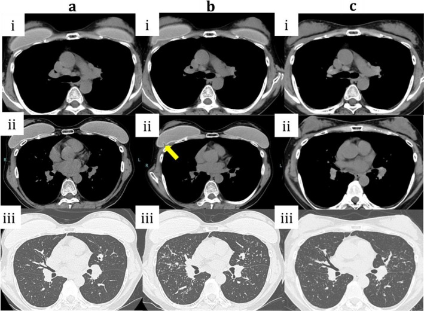
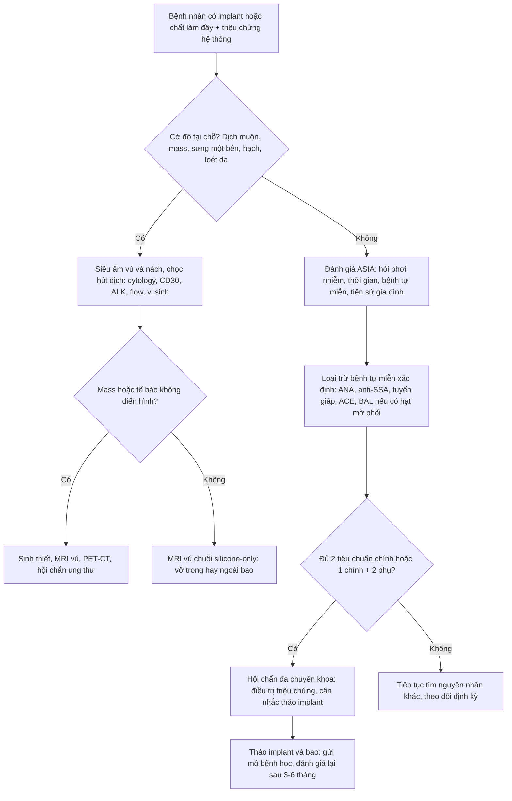
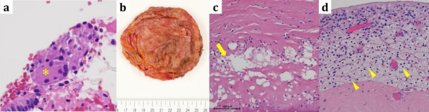

# 1663 — Hội chứng tự miễn/viêm do chất tá trợ (ASIA) sau implant & chất làm đầy / Autoimmune-inflammatory syndrome induced by adjuvants

**Tags:** `pattern:u-hat` `pattern:viem-he-thong` `pattern:hach-trung-that` `vung:vu` `vung:phoi` `vung:trung-that` `score:Shoenfeld-ASIA` `protocol:MRI-vu` `protocol:CT-nguc` `protocol:PET-CT`
**Mức chắc chắn (certainty):** tổng hợp y văn (literature synthesis) — ghép **1 ca nguyên văn có hình CĐHA** (*Respirol Case Rep* 2026, PMC12864536, CC BY 4.0: implant silicone vỡ sau 24 năm, hạt mờ quanh phế quản + hạch trung thất, tháo implant thì cải thiện) với **1 tổng quan có thuật toán chẩn đoán** (*J Clin Med* 2026, PMC13412946, CC BY 4.0) và **2 loạt ca** (*Front Immunol* 2023, PMC10242122, CC BY 4.0; *Cureus* 2022, PMC9576548, CC BY 3.0). Số nào nguồn không đưa thì ghi "chưa rõ".

> **Câu chốt:** ASIA không có xét nghiệm chốt và **không có hình ảnh chốt** — chẩn đoán là **chẩn đoán loại trừ có cấu trúc**. Điều duy nhất hình ảnh làm được: (1) phát hiện **implant vỡ/dịch/mass** và tách **BIA-ALCL/BIA-SCC**; (2) mô tả **hạch trung thất + hạt mờ quanh phế quản** kiểu sarcoid; (3) cho thấy **tháo implant thì tổn thương thoái triển**. Trong ca dưới đây, **hạch trung thất có từ 3 năm trước**, chỉ **tiến triển sau khi implant vỡ**, và **giảm rõ sau khi tháo** — mẫu hình thời gian mới là chìa khoá, không phải một dấu hiệu đơn lẻ.

## 1. Tổng quan bệnh học – cơ chế hình ảnh

### 1.1 Cơ chế: "tá trợ" là gì và vì sao silicone gây bệnh toàn thân

- **Chất tá trợ (adjuvant)** là vật liệu lạ kéo dài **kích thích miễn dịch bẩm sinh**: silicone gel, silicone lỏng tiêm, lưới, kim loại, chất làm đầy. Mô hình đề xuất: **đại thực bào** thực bào hạt silicone → hoạt hoá **inflammasome**, giải phóng IL-1β/IL-6 → **Th1/Th17** → u hạt và tự kháng thể; ở người có nền nhạy cảm (HLA, bệnh tự miễn, tiền sử dị ứng) thì chuyển thành bệnh hệ thống (PMC13412946).
- **Silicone lan theo đường bạch huyết:** hạt silicone và gel "bleed" đi qua mạch bạch huyết tới **hạch nách, hạch trung thất, thậm chí phổi** → u hạt có phản ứng viêm mạn. Vì vậy **triệu chứng có thể xuất hiện mà vú hoàn toàn không đau, không sưng** (ca nguyên văn không có triệu chứng tại vú dù implant vỡ — PMC12864536).
- **Vỡ implant là yếu tố đẩy bệnh, không phải thời gian phơi nhiễm:** ca nguyên văn có implant **24 năm** nhưng chỉ triệu chứng khi **vỏ implant vỡ**; y văn ghi nhận implant vỡ có **tần suất triệu chứng hệ thống cao hơn** implant nguyên vẹn (PMC12864536).

### 1.2 TẠI SAO hình ảnh trông như vậy (vật lý của silicone trên US/CT/MRI)

- **Siêu âm — "bão tuyết" (snowstorm):** silicone và mô có **trở kháng âm khác nhau rất lớn** → gần như toàn bộ sóng bị phản xạ ở mặt phân cách, tạo **chuỗi phản xạ lặp (reverberation/ring-down)** phía sau implant: một đám **tăng hồi âm dày đặc che lấp mô phía sau**. Vì vậy siêu âm **rất nhạy với silicone ngoài bao** nhưng **kém** để đánh giá nhu mô sau implant. Trong ca 2 của loạt ca *Cureus* 2022, **nhũ ảnh** còn thấy "**snowstorm artifact**" do silicone ngoài bao ở vùng dưới đòn, nách và chuỗi vú trong (PMC9576548).
- **CT — silicone đậm hơn mỡ, nhạt hơn cơ:** trên cửa sổ mô mềm, gel silicone nằm **giữa mỡ và cơ**, còn **vỏ implant** là đường mảnh đậm hơn. Vì thế CT ngực (thường là phim đầu tiên của bệnh nhân có hạch trung thất) **nhìn thấy implant, thấy biến dạng vỏ, thấy hạch — nhưng không phân biệt được gel trong/ngoài bao** nếu không có MRI.
- **MRI — chuỗi "silicone-only" là chuỗi quyết định:** gel silicone có **rất ít proton linh động** nên trên T1/T2 thường **tối**; muốn "làm sáng silicone" phải dùng **chuỗi ức chế mỡ + ức chế nước** (silicone-selective). Dấu hiệu vỡ trong bao: **linguine sign** (vỏ implant xẹp, trôi trong gel thành sợi mì), **keyhole/teardrop sign** (gel lọt vào nếp gấp vỏ), **đường dưới bao**. Vỡ ngoài bao: **silicone tăng tín hiệu trong nhu mô, trong hạch nách/trung thất** trên chuỗi silicone-only.

### 1.3 Ngưỡng định lượng nằm lòng

| Đại lượng | Con số | Nguồn |
|---|---|---|
| Thời gian tiềm tàng trung bình của ASIA | **~31 tháng** (ca nguyên văn: **24 năm** mới có triệu chứng, sau khi vỡ) | PMC12864536 |
| Triệu chứng thường gặp nhất | **Đau khớp 64,8%**, **mệt mỏi mạn 54,5%**, **đau cơ 34,9%** | PMC12864536 |
| Nguy cơ sarcoidosis ở người có implant silicone | **~2 lần** dân số chung | PMC12864536 |
| 300 bệnh nhân ASIA | **89%** có bệnh tự miễn xác định; **5,3%** viêm mạch | PMC10242122 |
| 32 bệnh nhân implant silicone + ASIA | **17** bệnh tự miễn hệ thống, **7** cơ quan (3 viêm giáp tự miễn) | PMC10242122 |
| Đoàn hệ 24.651 phụ nữ có implant vs 98.504 không | Liên quan mạnh nhất: **Sjögren, xơ cứng bì, sarcoidosis** | PMC10242122 |
| 201 bệnh nhân ASIA (45 có bệnh khớp tự miễn) | **42%** có tiền sử gia đình bệnh khớp tự miễn | PMC10242122 |
| BIA-ALCL (FDA, đến 30/6/2024) | **1.380** báo cáo thiết bị y tế, **64** tử vong | PMC13412946 |
| Ca nguyên văn: ACE / sIL-2R / lysozyme | **4,9 U/mL** / **372 U/mL** / **4,9 µg/mL** (không gợi ý sarcoidosis hoạt động) | PMC12864536 |
| Ca nguyên văn: BAL | **Lymphocyte 22%**, **CD4/CD8 2,04** (không tăng như sarcoidosis điển hình) | PMC12864536 |

*Cột a (3 năm trước triệu chứng): hạch trung thất–rốn phổi (a-i), hai implant dưới cơ ngực (a-ii), hạt mờ thưa hai bên (a-iii). Cột b (lúc có triệu chứng): hạch giảm nhẹ nhưng còn to (b-i), **biến dạng implant phải — mũi tên vàng** (b-ii), hạt mờ lan theo **bó mạch–phế quản** (b-iii). Cột c (sau tháo implant): hạch không đổi (c-i), không còn implant (c-ii), **hạt mờ giảm mật độ** (c-iii). Nguồn: Tsuda Y et al., Respirol Case Rep 2026 (PMC12864536), Fig. 1, CC BY 4.0.*

## 2. Mẫu hình + chẩn đoán phân biệt theo vị trí (gamut)

### 2.1 Mẫu hình "hạch trung thất + hạt mờ quanh phế quản ở người có implant"

Bốn câu hỏi theo thứ tự:

1. **Có implant/chất làm đầy ở đâu?** Vú, mông, mặt, khớp (silicone lỏng tiêm), lưới thoát vị, kim loại. Hỏi **thời điểm** và **đã thay/tháo chưa**.
2. **Hạch có to lên theo thời gian không?** Hạch **ổn định/giảm nhẹ** trong khi **hạt mờ tiến triển** là mẫu hình ASIA (ca nguyên văn); hạch **to nhanh, đối xứng, kèm B symptoms** đòi hỏi loại trừ lymphoma.
3. **Phân bố hạt mờ:** **quanh bó mạch–phế quản hai bên** + hạch rốn phổi hai bên = kiểu sarcoid; **dưới màng phổi/ngoại vi** = gợi ý khác (lao, di căn, bụi).
4. **Implant còn nguyên không?** Vỡ ngoài bao + silicone trong hạch = bằng chứng mạnh cho phản ứng do tá trợ.

### 2.2 Gamut theo vị trí

- **Hạch trung thất/rốn phổi hai bên:** sarcoidosis, **ASIA sarcoid-like**, lao, histoplasmosis, berylliosis (nghề nghiệp), lymphoma, di căn.
- **Hạt mờ quanh phế quản:** sarcoidosis, **ASIA sarcoid-like**, bụi hữu cơ (HP), lao lan theo phế quản, di căn bạch huyết.
- **Khối/dịch quanh implant ở vú:** **BIA-ALCL** (dịch muộn, mass trong bao), **BIA-SCC**, vỡ implant, co thắt bao (capsular contracture), **siliconoma/u hạt**, nhiễm trùng bao.
- **Hạch nách to + tiền sử implant:** silicone lymphadenitis (siliconoma hạch), BIA-ALCL lan hạch, di căn vú, lymphoma.

### 2.3 Hai đường đi song song — không được gộp

- **Đường "cờ đỏ" (red flag):** dịch quanh implant muộn, sưng một bên, mass trong bao, hạch nách, loét/đổi màu da, B symptoms → **ưu tiên loại trừ BIA-ALCL/BIA-SCC**: siêu âm + chọc hút dịch (cytology, **CD30**, ALK, flow cytometry), sinh thiết mass (PMC13412946).
- **Đường "triệu chứng hệ thống":** đau khớp/đau cơ/mệt mỏi/khô mắt-miệng/rối loạn nhận thức → **đánh giá ASIA** sau khi loại trừ bệnh tự miễn xác định.

## 3. Bảng so sánh phân biệt (ma trận đối chiếu)

| Thực thể (entity) | Hình ảnh điển hình | Chốt vào (rule-in) | Chốt loại (rule-out) | Gợi ý xác nhận |
|---|---|---|---|---|
| **ASIA / sarcoid-like do silicone** | Hạch trung thất–rốn phổi **hai bên**, hạt mờ **quanh bó mạch–phế quản**; implant có thể **biến dạng/vỡ** trên MRI | **Phơi nhiễm tá trợ + triệu chứng hệ thống + u hạt phản ứng dị vật + cải thiện sau tháo** | U hạt **hoại tử** (lao), tế bào ác tính, hạch to nhanh → không phải ASIA | Sinh thiết (u hạt không hoại tử + dị vật), BAL, đáp ứng sau tháo implant |
| **Sarcoidosis** | Hạch rốn phổi hai bên **đối xứng**, hạt mờ quanh bạch huyết, **nốt da, mắt, tim** | **Hạch đối xứng + tăng ACE + BAL CD4/CD8 > 3,5** | Không có phơi nhiễm tá trợ, u hạt có **thể Asteroid** trong hạch | ACE, BAL, PET-CT, theo dõi không tháo implant |
| **BIA-ALCL** | **Dịch quanh implant muộn**, mass trong bao, hạch nách; **không** hạt mờ phổi | **Dịch muộn > 1 năm + CD30 dương + tế bào lớn không điển hình** | Cytology âm, CD30 âm → không phải ALCL | Chọc hút dịch + IHC CD30/ALK; MRI vú; PET-CT giai đoạn |
| **BIA-SCC** | Mass trong bao xâm lấn, có thể **phá vỏ**; tiền sử implant **rất lâu** | **Sinh thiết: carcinoma vảy + mô bao** | Không có tế bào vảy, chỉ u hạt → ASIA/siliconoma | Sinh thiết mở, CT/MRI đánh giá xâm lấn |
| **Siliconoma / u hạt dị vật** | **Khối đặc** quanh implant/hạch, có thể **vôi hóa**; MRI: khối tín hiệu thấp T2 | **Tiền sử silicone lỏng/vỡ + u hạt dị vật trên mô bệnh** | Không có dị vật, tế bào ác tính → loại | Sinh thiết; MRI; so phim cũ |
| **Vỡ implant trong bao** | **Linguine sign**, keyhole/teardrop, đường dưới bao trên MRI silicone-only | **Dấu linguine + gel trong vỏ** | Vỏ liên tục, không có gel ngoài vỏ → chưa vỡ ngoài bao | MRI silicone-only; siêu âm bổ trợ |
| **Vỡ implant ngoài bao** | Silicone **trong nhu mô/hạch** trên MRI; "snowstorm" lan rộng trên siêu âm/nhũ ảnh | **Silicone ngoài vỏ + hạch chứa silicone** | Chỉ gel trong vỏ → vỡ trong bao | MRI; sinh thiết hạch nếu cần |

## 4. Protocol chụp + hệ phân độ/điểm chuẩn hóa

### 4.1 Protocol hình ảnh theo câu hỏi lâm sàng

- **Siêu âm vú + implant + nách** (đầu dò linear **12–15 MHz**): đo **độ dày vỏ bao**, tìm dịch, mass, **snowstorm**; đây là bước đầu rẻ, sẵn có — nhưng **không** đánh giá được gel trong/ngoài bao.
- **MRI vú 1,5T hoặc 3T, coil vú, tư thế nằm sấp:** bắt buộc **T1 không ức chế mỡ**, **T2 ức chế mỡ**, **chuỗi silicone-only (ức chế mỡ + ức chế nước)**, **DWI**, và **T1 sau tiêm** nếu có mass/dịch. Đây là **chuẩn không xâm lấn** cho vỡ implant.
- **CT ngực lát mỏng 1 mm, 2 cửa sổ** khi có hạch/hạt mờ: mô tả **phân bố quanh bó mạch–phế quản**, so **phim cũ ≥ 3 năm**; đọc lại **implant** trên cửa sổ mô mềm (đừng chỉ đọc mạch vành/động mạch phổi).
- **PET-CT:** **không** dùng để chẩn đoán ASIA; dùng khi cần loại trừ **lymphoma/di căn** hoặc đánh giá mức hoạt động của hạch — hạch trong ASIA có thể **tăng FDG** và **bắt chước lymphoma**.
- **Chọc hút dịch quanh implant:** luôn gửi **cytology + CD30 + ALK + flow cytometry + vi sinh** khi có dịch muộn.

### 4.2 Tiêu chuẩn Shoenfeld (2011) — công cụ duy nhất hiện có

| Nhóm | Nội dung |
|---|---|
| **Tiêu chuẩn chính** | (1) **Phơi nhiễm chất tá trợ** trước khi có triệu chứng; (2) **triệu chứng điển hình**: đau cơ/đau khớp/mệt mỏi mạn/giấc ngủ không hồi phục/rối loạn thần kinh-giảm nhận thức/khô miệng; (3) **tháo chất tá trợ → cải thiện**; (4) **mô bệnh học điển hình** của cơ quan bị ảnh hưởng |
| **Tiêu chuẩn phụ** | Tự kháng thể hoặc kháng thể chống chính tá trợ; biểu hiện khác (ruột kích thích, mệt mỏi); HLA đặc hiệu; **xuất hiện bệnh tự miễn mới** |
| **Ngưỡng chẩn đoán** | **≥ 2 tiêu chuẩn chính**, hoặc **1 chính + 2 phụ** |
| **Giới hạn** | Không có biomarker được kiểm định; **không dùng để chứng minh nhân quả**; nhiều ca đủ tiêu chuẩn vẫn có bệnh tự miễn khác song hành (PMC13412946, PMC13226960) |

- Ca nguyên văn đạt **cả 4 tiêu chuẩn chính**: phơi nhiễm silicone 24 năm, triệu chứng (ho, mệt, đau khớp), **cải thiện sau tháo**, **u hạt dị vật** quanh bao (PMC12864536).

### 4.3 Phân độ co thắt bao (Baker) — dùng khi mô tả "implant cứng"

| Độ | Lâm sàng |
|---|---|
| **I** | Vú mềm, không khác biệt |
| **II** | Hơi cứng, sờ thấy implant nhưng không thấy hình dáng |
| **III** | Cứng, **nhìn thấy hình implant** |
| **IV** | Cứng, **đau**, biến dạng rõ |

- Ca *Cureus* 2026 có **co thắt bao độ IV** kèm yếu cơ, CK tăng, ANA 1:1280 — tháo implant chỉ **cải thiện một phần** (PMC13226960), khác ca nguyên văn (cải thiện rõ).

## 5. Biến thể bình thường và cạm bẫy

- **"Bỏ sót chủ đề" (satisfaction of search) điển hình:** đọc CT ngực vì hạch trung thất, kết luận sarcoidosis, **không hỏi tiền sử implant** — ca nguyên văn mất **3 năm** mới nối được hai dữ kiện. Trên mọi CT ngực có hạch + hạt mờ, **liếc cửa sổ mô mềm vùng ngực trước** xem có implant.
- **Hạch giảm nhẹ không phải là "đang lui bệnh":** ca nguyên văn hạch **giảm nhẹ** nhưng hạt mờ **tiến triển** đúng lúc implant vỡ; chỉ số hạch một mình không phản ánh hoạt tính.
- **Siêu âm bình thường không loại trừ vỡ ngoài bao:** "snowstorm" có thể **che lấp** chính chỗ rách vỏ; cần MRI silicone-only.
- **"Snowstorm" bị đọc thành vôi hóa:** trên nhũ ảnh, đám tăng đậm dày đặc do silicone ngoài bao **không phải** vôi hóa lành tính — hỏi tiền sử tiêm/thay implant.
- **Implant nguyên vẹn không loại trừ ASIA:** vỡ làm tăng nguy cơ, nhưng ASIA đã được báo cáo với implant nguyên vẹn (PMC10242122).
- **Đừng gọi "en bloc capsulectomy" cho ASIA:** thuật ngữ này dành cho **nghi/xác định ung thư** trong bao; dùng sai gây hiểu nhầm về lợi ích (PMC13412946).
- **Tháo implant không phải "chữa khỏi chắc chắn":** nhiều ca chỉ **cải thiện một phần** (PMC13226960); phải tiếp tục điều trị bệnh tự miễn nếu có và không được gán mọi triệu chứng cho implant.
- **PET-CT dương tính không phải ung thư:** hạch viêm do silicone có thể **tăng FDG mạnh**; cần mô bệnh học trước khi kết luận.

## 6. Tự lượng giá — Blind Quiz

**Ca 1 — Nữ 53 tuổi, implant silicone dưới cơ ngực 24 năm. Ba năm trước: hạch trung thất + hạt mờ thưa, được theo dõi "sarcoidosis". Nay ho, mệt, đau khớp; CT ngực lặp lại.**

- Hỏi: (1) Mô tả thay đổi giữa ba cột a–b–c. (2) Ba chẩn đoán phân biệt cho hạch trung thất + hạt mờ ở người có implant. (3) Dấu hiệu nào trên hình **định hướng nguyên nhân** và nên làm gì tiếp?

<b>Bấm để hiện đáp án (findings + chẩn đoán)</b>

- **Findings:** cột a — hạch trung thất/rốn phổi hai bên + hạt mờ thưa; cột b — hạch **giảm nhẹ nhưng còn to**, **implant phải biến dạng (mũi tên vàng)**, hạt mờ lan **theo bó mạch–phế quản**; cột c — sau tháo implant, **hạt mờ giảm mật độ**.
- **Chẩn đoán:** **ASIA sarcoid-like do silicone** — implant vỡ ngoài bao giải phóng gel; u hạt phản ứng dị vật quanh bao + u hạt không hoại tử ở phổi; đạt **cả 4 tiêu chuẩn chính Shoenfeld**.
- **Vì sao không phải sarcoidosis kinh điển:** **CD4/CD8 = 2,04** (sarcoidosis thường > 3,5), ACE **4,9 U/mL**, và **cải thiện sau tháo implant** — điều sarcoidosis không làm.
- **Bước tiếp:** MRI vú chuỗi silicone-only xác nhận vỡ ngoài bao; hội chẩn phẫu thuật tháo implant + bao, gửi mô bệnh học.
- Nguồn: Tsuda Y et al., *Respirol Case Rep* 2026 (PMC12864536), Fig. 1, CC BY 4.0.

**Ca 2 — Bệnh phẩm sau tháo implant: vỏ implant và mô quanh bao.**

- Hỏi: (1) Mô tả 4 thành phần a–d của hình. (2) Hình này thoả tiêu chuẩn nào của ASIA? (3) Nếu chỉ có hình này mà không có tiền sử, bạn có chẩn đoán được ASIA không?

<b>Bấm để hiện đáp án (findings + chẩn đoán)</b>

- **Findings:** (a) phổi — **tế bào khổng lồ đa nhân**; (b) **đại thể vỏ implant phải đã vỡ**, dính cơ; (c) mô quanh bao — **lắng đọng silicone vô định hình**; (d) **đại thực bào dạng bọt** tập trung, rất ít lympho/plasma, **không có bạch cầu trung tính**.
- **Tiêu chuẩn ASIA được thoả:** **mô bệnh học điển hình** (u hạt dị vật) — tiêu chuẩn chính thứ 4.
- **Không chẩn đoán được nếu chỉ có hình:** ASIA là **chẩn đoán lâm sàng + loại trừ**; mô bệnh học chỉ chứng minh **phản ứng dị vật**, không chứng minh nhân quả. Cần phơi nhiễm, triệu chứng, thời gian, và đáp ứng sau tháo.
- Nguồn: Tsuda Y et al., *Respirol Case Rep* 2026 (PMC12864536), Fig. 2, CC BY 4.0.

**Câu 3 — Tự luận ngắn:** Bệnh nhân nữ 40 tuổi tiêm chất làm đầy mông 3 năm trước, nay mệt mỏi, đau khớp, khô mắt; MRI cho thấy chất làm đầy còn nguyên, không có dịch. Bạn làm gì và **không** làm gì?

<b>Bấm để hiện đáp án</b>

- **Làm:** hỏi kỹ loại chất (silicone lỏng vs acid hyaluronic), thời điểm, triệu chứng hệ thống; xét nghiệm **loại trừ** bệnh tự miễn xác định (ANA, anti-SSA/SSB, tuyến giáp, viêm gan C, sarcoidosis nếu có hạt mờ phổi); đánh giá theo **tiêu chuẩn Shoenfeld**; hội chẩn đa chuyên khoa.
- **Không làm:** không chọc/dẫn lưu "ổ dịch" khi không có dịch; không hứa "tháo là khỏi"; không dùng corticoid kéo dài cho triệu chứng không có viêm khách quan; không gọi "en bloc" khi không nghi ung thư.
- **Vì sao:** implant nguyên vẹn **không loại trừ** ASIA, nhưng cũng **không đủ** để chẩn đoán; điều trị sai hướng gây hại nhiều hơn lợi.

## Bài liên quan chéo
- [1654 – Dịch quanh implant ngực & BIA-ALCL](../1654-dich-quanh-implant-nguc-va-bia-alcl/lesson.md) (đường cờ đỏ: dịch muộn, CD30)
- [1655 – Ung thư vảy trong bao implant (BIA-SCC)](../1655-ung-thu-vay-trong-bao-implant-nguc-bia-scc/lesson.md) (mass trong bao)
- [1688 – Siliconoma lan xa ngoài vú](../1688-siliconoma-lan-xa-ngoai-vu/lesson.md) (u hạt dị vật, di chuyển theo bạch huyết)
- [1686 – Hạch nách chứa silicone & siliconoma](../1686-hach-nach-chua-silicone-va-siliconoma/lesson.md) (hạch nách sau implant)
- [510 – BI-RADS: nhũ ảnh, siêu âm, MRI](../510-vu-BIRADS-nhu-anh-sieu-am-MRI/lesson.md) (ngôn ngữ báo cáo vú)

> Không dùng để chẩn đoán độc lập khi chưa có người hướng dẫn.
