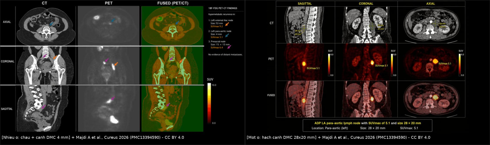
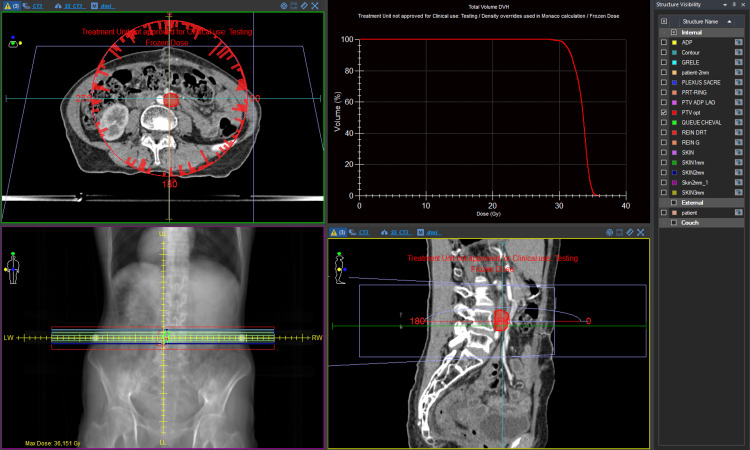
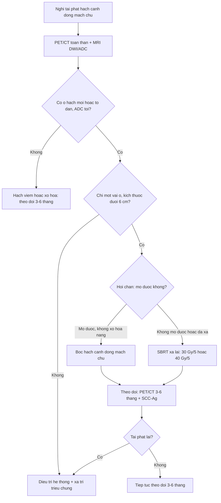
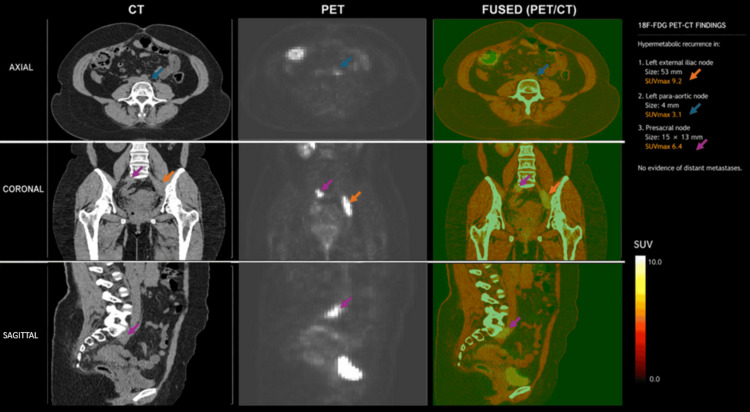
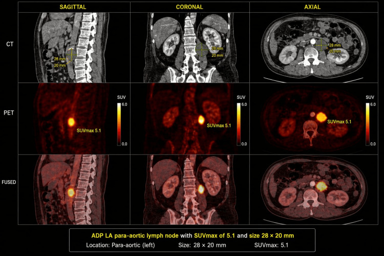

# 1664 — Hạch cạnh động mạch chủ tái phát sau xạ trị ung thư cổ tử cung / Para-aortic nodal recurrence after radiotherapy for cervical cancer

**Tags:** `pattern:hach` `pattern:tai-phat` `vung:hau-phuc-mac` `vung:tieu-khung` `score:Node-RADS` `score:FIGO-2018` `protocol:PET-CT` `protocol:MRI-DWI` `protocol:SBRT-xa-lai` `incidentaloma:hach-canh-dmc`
**Mức chắc chắn (certainty):** tổng hợp y văn (literature synthesis) — 1 tổng quan về xạ lại SBRT (Thomas BJ et al., *Clin Transl Radiat Oncol* 2026, PMC12593702), 1 báo cáo 2 ca có ảnh PET/CT (Majdi A et al., *Cureus* 2026, PMC13394590), 1 nghiên cứu Node-RADS trên 439 ca ung thư cổ tử cung (Tan S et al., *Cancer Imaging* 2026, PMC13520168), 1 protocol thử nghiệm pha III nêu tiêu chuẩn chẩn đoán hạch cạnh động mạch chủ (Shinghal A et al., *BMJ Open* 2024, PMC11590838) và 1 tổng quan phân giai đoạn hạch cạnh động mạch chủ (Obando-Rodríguez JS et al., *Cancers* 2026, PMC13359896). **Không có ca nguyên văn của nhóm**; 2 ca trong mục (6) là ca của bài gốc, ghi rõ nguồn từng ca. Chỗ nguồn lệch nhau (ngưỡng kích thước hạch, giá trị SUVmax) được ghi là **mâu thuẫn nguồn**, không chọn bừa.

## 1. Tổng quan bệnh học – cơ chế hình ảnh

- **Đường lan giải phẫu quyết định "vì sao cạnh động mạch chủ":** ung thư cổ tử cung (cervical cancer — CC) lan bạch huyết theo bậc **cạnh tử cung → hạch bịt trong/chậu trong → chậu ngoài → chậu chung → trước xương cùng → cạnh động mạch chủ (para-aortic, PALN)**. Vùng cạnh động mạch chủ thường nằm **ngay trên bờ trên trường chiếu chậu** — nơi liều giảm nhanh (vùng "bờ trường", field edge), và là nơi hạch vi di căn lúc chẩn đoán có thể "sống sót" rồi mọc lại sau xạ trị.
- **Ba cơ chế của "tái phát cạnh động mạch chủ" — khác nhau về ý nghĩa:**
  1. **Di căn vi mô có sẵn từ đầu** (occult): khi hình ảnh âm tính, mổ bóc hạch cạnh động mạch chủ vẫn tìm thấy di căn ở **8–12%** bệnh nhân (Shinghal A et al. 2024). Đây là lý do PET/CT âm không loại trừ được di căn vi mô.
  2. **Tái phát thật sau đáp ứng hoàn toàn** ở vùng đã chiếu hoặc sát bờ trường.
  3. **Hạch mới** do thay đổi dẫn lưu bạch huyết sau xạ trị chậu (xơ hóa chặn đường dẫn lưu thông thường).
- **Dịch tễ định lượng (các con số không đồng nhất — ghi nguyên vẹn):**
  - Hạch cạnh động mạch chủ **có sẵn lúc chẩn đoán** ở **17–24%** ung thư cổ tử cung tiến xa tại chỗ (LACC) (Obando-Rodríguez JS et al. 2026); hạch chậu và/hoặc cạnh động mạch chủ chiếm **30–40%** các ca, trong đó chỉ hạch chậu khoảng **30%**; **không có hạch chậu thì nguy cơ cạnh động mạch chủ < 5%** (Shinghal A et al. 2024).
  - **Giai đoạn IIIC1 xạ trị chậu đơn thuần:** hạch cạnh động mạch chủ chiếm **tới 41%** các thất bại hạch (nodal failure) (Shinghal A et al. 2024).
  - **EMBRACE (816 ca tiến cứu):** thất bại hạch cạnh động mạch chủ chiếm **69%** mọi thất bại hạch; trong **406 ca có hạch chậu dương lúc chẩn đoán**, **47 ca (11,5%)** thất bại cạnh động mạch chủ (dẫn trong Shinghal A et al. 2024).
  - **RetroEMBRACE (MRI-guided brachytherapy):** thất bại cạnh động mạch chủ **tới 24%** (dẫn trong Shinghal A et al. 2024).
  - **Chiếu xạ cạnh động mạch chủ dự phòng (EFRT)** hạ tỷ lệ tái phát PALN xuống **2,5%** trong loạt 62 ca của Vargo et al. (dẫn trong Shinghal A et al. 2024) — đây là can thiệp **dự phòng**, không phải điều trị tái phát.
- **TẠI SAO PET/CT và MRI-DWI bổ sung nhau (vật lý, không chỉ "tăng/giảm tín hiệu"):**
  - **FDG-PET:** tế bào u tăng đường phân (Warburg) → tăng bắt ¹⁸F-FDG. Nhưng **độ phân giải không gian ~4–6 mm**, nên hạch **< 5 mm** hoặc vi di căn có thể **âm tính giả**; ngược lại **viêm, mô hạt sau xạ, đại thực bào** cũng bắt FDG → dương tính giả. SUVmax phụ thuộc đường huyết, thời gian bắt thuốc, máy và **nền gan/máu**, nên **không có ngưỡng SUVmax tuyệt đối** để chẩn đoán.
  - **DWI/ADC:** mật độ tế bào cao của hạch di căn làm nước ngoại bào giảm → **DWI b cao sáng + ADC tối**; mô xơ sau xạ **giảm tế bào, tăng khoảng gian bào** → **ADC sáng**. Vì vậy **ADC là thứ tách hạch u với hạch xơ/viêm**, T2W đơn thuần không đủ.
  - **Hệ quả thực hành:** PET/CT dùng để **phát hiện + phân giai đoạn toàn thân**; MRI/CT đo **trục ngắn + hình thái** và xác nhận hạn chế khuếch tán thật. Không dùng một mình SUVmax hay một mình kích thước.
- **Ngưỡng định lượng để gọi "hạch nghi di căn" (dùng trong thử nghiệm EPIC):** hạch cạnh động mạch chủ **trục ngắn > 8 mm**, **bờ thùy/không đều**, và/hoặc **hoại tử, kết đám (conglomeration), bọc mạch (vessel encasement), xâm lấn** trên CT có cản quang, **hoặc bắt FDG mạnh hơn nền** (Shinghal A et al. 2024). Đây là tiêu chuẩn **chọn bệnh nhân**, không phải tiêu chuẩn chẩn đoán mô học.
- **Node-RADS 1.0 (chuẩn hóa đọc hạch):** chấm theo **kích thước** (trục ngắn **≥ 10 mm** = "enlarged"; trục bất kỳ **≥ 30 mm** = "bulky") và **hình thái** (kết cấu, bờ, hình dạng), rồi gộp thành **điểm 1–5**. Quy ước báo cáo: **1–2 = N(−)**, **4–5 = N(+)**, **3 = không xác định, tùy u nguyên phát** (Tan S et al. 2026).
- **Hiệu năng Node-RADS ở ung thư cổ tử cung (439 ca, MRI trước mổ, đối chiếu mô học):** bác sĩ **senior** AUC **0,868**, độ nhạy **76,4%**, độ đặc hiệu **97,3%**; **junior** AUC **0,758**, nhạy **54,6%**, đặc hiệu **97,0%**; đồng thuận giữa 2 senior **κ = 0,988**, giữa 2 junior **κ = 0,737** (Tan S et al. 2026). Nghĩa là **hệ thống giúp đọc nhất quán, nhưng kinh nghiệm vẫn quyết định độ nhạy** — và **độ nhạy thấp là điểm yếu cố hữu của mọi tiêu chuẩn dựa trên kích thước**.
  - **Cạm bẫy số liệu:** gộp từ y văn (dẫn trong nghiên cứu Node-RADS đại tràng), tỷ lệ ác tính của **Node-RADS 1 là 4%** và **Node-RADS 2 là 31%** — nên **"N(−) theo Node-RADS" không loại trừ được vi di căn**.

## 2. Mẫu hình + chẩn đoán phân biệt theo vị trí (gamut)

**Trục A — theo vị trí trong trục cạnh động mạch chủ (vị trí quyết định trường chiếu và biến chứng):**

1. **Dưới tĩnh mạch thận trái (lower PALN, L2–L4):** hay gặp nhất, giữa động mạch chủ và tĩnh mạch chủ dưới; là **đích của chiếu xạ cạnh động mạch chủ dưới** trong EMBRACE II (tới rốn thận). Đây là vị trí "chuẩn" của tái phát sau xạ chậu.
2. **Trên tĩnh mạch thận trái (upper PALN, ngang thân tạng/động mạch mạc treo tràng trên):** ít hơn nhưng **đổi giai đoạn** nếu có; đi kèm hạch trung thất dưới qua **lỗ cơ hoành**.
3. **Khoang động mạch chủ – tĩnh mạch chủ (aortocaval/interaortocaval):** hạch nằm **giữa ĐMC và IVC**, dễ nhầm với **huyết khối IVC** hoặc **phình ĐMC có huyết khối**.
4. **Cạnh động mạch chủ + hạch chậu/trước xương cùng:** mẫu hình hay gặp ở ca 1 của bài (đa ổ vùng chậu + cạnh ĐMC).
5. **Cạnh động mạch chủ đơn độc (isolated):** nhóm **có khả năng cứu vãn tại chỗ cao nhất** (SBRT hoặc mổ), nhưng phải loại di căn xa và **ung thư nguyên phát thứ hai**.
6. **Lan lên trung thất dưới (retrocrural):** chụp PET/CT **phải che tới nền cổ** — bỏ sót tầng này là lỗi "satisfaction of search".

**Trục B — gamut "hạch cạnh động mạch chủ to/tăng FDG" (theo bệnh bắt chước):**

- **Tái phát ung thư cổ tử cung** (bối cảnh xạ trị chậu trước đó, hạch mới/to dần, ADC tối).
- **Hạch viêm tăng sinh (reactive):** bờ nhẵn, đối xứng, **không hoại tử**, có ổ viêm gần đó; thường **giảm khi chụp lại**.
- **Lao hạch / sarcoidosis:** hạch **kết đám, hoại tử trung tâm (lao)**, có thể vôi hóa; bối cảnh dịch tễ, triệu chứng toàn thân.
- **Lymphoma:** hạch **rất to, đồng nhất, nhiều tầng**, thường không hoại tử; có thể là **u thứ hai** ở người sống sót sau ung thư.
- **Di căn từ ung thư nguyên phát thứ hai** (buồng trứng, niêm mạc tử cung, đại tràng, vú): hình ảnh giống hệt; **mô học mới là chốt**.
- **Xơ hóa sau phúc mạc sau xạ (retroperitoneal fibrosis):** **mảng mô mềm bao quanh ĐMC/IVC, không có hạch rời**, không hạn chế khuếch tán, FDG nhẹ; **không phải tái phát** nhưng **cản trở mổ**.
- **Huyết khối/phình ĐMC có huyết khối:** cấu trúc trong lòng mạch, **không ngấm thuốc như mô hạch**, có vôi hóa thành mạch.

**Gợi nhớ NODES:** **N**eoplasm tái phát (CC), **O**ther primary/lymphoma, **D**isease lành tính (lao/sarcoid), **E**nlarged reactive, **S**car (xơ hóa sau xạ).

## 3. Bảng so sánh phân biệt (ma trận đối chiếu)

| Thực thể (entity) | Hình ảnh điển hình (CT/MRI/PET) | Chốt vào (rule-in) | Chốt loại (rule-out) | Gợi ý xác nhận |
|---|---|---|---|---|
| **Tái phát hạch cạnh ĐMC sau xạ trị CC** | Hạch **trục ngắn > 8 mm** (hoặc mới xuất hiện), **bờ thùy/không đều**, **hoại tử/kết đám**, **DWI sáng + ADC tối**, **FDG > nền gan**, tăng dần qua các lần chụp | **Hạch mới/to dần + ADC tối + FDG dương trong bối cảnh đã xạ chậu** | Hạch ổn định ≥ 12 tháng, ADC sáng, FDG không tăng → không phải tái phát | PET/CT toàn thân + MRI DWI; sinh thiết qua EUS/CT khi do dự |
| **Hạch viêm tăng sinh** | Bờ nhẵn, đồng nhất, **không hoại tử**, đối xứng; FDG tăng nhẹ–vừa | **Bờ nhẵn + không hoại tử + có ổ viêm lân cận + giảm khi chụp lại** | To thêm, hoại tử, ADC tối khu trú → nghi u | Chụp lại 6–12 tuần; điều trị nguyên nhân viêm |
| **Lao hạch / sarcoid** | Hạch **kết đám, hoại tử trung tâm**, có thể **vôi hóa**; FDG mạnh | **Hoại tử trung tâm + vôi hóa + bối cảnh dịch tễ/toàn thân** | Không vôi hóa, không hoại tử, đơn độc → ít nghĩ lao | X-quang ngực, IGRA/PCR lao, sinh thiết |
| **Lymphoma** | Hạch **rất to, nhiều tầng, đồng nhất**, ít hoại tử; có hạch khác ngoài trục | **Nhiều tầng + rất to + đồng nhất** | Hạch đơn độc nhỏ, hoại tử → ít nghĩ lymphoma | Sinh thiết hạch (mô học + hóa mô miễn dịch) |
| **Di căn từ ung thư nguyên phát thứ hai** | Như tái phát; vị trí và hình thái **không phân biệt được** | **Tiền sử/khám gợi ý u thứ hai + hạch ngoài vùng dẫn lưu CC** | Chỉ có hạch trong vùng dẫn lưu CC và đúng thời điểm → vẫn phải loại bằng mô học | PET/CT toàn thân, CA-125/CEA, sinh thiết |
| **Xơ hóa sau phúc mạc sau xạ** | **Mảng mô mềm bao quanh ĐMC/IVC**, không hạch rời, **ADC sáng**, FDG nhẹ | **Bao quanh mạch, không hạch rời, ổn định** | Có hạch rời ADC tối → không phải xơ đơn thuần | So phim cũ; MRI DWI; tránh sinh thiết mù |
| **Huyết khối/phình ĐMC** | Cấu trúc **trong lòng mạch**, không ngấm thuốc, **vôi hóa thành**, ± túi phình | **Trong lòng mạch + vôi hóa + không hạn chế khuếch tán** | Mô mềm ngoài lòng mạch, ADC tối → hạch | CTA; so sánh thì động mạch/tĩnh mạch |

*Trái: 32 tuổi, 12 tháng sau hóa–xạ, PET/CT có **3 ổ**: hạch chậu ngoài trái **53 mm, SUVmax 9,2**; hạch cạnh ĐMC trái **4 mm, SUVmax 3,1**; hạch trước xương cùng **15 × 13 mm, SUVmax 6,4** — không di căn xa. Phải: 48 tuổi, 33 tháng sau hóa–xạ, **một hạch cạnh ĐMC trái 28 × 20 mm, SUVmax 5,1**. Nguồn: Majdi A et al., Cureus 2026 (PMC13394590), CC BY 4.0; ảnh ghép letterbox bằng `tools/make_composite.py`, không crop/kéo giãn.*

### Đọc đúng hạch "nhỏ mà thật" và hạch "to mà lành"

- **Kích thước là tiêu chí yếu:** hạch **4 mm** trong ca 1 vẫn là **di căn thật** (SUVmax 3,1) — nếu chỉ dùng ngưỡng **> 8–10 mm** sẽ bỏ sót và **không mở rộng trường chiếu**. Ngược lại, hạch **15 mm** viêm tăng sinh vẫn có thể lành tính.
- **Ba trụ cột phải đọc cùng nhau:** (1) **kích thước + hình thái** (Node-RADS), (2) **hạn chế khuếch tán thật** (DWI sáng **và** ADC tối), (3) **chuyển hóa** so với **nền gan/máu** và **xu hướng qua thời gian**. Thiếu một trụ cột thì **không kết luận**.
- **Đo ADC đúng cách:** ROI đặt trong **phần đặc nhất**, tránh trung tâm hoại tử; ghi kèm **ADC cơ lưng/gan** làm mẫu nội kiểm cùng máy — vì **chưa có ngưỡng ADC tuyệt đối dùng chung** cho hạch (bài 1626 ghi rõ điểm này cho vòm âm đạo).
- **SUVmax không phải "điểm số ung thư":** ca 1 có hạch **4 mm với SUVmax 3,1** và hạch **53 mm với SUVmax 9,2**; nếu lấy SUVmax làm tiêu chí duy nhất sẽ **bỏ sót ổ nhỏ nhất nhưng lại là ổ quyết định trường chiếu**.

## 4. Protocol chụp + hệ phân độ/điểm chuẩn hóa

**Chỉ định chụp (khi nào nghĩ tới tái phát cạnh động mạch chủ):** đau lưng/đau chậu mới, phù chân, đau lan chân, **SCC-Ag tăng**, ho, ho ra máu; hoặc **theo dõi định kỳ 3–6 tháng** sau hóa–xạ (NCCN, dẫn trong bài 1626). Đừng chờ triệu chứng: **hạch cạnh động mạch chủ thường im lặng**.

**PET/CT toàn thân (ưu tiên số một để phân giai đoạn):**

- Nhịn ăn **≥ 6 giờ**, đường huyết **< 11,1 mmol/L (200 mg/dL)** trước tiêm; ¹⁸F-FDG **3–5 MBq/kg**; chụp **60 phút** sau tiêm; che **từ nền sọ đến đùi**.
- Đọc **SUVmax + so với nền gan** (không dùng một ngưỡng SUVmax tuyệt đối) và **mô tả vị trí theo trục** (dưới/trên tĩnh mạch thận trái, aortocaval, retrocrural).
- Hiệu năng tham chiếu: trong 88 ca ung thư biểu mô vảy nghi tái phát, **PET/CT: Se 98,2% / Sp 90,9% / Acc 95,5%** (bài 1626 dẫn Peng NJ et al. 2020). Nhưng **hạch < 5 mm có thể âm tính giả** — nên PET/CT **không thay thế** MRI DWI ở vùng cạnh động mạch chủ.

**MRI tiểu khung – cạnh động mạch chủ:**

- **T2W độ phân giải cao, lát 3 mm**, mặt phẳng axial/ coronal; **DWI b = 0/800–1000 s/mm² + ADC** bắt buộc; **DCE** khi cần phân biệt mô xơ/viêm.
- Đo **trục ngắn** (short axis) tại điểm lớn nhất, ghi **mm**; mô tả **bờ, kết cấu, hoại tử, kết đám, quan hệ mạch**; áp **Node-RADS 1.0** (1–2 = N−, 4–5 = N+, 3 = tùy u).
- **Thời điểm:** sau xạ **≥ 6 tháng** mới đánh giá "tái phát" (trước đó là **tồn dư/dai dẳng**); so với **phim cũ cùng máy** là bắt buộc.

**CT có cản quang:** lát **1 mm**, thì tĩnh mạch cửa; đo trục ngắn, tìm **hoại tử, kết đám, bọc mạch**; dùng khi không có MRI hoặc để đánh giá xâm lấn mạch.

**Sinh thiết:** ưu tiên **EUS qua thực quản/dạ dày** hoặc **CT-guided** khi tổn thương **≥ 1 cm** và an toàn; với hạch **đơn độc, mổ/SBRT được, PET/CT rất điển hình**, hội chẩn đa chuyên khoa có thể **điều trị mà không sinh thiết** — đúng như 2 ca nguồn (Majdi A et al. 2026), vì sinh thiết sâu cạnh ĐMC có nguy cơ chảy máu.

**Xạ lại SBRT (stereotactic body radiotherapy) — chọn ca và liều:**

- **Tiêu chí chọn ca** (Thomas BJ et al. 2026): **1–3 ổ**, GTV/CTV **< 6 cm** đường kính lớn nhất, **> 6 tháng** sau xạ lần đầu (lý tưởng), **WHO PS ≤ 2**, không còn độc tính xạ đáng kể.
- **Liều hay dùng:** **30 Gy/5 lần** (liều trung vị trong loạt 73 ca); ca đơn độc dùng **30 Gy/3 lần** hoặc **40 Gy/5 lần**.
- **Quy đổi tại chỗ (tính từ công thức, α/β = 10):** 30 Gy/5 → **EQD2 40 Gy, BED₁₀ 48 Gy**; 40 Gy/5 → **EQD2 60 Gy, BED₁₀ 72 Gy**; 30 Gy/3 → **EQD2 50 Gy, BED₁₀ 60 Gy**.
- **Cộng dồn liều:** nếu xạ lần đầu **45–50 Gy**, phải tính **liều tích lũy trên cơ quan nguy cấp (OAR)**; hướng dẫn UK SABR gợi ý tính **30% hồi phục**, tăng **50%** nếu khoảng cách **> 18 tháng** (Thomas BJ et al. 2026) — đây là **thực hành thận trọng, không dựa trên bằng chứng**.
- **Kỹ thuật:** VMAT/CyberKnife/MR-linac, **PTV = GTV + 5 mm**, CBCT trước mỗi lần, **chuẩn bị ruột** (thụt/tháo rỗng) để giảm di động ruột; OAR chính: **ruột non, thận hai bên, tủy sống, đuôi ngựa, tá tràng**.
- **Kết quả (73 bệnh nhân / 81 đợt, 12,3% ở vùng cạnh ĐMC):** OS trung vị **42,9 tháng**, PFS **14,0 tháng**, thời gian tới thất bại tại chỗ **35,2 tháng**; nhóm **cổ tử cung**: OS **36,0**, PFS **11,3**, thất bại tại chỗ **35,2 tháng**; độc tính **cấp độ 3: 2 ca**, **muộn độ 3: 2 ca** (buồn nôn, hẹp âm đạo), không có độ 4–5 (Thomas BJ et al. 2026).

*48 tuổi, hạch cạnh ĐMC trái 28 × 20 mm; PTV V100 **99,19%**; liều tối đa tủy **16,1 Gy**; các OAR (ruột non, thận, tủy, đuôi ngựa) trong giới hạn. Nguồn: Majdi A et al., Cureus 2026 (PMC13394590), Fig. 4, CC BY 4.0 (ảnh giao diện phần mềm, không chỉnh sửa).*

**Theo dõi sau điều trị:** **PET/CT 3–6 tháng** sau SBRT (đáp ứng chuyển hóa hoàn toàn = **SUVmax < 2,0** hoặc trở về nền), sau đó **3–6 tháng/lần** trong 2 năm đầu; **SCC-Ag** mỗi lần khám nếu là ung thư biểu mô vảy; MRI khi PET không kết luận.

## 5. Biến thể bình thường và cạm bẫy

- **Hạch nhỏ 4–6 mm vẫn có thể là di căn** (ca 1: **4 mm, SUVmax 3,1**). Ngưỡng **> 8 mm** là để **chọn bệnh nhân chiếu xạ dự phòng**, không phải để loại trừ tái phát.
- **Hạch "to" sau xạ có thể là xơ/viêm:** hạch **15 mm** với **ADC sáng** và **FDG nhẹ**, ổn định 12 tháng → **không phải u**. Bẫy ngược lại: hạch **nhỏ, ADC tối, FDG tăng** → **phải coi là u cho tới khi chứng minh khác**.
- **SUVmax không có ngưỡng chẩn đoán:** cùng một máy, cùng một bệnh nhân, hạch **4 mm SUVmax 3,1** đã là di căn; so với **nền gan** và **xu hướng** quan trọng hơn con số tuyệt đối.
- **Node-RADS 1–2 không loại trừ vi di căn:** gộp y văn cho tỷ lệ ác tính **4% (điểm 1)** và **31% (điểm 2)**; **điểm 3 là vùng mờ** — cần mô học hoặc theo dõi ngắn.
- **"Hạch cạnh động mạch chủ = di căn xa" là hiểu sai FIGO:** từ **FIGO 2018**, hạch cạnh động mạch chủ là **di căn hạch vùng (IIIC2)**, vẫn có **ý định chữa khỏi** — đổi cách gọi sẽ đổi cả chiến lược.
- **Xơ hóa sau phúc mạc sau xạ làm mổ cực khó:** ca 2 đã **bỏ mổ bóc hạch** vì hạch **dính chặt ĐMC** trong xơ hóa hậu xạ; đây là **biến chứng của bối cảnh**, không phải "hạch không mổ được" — phải đánh giá **trước** khi đưa bệnh nhân vào mổ.
- **Dương tính giả PET/CT:** **viêm sau xạ, mô hạt, lao, sarcoid, lymphoma, u nguyên phát thứ hai**, hoạt động cơ hoành/thận, **brown fat**; luôn đối chiếu MRI và lâm sàng.
- **Bỏ sót tầng trên:** chỉ chụp tiểu khung sẽ bỏ **hạch retrocrural/trung thất dưới** và **hạch trên tĩnh mạch thận** — PET/CT phải **che tới nền cổ**.
- **Sinh thiết mù vùng xơ:** mẫu nhỏ trong mô xơ dễ **âm tính giả**; nếu hình ảnh và SCC-Ag thuyết phục, sinh thiết **nhắm phần ADC tối** hoặc lặp lại dưới hướng dẫn hình ảnh.
- **Đừng quên ổ thứ hai:** "tái phát cạnh động mạch chủ" có thể là **ung thư buồng trứng/niêm mạc tử cung/đại tràng thứ hai**; mô học khác nhau đổi hoàn toàn phác đồ.

## 6. Tự lượng giá — Blind Quiz

> Ba ca dưới đây lấy từ hai bài gốc khác nhau, khác máy chụp và khác bệnh nhân — **không so sánh trực tiếp giữa các ảnh**.

**Ca 1 — 32 tuổi, ung thư biểu mô vảy cổ tử cung FIGO 2018 IIIC1, đã hóa–xạ + brachytherapy, 12 tháng sau điều trị đau lưng. Nhìn ảnh PET/CT, mô tả trước khi mở đáp án.**

- Gợi ý lâm sàng: không có diễn tiến thần kinh, không sốt; SCC-Ag tăng nhẹ.
- Câu hỏi: (1) Có mấy ổ tăng chuyển hóa, ở đâu? (2) Ổ nào **quyết định** việc mở rộng trường chiếu? (3) Vì sao ổ nhỏ nhất lại quan trọng nhất?

<b>Bấm để hiện đáp án (findings + chẩn đoán)</b>

- **Ba ổ:** hạch **chậu ngoài trái 53 mm, SUVmax 9,2** (mũi tên cam); hạch **cạnh động mạch chủ trái 4 mm, SUVmax 3,1** (mũi tên xanh); hạch **trước xương cùng 15 × 13 mm, SUVmax 6,4** (mũi tên tím). Không di căn tạng.
- **Ổ quyết định:** hạch **cạnh động mạch chủ 4 mm** — dù nhỏ nhất, nó **nằm ngoài trường chậu** và biến bệnh từ "tái phát chậu" thành **tái phát vùng cạnh động mạch chủ**, đổi cả **trường chiếu** lẫn **khả năng SBRT**.
- **Vì sao 4 mm vẫn là thật:** PET/CT có **độ phân giải ~4–6 mm**, nhưng hạch này **bắt FDG rõ hơn nền** và **phù hợp vị trí dẫn lưu**; bài học: **không dùng ngưỡng kích thước để loại trừ**.
- **Xử trí:** hội chẩn chọn **SBRT 40 Gy/5 lần** cho cả 3 ổ; **đáp ứng chuyển hóa hoàn toàn sau 6 tháng**, không độc tính ≥ độ 2; **38 tháng** không bệnh.
- **Nguồn ảnh:** Majdi A et al., *Cureus* 2026;18(6):e111361 (PMC13394590), Fig. 1, CC BY 4.0.

**Ca 2 — 48 tuổi, ung thư biểu mô vảy cổ tử cung FIGO 2018 IIB, hóa–xạ kết thúc 33 tháng trước, không triệu chứng, PET/CT theo dõi.**

- Câu hỏi: (1) Mô tả hạch? (2) Có phải di căn xa không? (3) Vì sao **không mổ** dù chỉ một hạch?

<b>Bấm để hiện đáp án (findings + chẩn đoán)</b>

- **Findings:** một hạch **cạnh động mạch chủ trái, 28 × 20 mm, SUVmax 5,1**, không có ổ khác trong tiểu khung hay tạng; **không hoại tử rõ**; tăng FDG đồng nhất.
- **Không phải di căn xa:** theo **FIGO 2018**, hạch cạnh động mạch chủ là **di căn hạch vùng (IIIC2)** → vẫn **ý định chữa khỏi**, không phải giai đoạn IV.
- **Vì sao không mổ:** mở bụng thăm dò thấy **xơ hóa sau phúc mạc sau xạ dày, hạch dính chặt vào ĐMC** → **bỏ mổ** vì nguy cơ tổn thương mạch lớn; chọn **SBRT 30 Gy/3 lần**.
- **Kết cục:** **đáp ứng chuyển hóa hoàn toàn sau 3 tháng** (SUVmax < 2,0), tiêu chảy độ 1 thoáng qua; **40 tháng** không bệnh.
- **Bài học:** "mổ được về mặt ung thư" **khác** "mổ được về mặt giải phẫu sau xạ"; đánh giá **xơ hóa/dính** trên MRI trước khi quyết định.
- **Nguồn ảnh:** Majdi A et al., *Cureus* 2026 (PMC13394590), Fig. 3, CC BY 4.0.

**Ca 3 — cùng bệnh nhân ca 2, xem kế hoạch xạ lại: liều bao nhiêu, kỹ thuật gì, cơ quan nguy cấp nào được bảo vệ?**

- Câu hỏi: (1) Liều và phân liều? (2) Vì sao dùng cung VMAT + CBCT? (3) Liều tích lũy với xạ lần đầu 46 Gy/23 lần được xử lý thế nào?

<b>Bấm để hiện đáp án (findings + chẩn đoán)</b>

- **Liều:** **30 Gy/3 lần** (10 Gy/lần) → **EQD2 50 Gy, BED₁₀ 60 Gy**; PTV **V100 99,19%**; liều tối đa tủy **16,1 Gy**.
- **Kỹ thuật:** **VMAT** tạo gradient liều dốc quanh hạch, bảo vệ **ruột non, thận hai bên, tủy sống, đuôi ngựa, tá tràng**; **CBCT 2D/3D/4D** trước mỗi lần để bù di động ruột và sai số tư thế.
- **Liều tích lũy:** xạ lần đầu **46 Gy/23 lần**; cộng dồn **OAR** (đặc biệt **ruột non** và **thận**), áp dụng **30% hồi phục** (hoặc **50%** nếu > 18 tháng) theo hướng dẫn UK SABR — **thận trọng, chưa có bằng chứng cấp cao**.
- **Vì sao không dùng 40 Gy/5 ở ca này:** hạch **28 × 20 mm**, sát ĐMC/thận; **30 Gy/3** giữ **BED₁₀ 60 Gy** trong khi **giảm số lần** và **giảm liều OAR** — đánh đổi hợp lý khi xạ lại.
- **Nguồn ảnh:** Majdi A et al., *Cureus* 2026 (PMC13394590), Fig. 4, CC BY 4.0.

## Bài liên quan chéo
- [1626 – Tái phát tại vòm âm đạo sau xạ trị ung thư cổ tử cung](../1626-tai-phat-vom-am-dao-sau-xa-tri/lesson.md) (DWI/ADC, PET/CT, SCC-Ag — cùng khung theo dõi)
- [1665 – Rò trực tràng–âm đạo sau xạ trị và sau mổ](../1665-ro-truc-trang-am-dao-sau-xa-tri/lesson.md) (biến chứng muộn cùng vùng xạ)
- [1608 – Ung thư niệu mạc thứ phát sau xạ trị tiểu khung](../1608-ung-thu-nieu-mac-thu-phat-sau-xa-tri-tieu-khung/lesson.md) (u thứ hai sau xạ — cạm bẫy "tái phát")
- [577 – Theo dõi & phát hiện tái phát ung thư phụ khoa](../577-theo-doi-tai-phat-ung-thu-phu-khoa/lesson.md) (lịch theo dõi, RECIST)
- [562 – Hẹp âm đạo sau xạ trị ung thư cổ tử cung](../562-hep-am-dao-sau-xa-tri/lesson.md) (độc tính muộn ảnh hưởng khám/theo dõi)
- [582 – Biến chứng tiêu hóa–niệu sau xạ trị phụ khoa](../582-bien-chung-tieu-hoa-nieu-sau-xa-tri-phu-khoa/lesson.md) (rò, viêm trực tràng xạ)

## Ảnh
- `1664_hach-canh-dmc_PETCT_PMC13394590-Fig1-CCBY.jpg`, `1664_hach-canh-dmc_PETCT_PMC13394590-Fig3-CCBY.jpg`, `1664_hach-canh-dmc_SBRT_PMC13394590-Fig4-CCBY.jpg`, `composite_hach-canh-dmc-petct.jpg`.
- Nguồn + giấy phép từng ảnh: `images/CREDITS.md`. Bài nguồn ảnh **CC BY 4.0** → được phép tạo ảnh ghép, giữ attribution.

> Không dùng để chẩn đoán độc lập khi chưa có người hướng dẫn.
