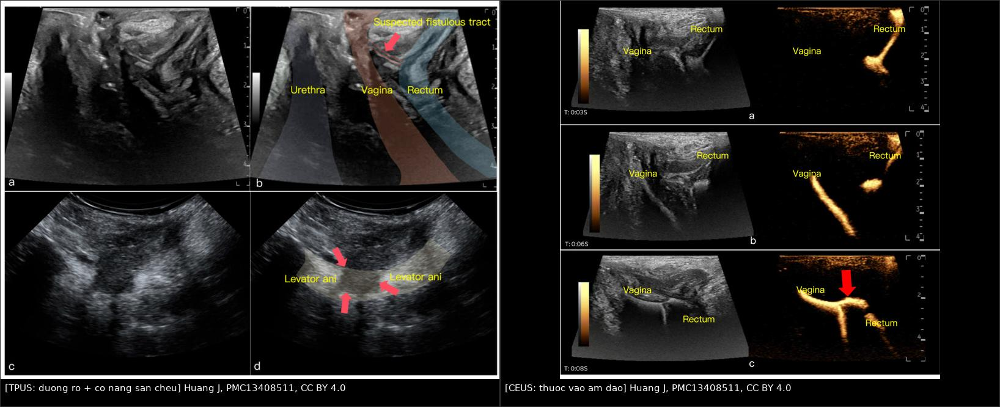
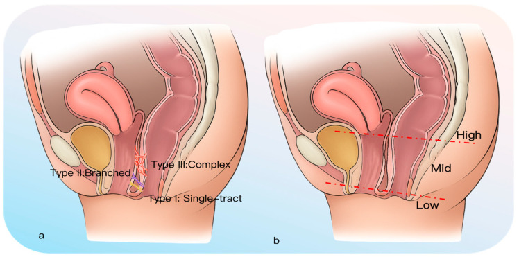
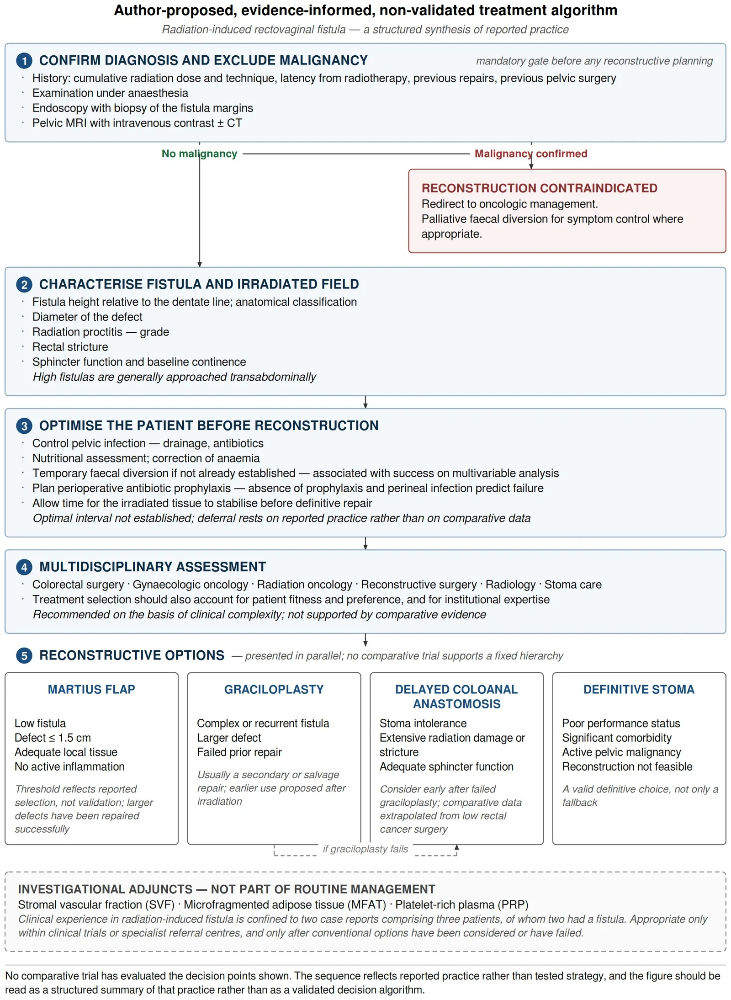
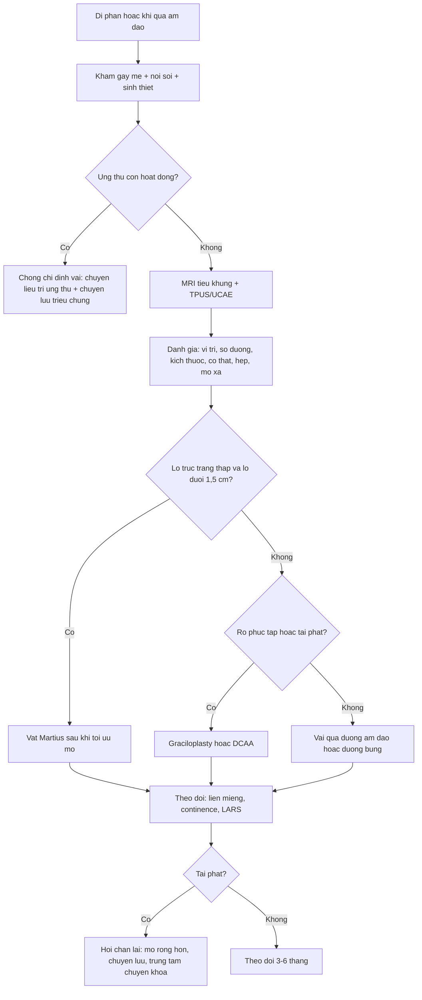
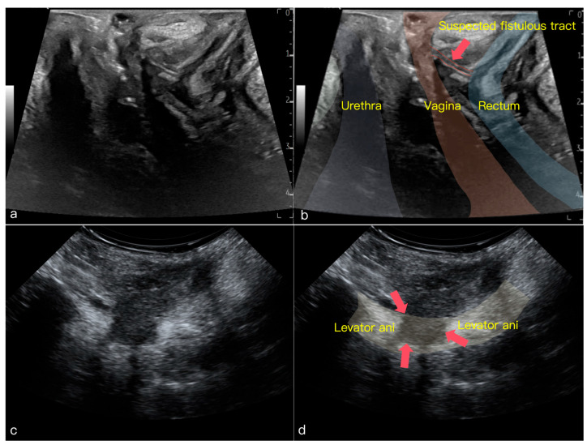
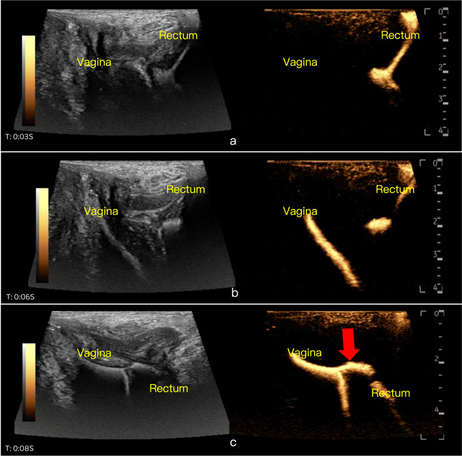
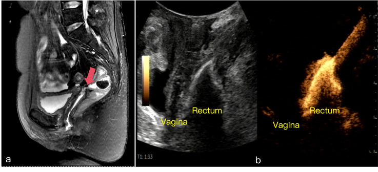

# 1665 — Rò trực tràng – âm đạo sau xạ trị và sau mổ / Rectovaginal fistula after radiotherapy and pelvic surgery

**Tags:** `pattern:ro` `pattern:xo-hoa-sau-xa` `pattern:viem-truc-trang-xa` `vung:am-dao` `vung:truc-trang` `vung:tieu-khung` `score:CTCAE` `protocol:MRI-tieu-khung` `protocol:sieu-am-tang-sinh-mon` `protocol:noi-soi` `incidentaloma:ro-sau-xa`
**Mức chắc chắn (certainty):** tổng hợp y văn (literature synthesis) — 1 tổng quan có tìm kiếm cấu trúc về rò trực tràng–âm đạo sau xạ (Lachowska K et al., *Front Oncol* 2026, PMC13591310), 1 nghiên cứu tiến cứu 62 ca về siêu âm tầng sinh môn + bơm chất cản âm siêu âm (Huang J et al., *Diagnostics* 2026, PMC13408511), 1 đoàn hệ 82 ca rò **sau mổ** (Poitevin M et al., *Tech Coloproctol* 2024, PMC11450074) và 1 so sánh mở bụng vs nội soi khi làm hậu môn nhân tạo (Liu Z et al., *Med Sci Monit* 2025, PMC12372537). **Không có ca nguyên văn của nhóm**; 3 ca trong mục (6) là ca của bài gốc, ghi rõ nguồn. Chỗ nguồn lệch nhau (tỷ lệ thành công của vạt, vai trò hậu môn nhân tạo) được ghi là **mâu thuẫn nguồn**, không chọn bừa.

## 1. Tổng quan bệnh học – cơ chế hình ảnh

- **Bệnh học (pathology) — "xạ trị làm chết mạch nhỏ rồi làm thủng vách":** tia xạ gây **viêm nội mạc tiểu động mạch tắc nghẽn tiến triển (obliterative endarteritis)**, giảm tưới máu, thiếu máu mạn, rồi **hoại tử niêm mạc trực tràng và thành âm đạo**. Mô xạ trị bị thay bằng **collagen dày, xơ, kém đàn hồi và kém lành**; vách trực tràng–âm đạo mỏng dần và **thủng** — thường **nhiều tháng tới nhiều năm** sau xạ.
- **Ngưỡng liều — con số quan trọng nhất:** trong nghiên cứu tiến cứu đa trung tâm **EMBRACE**, **D₂cm³ trực tràng ≥ 75 Gy EQD2** có **nguy cơ rò 12,5% trong 3 năm**, so với **0–2,7%** ở liều thấp hơn (Lachowska K et al. 2026). Nguy cơ gắn với **liều tích lũy lên thành trước trực tràng** (xạ ngoài + brachytherapy), **không** với riêng một thành phần.
- **Dịch tễ:** tỷ lệ rò sau xạ trị ung thư cổ tử cung được báo **3–13%**, tùy quần thể, thời đại điều trị và thời gian theo dõi (Lachowska K et al. 2026). Trong loạt siêu âm 62 ca, **16,1%** rò liên quan **điều trị ung thư** (Huang J et al. 2026) — tức đây không phải biến chứng hiếm gặp ở đơn vị có xạ trị phụ khoa.
- **Thời gian tiềm tàng (latency):** trung vị **8,9–20 tháng** sau xạ, **kéo dài tới 240 tháng**; trong khi rò sau cắt trước trực tràng thấp (low anterior resection) có trung vị **19,5 ngày** (Lachowska K et al. 2026). Vì vậy **rò xuất hiện 10–20 năm sau xạ vẫn phải nghĩ tới xạ trị cũ**, đừng chỉ hỏi "mổ gần đây".
- **TẠI SAO hình ảnh lại khó (vật lý):**
  - **MRI T2W:** đường rò chứa **dịch/khí** → **T2 sáng**; mô xơ xạ trị **T2 tối**, co kéo, làm **mất mặt phẳng mỡ** giữa trực tràng và âm đạo. Nhưng **đường rò nhỏ, xẹp khi nghỉ** có thể **không thấy** trên MRI tĩnh.
  - **Siêu âm tầng sinh môn (transperineal pelvic floor ultrasound — TPUS):** đầu dò đặt ngoài, **không cần đưa vào âm đạo/trực tràng**, thấy **niệu đạo – âm đạo – trực tràng** trên một mặt phẳng giữa dọc và đánh giá được **cơ nâng hậu môn/cơ thắt**; nhược điểm là **phụ thuộc người làm** và **không thấy tầng rò cao trong tiểu khung**.
  - **Bơm chất cản âm siêu âm qua trực tràng (ultrasound contrast agent enema — UCAE):** bơm **vi bọt SonoVue** (5 mL pha trong 150 mL nước muối) tạo **chênh áp** trong lòng trực tràng; nếu đường rò **thông**, vi bọt **đi qua vách sang âm đạo** và hiện thành **đường tăng tín hiệu động học theo giây**. Đây là phép thử **"rò có thông tại thời điểm chụp hay không"**, bổ sung cho MRI (thấy giải phẫu nhưng không chứng minh thông).
  - **CT có cản quang trong lòng trực tràng:** thấy **thuốc thoát sang âm đạo**, nhưng **nhạy kém** với đường rò nhỏ/xẹp và **nhiễm tia**.
- **Vì sao phân loại quan trọng hơn kích thước đơn thuần:** cùng một "lỗ rò 5 mm" nhưng **một đường (type I)** thì vá tại chỗ được; **nhiều nhánh (type II/III)** thì phải **bóc toàn bộ đường rò + chèn mô không bị xạ** — nếu không sẽ tái phát. Loạt UCAE dùng phân loại hình thái **type I (một đường) / II (phân nhánh) / III (nhiều đường/phức tạp)**, kích thước **< 0,5 cm / 0,5–2,5 cm / > 2,5 cm**, và vị trí lỗ trực tràng **cao / giữa / thấp** (Huang J et al. 2026).

## 2. Mẫu hình + chẩn đoán phân biệt theo vị trí (gamut)

**Trục A — theo vị trí và độ phức tạp (quyết định đường mổ):**

1. **Rò thấp (lỗ trực tràng thấp, sát đường răng cưa):** đường vào **qua âm đạo/qua tầng sinh môn**; có thể dùng **vạt Martius**; khâu trực tràng qua đường âm đạo.
2. **Rò giữa:** tùy mô xơ và đường rò; **Martius** hoặc **graciloplasty** nếu tái phát.
3. **Rò cao (lỗ trực tràng cao):** thường **đường bụng** (cắt trực tràng + nối, hoặc **DCAA**), vì đường âm đạo không với tới; đừng cố vá qua âm đạo.
4. **Rò một đường (type I):** vá tại chỗ ± chèn mô; **rò phân nhánh/nhiều đường (type II/III):** **bóc toàn bộ đường rò**, chèn **mô không bị xạ**, cân nhắc **hậu môn nhân tạo tạm**.
5. **Rò ổ nhỏ (< 0,5 cm) nhưng mô xạ trị:** **không** được coi là "dễ" — mô xung quanh **kém lành**; theo mổ trong loạt UCAE, **51/62 (82,3%)** rò có đường kính **< 0,5 cm** (Huang J et al. 2026), nên "nhỏ" là **quy luật**, không phải yếu tố tiên lượng tốt.
6. **Rò kèm hẹp trực tràng/viêm trực tràng xạ:** phải xử lý **hẹp và viêm** trước/đồng thời; hẹp làm **tăng áp lực trong lòng** và **giảm lành**.
7. **Rò kèm u tái phát:** **chống chỉ định vá**; ưu tiên **loại trừ ung thư** bằng nội soi + sinh thiết (xem mục 4).

**Trục B — gamut "rò âm đạo" theo nguyên nhân (bắt chước nhau trên lâm sàng):**

- **Rò do xạ trị (radiation-induced RVF):** tiền sử xạ 8,9–240 tháng, mô xơ, **không đau nhiều**, đi tiêu qua âm đạo + khí; nội soi thấy **niêm mạc trực tràng nhợt, mạch máu giãn (telangiectasia)**, ổ loét.
- **Rò sau mổ (post-surgical):** sau cắt trước trực tràng, đặt bấm búi trĩ, cắt tử cung; **latency ngắn (ngày–tuần)**, mô xung quanh **không xơ xạ**.
- **Rò sản khoa (obstetric):** sau rách tầng sinh môn độ III/IV, chèn ép đầu thai; **thường thấp**, mô **không bị xạ**, tiên lượng vá tốt hơn (87,5% ở nhóm sản khoa trong loạt Schoene).
- **Rò Crohn:** viêm loét, **có thể nhiều đường, ổ áp-xe**, bối cảnh bệnh Crohn; cần điều trị bệnh nền.
- **Rò do ung thư xâm lấn:** bờ **cứng, dễ chảy máu**, kèm **khối/hạch**; sinh thiết bắt buộc.
- **Viêm trực tràng xạ KHÔNG có rò:** chảy máu, đau, mót rặn — **không có khí/phân qua âm đạo**; điều trị nội khoa/nội soi, **không mổ vá**.
- **Áp-xe vách trực tràng–âm đạo:** khối **T2 sáng có viền ngấm thuốc**, sốt, đau; cần **dẫn lưu** trước khi vá.

**Gợi nhớ RADIATION:** **R**ectal/vaginal defect, **A**nterior rectal wall (thành trước trực tràng), **D**ose (D₂cm³ ≥ 75 Gy), **I**schaemia, **A**trophy/fibrosis, **T**iming (8,9–240 tháng), **I**ncontinence? (không bắt buộc), **O**rgan (bàng quang/niệu quản đi kèm), **N**eoplasm phải loại trừ.

## 3. Bảng so sánh phân biệt (ma trận đối chiếu)

| Thực thể (entity) | Hình ảnh điển hình (MRI/US/CT) | Chốt vào (rule-in) | Chốt loại (rule-out) | Gợi ý xác nhận |
|---|---|---|---|---|
| **Rò trực tràng–âm đạo do xạ** | Đường **T2 sáng** xuyên vách, mô xơ **T2 tối** quanh, mất mặt phẳng mỡ; **UCAE: vi bọt sang âm đạo trong vài giây** | **Đường rò thấy trên ≥ 1 phương thức + tiền sử xạ + mô xơ quanh** | Không có đường rò, chỉ dày vách + viêm trực tràng → không phải rò | MRI T2 lát mỏng + UCAE; nội soi ± xanh methylene |
| **Rò sau mổ (post-surgical)** | Đường rò ngắn, **mô quanh mềm, không xơ**, thường thấp | **Mổ vùng chậu/trực tràng gần đây + đường rò ngắn** | Xơ xạ dày, latency nhiều năm → nghĩ do xạ | Hỏi kỹ tiền sử mổ; MRI |
| **Rò sản khoa** | Thấp, **cơ thắt có thể tổn thương**, mô mềm | **Tiền sử rách độ III/IV hoặc chèn ép đầu** | Không tiền sử sản khoa + mô xơ → ít nghĩ | Khám + TPUS đánh giá cơ thắt |
| **Rò Crohn** | Nhiều đường, **áp-xe, hẹp**, viêm lan; MRI thấy **nhánh phụ** | **Bệnh Crohn + nhiều đường/áp-xe** | Một đường đơn độc, không viêm ruột → ít nghĩ | MRI ruột non, nội soi, mô học |
| **Rò do ung thư xâm lấn** | Bờ **cứng, dày không đều**, **khối + hạch**, ngấm thuốc mạnh | **Khối/hạch + bờ cứng + chảy máu** | Mô mềm mềm, không khối, không hạch → không phải u | **Sinh thiết bắt buộc** trước khi vá |
| **Viêm trực tràng xạ không rò** | Niêm mạc dày, **telangiectasia**, không có đường xuyên vách | **Chảy máu/đau/mót rặn, không có phân qua âm đạo** | Có khí/phân qua âm đạo + đường rò → có rò | Nội soi; MRI để loại rò |
| **Áp-xe vách** | Khối **T2 sáng viền ngấm thuốc**, khí trong ổ, sốt | **Sốt + đau + khối có viền** | Không sốt, chỉ đường rò mảnh → không phải áp-xe | Dẫn lưu ± kháng sinh; MRI theo dõi |

*Trái: TPUS mặt phẳng giữa dọc — **niệu đạo, âm đạo, trực tràng** và **đường rò nghi ngờ** (mũi tên đỏ); hàng dưới là **cơ nâng hậu môn bị đứt** (mũi tên đỏ). Phải: UCAE tại **0:03 → 0:06 → 0:08 giây** — vi bọt từ trực tràng **đi qua đường rò sang âm đạo** (mũi tên đỏ), chứng minh rò **thông**. Nguồn: Huang J et al., Diagnostics 2026 (PMC13408511), Fig. 1 và Fig. 2, CC BY 4.0; ảnh ghép letterbox bằng `tools/make_composite.py`, không crop/kéo giãn.*

### Phân loại hình thái và vị trí (dùng để chọn đường mổ)

*(a) **Type I**: một đường đơn độc; **type II**: đường chính có nhánh; **type III**: nhiều đường/ phức tạp — type II và III được gọi là **rò phức tạp**. (b) Vị trí lỗ trực tràng: **cao / giữa / thấp**; lỗ **cao** thường phải mổ **đường bụng**. Nguồn: Huang J et al., Diagnostics 2026 (PMC13408511), Fig. 4, CC BY 4.0.*

## 4. Protocol chụp + hệ phân độ/điểm chuẩn hóa

**Bước 1 — xác định và loại trừ ung thư (bắt buộc trước mọi kế hoạch vá):** khám dưới gây mê (examination under anaesthesia — EUA), **nội soi trực tràng/đại tràng** + **sinh thiết bờ lỗ rò** nếu nghi; **MRI tiểu khung có cản quang**. Đây là "cửa bắt buộc" trong thuật toán của bài tổng quan: **ung thư còn hoạt động → chống chỉ định tái tạo**, chỉ chuyển lưu triệu chứng (Lachowska K et al. 2026).

**MRI tiểu khung (chuẩn giải phẫu):**

- **T2W độ phân giải cao, lát 3 mm**, axial/ sagittal/ coronal; **T1W ± fat-sat sau tiêm** để thấy **viền viêm/áp-xe**; **DWI** hữu ích để phân biệt **mô u** với **xơ** (u: ADC tối; xơ: ADC sáng).
- Đọc và ghi: **vị trí lỗ trực tràng (cao/giữa/thấp), đường kính lỗ, số đường rò, độ dài đường rò, cơ thắt/cơ nâng, hẹp trực tràng, áp-xe, hạch, mô u**.
- Lưu ý: **MRI có thể âm tính** với đường rò **xẹp, gián đoạn** — trong loạt 62 ca, MRI chỉ phát hiện **69,2% (18/26)** rò đã được xác nhận mổ (Huang J et al. 2026).

**Siêu âm tầng sinh môn + bơm cản âm siêu âm (UCAE) — bổ sung cho MRI:**

- Bệnh nhân **nằm nghiêng trái**, đầu dò **convex 1–6 MHz** và **linear 3–11 MHz**; thăm khám mặt phẳng giữa dọc (niệu đạo–âm đạo–trực tràng), **parasagittal** (cơ nâng), rồi **coronal/transverse** (cơ thắt).
- Chuẩn bị: **thụt tháo 30 phút trước**; **SonoVue 5 mL pha 150 mL nước muối**, bơm qua ống vào trực tràng; ghi **động học 0–10 giây** (ca mẫu: 0:03, 0:06, 0:08 giây).
- Hiệu năng trong 62 ca tiến cứu: **UCAE phát hiện 96,8% (60/62)**; **CT 54,2% (13/24)**, **MRI 69,2% (18/26)**, **barium enema 66,7% (4/6)**; với rò **< 0,5 cm**, UCAE thấy **49/51** so với **CT 6** và **MRI 10**; **không có biến chứng** (Huang J et al. 2026).
- TPUS đánh giá **tổn thương sàn chậu** tốt hơn MRI: **cơ nâng hậu môn** Se **81,0%** (MRI **55,0%**), **cơ thắt hậu môn** Se **84,2%** (MRI **66,7%**); đề xuất mổ dựa trên siêu âm **khớp với mổ thực tế 88,7% (55/62)** (Huang J et al. 2026).
- **Hạn chế:** rò **rất cao ở vòm âm đạo** hoặc **đường rò gián đoạn** có thể **âm tính giả** — đúng ca minh họa Fig. 6: **MRI thấy đường rò ở vòm âm đạo, UCAE không thấy** (Huang J et al. 2026). Vì vậy **không dùng UCAE để loại trừ**.

**Xanh methylene + nội soi:** bơm xanh vào trực tràng, đặt bông trong âm đạo — bông xanh = rò; đơn giản, rẻ, nhưng **âm tính giả** khi rò **gián đoạn**.

**Phân độ và ngưỡng liều:**

- **CTCAE** (ung thư) và **RTOG/EORTC** (độc tính muộn) dùng để ghi nhận **độ nặng** (rò cần can thiệp = độ 3–4); **không có RADS riêng cho rò** — báo cáo theo **vị trí + số đường + kích thước + mô quanh**.
- **Ngưỡng liều dự báo:** **D₂cm³ trực tràng ≥ 75 Gy EQD2 → 12,5% rò trong 3 năm** (so với 0–2,7% ở liều thấp) (Lachowska K et al. 2026).
- **Độc tính muộn đi kèm:** hẹp âm đạo độ ≥ 2 sau 2 năm **21%** (630 ca EMBRACE); nguy cơ **20% ở 65 Gy, 27% ở 75 Gy, 34% ở 85 Gy**; **đau chậu mạn 38% (35/92)** người sống sót sau xạ trị cổ tử cung (Lachowska K et al. 2026).

**Thuật toán điều trị (bài tổng quan tự đề xuất — CHƯA được kiểm chứng):**

*1) Xác nhận chẩn đoán + loại trừ ung thư (khám gây mê, nội soi + sinh thiết, MRI ± CT); 2) Đặc điểm rò và vùng đã xạ (vị trí so với đường răng cưa, đường kính, độ viêm trực tràng xạ, hẹp, chức năng cơ thắt); 3) Tối ưu trước mổ (kiểm soát nhiễm, dinh dưỡng/thiếu máu, chuyển lưu tạm, kháng sinh dự phòng, **để mô xạ ổn định**); 4) Hội chẩn đa chuyên khoa; 5) Chọn tái tạo: **Martius** (rò thấp, lỗ ≤ 1,5 cm — ngưỡng chọn ca, không phải ngưỡng được chứng minh), **graciloplasty** (phức tạp/tái phát), **DCAA** (không dung nạp hậu môn nhân tạo, tổn thương xạ rộng, cơ thắt đủ), **hậu môn nhân tạo vĩnh viễn** (không mổ được). Nguồn: Lachowska K et al., Front Oncol 2026 (PMC13591310), Fig. 2, CC BY 4.0.*

**Kết quả từng kỹ thuật (đọc kèm cỡ mẫu và độ chắc chắn — bằng chứng tổng thể rất thấp):**

| Kỹ thuật | Chỉ định / chọn ca | Kết quả (số liệu gốc) | Biến chứng | Mức bằng chứng |
|---|---|---|---|---|
| **Chuyển lưu phân (colostomy/ileostomy)** | Bắc cầu, kiểm soát triệu chứng, hoặc triệt để khi không mổ được | **Tự liền sau chuyển lưu đơn thuần: 12% (6/50)**; đóng hậu môn nhân tạo chỉ **30%** trong loạt mổ tái tạo | Biến chứng **10–70%**; sa/lẹt/hẹp/thoát vị cạnh lỗ; rối loạn điện giải (ileostomy) | Đoàn hệ, thấp |
| **Vạt Martius** | Rò **thấp**, lỗ **≤ 1,5 cm** (chọn ca), mô tại chỗ còn dùng được | **137 ca/12 nghiên cứu:** liền **91,4%** (rò nguyên phát), **77,5%** (rò tái phát); tái phát **12,0%**; nhóm **do xạ: 94,6%** nhưng chỉ **26 ca** từ 2 loạt 1982/1988 | **29%**; đau khi giao hợp **4,5% (6/137)**; đau hậu môn từng cơn | Meta phân tích tỷ lệ; nguy cơ sai lệch cao |
| **Graciloplasty** | Rò **phức tạp/tái phát**, mô xạ nghèo mạch, đã thất bại vá đơn giản | **658 ca/25 nghiên cứu:** thành công **79,4%**, liền hoàn toàn RVF **74,9%**; **lần đầu 62,8% → 84,5%** sau thêm can thiệp; tái phát **16,7%**; **nhóm xạ (17 ca): liền lần đầu 35,3%, cuối cùng 47,1%** | **25,7%** ngắn hạn; nhiễm vết mổ, hoại tử cơ, đau/thâm; rò tái phát | Meta phân tích; **rất thấp**, 18% ca có xạ trị |
| **DCAA (Turnbull–Cutait)** | Rò cao, tổn thương xạ rộng/hẹp, không dung nạp hậu môn nhân tạo, cơ thắt đủ | **GRECCAR 78 ca** (49% đã xạ, 10% rò do xạ): liền **81%**, giữ liên tục ống tiêu hóa; **42%** LARS nặng/phải làm hậu môn nhân tạo | Biến chứng **45%**, nặng **23%**, rò miệng nối **17%**, 1 tử vong | Đoàn hệ + meta từ ung thư trực tràng (gián tiếp) |
| **Hậu môn nhân tạo vĩnh viễn** | PS kém, bệnh nặng, không mổ được, ung thư hoạt động | Kiểm soát triệu chứng, **không vá rò** | Như bảng chuyển lưu; ảnh hưởng chất lượng sống | Ý kiến chuyên gia |

**Vai trò của hậu môn nhân tạo — mâu thuẫn nguồn cần nói rõ:**

- Trong **82 ca rò sau mổ** (Poitevin M et al. 2024): **85,4% (70/82)** liền cuối cùng, trung bình **3,04 ± 2,72 lần can thiệp**; **đặt hậu môn nhân tạo KHÔNG làm tăng thành công** (OR **0,49**; KTC 95% **0,11–2,22**). Nhưng đây là **rò sau mổ**, **không phải rò do xạ** — **không được** suy ra rằng chuyển lưu vô ích ở rò xạ.
- Trong **rò do xạ**, chuyển lưu là **bắc cầu/kiểm soát triệu chứng**, và **tự liền chỉ 12%** — nên **không chờ vô hạn**; đồng thời **không có thử nghiệm so sánh** chuyển lưu đơn thuần với vá sớm.
- **Nội soi ổ bụng vs mở** khi làm hậu môn nhân tạo ở rò do xạ (66 ca): nằm viện **6 ± 2,43 vs 8 ± 3,33 ngày** (p < 0,01), **ít nhiễm vết mổ hơn** (p = 0,04), không khác thời gian mổ/mất máu (Liu Z et al. 2025).

## 5. Biến thể bình thường và cạm bẫy

- **UCAE âm tính không loại trừ rò:** ca Fig. 6 có **MRI thấy đường rò ở vòm âm đạo** nhưng **UCAE không thấy** — vì đường rò **gián đoạn/xẹp** hoặc **quá cao** ngoài tầm đầu dò. Kết luận: **âm tính trên UCAE ≠ không có rò**; phải đọc **MRI + khám gây mê**.
- **MRI dương tính giả:** **mô xơ co kéo** có thể tạo **đường giả**; **dịch trong âm đạo** có thể trông như đường rò. Cần thấy **đường xuyên vách liên tục** + **khí/dịch trong lòng** + **ngấm thuốc viền** mới chắc.
- **"Rò nhỏ thì dễ vá" là sai trong mô xạ:** **51/62 (82,3%)** rò trong loạt UCAE có **đường kính < 0,5 cm** khi đối chiếu mổ; yếu tố quyết định là **chất lượng mô quanh** và **số đường rò**, không phải kích thước.
- **Bỏ sót ung thư tái phát:** mọi kế hoạch vá **phải** có **nội soi + sinh thiết**; một "rò lành tính" ở bệnh nhân đã xạ có thể là **u tái phát xâm lấn** — vá vào u = thất bại và che dấu bệnh.
- **Hậu môn nhân tạo không phải "bảo hiểm" cho mọi ca:** ở rò **sau mổ**, đặt stoma **không tăng tỷ lệ liền** (OR 0,49); ở rò **do xạ**, stoma chủ yếu **kiểm soát triệu chứng** và **tự liền chỉ 12%**. Đừng hứa "đặt stoma rồi sẽ liền".
- **Đừng nhập số liệu rò sau mổ vào rò xạ:** **85,4%** và **3,04 lần can thiệp** là của **82 ca rò sau mổ** (Poitevin M et al. 2024); **rò do xạ** có mô xơ, kém mạch, tỷ lệ liền thấp hơn rõ rệt (nhóm xạ của graciloplasty **47,1%**).
- **Bằng chứng vạt Martius "94,6% ở nhóm xạ" rất yếu:** chỉ **26 ca**, từ **2 loạt công bố 1982 và 1988**, trước thời **brachytherapy thích ứng có hướng dẫn hình ảnh** — không dùng để tư vấn như số liệu hiện đại.
- **Graciloplasty không phải bằng chứng trực tiếp cho rò xạ:** meta 658 ca gồm **rò trực tràng–niệu đạo và rò tầng sinh môn phức tạp**, **chỉ ~18% có xạ trị**; tỷ lệ **74,9%** là của **quần thể hỗn hợp**, không phải rò xạ thuần.
- **Hẹp âm đạo làm mất đường vào:** hẹp độ ≥ 2 gặp **21%** sau 2 năm; trước khi vá phải đánh giá **độ mở âm đạo** — hẹp nặng thì **không đủ chỗ** làm vạt qua âm đạo.
- **Satisfaction of search:** rò xạ thường **kèm** hẹp trực tràng, **rò niệu–sinh dục**, **hẹp niệu quản**, **viêm bàng quang xạ** — thấy rò trực tràng rồi dừng là bỏ sót tầng thứ hai.

## 6. Tự lượng giá — Blind Quiz

> Ba ca dưới đây lấy từ **cùng một nghiên cứu** nhưng **khác bệnh nhân**; ảnh đã được tác giả chú thích, không so sánh trực tiếp giữa các ca.

**Ca 1 — bệnh nhân nữ có tiền sử xạ trị vùng chậu, đi tiêu ra khí qua âm đạo. Nhìn ảnh siêu âm, mô tả trước khi mở đáp án.**

- Gợi ý lâm sàng: không sốt, không đau nhiều; khám thấy khí thoát qua âm đạo khi rặn.
- Câu hỏi: (1) Cấu trúc nào là âm đạo, trực tràng, niệu đạo? (2) Có đường rò không? (3) Ảnh dưới cho thấy tổn thương gì thêm, và vì sao nó quan trọng trước khi mổ?

<b>Bấm để hiện đáp án (findings + chẩn đoán)</b>

- (a,b) Mặt phẳng giữa dọc: **niệu đạo** ở trước, **âm đạo** ở giữa, **trực tràng** ở sau; mũi tên đỏ chỉ **đường rò nghi ngờ** xuyên vách âm đạo–trực tràng.
- (c,d) Mặt phẳng **cơ nâng hậu môn**: mũi tên đỏ chỉ **đứt/mất liên tục vòng cơ giảm âm** = **tổn thương cơ nâng hậu môn**.
- **Vì sao quan trọng:** tổn thương cơ nâng/cơ thắt đổi **đường mổ và kỹ thuật** (có thể cần **sphincteroplasty** kèm), và **tiên lượng kiểm soát phân** sau mổ; TPUS phát hiện tốt hơn MRI (Se **81,0% vs 55,0%** cho cơ nâng; **84,2% vs 66,7%** cho cơ thắt).
- **Chẩn đoán:** rò trực tràng–âm đạo **type I** kèm tổn thương sàn chậu; bước tiếp theo **MRI + nội soi + sinh thiết** để loại ung thư.
- **Nguồn ảnh:** Huang J et al., *Diagnostics* 2026;16(14):2209 (PMC13408511), Fig. 1, CC BY 4.0.

**Ca 2 — bơm chất cản âm siêu âm qua trực tràng ở một bệnh nhân rò trực tràng–âm đạo. Xem chuỗi 3 thời điểm và trả lời.**

- Câu hỏi: (1) Vi bọt đi từ đâu tới đâu? (2) Thời điểm nào chứng minh rò **thông**? (3) Nếu chuỗi này âm tính thì kết luận gì?

<b>Bấm để hiện đáp án (findings + chẩn đoán)</b>

- **0:03 giây:** vi bọt **làm đầy lòng trực tràng**, chưa thấy ở âm đạo.
- **0:06 giây:** vi bọt **bắt đầu đi vào âm đạo** qua đường rò.
- **0:08 giây:** **đường vi bọt nối trực tràng–âm đạo** rõ (mũi tên đỏ) → **rò thông tại thời điểm chụp**.
- **Cơ chế:** chênh áp trong lòng trực tràng đẩy vi bọt qua lỗ rò; đây là phép thử **chức năng**, khác với MRI (chỉ thấy giải phẫu).
- **Nếu âm tính:** **không loại trừ rò** (đường rò xẹp/gián đoạn/ở cao); phải dựa **MRI + khám gây mê + nội soi**.
- **Nguồn ảnh:** Huang J et al., *Diagnostics* 2026 (PMC13408511), Fig. 2, CC BY 4.0.

**Ca 3 — rò ở vòm âm đạo sau xạ, MRI dương tính nhưng UCAE âm tính. Nhìn ảnh, giải thích vì sao.**

- Câu hỏi: (1) MRI thấy gì? (2) Vì sao UCAE âm tính? (3) Kết luận và bước tiếp theo?

<b>Bấm để hiện đáp án (findings + chẩn đoán)</b>

- (a) MRI sagittal có cản quang: **đường rò ở vòm âm đạo** (mũi tên đỏ) nối trực tràng với vòm; mô xơ xung quanh **dày, tối trên T2**.
- (b) UCAE: **không thấy đường vi bọt** — vì rò **ở rất cao (vòm âm đạo)**, **xa đầu dò tầng sinh môn**, và có thể **xẹp/gián đoạn** tại thời điểm bơm.
- **Kết luận:** **rò trực tràng–âm đạo vòm** (type I, vị trí cao); **UCAE âm tính không loại trừ** — đây là **hạn chế đã biết** của phương pháp.
- **Bước tiếp theo:** **khám gây mê + nội soi + sinh thiết** (loại ung thư), **MRI là chuẩn định vị**; rò **cao** thường phải mổ **đường bụng** (DCAA/cắt trực tràng), không vá qua âm đạo.
- **Nguồn ảnh:** Huang J et al., *Diagnostics* 2026 (PMC13408511), Fig. 6, CC BY 4.0.

## Bài liên quan chéo
- [1626 – Tái phát tại vòm âm đạo sau xạ trị ung thư cổ tử cung](../1626-tai-phat-vom-am-dao-sau-xa-tri/lesson.md) (cùng bối cảnh xạ trị; phân biệt mô xơ – u)
- [1664 – Hạch cạnh động mạch chủ tái phát sau xạ trị ung thư cổ tử cung](../1664-hach-dong-mach-chu-tai-phat-sau-xa-tri/lesson.md)
- [582 – Biến chứng tiêu hóa–niệu sau xạ trị phụ khoa](../582-bien-chung-tieu-hoa-nieu-sau-xa-tri-phu-khoa/lesson.md) (viêm trực tràng xạ, rò niệu)
- [191 – Vá lại rò niệu–sinh dục thất bại: vạt Martius, chọn lại đường mổ](../191-va-lai-ro-nieu-sinh-duc-that-bai/lesson.md)
- [564 – Rò bàng quang–âm đạo & rò niệu quản–âm đạo sau mổ phụ khoa](../564-ro-bang-quang-am-dao-sau-mo-phu-khoa/lesson.md)
- [562 – Hẹp âm đạo sau xạ trị ung thư cổ tử cung](../562-hep-am-dao-sau-xa-tri/lesson.md) (hẹp làm mất đường vào khi vá)
- [1608 – Ung thư niệu mạc thứ phát sau xạ trị tiểu khung](../1608-ung-thu-nieu-mac-thu-phat-sau-xa-tri-tieu-khung/lesson.md) (u thứ hai sau xạ)

## Ảnh
- `1665_ro-truc-trang-am-dao_TPUS_PMC13408511-Fig1-CCBY.jpg`, `1665_ro-truc-trang-am-dao_CEUS_PMC13408511-Fig2-CCBY.jpg`, `1665_ro-truc-trang-am-dao_phan-loai_PMC13408511-Fig4-CCBY.jpg`, `1665_ro-truc-trang-am-dao_MRI-vs-UCAE_PMC13408511-Fig6-CCBY.jpg`, `1665_ro-truc-trang-am-dao_thuat-toan_PMC13591310-Fig2-CCBY.jpg`, `composite_ro-truc-trang_tpus-vs-ceus.jpg`.
- Nguồn + giấy phép từng ảnh: `images/CREDITS.md`. Cả 2 bài nguồn ảnh đều **CC BY 4.0** → được phép tạo ảnh ghép, giữ attribution.

> Không dùng để chẩn đoán độc lập khi chưa có người hướng dẫn.
