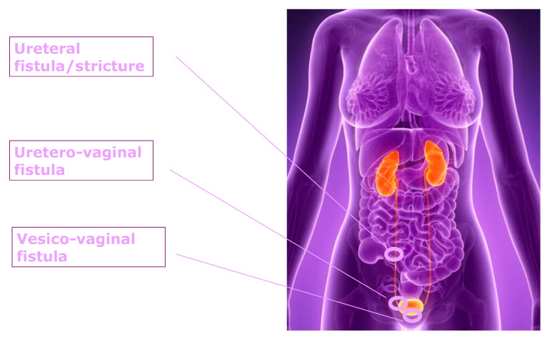
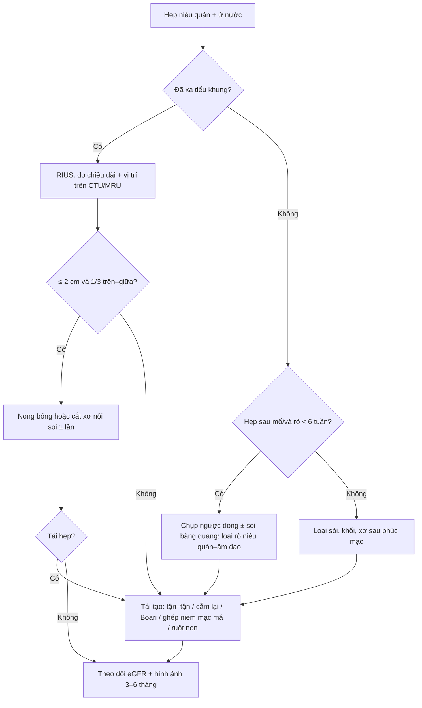
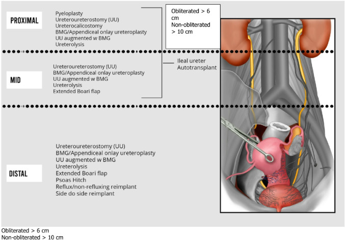
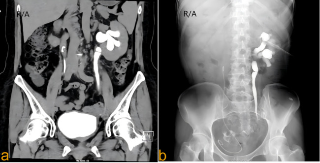
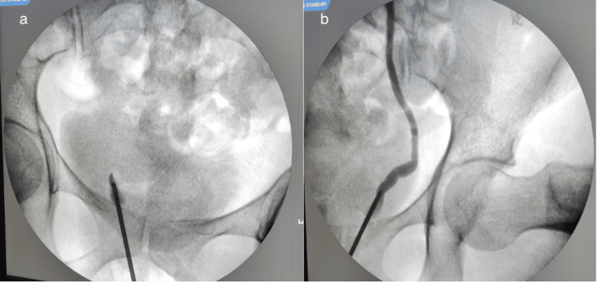

# 1666 — Hẹp niệu quản sau vá rò và sau xạ trị / Ureteral stricture after fistula repair and after pelvic radiotherapy

**Tags:** `pattern:hep-nieu-quan` `pattern:u-nuoc` `pattern:u-nieu-quan` `pattern:ro-nieu-sinh-duc` `pattern:xo-hoa-sau-xa` `vung:nieu-quan` `vung:than` `vung:tieu-khung` `protocol:CTU` `protocol:MRU` `protocol:chup-nguoc-dong` `protocol:do-ap-luc-Whitaker` `protocol:MAG3` `score:Clavien-Dindo` `incidentaloma:u-nuoc-thai-ky`
**Mức chắc chắn (certainty):** tổng hợp y văn (literature synthesis) — ghép 1 tổng quan cơ chế **hẹp niệu quản do xạ** (*Ther Adv Urol* 2026, PMC13133489, CC BY-NC 4.0), 1 thuật toán **tái tạo niệu quản robot** (*World J Urol* 2026, PMC12812089, CC BY 4.0), 1 đoàn hệ 53 ca **RIUS** (*Cancers* 2024, PMC11545663, CC BY 4.0), 1 tổng quan **tổn thương niệu quản trong mổ phụ khoa** (*Healthcare* 2025, PMC12346312, CC BY 4.0), 1 ca **rò niệu quản–âm đạo ẩn trong vá rò bàng quang–âm đạo** (*Cureus* 2025, PMC12449848, CC BY 4.0) và 1 ca **thay niệu quản bằng tĩnh mạch buồng trứng** (*BMC Surg* 2025, PMC12512800, CC BY-NC-ND 4.0). Không có thử nghiệm ngẫu nhiên nào về **ngưỡng can thiệp** trong RIUS → phần "khi nào mổ" là tổng hợp thực hành.

> **Câu chốt:** hẹp niệu quản sau vá rò và sau xạ **không phải một ống bị bóp** mà là **một đoạn thành mạch–niệu quản đã chết về mặt vi mạch**: xạ và/hoặc mổ gây **thiếu máu cục bộ → xơ hóa → co kéo**, nên **nong bóng và đặt stent chỉ chữa được triệu chứng**, còn **tái hẹp sau nong do xạ lên tới 100% (5/5 ca)** và **15% tái hẹp trong 6 tháng** kể cả sau mổ tái tạo ở trung tâm chuyên khoa. Điều quyết định kế hoạch **không phải mức ứ nước** mà là **3 biến số: chiều dài hẹp (≤ 2 cm hay > 2 cm), vị trí (sát bàng quang hay cao), và nền mô đã xạ hay chưa**.

## 1. Tổng quan bệnh học – cơ chế hình ảnh

### 1.1 Hai cơ chế, một hình ảnh: sợi xơ thay cho cơ trơn

- **Nhánh do xạ (radiation-induced ureteral stricture, RIUS):** tia xạ làm tổn thương **vi mạch quanh niệu quản** → **ROS** (gốc tự do) + viêm mạn → **đại thực bào M2** tiết **TGF-β và PDGF** → **nguyên bào sợi thành nguyên bào cơ** → **lắng đọng collagen ở lớp ngoài (adventitia)** → thành niệu quản **cứng, mất nhu động, hẹp lòng cố định**, kèm **dính vào tổ chức xung quanh** (PMC13133489). Đây là **vòng xoắn tự duy trì**: thiếu máu → xơ → thiếu máu thêm, nên tổn thương **vẫn tiến triển sau khi đã ngừng xạ**.
- **Nhánh do mổ/vá rò (iatrogenic):** khâu xiết, nhiệt điện, **bóc tách làm mất mạch nuôi** hoặc **tụ máu–xơ hóa quanh niệu quản** sau mổ phụ khoa/vá rò → cùng đích cuối là **đoạn niệu quản thiếu máu bị xơ thay thế**. Tổn thương niệu quản trong mổ phụ khoa chiếm **> 50% mọi tổn thương niệu quản do thầy thuốc**; tỉ lệ **0,08%** ở mổ lành tính và **0,39–1,1%** ở mổ ung thư (PMC12346312). Ngay cả khi soi bàng quang kiểm tra trong mổ, **0,27%** vẫn có tổn thương phát hiện muộn.
- **TẠI SAO hình ảnh trông như vậy (vật lý + mô bệnh):** sợi collagen **nghèo proton tự do** → **T2 tín hiệu thấp**, không ngấm thuốc, không có khối trong lòng; trên CT là **thành dày, đậm độ mô mềm, không vôi hóa, không có thành phần đặc bắt thuốc**. Vì không có khối, **không có "bờ tổn thương"** để đo — thứ duy nhất thấy được là **sự chuyển tiếp đột ngột từ niệu quản giãn sang đoạn hẹp** và **mô xơ quanh niệu quản**.
- **Vì sao ứ nước không tương xứng với triệu chứng:** hẹp tiến triển **nhiều tháng–nhiều năm**, thận **bù trừ** nên bệnh nhân thường **không đau**; tổn thương chỉ lộ ra khi **eGFR giảm** hoặc **nhiễm trùng tiết niệu tái diễn**. Trong loạt 53 ca RIUS, **thời gian từ xạ đến chẩn đoán trung vị chỉ 6 tháng (IQR 4–10)** nhưng y văn ghi **tiềm tàng tới 20 năm** (PMC11545663) — nghĩa là **không có mốc thời gian nào an toàn để loại trừ**.

### 1.2 Ngưỡng định lượng nằm lòng

| Đại lượng | Số liệu | Nguồn |
|---|---|---|
| Tỉ lệ RIUS chung sau xạ tiểu khung | **0,4–2,7%** | PMC11545663 |
| RIUS sau brachytherapy ung thư cổ tử cung | tích lũy **1,9% (3 năm)**, **2,7% (5 năm)** | PMC12512800 |
| RIUS sau xạ trị ung thư cổ tử cung (n = 1.860) | **2,1%** | PMC12512800 (dẫn Fokdal) |
| Thời gian tiềm tàng | trung vị **6 tháng** (IQR 4–10); y văn **tới 20 năm** | PMC11545663 |
| Phân bố chiều dài hẹp | **64% ≤ 2 cm**; **36% > 2 cm** | PMC11545663 |
| Vị trí hẹp (RIUS) | **1/3 trên 36%**, **1/3 giữa 39%**, **1/3 dưới 25%** | PMC11545663 |
| Hai bên | **78% (14/18)** trong loạt phẫu thuật RIUS | PMC13133489 (dẫn Toia) |
| Yếu tố dự báo tái hẹp | hẹp **> 2 cm OR 6,4 (1,1–36,9)**; **hóa trị đồng thời OR 7,8 (1,3–49,0)** | PMC11545663 |
| Nong bóng ở hẹp lành tính **có mạch nuôi tốt, < 2 cm** | không tái phát **89% ở 2 năm** | PMC13133489 (dẫn Richter, n = 114) |
| Nong bóng ở hẹp **thiếu máu** | không tái phát chỉ **40%** | PMC13133489 |
| Nong bóng ở RIUS | **tái phát 100% (5/5)** | PMC13133489 (dẫn Yam) |
| Đặt stent: hẹp **nội tại** vs **chèn ép ngoài** | thành công **94% vs 73%** | PMC13133489 (dẫn Yossepowitch) |
| Nhịp thay stent ở RIUS | **1–2 tháng/lần** (stent polymer thường 3–6 tháng, kim loại tới 12 tháng) | PMC13133489 |
| Tổn thương niệu quản trong mổ phụ khoa | **0,08%** mổ lành tính; **0,39–1,1%** mổ ung thư; **0,27%** phát hiện muộn dù đã soi bàng quang | PMC12346312 |
| Rò niệu quản–âm đạo (UVF) đi kèm rò bàng quang–âm đạo (VVF) | **~10%** | PMC12449848 |

## 2. Mẫu hình + chẩn đoán phân biệt theo vị trí (gamut)

*Sơ đồ ba tổn thương hay gặp sau mổ phụ khoa: hẹp/rò niệu quản, rò niệu quản–âm đạo, rò bàng quang–âm đạo. Nguồn: Healthcare (Basel) 2025, PMC12346312, CC BY 4.0 — nguyên bản.*

- **Mẫu hình chốt:** **giãn niệu quản–thận trên + một điểm chuyển tiếp hẹp, nhẵn, không có khối trong lòng, không có sỏi cản quang**. Trên CTU thì muộn, đoạn trên **đầy cản quang và giãn**, đoạn dưới **mảnh như sợi chỉ**; trên MRU đoạn hẹp **mất tín hiệu dịch** giữa hai đoạn có dịch.
- **Gamut theo vị trí (quyết định kỹ thuật tái tạo, không chỉ chẩn đoán):**
  - **Sát khúc nối bể thận – niệu quản (UPJ) / 1/3 trên:** hẹp do xạ thể **cao** (thường gặp khi xạ mở rộng), hẹp sau mổ đại tràng–trực tràng, **xơ sau phúc mạc**, **lạc nội mạc tử cung**, di căn hạch. Kỹ thuật: tạo hình bể thận–niệu quản, **niệu quản–niệu quản tận–tận**, ghép niêm mạc má, **niệu quản–đài thận**.
  - **1/3 giữa:** hẹp do xạ (thường **dài, nhiều đoạn**), hẹp sau **cắt tử cung**, **thoát vị niệu quản vào ổ xơ**. Kỹ thuật: tận–tận, ghép niêm mạc má, **niệu quản ghép ruột non**.
  - **1/3 dưới (sát bàng quang, < 5 cm):** hẹp sau **vá rò**, sau **mổ sa sinh dục**, sau **đặt lưới**, hẹp do xạ đoạn chậu. Kỹ thuật: **cắm lại niệu quản vào bàng quang (ureteroneocystostomy)** ± **psoas hitch** ± **Boari flap**; tránh Boari trên bàng quang đã xạ.
- **Gamut theo "nền mô" (quan trọng hơn gamut theo vị trí):** **niệu quản "sạch"** (sỏi, hẹp lành tính) → nong bóng/khâu nối dễ lành; **niệu quản đã xạ hoặc đã mổ nhiều lần** → mọi can thiệp đều **lành kém, tái hẹp cao**, phải **cắt hết đoạn xơ** và **không tạo căng**.
- **Ba câu hỏi trước khi đọc phim:** **(1) hẹp dài bao nhiêu cm? (2) cách lỗ niệu quản bao xa? (3) nền mô đã xạ/nhiều lần mổ chưa?** — trả lời được 3 câu này là đã chọn xong chiến lược.

## 3. Bảng so sánh phân biệt (ma trận đối chiếu)

| Thực thể (entity) | Hình ảnh điển hình | Chốt vào (rule-in) | Chốt loại (rule-out) | Gợi ý xác nhận |
|---|---|---|---|---|
| **Hẹp do xạ (RIUS)** | Đoạn hẹp **dài, nhẵn, đều**, thành dày không vôi, mô xơ quanh niệu quản, thường **hai bên** | **Tiền sử xạ tiểu khung + hẹp dài/nhiều đoạn + không khối trong lòng** | Có **khối bắt thuốc trong lòng** → không phải hẹp xơ đơn thuần | CTU 3 thì + MRU; soi niệu quản thấy lòng hẹp đều, niêm mạc nhợt |
| **Hẹp sau vá rò / sau mổ phụ khoa** | Hẹp **khu trú, ngắn** đúng vị trí mổ; có thể kèm **rò niệu quản–âm đạo**, ứ nước một bên | **Mổ trong 6 tuần trước + hẹp đúng tầng mổ + đái rỉ liên tục** | Hẹp lan tỏa hai bên, không liên quan vị trí mổ → nghĩ xạ/hẹp lành tính khác | Chụp ngược dòng thì mổ; CT bàng quang có cản quang; soi bàng quang tìm lỗ rò |
| **Hẹp do sỏi** | **Sỏi cản quang** tại điểm hẹp, **dấu đuôi sao chổi**, niêm mạc phù nề | **Sỏi thấy trên CT không cản quang** | Hẹp nhẵn, không sỏi, không cản quang trong lòng | CT không cản quang là chuẩn; siêu âm + X-quang bụng |
| **Xơ sau phúc mạc / lạc nội mạc** | Hẹp **kéo dài, nhiều mức**, đẩy niệu quản vào trong; khối mô mềm **bao quanh chứ không trong lòng** | **Hẹp nhiều đoạn + mô mềm quanh niệu quản + không khối trong lòng** | Tổn thương **trong lòng**/loét niêm mạc → nghĩ ung thư | MRI có/không cản từ; sinh thiết khi nghi ác tính |
| **Ung thư biểu mô niệu quản** | **Khối trong lòng**, bờ không đều, **ngấm thuốc thì vỏ–niệu quản**, có thể **di căn hạch** | **Khối đặc trong lòng + ngấm thuốc + tế bào niệu** | Thành dày đều, không khối, không ngấm → nghĩ xơ | Niệu soi + tế bào học; CTU thì bài tiết |
| **Giãn sinh lý thai kỳ (bẫy)** | Giãn **phải > trái**, tới **bể thận**, **không có điểm chuyển tiếp**, hết sau sinh | **Thai kỳ + không điểm hẹp + giãn hai bên không đối xứng** | Có **điểm chuyển tiếp + đoạn dưới xẹp** → hẹp thật | Siêu âm sau sinh 6–12 tuần; chỉ chụp thêm khi có biến chứng |

- **Ảnh minh họa mẫu hình:** CTU thì bài tiết cho thấy **niệu quản trên giãn, đoạn chậu hẹp**; chụp ngược dòng xác nhận **đoạn hẹp** và **không có sỏi/khối**.

## 4. Protocol chụp + hệ phân độ/điểm chuẩn hóa

### 4.1 Chọn kỹ thuật theo câu hỏi lâm sàng

- **CTU (CT urography) 3 thì** — chuẩn để **đo chiều dài hẹp và loại trừ sỏi/khối**: thì **không cản quang** (sỏi, vôi hóa), thì **vỏ thận 90–100 giây** (đánh giá nhu mô, mạch), thì **bài tiết 8–10 phút** (hình dạng lòng niệu quản). Kỹ thuật **split-bolus** giảm số lần chụp nhưng vẫn đủ 3 thông tin.
- **MRU (MR urography) không cản từ** — khi **suy thận, dị ứng cản quang, thai phụ, trẻ**: chuỗi **T2 nặng (SSFSE/HASTE)** cho hình ảnh lòng niệu quản bằng dịch, **không cần thuốc**, đánh giá được **mô xơ quanh niệu quản**. Đây cũng là lựa chọn khi **cản quang bị chống chỉ định** và khi cần phân biệt **xơ quanh niệu quản** với khối.
- **Chụp ngược dòng (retrograde pyelography)** — khi CTU/MRU không kết luận hoặc cần **đo chính xác đoạn hẹp ngay trước mổ**; đồng thời **phát hiện rò niệu quản–âm đạo ẩn** (bơm thuốc thấy **tràn sang âm đạo**). Trong ca VVF, **chụp ngược dòng trong mổ** là bước phát hiện UVF mà CT trước mổ bỏ sót (PMC12449848).
- **Đo áp lực Whitaker** — chỉ dùng khi **hình ảnh mơ hồ mà nghi tắc thật**: truyền dịch vào bể thận và đo chênh áp; **chênh áp thấp = không tắc** (loại trừ hẹp có ý nghĩa).
- **MAG3 + lợi niệu** — đánh giá **chức năng từng thận** và **mức tắc** trước khi quyết định giữ thận hay không.

### 4.2 Bảng ngưỡng kỹ thuật tái tạo (tra nhanh khi hội chẩn)

| Kỹ thuật | Giới hạn chiều dài / điều kiện | Kết quả báo cáo |
|---|---|---|
| Nong bóng / cắt xơ nội soi | **< 2 cm**, không thiếu máu, không xạ | nong đơn thuần **15–44%** thành công; cắt xơ **75%** ở 6 tháng; **kết hợp ở hẹp > 2 cm: 77,2% (1 năm)/66,6% (2 năm)** |
| Niệu quản–niệu quản tận–tận | **< 2 cm**, cách lỗ niệu quản **> 2 cm** | **65–100%** |
| Cắm lại niệu quản vào bàng quang | hẹp **< 5 cm** tính từ lỗ niệu quản | **85–100%**; bí tiểu cấp **8%** |
| Psoas hitch | thiếu chiều dài sau khi cắm lại | cộng thêm **6 cm** (tới **10 cm**) |
| Boari flap | hẹp **8–15 cm** | **90%**; **tránh trên bàng quang đã xạ** |
| Ghép niêm mạc má | **không tắc hoàn toàn ≤ 10 cm**; **tắc hoàn toàn ≤ 6 cm** | **90–100%**; biến chứng nơi lấy **4%**, graft co **8–9%** |
| Niệu quản ghép ruột non | hẹp dài/nhiều đoạn, thất bại các cách khác | chiều dài hẹp trung bình **20 cm**; biến chứng sớm **8%**, muộn **14%**; toan chuyển hóa **4%** |
| Ghép ruột thừa (onlay) | hẹp bên **phải** | ruột thừa dài trung bình **8 cm**; **10–20%** bệnh nhân không có ruột thừa |
| Ghép tĩnh mạch buồng trứng | hẹp dài sau xạ, bệnh nhân **sau mãn kinh/cắt buồng trứng** | đường kính tĩnh mạch **3–4 mm**, tương đương niệu quản |

- **Hai nguyên tắc làm thay đổi tỉ lệ tái hẹp:** (1) **"nghỉ niệu quản" (ureteral rest) 1–6 tuần** trước mổ — hai loạt lớn giảm tái hẹp **13,4% → 4,6%** và **22,5% → 9,3%**; (2) **hoãn tái tạo tới 1 năm sau liều xạ cuối** để mô hồi phục (PMC12812089).
- **Kết cục thực tế của RIUS:** nong/cắt xơ được thử ở **72%**, thành công **74%** lúc rút stent nhưng chỉ **59%** ở 12 tháng; **47%** phải mổ tái tạo; **15%** tái hẹp (trung vị **5 tháng**); **eGFR cải thiện có ý nghĩa** ở 12 tháng (67,7 → 77,0 mL/phút, p = 0,007) (PMC11545663).

### 4.3 Sơ đồ quyết định

- **Kết quả mổ tái tạo (ảnh minh họa lựa chọn theo vị trí):** ghép niêm mạc má **chỉ dùng khi không tắc hoàn toàn ≤ 10 cm** hoặc **tắc hoàn toàn ≤ 6 cm**; hẹp dài hơn phải dùng **ruột non** hoặc **ghép tĩnh mạch buồng trứng**.

*Bảng–sơ đồ kỹ thuật theo 1/3 trên – giữa – dưới, kèm giới hạn chiều dài của ghép niêm mạc má (tắc hoàn toàn > 6 cm, không tắc hoàn toàn > 10 cm thì cần ruột non). Nguồn: World J Urol 2026, PMC12812089, CC BY 4.0 — nguyên bản.*

## 5. Biến thể bình thường và cạm bẫy

- **Giãn sinh lý thai kỳ:** **phải > trái**, do **tử cung chèn ép + progesterone giãn cơ trơn**; **không có điểm chuyển tiếp**, **không có đoạn dưới xẹp**, và **hết trong 6–12 tuần sau sinh**. Đừng gắn nhãn "hẹp niệu quản" cho thai phụ chỉ vì có ứ nước — nhưng cũng đừng bỏ qua **hẹp thật** khi có **điểm chuyển tiếp**.
- **Hẹp giả do nhu động:** co thắt sinh lý tạo **đoạn mảnh ngắn, thay đổi giữa các thì/lần chụp**; hẹp thật **cố định** và có **giãn trên**. Chụp lại thì muộn hoặc sau lợi niệu là cách phân biệt.
- **Sau mổ < 7 ngày:** **phù nề niệu quản** do thủ thuật gây hẹp giả — đừng vội kết luận hẹp xơ; hẹp xơ cần **≥ vài tuần** và có **xơ hóa quanh niệu quản**.
- **Xơ do xạ vs tái phát ung thư:** xơ **không ngấm thuốc, không có khối, không dày hạch**; tái phát ung thư **có khối ngấm thuốc và/hoặc hạch**. **PET/CT có thể dương giả sau xạ** — không dùng một mình để mổ.
- **Cạm bẫy chết người — rò động mạch chậu–niệu quản (uretero-arterial fistula):** ở bệnh nhân **đã xạ tiểu khung + đặt stent niệu quản nhiều lần**, **đái máu ồ ạt thoáng qua ("sentinel bleed")** rồi tự cầm là **dấu hiệu báo trước**, không phải viêm xạ; ca đã báo phải **thay stent kim loại nhiều lần** và cuối cùng **chảy máu bàng quang tamponade, Hb 45 g/L** (PMC13066737). Nghi ngờ → **CTA 2 thì + chụp mạch**, không chờ.
- **Cạm bẫy "bỏ sót rò niệu quản–âm đạo" khi vá rò bàng quang–âm đạo:** rò niệu quản–âm đạo đi kèm **~10%**; nếu không phát hiện, bệnh nhân **vẫn rỉ nước tiểu sau khi vá thành công** và bị **mổ lại trong mô sẹo** (PMC12449848). Trước mọi ca vá rò: **chụp ngược dòng/soi bàng quang** là bắt buộc.
- **Stent không phải điều trị triệt để:** ở RIUS, stent phải thay **1–2 tháng/lần** và có thể gây **nhiễm màng sinh học, đóng cặn, di trú, rò** — chỉ dùng như **cầu nối** tới mổ hoặc **giảm nhẹ** ở người không mổ được.
- **Đừng đo chiều dài hẹp trên phim 2D nghiêng:** chiều dài thật đo trên **CTU/MRU nhiều bình diện** hoặc **thước trong mổ**; ước lượng sai làm chọn sai kỹ thuật (ghép má cho hẹp > 10 cm → thất bại).

## 6. Tự lượng giá — Blind Quiz

**Ca 1 — Nữ 58 tuổi, xạ trị ung thư cổ tử cung 3 năm trước, hiện mệt và creatinin tăng nhẹ; không đau bụng.**

- Gợi ý: **không có cơn đau quặn thận**, không sỏi trên phim cũ.
- Câu hỏi: (1) Mô tả vị trí và hình thái đoạn hẹp. (2) Ba chẩn đoán phân biệt. (3) Dấu hiệu nào chốt nguyên nhân do xạ?

<b>Bấm để hiện đáp án (findings + chẩn đoán)</b>

- **Findings:** (a) CTU coronal — **bể thận và 1/3 trên niệu quản trái giãn**, thuốc cản quang đọng lại; **đoạn chậu hẹp nhẵn, không khối trong lòng**, không sỏi cản quang. (b) Chụp ngược dòng/antegrade xác nhận **đoạn hẹp khu trú** với niệu quản trên giãn.
- **Chẩn đoán:** **hẹp niệu quản do xạ (RIUS)** — tiền sử xạ tiểu khung + hẹp nhẵn không khối + không sỏi.
- **Phân biệt:** hẹp sau mổ/vá rò (không có tiền sử mổ), sỏi niệu quản (không sỏi trên CT không cản quang), ung thư niệu quản (không khối ngấm thuốc trong lòng).
- **Vì sao hẹp mà không đau:** hẹp tiến triển chậm nhiều tháng, thận bù trừ; triết lý "đau = tắc cấp", còn đây là **tắc mạn**.
- **Bước tiếp theo:** đo chiều dài hẹp trên CTU; nếu **≤ 2 cm, 1/3 trên–giữa** → nong/cắt xơ một lần; nếu dài hơn hoặc tái hẹp → **tái tạo** (tận–tận/cắm lại ± Boari), nhớ **nghỉ niệu quản 1–6 tuần** trước mổ.
- Nguồn ảnh: *BMC Surg* 2025, PMC12512800, CC BY-NC-ND 4.0 — nguyên bản (2 panel a–b).

**Ca 2 — Nữ 36 tuổi, rỉ nước tiểu liên tục 10 ngày sau cắt tử cung toàn phần; siêu âm thấy ứ nước phải; nội soi bàng quang có lỗ rò ở thành sau.**

- Câu hỏi: (1) Vì sao **niệu quản phải không hiện hình** trên hình (a)? (2) Chẩn đoán kép là gì? (3) Nếu chỉ vá rò bàng quang–âm đạo thì hậu quả?

<b>Bấm để hiện đáp án (findings + chẩn đoán)</b>

- **Findings:** (a) Bơm thuốc ngược dòng bên phải — **niệu quản phải không hiện hình**, thuốc **tràn vào bàng quang/âm đạo**; (b) bên trái **niệu quản bình thường, thành mạch đều**. Kèm ứ nước phải trên CT.
- **Chẩn đoán:** **rò niệu quản–âm đạo (UVF) ẩn** phối hợp **rò bàng quang–âm đạo (VVF)** sau cắt tử cung — UVF đi kèm **~10%** ca VVF.
- **Vì sao bỏ sót:** VVF và UVF cùng gây **rỉ nước tiểu liên tục**, triệu chứng chồng lấp; CT trước mổ chỉ thấy **ứ nước + thoát thuốc từ bàng quang**, không thấy đường rò niệu quản.
- **Hậu quả nếu chỉ vá VVF:** bệnh nhân **vẫn rỉ nước tiểu**, bị **mổ lại trong mô sẹo**, nguy cơ **hẹp niệu quản tiến triển + mất chức năng thận**.
- **Xử trí trong ca này:** **cắm lại niệu quản phải + vá VVF cùng lúc**, hết rỉ hoàn toàn.
- Nguồn ảnh: *Cureus* 2025, PMC12449848, CC BY 4.0 — nguyên bản (2 panel a–b).

**Ca 3 — Nam 67 tuổi, hẹp niệu quản 4 cm sau xạ trị ung thư trực tràng; đã nong bóng 1 lần, tái hẹp sau 5 tháng.**

- Câu hỏi: (1) Vì sao nong bóng thất bại ở đây? (2) Chọn kỹ thuật nào và vì sao không dùng ghép niêm mạc má? (3) Tỉ lệ tái hẹp kỳ vọng?

<b>Bấm để hiện đáp án</b>

- **Vì sao thất bại:** hẹp **> 2 cm** (OR tái hẹp **6,4**) + **nền đã xạ** (mô thiếu máu, xơ) → nong chỉ rách mô xơ rồi lành bằng xơ nhiều hơn. Ở RIUS, nong bóng **tái phát 100% (5/5)** trong loạt được dẫn; tỉ lệ thành công chung của nội soi ở RIUS chỉ **59%** ở 12 tháng.
- **Kỹ thuật:** hẹp **4 cm, 1/3 giữa, đã xạ** → **niệu quản ghép ruột non** hoặc **ghép tĩnh mạch buồng trứng** (nếu là nữ sau mãn kinh) / **tận–tận có ghép bổ sung**. **Ghép niêm mạc má** chỉ đặt ra khi **không tắc hoàn toàn ≤ 10 cm**; nếu đoạn hẹp **tắc hoàn toàn > 6 cm** thì không dùng onlay được.
- **Kỳ vọng:** tái hẹp chung **15%** (trung vị **5 tháng**); eGFR có thể cải thiện dù phải can thiệp nhiều lần. Hoãn mổ tới **1 năm sau liều xạ cuối** nếu tình trạng cho phép.

## Bài liên quan chéo
- [191 – Vá lại rò niệu–sinh dục thất bại](../191-va-lai-ro-nieu-sinh-duc-that-bai/lesson.md)
- [152 – Sỏi niệu](../152-soi-nieu/lesson.md)
- [1665 – Rò trực tràng–âm đạo sau xạ trị và sau mổ](../1665-ro-truc-trang-am-dao-sau-xa-tri/lesson.md)
- [1633 – Viêm bàng quang do xạ, chảy máu nặng](../1633-viem-bang-quang-xa-chay-mau-nang/lesson.md)
- [500 – Tổng quan Vú & Sản phụ khoa](../500-tong-quan-vu-san-phu-khoa/lesson.md)

> Không dùng để chẩn đoán độc lập khi chưa có người hướng dẫn.
