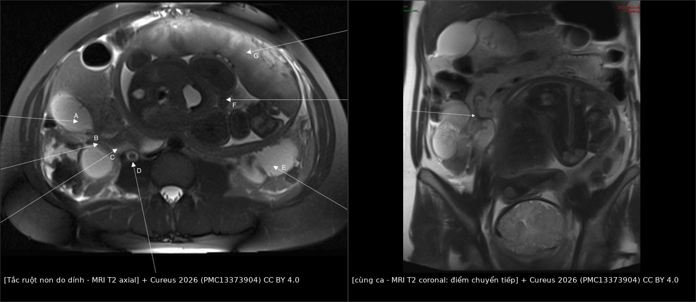
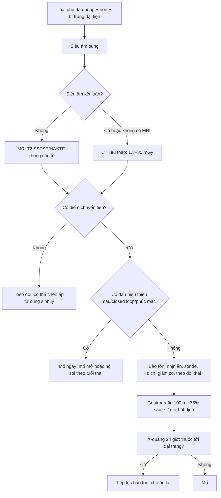
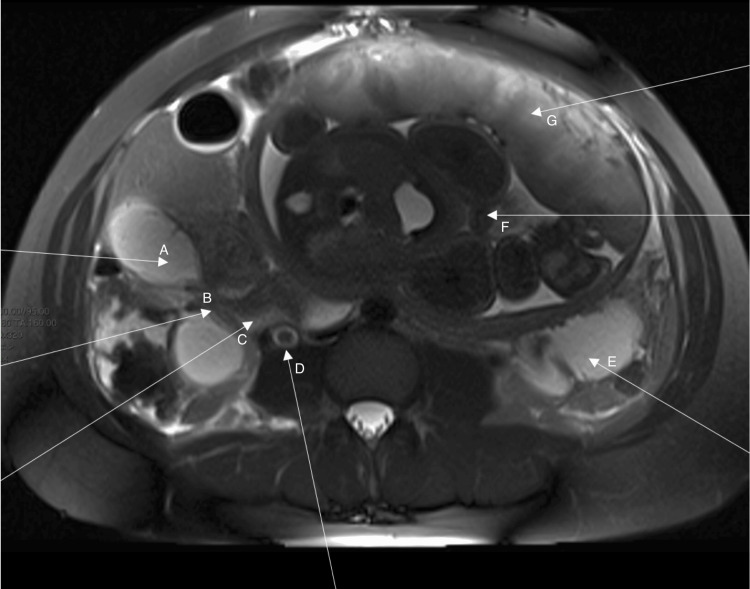
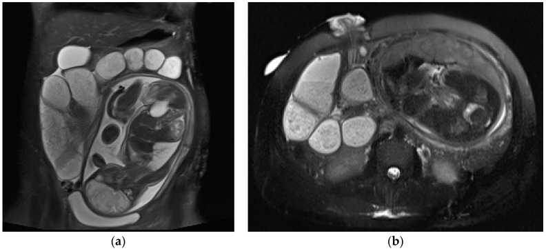

# 1667 — Tắc ruột non do dính sau mổ ở thai phụ / Adhesive small bowel obstruction in pregnancy

**Tags:** `pattern:tac-ruot-non` `pattern:dinh-phuc-mac` `pattern:diem-chuyen-tiep` `pattern:xoan-ruot` `pattern:thoat-vi-noi` `vung:ruot-non` `vung:o-bung` `protocol:MRI-thai` `protocol:CT-lieu-thap` `protocol:X-quang-bung` `protocol:sieu-am-bung` `protocol:gastrografin` `incidentaloma:u-nuoc-thai-ky`
**Mức chắc chắn (certainty):** tổng hợp y văn (literature synthesis) — ghép 1 tổng quan hệ thống **216 thai phụ tắc ruột non** (*World J Emerg Surg* 2024, PMC11007914, CC BY 4.0), 1 đoàn hệ hồi cứu **43 ca dùng gastrografin** (*Sci Rep* 2025, PMC12297560, CC BY-NC-ND 4.0), 1 tổng quan **phẫu thuật cấp cứu ở thai phụ** (*Can J Surg* 2025, PMC12133296, CC BY-NC-ND 4.0), 1 tổng quan **hình ảnh bụng cấp thai kỳ** (*Diagnostics* 2023, PMC10528125, CC BY 4.0) và 1 ca **tắc ruột non ở thai 38 tuần** (*Cureus* 2026, PMC13373904, CC BY 4.0). Không có thử nghiệm ngẫu nhiên nào về **ngưỡng mổ** ở thai phụ.

> **Câu chốt:** tắc ruột non ở thai phụ **không hiếm đến mức bỏ qua, nhưng cũng không điển hình**: **52,1% xảy ra ở 3 tháng cuối**, **~2/3 do dính sau mổ cũ** (kể cả **mổ lấy thai** trước đó), và **chẩn đoán muộn giết thai nhiều hơn giết mẹ** — **tử vong thai 15,9%** so với **mẹ 3,7%**. Hai điều làm thay đổi kết cục: **(1) dùng MRI không cản từ (SSFSE/HASTE) thay vì sợ tia xạ** — chỉ **14,3%** ca trong y văn được chẩn đoán bằng MRI; **(2) gastrografin đường mũi–dạ dày vừa chẩn đoán vừa điều trị** — thành công bảo tồn **90,5% vs 59,1%**, phải mổ **9,5% vs 40,9%**, và biết kết quả sau **29 giờ thay vì 75 giờ**.

## 1. Tổng quan bệnh học – cơ chế hình ảnh

### 1.1 Vì sao thai kỳ làm dính thành tắc

- **Cơ chế "dây căng":** sau mổ bụng/mổ lấy thai, các quai ruột **dính vào một dải xơ cố định** (dây dính). Khi tử cung lớn dần, nó **đẩy quai ruột lên trên và sang bên**, làm **dây dính căng như dây cung** và **xoay quai ruột quanh điểm cố định** → hẹp lòng tại **một điểm chuyển tiếp (transition point)**. Vì vậy tắc thường xuất hiện **khi tử cung to nhất (3 tháng cuối, 52,1%)**, không phải lúc mới mổ.
- **Vì sao ứ dịch:** ruột trên điểm tắc **ứ dịch và hơi** (dịch tiết + khí nuốt vào) → giãn; ruột dưới **xẹp**. Trên **T2/SSFSE**, dịch ứ **tăng tín hiệu rất mạnh** (nước tự do), nên chỉ cần **T2 không cản từ** là thấy rõ **ranh giới giãn–xẹp** — đây là lý do MRI là modality đầu tay, không cần thuốc.
- **Vì sao nguy hiểm hơn người không mang thai:** tử cung to **che chắn thăm khám**, **bạch cầu và CRP tăng sinh lý**, ít **dấu hiệu phúc mạc** vì thành bụng bị căng; đồng thời **tử cung to làm tăng áp lực ổ bụng** nên **quai ruột dễ bị xoắn và thiếu máu** hơn.
- **Ngưỡng định lượng nằm lòng (xem bảng 1.2):** tần suất **1/1.500 – 1/66.431** ca sinh (có nguồn ghi **1/17.000**), **60–70% do dính**, **82,5% phải mổ**, trong đó **61,7% mổ trong 24 giờ**.
- **TẠI SAO hình ảnh quyết định:** không có xét nghiệm máu nào phân biệt **tắc cơ học** với **liệt ruột sinh lý**; chỉ có **điểm chuyển tiếp** trên hình ảnh mới chứng minh **tắc cơ học**, và **dấu hiệu thiếu máu ruột** mới buộc **mổ ngay**.

### 1.2 Ngưỡng định lượng nằm lòng

| Đại lượng | Số liệu | Nguồn |
|---|---|---|
| Tần suất tắc ruột non trong thai kỳ | **1/1.500 – 1/66.431** ca sinh; một tổng quan khác ghi **1/17.000** | PMC11007914; PMC12133296 |
| Vị trí hàng bệnh cảnh | **nguyên nhân bụng cấp phổ biến thứ 3** ở thai phụ (sau viêm ruột thừa, bệnh đường mật) | PMC11007914 |
| Nguyên nhân | **dính 60–70%**; thoát vị nội **29,0%**; xoắn ruột non **13,8%**; lồng ruột **12,0%** | PMC11007914; PMC12133296 |
| Phân bố theo 3 tháng | **5,9% / 42,0% / 52,1%** | PMC11007914 |
| Tỉ lệ phải mổ | **82,5%**; **61,7%** mổ trong **24 giờ** | PMC11007914 |
| Đường mổ | mở **75,6%**, nội soi **15,9%**, chuyển mở **8,5%** | PMC11007914 |
| Thủ thuật | gỡ dính **20,3%**; **cắt ruột 34,4%**; **mổ lấy thai cùng lúc 23,2%** | PMC11007914 |
| Tử vong mẹ / thai | **3,7%** / **15,9–16,0%** | PMC11007914 |
| Nguy cơ thai khi tắc ruột | mất thai **17%**, sinh non **45%**, tử vong mẹ **2%** | PMC12133296 |
| Chẩn đoán bằng hình ảnh | X-quang **19,8%**, siêu âm **11,1%**, CT **22,6%**, **MRI 14,3%**, khám/mổ **30,9%** | PMC11007914 |
| Liều xạ thai nhi | X-quang bụng **0,1–3,0 mGy**; CT bụng **1,3–35 mGy**; CT tiểu khung **10–50 mGy**; **< 50 mGy chưa ghi nhận nguy cơ** | PMC12133296 |
| Gastrografin: thành công bảo tồn | **90,48% (19/21) vs 59,09% (13/22)**, p = 0,045 | PMC12297560 |
| Gastrografin: phải mổ | **9,52% (2/21) vs 40,91% (9/22)** | PMC12297560 |
| Gastrografin: thời gian đánh giá đáp ứng | **29,29 ± 0,40 giờ vs 75,23 ± 8,47 giờ**, p < 0,001 | PMC12297560 |
| Gastrografin: nằm viện | trung vị **6 ngày (6–7) vs 9 ngày (7–14,25)**, p = 0,001 | PMC12297560 |
| Biến cố thai nhi do gastrografin | **0** dị tật, **0** sảy thai, không khác sinh non (**9,52% vs 18,18%**, p = 0,664) | PMC12297560 |

## 2. Mẫu hình + chẩn đoán phân biệt theo vị trí (gamut)

- **Mẫu hình chốt (5 dấu hiệu, đọc theo thứ tự):**
  1. **Quai ruột non giãn > 3 cm**, chứa **dịch–hơi** (mức dịch ngang trên X-quang đứng, **tăng tín hiệu T2** trên MRI).
  2. **Điểm chuyển tiếp (transition point):** nơi quai giãn **đột ngột chuyển sang quai xẹp** — dấu hiệu **duy nhất** chứng minh **tắc cơ học**.
  3. **Ruột dưới điểm tắc xẹp hoàn toàn**, ít hơi.
  4. **Dấu hiệu "phân ruột non" (small bowel feces sign)** ở quai trên điểm tắc — gợi ý **tắc bán cấp**, không đặc hiệu nguyên nhân.
  5. **Dấu hiệu nguy hiểm (strangulation):** quai **hình chữ U/C đóng kín (closed loop)**, **xoắn mạc treo (whirl sign)**, thành ruột **không ngấm thuốc**, **khí trong thành ruột (pneumatosis)**, **khí trong tĩnh mạch cửa**, **dịch ổ bụng nhiều**.
- **Gamut theo nguyên nhân (thay đổi theo lịch sử mổ):**
  - **Chưa từng mổ bụng:** nghĩ **thoát vị bẹn/đùi/ventral bị nghẹt**, **xoắn ruột non**, **lồng ruột**, **u/lymphoma**, **bệnh Crohn hẹp**, **dính bẩm sinh** (**11%** dính không do mổ).
  - **Đã mổ lấy thai / mổ phụ khoa:** **dính** là hàng đầu; khối **dính vào thành bụng sẹo mổ**; **thoát vị ở vết mổ**.
  - **Đã mổ nối ruột non theo Roux-en-Y (giảm béo):** **thoát vị nội** ở **Petersen**, **lỗ mạc treo ngang**, **lỗ hỗng–hỗng** — chiếm **29,0%** ca trong tổng quan và **thường không có dấu hiệu tắc điển hình** vì quai ruột **xoay quanh mạc treo** chứ không dính vào thành.
  - **Có bệnh nền:** **lồng ruột** (12,0%), **xoắn** (13,8%), **thoát vị nội** (29,0%).
- **Ba câu hỏi trước khi kết luận:** **(1) có điểm chuyển tiếp thật không? (2) có dấu hiệu thiếu máu/closed loop không? (3) thai đang ở tuần bao nhiêu (quyết định mổ nội soi hay mổ mở, có cần mổ lấy thai cùng lúc)?**

## 3. Bảng so sánh phân biệt (ma trận đối chiếu)

| Thực thể (entity) | Hình ảnh điển hình | Chốt vào (rule-in) | Chốt loại (rule-out) | Gợi ý xác nhận |
|---|---|---|---|---|
| **Tắc do dính** | Một **điểm chuyển tiếp** đơn độc, quai trên giãn, **dính vào sẹo mổ**, không có túi thoát vị | **Tiền sử mổ bụng + 1 điểm chuyển tiếp + không khối** | Nhiều mức tắc, không điểm chuyển tiếp → nghĩ **liệt ruột** | MRI SSFSE coronal/axial; mổ gỡ dính nếu không đáp ứng |
| **Thoát vị nội sau RYGB** | **Whirl sign** (mạc treo xoắn), **SMV beaking**, mạc treo **sung huyết/phù**, quai ruột **tụ lại một vùng** | **Mổ RYGB trước đó + whirl/SMV beaking** | Không có mạc treo xoắn, không tiền sử mổ → nghĩ dính | MRI/CT; **dấu hiệu có đồng thuận liên đọc tốt nhất**: whirl, SMV beaking, sung huyết mạc treo |
| **Xoắn ruột non** | Quai giãn **hình chữ U**, **whirl sign**, mạch treo **xoắn**, **thiếu máu thành ruột** | **Whirl + quai đóng kín + dịch ổ bụng** | Quai giãn rải rác, không xoắn → nghĩ dính/tắc bán cấp | CTA/MRI; **mổ ngay** khi có dấu hiệu thiếu máu |
| **Lồng ruột** | **Dấu bia (target) / dấu bánh mì kẹp**, **lưỡi liềm mạc treo**, đầu lồng **hình đạn** | **Target sign + quai lồng vào nhau** | Không thấy đầu lồng → loại trừ | Siêu âm là đầu tay; MRI xác nhận, **không dùng thuốc thụt ở thai phụ** |
| **Tắc do u/IBD hẹp** | **Khối/thành ruột dày** tại điểm tắc, hạch, không dính sẹo mổ | **Thành dày > 3 mm + khối + hạch** | Thành mỏng, chỉ dính → nghĩ dính | MRI bụng có/không cản từ; nội soi sau sinh |
| **Chèn ép tử cung (bẫy sinh lý)** | Quai ruột **bị đẩy lệch**, không có **điểm chuyển tiếp**, hết khi đổi tư thế | **Không điểm hẹp + quai vẫn có nhu động + thai to** | Có **điểm chuyển tiếp cố định** → tắc thật | MRI lặp sau 2–4 giờ; theo dõi lâm sàng |

- **Ảnh ghép đối chiếu (cùng một ca, hai bình diện):** trục **(a)** cho thấy **quai giãn–điểm chuyển tiếp–quai xẹp**; coronal **(b)** xác định **điểm chuyển tiếp đơn độc** ở **hồi tràng cuối**, cạnh **tử cung to**.

*Trái: axial — quai giãn (A, B, C, E, F, G), túi mật (A), điểm chuyển tiếp (B), quai xẹp (C), ứ nước phải (D), tử cung/thai (F). Phải: coronal — mũi tên chỉ điểm chuyển tiếp đơn độc. Nguồn: Cureus 2026 (PMC13373904), CC BY 4.0, ảnh ghép letterbox.*

## 4. Protocol chụp + hệ phân độ/điểm chuẩn hóa

### 4.1 Trình tự hình ảnh (theo bậc, không nhảy bậc)

- **Siêu âm bụng** — đầu tay: quai ruột **ứ dịch, mất nhu động**, có/không có dịch ổ bụng; nhưng **không xác định được điểm chuyển tiếp** trong phần lớn ca (chỉ **11,1%** ca trong y văn được chẩn đoán bằng siêu âm).
- **MRI bụng không cản từ** — **chuẩn khi siêu âm không kết luận**: chuỗi **T2 SSFSE/HASTE** (nhanh, ít nhiễu do thai máy), **coronal + axial**, thêm **T1/T2 fat-sat** khi nghi máu/viêm; **DWI** hữu ích cho ổ áp-xe nhưng không bắt buộc. **Truy quai ruột từ trên xuống tới điểm chuyển tiếp**, đo **đường kính quai giãn** và **bề dày thành**.
- **CT bụng–tiểu khung liều thấp** — khi **MRI không có/không kịp**, khi bệnh nhân **không ổn định**, hoặc nghi **thiếu máu ruột cấp**. **Không từ chối CT chỉ vì đang mang thai**: liều thai nhi **1,3–35 mGy (bụng)** và **10–50 mGy (tiểu khung)**, đều **dưới ngưỡng 50 mGy** chưa ghi nhận nguy cơ; dùng **protocol liều thấp** và hội chẩn bác sĩ CĐHA.
- **X-quang bụng đứng** — chỉ để **theo dõi gastrografin** hoặc khi không có MRI/CT; liều thai nhi **0,1–3,0 mGy**.
- **Không dùng gadolinium** thường quy (qua nhau thai, chưa đủ dữ liệu an toàn); **không dùng thuốc thụt baryte** khi nghi tắc/thủng.

### 4.2 Gastrografin: vừa chẩn đoán, vừa điều trị

- **Cơ chế:** dung dịch **1900 mOsm/L (~6 lần dịch ngoại bào)** → **hút dịch vào lòng ruột**, giảm phù thành ruột, kích thích nhu động, tăng chênh áp qua chỗ tắc, bôi trơn; đồng thời **cản quang** cho phép theo dõi **thuốc tới đại tràng trong 24 giờ** = **tắc giải quyết được bằng bảo tồn**.
- **Phác đồ đã báo cáo (43 thai phụ):** **100 mL gastrografin 75%** qua sonde mũi–dạ dày **sau ≥ 2 giờ hút dịch hiệu quả**; **kẹp sonde 2 giờ** rồi hút lại; **X-quang bụng ở 24 giờ**: **thấy thuốc ở đại tràng → tiếp tục bảo tồn**, **không thấy → mổ**.
- **Ngưỡng thành công:** bảo tồn **90,48% vs 59,09%** (p = 0,045); mổ **9,52% vs 40,91%**; nằm viện **6 vs 9 ngày**; **không có biến cố mẹ/thai** trong loạt nhỏ này — nhưng đây là **nghiên cứu hồi cứu, tự chọn nhóm**, nên chỉ dùng khi **không có dấu hiệu thiếu máu/closed loop**.

### 4.3 Sơ đồ quyết định

### 4.4 Nguyên tắc mổ theo tuổi thai

- **3 tháng đầu và 3 tháng giữa:** **nội soi được ưu tiên nếu khả thi** (vết mổ nhỏ, ít đau, ra viện sớm); vào trocar **kiểu mở (Hasson)** ở điểm cách tử cung, **giảm áp CO₂** (12 mmHg), **nghiêng trái 15–30°** để tử cung không chèn tĩnh mạch chủ.
- **3 tháng cuối:** tử cung to che phủ — **mổ mở là lựa chọn thực tế**; nếu **đã đủ tháng hoặc có chỉ định sản khoa**, có thể **mổ lấy thai trước rồi xử lý tắc ruột qua cùng đường rạch** (ca 38 tuần: gỡ dây dính qua vết mổ lấy thai, mẹ và con hồi phục tốt — PMC13373904).
- **Không hoãn mổ vì sợ tia xạ:** chậm trễ làm tăng **mất thai, sinh non**; nguy cơ **thiếu máu ruột/cắt ruột** tăng theo giờ.

## 5. Biến thể bình thường và cạm bẫy

- **Giãn ruột sinh lý thai kỳ:** progesterone **giảm nhu động**, ruột **giãn nhẹ và chậm**; nhưng **không có điểm chuyển tiếp** và **không có mức dịch–hơi rõ**. Đừng gọi "tắc" khi chỉ giãn nhẹ.
- **Chèn ép tử cung:** quai ruột **bị đẩy lệch**, hết khi **nằm nghiêng trái** hoặc lặp hình sau vài giờ; **thiếu điểm chuyển tiếp cố định** là chốt loại.
- **Ứ nước – ứ niệu quản sinh lý thai kỳ (phải > trái)** hay đi kèm và **dễ bị đọc nhầm là nguyên nhân đau bụng**; đây là **phát hiện kèm**, không phải nguyên nhân tắc ruột.
- **Tử cung chèn ép tĩnh mạch chủ khi nằm ngửa** gây **tụt huyết áp, thai máy giảm** — đừng nhầm với **sốc do thiếu máu ruột**; đổi tư thế nghiêng trái là nghiệm pháp.
- **Bạch cầu/CRP tăng sinh lý**, **không có dấu hiệu phúc mạc rõ** vì thành bụng căng → **đừng chờ đủ tiêu chuẩn "bụng ngoại khoa"** mới mổ; theo dõi **nhịp tim thai** và **toan chuyển hóa**.
- **MRI: bẫy chuyển động và dịch ối** — dịch ối **rất sáng T2** có thể che quai ruột; dùng **chuỗi HASTE/SSFSE** và **đọc đa bình diện**, đừng đo điểm tắc chỉ trên một lát.
- **Đừng dùng gastrografin khi nghi thủng/thiếu máu/closed loop** — trong loạt trên, **7 ca bị loại trước** vì viêm phúc mạc, lồng ruột, xoắn, thoát vị nghẹt, u.
- **Cạm bẫy "đã mổ lấy thai nên chỉ nghĩ dính"**: ở người **đã mổ RYGB**, thoát vị nội có thể **không có dấu hiệu tắc trên X-quang** nhưng **đã có quai chết**; **MRI/CT là bắt buộc**, không dựa vào X-quang.

## 6. Tự lượng giá — Blind Quiz

**Ca 1 — Thai 38 tuần, đau bụng thượng vị, nôn, thai máy giảm; bụng mềm, không phản ứng; xét nghiệm bình thường.**

- Câu hỏi: (1) Mô tả 3 dấu hiệu chính trên ảnh. (2) Điểm chuyển tiếp nằm ở đâu và do đâu? (3) Có chỉ định mổ ngay không?

<b>Bấm để hiện đáp án (findings + chẩn đoán)</b>

- **Findings:** **nhiều quai ruột non giãn chứa dịch** (A, B, C, E, F, G), **quai xẹp** ở hồi tràng cuối (C), **điểm chuyển tiếp** (B); **ứ nước phải** (D) — sinh lý thai kỳ; tử cung/thai chiếm phần lớn ổ bụng (F). **Không có khí trong thành ruột, không có closed loop.**
- **Chẩn đoán:** **tắc ruột non do dính** — mổ lấy thai 38 tuần, gỡ **dây dính xơ ngang hồi tràng cuối** qua cùng vết mổ; mẹ và con hồi phục không biến chứng.
- **Vì sao mổ ngay dù xét nghiệm bình thường:** **đủ tháng + triệu chứng tiến triển + thai máy giảm** là chỉ định sản khoa; đồng thời **điểm chuyển tiếp đơn độc** xác nhận tắc cơ học. Không chờ "xét nghiệm xấu".
- **Bài học:** ở 3 tháng cuối, **mổ lấy thai + gỡ dính cùng một đường rạch** giảm **một lần mổ** và giảm biến chứng.
- Nguồn ảnh: *Cureus* 2026, PMC13373904, CC BY 4.0 — nguyên bản.

**Ca 2 — Thai 21 tuần, bệnh Crohn đã mổ, có ileostomy; đau bụng tăng dần 2 ngày, nôn ra dịch xanh.**

- Câu hỏi: (1) Vì sao chọn MRI thay vì CT ở ca này? (2) Dấu hiệu nào chứng minh tắc? (3) Nếu siêu âm thấy quai giãn nhưng không tìm được điểm tắc thì làm gì?

<b>Bấm để hiện đáp án</b>

- **Findings:** coronal **(a)** và axial HASTE **(b)**: **nhiều quai ruột giãn chứa dịch ở phía trên ileostomy**, **đoạn dưới xẹp**; **không có khối, không có dấu hiệu thiếu máu**. Mổ nội soi xác nhận **dính**.
- **Vì sao MRI:** **không tia xạ**, **dịch ứ sáng T2** cho tương phản rất tốt, **HASTE/SSFSE** nhanh và ít nhiễu thai máy; thai 21 tuần nên **tránh CT nếu MRI trả lời được**.
- **Dấu hiệu chứng minh tắc:** **điểm chuyển tiếp** giữa quai giãn và quai xẹp — không phải "quai giãn" đơn thuần.
- **Nếu siêu âm không tìm được điểm tắc:** **MRI coronal + axial** là bước tiếp theo (không phải X-quang); nếu MRI không có → **CT liều thấp**, và **không trì hoãn** khi có dấu hiệu thiếu máu.
- Nguồn ảnh: *Diagnostics* 2023, PMC10528125, CC BY 4.0 — nguyên bản (2 panel a–b).

**Ca 3 — Thai 28 tuần, mổ lấy thai 3 năm trước, tắc ruột non trên MRI, không có dấu hiệu thiếu máu. Chọn bảo tồn hay mổ?**

<b>Bấm để hiện đáp án</b>

- **Chọn bảo tồn có kiểm soát** (nhịn ăn, sonde mũi–dạ dày, dịch tinh thể, giảm co tử cung, theo dõi thai) **+ gastrografin 100 mL 75%** sau ≥ 2 giờ hút dịch, **X-quang ở 24 giờ**.
- **Con số để tư vấn:** bảo tồn thành công **90,5% vs 59,1%**; phải mổ **9,5% vs 40,9%**; biết kết quả sau **~29 giờ** thay vì **~75 giờ**; nằm viện **6 vs 9 ngày**. Loạt nhỏ, hồi cứu — nhưng **không có biến cố thai** trong nhóm dùng gastrografin.
- **Chuyển mổ ngay** nếu: đau tăng không giảm, **sốt/nhịp nhanh**, **phản ứng phúc mạc**, **toan chuyển hóa**, **thuốc không tới đại tràng sau 24 giờ**, hoặc **thai máy giảm**.
- **Bẫy:** đừng chờ "đủ 48–72 giờ" ở thai phụ — **82,5%** ca trong y văn phải mổ và **61,7% mổ trong 24 giờ**; chậm trễ làm tăng cắt ruột và mất thai.

## Bài liên quan chéo
- [109 – Áp-xe ruột thừa ở thai phụ](../109-ap-xe-ruot-thua-o-thai-phu/lesson.md)
- [145 – Viêm ruột thừa trong thai kỳ](../145-viem-ruot-thua-trong-thai-ky/lesson.md)
- [160 – Bụng cấp GI](../160-bung-cap-GI/lesson.md)
- [162 – Tắc ruột](../162-tac-ruot/lesson.md)
- [1666 – Hẹp niệu quản sau vá rò và sau xạ trị](../1666-hep-nieu-quan-sau-va-ro-va-sau-xa-tri/lesson.md)

> Không dùng để chẩn đoán độc lập khi chưa có người hướng dẫn.
