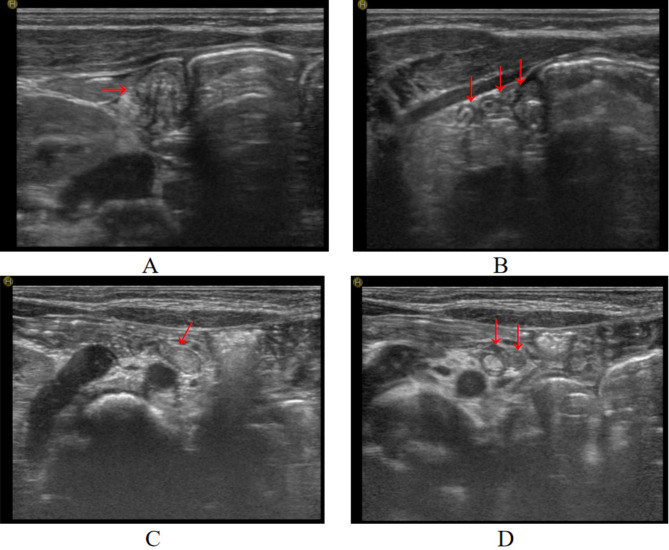
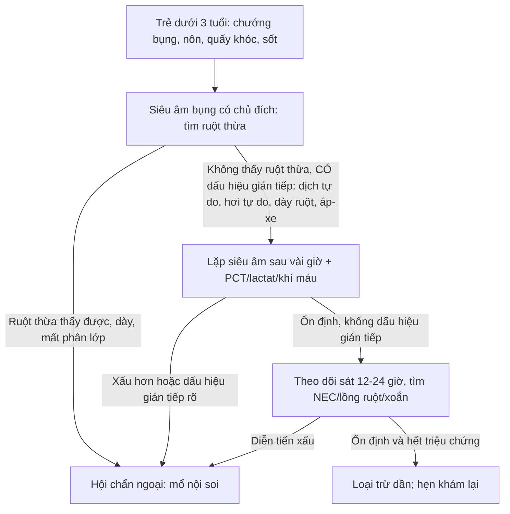
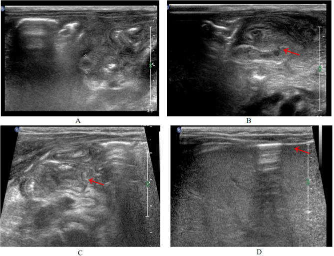
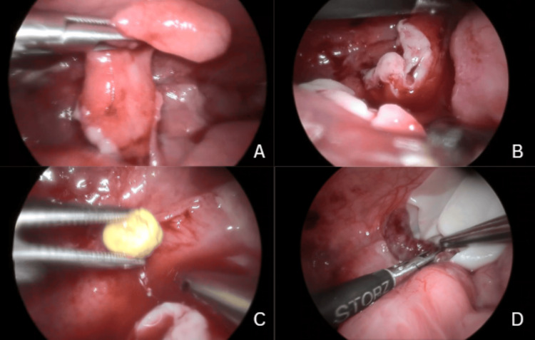
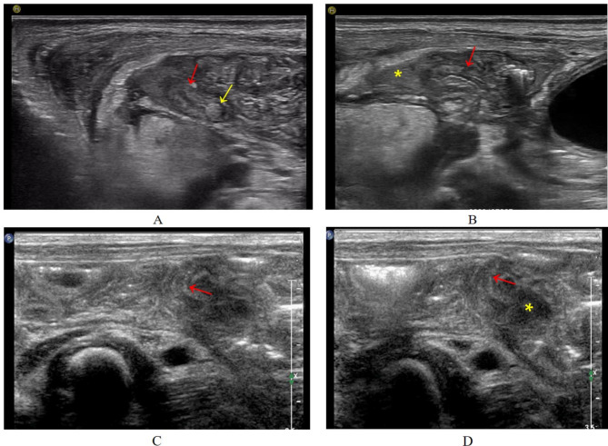

# 1668 — Viêm ruột thừa ở trẻ dưới 3 tuổi và sơ sinh / Appendicitis in infants under 3 years and in neonates

**Tags:** `pattern:viem-ruot-thua` `pattern:thung-ruot` `pattern:o-tu-dich` `pattern:hoi-tu-do` `pattern:viem-phuc-mac` `vung:hoc-chau-phai` `vung:ruot-thua` `vung:o-bung` `protocol:sieu-am-bung` `protocol:MRI-khong-can-an-than` `protocol:CT-bung` `score:Alvarado`
**Mức chắc chắn (certainty):** tổng hợp y văn (literature synthesis) — ghép **2 loạt bệnh nhi** (69 ca sơ sinh, *Pediatr Investig* 2023, PMC10262871, CC BY-NC-ND 4.0; 20 sơ sinh có mô tả siêu âm hệ thống, *BMC Pediatr* 2024, PMC11562379, CC BY-NC-ND 4.0) + **1 ca nguyên văn** 2 tháng tuổi (*Cureus* 2026, PMC13332841, CC BY 4.0). Không có thử nghiệm ngẫu nhiên nào về **mổ ngay vs bảo tồn** ở nhóm tuổi này.

> **Câu chốt:** ở trẻ < 3 tuổi, viêm ruột thừa **không phải "bệnh của người lớn thu nhỏ"** mà là **một bệnh khác về mặt cơ chế lan nhiễm**: ruột thừa **hình phễu, đáy rộng, thành mỏng, ít mạch nuôi**, mạc nối chưa phát triển nên **không có gì "khoanh vùng" ổ viêm** → thủng **80–100%** trước 2 tuổi, và **màng bụng nhiễm khuẩn toàn thể** là biểu hiện đầu tiên chứ không phải biến chứng muộn. Hệ quả thực hành: **không có bộ ba triệu chứng cổ điển, không có điểm đau khu trú, xét nghiệm và X-quang có thể BÌNH THƯỜNG** — nên chẩn đoán dựa vào **siêu âm có chủ đích tìm ruột thừa** và **ngưỡng mổ rất thấp**, không dựa vào điểm số lâm sàng.

## 1. Tổng quan bệnh học – cơ chế hình ảnh

### 1.1 Vì sao nhóm tuổi này thủng gần như tất yếu

- **Dịch tễ:** viêm ruột thừa chiếm **< 2%** các ca viêm ruột thừa ở trẻ **dưới 2 tuổi**; riêng **viêm ruột thừa sơ sinh (neonatal appendicitis, NA)** **0,04–0,2%** tổng số ca, và **0,1–0,34%** viêm ruột thừa nhi; nam:nữ **≈ 3:1** (PMC10262871, PMC11562379).
- **Bốn lý do giải phẫu – sinh lý** (được chính các tác giả nêu): (1) ruột thừa sơ sinh **hình phễu, đáy rộng** → khó tắc lòng do phân/mô lympho; (2) **chế độ ăn toàn lỏng**; (3) **tư thế nằm ngửa thường xuyên**; (4) **ít nhiễm hô hấp – tiêu hóa** trong giai đoạn sơ sinh. Chính vì **khó tắc lòng**, cơ chế bệnh sinh ở nhóm này **không phải "tắc lòng kinh điển"** mà là **nhiễm trùng/huyết khối vi mạch trên nền non yếu miễn dịch – thiếu oxy – bệnh nền** (NEC, Hirschsprung, hẹp hồi tràng do phân su, thoát vị bẹn nghẹt).
- **Vì sao thủng sớm và không khu trú (TẠI SAO, phần quyết định hình ảnh):** thành ruột thừa sơ sinh **rất mỏng, mạng mạch nuôi kém**, thành manh tràng **đàn hồi thấp**; **mạc nối (omentum) chưa phát triển** nên **không có "nắp" mạc nối bịt lỗ thủng** như người lớn. Kết quả là **dịch viêm + hơi lan tự do toàn ổ bụng** thay vì tạo **đám quánh khu trú**. Trên hình ảnh: **dịch tự do nhiều, hơi tự do, dày thành ruột non phản ứng** — tức hình ảnh của **viêm phúc mạc**, không phải của "viêm ruột thừa chưa biến chứng".
- **Ngưỡng định lượng nằm lòng** (số thật, kèm nguồn):

| Đại lượng | Số liệu | Nguồn |
|---|---|---|
| Tỉ lệ thủng theo tuổi | **< 2 tuổi: 100%** · **2–3 tuổi: 83,3%** · **> 5 tuổi: 47,3%** | PMC11562379 (dẫn tài liệu 6) |
| Thủng trong loạt 20 sơ sinh | **80% (16/20)**; hoại tử **35% (7/20)**; tử vong **5% (1/20)** | PMC11562379 |
| Thủng trong loạt 69 sơ sinh | tử vong **2,9% (2/69)**; **58% điều trị bảo tồn**, **42% mổ** | PMC10262871 |
| Tử vong theo thời kỳ | **78% (1901–1975)** → **23% (1990–2014)**; y văn gần đây **8–28%** | PMC11562379, PMC13332841 |
| Tuổi khởi phát trong loạt 69 ca | trung vị **8 ngày (IQR 9)** ở nhóm bảo tồn, **11 ngày (IQR 14)** ở nhóm mổ | PMC10262871 |
| Cân nặng nhập viện | **860–4.400 g**, trung bình **3.130 ± 730 g** | PMC10262871 |
| Đẻ non | **29%** (loạt 69 ca) · **30%** (loạt 20 ca) | PMC10262871, PMC11562379 |
| Thời gian từ triệu chứng đến chẩn đoán | **1–22 ngày** (loạt 69 ca); **2 ngày (IQR 1–6)** tới lúc mổ (loạt 20 ca) | PMC10262871, PMC11562379 |

- **TẠI SAO xét nghiệm "bình thường" vẫn không loại trừ:** viêm phúc mạc sơ sinh **không tạo đáp ứng bạch cầu – CRP điển hình ngay**. Trong loạt 69 ca: **CRP tăng 85,5% (16–160 mg/L)** nhưng **WBC bình thường 17,4%** và **giảm 7,2%**; bạch cầu trung tính tăng **81,2%**. Trong ca nguyên văn 2 tháng tuổi, **WBC 5,5 × 10⁹/L và CRP 1 mg/L lúc nhập viện** (bình thường), chỉ **procalcitonin 14,6 ng/mL**, **lactat 4,8 mmol/L**, **base deficit −6,9 mEq/L**; CRP nhảy lên **97 mg/L** sau ~24–48 giờ. Bài học: **PCT/lactat/khí máu dương tính trước CRP** — nên một CRP 1 mg/L không được dùng để trấn an.
- **Vì sao X-quang hay bình thường:** hơi tự do lượng ít ở sơ sinh **không nằm dưới cơ hoành kiểu người lớn** (trẻ nằm ngửa, hơi tụ trước gan). Trong loạt 69 ca: **66 phim bụng — chỉ 6 ca có hơi dưới cơ hoành**, 41 ca chỉ có **chướng hơi/ứ trệ**, 9 ca **tắc ruột không hoàn toàn**. Ở ca nguyên văn 2 tháng tuổi, **X-quang bụng hoàn toàn bình thường**.

### 1.2 Siêu âm: vì sao đo được ruột thừa ở sơ sinh, và đo cái gì

- Thành bụng sơ sinh **rất mỏng** → đầu dò **linear 5–13 MHz** (loạt 20 ca dùng L12-5/L74M) cho **độ phân giải < 1 mm**, đủ thấy **từng lớp thành** và **dịch trong lòng**.
- **Mốc giải phẫu để tìm ruột thừa:** dấu **"mũ nấm" (mushroom sign)** — **cuống = hồi tràng tận**, **mũ = manh tràng**; đáy ruột thừa nằm ở **đầu tận cùng manh tràng**; nếu không thấy quanh hồi tràng thì **phải tìm dọc rãnh đại tràng phải (right paracolic gutter)**.
- **Ruột thừa sơ sinh bình thường:** cắt ngang **tròn, đường kính < 4 mm**, **thành phân lớp rõ**, **không dày thành**, **không dịch trong lòng**; chiều dọc là **cấu trúc dạng ống, đáy bịt (blind-ending)**.
- **Dấu hiệu của viêm (loạt 20 ca):** đường kính **4,6 ± 1,8 mm**; trong **11 ca đo được, 8 ca (73%) ≥ 4 mm**; **thành 1,5 ± 0,5 mm**; **mất phân lớp thành**; **dịch trong lòng 30%**; **dịch quanh ruột thừa 25%**. Dấu hiệu gián tiếp: **dịch tự do 50%** (sâu **18 mm**), **dày thành ruột non hố chậu phải 30%**, **mờ mạc treo hố chậu phải 20%**, **hơi tự do 20%**, **viêm phúc mạc – ổ áp-xe 15%**, **dày thành bụng 10%**.
- **Giới hạn cứng của siêu âm (phải nhớ khi đọc):** ruột thừa **chỉ thấy được ở 65% (13/20)**, **không thấy 35%**; **không ca nào có siêu âm bình thường** (tức "không thấy gì" ≠ "không bệnh", mà là **dấu hiệu gián tiếp luôn có**); siêu âm phát hiện thủng **12/16 (75%)**; 3 ca **không kết luận được vì hơi ruột nhiều**. Đây là lý do phải **đọc cả dấu hiệu gián tiếp**, không chỉ chờ "thấy ruột thừa".

## 2. Mẫu hình + chẩn đoán phân biệt theo tuổi (gamut)

Chia gamut theo **tuổi** vì đây là biến quyết định: cùng một hình ảnh "dày ruột + dịch tự do", chẩn đoán khác nhau ở sơ sinh và ở trẻ 2 tuổi.

- **Sơ sinh (0–28 ngày) — "bụng cấp sơ sinh":** **viêm ruột thừa thủng** · **NEC** (comorbidity **20,3%** trong loạt 69 ca — tức 1/5 ca viêm ruột thừa sơ sinh **đồng thời có NEC**) · **xoắn ruột non do malrotation** · **viêm đại tràng do Hirschsprung** (4,3% trong loạt) · **hẹp/tắc hồi tràng do phân su** · **thủng dạ dày tự phát** · **viêm phúc mạc do phân su**.
- **Nhũ nhi 1–36 tháng:** **lồng ruột (intussusception)** · **viêm ruột thừa** · **viêm dạ dày – ruột cấp** · **viêm hạch mạc treo** · **xoắn buồng trứng** · **nhiễm khuẩn tiết niệu / viêm thận – bể thận** · **túi thừa Meckel** · **thoát vị bẹn nghẹt**.
- **Thể đặc biệt phải nhớ tên:** **viêm ruột thừa trong túi thoát vị bẹn (Amyand hernia)** — trong loạt 69 ca có **2 ca (2,9%)**, mổ appendectomy + thắt cổ túi thoát vị cùng lúc; **xoắn ruột thừa (appendiceal torsion)** — biểu hiện như viêm ruột thừa nhưng **không có viêm lòng**, chỉ **xoắn cuống mạch treo**; **viêm ruột thừa "nhiễm trùng huyết" khởi phát** — trong loạt 69 ca có 1 ca nhiễm khuẩn huyết và 1 ca loạn nhịp tim kháng trị **hết sau cắt ruột thừa**.
- **Mnemonic cho "bụng cấp nhũ nhi" — NICE-V:** **N**EC · **I**ntussusception · **C**onstipation/obstruction · **E**nteritis/gastroenteritis · **V**olvulus (và **A**ppendicitis luôn nằm ở cuối danh sách vì hiếm — chính vì thế mới bị bỏ sót).

## 3. Bảng so sánh phân biệt (ma trận đối chiếu)

| Thực thể (entity) | Hình ảnh điển hình (US / CT / MRI) | Chốt vào (rule-in) | Chốt loại (rule-out) | Gợi ý xác nhận |
|---|---|---|---|---|
| **Viêm ruột thừa thủng (sơ sinh/nhũ nhi)** | Ruột thừa **≥ 4 mm** (sơ sinh; **≥ 6 mm** ở trẻ lớn), **mất phân lớp thành**, **dịch trong lòng**, **mất liên tục thành** ± **dịch quanh ruột thừa**, **dịch tự do**, **hơi tự do trước gan** | **Thấy ruột thừa dày + mất liên tục thành**; **hơi tự do trước gan**; **dịch tự do không giải thích được** | **Ruột thừa < 4 mm, thành phân lớp rõ, không dịch quanh** → loại trừ mạnh (nhưng chỉ thấy được ở 65% ca) | Siêu âm lặp sau vài giờ; **mổ nội soi chẩn đoán** khi lâm sàng xấu; CT/MRI chỉ khi còn do dự |
| **NEC (viêm ruột hoại tử)** | **Dày thành ruột non + pneumatosis intestinalis** (bóng hơi trong thành), **hơi trong tĩnh mạch cửa**, thành ruột **một đoạn dài**, thường **hồi tràng tận – manh tràng** | **Pneumatosis + hơi tĩnh mạch cửa + bệnh cảnh sinh non** | **Một cấu trúc dạng ống đáy bịt dày khu trú** → nghĩ ruột thừa, không phải NEC | Phim bụng seri; siêu âm thành ruột; **NEC đồng thời 20,3%** — đừng dừng ở chẩn đoán NEC |
| **Lồng ruột (intussusception)** | Khối **"bánh mì kẹp"/target sign** cắt ngang, **"giả thận"/pseudokidney** dọc; **dấu liềm dịch trong khối** | **Target/pseudokidney + dấu liềm dịch**; khởi phát **đau từng cơn – khóc thét – co chân** | **Cấu trúc ống đáy bịt riêng biệt, không lồng vào lòng ruột khác** | Siêu âm là chuẩn; thụt/tháo lồng bằng nước hoặc hơi |
| **Xoắn ruột non do malrotation** | **Dấu "xoáy nước" (whirlpool sign)** — mạc treo + mạch treo xoắn; **ĐM mạc treo tràng trên đảo ngược**; dạ dày – tá tràng giãn | **Whirlpool + đảo ngược chiều mạch treo** | **Mạch treo hướng bình thường, ruột thừa thấy được ở hố chậu phải** | Siêu âm Doppler; **thụt cản quang/CT** khi nghi ngờ cao |
| **Viêm đại tràng do Hirschsprung** | Đại tràng **giãn > đoạn chuyển tiếp hẹp**, **đầy hơi – phân**, **không có dịch tự do nhiều** | **Đoạn chuyển tiếp rõ + tiền sử chậm phân su** | **Dịch tự do + hơi tự do + ruột thừa dày** → không phải Hirschsprung đơn thuần | Thụt cản quang; sinh thiết trực tràng |
| **Xoắn buồng trứng** | Buồng trứng **to, nhiều nang nhỏ ngoại vi**, **không có tín hiệu Doppler**, dịch quanh | **Buồng trứng to + mất tín hiệu mạch** | **Cấu trúc ống đáy bịt + hố chậu phải là nguồn viêm** | Siêu âm Doppler; MRI nếu cần |
| **Viêm thận – bể thận / nhiễm khuẩn tiết niệu** | Thận **to, giảm âm vỏ thận**, **bể thận – niệu quản giãn nhẹ**, không có tổn thương hố chậu phải | **Ứ nước + thận to một bên** | **Không có ứ nước, có bất thường ruột thừa** | Cấy nước tiểu; siêu âm thận – tiết niệu |

*Ảnh 1 — mốc để KHÔNG gọi nhầm: ruột thừa sơ sinh bình thường đường kính **< 4 mm**, thành phân lớp rõ, không dịch trong lòng. Nguồn: *BMC Pediatr* 2024, PMC11562379, CC BY-NC-ND 4.0 (nguyên bản).*

## 4. Protocol chụp + quyết định mổ (không có RADS — có sơ đồ quyết định)

### 4.1 Siêu âm là bước 1, và phải là siêu âm "có chủ đích"

- **Đầu dò linear 5–13 MHz**, trẻ **nằm ngửa**, **ấn bóp từng bước (graded compression)** để đẩy hơi ruột; nếu bụng chướng nhiều, cho **nhịn ăn vài giờ rồi quét lại** (đúng khuyến cáo của loạt 20 ca).
- **Đo và ghi 5 số:** đường kính ngoài ruột thừa (mm) · độ dày thành (mm) · có/không **mất phân lớp** · có/không **dịch trong lòng** · có/không **mất liên tục thành (thủng)**; cộng **dịch tự do (mm)**, **hơi tự do**, **ổ áp-xe**.
- **Ngưỡng theo tuổi (quan trọng, dễ sai):** người lớn/trẻ lớn dùng **≥ 6 mm**; **sơ sinh bình thường < 4 mm** và trong loạt 20 ca **73% ca bệnh có ≥ 4 mm** — nên ở sơ sinh **≥ 4 mm đã là bất thường cần diễn giải cùng các dấu hiệu phụ**, không chờ tới 6 mm.
- **Khi siêu âm âm tính mà lâm sàng vẫn nghi:** **lặp siêu âm sau vài giờ** (đúng diễn tiến ca nguyên văn: siêu âm đầu chỉ có **dịch tự do ít + hạch mạc treo to**, siêu âm lần hai mới gợi ý thủng). **MRI bụng không cần an thần** và **CT ít liều** là lựa chọn thay thế khi siêu âm không kết luận — nhưng **không được để chậm mổ vì chờ hình ảnh**.

### 4.2 Mổ ngay hay bảo tồn?

- **Nguyên tắc:** ở sơ sinh/nhũ nhi, **"chờ đợi có kiểm soát" chỉ dành cho ca có chẩn đoán khác rõ ràng hoặc ca rất nhẹ đã hết triệu chứng** — vì **thủng 80–100%** và **không có mạc nối khoanh vùng**.
- **Bằng chứng thực tế phải nói thẳng:** loạt 69 ca (1980–2019) có **58% điều trị bảo tồn** (nhịn ăn, nuôi dưỡng tĩnh mạch, kháng sinh **cephalosporin thế hệ 3 + metronidazole**) và **42% mổ**; **1 ca tái phát sau 5 tháng** phải mổ nội soi. Nhưng đây là **loạt hồi cứu 39 năm ở một trung tâm**, có **thiên lệch chọn bệnh** (nhiều ca "viêm ruột thừa" được chẩn đoán trên siêu âm mà không có mô bệnh), **không được dùng để biện minh cho bảo tồn thường quy**.
- **Khác biệt có ý nghĩa duy nhất giữa 2 nhóm trong loạt 69 ca:** thời gian nuôi dưỡng tĩnh mạch **5,5 ± 2,2 vs 8,6 ± 4,5 ngày (p = 0,001)**; thời gian nằm viện **không khác** (16 vs 15 ngày, p = 0,268).
- **Kỹ thuật:** nội soi ổ bụng **4 trocar (2 × 5 mm + 2 × 3 mm)**, **áp lực bơm hơi thấp 4–6 mmHg**; nội soi chẩn đoán **tránh được mở bụng không cần thiết ở ~53%** ca "bụng cấp sơ sinh".
- **Kháng sinh:** phổ **gram âm + kỵ khí** (cephalosporin 3 + metronidazole) cho tới khi có kết quả cấy; **không có bằng chứng** cho việc rút ngắn kháng sinh dưới 7–10 ngày khi đã thủng — *chưa rõ ngưỡng chính xác, cần tra thêm*.

## 5. Biến thể bình thường và cạm bẫy

- **Ruột thừa sơ sinh bình thường "trông to" hơn bạn nghĩ:** đáy rộng hình phễu + **cuộn nhiều vòng** → cắt ngang thấy **nhiều vòng tròn xếp cạnh nhau**, rất dễ đọc thành "nhiều ổ áp-xe". Phân biệt bằng **chiều dọc: một ống duy nhất, đáy bịt**.
- **Bẫy 1 — "không thấy ruột thừa = không viêm":** sai. **35%** ca bệnh không thấy ruột thừa; chẩn đoán dựa vào **dấu hiệu gián tiếp**. Ngược lại, **không ca nào** trong loạt 20 ca có siêu âm **hoàn toàn bình thường**.
- **Bẫy 2 — thoả mãn tìm kiếm (satisfaction of search):** thấy **pneumatosis** là dừng ở **NEC**, trong khi **NEC đồng thời 20,3%**. Luôn **tìm ruột thừa ở mọi ca NEC có bụng chướng nặng hoặc xấu đột ngột**.
- **Bẫy 3 — xét nghiệm "sạch":** ca 2 tháng tuổi có **WBC 5,5 × 10⁹/L, CRP 1 mg/L, X-quang bụng bình thường**, vẫn **thủng đáy ruột thừa + viêm phúc mạc mủ**. Nếu chỉ tin CRP/WBC/X-quang thì **xuất viện nhầm một ca viêm phúc mạc**.
- **Bẫy 4 — "đau hố chậu phải" ở nhũ nhi không đáng tin:** trong loạt 69 ca, **ấn đau chỉ 8,7%**, **cảm ứng thành bụng 5,8%**, **viêm mô thành bụng 4,3%** — vì thành bụng mỏng, dịch lan, không khu trú. Triệu chứng thật là **chướng bụng 52,2% – sốt 27,5% – bỏ bú 23,2% – nôn 21,7%**.
- **Bẫy 5 — bỏ sót Amyand:** **2,9%** ca viêm ruột thừa sơ sinh nằm **trong túi thoát vị bẹn**; luôn **khám bẹn – bìu** và quét cả ống bẹn khi tìm ruột thừa. Trong loạt 69 ca có 3 ca **khởi phát bằng sưng – đau bìu phải** (được theo dõi mạch máu tinh hoàn).
- **Bẫy 6 — hơi tự do trên phim bụng nằm ngửa:** hơi tụ **trước gan** (thấy ở **4/20 ca = 20%** trên siêu âm) chứ không nhất thiết dưới cơ hoành; đừng loại trừ thủng vì "không thấy liềm hơi dưới hoành".

## 6. Tự lượng giá — Blind Quiz

**Ca 1 — Sơ sinh 18 ngày, chướng bụng, bỏ bú. Nhìn 4 khung siêu âm trước, tự mô tả.**

- Gợi ý lâm sàng: sơ sinh, chướng bụng nhiều, không sốt cao.
- Câu hỏi: (1) mô tả từng khung A–D; (2) khung nào chứng minh **thủng**? (3) 3 chẩn đoán phân biệt và dấu hiệu nào loại trừ chúng?

<b>Bấm để hiện đáp án (findings + chẩn đoán)</b>

- **Findings:** (A) ruột thừa dày, mất phân lớp thành, đo đường kính; (B) **mất liên tục thành phía gần (mũi tên đỏ)** = thủng; (C) ruột thừa **dày, mất phân lớp (mũi tên)**; (D) **hơi tự do giữa thành bụng và gan (mũi tên đỏ)** — hơi tự do, không phải hơi trong lòng ruột.
- **Chẩn đoán:** **viêm ruột thừa sơ sinh đã thủng** (trong loạt nguồn: 18 ngày tuổi, nữ; **80%** ca trong loạt đã thủng lúc mổ).
- **Vì sao:** thành ruột thừa sơ sinh mỏng + không có mạc nối khoanh vùng → thủng lan nhanh; hơi tự do **tụ trước gan** vì trẻ nằm ngửa.
- **Phân biệt:** NEC (sẽ có **pneumatosis lan rộng**, không có ống đáy bịt dày khu trú), xoắn ruột (whirlpool), Hirschsprung (đoạn chuyển tiếp). **NEC đồng thời 20,3%** nên vẫn phải kiểm tra.
- Nguồn ảnh: *BMC Pediatr* 2024, PMC11562379, CC BY-NC-ND 4.0 (nguyên bản, không crop).

**Ca 2 — Nam 2 tháng tuổi, sốt 6 giờ, nôn 10 lần, bụng chướng nhẹ. WBC 5,5 × 10⁹/L, CRP 1 mg/L, X-quang bụng bình thường.**

- Câu hỏi: với **WBC và CRP bình thường**, bạn có loại trừ viêm ruột thừa không? Dấu hiệu nào trong ảnh chứng minh chẩn đoán?

<b>Bấm để hiện đáp án (findings + chẩn đoán)</b>

- **Findings trong ảnh:** (A) ruột thừa **phù nề, hoại tử thành lan tỏa**; (B) **lỗ thủng ở đáy ruột thừa** + dịch mủ và **sỏi phân (appendicolith)** trong ổ bụng.
- **Chẩn đoán:** **viêm ruột thừa hoại tử – thủng đáy + viêm phúc mạc mủ** ở nhũ nhi 2 tháng tuổi.
- **Vì sao WBC/CRP bình thường không loại trừ:** đáp ứng viêm ở sơ sinh/nhũ nhi chậm; ở ca này **procalcitonin 14,6 ng/mL**, **lactat 4,8 mmol/L**, **base deficit −6,9 mEq/L** dương tính **trước** khi CRP tăng (1 → **97 mg/L** sau ~24–48 giờ). Siêu âm đầu chỉ có **dịch tự do ít + hạch mạc treo to**; **siêu âm lần hai** mới gợi ý thủng.
- **Xử trí:** nội soi 4 trocar, **bơm hơi 4–6 mmHg**, cắt ruột thừa + rửa ổ bụng.
- Nguồn ảnh: *Cureus* 2026, PMC13332841, CC BY 4.0 (nguyên bản).

**Ca 3 — Sơ sinh 13 ngày (A, B) và 4 ngày (C, D). Cùng một câu hỏi: có thủng chưa?**

- Câu hỏi: khung nào là **thủng + áp-xe quanh ruột thừa**? Vì sao "mất phân lớp" một mình **không** đủ để gọi thủng?

<b>Bấm để hiện đáp án (findings + chẩn đoán)</b>

- **Findings:** (A) ruột thừa dày, **mất phân lớp (mũi tên vàng)** + **khối phân trong lòng (mũi tên đỏ)**; (B) **thủng phần xa (mũi tên đỏ)** với **áp-xe giảm âm quanh ruột thừa (dấu *)**, không thấy cấu trúc ống liên tục; (C) ruột thừa **dày, mất phân lớp (mũi tên đỏ)**; (D) **mất liên tục thành (mũi tên đỏ) + áp-xe quanh giảm âm (*)**.
- **Chẩn đoán:** cả 4 khung là **viêm ruột thừa đã thủng có áp-xe quanh ruột thừa**; trong loạt nguồn siêu âm phát hiện thủng **12/16 ca (75%)**.
- **Vì sao:** "mất phân lớp" chỉ nói **thành đã phù nề/hoại tử**, chưa nói **đã thủng**; thủng cần **mất liên tục thành** hoặc **dịch/áp-xe ngoài lòng**.
- Nguồn ảnh: *BMC Pediatr* 2024, PMC11562379, CC BY-NC-ND 4.0 (nguyên bản).

## Bài liên quan chéo

- [161 – Viêm ruột thừa cấp ở người lớn](../161-viem-ruot-thua-cap/lesson.md)
- [162 – Tắc ruột non: tiếp cận và phân biệt](../162-tac-ruot/lesson.md)
- [622 – Tắc ruột sơ sinh: phân biệt teo – tắc – xoắn](../622-tac-ruot-so-sinh/lesson.md)
- [620 – Cấp cứu tiêu hóa sơ sinh – nhũ nhi](../620-cap-cuu-tieu-hoa-so-sinh-nhu-nhi/lesson.md)

## Ảnh

- Ảnh dùng **nguyên bản**, không crop, không ghép: 3 ảnh **CC BY-NC-ND 4.0** (PMC11562379) và 1 ảnh **CC BY 4.0** (PMC13332841). Chi tiết từng ảnh: `images/CREDITS.md`.
- **Không tạo ảnh ghép**: 2 bài nguồn khác bệnh nhân, khác modality (siêu âm vs nội soi), và 3/4 ảnh là **NC-ND** (cấm phái sinh).

> Không dùng để chẩn đoán độc lập khi chưa có người hướng dẫn.
