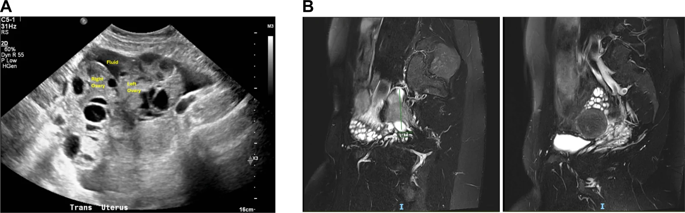
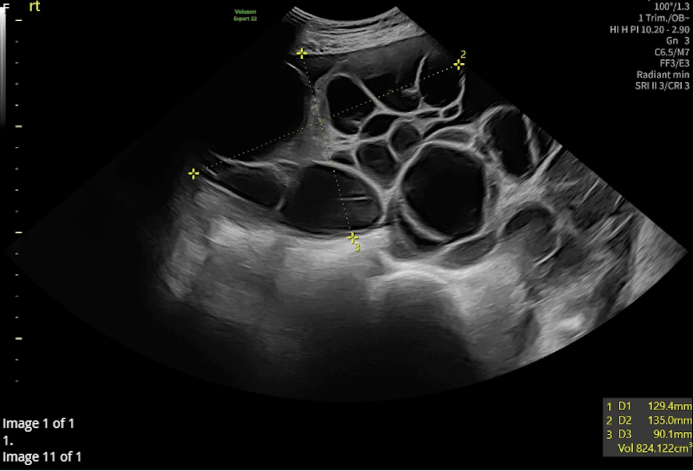
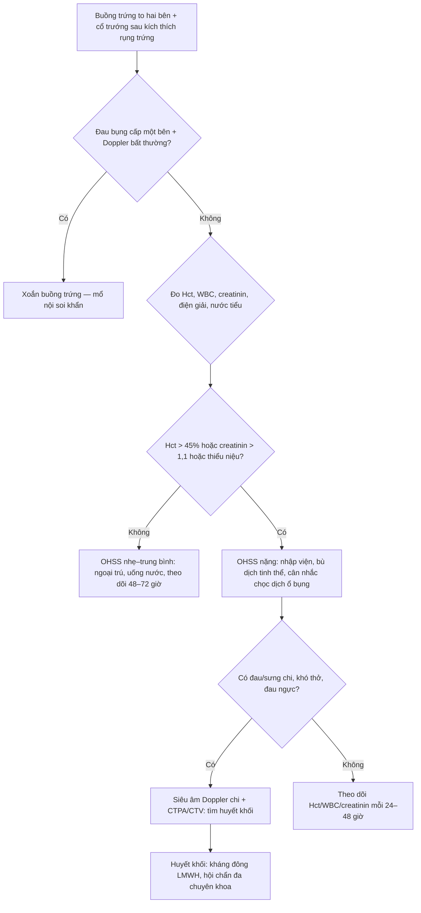
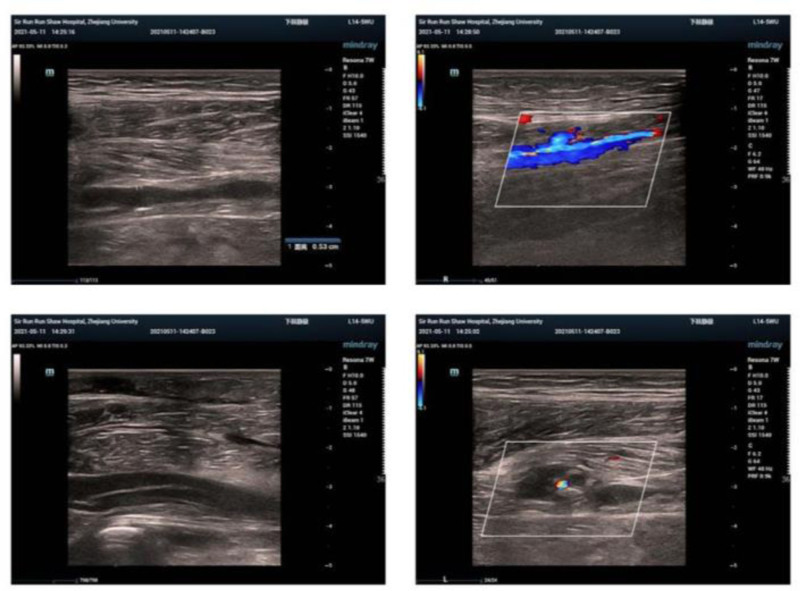

# 1669 — Hội chứng quá kích buồng trứng: buồng trứng đa nang hai bên + cổ trướng sau kích thích rụng trứng / Ovarian hyperstimulation syndrome (OHSS)

**Tags:** `pattern:buong-trung-da-nang` `pattern:dich-o-bung` `pattern:co-trung` `vung:buong-trung` `vung:phan-phu` `vung:phoi` `protocol:TVUS` `protocol:CT-bung` `protocol:MRI-bung` `score:ASRM`
**Mức chắc chắn (certainty):** tổng hợp y văn (literature synthesis) — ghép 2 tổng quan về sinh lý bệnh/phân độ và dự phòng (*Iran J Med Sci* 2018, PMC5993897, CC BY-NC-SA 3.0; *Reprod Biol Endocrinol* 2023, PMC10360244, CC BY 4.0), 2 tổng quan dịch tễ – huyết khối (*Adv Ther* 2020, PMC7595967, CC BY-NC 4.0; *J Clin Med* 2025, PMC11856335, CC BY 4.0), 1 phân tích gộp mô hình dự báo (*BMC Pregnancy Childbirth* 2025, PMC12363076, CC BY-NC-ND 4.0) và 3 ca nguyên văn có ảnh (PMC13631586, PMC13643111, PMC12262994). **Không có thử nghiệm ngẫu nhiên nào về ngưỡng chụp CT/MRI trong OHSS** → phần "chỉ định hình ảnh" là tổng hợp thực hành, không phải khuyến cáo hạng A.

> **Câu chốt:** OHSS không phải "buồng trứng to đơn thuần" mà là **bệnh toàn thân do VEGF làm tăng tính thấm mao mạch**: huyết tương thoát ra khoang thứ ba → **cô đặc máu, cổ trướng, tràn dịch màng phổi, thiểu niệu và huyết khối**. Trên hình ảnh, chốt chẩn đoán là **hai buồng trứng to, nhiều nang mỏng thành, không có thành phần đặc bắt thuốc + dịch ổ bụng**, đặt trong **bối cảnh có kích thích rụng trứng hoặc có thai**. Con số quyết định xử trí không phải kích thước nang mà là **hematocrit > 45%, bạch cầu > 15.000/mm³, creatinin > 1,1 mg/dL và nước tiểu < 30 mL/giờ**.

## 1. Tổng quan bệnh học – cơ chế hình ảnh

### 1.1 Vì sao buồng trứng to và dịch lại đi vào khoang thứ ba

- **Trục chính:** hCG (hoặc đồng vận GnRH) kích thích **tế bào hạt (granulosa)** tiết **VEGF** → VEGF gắn **VEGFR-2** trên tế bào nội mô mao mạch buồng trứng và phúc mạc → **tăng tính thấm** → protein và dịch thoát vào khoang phúc mạc, màng phổi, màng tim. Nồng độ VEGF tương quan với độ nặng OHSS (PMC5993897).
- **Vì sao buồng trứng to:** nhiều nang noãn cùng phát triển + **phù mô đệm (stromal edema)** do rò dịch mao mạch trong vỏ buồng trứng. Thể tích buồng trứng có thể **> 800 mL** (ca sOHSS: **824 mL bên phải, 429 mL bên trái** — PMC13643111), so với thể tích sinh lý **5–15 mL** ở người trưởng thành.
- **Vì sao cô đặc máu:** dịch thoát giàu protein → **albumin máu giảm**, **hematocrit tăng** dù không mất máu; ca CKD: hemoglobin **10,5 → 12,5 g/dL**, creatinin **3,1 mg/dL** so với nền **2,5–2,7 mg/dL** (PMC13631586). Đây là **cô đặc máu giả (hemoconcentration)**, không phải đa hồng cầu thật.
- **Vì sao có huyết khối:** cô đặc máu + tăng yếu tố đông máu + bất động + buồng trứng to chèn ép tĩnh mạch chậu → huyết khối tĩnh mạch sâu, tĩnh mạch cảnh/tay, xoang hang, thuyên tắc phổi. VTE thường xuất hiện **trung bình 26,6 ngày sau hCG**, còn huyết khối động mạch sớm hơn, **trung bình 13,7 ngày** (PMC11856335).
- **Khởi phát sớm – muộn:** thể **sớm 4–10 ngày sau trigger**, do hCG ngoại sinh; thể **muộn từ ngày 9 trở đi**, do hCG nội sinh từ thai (PMC13631586). Thể muộn kéo dài hơn và thường nặng hơn vì nguồn hCG vẫn tiếp tục.

### 1.2 Ngưỡng định lượng nằm lòng

| Đại lượng | Số liệu | Nguồn |
|---|---|---|
| OHSS nhẹ | **20–33%** các chu kỳ hỗ trợ sinh sản | tổng quan 27 tổng quan/85.497 ca, dẫn trong PMC12363076 |
| OHSS trung bình – nặng | **3–8%** chu kỳ IVF; **1–5%** chu kỳ IVF nói chung; tới **20%** ở nhóm nguy cơ cao | PMC12363076; PMC10360244 |
| OHSS nặng | **0,19%** (191/100.000 chu kỳ) với follitropin alfa; toàn bộ OHSS **5,19%** | PMC7595967 |
| Nhập viện vì OHSS (Mỹ 2002–2011) | **11.562 ca**; **4,4%** trong số đó đe dọa tính mạng | PMC10360244 |
| Kích thước buồng trứng theo độ | nhẹ **≤ 8 cm**; trung bình **≤ 12 cm**; nặng **> 12 × 12 cm** | PMC5993897 |
| Hematocrit | nặng **> 45%**; nguy kịch **> 55%** | PMC5993897 |
| Bạch cầu | nặng **> 15.000/mm³**; nguy kịch **> 25.000/mm³** | PMC5993897 |
| Creatinin | nặng **1,1–1,5 mg/dL**; nguy kịch **≥ 1,6 mg/dL** hoặc độ thanh thải **< 50 mL/phút** | PMC5993897 |
| Điện giải | K⁺ **> 5,0 mmol/L**, Na⁺ **< 135 mmol/L**, áp lực thẩm thấu **< 282 mOsm/kg** | PMC5993897 |
| Albumin | **< 35 g/L** (giảm protein máu) | PMC5993897 |
| Nước tiểu | thiểu niệu **< 300 mL/ngày** hoặc **< 30 mL/giờ** | PMC5993897 |
| Nguy cơ trước chu kỳ | AMH **≥ 3,4 ng/mL** (Se **90,5%**/Sp **81,3%** ở cut-off 3,36 ng/mL); AFC **≥ 24**; **> 17 nang > 10 mm** | PMC13631586; PMC5993897 |
| Nguy cơ trong chu kỳ | estradiol **> 3.500 pg/mL** ngày trigger; thu **> 15–20 noãn** | PMC13631586 |
| Huyết khối sau IVF | VTE **0,1–0,5%** chu kỳ; OHSS làm tăng nguy cơ tuyệt đối **~2%**; VTE trung bình **26,6 ngày** sau hCG | PMC11856335 |

## 2. Mẫu hình + chẩn đoán phân biệt theo vị trí (gamut)

*(A) Siêu âm ngang 1 ngày sau chọc hút: hai buồng trứng to, nhiều nang mỏng thành, dịch quanh buồng trứng. (B) MRI T2 coronal 4 tháng sau: buồng trứng vẫn to, nhiều nang tín hiệu cao; OHSS kéo dài ở bệnh nhân suy thận mạn. Nguồn: Kidney Med 2026, PMC13631586, CC BY-NC-ND 4.0 — nguyên bản.*

- **Mẫu hình chốt:** **hai buồng trứng to đối xứng (thường > 8 cm), cấu trúc nhiều nang mỏng thành (< 3 mm), không có thành phần đặc/ nhú bắt thuốc + dịch ổ bụng**; kèm tràn dịch màng phổi **phải > trái** và có thể tràn dịch màng tim.
- **Gamut theo bối cảnh (quan trọng hơn gamut theo hình thái):**
  - **Có kích thích rụng trứng + sau chọc hút 4–10 ngày:** OHSS sớm (hCG ngoại sinh).
  - **Có thai sau chuyển phôi, khởi phát ≥ 9 ngày:** OHSS muộn (hCG nội sinh) — kéo dài, dễ tái phát.
  - **Không dùng thuốc, có thai hoặc TSH cao:** **OHSS tự phát (spontaneous OHSS, sOHSS)** do đột biến hoạt hóa **FSHR** hoặc phản ứng chéo với hCG/TSH; rất hiếm nhưng **bắt chước ung thư buồng trứng** (PMC13643111).
  - **Có thai + hCG rất cao (thai trứng, đa thai):** **hyperreactio luteinalis** — nang hoàng thể hóa hai bên, thường không có cô đặc máu.
- **Gamut theo hình thái:**
  - **Hai bên, nhiều nang đơn thuần, vách mỏng:** OHSS, sOHSS, hyperreactio luteinalis, PCOS (nhưng PCOS nang **2–9 mm**, không cổ trướng).
  - **Một bên, thành phần đặc/nhú, vách dày > 3 mm, cổ trướng:** u biểu mô buồng trứng (mucinous/serous), di căn, u tế bào hạt.
  - **Một bên, xoắn cuống, đau cấp, Doppler bất thường:** xoắn buồng trứng — biến chứng của chính OHSS.
  - **Buồng trứng to + đau bụng + tụt hematocrit:** vỡ nang/xuất huyết trong ổ bụng.

## 3. Bảng so sánh phân biệt (ma trận đối chiếu)

| Thực thể (entity) | Hình ảnh điển hình (US/CT/MRI) | Chốt vào (rule-in) | Chốt loại (rule-out) | Gợi ý xác nhận |
|---|---|---|---|---|
| **OHSS do kích thích rụng trứng** | Hai buồng trứng to > 8 cm, nhiều nang mỏng thành, dịch quanh buồng trứng, cổ trướng; CT: dịch **0–20 HU**, không thành phần đặc; MRI: nang **T1 thấp – T2 cao** | **Tiền sử kích thích rụng trứng/chọc hút + hai buồng trứng đa nang + cổ trướng + cô đặc máu** | Có **nhú đặc bắt thuốc**, vách dày > 3 mm, một bên → nghĩ u | US đầu tay; CT/MRI khi biến chứng hoặc nghi u |
| **OHSS tự phát (sOHSS)** | Giống OHSS nhưng **không có tiền sử thuốc**; thường trong thai kỳ; CA-125 có thể rất cao | **Có thai + hai buồng trứng đa nang + cổ trướng, không dùng gonadotropin**; tiền sử gia đình | Có khối đặc/ nhú, hoặc bệnh tiến triển sau 16–20 tuần → nghi u | TSH, β-hCG, siêu âm thai; theo dõi thể tích buồng trứng |
| **Hyperreactio luteinalis** | Hai buồng trứng to nhiều nang hoàng thể hóa, thường **không dịch ổ bụng nhiều**, hCG rất cao | **Thai trứng/đa thai + hCG rất cao + nang hai bên** | Cô đặc máu, cổ trướng lượng nhiều → nghi OHSS | β-hCG, siêu âm tử cung, theo dõi sau xử trí nguyên nhân |
| **U biểu mô buồng trứng (mucinous/borderline)** | Khối **một bên**, nhiều vách dày, thành phần đặc/nhú, có thể cổ trướng; CT có thành phần ngấm thuốc | **Thành phần đặc bắt thuốc + vách > 3 mm + một bên** | Hai bên, nang mỏng đều, không thành phần đặc → nghĩ OHSS | MRI có/không cản từ; CA-125; phẫu thuật khi nghi ác |
| **PCOS** | Hai buồng trứng to nhẹ, **12–20 nang nhỏ 2–9 mm** xếp ngoại vi, không dịch ổ bụng | **Nang nhỏ đều + không cổ trướng + rối loạn phóng noãn** | Nang lớn > 10 mm, dịch ổ bụng, cô đặc máu → OHSS | Testosterone, LH/FSH, siêu âm |
| **Xoắn buồng trứng** | Buồng trứng to, **một bên**, đau cấp; Doppler: mất dòng tĩnh mạch trước, sau đó mất dòng động mạch; có thể phù xuất huyết | **Đau cấp một bên + mất tín hiệu Doppler + cuống xoắn** | Hai bên, không đau, Doppler bình thường → không xoắn | Siêu âm Doppler khẩn; mổ nội soi khi nghi |
| **Huyết khối tĩnh mạch sâu (DVT)** | Tĩnh mạch không xẹp được, **khuyết thuốc trong lòng**, tăng hồi âm; Doppler: mất biến thiên theo nhịp thở | **Buồng trứng to + đau/sưng chi + khuyết thuốc trong tĩnh mạch** | Tĩnh mạch xẹp hoàn toàn, dòng chảy bình thường → loại DVT | Siêu âm Doppler chi; CTV/CTV bụng khi nghi huyết khối chậu |

- **Ảnh minh họa mẫu hình:** ca sOHSS có buồng trứng phải **824 mL** kèm cổ trướng, sau đó giảm dần còn **623 mL** ở 15 tuần và **132 × 55 × 51 mm** ở 20 tuần (PMC13643111) — **theo dõi thể tích bằng siêu âm** là cách đánh giá đáp ứng điều trị, không cần chụp lại CT.

*Siêu âm đầu dò âm đạo: buồng trứng phải nhiều nang, thể tích đo được 824,122 mL, dịch quanh buồng trứng. Nguồn: Cureus 2026, PMC13643111, CC BY 4.0 — nguyên bản.*

## 4. Protocol chụp + hệ phân độ/điểm chuẩn hóa

### 4.1 Chọn kỹ thuật theo câu hỏi lâm sàng

- **Siêu âm là đầu tay, luôn luôn.** Với buồng trứng **> 10–12 cm**, dùng **đầu dò bụng (transabdominal) với bàng quang đầy** để đo toàn bộ buồng trứng; đầu dò âm đạo chỉ để đánh giá nang nhỏ và Doppler khi buồng trứng còn vừa. Đo **3 chiều** và tính thể tích **V = 0,523 × D1 × D2 × D3**; ghi rõ **thể tích (mL)** thay vì chỉ "to".
- **Doppler:** đánh giá **xoắn cuống** (mất dòng tĩnh mạch sớm hơn động mạch) và **huyết khối tĩnh mạch chậu**; không dùng Doppler để chẩn đoán OHSS.
- **CT bụng–chậu có cản quang thì tĩnh mạch cửa** khi: nghi **vỡ/xuất huyết**, **huyết khối tĩnh mạch chậu**, **tắc ruột**, **thủng tạng**, hoặc cần loại u khi siêu âm không kết luận. Dịch OHSS có tỷ trọng **0–20 HU**; thành phần đặc ngấm thuốc là dấu hiệu **chống lại OHSS**.
- **CTA/CTPA** khi nghi **thuyên tắc phổi** hoặc huyết khối động mạch; **CTV** khi nghi huyết khối tĩnh mạch chậu.
- **MRI bụng–chậu không cản từ** là lựa chọn khi **suy thận, có thai, dị ứng iod**, hoặc cần theo dõi buồng trứng kéo dài: nang OHSS **T1 thấp, T2 rất cao**, không có thành phần đặc; mô đệm phù **T2 cao**. Ca CKD cho thấy MRI vẫn phát hiện buồng trứng to **4 tháng sau chọc hút** (PMC13631586).
- **Tránh cản quang iod ở bệnh nhân creatinin tăng/thiểu niệu** nếu không thật cần: ưu tiên siêu âm/MRI, và nếu buộc phải CT thì dùng **liều thấp, đủ nước, theo dõi creatinin sau 48–72 giờ**.

### 4.2 Phân độ ASRM/OHSS và ngưỡng xử trí

| Độ | Tiêu chuẩn | Nơi xử trí |
|---|---|---|
| Nhẹ | Buồng trứng **≤ 8 cm**, chướng bụng, đau nhẹ | Ngoại trú, theo dõi cân nặng/nước tiểu |
| Trung bình | Buồng trứng **≤ 12 cm**, nôn/tiêu chảy, **có dịch ổ bụng trên siêu âm**, tăng cân **> 3 kg** | Ngoại trú sát hoặc nhập viện theo triệu chứng |
| Nặng | Buồng trứng **> 12 cm**, cổ trướng lâm sàng ± tràn dịch màng phổi, **Hct > 45%**, **WBC > 15.000**, K⁺ > 5,0, Na⁺ < 135, albumin < 35 g/L, thiểu niệu | Nhập viện, bù dịch tinh thể, chọc dịch ổ bụng khi chèn ép |
| Nguy kịch | Cổ trướng/tràn dịch nặng, **Hct > 55%**, **WBC > 25.000**, vô niệu, **creatinin ≥ 1,6 mg/dL**, huyết khối, ARDS | Hồi sức tích cực, lọc máu/chọc dẫn lưu, xử trí huyết khối |

### 4.3 Dự phòng và điều trị có số liệu

- **Dự phòng:** GnRH antagonist (OR **0,61**, KTC 0,51–0,72; 36 RCT/7.944 ca), **GnRH agonist trigger** (OR **0,15**, KTC 0,05–0,47; 8 RCT/989 ca), **đông lạnh toàn bộ phôi**, **đồng vận dopamine (cabergoline 0,5 mg/ngày × 8 ngày)** (OR **0,32**, KTC 0,23–0,44; 10 RCT/1.202 ca), kích thích nhẹ (RR **0,26**, KTC 0,14–0,49) (PMC10360244). **GnRH agonist trigger không loại trừ hoàn toàn OHSS** — vẫn có ca nặng sau trigger đơn thuần (PMC11485447).
- **Điều trị:** bù dịch tinh thể (không dùng albumin thường quy), **chọc dịch ổ bụng qua ngả âm đạo** khi cổ trướng chèn ép/hô hấp, **dẫn lưu màng phổi** khi tràn dịch gây suy hô hấp, **kháng đông dự phòng** ở thể nặng/nhập viện (LMWH), **không mổ** trừ khi xoắn/vỡ.
- **Theo dõi tại nhà:** cân nặng mỗi ngày, vòng bụng, lượng nước tiểu, Hct/creatinin mỗi **48–72 giờ**; nhập viện ngay khi **tăng cân > 1 kg/ngày**, **nước tiểu < 500 mL/ngày**, khó thở hoặc đau ngực.

## 5. Biến thể bình thường và cạm bẫy

- **CA-125 cao + cổ trướng không đồng nghĩa ung thư.** Trong sOHSS, CA-125 có thể tăng rất cao và hình ảnh giống u buồng trứng; **hai bên + nang mỏng + không thành phần đặc + có thai** là chốt loại u. Can thiệp mổ không cần thiết có thể làm mất thai (PMC13643111).
- **PCOS không phải OHSS:** PCOS có **12–20 nang nhỏ 2–9 mm**, không cổ trướng, không cô đặc máu; đừng gọi "buồng trứng đa nang" là OHSS nếu không có dịch và bối cảnh kích thích.
- **Xoắn cuống có thể có Doppler bình thường** (xoắn ngắt quãng) — đau cấp một bên + buồng trứng to là đủ để mổ nội soi, không chờ Doppler "dương tính".
- **OHSS muộn sau khi β-hCG dương tính:** khởi phát **≥ 9 ngày** sau trigger, kéo dài vì hCG thai; đừng nhầm là "nhiễm trùng sau chọc hút".
- **Cạm bẫy đo thể tích:** đo một nang to nhất sẽ **đánh giá thấp** mức độ; phải đo **toàn bộ buồng trứng** theo 3 chiều, nhất là khi buồng trứng > 10 cm.
- **Tràn dịch màng phổi phải nhiều hơn trái** là mẫu hình kinh điển; tràn dịch lượng nhiều gây suy hô hấp cần dẫn lưu, nhưng **không rút quá nhanh** vì nguy cơ phù phổi tái giãn.
- **Suy thận + cản quang:** creatinin tăng sau CT có thể do cả OHSS và thuốc cản quang; ưu tiên siêu âm/MRI, theo dõi creatinin **48–72 giờ** sau CT.
- **Không bỏ sót huyết khối:** đau/sưng chi, đau ngực, khó thở, đau đầu bất thường ở người OHSS nặng → siêu âm Doppler/CTPA/CTV ngay, kể cả khi không có yếu tố nguy cơ kinh điển.

## 6. Tự lượng giá — Blind Quiz

**Ca 1 — Nữ 28 tuổi, suy thận mạn độ 4, IVF; 1 ngày sau chọc hút đau bụng, tăng cân, thiểu niệu.**

- Gợi ý: estradiol đỉnh **5.767 pg/mL**; creatinin **3,1 mg/dL** (nền 2,5–2,7); Hb **10,5 → 12,5 g/dL**.
- Câu hỏi: Mô tả bất thường trên siêu âm? Vì sao Hb tăng dù không mất máu? Vì sao MRI vẫn còn bất thường sau 4 tháng?

<b>Bấm để hiện đáp án (findings + chẩn đoán)</b>

- **Findings:** hai buồng trứng to, nhiều nang mỏng thành, dịch quanh buồng trứng; MRI T2 coronal 4 tháng sau vẫn thấy buồng trứng nhiều nang tín hiệu cao.
- **Chẩn đoán:** **OHSS sớm mức trung bình–nặng, biến chứng suy thận cấp và tăng kali** trên nền CKD 4. Hb tăng do **cô đặc máu** (dịch thoát vào khoang thứ ba), không phải mất máu. MRI còn bất thường vì OHSS có thể **kéo dài nhiều tháng**, nhất là khi có bệnh thận nền.
- **Nguồn ảnh:** Kidney Med 2026, PMC13631586, CC BY-NC-ND 4.0.

**Ca 2 — Nữ 30 tuổi, thai 11 tuần, không dùng thuốc sinh sản, đau bụng + bụng to; CA-125 tăng.**

- Câu hỏi: Chẩn đoán? Hai chẩn đoán phân biệt nguy hiểm nhất? Vì sao không mổ?

<b>Bấm để hiện đáp án (findings + chẩn đoán)</b>

- **Findings:** buồng trứng phải **824,122 mL**, nhiều nang, dịch quanh buồng trứng; thai trong tử cung sống.
- **Chẩn đoán:** **OHSS tự phát (sOHSS) trong thai kỳ** — do đột biến hoạt hóa FSHR/ nhạy cảm hCG, có tiền sử gia đình. Phân biệt: **u biểu mô buồng trứng** và **u nguyên bào nuôi/ thai trứng**.
- **Vì sao không mổ:** hình ảnh hai bên, nang mỏng, không thành phần đặc; theo dõi cho thấy thể tích **giảm dần** (824 → 623 → 132 × 55 × 51 mm) và thai phát triển bình thường; mổ sẽ làm mất thai vô ích.
- **Nguồn ảnh:** Cureus 2026, PMC13643111, CC BY 4.0.

**Ca 3 — Nữ 37 tuổi, OHSS nặng sau chọc hút 34 noãn; 12 giờ sau trigger đau và sưng chân trái.**

- Câu hỏi: Dấu hiệu trên Doppler? Vì sao OHSS gây huyết khối? Xử trí kháng đông?

<b>Bấm để hiện đáp án (findings + chẩn đoán)</b>

- **Findings:** tĩnh mạch chi dưới **không xẹp được**, có **khuyết thuốc/huyết khối trong lòng**, dòng chảy bất thường; xác nhận **huyết khối tĩnh mạch sâu**.
- **Cơ chế:** cô đặc máu + tăng đông + bất động + buồng trứng to chèn ép tĩnh mạch chậu.
- **Xử trí:** **LMWH** ngay, tiếp tục qua thời kỳ mang thai theo cân nặng; theo dõi D-dimer/tiểu cầu; ca này chuyển aspirin 75 mg/ngày sau khi ngừng LMWH và sinh đủ tháng (3350 g), không tái phát.
- **Nguồn ảnh:** Medicine 2025, PMC12262994, CC BY 4.0.

## Bài liên quan chéo
- [1623 – Huyết khối tĩnh mạch buồng trứng sau sinh](../1623-huyet-khoi-tinh-mach-buong-trung-sau-sinh/lesson.md)
- [1630 – Khối phần phụ nghi ác trong thai](../1630-khoi-phan-phu-nghi-ac-trong-thai/lesson.md)
- [1632 – Bảo tồn mô buồng trứng trước dậy thì](../1632-tru-mo-buong-trung-truoc-day-thi/lesson.md)
- [1666 – Hẹp niệu quản sau vá rò và sau xạ trị](../1666-hep-nieu-quan-sau-va-ro-va-sau-xa-tri/lesson.md)

## Ảnh
- `1669_ohss_US-MRI_PMC13631586-f2.webp` — US + MRI T2, **CC BY-NC-ND 4.0**, nguyên bản (không crop/ghép).
- `1669_ohss_US_PMC13643111-f4.webp` — US buồng trứng 824 mL, **CC BY 4.0**, nguyên bản.
- `1669_ohss_DUS_PMC12262994-f3.jpg` — siêu âm Doppler tĩnh mạch chi, **CC BY 4.0**, nguyên bản.
- Nguồn, giấy phép và chú thích gốc: `images/CREDITS.md` và `sources.md`. Không tạo ảnh ghép vì 3 ảnh thuộc 3 bệnh nhân và 2 loại modality, ghép sẽ sai bối cảnh.

> Không dùng để chẩn đoán độc lập khi chưa có người hướng dẫn.
