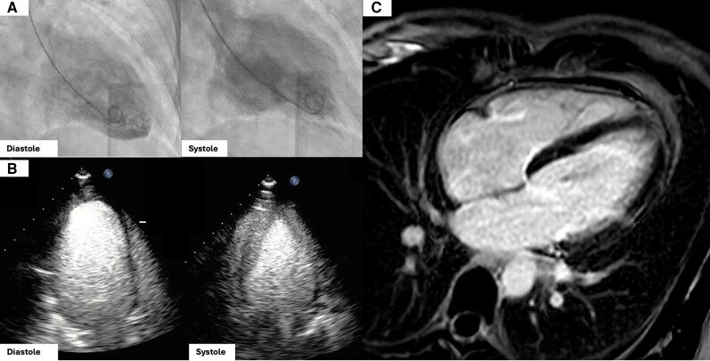
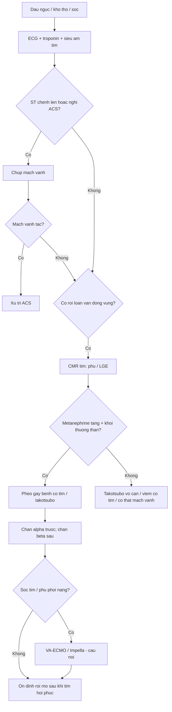
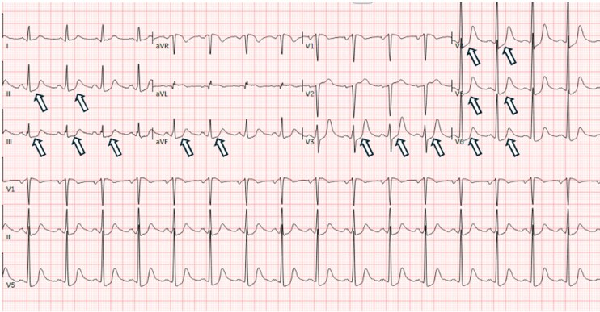
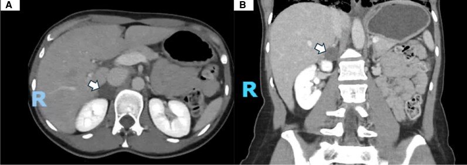

# 167 — Biến chứng tim mạch của u tủy thượng thận: bệnh cơ tim do catecholamine, takotsubo & khủng hoảng tăng huyết áp / Catecholamine-induced cardiomyopathy and pheochromocytoma crisis

**Tags:** `pattern:cardiomyopathy` `pattern:takotsubo` `pattern:rong-loan-van-dong-vung` `vung:tim` `vung:thuong-than` `protocol:MRI-tim` `protocol:ECMO` `incidentaloma:u-thuong-than`

**Mức chắc chắn (certainty):** tổng hợp y văn (literature synthesis) — ca nguyên văn reverse takotsubo (PMC13090540), nghiên cứu yếu tố dự báo (PMC8959126), review khủng hoảng đa cơ quan (PMC11943199), ca takotsubo tái phát (PMC13166324) và guideline Nhật 2025 (PMC12819074); số liệu lấy trực tiếp từ bài gốc.

> **Câu chốt:** Ở bệnh nhân **đau ngực + ST chênh + troponin tăng nhưng mạch vành sạch**, đừng dừng ở "viêm cơ tim" hay "takotsubo vô căn" — hãy hỏi **huyết áp có dao động từng cơn không**. Một khối thượng thận nhỏ có thể là nguyên nhân của **sốc tim, phù phổi, rối loạn nhịp và đột tử**; và điều trị sai (ức chế miễn dịch, chẹn beta đơn thuần) có thể **kích hoạt cơn kịch phát**.

## 1. Tổng quan — catecholamine làm hỏng cơ tim như thế nào

- **Bệnh học (pathology):** catecholamine tăng vọt kích thích **thụ thể beta-1** trên tế bào cơ tim → tăng cAMP/PKA → **quá tải canxi nội bào**, giảm co bóp và tăng tiêu thụ oxy. Đồng thời kích thích **alpha-1** gây co mạch vành, rối loạn vi tuần hoàn, tăng gốc tự do → **hoại tử dải co thắt (contraction band necrosis)**, thâm nhiễm bạch cầu và xơ hóa. Mô học giống **viêm cơ tim** nhưng không do nhiễm trùng.
- **TẠI SAO hồi phục:** tổn thương chủ yếu là **choáng cơ tim (myocardial stunning)** do catecholamine, không có tắc mạch vành cố định; khi nguồn catecholamine được cắt hoặc chặn, chức năng tim thường hồi phục trong **~21 ngày** (có ca sớm hơn).
- **TẠI SAO troponin thường không tương xứng:** tổn thương lan tỏa từng đám, không có ổ nhồi máu lớn; **troponin tăng nhưng không tương xứng với mức rối loạn vận động** là một gợi ý (không phải quy luật tuyệt đối).
- **TẠI SAO ECG giống nhồi máu:** thiếu máu dưới nội tâm mạc do co mạch/vi mạch → **ST chênh xuống nhiều chuyển đạo, QT dài, loạn nhịp**; có thể có ST chênh lên thoáng qua.
- **Hình thái takotsubo:** thể **đỉnh (apical ballooning)** kinh điển; thể **đảo ngược (reverse)** với giảm vận động vùng nền và đỉnh tăng động — chiếm **~2%** takotsubo nói chung nhưng tới **28%** các ca liên quan pheo, và **tiên lượng xấu hơn** thể kinh điển.
- **Dịch tễ & tiên lượng (số liệu định lượng):** bệnh cơ tim do catecholamine gặp ở **8–11%** bệnh nhân PPGL; biến chứng xảy ra tới **68%**, trong đó **suy tim 53%**, **sốc tim 37,7%**. Khủng hoảng đa cơ quan (pheochromocytoma multisystem crisis, PMC) có **tử vong 13,8%**; hỗ trợ tuần hoàn cơ học (VA-ECMO) kéo dài trung vị **4 ngày (1–7)**, sống sót trong viện **93,5%** (có thể bị thiên lệch công bố). Trong PPGL, **> 2/3 tử vong** do biến chứng tim mạch; **20%** có rối loạn nhịp; **< 10%** huyết áp bình thường khi khởi phát.
- **Di chứng:** **59%** bệnh nhân PPGL có **sẹo cơ tim không do thiếu máu** trên MRI tim; **50–60%** ca mổ tử thi có viêm cơ tim khu trú. Chức năng tim hồi phục ở **69,4%** ca bệnh cơ tim do pheo (so với **40,8%** bệnh cơ tim nguyên phát khác), nhưng **tái phát 20%** nếu không điều trị u.

**Yếu tố dự báo bệnh cơ tim do catecholamine (hồi cứu 202 ca, đa biến):**
- **Nhịp tim nghỉ tối đa ≥ 115 lần/phút** — OR **10,05** (95% CI 3,71–27,20).
- **Huyết áp tâm thu tối đa ≥ 180 mmHg** — OR **7,17** (2,22–23,23).
- **Glucose máu ≥ 8,0 mmol/L** — OR **6,52** (2,25–18,86).
- **≥ 3 triệu chứng/dấu hiệu** — OR **6,05** (1,86–19,64).
- **Tuổi khởi phát ≤ 40** — OR **3,74** (1,37–10,20).
- *Thể takotsubo (trong nhóm bệnh cơ tim) gặp nhiều hơn ở nữ (OR 5,06), đau ngực (OR 5,84) và u ngoài thượng thận (OR 8,64).*

## 2. Mẫu hình + chẩn đoán phân biệt theo bệnh cảnh (gamut)

- **A — Đau ngực + ST chênh + men tim tăng, mạch vành sạch:** nghĩ **takotsubo do pheo** (đỉnh/đảo ngược/toàn bộ), **viêm cơ tim**, **co thắt mạch vành**, **nhồi máu đã tái thông**. Đây là cửa vào hay bị bỏ sót nhất.
- **B — Suy tim cấp/phù phổi cấp:** bệnh cơ tim do catecholamine, hẹp van/ bệnh van cấp, quá tải dịch; ở pheo, phù phổi có thể xuất hiện sau **chẹn beta đơn thuần** hoặc **glucocorticoid**.
- **C — Rối loạn nhịp:** rung nhĩ, nhịp nhanh trên thất, **QT dài**, nhịp nhanh thất; **20%** PPGL có loạn nhịp.
- **D — Sốc tim/đa cơ quan:** hạ huyết áp, lactate cao, thiểu niệu, suy gan/thận; **37,7%** ca takotsubo do pheo có sốc tim.
- **E — Khủng hoảng tăng huyết áp có tổn thương cơ quan đích:** đột quỵ, nhồi máu cơ tim, **bóc tách động mạch chủ**, phù phổi; huyết áp thường **> 180/120 mmHg**.

**Kích hoạt cơn (trigger) — hỏi kỹ trước khi làm thủ thuật:**
- **Sinh hoạt:** cúi người, gắng sức, ăn quá no, rượu, phô mai lâu năm/thực phẩm nhiều tyramine, hút thuốc, căng thẳng, thai kỳ.
- **Thủ thuật:** sờ nắn bụng, thụt tháo, **sinh thiết u**, tiêm thuốc cản quang.
- **Thuốc:** **metoclopramide**, glucagon, **chẹn beta đơn thuần**, chống trầm cảm ba vòng, SNRI, MAOI, **dexamethasone liều cao**.
- **Điều trị:** hóa trị CVD, **¹³¹I-MIBG**, xạ ngoài, nút mạch (TAE), đốt RF.

**Chẩn đoán phân biệt cốt lõi:** hội chứng vành cấp (ACS), viêm cơ tim, thuyên tắc phổi, sốc nhiễm khuẩn, bóc tách động mạch chủ, co thắt mạch vành, bệnh cơ tim stress không do pheo.

## 3. Bảng so sánh phân biệt (ma trận đối chiếu)

| Thực thể (entity) | Hình ảnh/lâm sàng điển hình | Chốt vào (rule-in) | Chốt loại (rule-out) | Xác nhận |
|---|---|---|---|---|
| **Bệnh cơ tim do catecholamine / takotsubo do pheo** | Đau ngực, khó thở, ST chênh, troponin tăng nhẹ; echo giảm vận động vùng **không theo lãnh thổ mạch vành**; phù phổi | **Mạch vành sạch + rối loạn vận động vùng + metanephrine tăng + có khối thượng thận** | Tắc mạch vành thực sự; men tim tăng rất cao kèm ST chênh lên điển hình | Echo → CMR (T2 edema, LGE từng đám), metanephrine, CT/MRI thượng thận |
| **Hội chứng vành cấp (ACS)** | ST chênh lên/xuống theo vùng, troponin tăng, đau ngực điển hình | **Tắc mạch vành trên chụp mạch + vùng cơ tim khớp lãnh thổ** | Mạch vành sạch + rối loạn vận động toàn bộ/đảo ngược → nghĩ takotsubo/pheo | Chụp mạch vành, siêu âm tim |
| **Viêm cơ tim** | Sốt/tiền sử nhiễm virus, ST-T thay đổi, men tim tăng, giảm chức năng lan tỏa | **CMR: phù cơ tim lan tỏa + LGE dưới thượng tâm mạc/giữa thành** | Không sốt, có cơn THA, có u thượng thận → nghĩ pheo | CMR, troponin, ± sinh thiết (hiếm) |
| **Thuyên tắc phổi** | Khó thở, đau ngực màng phổi, D-dimer tăng, thất phải giãn | **CTPA có huyết khối + thất phải giãn** | CTPA âm + men tim tăng đơn độc → không loại trừ pheo | CTPA, siêu âm tim |
| **Sốc nhiễm khuẩn** | Sốt, ổ nhiễm, lactate cao, giãn mạch | **Cấy dương + ổ nhiễm + đáp ứng vận mạch** | Không ổ nhiễm, huyết áp dao động từng cơn, có u thượng thận | Cấy, PCT, siêu âm |
| **Bóc tách động mạch chủ** | Đau sau lưng dữ dội, chênh huyết áp hai tay, mất mạch | **Flap/lật nội mạc trên CTA** | CTA âm + không chênh huyết áp | CTA ngực–bụng |
| **Co thắt mạch vành** | Đau ngực khi nghỉ, ST chênh thoáng qua, mạch vành sạch | **Co thắt khi test acetylcholine/ergonovine** | Co thắt không tái lập + có u thượng thận → nghĩ pheo | Chụp mạch + test co thắt |

*(A) Ventriculography thì tâm trương–tâm thu: **giảm vận động vùng nền, đỉnh tăng động** (reverse takotsubo). (B) Siêu âm tim M-mode xác nhận. (C) MRI tim 4 buồng: rối loạn vận động vùng, không có LGE điển hình theo lãnh thổ mạch vành. Nguồn: Cedeno-Serna J et al., JCEM Case Reports 2026 (PMC13090540), Fig. 2, CC BY 4.0.*

## 4. Protocol chẩn đoán & xử trí

### 4.1. Tiếp cận cấp cứu (6 bước)

1. **ECG + troponin + siêu âm tim tại giường** trong 10–15 phút; đo huyết áp hai tay, hỏi cơn THA từng cơn, thuốc đã dùng.
2. **Nếu ST chênh lên hoặc nghi ACS:** chụp mạch vành theo đường ACS. **Mạch vành sạch + rối loạn vận động vùng** → chuyển hướng sang takotsubo/pheo.
3. **Siêu âm tim:** đánh giá EF, rối loạn vận động vùng, hẹp van, áp lực động mạch phổi, tràn dịch màng tim.
4. **MRI tim** khi chẩn đoán chưa rõ: cine + T2 mapping/STIR (phù) + LGE (sẹo/xơ) + tưới máu; **không chờ MRI nếu bệnh nhân sốc**.
5. **Tầm soát pheo:** metanephrine tự do huyết tương/niệu **trước khi sinh thiết**; sau đó CT/MRI thượng thận–bụng. **Không chọc hút u thượng thận chưa loại pheo.**
6. **Tìm và loại bỏ yếu tố kích hoạt:** ngừng metoclopramide/glucocorticoid, không dùng chẹn beta đơn thuần, tránh sờ nắn u.

### 4.2. Điều trị

- **Chẹn alpha là nền tảng:** phentolamine truyền **1–6 µg/kg/phút** hoặc bolus **5–15 mg**; hoặc phenoxybenzamine/doxazosin đường uống khi huyết áp cho phép. Mục tiêu: kiểm soát cơn THA mà vẫn giữ tưới máu.
- **Chẹn beta chỉ sau khi đã chẹn alpha**, nếu nhịp nhanh dai dẳng; **không dùng** trong cơn cấp chưa chẹn alpha.
- **Suy tim/sốc tim:** hạn chế inotrope (có thể làm nặng nghẽn đường ra và tăng tiêu thụ oxy); **VA-ECMO/Impella** khi sốc kháng trị, làm cầu nối tới hồi phục hoặc tới mổ. Số liệu: VA-ECMO trung vị **4 ngày**, sống sót viện **93,5%**, hồi phục EF sau cai máy.
- **Không mổ cấp cứu thường quy:** ưu tiên ổn định + chẹn alpha + hỗ trợ cơ học; mổ khi tim hồi phục. Mổ cấp cứu chỉ khi khủng hoảng không thể ổn định (ca ECMELLA + cắt u sớm đã được báo cáo).
- **Sau mổ:** theo dõi **tụt huyết áp do giãn mạch** và **hạ đường huyết**; đo glucose 48 giờ; hồi phục chức năng tim có thể mất vài tuần.

### 4.3. Theo dõi sau biến cố

- **Siêu âm tim lặp** sau **1–2 tuần**, **1 tháng**, **3–6 tháng** đến khi EF bình thường; nhiều ca hồi phục trong **21 ngày**.
- **MRI tim** nếu nghi sẹo/xơ hoặc chức năng không hồi phục; **59%** PPGL có sẹo không do thiếu máu.
- **Điều trị u** là biện pháp phòng tái phát chính; nếu chưa mổ được, chẹn alpha duy trì và theo dõi.
- **Tầm soát gia đình** khi có đột biến (RET/VHL/SDHx) — bài 199.

## 5. Biến thể bình thường và cạm bẫy

- **Cạm bẫy chết người số 1: gọi là "viêm cơ tim" rồi cho corticosteroid.** Glucocorticoid liều cao có thể **kích hoạt khủng hoảng pheo**; trước khi dùng steroid cho "viêm cơ tim không rõ nguyên nhân", phải loại pheo ở bệnh nhân có cơn THA/tim đập nhanh.
- **Cạm bẫy số 2: chẹn beta đơn thuần** để trị nhịp nhanh → mất giãn mạch beta-2, tăng co mạch alpha → **phù phổi, cơn THA**.
- **Troponin bình thường không loại trừ**, nhất là khi đến muộn; đánh giá bằng siêu âm + MRI.
- **Reverse takotsubo không "nhẹ hơn"**: thể đảo ngược liên quan **tiên lượng xấu hơn** và hay gặp ở người trẻ/nữ.
- **Mạch vành sạch không có nghĩa "không có bệnh mạch vành"**: có thể co thắt, bệnh vi mạch, hoặc takotsubo.
- **Không bỏ sót u bàng quang:** PGL bàng quang gây **cơn THA khi đi tiểu**; bệnh nhân có thể được chẩn đoán nhầm là bệnh tim do stress.
- **Sau cắt u, huyết áp có thể tụt và glucose có thể hạ** — không phải "biến chứng lạ", mà là hệ quả sinh lý của việc mất nguồn catecholamine.
- **Thai kỳ:** cơn THA + suy tim ở thai phụ có thể là pheo; MRI là chìa khóa, tránh CT bụng không cần thiết (bài 169).

## 6. Tự lượng giá — Blind Quiz

**Ca 1 (phần 1) — Nữ 46 tuổi, đau ngực từng cơn, khó thở, huyết áp dao động, ECG dưới đây. Bạn đọc gì trước khi biết troponin?**

- Gợi ý lâm sàng: không đau ngực điển hình, không tiền sử bệnh mạch vành.
- Câu hỏi: Dấu hiệu ECG chính? 3 chẩn đoán phân biệt? Xét nghiệm nào có giá trị nhất tiếp theo?

<b>Bấm để hiện đáp án (findings + chẩn đoán)</b>

- **Dấu hiệu:** **ST chênh xuống ở nhiều chuyển đạo** (II, III, aVF, V3–V6), **QT dài**, không có ST chênh lên theo một vùng mạch vành.
- **Phân biệt:** ACS (NSTEMI), **takotsubo/pheo**, viêm cơ tim, co thắt mạch vành.
- **Tiếp theo:** troponin + siêu âm tim + chụp mạch vành nếu nghi ACS; nếu mạch vành sạch → MRI tim và tầm soát pheo.
- Nguồn: Cedeno-Serna J et al., JCEM Case Reports 2026, Fig. 1, PMC13090540, CC BY 4.0.

**Ca 2 (phần 2 — cùng bệnh nhân) — Chụp mạch vành sạch; ventriculography và MRI tim như hình; CT bụng phát hiện khối 3 cm thượng thận phải. Chẩn đoán và bước tiếp theo?**

- Câu hỏi: Vì sao đây không phải ACS? Khối thượng thận gợi ý gì? Có nên sinh thiết ngay không?

<b>Bấm để hiện đáp án (findings + chẩn đoán)</b>

- **Dấu hiệu:** ventriculography **giảm vận động vùng nền, đỉnh tăng động** = **reverse takotsubo**; MRI tim không có LGE theo lãnh thổ mạch vành; CT có **khối 3 cm thượng thận phải**, metanephrine niệu **> 8 lần giới hạn trên**.
- **Chẩn đoán:** **bệnh cơ tim do catecholamine / reverse takotsubo do pheochromocytoma**.
- **Không sinh thiết:** chọc u thượng thận chưa loại pheo có thể gây **cơn THA/khủng hoảng**. Bước tiếp: chẹn alpha, theo dõi tim, mổ sau khi tim hồi phục.
- **Diễn tiến:** EF hồi phục, metanephrine bình thường sau 1 tuần; u nhỏ dần sau xuất huyết trong u — nhưng vẫn cần theo dõi vì u còn đó.
- Nguồn: Cedeno-Serna J et al., JCEM Case Reports 2026, Fig. 2–3, PMC13090540, CC BY 4.0.

**Ca 3 — Nữ 29 tuổi được chẩn đoán "viêm cơ tim nặng", EF 25%, sau đó huyết áp dao động 90–150/50–90 mmHg. Bạn nghĩ thêm gì?**

<b>Bấm để hiện đáp án</b>

- **Nghĩ pheo:** bệnh cơ tim không giải thích được + huyết áp dao động từng cơn + đáp ứng kém với điều trị viêm cơ tim thông thường. Ca tương tự trong y văn được chẩn đoán **CICMP do pheo** sau 3 năm, với EF 25% và phù phổi cấp.
- **Việc cần làm:** metanephrine, CT/MRI thượng thận, **không sinh thiết trước khi loại pheo**, chẹn alpha trước mọi can thiệp.
- Nguồn: ca nguyên văn PMC13474329 (CC BY-NC-ND 4.0) — chỉ tham khảo, không dùng ảnh.

## Bài liên quan chéo
- [168 – U tủy thượng thận & u cận hạch: chẩn đoán hình ảnh](../168-pheo-paraganglioma/lesson.md)
- [177 – Điều trị & theo dõi PPGL](../177-dieu-tri-va-theo-doi-ppgl/lesson.md)
- [169 – PPGL ở trẻ em & thai kỳ](../169-ppgl-tre-em-va-thai-ky/lesson.md)
- [155 – Khối thượng thận tình cờ](../155-thuong-than-tinh-co/lesson.md)
- [075 – Tràn dịch màng tim](../075-tran-dich-mang-tim/lesson.md)

## Ảnh
- Nguồn + giấy phép từng ảnh: `images/CREDITS.md`.
- Ảnh CC BY 4.0 được giữ nguyên bản; không crop/ghép.

> Không dùng để chẩn đoán độc lập khi chưa có người hướng dẫn.
