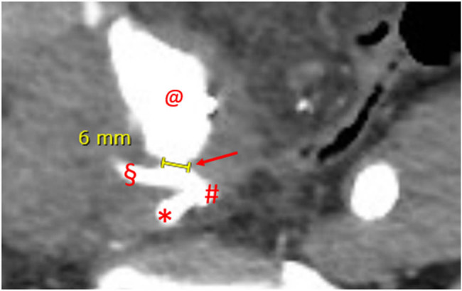
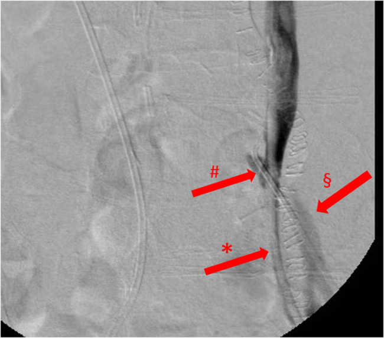
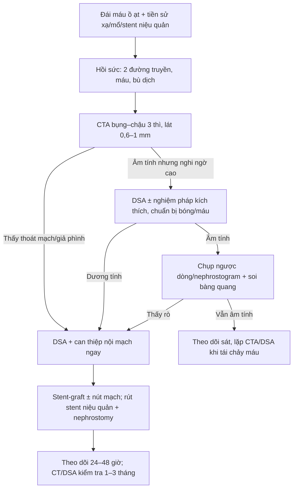
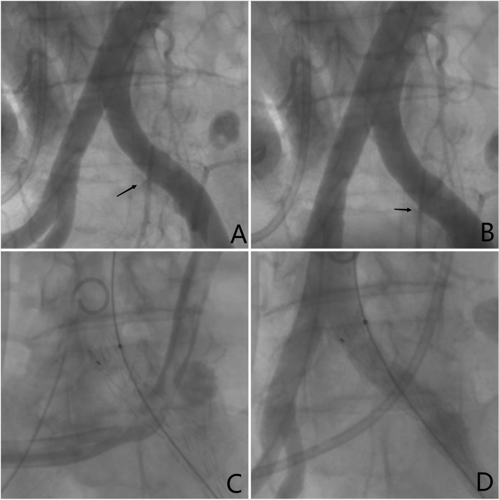
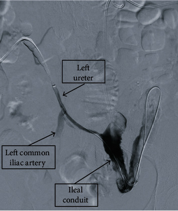

# 1670 — Rò động mạch chậu – niệu quản sau xạ trị và sau đặt stent: “chảy máu cảnh báo” rồi sốc mất máu / Uretero-iliac artery fistula (UAF)

**Tags:** `pattern:ro-dong-mach-nieu-quan` `pattern:chay-mau` `pattern:khuyet-thuoc-long-mach` `vung:nieu-quan` `vung:chau` `vung:dong-mach-chau` `protocol:CTA` `protocol:DSA` `protocol:chup-nguoc-dong`
**Mức chắc chắn (certainty):** tổng hợp y văn (literature synthesis) — ghép 1 tổng quan + 2 ca có ảnh (*Open Med* 2022, PMC9746699, CC BY 4.0), 1 tổng quan + ca (*Radiology Case Reports* 2024, PMC11866053, CC BY-NC-ND 4.0), 2 ca (*Case Rep Urol* 2021, PMC8371582, CC BY), 1 loạt ca phức tạp + tổng quan (*Diagnostics* 2022, PMC9406295, CC BY 4.0), 2 ca (*BMC Urol* 2022, PMC9330645, CC BY 4.0) và 1 ca can thiệp nội mạch (*J Vasc Surg Cases* 2022, PMC8783110, CC BY-NC-ND 4.0). **Không có thử nghiệm ngẫu nhiên** về chẩn đoán/điều trị UAF → các con số là tổng quan đoàn hệ và ca, không phải khuyến cáo hạng A.

> **Câu chốt:** UAF là **lỗ rò giữa niệu quản đã xơ – thiếu máu (do xạ, mổ, stent lâu ngày) và động mạch chậu đập ngay cạnh**, nên bệnh cảnh kinh điển là **đái máu ồ ạt từng đợt, có “chảy máu cảnh báo” trước đó, rồi sốc mất máu**. Chẩn đoán **không được loại trừ bằng CT không cản quang hay CT có cản quang âm tính**: độ nhạy CT chỉ **27–55%**, chụp mạch **45–72%**, và trung bình phải làm **2,4 lần chụp** mới chẩn đoán được. Điều trị đầu tay hiện nay là **stent-graft nội mạch ± nút mạch, kèm rút stent niệu quản và đặt nephrostomy** để cắt vòng xoắn cơ học – viêm.

## 1. Tổng quan bệnh học – cơ chế hình ảnh

### 1.1 Vì sao niệu quản lại rò vào động mạch chậu

- **Giải phẫu:** niệu quản bắt chéo **động mạch chậu gốc (common iliac)** ở eo chậu; bên trái bắt chéo **ĐM chậu gốc trái**, bên phải thường bắt chéo **ngã ba ĐM chậu gốc – ĐM chậu ngoài**. Đây là nơi thành niệu quản **mỏng nhất, sát động mạch nhất, ít mô đệm nhất** → là vị trí rò hay gặp nhất, đặc biệt **ĐM chậu gốc trái** (PMC9406295).
- **Chuỗi bệnh sinh:** xạ trị tiểu khung + mổ lớn + **stent niệu quản lâu ngày** → **viêm mạn, xơ hóa, thiếu máu thành niệu quản** → niêm mạc teo, thành mỏng dính vào mô xơ quanh niệu quản; **động mạch chậu đập theo nhịp** tiếp tục **mài mòn** thành đã hỏng (yếu tố cơ học) → loét xuyên thành → **lỗ rò**. Nhiễm khuẩn niệu tái diễn làm tăng viêm và phá hủy thêm (PMC9746699).
- **Vì sao chảy máu từng đợt:** lỗ rò nhỏ bị **cục máu đông bịt tạm** → đái máu ngắt quãng; khi cục máu trôi hoặc lỗ rò mở rộng → **chảy máu ồ ạt, sốc**. Đây là lý do **“chảy máu cảnh báo” (sentinel/herald bleed)** là dấu hiệu phải nhập viện ngay, không chờ đợi.
- **Vì sao chẩn đoán khó:** lỗ rò có thể **rất nhỏ** và dòng máu chảy **từ động mạch vào niệu quản**; nếu lưu lượng lớn (**≥ 3 mL/giây**) thì thuốc cản quang bị rửa trôi, **chụp ngược dòng không thấy rò**; ca có lỗ rò **6 mm** ước tính lưu lượng **~7 mL/giây** (PMC9746699). Vì vậy **âm tính không loại trừ**.

### 1.2 Ngưỡng định lượng nằm lòng

| Đại lượng | Số liệu | Nguồn |
|---|---|---|
| Tử vong chung | **7–23%**; có loạt tới **7–90%** tùy mổ mở/nội mạch và tình trạng sốc; **10–20%** ở loạt khác | PMC9746699; PMC9406295; PMC9330645 |
| Tiền sử mổ tiểu khung/ sau phúc mạc | **63,8–69,5%** (mổ ung thư **54%**, mổ mạch **31%**) | PMC9746699 (dẫn van den Bergh, Batter, Das, Subiela) |
| Xạ trị tiểu khung | **46–57,4%** | PMC9746699 |
| Stent niệu quản lâu dài | **65–91,5%** | PMC9746699 |
| Thời gian từ đặt stent đến rò | **16 tháng**, **7 năm**, **13 năm** (3 lần rò trong 2 ca) | PMC9746699 |
| Độ nhạy CT có cản quang | **27–55%**; gộp **47,01%** | PMC9746699; PMC9406295 |
| Độ nhạy chụp mạch (DSA) | **45–72%**; gộp **59,83%** | PMC9746699; PMC9406295 |
| Độ nhạy chụp ngược dòng/niệu quản | **52–61%** (có loạt chỉ **11,1%**) | PMC9746699; PMC9406295 |
| Chụp mạch “kích thích” (rút stent/cọ xát) | nâng độ nhạy tới **92,9%** | PMC9406295 |
| Số lần chụp trung bình trước chẩn đoán | **2,4** | PMC9746699 (dẫn van den Bergh) |
| Biến chứng sau can thiệp nội mạch | **10%** (sớm **4,2%**, muộn **17%**); chảy máu lại **7,5%**, huyết khối stent **3,2%** | PMC9746699 (dẫn Subiela, 94 ca) |
| Tử vong sau can thiệp nội mạch | **27,6%** toàn nhóm theo dõi, nhưng chỉ **2,1%** do UAF | PMC9746699 (dẫn Subiela) |
| Không chảy máu lại sau stent-graft | **76,2%** ở 1 năm; **40,6%** ở 2 năm (11 ca) | PMC9746699 (dẫn Okada) |

## 2. Mẫu hình + chẩn đoán phân biệt theo vị trí (gamut)

*CT bụng–chậu thì động mạch, mặt phẳng axial: mũi tên đỏ chỉ **lỗ rò 6 mm**; **@** = túi giả phình; **§** = ĐM chậu ngoài; **#** = ngã ba ĐM chậu gốc phải; **\*** = ĐM chậu trong. Nguồn: Open Med 2022, PMC9746699, CC BY 4.0 — nguyên bản.*

- **Mẫu hình chốt:** bệnh nhân có **tiền sử xạ trị tiểu khung/mổ lớn/stent niệu quản lâu ngày**, đái máu **ồ ạt hoặc ngắt quãng**, kèm **đau hông lưng** và **tụt huyết áp**; trên hình ảnh có **thuốc cản quang từ động mạch chậu đi vào lòng niệu quản**, **giả phình** hoặc **mất mặt phẳng mỡ giữa niệu quản và động mạch**.
- **Gamut theo vị trí (quyết định kỹ thuật can thiệp):**
  - **ĐM chậu gốc (common iliac) — hay nhất, đặc biệt bên trái:** chỗ niệu quản bắt chéo; stent-graft thẳng, dễ tiếp cận.
  - **ĐM chậu ngoài (external iliac):** thường sau mổ chậu/ghép thận; cần stent-graft qua ngã bẹn, chú ý che ĐM chậu trong.
  - **ĐM chậu trong (internal iliac):** thường kèm giả phình, khó đặt stent-graft; cân nhắc nút mạch + bypass.
  - **ĐM chủ bụng thấp:** rò chủ – niệu quản, hiếm, tử vong rất cao; đi kèm phình ĐMC hoặc bóc tách.
- **Gamut theo kiểu chảy máu:**
  - **Ồ ạt lần đầu:** thường lỗ rò lớn, sốc mất máu.
  - **Ngắt quãng nhiều đợt (sentinel):** lỗ rò nhỏ bị huyết khối bịt; **đừng chủ quan**.
  - **Đái máu + đau hông lưng + sốt:** coi chừng **nhiễm khuẩn tiết niệu + rò**, dễ chẩn đoán nhầm là viêm thận – bể thận.
  - **Đái máu sau thay stent:** có thể do chấn thương niệu quản, nhưng nếu ồ ạt + tụt HA phải nghĩ UAF.

## 3. Bảng so sánh phân biệt (ma trận đối chiếu)

| Thực thể (entity) | Hình ảnh điển hình | Chốt vào (rule-in) | Chốt loại (rule-out) | Gợi ý xác nhận |
|---|---|---|---|---|
| **Rò động mạch chậu – niệu quản (UAF)** | Thuốc cản quang từ ĐM chậu vào niệu quản; giả phình; stent niệu quản sát động mạch; máu cục trong bể thận/ bàng quang | **Tiền sử xạ/mổ/stent + đái máu ồ ạt + thoát mạch từ ĐM chậu vào niệu quản trên CTA/DSA** | Có khối đặc trong lòng niệu quản, không thoát mạch → nghĩ u | CTA thì động mạch + thì muộn; DSA ± nghiệm pháp kích thích |
| **Giả phình ĐM chậu chưa rò** | Túi giả phình cạnh niệu quản, **không có thuốc vào lòng niệu quản**; có thể chèn ép niệu quản gây ứ nước | **Túi giả phình + mất liên tục thành ĐM + không thấy đường rò** | Có thuốc cản quang trong niệu quản → đã rò | CTA/DSA; theo dõi nguy cơ rò |
| **Ung thư biểu mô niệu quản** | **Khối đặc trong lòng**, ngấm thuốc thì vỏ – niệu quản, bờ không đều; ứ nước trên; không có giả phình | **Khối đặc trong lòng + ngấm thuốc + tế bào niệu** | Không khối, thành đều, có giả phình/đường rò → không phải u | Niệu soi + sinh thiết; CTU thì bài tiết |
| **Sỏi niệu quản** | **Sỏi cản quang** tại điểm hẹp, dấu đuôi sao chổi, niêm mạc phù; đái máu nhẹ | **Sỏi thấy trên CT không cản quang** | Không sỏi, có thoát mạch động mạch → không phải sỏi | CT không cản quang là chuẩn |
| **Rò chủ – ruột (aortoenteric fistula)** | Khí trong túi phình/ĐM chủ, mất mặt phẳng mỡ với ruột, thoát thuốc vào lòng ruột; đau bụng + sốt + chảy máu tiêu hóa | **Phình ĐMC + khí/mất mặt phẳng mỡ + chảy máu tiêu hóa** | Chảy máu qua đường niệu, có stent niệu quản, không khí quanh ĐMC | CT có cản quang; nội soi tiêu hóa |
| **Rò niệu quản – âm đạo** | Thuốc cản quang từ niệu quản tràn vào âm đạo; đái rỉ liên tục sau mổ | **Đái rỉ liên tục + thuốc vào âm đạo** | Chảy máu ồ ạt + tụt HA + thoát mạch vào ĐM → không phải rò âm đạo | Chụp ngược dòng, soi bàng quang–âm đạo |

- **Ảnh minh họa mẫu hình:** chụp ngược dòng ở ca thứ hai cho thấy **thuốc từ niệu quản trái tràn vào ĐM chậu gốc trái** — chẩn đoán xác định dù CT và chụp ngược dòng lần đầu âm tính (PMC9746699).

*Chụp niệu quản ngược dòng thì muộn, không xóa nền: **\*** = stent niệu quản trái; **§** = ĐM chậu gốc trái; **#** = đường rò. Nguồn: Open Med 2022, PMC9746699, CC BY 4.0 — nguyên bản.*

## 4. Protocol chụp + hệ phân độ/điểm chuẩn hóa

### 4.1 Thứ tự chẩn đoán khi nghi UAF

- **Bước 0 — hồi sức trước, chụp sau:** đặt 2 đường truyền lớn, truyền máu khối hồng cầu, bù dịch; **không để bệnh nhân đi chụp khi chưa có đường truyền và máu dự trữ**. Nếu đang sốc không cầm được, **can thiệp mạch ngay** thay vì cố chẩn đoán bằng CT.
- **Bước 1 — CTA bụng–chậu 3 thì:** thì **không cản quang** (sỏi, máu cục, vôi hóa), thì **động mạch 25–35 giây** (lỗ rò, giả phình), thì **muộn 3–5 phút** (thuốc trong niệu quản). Lát **0,6–1 mm**, dựng **MIP/MPR** theo trục động mạch chậu và niệu quản. **Nhìn cả stent niệu quản**: thành niệu quản quanh stent dày, mất mặt phẳng mỡ với ĐM là gợi ý.
- **Bước 2 — nếu CTA âm tính mà nghi ngờ cao:** **DSA chậu** (chụp mạch số hóa xóa nền) ± **nghiệm pháp kích thích**: rút stent niệu quản hoặc cọ xát nhẹ thành động mạch trong lúc chụp, **chuẩn bị bóng chèn và máu**; độ nhạy có thể tăng tới **92,9%** nhưng **nguy cơ chảy máu chết người** (PMC9406295).
- **Bước 3 — chẩn đoán tại chỗ:** **chụp ngược dòng/nephrostogram** thấy thuốc sang động mạch; **soi bàng quang** xác định bên chảy máu (máu từ lỗ niệu quản); **niệu soi** có thể thấy máu nhưng **không nên cố gắng** nếu đang chảy ồ ạt.
- **Bước 4 — điều trị:** **stent-graft phủ (covered stent) ĐM chậu** ± **nút mạch ĐM chậu trong**; **rút stent niệu quản** và đặt **nephrostomy** để cắt kích thích cơ học – viêm; nếu thất bại/không ổn định → **mổ mở** (khâu ĐM + tái tạo niệu quản hoặc cắt thận).

### 4.2 Kỹ thuật can thiệp nội mạch (có số liệu)

- **Stent-graft:** chọn cỡ **lớn hơn đường kính ĐM 10–20%**, dài đủ che hai đầu lỗ rò (**≥ 2 cm** mỗi bên); ví dụ trong ca: **Viabahn 5 × 100 mm**, **9 × 100 mm**, **16 × 12 × 100 mm** (PMC9746699); **VBX 8 × 50 mm** + 3 coil ĐM chậu trong (PMC8783110).
- **Nút mạch ĐM chậu trong** bằng coil/ PVA trước khi đặt stent-graft khi lỗ rò sát ngã ba hoặc có giả phình; **không nút ĐM chậu ngoài** vì nguy cơ thiếu máu chi.
- **Xử trí niệu quản:** **rút stent** và **nephrostomy** (hoặc thay stent mềm) để loại bỏ vật liệu cứng cọ xát; **không đặt lại stent cứng** qua vùng rò.
- **Kháng sinh** theo cấy nước tiểu; **kháng đông** sau stent-graft theo phác đồ mạch máu (thường aspirin ± clopidogrel).
- **Theo dõi:** CT/DSA kiểm tra **1–3 tháng**, sau đó **mỗi 6–12 tháng**; cảnh giác **rò thứ phát bên đối diện** (đã gặp lúc **9 tháng** sau can thiệp — PMC9406295) và **hẹp/tắc stent-graft**.

*Chụp mạch chậu trước (A, B: mũi tên chỉ thuốc thoát ra từ ĐM chậu vào niệu quản) và sau can thiệp (C, D: không còn thoát mạch). Nguồn: BMC Urol 2022, PMC9330645, CC BY 4.0 — nguyên bản.*

## 5. Biến thể bình thường và cạm bẫy

- **CTA âm tính không loại trừ UAF.** Độ nhạy chỉ **27–55%**; ca 1 trong PMC9746699 có CTA dương tính nhờ lỗ rò **6 mm**, nhưng ca 2 **CTA và chụp ngược dòng lần đầu đều âm tính**, chỉ dương tính khi chụp kích thích. Nếu bệnh nhân còn chảy máu, **lặp lại hoặc DSA**.
- **CT không cản quang âm tính càng không loại trừ.** Ca PMC8371582: CT bụng–chậu không cản quang **âm tính**, sau đó nephrostogram mới thấy rò lớn.
- **Huyết khối bịt lỗ rò:** ngay sau đợt chảy máu, lỗ rò có thể bị cục máu bịt → **chụp âm tính giả**; chụp khi ổn định có thể bỏ sót. Đừng kết luận "không có rò" chỉ vì một lần chụp âm tính.
- **Chụp ngược dòng có thể gây chảy máu lại ồ ạt:** bơm thuốc có thể đẩy cục máu bịt ra; **chỉ làm khi có kíp can thiệp và máu sẵn sàng**.
- **Dị vật kim loại:** stent niệu quản và stent-graft gây **giả ảnh (artifact)** che lỗ rò; dùng **MIP/MPR** và cửa sổ mạch, không chỉ đọc lát axial.
- **Chảy máu từ hai bên:** bệnh nhân có **nephrostomy hai bên** có thể chảy máu từ một bên; **soi bàng quang/niệu soi** xác định bên trước khi can thiệp.
- **Đừng nhầm với nhiễm khuẩn tiết niệu:** sốt + đau hông lưng + đái máu ở người có stent rất dễ bị điều trị như viêm thận – bể thận; **tụt Hb, tụt HA, máu cục** là cờ đỏ của rò.
- **Suy thận sau cản quang:** CTA có thể làm creatinin tăng; nhưng trong UAF, **chậm chẩn đoán nguy hiểm hơn** nguy cơ cản quang — vẫn phải chụp, bù nước và theo dõi creatinin **48–72 giờ**.

## 6. Tự lượng giá — Blind Quiz

**Ca 1 — Nam 72 tuổi, cắt bàng quang tận gốc + tạo hình ruột non, stent niệu quản phải 16 tháng. Đột ngột choáng, đái máu ồ ạt, Hb 9,1 → 7,4 g/dL.**

- Câu hỏi: Dấu hiệu chốt trên CTA? Vì sao CT không cản quang trước đó có thể âm tính? Xử trí cấp cứu?

<b>Bấm để hiện đáp án (findings + chẩn đoán)</b>

- **Findings:** lỗ rò **6 mm** từ **ĐM chậu ngoài phải** vào niệu quản, kèm **túi giả phình**; thuốc cản quang thoát vào lòng niệu quản.
- **Chẩn đoán:** **rò động mạch chậu – niệu quản (UAF)** sau stent niệu quản lâu ngày. CT không cản quang chỉ thấy stent đúng vị trí, **không thấy lỗ rò**; cần **CTA thì động mạch**.
- **Xử trí:** hồi sức (5 đơn vị máu trong ngày), **stent-graft Viabahn 5 × 100 mm** từ ĐM chậu gốc đến ĐM chậu ngoài + nút ĐM chậu trong; rút stent niệu quản, đặt nephrostomy.
- **Nguồn ảnh:** Open Med 2022, PMC9746699, CC BY 4.0.

**Ca 2 — Nữ 56 tuổi, ung thư cổ tử cung đã xạ trị, stent niệu quản hai bên 7 năm, đái máu ồ ạt; CTA và chụp ngược dòng lần đầu âm tính.**

- Câu hỏi: Vì sao hai lần chụp đầu âm tính? Làm gì tiếp theo? Điều trị?

<b>Bấm để hiện đáp án (findings + chẩn đoán)</b>

- **Findings:** chụp ngược dòng **kích thích** thấy thuốc từ **niệu quản trái** tràn vào **ĐM chậu gốc trái** qua đường rò.
- **Vì sao âm tính:** lỗ rò nhỏ + dòng máu **≥ 3 mL/giây** rửa trôi thuốc; cục máu bịt tạm; trung bình phải **2,4 lần chụp** mới chẩn đoán.
- **Điều trị:** nút động mạch + **stent-graft Viabahn 9 × 100 mm** ĐM chậu gốc trái; sau đó tái phát do hẹp/collapse stent, phải đặt thêm stent-graft và cuối cùng có **rò niệu quản – đại tràng** phải mở hậu môn nhân tạo.
- **Nguồn ảnh:** Open Med 2022, PMC9746699, CC BY 4.0.

**Ca 3 — Nữ 55 tuổi, xạ trị + cắt toàn bộ tiểu khung vì ung thư cổ tử cung, nephrostomy hai bên; đái máu từ cả hai ống, Hb 8,1 g/dL, CT không cản quang âm tính.**

- Câu hỏi: Vì sao CT âm tính? Hình nào chẩn đoán? Hướng can thiệp?

<b>Bấm để hiện đáp án (findings + chẩn đoán)</b>

- **Findings:** nephrostogram (chụp qua ống thận) thấy thuốc từ **niệu quản trái** vào **ĐM chậu gốc trái**, xác nhận rò lớn; bàng quang ruột non (ileal conduit) chứa máu cục.
- **Vì sao CT âm tính:** CT **không cản quang** không thể thấy đường rò; ngay cả CTA có thể âm tính vì cục máu bịt.
- **Hướng can thiệp:** hồi sức + **stent-graft phủ ĐM chậu**, nút mạch nhánh, rút stent niệu quản và dẫn lưu qua da; theo dõi sát vì nguy cơ tái phát.
- **Nguồn ảnh:** Case Rep Urol 2021, PMC8371582, CC BY (Attribution).

## Bài liên quan chéo
- [1666 – Hẹp niệu quản sau vá rò và sau xạ trị](../1666-hep-nieu-quan-sau-va-ro-va-sau-xa-tri/lesson.md)
- [191 – Vá lại rò niệu – sinh dục thất bại](../191-va-lai-ro-nieu-sinh-duc-that-bai/lesson.md)
- [1660 – Stent niệu quản lưu quên](../1660-stent-nieu-quan-luu-quen/lesson.md)
- [938 – Rò động mạch chủ – ruột](../938-ro-dong-mach-chu-ruot/lesson.md)
- [170 – Phình động mạch chủ bụng](../170-phinh-DMC-bung/lesson.md)

## Ảnh
- `1670_ro-DM-chau-nieu-quan_CTA_PMC9746699-f2.jpg` — CTA lỗ rò 6 mm, **CC BY 4.0**, nguyên bản.
- `1670_ro-DM-chau-nieu-quan_RGP_PMC9746699-f4.jpg` — chụp ngược dòng, **CC BY 4.0**, nguyên bản.
- `1670_ro-DM-chau-nieu-quan_NEU-PYELO_PMC8371582-f1.jpg` — nephrostogram, **CC BY (Attribution)**, nguyên bản.
- `1670_ro-DM-chau-nieu-quan_DSA_PMC9330645-f1.jpg` — DSA trước/sau stent-graft, **CC BY 4.0**, nguyên bản.
- Nguồn, giấy phép và chú thích gốc: `images/CREDITS.md` và `sources.md`. Không tạo ảnh ghép vì 4 ảnh thuộc 4 bệnh nhân và 3 kỹ thuật khác nhau.

> Không dùng để chẩn đoán độc lập khi chưa có người hướng dẫn.
