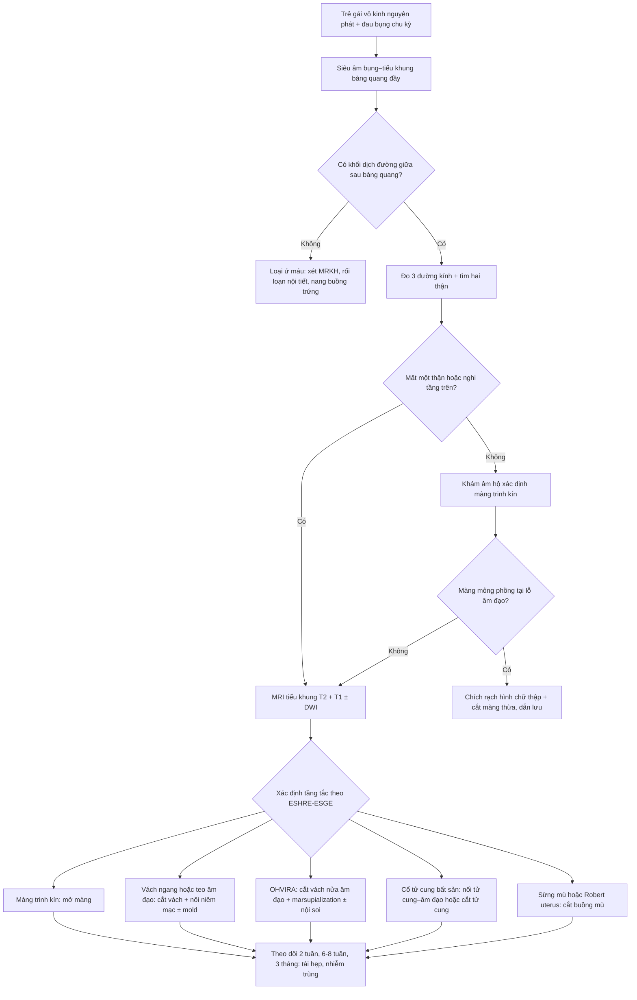
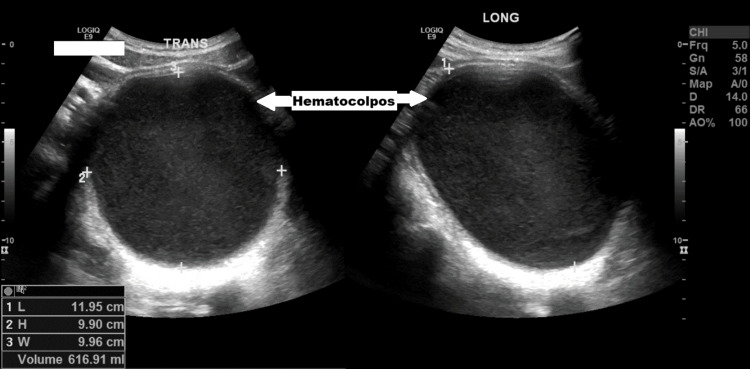
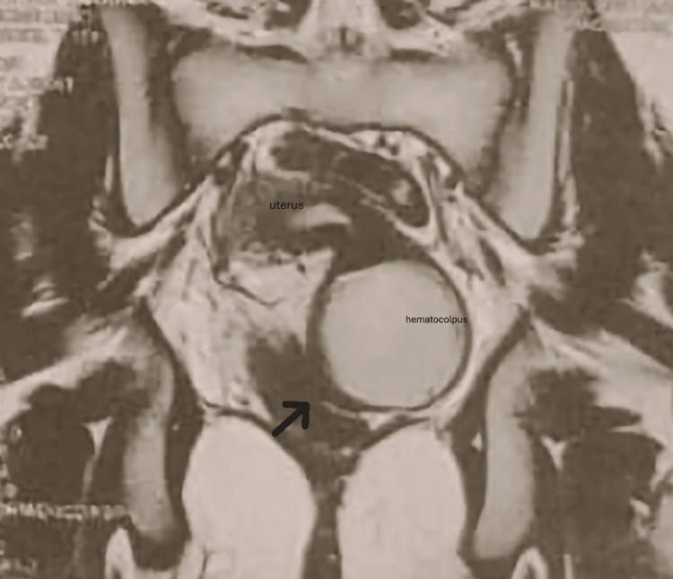
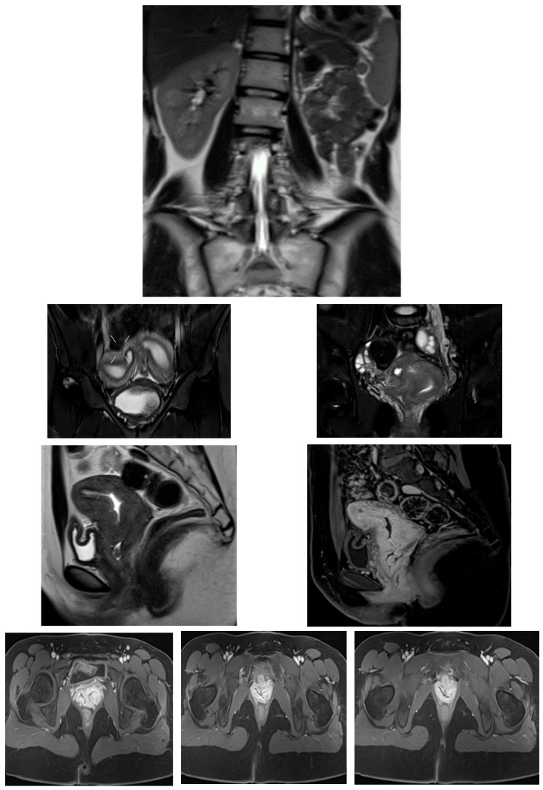

# 1671 — Ứ máu âm đạo – tử cung ở trẻ vị thành niên: màng trinh kín, vách ngang, OHVIRA & bất sản cổ tử cung / Hematocolpos and hematometra in adolescents

**Tags:** `pattern:u-mau-am-dao` `pattern:u-mau-buong-tu-cung` `pattern:khong-hoi-am` `vung:am-dao` `vung:tu-cung` `vung:tieu-khung` `score:ESHRE-ESGE` `protocol:TVUS` `protocol:MRI-tieu-khung` `incidentaloma:hematocolpos`
**Mức chắc chắn (certainty):** tổng hợp y văn (literature synthesis) — số liệu dịch tễ lấy từ loạt 17 bệnh nhi hydrometrocolpos (PMC13614824) và 164 ca OHVIRA (PMC12589279); hình ảnh là **ca nguyên văn có số đo** (617 mL — PMC12665289; 700 mL — PMC13165485; didelphys + thận mất — PMC12939194); kết cục tái hẹp sau mổ từ một ca (PMC12928252). Không có RCT nào cho nhóm bệnh này.

## 1. Tổng quan bệnh học – cơ chế hình ảnh

- **Phôi thai học quyết định tên gọi:** ống Müller (paramesonephric) **dài ra → dung hợp → tạo lòng (canalization) → tiêu vách giữa**. Hỏng ở bước nào thì tắc ở tầng đó, và **tầng tắc quyết định khoang nào bị ứ máu**:
  - tắc ở **lỗ âm đạo** (màng trinh kín) → ứ toàn bộ **âm đạo** (hematocolpos), tử cung ít bị ảnh hưởng lúc đầu;
  - tắc ở **âm đạo giữa/trên** (vách ngang, teo âm đạo) → ứ **âm đạo trên ± buồng tử cung**;
  - tắc **một nửa âm đạo** (OHVIRA, sừng tử cung mù) → ứ **một bên** âm đạo ± sừng tử cung bên đó, bên kia vẫn hành kinh;
  - tắc ở **cổ tử cung** (bất sản/thiểu sản cổ tử cung) → **ứ máu buồng tử cung**, âm đạo bình thường hoặc thiếu.
- **Vì sao ứ máu chứ không chỉ ứ dịch:** sau dậy thì, nội mạc tử cung **bong theo chu kỳ** nhưng không có đường ra → máu tích trong lòng ống, **áp lực tăng dần** → đau bụng dưới **theo chu kỳ**, khối vùng chậu, chèn ép bàng quang/trực tràng. Máu ứ lâu → **viêm nhiễm (pyocolpos)** và **trào ngược qua vòi → lạc nội mạc tử cung**.
- **TẠI SAO hình ảnh phân biệt được "máu" với "dịch/nang":**
  - **T1 sáng**: hemoglobin thoái hóa thành **methemoglobin** (Fe³⁺ thuận từ) → **rút ngắn T1**; mỡ cũng sáng T1 nên phải có **T1 fat-sat** để loại mỡ (u quái, mỡ trong khối).
  - **T2 thay đổi theo tuổi máu**: máu **cấp** (deoxyhemoglobin trong hồng cầu còn nguyên) → **T2 tối**; **bán cấp muộn** (methemoglobin ngoại bào) → **T2 sáng**; **mạn** (hemosiderin) → **T2 tối viền**. Vì vậy "T2 sáng" **không loại trừ** máu ứ — ca 16 tuổi dưới đây có hematocolpos **T2 sáng**.
  - **Mức dịch–dịch (fluid–fluid level)**: huyết thanh nhẹ nổi trên, hồng cầu lắng dưới — dấu hiệu rất gợi ý **máu đang tích thêm**, gặp ở ứ máu thể hoạt động.
  - **Không ngấm thuốc**: phần dịch/máu **không ngấm** (chỉ thành ngấm) → khác u hoại tử/khối đặc. **DWI**: máu thường **không hạn chế khuếch tán thật** (ADC không thấp, có thể T2 shine-through); **ứ mủ** thì **ADC thấp** — dùng khi có **sốt** để phân biệt pyocolpos.
  - **CT** (hạn chế ở trẻ vì liều): máu ứ đọng **~30–60 HU**, cao hơn nước tiểu **0–10 HU**; nhưng CT dễ gọi nhầm khối nang buồng trứng — **không phải phương thức đầu tay**.
- **Con số phải nhớ:**
  - **Hydrometrocolpos 1:16.000** trẻ gái sinh sống; **màng trinh kín 0,05–0,1%** trẻ gái — nguyên nhân tắc hay gặp nhất (PMC13614824).
  - Trong **17 bệnh nhi** hydrometrocolpos, **cả 17 đều có ứ nước thận–niệu quản** do chèn ép đường niệu dưới; **1 ca phát hiện trước sinh** với **ứ nước–niệu quản hai bên + thiểu ối** (PMC13614824) → **ứ máu âm đạo là bệnh của cả đường niệu**, không chỉ của âm đạo.
  - **OHVIRA = 6,2–8,3%** các dị dạng sinh dục nữ (PMC12589279); **dị dạng tử cung 5,5%** dân số chung, **8,0%** ở người hiếm muộn, **13,3%** ở người sảy thai tái diễn (PMC13394822); dị dạng **cổ tử cung–âm đạo 4–7%** các dị dạng Müller (PMC12283993).
  - **Chẩn đoán nhầm OHVIRA 16,5% (27/164)**: hay gọi là **áp-xe vùng chậu 29,6%** và **nang buồng trứng 25,9%**; **MRI trước chẩn đoán làm giảm chẩn nhầm (OR 0,157)**; có lạc nội mạc đi kèm làm **tăng** nguy cơ chẩn nhầm **(OR 3,267)** (PMC12589279).
  - **Lạc nội mạc tử cung gặp 42,86% ở nhóm dị dạng TẮC NGHẼN** so với **16,49%** ở nhóm không tắc (p = 0,006), và xuất hiện **sớm hơn ~3 tuổi** (25,22 ± 4,02 vs 28,46 ± 4,49) (PMC13012282) → **mỗi tháng chẩn đoán muộn là mỗi tháng trào ngược**.

## 2. Mẫu hình + chẩn đoán phân biệt theo vị trí (gamut)

- **Mẫu hình chung:** trẻ gái **vô kinh nguyên phát ± đau bụng dưới chu kỳ ± khối vùng chậu**, siêu âm thấy **hốc không hồi âm hình con nhộng ở đường giữa**, **phía sau bàng quang**.
- **Gamut theo TẦNG tắc — nhớ "M – V – N – C" (Màng – Vách – Nửa – Cổ):**
  1. **Màng (lỗ âm đạo):** **màng trinh kín** (hay gặp nhất; màng mỏng, phồng xanh tím ở âm hộ khi rặn), **dính môi bé**, sẹo cắt âm vật/khâu hẹp sau FGM.
  2. **Vách (âm đạo):** **vách ngang âm đạo** (thường 1/3 trên, dày ≥ 1 cm), **teo âm đạo đoạn xa**, **hẹp âm đạo sau xạ/mổ**.
  3. **Nửa (một bên):** **OHVIRA/Herlyn–Werner–Wunderlich** (tử cung hai sừng–hai cổ + một nửa âm đạo tắc + **thận cùng bên mất**), **Robert's uterus** (vách dọc không hoàn toàn + một buồng mù), **tử cung một sừng có sừng mù**, **ACUM** (khối có khoang trong cơ tử cung — bắt chước).
  4. **Cổ (cổ tử cung):** **bất sản/thiểu sản cổ tử cung ± bất sản âm đạo** → ứ máu **buồng tử cung**, âm đạo có thể bình thường.
  5. **Không tắc (phân biệt quan trọng):** **MRKH** — vô kinh nguyên phát nhưng **KHÔNG đau chu kỳ, KHÔNG ứ máu**, không có tử cung thật.
- **Gamut "khối nang vùng chậu ở trẻ gái" (khi chưa thấy ứ máu):** nang buồng trứng/paraovarian · ứ nước vòi tử cung · **bàng quang căng** (bí tiểu) · nang niệu rốn · u quái cùng cụt · thoát vị màng não trước cùng cụt · nang ống Müller.
- **Gamut "đau bụng dưới cấp + sốt ở trẻ đã dậy thì":** **pyocolpos/ứ mủ** · áp-xe phần phụ · viêm ruột thừa · xoắn phần phụ · vỡ nang — **ứ mủ có thể vỡ thành viêm phúc mạc**, đây là lý do không được chọc dò mù.

## 3. Bảng so sánh phân biệt (ma trận đối chiếu)

| Thực thể (entity) | Hình ảnh điển hình (US/MRI) | Chốt vào (rule-in) | Chốt loại (rule-out) | Gợi ý xác nhận |
|---|---|---|---|---|
| **Màng trinh kín (imperforate hymen)** | Khối dịch **con nhộng** đường giữa, **sau bàng quang**; màng mỏng phồng ở âm hộ; tử cung **bình thường**, **hai buồng trứng bình thường** | **Vô kinh + đau chu kỳ + màng phồng xanh tím ở lỗ âm đạo**; MRI: ứ máu **dưới** tầng màng, không có vách ngang | Thấy **vách dày ≥ 1 cm** hoặc **cổ tử cung bất thường** → không phải màng trinh | Khám âm hộ; US **đo 3 đường kính + thể tích**; MRI khi cần loại tầng trên |
| **Vách ngang âm đạo** | Ứ máu **âm đạo trên**; **vách dày 1–2 cm** trên T2, thường 1/3 trên | **Khoảng cách vách–lỗ âm đạo** đo được trên MRI; vách **dày, có mô xơ** | Vách **mỏng như màng** + sát lỗ âm đạo → màng trinh kín | MRI T2 sagittal đo độ dày/chiều cao vách; chuẩn bị **cắt vách + nối niêm mạc** |
| **Teo âm đạo đoạn xa** | Ứ máu âm đạo trên + **đoạn âm đạo dưới xơ hẹp**; có thể kèm **bất sản cổ tử cung** | **Đoạn âm đạo dưới không có lòng**, ứ máu phía trên; ca 16 tuổi: **vách mỏng + thành phần teo đoạn xa** (PMC12928252) | Có lòng âm đạo liên tục → loại teo | MRI + khám; **nguy cơ tái hẹp sau nối** — ca này tái tắc **2 tháng**, **nhiễm trùng 4 tháng**, phải đặt mold |
| **OHVIRA (Herlyn–Werner–Wunderlich)** | **Tử cung hai sừng, hai cổ tử cung** + **một nửa âm đạo căng máu** chèn bàng quang/trực tràng; **thận cùng bên không có** | **Bộ ba: didelphys + hemivagina tắc + bất sản thận cùng bên** trên MRI; **16,5% từng bị chẩn nhầm** (PMC12589279) | Có **hai thận bình thường** + không có nửa âm đạo tắc → không phải OHVIRA | **MRI là bắt buộc** (US bỏ sót thận mất, không phân loại được); cắt vách + marsupialization |
| **Robert's uterus / sừng mù** | **Vách dọc không hoàn toàn** + **buồng mù** ứ máu trong cơ tử cung; bờ ngoài tử cung **bình thường** | **Đau chu kỳ nặng + một khoang mù có nội mạc**, không thông với cổ tử cung | Không thấy khoang mù, hai buồng thông nhau → loại | MRI T2 + soi buồng; **dễ bị gọi là JCA** và mổ sai (PMC12085458) |
| **Bất sản cổ tử cung** | **Ứ máu buồng tử cung**, **không thấy cổ tử cung**, âm đạo có thể bình thường/thiếu | **Không có ống cổ tử cung** trên MRI; ứ máu trong tử cung, **không có ứ máu âm đạo** | Thấy cổ tử cung và ống thông → loại | MRI; **nối tử cung–âm đạo** (6/8 thành công) hay cắt tử cung (PMC13394822) |
| **MRKH** | **Không có tử cung thật**, buồng trứng bình thường, **không ứ máu** | **Vô kinh nguyên phát + KHÔNG đau chu kỳ + không khối máu** | Có ứ máu/đau chu kỳ → không phải MRKH đơn thuần | MRI; tư vấn tạo âm đạo — **không mổ cấp cứu** |
| **Nang buồng trứng / áp-xe phần phụ (bắt chước)** | Nang **lệch một bên**, có vách/mức cặn, **tuyến sinh dục bình thường**; US **không thấy khối đường giữa sau bàng quang** | **Khối lệch bên + buồng trứng cùng bên không tách được** | **Khối đường giữa, hình con nhộng, nối với tử cung** → ứ máu | MRI; **không chọc dò mù** khi chưa loại ứ máu |
| **Pyocolpos (ứ mủ)** | Ứ máu + **vách dày, tăng tín hiệu T2 quanh, hạn chế khuếch tán (ADC thấp)**, khí hiếm | **Sốt + đau + ứ máu + DWI hạn chế** | Không sốt, không hạn chế khuếch tán → ứ máu đơn thuần | **Dẫn lưu + kháng sinh**, không chỉ theo dõi |

## 4. Protocol chụp + hệ phân độ/điểm chuẩn hóa

- **Siêu âm là bước 1** (không xâm nhập, không bức xạ): ở trẻ chưa quan hệ, **transabdominal với bàng quang đầy**; nếu bàng quang không giữ được → **transperineal**. Đo **3 đường kính** và tính thể tích **V = 0,523 × D1 × D2 × D3** (ca dưới: 11,95 × 9,90 × 9,96 cm → **616,91 mL**).
- **Bắt buộc tìm THẬN trên siêu âm**: mất một thận cùng bên là chìa khóa của OHVIRA — nhưng US **bỏ sót** vì ruột/bàng quang che; **không thấy thận = chỉ định MRI**.
- **MRI tiểu khung (chuẩn vàng)** — không cần cản từ thường quy:
  - **T2** sagittal + coronal + axial **3–4 mm** (giải phẫu tử cung/âm đạo/vách);
  - **T1** axial ± **T1 fat-sat** (xác nhận **máu**: T1 sáng, mất tín hiệu khi fat-sat = mỡ);
  - **DWI b800–1000 + ADC** khi **sốt** hoặc nghi pyocolpos;
  - **gadolinium**: chỉ khi nghi khối đặc/u — không dùng để "thấy máu".
- **Phân loại:**
  - **ESHRE–ESGE 2013**: **U0–U6** (hình thái tử cung), **C0–C4** (cổ tử cung), **V0–V4** (âm đạo) — ghi đủ 3 thành phần, vì cùng "ứ máu" nhưng **C/V khác nhau quyết định mổ gì**.
  - **OHVIRA — Zhu**: **class 1** tắc hoàn toàn (đau dữ dội sớm sau dậy thì) · **class 2** tắc không hoàn toàn (vẫn có kinh, **chẩn đoán muộn**).
- **Ngưỡng/thời điểm can thiệp:** **mổ ngay khi có tắc nghẽn gây đau**; thể **không tắc** (MRKH, vách không cản trở) xử trí **gần thời điểm hoạt động tình dục** — nguyên tắc "theo giải phẫu, ưu tiên giải áp + bảo tồn sinh sản" (PMC13394822).
- **Sau mổ:** khám + siêu âm lại **2 tuần, 6–8 tuần, 3 tháng** (ca teo âm đạo tái tắc **2 tháng**, nhiễm trùng **4 tháng** — PMC12928252); đặt **mold/nong** khi nguy cơ hẹp.

## 5. Biến thể bình thường và cạm bẫy

- **Biến thể bình thường:**
  - **Ứ dịch âm đạo ở sơ sinh (mucocolpos/hydrocolpos)**: do **estrogen mẹ** → khối dịch nhỏ, **tự thoái triển vài tuần**; chỉ can thiệp khi **chèn ép niệu quản/bí tiểu** hoặc tăng dần.
  - **Màng trinh có lỗ nhỏ (microperforate/cribriform)**: vẫn có kinh **thưa, kéo dài**; đừng loại trừ ứ máu chỉ vì "có ra máu".
  - **Tử cung hai sừng–hai cổ không tắc**: biến thể, **không ứ máu**, không mổ.
- **Cạm bẫy (pitfall):**
  1. **"Có kinh đều" ≠ không tắc**: OHVIRA **class 2** (tắc không hoàn toàn) vẫn ra kinh, chỉ **đau tăng dần** → chẩn đoán muộn; ca 16 tuổi bị **pyosalpinx 12,2 × 12,2 × 8,2 cm** trước khi được chẩn đoán (PMC12939194).
  2. **Chẩn nhầm thành áp-xe/nang buồng trứng 16,5%** rồi **chọc dò/dẫn lưu qua da** → biến ứ máu thành **pyocolpos nhiễm trùng**, mất cơ hội mổ sạch (PMC12589279).
  3. **Bỏ sót thận mất cùng bên**: siêu âm không thấy thận **không** đồng nghĩa "không có bệnh thận" — phải MRI; ngược lại, **thấy đủ hai thận** không loại trừ OHVIRA thể hiếm.
  4. **Nhầm với bàng quang**: khối ứ máu nằm **sau** bàng quang; đặt sonde và lặp siêu âm sau khi làm rỗng bàng quang để chứng minh khối **không xẹp**.
  5. **Robert's uterus bị gọi là "juvenile cystic adenomyoma"**: cả hai đều là khoang máu trong cơ tử cung; **JCA nằm trong thành cơ, không có nội mạc bao quanh**, còn buồng mù **có nội mạc + thông với ống Müller** — mổ sai làm mất tử cung (PMC12085458).
  6. **Tái hẹp sau mổ**: niêm mạc âm đạo co rút nhanh; ca teo âm đạo **tái tắc sau 2 tháng**, **nhiễm trùng sau 4 tháng** — phải **đặt mold/nong** và theo dõi, không chỉ hẹn 1 năm (PMC12928252).
  7. **Đau bụng cấp + sốt ở trẻ đã mổ ứ máu cũ**: nghĩ **pyocolpos tái phát** trước khi nghĩ viêm ruột thừa — siêu âm đường giữa trước.

## 6. Tự lượng giá — Blind Quiz ngay trên trang tĩnh (không cần app)

**Ca 1 — nữ 13 tuổi, bí tiểu 24 giờ, đau bụng dưới âm ỉ 2 tháng**

- Bối cảnh: chưa có kinh lần nào, đau tăng dần, tiểu khó rồi bí tiểu hoàn toàn; khám thấy khối căng vùng hạ vị.
- Câu hỏi: Khối dịch nằm ở đâu so với bàng quang? Ba chẩn đoán phân biệt? Dấu hiệu nào trên ảnh chốt chẩn đoán?

<b>Bấm để hiện đáp án (findings + chẩn đoán)</b>

- Dấu hiệu: khối **không hồi âm, có cặn lợ nội bộ**, hình **con nhộng đường giữa**, **phía sau bàng quang**; số đo trên ảnh **11,95 × 9,90 × 9,96 cm**, thể tích **616,91 mL**.
- Chẩn đoán: **ứ máu âm đạo do màng trinh kín** — ứ máu chèn cổ bàng quang gây **bí tiểu cấp** (cơ chế chèn ép, không phải nhiễm trùng niệu).
- Phân biệt: nang buồng trứng khổng lồ (lệch bên, không nối tử cung), bàng quang căng (xẹp sau đặt sonde), ứ mủ (sốt + hạn chế khuếch tán trên MRI).
- Nguồn ảnh: Cureus 2025 (PMC12665289), Fig. 1 — CC BY 4.0.

**Ca 2 — nữ 16 tuổi, vô kinh nguyên phát, đau bụng dưới chu kỳ 8 tháng**

- Bối cảnh: dậy thì bình thường, không có kinh, đau tăng mỗi tháng; khám âm hộ không thấy màng phồng rõ.
- Câu hỏi: Cấu trúc nào bị căng máu? Tầng tắc nằm ở đâu? Vì sao ca này dễ tái phát sau mổ?

<b>Bấm để hiện đáp án (findings + chẩn đoán)</b>

- Dấu hiệu: **âm đạo căng máu (hematocolpos) tín hiệu T2 cao**, đẩy bàng quang ra trước; **mũi tên** chỉ **đoạn hẹp/xơ ở âm đạo đoạn xa**; tử cung phía trên ứ máu nhẹ.
- Chẩn đoán: **teo âm đạo đoạn xa + vách ngang** — không phải màng trinh kín (màng mỏng sát lỗ âm đạo).
- Vì sao tái phát: sau cắt vách + nối niêm mạc, **co rút xơ** làm hẹp lại — ca này **tái tắc sau 2 tháng**, **nhiễm trùng ứ máu sau 4 tháng**, phải mổ lại + đặt **mold âm đạo**.
- Nguồn ảnh: Cureus 2026 (PMC12928252), Fig. 1 — CC BY 4.0.

**Ca 3 — nữ 15 tuổi, đau bụng dưới tăng dần 6 tháng, siêu âm thấy "hai tử cung"**

- Bối cảnh: kinh đều 3 năm rồi **giảm lượng**, đau sau kỳ kinh; không sốt.
- Câu hỏi: Bộ ba chẩn đoán là gì? Vì sao phải chụp MRI thay vì chỉ siêu âm? Cơ quan nào bắt buộc phải kiểm tra?

<b>Bấm để hiện đáp án (findings + chẩn đoán)</b>

- Dấu hiệu: **tử cung hai sừng (didelphys)**, **một nửa âm đạo căng máu** chèn bàng quang/trực tràng, **mất thận trái** trên ảnh coronal toàn ổ bụng; ổ phúc mạc có dịch/viêm.
- Chẩn đoán: **OHVIRA (Herlyn–Werner–Wunderlich)** — bộ ba *didelphys + hemivagina tắc + bất sản thận cùng bên*.
- Vì sao MRI: siêu âm **không phân loại được hình thái tử cung, không xác định bên tắc, và bỏ sót thận mất**; MRI còn phát hiện **ứ nước vòi, lạc nội mạc, áp-xe** để mổ đúng.
- Cơ quan bắt buộc: **thận và niệu quản** — dị dạng Müller luôn đi kèm dị dạng Wolff.
- Nguồn ảnh: Diagnostics 2026 (PMC12939194), Fig. 3 — CC BY 4.0.

## Bài liên quan chéo
- [1634 – Hẹp cổ tử cung & ứ máu buồng tử cung sau xạ trị phụ khoa](../1634-hep-co-tu-cung-u-mau-sau-xa/lesson.md)
- [562 – Hẹp âm đạo sau xạ trị](../562-hep-am-dao-sau-xa-tri/lesson.md)
- [1612 – Colpocleisis & biến chứng ứ mủ (pyocolpos/pyometra)](../1612-colpocleisis-va-bien-chung/lesson.md)
- [536 – U mầm/u mô đệm buồng trứng](../536-u-mam-u-mo-dem-buong-trung/lesson.md)
- [1681 – Di chứng muộn niệu–sinh dục ở bé gái sau chấn thương khung chậu](../1681-di-chung-muon-nieu-sinh-duc-be-gai-sau-chan-thuong-khung-chau/lesson.md)
- [1604 – Thai kỳ sau điều trị chửa ở sẹo mổ lấy thai](../1604-thai-ky-sau-chua-seo-mo-lay-thai/lesson.md)
- [1631 – Thai tiếp tục sau chửa ở sẹo mổ lấy thai](../1631-thai-tiep-tuc-sau-chua-seo-mo-lay-thai/lesson.md)

## Ảnh
- `images/1671_u-mau-am-dao_US-PMC12665289-F1.jpg` — siêu âm, Cureus 2025 (PMC12665289), Fig. 1, **CC BY 4.0**.
- `images/1671_u-mau-am-dao_MRI-PMC12928252-F1.jpg` — MRI T2 coronal, Cureus 2026 (PMC12928252), Fig. 1, **CC BY 4.0**.
- `images/1671_u-mau-am-dao_MRI-PMC12939194-F3.jpg` — MRI nhiều bình diện, Diagnostics 2026 (PMC12939194), Fig. 3, **CC BY 4.0**.
- Ba ảnh từ **ba bài khác nhau** → **không ghép composite**, giữ nguyên bản (không crop, không chèn chữ).
- Không tải ảnh Radiopaedia/AuntMinnie; dẫn link trong `sources.md`.

> Không dùng để chẩn đoán độc lập khi chưa có người hướng dẫn.
