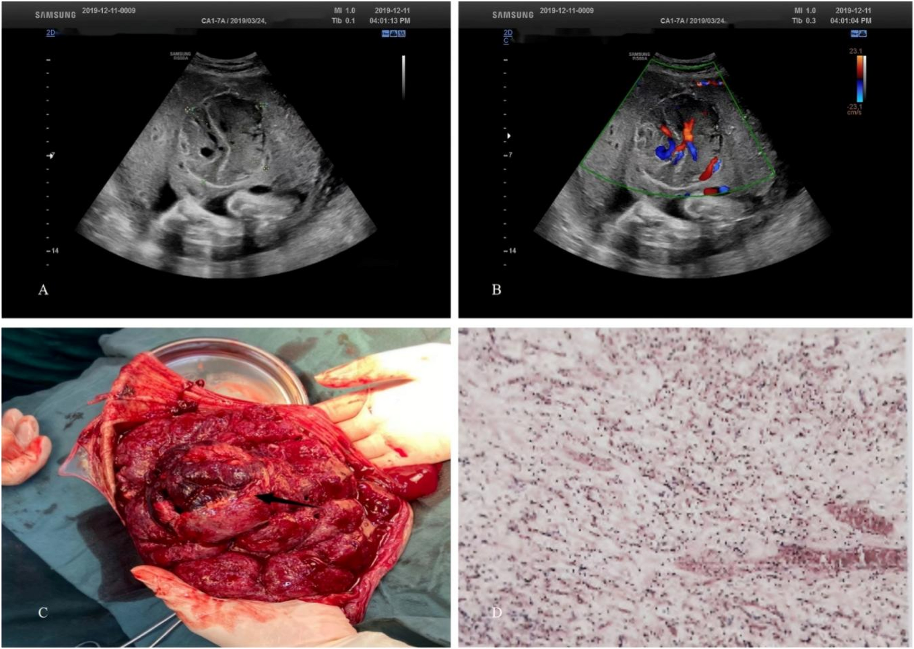
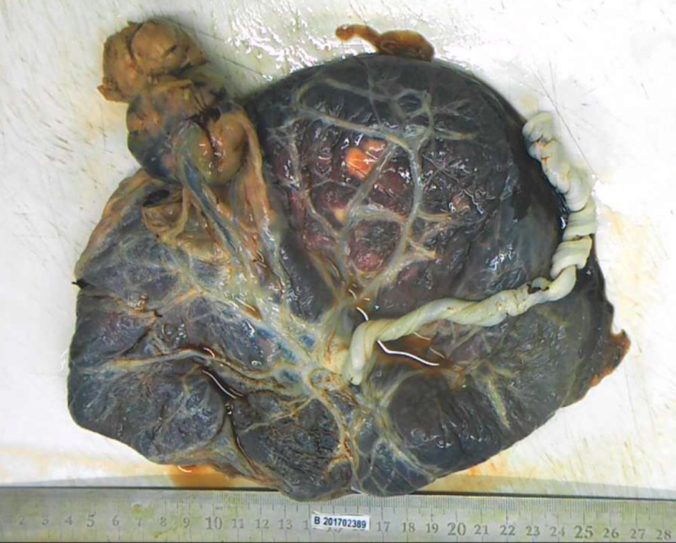
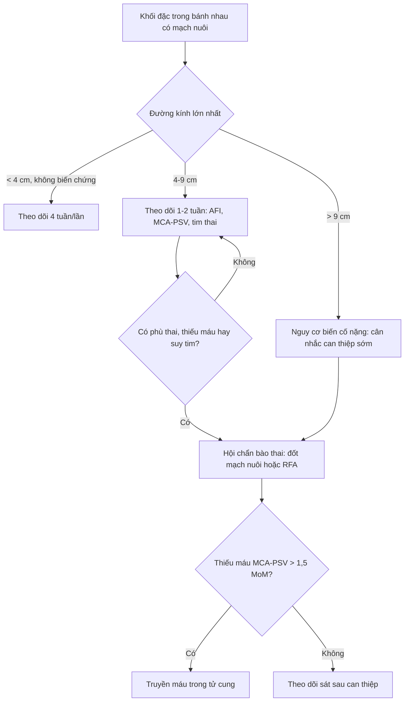
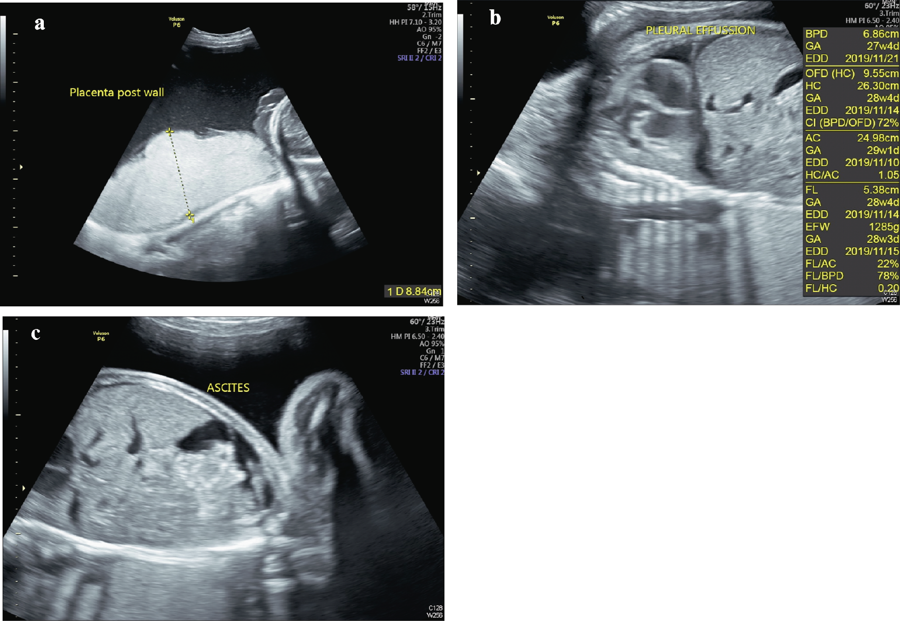

# 1672 — U máu bánh nhau lớn: ngưỡng 4,7 cm, shunt mạch → đa ối / suy tim thai và khi nào can thiệp / Giant placental chorioangioma

**Tags:** `pattern:u-mach-banh-nhau` `pattern:da-oi` `pattern:thai-phu` `pattern:thieu-mau-thai` `pattern:suy-tim-thai` `vung:banh-nhau` `vung:thai-nhi` `score:MCA-PSV` `protocol:SA-Doppler-mau` `protocol:MRI-thai` `protocol:laser-fetoscopic`
**Mức chắc chắn (certainty):** tổng hợp y văn (literature synthesis) — số liệu từ đoàn hệ 102.399 ca sinh (PMC10210461), đoàn hệ 94 ca có ROC theo đường kính (PMC12681165), phân tích gộp 28 nghiên cứu/161 thai (Buca 2020, DOI 10.1002/uog.20304) và các ca nguyên văn dùng cho quiz (PMC10956381, PMC10210461).

## 1. Tổng quan bệnh học – cơ chế hình ảnh

### 1.1. Bản chất mô học và vì sao khối này "ăn máu"

- U máu bánh nhau (placental chorioangioma, chorangioma) là u **lành tính, không phải nguyên bào nuôi (non-trophoblastic)** — thực chất là **hamartoma mạch máu** phát sinh từ **trung mô màng đệm nguyên thủy (primitive chorionic mesoderm)**: một mạng mao mạch nằm trong chất nền nhung mao phì đại, phủ một lớp nguyên bào nuôi. Vì vậy trên siêu âm khối **đặc, bờ rõ, nằm trong bánh nhau** và **có mạch nuôi rõ từ màng đệm (chorionic plate)** — khác hoàn toàn với ổ nhồi máu (infarct) hay máu tụ (hematoma) vốn **không có dòng chảy bên trong**.
- **TẠI SAO gây bệnh cảnh toàn thân:** mạng mao mạch trong u tạo **shunt động–tĩnh mạch trong bánh nhau** với **sức cản rất thấp**. Máu từ động mạch rốn chảy thẳng vào u rồi về tĩnh mạch rốn, không qua mao mạch nhung mao bình thường → **dòng chảy cao, vận tốc cao, RI thấp** trên Doppler; đồng thời **một phần máu thai bị "ăn cắp" (steal)** khỏi phần bánh nhau còn lại.
- Hệ quả sinh lý theo 4 trục:
  1. **Cung lượng tim thai tăng (high-output)**: tim to, hở ba lá, đảo dòng sóng a ống tĩnh mạch (ductus venosus) → **phù thai (hydrops)**;
  2. **Dịch rỉ từ mặt u + đa niệu do tăng cung lượng** → **đa ối (polyhydramnios)**;
  3. **Thiếu máu mạn** do xuất huyết trong u/tiêu hủy hồng cầu → **MCA-PSV > 1,5 MoM**;
  4. **Suy bánh nhau tương đối** → **thai chậm tăng trưởng (FGR/SGA)**.
- Ở mẹ, u lớn có thể gây **hội chứng gương (mirror syndrome / Ballantyne)**: mẹ phù, tăng cân, thiểu niệu, protein niệu, **pha loãng máu** (albumin giảm) — bệnh cảnh mẹ "sao chép" tình trạng phù thai.

### 1.2. Ngưỡng định lượng phải nhớ

- **Tần suất:** 0,41–1,4% bánh nhau khi soi mô học; đoàn hệ 102.399 ca sinh ghi nhận **0,17% (175/102.399)**, trong đó **u lớn ≥ 4 cm chỉ 0,04% (44/102.399)**. U "khổng lồ" ước **1/9.000–1/50.000** ca sinh. Đa số u **< 1 cm và chỉ phát hiện khi đọc mô học** (102/177 = 57,6% trong đoàn hệ trên).
- **Ngưỡng đường kính:** phân tích ROC trên 94 thai cho **4,7 cm** là điểm cắt dự báo biến cố (Se **82,1%**, Sp **50,0%**, AUC **0,705**; OR **1,026 mỗi 1 mm** đường kính tăng). Các biến cố nặng (sảy, hội chứng gương, phù thai, suy tim thai, thiếu máu thai, thai lưu, tử vong sơ sinh) **chủ yếu xảy ra khi u > 9 cm**.
- **Yếu tố tiên lượng thứ hai — vị trí:** trong 44 u lớn, nhóm có biến cố nặng có **đường kính trung vị 6 cm so với 5 cm** (p = 0,006) và **khoảng cách u–chỗ bám dây rốn trung vị 1 cm so với 3 cm** (p = 0,025). U **càng sát chỗ bám dây rốn càng nguy hiểm** vì shunt nằm ngay trên trục tuần hoàn thai–bánh nhau.
- **Nguy cơ nền (phân tích gộp, thai không can thiệp):** thai lưu **8,2%**, tử vong sơ sinh **3,8%**, tử vong chu sinh **11,1%**, SGA **24,0%**, sinh non < 37 tuần **34,1%**, bệnh tật sơ sinh **12,0%**, dấu hiệu tuần hoàn tăng động **21,0%**, MCA-PSV tăng **20,6%**. Khi phù thai xuất hiện, tiên lượng xấu đi rõ rệt.

## 2. Mẫu hình + chẩn đoán phân biệt theo vị trí (gamut)

### 2.1. Gamut theo "khối trong bánh nhau có mạch máu"

| Nhóm | Đặc điểm nhận diện |
|---|---|
| U máu bánh nhau (chorioangioma) | Khối đặc, bờ rõ, hồi âm hỗn hợp, **mạch nuôi từ màng đệm + dòng chảy phong phú bên trong**, thường 1 ổ |
| Chorioangiomatosis | Nhiều nốt nhỏ rải rác, bánh nhau dày; bệnh cảnh toàn thân nặng hơn kích thước từng nốt |
| Loạn sản trung mô bánh nhau (placental mesenchymal dysplasia, PMD) | Bánh nhau to, **nhiều khoang dịch "pho mát Thụy Sĩ"**, không có khối đặc duy nhất có mạch nuôi; liên quan Beckwith–Wiedemann, AFP tăng |
| Thai trứng bán phần (partial hydatidiform mole) | Nhiều nang nhung mao + thai, hCG tăng mạnh, hay sảy |
| Nhồi máu / máu tụ bánh nhau | Vùng hồi âm thay đổi, **không có dòng chảy bên trong**, thường bờ theo phân thùy |
| Thùy bánh nhau phụ (succenturiate lobe) | Mô bánh nhau **bình thường** cùng hồi âm, nối bằng mạch màng ối; nguy cơ vasa previa |

- **Theo vị trí (quyết định độ nặng):** (1) **cạnh dây rốn / trung tâm** — shunt gần trục, nguy cơ cao nhất; (2) **ngoại vi/ở mép bánh nhau** — 38,6% (17/44) u lớn; (3) **có cuống (pedunculated)**, lồi vào buồng ối — nguy cơ **xoắn cuống, chảy máu, vỡ**; (4) **dây rốn xuyên qua u** (1 ca trong 44) — bẫy khi đẩy kim chọc ối/truyền máu.
- **Theo kích thước:** < 4 cm thường im lặng; **4–9 cm** là vùng cần theo dõi sát; **> 9 cm** là vùng biến cố nặng.

## 3. Bảng so sánh phân biệt (ma trận đối chiếu)

| Thực thể (entity) | Hình ảnh điển hình | Chốt vào (rule-in) | Chốt loại (rule-out) | Gợi ý xác nhận |
|---|---|---|---|---|
| U máu bánh nhau | Khối đặc bờ rõ trong bánh nhau, hồi âm hỗn hợp, **mạch nuôi từ màng đệm** | **Dòng chảy trong khối + mạch nuôi + khối đơn độc** | Bờ mờ lan tỏa, nhiều khoang dịch → PMD/trứng | Doppler màu, MRI, mô học sau sinh |
| PMD | Bánh nhau rất dày, **nhiều khoang dịch** "pho mát Thụy Sĩ", không có mạch nuôi đơn độc | **Nhiều khoang + bánh nhau to + AFP tăng** | Khối đặc có mạch nuôi → u máu | Siêu âm + AFP + theo dõi Beckwith–Wiedemann |
| Thai trứng bán phần | Nang nhung mao + phần thai, hCG rất cao | **hCG tăng mạnh + nang lan tỏa** | Khối đặc đơn độc + thai bình thường | hCG, mô học |
| Nhồi máu / máu tụ bánh nhau | Vùng hồi âm bất thường, bờ theo phân thùy | **Không có dòng chảy trong tổn thương** | Có mạch nuôi → u máu | Doppler màu; theo dõi |
| Thùy bánh nhau phụ | Đảo mô bánh nhau tách khỏi bánh chính, hồi âm như bánh nhau | **Hồi âm đồng nhất với bánh nhau + mạch màng ối** | Khối hồi âm khác biệt + tăng sinh mạch → u | Khảo sát màng ối, Doppler |
| Chorioangiomatosis | Nhiều nốt nhỏ, bánh nhau dày | **Nhiều nốt + bánh nhau dày + biến cố toàn thân** | Một khối lớn → u máu đơn độc | Mô học sau sinh |

*A: khối bờ rõ, hồi âm không đồng nhất trong bánh nhau. B: Doppler màu — mạng mạch phong phú trong khối. C: đại thể sau sinh — nốt đỏ, chắc, tách khỏi mô bánh nhau. D: H&E — tăng sinh mạch cỡ mao mạch trong chất nền nhung mao. Nguồn: Wu X và cộng sự, BMC Pregnancy Childbirth 2025;25:1294 (PMC12681165, Figure 2), CC BY-NC-ND 4.0 — ảnh nguyên bản, không crop/ghép.*

*Khối mạch máu lớn có cuống nối với bánh nhau bằng một cuống mạch mảnh, bề mặt có mạng mạch nổi rõ; thước chia vạch cm trong ảnh. Đây là thể dễ xoắn cuống và dễ chảy máu khi can thiệp. Nguồn: Ma H, Liu Z, Ruan J, BMC Pregnancy Childbirth 2023;23:381 (PMC10210461, Figure 2), CC BY 4.0.*

## 4. Protocol chụp + phân tầng nguy cơ + lựa chọn can thiệp

### 4.1. Siêu âm — bộ đo tối thiểu mỗi lần khám

1. **Đường kính lớn nhất** (3 chiều) và **số ổ**; ghi rõ **khoảng cách từ bờ u tới chỗ bám dây rốn** (mm).
2. **Doppler màu/công suất**: có mạch nuôi từ màng đệm? RI/PSV của mạch nuôi (RI thấp = shunt mạnh).
3. **Lượng ối**: AFI hoặc DVP; **đa ối** định nghĩa AFD > 8 cm hoặc AFI > 25 cm. Trong đoàn hệ 44 u lớn, đa ối gặp **27,3% (12/44)**, AFI cao nhất **41,3 cm**.
4. **Thiếu máu thai**: MCA-PSV tính theo **bội số trung vị (MoM)**; ngưỡng hành động **> 1,5 MoM**. Ca trong đoàn hệ đã được chỉ định đốt u khi MCA-PSV **2,13 MoM**.
5. **Suy tim thai**: chỉ số tim–ngực (cardiothoracic ratio) > 0,5, hở ba lá, đảo dòng sóng a tĩnh mạch rốn/ống tĩnh mạch, dấu "gan trời sao" (starry sky liver).
6. **Tăng trưởng**: ước lượng cân nặng, siêu âm Doppler động mạch rốn.

**Nhịp theo dõi:** u < 4 cm — mỗi 4 tuần; u ≥ 4,7 cm — **mỗi 1–2 tuần**, kèm AFI, động mạch rốn, MCA, ống tĩnh mạch và siêu âm tim thai (khuyến nghị trực tiếp từ nghiên cứu ROC).

### 4.2. Phân tầng và luồng xử trí

### 4.3. Can thiệp — bằng chứng và giới hạn

| Can thiệp | Chỉ định thực hành | Số liệu chính |
|---|---|---|
| Theo dõi + chọc hút ối (amnioreduction) | Đa ối gây khó thở, cơn co | 2/12 ca đa ối phải chọc hút; 1 ca dùng indomethacin đường uống |
| Đốt mạch nuôi qua nội soi thai (fetoscopic laser) | U có 1–2 mạch nuôi rõ, thai còn bù trừ | Trong phân tích gộp, nhóm được can thiệp trong tử cung có tử vong chu sinh **31,2% (18,1–46,1%)** và **57,3%** hết phù/tuần hoàn tăng động — nhưng đây là nhóm bệnh nặng nhất, **không có RCT** |
| Đốt nhiệt bằng sóng cao tần (RFA) | U không cuống, khó đốt mạch nuôi | Ca 9,4 × 8,8 × 5,5 cm kèm phù + thiếu máu nặng: truyền máu + RFA → nhịp chậm rồi vô tâm thu, phải mổ cấp |
| Đốt laser trong u (interstitial laser) + chọc hút ối | U lớn nhiều mạch nuôi | Ca 7,9 × 5,6 × 5,4 cm: tắc hoàn toàn mạch nuôi, nhưng **2 ngày sau phù thai thoáng qua** (hở ba lá, gan trời sao), sau đó thai đủ tháng |
| Nút mạch bằng microcoil | Ca chọn lọc | Báo cáo ca, chưa có loạt lớn |
| Propranolol đường uống cho mẹ | Hướng mới cho u tăng sinh/suy tim thai | Loạt 4 thai (Leiden 2023–2025): tim thai bình thường hóa, hết phù, u thoái triển và huyết khối trong u |

- **Nguyên tắc thực hành:** can thiệp chỉ đặt ra khi có **phù thai, thiếu máu (MCA-PSV > 1,5 MoM), suy tim hoặc đa ối nặng**; u nhỏ không triệu chứng **không can thiệp**.
- **Khi nào lấy thai:** thai ổn định — chờ **37–38 tuần**; có phù/suy tim tiến triển — cân nhắc sinh sớm sau khi đã hội chẩn và chuẩn bị hồi sức sơ sinh. Trong 44 u lớn, sinh non < 37 tuần **30,6%**, < 34 tuần **13,9%**, < 32 tuần **11,1%**; nhập NICU **23,3%**.
- **Sau sinh:** khám da trẻ tìm **u máu nhiều ổ (benign neonatal hemangiomatosis)** — gặp **5/44** ca; theo dõi tăng trưởng 1–12 năm (đa số phát triển bình thường).

## 5. Biến thể bình thường và cạm bẫy

- **Bỏ sót u nhỏ:** 7/44 u lớn (15,9%) **không thấy trên siêu âm trước sinh**, tất cả đều **< 6 cm** — nguyên nhân thường là không quét hết bánh nhau, nhất là **mép bánh nhau và vùng dưới thai**. Quy tắc: mọi lần khám thai phải **đo độ dày bánh nhau** và quét toàn bộ đĩa bánh nhau bằng Doppler màu.
- **"Có màu" không đồng nghĩa "có mạch":** máu tụ bánh nhau và ổ nhồi máu có thể có tín hiệu màu giả do **nhịp đập của mạch mẹ lân cận**; chốt bằng **mạch nuôi từ màng đệm** và phổ Doppler trong khối.
- **Hội chứng gương bị gọi nhầm là tiền sản giật:** cả hai đều có phù, protein niệu, acid uric cao. Khác biệt cốt lõi: gương có **pha loãng máu** (albumin thấp, Hct giảm) và **có phù thai + bánh nhau dày**; tiền sản giật điển hình là **cô đặc máu**. Ca nguyên văn 36 tuổi: bánh nhau dày **8,84 cm**, tràn dịch màng phổi + cổ trướng thai, creatinin **3,94 mg/dL**, Na **120 mEq/L**, acid uric **13,2 mg/dL**, ALT **202 U/L** — toàn bộ hồi phục sau sinh.
- **Truyền máu trong tử cung khi dây rốn xuyên qua u:** dễ chọc vào mạch trong u (lòng rộng, áp lực bất thường) — chọn **tĩnh mạch rốn trong gan (IHUV)** hoặc đoạn dây rốn xa u.
- **Phù thai thoáng qua sau đốt:** có thể **nặng lên trong 1–2 ngày đầu** rồi hết; không nên kết luận thất bại can thiệp ngay sau thủ thuật.
- **Đa ối + bánh nhau "bình thường":** nếu AFI tăng mà không thấy u, phải loại trừ **song thai TTTS (bài 566, 1611)**, hẹp thực quản/tắc ruột thai và **đái tháo đường thai kỳ** trước khi kết luận vô căn.

## 6. Tự lượng giá — Blind Quiz

**Ca 1 — Thai 30 tuần, đa ối, khối trong bánh nhau. Nhìn ảnh trước, mô tả.**

- Gợi ý lâm sàng: AFI tăng, tử cung to nhanh hơn tuổi thai.
- Câu hỏi: Khối nằm ở đâu? Dấu hiệu nào chứng minh đây là tổn thương **mạch máu** chứ không phải máu tụ? Ba chẩn đoán phân biệt? Bước tiếp theo trên thai?

<b>Bấm để hiện đáp án</b>

- Khối **đặc, bờ rõ, nằm trong nhu mô bánh nhau**, hồi âm không đồng nhất (A). Doppler màu (B) cho thấy **mạng mạch dày đặc bên trong khối**, tức tổn thương **có tưới máu thật** — máu tụ/nhồi máu sẽ trống tín hiệu màu.
- Chẩn đoán: **u máu bánh nhau (chorioangioma)**; đại thể là nốt đỏ chắc (C), mô học là tăng sinh mao mạch trong chất nền nhung mao (D).
- Phân biệt: PMD, thai trứng bán phần, thùy bánh nhau phụ.
- Bước tiếp theo: đo **đường kính + khoảng cách tới chỗ bám dây rốn**, đo **MCA-PSV** (ngưỡng 1,5 MoM), siêu âm tim thai, AFI; nếu ≥ 4,7 cm → theo dõi **1–2 tuần/lần**.
- Nguồn: Wu X và cộng sự, BMC Pregnancy Childbirth 2025;25:1294 (PMC12681165), CC BY-NC-ND 4.0.

**Ca 2 — Bánh nhau sau sinh, khối lớn có cuống. Nhìn ảnh, đoán vị trí và biến chứng.**

- Gợi ý lâm sàng: thai 38 tuần, sinh thường, bánh nhau bất thường khi kiểm tra.
- Câu hỏi: Vì sao thể có cuống nguy hiểm hơn thể nằm trong nhu mô? Hai biến chứng cấp có thể xảy ra?

<b>Bấm để hiện đáp án</b>

- Khối **lồi vào buồng ối, nối với bánh nhau bằng cuống mạch mảnh** — toàn bộ lưu lượng shunt đi qua một cuống nhỏ.
- Nguy hiểm: **xoắn cuống** (nhồi máu u, đau, chảy máu trong ối) và **vỡ/chảy máu** khi chuyển dạ hoặc khi đẩy kim can thiệp.
- Đây là ca 23 trong đoàn hệ 44 u lớn; u có cuống chiếm tỷ lệ nhỏ nhưng là bẫy khi chọc ối/truyền máu.
- Nguồn: Ma H, Liu Z, Ruan J, BMC Pregnancy Childbirth 2023;23:381 (PMC10210461), CC BY 4.0.

**Ca 3 — Thai 25 tuần, mẹ khó thở, phù, thiểu niệu. Nhìn ảnh, đừng vội gọi tiền sản giật.**

- Gợi ý lâm sàng: mẹ tăng cân nhanh, Na 120 mEq/L, creatinin 3,94 mg/dL, acid uric 13,2 mg/dL, ALT 202 U/L.
- Câu hỏi: Ba dấu hiệu trên ảnh? Chẩn đoán mẹ là gì? Xử trí nào cải thiện cả mẹ và thai?

<b>Bấm để hiện đáp án</b>

- Ảnh a: **bánh nhau dày 8,84 cm** (bình thường cuối thai kỳ ~3–4 cm); ảnh b: **tràn dịch màng phổi**; ảnh c: **cổ trướng** (ascites) — thai phù đa khoang.
- Chẩn đoán: **hội chứng gương (mirror syndrome)** do u máu bánh nhau **8,5 cm** (chỉ phát hiện khi mổ); bệnh cảnh mẹ nặng thêm do ritodrine (tiêu cơ vân, tổn thương gan/thận cấp).
- Xử trí: **ngừng thuốc giảm co và lấy thai** — triệu chứng mẹ giảm rõ sau sinh; đây là điểm khác với tiền sản giật (pha loãng máu, có phù thai).
- Phản biện: u **8,5 cm** nằm trong vùng "nguy cơ cao" nhưng **không được phát hiện trước sinh** — lỗi hệ thống của siêu âm sàng lọc, không phải bệnh hiếm gặp không thể thấy.
- Nguồn: Wu PT và cộng sự, BMC Pregnancy Childbirth 2024;24:213 (PMC10956381), CC BY 4.0.

## Bài liên quan chéo
- [500 – Tổng quan Vú & Sản phụ khoa](../500-tong-quan-vu-san-phu-khoa/lesson.md)
- [563 – Bất thường rau–bánh nhau sớm](../563-bat-thuong-rau-banh-nhau-som/lesson.md)
- [566 – Song thai: chorionicity, TTTS & TAPS](../566-song-thai-chorionicity-TTTS-TAPS/lesson.md)
- [1611 – TTTS tái phát sau laser](../1611-ttts-tai-phat-sau-laser/lesson.md)
- [1637 – TAPS sau laser: MCA-PSV & khi nào truyền máu trong tử cung](../1637-taps-sau-laser-ttts/lesson.md)
- [1673 – Truyền máu trong tử cung qua tĩnh mạch rốn](../1673-truyen-mau-trong-tu-cung/lesson.md)
- [1635 – Vỡ ối non tháng sau can thiệp bào thai](../1635-ro-oi-non-thang-sau-can-thiep-bao-thai/lesson.md)

## Ảnh
- `1672_u-mau-banh-nhau_US-Doppler-PMC12681165-F2.png` — siêu âm 2D + Doppler màu + đại thể + mô học (PMC12681165, CC BY-NC-ND 4.0, ảnh nguyên bản).
- `1672_u-mau-banh-nhau_Dai-the-PMC10210461-F2.jpg` — u có cuống, đại thể (PMC10210461, CC BY 4.0).
- `1672_u-mau-banh-nhau_US-PMC10956381-F1.png` — bánh nhau dày + tràn dịch màng phổi + cổ trướng (PMC10956381, CC BY 4.0).
- Nguồn và giấy phép từng ảnh: `images/CREDITS.md`; link gốc: `sources.md`.

> Không dùng để chẩn đoán độc lập khi chưa có người hướng dẫn.
