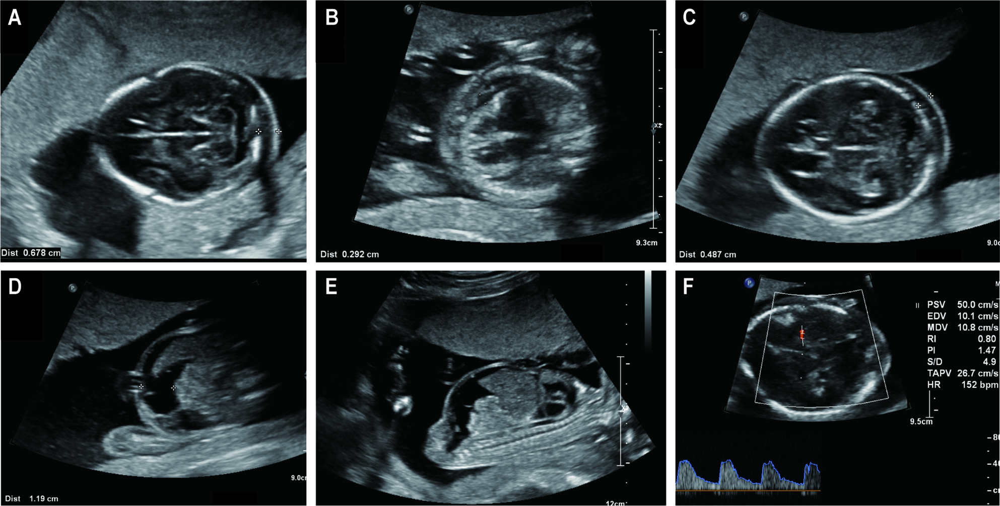
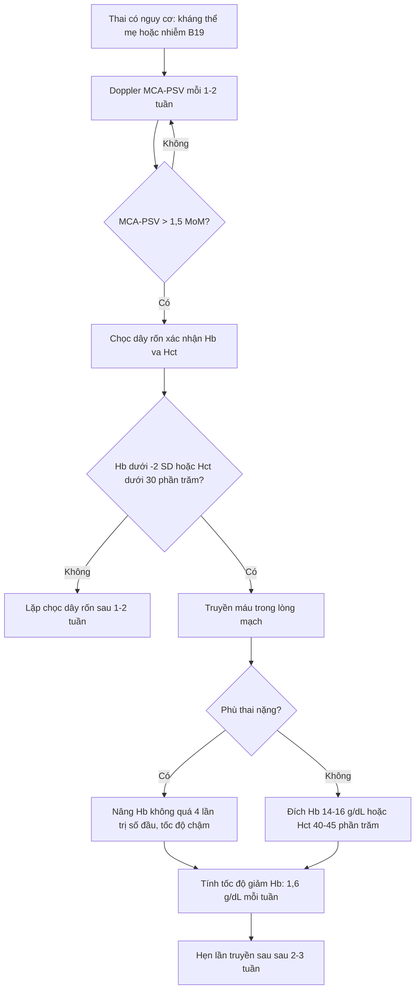
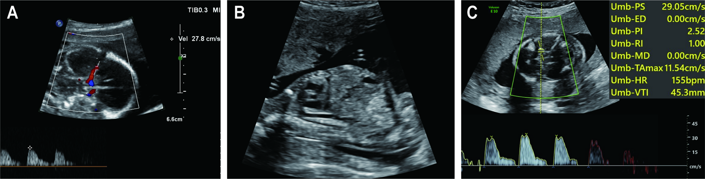
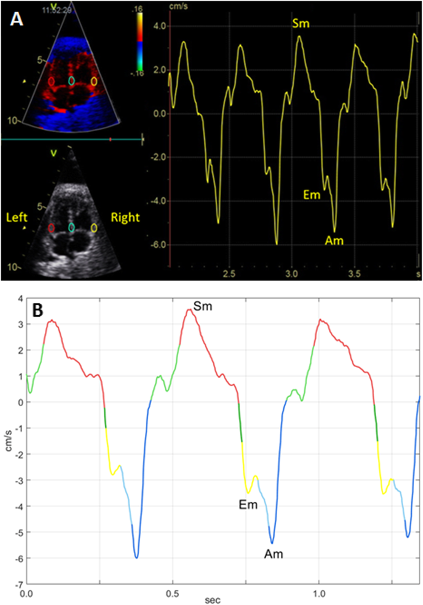

# 1673 — Truyền máu trong tử cung qua tĩnh mạch rốn: chọn đường vào, thể tích, biến chứng & ngưỡng truyền lại / Intrauterine transfusion

**Tags:** `pattern:thieu-mau-thai` `pattern:thai-phu` `pattern:tan-huyet-mien-dich` `pattern:thai-da-hong-cau` `vung:thai-nhi` `vung:tinh-mach-ron` `score:MCA-PSV` `protocol:truyen-mau-trong-tu-cung` `protocol:choc-day-ron` `protocol:IHUV`
**Mức chắc chắn (certainty):** tổng hợp y văn (literature synthesis) — số liệu từ 791 lần truyền trên 309 thai (PMC12047679), 1.678 lần truyền trên 589 thai (Zwiers 2017, PMC5601196), tổng quan quản lý HDFN 2025 (PMC13344805) và kỹ thuật đường vào tĩnh mạch rốn trong gan (PMC13344663); ca nguyên văn cho quiz: PMC12969879 (parvovirus B19) và PMC7427079.

## 1. Tổng quan bệnh học – cơ chế hình ảnh

### 1.1. Vì sao thiếu máu thai lại làm MCA-PSV tăng

- **Bệnh học:** ở bất đồng nhóm máu (HDFN), **IgG của mẹ qua nhau từ khoảng 14–16 tuần** bám hồng cầu thai; hồng cầu bị phủ kháng thể bị **đại thực bào hệ lưới nội mô của thai** phá hủy → **thiếu máu tán huyết**. Ở nhiễm **parvovirus B19**, virus tấn công **tiền nguyên hồng cầu** trong tủy → **bất sản hồng cầu thoáng qua** và thiếu máu nặng sau 2–3 tuần. Ở **TAPS**, hồng cầu truyền từ từ qua miệng nối rất nhỏ (bài 1637). Ở **xuất huyết thai–mẹ**, mất máu cấp.
- **TẠI SAO MCA-PSV tăng:** thiếu máu làm **độ nhớt máu giảm** và **cung lượng tim tăng** để bù oxy; huyết quản não giãn do thiếu oxy → **vận tốc đỉnh tâm thu động mạch não giữa (MCA-PSV) tăng**. Vì vậy MCA-PSV là **đại lượng thay thế cho hemoglobin**, phải biểu diễn bằng **bội số trung vị (MoM)** theo tuổi thai, không dùng cm/s thô.
- **TẠI SAO phù thai (hydrops):** thiếu máu → **tạo hồng cầu ngoài tủy** → gan lách to → **tăng áp lực tĩnh mạch cửa** + **giảm tổng hợp albumin** → giảm áp lực keo huyết tương + tổn thương mao mạch do thiếu oxy → **dịch tích tụ ≥ 2 khoang** (cổ trướng, tràn dịch màng phổi, màng tim, phù da) và **bánh nhau dày**. Trên siêu âm, phù thai là **dấu hiệu muộn** — MCA-PSV phải bắt trước khi phù xuất hiện.

### 1.2. Ngưỡng định lượng quyết định truyền

- **Hiệu giá kháng thể (titer):** ngưỡng tới hạn **1:16** với phần lớn kháng nguyên HDFN; với **Kell (K) là 1:4**. Khoảng **70%** thai phụ đạt ngưỡng này trong khoảng **26+3 đến 28+5 tuần**, và **45%** sẽ có HDFN (23% nặng, 6% trung bình, 17% nhẹ).
- **MCA-PSV:** ngưỡng hành động **> 1,5 MoM**, nhưng **tỷ lệ dương tính giả ~12%** → phải **chọc dây rốn xác nhận**; **sau 35 tuần độ nhạy chỉ còn 63%**.
- **Chỉ định truyền:** Hb thai **thấp hơn trung bình > 2 độ lệch chuẩn** theo tuổi thai, hoặc **Hct < 30%**. Nếu không đạt ngưỡng → **không truyền**, lặp chọc dây rốn sau **1–2 tuần**.
- **Đích sau truyền:** **Hb 14–16 g/dL** hoặc **Hct 40–45%**. Khi có **phù thai**, lần đầu **không nâng Hb quá 4 lần** trị số khởi đầu (nguy cơ quá tải tuần hoàn).
- **Tốc độ giảm Hb sau truyền (để hẹn lần sau):** trung vị **1,61 g/dL/tuần (0,65–2,22)**; khoảng cách giữa hai lần truyền **3,0 tuần (2,6–4,0)**.

## 2. Mẫu hình + chẩn đoán phân biệt theo nguyên nhân (gamut)

### 2.1. Gamut "thai phù + MCA-PSV tăng"

1. **HDFN (đồng miễn dịch):** mẹ có kháng thể bất thường, thai phù, gan lách to, **bánh nhau dày**; tiền sử thai trước bị HDFN nặng là yếu tố tiên lượng mạnh nhất.
2. **Nhiễm parvovirus B19:** mẹ có thể **không triệu chứng**; thai phù xuất hiện **2–3 tuần sau nhiễm**, thường **không dị tật**, **không gan lách to rõ**; IgM/IgG mẹ + PCR dịch ối.
3. **TAPS:** song thai một bánh nhau, **không có cặp đa ối–thiểu ối**, thai cho MCA-PSV **> 1,5 MoM**, thai nhận **< 1,0 MoM** (bài 1637).
4. **Xuất huyết thai–mẹ (FMH):** thiếu máu cấp, **tim thai phản ứng**, test Kleihauer–Betke dương tính, có biến cố (chấn thương, chọc ối, xoay thai).
5. **Thai phù không do miễn dịch khác:** bất thường tim, loạn nhịp, hội chứng truyền máu, rối loạn lympho, bất thường nhiễm sắc thể — **MCA-PSV bình thường** giúp loại trừ nguyên nhân thiếu máu.

### 2.2. Gamut theo đường vào mạch thai

- **Chỗ bám dây rốn vào bánh nhau (placental cord insertion, PCI):** đường vào chuẩn, dễ nhất khi bánh nhau **mặt trước** (xuyên bánh nhau) hoặc **mặt sau** (xuyên ối); nguy cơ **chảy máu từ chỗ chọc**, **chọc vào động mạch rốn**.
- **Quai dây rốn tự do (free loop):** dùng khi không tiếp cận được chỗ bám; **tỷ lệ biến chứng cao nhất 13,3%**.
- **Đoạn tĩnh mạch rốn trong gan (intrahepatic umbilical vein, IHUV):** kim xuyên nhu mô gan; **nhu mô gan chèn ép chỗ chọc** nên ít chảy máu, cố định kim tốt, tránh được **chọc động mạch rốn**; biến chứng chu phẫu **2%**.
- **Trong tim (intracardiac):** **không dùng** trừ tình huống bất khả kháng — mất thai **15–25%**.

## 3. Bảng so sánh phân biệt (ma trận đối chiếu)

| Thực thể / đường vào (entity) | Hình ảnh – kỹ thuật điển hình | Chốt vào (rule-in) | Chốt loại (rule-out) | Gợi ý xác nhận |
|---|---|---|---|---|
| HDFN | Thai phù, gan lách to, bánh nhau dày, MCA-PSV > 1,5 MoM, kháng thể mẹ dương | **Kháng thể mẹ đặc hiệu + MCA-PSV tăng + tiền sử thai bị HDFN** | Không có kháng thể, MCA-PSV bình thường → tìm nguyên nhân khác | Hiệu giá kháng thể, kiểu gen thai (cfDNA), chọc dây rốn |
| Parvovirus B19 | Thai phù đơn thuần, không dị tật, MCA-PSV tăng mạnh | **IgM mẹ + PCR B19V dịch ối/máu thai** | Có dị tật tim cấu trúc rõ → không phải B19 đơn thuần | Serology, PCR, siêu âm tim thai |
| TAPS | Song thai một bánh nhau, MCA-PSV lệch ≥ 0,5 MoM, không đa ối–thiểu ối | **Thai cho > 1,5 MoM và thai nhận < 1,0 MoM** | Có cặp DVP ≥ 8 cm / ≤ 2 cm → TTTS | Doppler MCA hai thai, sau sinh chênh Hb > 8 g/dL + reticulocyte > 1,7% |
| FMH | Thiếu máu cấp, có biến cố khởi phát | **Kleihauer–Betke dương, MCA-PSV tăng đột ngột** | Kleihauer âm + không biến cố → ít khả năng | Kleihauer, Hb thai |
| PCI (đường vào) | Chọc tại chỗ bám dây rốn, xuyên bánh nhau/màng ối | **Thấy chỗ bám rõ, kim vào tĩnh mạch** | Bánh nhau mặt trước + thai nằm trên → chọn IHUV | Siêu âm + Doppler màu |
| IHUV (đường vào) | Kim xuyên gan vào đoạn tĩnh mạch rốn trong gan | **Thấy tĩnh mạch trong gan giãn, tránh túi mật/dạ dày** | Gan thai nhỏ, bất thường gan → chọn PCI | Siêu âm + Doppler màu |

*Thai 18–19 tuần: A nếp gấp da gáy dày; B tràn dịch màng tim; C phù dưới da đầu; D, E cổ trướng; F phổ Doppler động mạch não giữa. Nguồn: Ma R và cộng sự, BMC Pregnancy Childbirth 2026;26:240 (PMC12969879, Figure 1), CC BY-NC-ND 4.0 — ảnh nguyên bản, không crop/ghép.*

## 4. Protocol thủ thuật + theo dõi

### 4.1. Chuẩn bị

- **Máu truyền:** khối hồng cầu **O âm, đã chiếu xạ, đã lọc bạch cầu**, phù hợp kháng thể mẹ; Hct cao (đích sau truyền 40–45%).
- **Tính thể tích:** công thức Rodeck — dựa trên **thể tích thai–bánh nhau ước theo cân nặng thai (EFW)**, Hct trước truyền, Hct máu truyền và Hct đích theo tuổi thai.
- **Giảm co tử cung:** nhiều trung tâm dùng **atosiban** trước–trong–sau thủ thuật; ca nguyên văn dùng atosiban 30 phút trước và kéo dài 8 giờ sau.
- **Kháng sinh dự phòng** (ca nguyên văn: cefazolin 30 phút trước) — thực hành phổ biến nhưng bằng chứng yếu.
- **Giảm cử động thai:** sau khi lấy máu xác định Hb, tiêm **giãn cơ thai** (rocuronium/pancuronium) vào tĩnh mạch rốn. Từ 2001, **giãn cơ thường quy** là một trong ba thay đổi kỹ thuật làm giảm biến chứng (cùng với dùng IHUV và tránh chọc động mạch).

### 4.2. Kỹ thuật

- **Cỡ kim:** **22 G** khi < 22 tuần, **20 G** khi thai lớn hơn.
- **Đường vào ưu tiên:** chỗ bám dây rốn; nếu bánh nhau mặt trước hoặc thai che → **IHUV**; **quai dây tự do chỉ khi bắt buộc**.
- **Không rút kim** giữa lấy máu và truyền; truyền **chậm**. **Không chọc vào động mạch rốn** — chọc động mạch làm tăng **10,8 lần (95% CI 3,5–33,6)** biến chứng chu phẫu không tử vong (co thắt, nhịp chậm).
- **Truyền thêm trong ổ bụng (intraperitoneal, IP)** sau khi truyền trong lòng mạch: làm **Hb giảm chậm hơn 0,48 g/dL/tuần** (95% CI 0,29–0,66) so với chỉ truyền trong mạch, và **kéo dài khoảng cách 3,7 tuần so với 3,0 tuần** — hữu ích khi muốn "bắc cầu" tới 37–38 tuần.

### 4.3. Luồng quyết định

### 4.4. Kết cục và biến chứng — số phải nhớ

| Chỉ số | Số liệu | Nguồn |
|---|---|---|
| Sống sót sau truyền (HDFN) | **93,4%** toàn bộ; **88,6%** trước 2001 so với **97,0%** từ 2001 | Zwiers 2017, 589 thai/1.678 lần |
| Biến chứng liên quan thủ thuật | **2,1%/lần** (3,4% → 1,2%); **6,1%/thai** | Zwiers 2017 |
| Mất thai do thủ thuật | **1,6% → 0,6%/lần**; **4,7% → 1,8%/thai** | Zwiers 2017 |
| Mổ cấp cứu trong 24 giờ | **0,4%/lần** (2,3% → 0,4%) | Zwiers 2017 |
| PPROM trong 7 ngày / nhiễm ối | **0,1%/lần** / **0,1–0,3%/lần** | Zwiers 2017 |
| Mất thai chung | **1–2%/lần**, **3–4%/thai kỳ** | PMC13344805 |
| Truyền trong tim | mất thai **15–25%** → tránh | PMC13344805 |
| Thai lưu trong loạt 309 thai | **11/309 (4%)**, trong đó **3 ca do thủ thuật** | PMC12047679 |
| Phù thai ở lần truyền đầu | **13% (41/309)** | PMC12047679 |
| Tuổi thai lần truyền đầu / sinh | **28,3 tuần** / **36,6 tuần** | PMC12047679 |
| Hb lúc sinh / phototherapy / trao đổi máu | **7,8 g/dL** / **95%** / **15%** | PMC12047679 |

- **Thời điểm sinh:** trung tâm Leiden **không truyền sau 35 tuần**, mục tiêu "bắc cầu" tới **37–38 tuần**. Ca nặng có thể truyền tới **34+6 tuần** rồi sinh 36 tuần với kết cục tốt.
- **Khi chưa truyền được (< 20–22 tuần):** **IVIG 1 g/kg/tuần** hoặc trao đổi huyết tương để trì hoãn; dù vậy tử vong thai **15–20%** và phù thai **24–38%**. **Nipocalimab** (ức chế FcRn) đang được nghiên cứu.

## 5. Biến thể bình thường và cạm bẫy

- **MCA-PSV dương tính giả 12%:** nguyên nhân — thai cử động, góc đo sai, nhịp tim thai cao, thiếu máu nhẹ; **luôn chọc dây rốn xác nhận** trước khi truyền. Sau **35 tuần**, độ nhạy giảm còn **63%** nên không được "yên tâm" chỉ vì MCA-PSV bình thường.
- **Sau truyền, MCA-PSV không còn phản ánh Hb** trong vài tuần (Hb đã được nâng) → hẹn lần sau theo **tốc độ giảm Hb** (1,6 g/dL/tuần) chứ không chờ MCA-PSV vượt ngưỡng.
- **Chọc nhầm động mạch rốn:** nguy cơ **co thắt/nhịp chậm**, tăng **10,8 lần** biến chứng → nhận diện bằng **phổ Doppler dạng động mạch** và **màu sắc dòng chảy**; nếu nghi ngờ, rút kim và chọn lại vị trí.
- **Quai dây tự do:** biến chứng **13,3%** so với **6,9%** ở chỗ bám và **2%** ở IHUV — chỉ dùng khi không còn lựa chọn.
- **Truyền quá nhanh/quá nhiều ở thai phù:** nguy cơ **quá tải tuần hoàn, phù phổi, tim ngừng** — giới hạn **không quá 4 lần Hb khởi đầu** ở lần đầu.
- **Xuất huyết thai–mẹ sau truyền:** đường xuyên bánh nhau làm **65%** ca tăng hiệu giá kháng thể so với **17%** khi bánh nhau mặt sau; nếu lượng máu mẹ–thai > 1 mL, **5/7** ca tăng hiệu giá > 150% → cần **Kleihauer và bổ sung anti-D**.
- **Đường trong ổ bụng đơn thuần:** hấp thu chậm và **kém tin cậy ở thai phù** — chỉ dùng khi không vào được tĩnh mạch (thường < 20 tuần), không dùng thay thế truyền trong mạch.
- **Giảm tiểu cầu thai:** ưu tiên **IHUV** vì nhu mô gan chèn ép chỗ chọc, giảm chảy máu sau thủ thuật.

## 6. Tự lượng giá — Blind Quiz

**Ca 1 — Thai 19 tuần, phù đa khoang, mẹ hoàn toàn không triệu chứng. Nhìn ảnh trước.**

- Gợi ý lâm sàng: thai 19 tuần, mẹ khỏe, IgM parvovirus B19 dương, các nhiễm trùng khác âm.
- Câu hỏi: Kể 4 khoang dịch trên ảnh? MCA-PSV dùng để làm gì? Hai nguyên nhân thiếu máu hay gặp ở tuổi thai này?

<b>Bấm để hiện đáp án</b>

- Ảnh cho thấy **nếp gấp da gáy dày (A)**, **tràn dịch màng tim (B)**, **phù dưới da đầu (C)**, **cổ trướng (D, E)** và **phổ MCA-PSV (F)** — phù ≥ 2 khoang.
- MCA-PSV đo **50,0 cm/s** ở 19 tuần, tương ứng **> 1,5 MoM** → gợi ý thiếu máu trung bình–nặng; trước đó 16 tuần đã **58,9 cm/s (2,77 MoM)**.
- Nguyên nhân: **HDFN** và **nhiễm parvovirus B19** (ca này là B19). Tràn dịch màng tim/cổ trướng không đặc hiệu — phải đo MCA-PSV để phân biệt thiếu máu với phù không do thiếu máu.
- Nguồn: Ma R và cộng sự, BMC Pregnancy Childbirth 2026;26:240 (PMC12969879), CC BY-NC-ND 4.0.

**Ca 2 — Cùng thai nhi, 1 ngày và 5 ngày sau truyền. Nhìn ảnh, đánh giá kết quả.**

- Gợi ý lâm sàng: truyền **10 mL** hồng cầu lắng O âm, chiếu xạ, đã lọc bạch cầu, qua chọc dây rốn ở **19 tuần 2 ngày**.
- Câu hỏi: Dấu hiệu nào chứng minh truyền thành công? Vì sao cổ trướng hết **chậm hơn** MCA-PSV? Lần truyền sau hẹn khi nào?

<b>Bấm để hiện đáp án</b>

- A: MCA-PSV còn **27,8 cm/s (1,12 MoM)** ngay ngày hôm sau — giảm từ 50,0 cm/s; B: **không còn cổ trướng đáng kể** ngày thứ 5; C: MCA-PSV bình thường ngày thứ 5.
- MCA-PSV phản ánh **độ nhớt/cung lượng tim** nên bình thường hóa **trong 24 giờ**; dịch ổ bụng được hấp thu qua bạch mạch và phúc mạc nên **chậm hơn nhiều ngày**.
- Hẹn lần sau: theo **tốc độ giảm Hb trung vị 1,6 g/dL/tuần** → thường **2–3 tuần**; ca này không cần truyền lại và sinh 39 tuần 4 ngày, trẻ 3.370 g, Hb 16,1 g/dL.
- Nguồn: Ma R và cộng sự, BMC Pregnancy Childbirth 2026;26:240 (PMC12969879), CC BY-NC-ND 4.0.

**Ca 3 — Vì sao tim thai "làm việc quá sức" trước khi truyền?**

- Gợi ý lâm sàng: thai thiếu máu nặng trước truyền, MCA-PSV cao, chưa phù.
- Câu hỏi: ROI đặt ở đâu? Vì sao thiếu máu làm vận tốc mô cơ tim tăng? Điều này giải thích dấu hiệu nào trên siêu âm tim thai?

<b>Bấm để hiện đáp án</b>

- ROI **6 × 4 mm** đặt ở **vách liên thất và thành thất** trên mặt cắt 4 buồng, dùng **Doppler mô màu** đo vận tốc **Sm/Em/Am** (A: ảnh ROI + phổ; B: đường cong tách ra).
- Thiếu máu → **giảm độ nhớt** → giảm hậu tải + tăng cung lượng → **cơ tim co bóp mạnh hơn** (Sm tăng), phản ánh **tuần hoàn tăng động (hyperdynamic)**.
- Hệ quả trên siêu âm tim thai: **tim to, hở ba lá, đảo dòng sóng a ống tĩnh mạch**, tiến tới **phù thai** — chính là lý do phải truyền trước khi phù xuất hiện.
- Nguồn: Herling L và cộng sự, Cardiovascular Ultrasound 2020;18:34 (PMC7427079), CC BY 4.0.

## Bài liên quan chéo
- [500 – Tổng quan Vú & Sản phụ khoa](../500-tong-quan-vu-san-phu-khoa/lesson.md)
- [1637 – TAPS sau laser: MCA-PSV & chỉ định truyền máu trong tử cung](../1637-taps-sau-laser-ttts/lesson.md)
- [1672 – U máu bánh nhau lớn: shunt mạch, đa ối, phù thai](../1672-u-mau-banh-nhau/lesson.md)
- [566 – Song thai: chorionicity, TTTS & TAPS](../566-song-thai-chorionicity-TTTS-TAPS/lesson.md)
- [1604 – Thai kỳ sau điều trị chửa ở sẹo mổ lấy thai](../1604-thai-ky-sau-chua-seo-mo-lay-thai/lesson.md)

## Ảnh
- `1673_truyen-mau-trong-tu-cung_US-truoc-PMC12969879-F1.png` — phù thai trước truyền (PMC12969879, CC BY-NC-ND 4.0, nguyên bản).
- `1673_truyen-mau-trong-tu-cung_US-sau-PMC12969879-F2.png` — MCA-PSV hồi phục, hết cổ trướng (PMC12969879, CC BY-NC-ND 4.0, nguyên bản).
- `1673_truyen-mau-trong-tu-cung_Sieu-am-tim-PMC7427079-F1.png` — Doppler mô cơ tim trước truyền (PMC7427079, CC BY 4.0).
- Nguồn và giấy phép từng ảnh: `images/CREDITS.md`; link gốc: `sources.md`.

> Không dùng để chẩn đoán độc lập khi chưa có người hướng dẫn.
