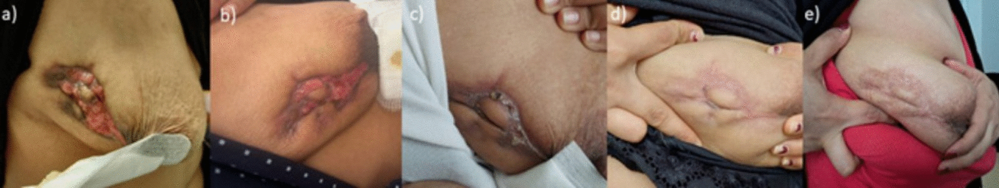
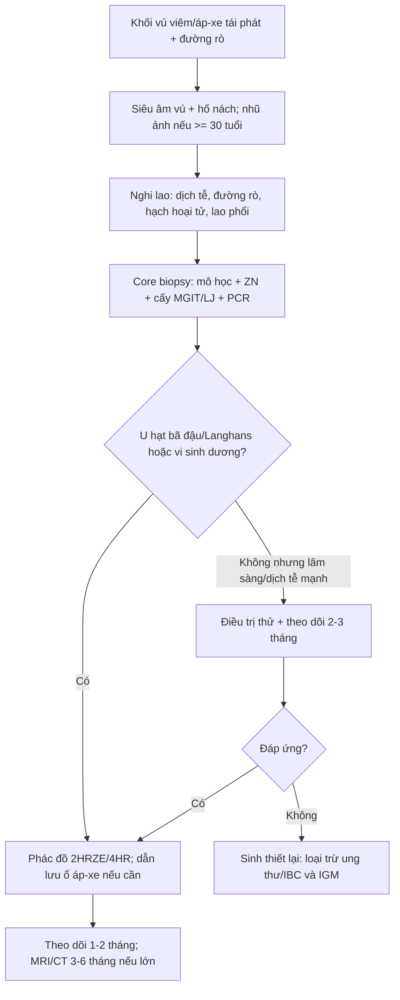
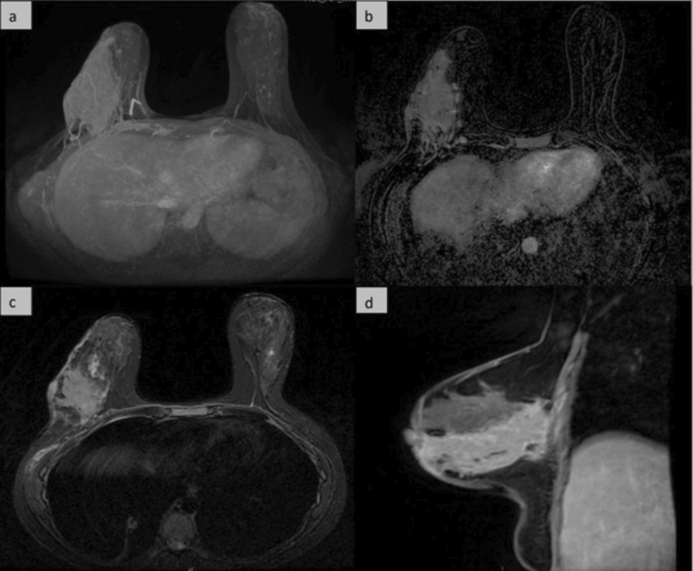

# 1674 — Viêm tuyến vú do lao: "kẻ bắt chước vĩ đại" của ung thư thể viêm / Tuberculous mastitis

**Tags:** `pattern:khoi-viem` `pattern:ap-xe` `pattern:duong-ro` `pattern:day-da-lan-toa` `pattern:hach-hoai-tu` `pattern:khong-khoi` `vung:vu` `vung:hach-nach` `protocol:sieu-am-vu` `protocol:MRI-vu` `protocol:sinh-thiet` `protocol:PCR-lao` `score:BI-RADS`
**Mức chắc chắn (certainty):** tổng hợp y văn (literature synthesis) — ghép **1 ca 30 tuổi** có **đủ 5 xét nghiệm vi sinh âm** nhưng vẫn chẩn đoán và điều trị lao (*Infect Dis Poverty* 2026, PMC12797753, CC BY 4.0), **loạt 17 ca** tại Casablanca (*Pan Afr Med J* 2020, PMC7896522, CC BY 4.0) và **bài nền 1616** (ung thư vú thể viêm). Không có thử nghiệm ngẫu nhiên.

> **Câu chốt:** một **khối vú đỏ, cứng, đau, tái phát sau nhiều đợt kháng sinh, kèm đường rò/hạch nách** phải được coi là **chẩn đoán phân biệt giữa lao vú và ung thư thể viêm** — **không được mổ cắt vú khi chưa có mô học**. Ở lao vú, **xét nghiệm vi sinh âm (kể cả PCR và IGRA) KHÔNG loại trừ**: chẩn đoán là **tổng hợp dịch tễ + hình ảnh + mô học + đáp ứng điều trị**, và **điều trị lao là điều trị nội khoa**, phẫu thuật chỉ để **dẫn lưu/loại bỏ ổ tồn dư**.

## 1. Tổng quan bệnh học – cơ chế hình ảnh (TẠI SAO)

### 1.1 Vì sao tuyến vú "hiếm" bị lao

- Tuyến vú **đề kháng tương đối** với *Mycobacterium tuberculosis* (mô mỡ + tuyến ít mạch bạch huyết so với phổi/hạch), nên lao vú **hiếm** dù lao phổi phổ biến. Số liệu: **≈ 0,1% bệnh lý vú ở nước phát triển**, nhưng **3–4% ở vùng lưu hành** (Ấn Độ, châu Phi); loạt 17 ca Casablanca ghi **0,64% tổng số bệnh tuyến vú** tại trung tâm của họ. Bài 2026 ghi lao vú chiếm **0,06–0,1%** các thể lao.
- **Đường lây:** máu, bạch huyết (từ hạch nách/trung thất), **lan trực tiếp** từ xương sườn–xương ức, hoặc **qua tổn thương da/núm**. Phần lớn là **thứ phát**; thể "nguyên phát" rất hiếm.
- **Nhóm nguy cơ:** **nữ trẻ, sinh nhiều, đang cho con bú** (giãn ống tuyến + tăng tưới máu); HIV/ức chế miễn dịch; đến từ vùng lưu hành. Loạt 17 ca: tuổi trung bình **33,5** (18–54), **59% sinh nhiều lần**, **52,9% có tiền sử cho con bú**, **41,2% đến khám sau > 6 tháng**.
- **5 thể McKeown:** thể **nốt**, **lan tỏa**, **xơ hóa (sclerosing)**, **viêm tắc ống (obliterans)**, **lao kê cấp**. Ca 2026 là thể **lan tỏa** (đỏ da lan rộng + đường rò vào sâu).

### 1.2 TẠI SAO hình ảnh giống ung thư và giống áp-xe

- **U hạt lao + hoại tử bã đậu + xơ hóa** là ba thành phần quyết định tín hiệu:
  - **Hoại tử bã đậu** giàu nước, tế bào chết → **T2 sáng, DWI hạn chế (ADC thấp)**; trên siêu âm là **ổ hỗn hợp/giảm âm không đồng nhất**, có thể có cặn — **không phải nang đơn thuần**.
  - **U hạt viêm** ngấm thuốc → **bờ không đều, ngấm thuốc dày** trên MRI; **dày da + phù mô kẽ** do viêm bạch huyết → **giống hệt ung thư thể viêm**.
  - **Xơ hóa** tiến triển → **T2 giảm, ngấm thuốc muộn**, co kéo da/núm → **giống ung thư xâm lấn**.
- **Đường rò (sinus tract)** là manh mối hình ảnh mạnh: một **đường hẹp giảm âm/tăng tín hiệu T2 từ ổ áp-xe ra da**, kèm **dày da khu trú** — ít gặp ở ung thư thể viêm (ung thư gây dày da lan tỏa, không tạo đường rò).
- **Hạch nách:** lao gây **hạch hoại tử trung tâm** (vỏ ngấm thuốc, trung tâm không ngấm) — khác hạch di căn thường đặc, mất rốn; nhưng **không đủ để phân biệt**, cần mô học.
- **Vì sao xét nghiệm vi sinh hay âm:** **lượng vi khuẩn trong mô vú rất thấp** ("paucibacillary"); **AFB soi trực tiếp** thường âm; **cấy MGIT/LJ** mất 2–6 tuần và vẫn có thể âm; **PCR** phụ thuộc mẫu và kỹ thuật. Ca 2026 âm **toàn bộ** (ZN, cấy, PCR, IGRA) nhưng vẫn đúng là lao nhờ **dịch tễ + hình ảnh phổi + mô học + đáp ứng điều trị**.
- **IGRA không dùng để loại trừ:** độ nhạy **58–78%** ở lao hoạt động, **thấp hơn** ở lao ngoài phổi/trẻ em; âm **không** loại trừ.

### 1.3 Ngưỡng và số liệu nằm lòng

| Đại lượng | Số liệu | Nguồn |
|---|---|---|
| Tần suất lao vú trong bệnh lý vú | **≈ 0,1%** (nước phát triển); **3–4%** (vùng lưu hành) | PMC7896522 |
| Tần suất tại trung tâm Casablanca | **0,64%** tổng số bệnh tuyến vú (17 ca/3 năm) | PMC7896522 |
| Tỷ lệ các thể lao trong tổng số lao | **0,06–0,1%** | PMC12797753 |
| Tuổi trung bình | **33,5** (18–54) | PMC7896522 |
| Thời gian từ khởi phát đến chẩn đoán | **41,2% > 6 tháng** | PMC7896522 |
| Kích thước khối trung bình | **5,4 cm** | PMC7896522 |
| Vị trí hay gặp | **52,9% góc trên–ngoài** | PMC7896522 |
| Hạch nách trên siêu âm | **18,75%** | PMC7896522 |
| Cấy/vi khuẩn học dương tính | **52,95%** | PMC7896522 |
| Điều trị 9 tháng / 12 tháng | **76,5% / 23,5%** | PMC7896522 |
| Tái phát sau điều trị | **23,5%** | PMC7896522 |
| Độ nhạy IGRA ở lao hoạt động | **58–78%** | PMC12797753 |

## 2. Mẫu hình + chẩn đoán phân biệt theo vị trí (gamut)

- **Theo hình thái:** **khối đặc viêm** (thể nốt) → **áp-xe + đường rò** (thể lan tỏa) → **xơ hóa co kéo** (thể xơ) → **lan tỏa dạng viêm da** (giống IBC).
- **Theo vị trí:** **góc trên–ngoài** hay gặp nhất; **sau núm/trung tâm** gợi ý lan theo ống tuyến; **hạch nách hoại tử** cùng bên; **thành ngực/xương sườn** khi lan trực tiếp.
- **Gamut "khối vú viêm tái phát":**
  - **Lao vú** — mạn, đường rò, hạch hoại tử, vùng lưu hành.
  - **Áp-xe vi khuẩn** — cấp, sốt, đau nhiều, đáp ứng dẫn lưu + kháng sinh; tái phát nếu bỏ sót ổ.
  - **Viêm tuyến vú u hạt tự phát (IGM)** — nữ sinh đẻ trong 5 năm sau cho bú, u hạt **không bã đậu**, cấy vô khuẩn, đáp ứng corticoid (bài 1613).
  - **Ung thư vú thể viêm (IBC)** — đỏ > 1/3 vú, da cam, không sốt; sinh thiết da/mô tuyến là chốt.
  - **Viêm tuyến vú do IgG4** — xơ hóa dày, nhiều tương bào IgG4; hiếm.
  - **Galactocele** — đang cho bú, nang có mức mỡ–dịch; không viêm mạn.
  - **Lao hạch nách đơn thuần**, **sarcoid**, **nấm**, **dị vật**.

## 3. Bảng so sánh phân biệt (ma trận đối chiếu)

| Thực thể (entity) | Hình ảnh điển hình (US / X-quang / MRI) | Chốt vào (rule-in) | Chốt loại (rule-out) | Gợi ý xác nhận |
|---|---|---|---|---|
| **Lao vú** | Khối **giảm âm không đồng nhất**, bờ không đều, **đường rò ra da**, dày da; MRI **ổ viền ngấm thuốc + phù T2 + hạch hoại tử** | **Đường rò mạn + hạch hoại tử + dịch tễ lao + u hạt bã đậu/Langhans** | **Không có u hạt bã đậu + cấy/PCR dương tính với vi khuẩn khác** → không phải lao | Core biopsy: **ZN + cấy MGIT/LJ + PCR**; IGRA chỉ hỗ trợ |
| **Áp-xe vi khuẩn** | Ổ dịch **viền dày**, có thể **khí**, phù mô mềm; **khởi phát cấp** | **Sốt + đau cấp + ổ dịch + cấy mủ dương tính** | **Mạn > 6 tháng + đường rò + không sốt** → nghĩ lao/IGM | Chọc hút/cấy mủ; siêu âm theo dõi |
| **IGM (viêm u hạt tự phát)** | Khối **thùy (lobulocentric)**, giảm âm, **không bã đậu**, có thể nhiều ổ; MRI viền ngấm thuốc | **Sinh đẻ trong 5 năm + u hạt không bã đậu + cấy vô khuẩn** | **U hạt bã đậu + Langhans + AFB/PCR lao** → lao, không phải IGM | Core biopsy + nhuộm AFB/PAS; thử corticoid |
| **Ung thư thể viêm (IBC)** | **Dày da lan tỏa > 1/3 vú**, da cam, phù; MRI **dày da + ngấm thuốc lan**, hạch nách | **Đỏ lan nhanh + da cam + sinh thiết da/mô có tế bào ác** | **Đường rò + u hạt bã đậu + đáp ứng kháng lao** → không phải IBC | **Punch biopsy da + core mô tuyến**, không chờ đáp ứng kháng sinh |
| **Galactocele** | Nang **có mức mỡ–dịch**, bờ đều, sau ống tuyến; đang cho bú | **Đang cho bú + nang mức mỡ–dịch + không viêm** | **Thành dày, ngấm thuốc, đường rò** → không phải galactocele đơn thuần | Siêu âm; chọc hút sữa |

*Diễn tiến (a → e): loét/đường rò trước điều trị (a), rồi 20 ngày (b), 2 tháng (c), 4 tháng (d) và 12 tháng (e) sau phác đồ kháng lao. Nguồn: *Infect Dis Poverty* 2026 (PMC12797753), CC BY 4.0.*

## 4. Protocol chụp + điều trị

- **Siêu âm tuyến vú + hố nách** là bước đầu: mô tả **kích thước, bờ, thành phần trong ổ, đường rò, dày da, hạch**; Doppler tìm tăng sinh mạch quanh ổ.
- **Nhũ ảnh** (nếu ≥ 30–35 tuổi): khối **mật độ cao bờ không đều**, dày da; **vi vôi hóa ác tính ít gặp** trong lao — nhưng **không loại trừ ung thư**.
- **MRI vú** (DCE + DWI + T2 fat-sat) khi: khối lớn/không rõ bờ, nghi lan thành ngực, cần đánh giá **đường rò và hạch**, hoặc phân biệt với IBC. Ca 2026: tổn thương **12 × 5,3 cm** từ núm tới cơ sâu, dày da, ngấm thuốc lan; MRI tháng 9 chỉ còn **mô xơ ngấm thuốc muộn**.
- **Lấy mô là bắt buộc** trước khi kết luận: **core needle biopsy (ưu tiên) hoặc VABB** gửi **mô học + ZN + cấy MGIT/LJ + PCR (Xpert MTB/RIF)**; **chọc hút ổ áp-xe** gửi cấy + PCR. **Không chẩn đoán lao chỉ bằng FNA tế bào.**
- **Xét nghiệm toàn thân:** X-quang/CT ngực (tìm lao phổi, micronodule), **HIV**, IGRA (chỉ hỗ trợ), men gan trước điều trị.
- **Điều trị:** phác đồ chuẩn **2HRZE/4HR** (6 tháng) theo WHO; nhiều loạt dùng **9–12 tháng** cho lao vú (loạt 17 ca: 76,5% 9 tháng, 23,5% 12 tháng) — **cá thể hóa theo đáp ứng**. **Phẫu thuật không phải điều trị chính**: chỉ **dẫn lưu áp-xe**, cắt ổ tồn dư/đường rò khi không lành, hoặc lấy mô chẩn đoán.
- **Theo dõi:** khám + siêu âm mỗi **1–2 tháng**; MRI/CT lặp **3–6 tháng** nếu tổn thương lớn; **đáp ứng kém sau 2–3 tháng → sinh thiết lại để loại trừ ung thư**, không tự tăng thuốc.

## 5. Biến thể bình thường và cạm bẫy

- **"Xét nghiệm âm = không lao" là bẫy chết người:** ca 2026 có **ZN, cấy, PCR và IGRA đều âm**; chẩn đoán dựa vào **dịch tễ + micronodule phổi + u hạt bã đậu + đáp ứng điều trị**. Nếu chỉ tin xét nghiệm, bệnh nhân bị **dẫn lưu lặp lại** hoặc **cắt vú oan**.
- **Vi khuẩn bắt được từ đường rò có thể là tạp khuẩn:** ca 2026 cấy ra **S. epidermidis** nhiều lần — **không phải nguyên nhân**, chỉ là khuẩn cư trú; đừng dừng ở đó.
- **Nhầm với IBC:** đỏ da + dày da + hạch nách giống hệt; **IBC không sốt, không đường rò, khởi phát nhanh**; **punch biopsy da** là chốt. **Không điều trị kháng sinh dài rồi mới sinh thiết** (bài 1616).
- **Nhầm với IGM:** IGM **không bã đậu**, cấy vô khuẩn, đáp ứng corticoid; lao có **bã đậu + Langhans + AFB/PCR** và **không đáp ứng corticoid đơn thuần** (có thể nặng lên). Trong một loạt **68 ca** chẩn đoán "viêm u hạt", **16,1% (11/68) hóa ra là lao**, và **cả 11 ca đều âm AFB + cấy Lowenstein** — nên **lao phải nằm trong chẩn đoán phân biệt của mọi ca IGM**, nhất là khi có dịch tễ (bài 1613, PMC10387850).
- **Số liệu nguồn có mâu thuẫn nội tại:** loạt 17 ca ghi "hạch nách 2 bệnh nhân (76% ca)" — **2/17 = 11,8%**, không thể là 76%; bài này **không dùng con số 76%**, chỉ dùng **18,75% trên siêu âm**. Đây là lỗi biên tập nguồn, cần đọc số gốc.
- **Vôi hóa:** lao vú có thể **vôi hóa dystrophic muộn**; **không có vôi hóa không loại trừ**, và **vôi hóa thô** không đồng nghĩa lành.
- **Thai kỳ/cho bú:** ưu tiên **siêu âm**; MRI không cản quang gadolinium nếu cần; **tránh streptomycin** (độc tai thai), dùng INH/rifampicin theo chỉ định chuyên khoa.

## 6. Tự lượng giá — Blind Quiz

**Ca 1 — Nữ 30 tuổi, đỏ đau vú phải 6 tháng, đã nhiều đợt kháng sinh, nay có 2 đường rò chảy mủ.**

- Gợi ý: sinh ở Peru (vùng lao lưu hành), không sốt; hạch nách cứng; X-quang ngực có vài nốt nhỏ thùy trên phải.
- Câu hỏi: Ba chẩn đoán phân biệt hàng đầu? Cần lấy mô kiểu gì và gửi những xét nghiệm nào? Vì sao **không được cắt vú** lúc này?

<b>Bấm để hiện đáp án (findings + chẩn đoán)</b>

- Findings: **loét + đường rò quanh quầng vú**, dày da, co kéo; mô học **viêm u hạt có tế bào khổng lồ Langhans**, bã đậu; X-quang/CT ngực **micronodule thùy trên**.
- Chẩn đoán: **lao vú thể lan tỏa** — dù **ZN, cấy, PCR và IGRA đều âm**; điều trị **2HRZE/4HR**, loét lành dần (a → e), MRI bình thường ở tháng 9.
- Phân biệt: **IBC** (punch biopsy da), **áp-xe vi khuẩn** (cấy mủ), **IGM** (u hạt không bã đậu).
- Vì sao không cắt vú: lao là **bệnh nội khoa**; cắt vú không giải quyết ổ nhiễm và làm mất cơ hội theo dõi/điều trị bảo tồn.
- Nguồn ảnh: *Infect Dis Poverty* 2026 (PMC12797753), Fig. 2, CC BY 4.0.

**Ca 2 — Cùng bệnh nhân, MRI vú lúc chẩn đoán: khối lớn, dày da, ngấm thuốc lan rộng.**

- Gợi ý: khối **12 × 5,3 cm** từ núm tới cơ sâu; da dày; không có ổ hoại tử đơn thuần.
- Câu hỏi: MRI giúp gì mà siêu âm không làm được? Dấu hiệu nào **không đặc hiệu** và dễ đẩy bạn tới chẩn đoán IBC? Theo dõi MRI vào lúc nào?

<b>Bấm để hiện đáp án (findings + chẩn đoán)</b>

- Findings: **vùng ngấm thuốc lan rộng** (a MIP, b trừ mỡ, c axial, d sagittal), **dày da**, phù mô; không thấy ổ dịch đơn thuần.
- Giá trị: MRI đo **phạm vi thật** (thành ngực/cơ), phát hiện **đường rò/nhánh trong tuyến**, đánh giá **hạch**, và là **mốc theo dõi đáp ứng** (tháng 9 chỉ còn mô xơ).
- Bẫy: **dày da + ngấm thuốc lan** cũng là dấu hiệu của **IBC** → **mô học mới là chốt**, không phải MRI.
- Theo dõi: MRI lặp **3–6 tháng** nếu tổn thương lớn/đáp ứng chậm; **đáp ứng kém → sinh thiết lại**.
- Nguồn ảnh: *Infect Dis Poverty* 2026 (PMC12797753), Fig. 4, CC BY 4.0.

## Bài liên quan chéo
- [1616 – Ung thư vú thể viêm (IBC)](../1616-ung-thu-vu-the-viem/lesson.md) — "viêm" mà không phải viêm; punch biopsy da.
- [1613 – Viêm tuyến vú u hạt & áp-xe vú](../1613-viem-tuyen-vu-u-hat-va-ap-xe-vu/lesson.md) — khung "vú viêm" IGM/áp-xe vs IBC; vì sao phải loại lao trước corticoid.
- [750 – Hạch cổ I–VII, ENE & NI-RADS](../750-cervical-lymph-nodes-nirads/lesson.md) — đánh giá hạch hoại tử/ngấm thuốc.
- [1689 – Nhiễm trùng và hoại tử vạt sau tái tạo vú](../1689-nhiem-trung-va-hoai-tu-vat-tu-than-sau-tai-tao-vu/lesson.md) — chẩn đoán phân biệt nhiễm sau mổ vú.

## Ảnh
- `images/1674_viem-vu-lao_LS_PMC12797753-f2.jpg` — diễn tiến lâm sàng a–e (trước và sau điều trị).
- `images/1674_viem-vu-lao_MRI_PMC12797753-f4.jpg` — MRI vú 4 panel (MIP, T1 trừ mỡ sau tiêm, axial, sagittal).
- Cả hai từ *Infect Dis Poverty* 2026;15:7 (PMC12797753), **CC BY 4.0**; chi tiết trong `images/CREDITS.md`.

> Không dùng để chẩn đoán độc lập khi chưa có người hướng dẫn.
