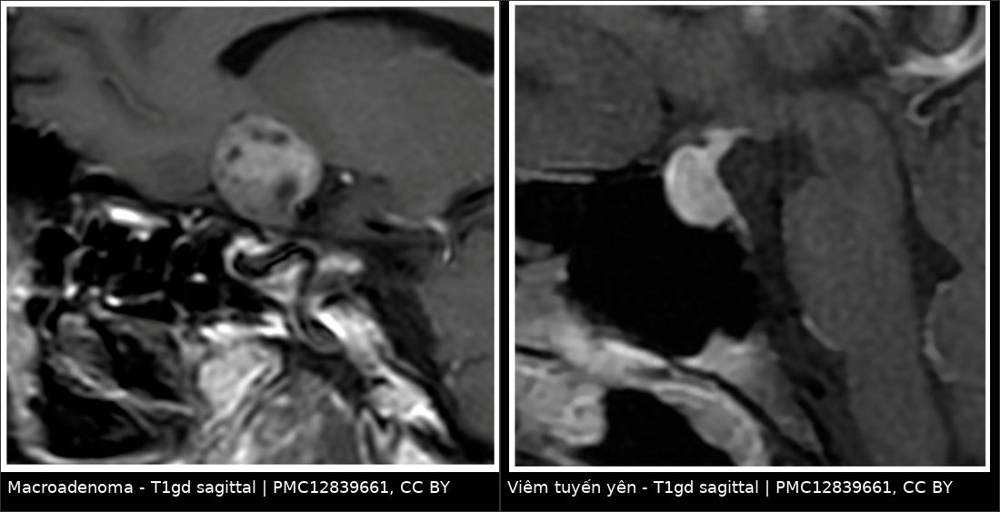
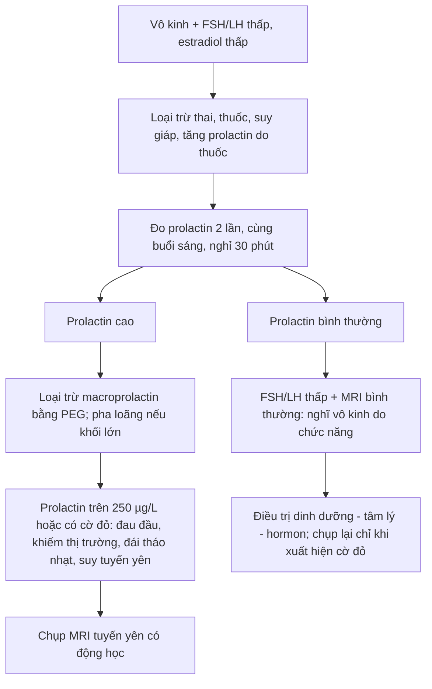
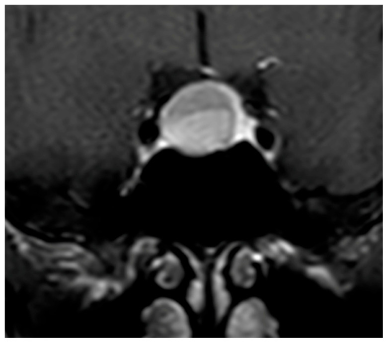
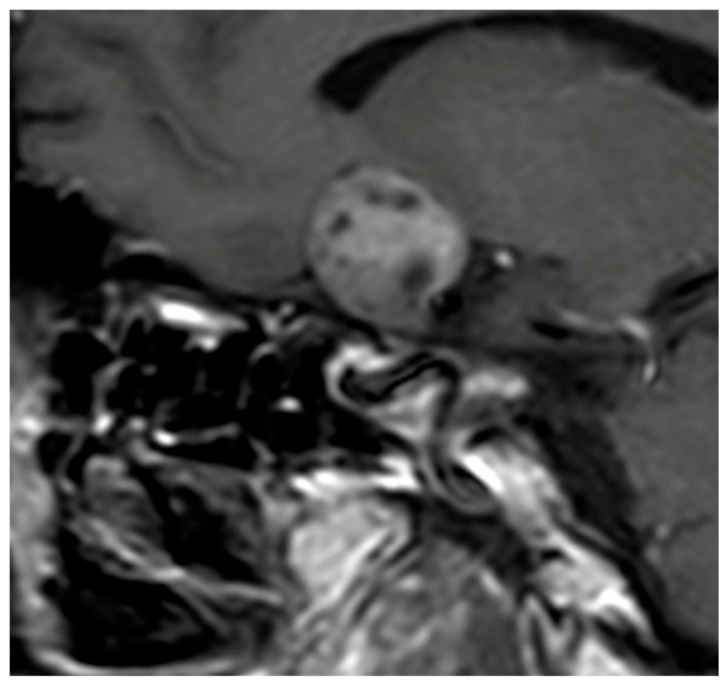
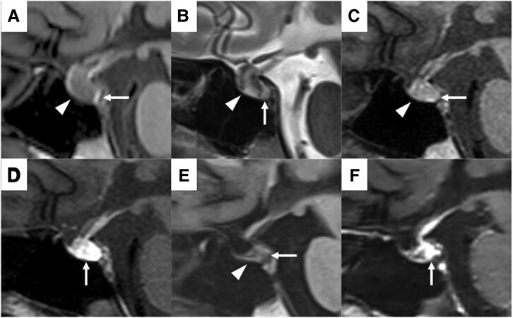

# 1675 — Vô kinh trung ương trên MRI tuyến yên / Hypogonadotropic amenorrhea on pituitary MRI

**Tags:** `pattern:vo-kinh` `pattern:khong-khoi-ho-yen` `pattern:khong-dong-deu-tuyen-yen` `pattern:day-cuong-tuyen-yen` `pattern:empty-sella` `vung:ho-yen` `vung:tuyen-yen` `protocol:MRI-tuyen-yen` `protocol:MRI-dong-hoc` `score:Gutenberg` `score:Wright` `incidentaloma:u-tuyen-yen`
**Mức chắc chắn (certainty):** tổng hợp y văn (literature synthesis) — ghép **1 tổng quan so sánh viêm tuyến yên vs macroadenoma không chức năng** (*Diagnostics* 2026, PMC12839661, CC BY 4.0), **1 đoàn hệ 167 nữ tăng prolactin** (*Medicine* 2025, PMC11730409, CC BY-NC 4.0), **1 nghiên cứu về MRI "quá sớm" trong tăng prolactin nhẹ** (*PLoS One* 2026, PMC13061191, CC BY 4.0), **1 ca Sheehan cấp có chuỗi MRI theo ngày** (*JCEM Case Rep* 2025, PMC12246542, CC BY 4.0). Không có thử nghiệm ngẫu nhiên về **ngưỡng prolactin để chụp MRI**.

> **Câu chốt:** vô kinh trung ương (**FSH/LH thấp, estradiol thấp**) là **một hội chứng, không phải một bệnh** — và câu hỏi hình ảnh duy nhất là: **"có khối trong hố yên chèn ép trục hạ đồi–tuyến yên, hay tuyến yên bình thường/teo?"**. Ba quyết định mà MRI thay đổi: (1) **u tiết prolactin** (điều trị thuốc, **không mổ**); (2) **viêm tuyến yên** (corticoid, **tránh mổ**); (3) **tuyến yên "không có gì"** → vô kinh do chức năng, **không mổ, không chụp lại vô hạn**. Nghịch lý thực hành: **chụp MRI quá sớm ở tăng prolactin nhẹ** tạo ra **20,6% "vi tuyến yên" tình cờ** không liên quan đến triệu chứng — tức hình ảnh tự sinh ra bệnh.

## 1. Tổng quan bệnh học – cơ chế hình ảnh

### 1.1 Trục hạ đồi – tuyến yên – buồng trứng: mất xung GnRH thì mất kinh

- **Sinh lý:** GnRH từ hạ đồi phóng theo **xung** → tế bào gonadotroph tuyến yên tiết **LH/FSH** theo xung → nang noãn phát triển và tiết **estradiol**. **Mất xung GnRH** (do stress, giảm cân, tập luyện quá mức, tăng prolactin, tổn thương hạ đồi–cuống tuyến yên) → **LH/FSH thấp, estradiol thấp, FSH không tăng bù** → **vô kinh trung ương (hypogonadotropic)**. Đây là điểm phân biệt cốt lõi với **suy buồng trứng (POI)**: POI có **FSH tăng cao**, vô kinh trung ương có **FSH thấp/bình thường thấp**.
- **Vì sao prolactin gây vô kinh:** prolactin cao **ức chế GnRH** ở hạ đồi (giảm xung) và **ức chế trực tiếp** tiết gonadotropin → vô kinh + tiết sữa. Vì vậy **tăng prolactin nhẹ có thể chỉ là "hiệu ứng cuống" (stalk effect)** do **bất kỳ khối nào chèn cuống**, không phải u tiết prolactin.
- **Nguyên nhân theo tần suất thực hành** (từ dữ liệu bài nguồn):
  - **Vô kinh do chức năng (functional hypothalamic amenorrhea)** — chẩn đoán **loại trừ**, MRI **bình thường**; đây là nguyên nhân **thường gặp nhất** ở nữ trẻ có vô kinh trung ương (nhận định thực hành, *suy luận*).
  - **Tăng prolactin / u tiết prolactin:** prolactinoma chiếm **~40%** u tuyến yên có chức năng (PMC11730409).
  - **Viêm tuyến yên:** **< 1%** mọi tổn thương tuyến yên và **0,5%** ca suy tuyến yên (PMC12839661).
  - **Hội chứng Sheehan** (nhồi máu tuyến yên sau băng huyết sau sinh) — nguyên nhân **vô kinh + mất sữa** sau sinh.
  - **Empty sella** (nguyên phát/thứ phát) — **2–35%** tuỳ định nghĩa, tới **79%** là **tình cờ** (PMC11940325 dẫn trong bài 1675 phần nguồn).
  - **Nguyên nhân thâm nhiễm/u khác:** sarcoid, lao, hemochromatosis, craniopharyngioma, u tế bào mầm, di căn.

### 1.2 TẠI SAO hình ảnh trông như vậy — vật lý + mô bệnh

| Cấu trúc / dấu hiệu | Vì sao có tín hiệu đó | Hệ quả thực hành |
|---|---|---|
| **Chấm sáng thùy sau trên T1 (posterior pituitary bright spot)** | **Túi tiết thần kinh (neurosecretory vesicles)** chứa vasopressin–neurophysin cô đặc → **rút ngắn T1** mạnh | **Mất chấm sáng** = rối loạn chức năng thùy sau: **viêm tuyến yên, đái tháo nhạt trung ương, Sheehan muộn**; u tuyến yên **thường giữ** chấm sáng trừ khi bị chèn ép nhiều |
| **Vi tuyến yên (microadenoma < 10 mm)** | Mô u **không có hàng rào máu–não bình thường**, nhưng **dòng máu đến khác** tuyến lành (u nhận động mạch trực tiếp, tuyến lành nhận hệ cửa) → **thì động mạch sớm: u ngấm ÍT hơn tuyến lành**, nên nổi lên như **ổ giảm ngấm (hypoenhancing) trên nền tuyến ngấm mạnh**; thì muộn u ngấm bù | Đây là lý do **MRI động học (dynamic) bắt buộc** cho vi tuyến yên; trên T1/T2 không tiêm, u chỉ là **ổ đẳng tín hiệu** — dễ bỏ sót nếu không có thì sớm |
| **Macroadenoma** | Khối lớn, có thể **xuất huyết (T1 sáng)**, **nang/hoại tử (T2 sáng)**, **không đồng nhất** | **Không đồng nhất + xâm lấn xoang hang + chèn giao thoa thị** → nghi macroadenoma hơn viêm tuyến yên |
| **Viêm tuyến yên (hypophysitis)** | Mô viêm **giàu tế bào, ít hoại tử, ít nang** → **ngấm thuốc ĐỒNG NHẤT và mạnh**, **T2 đẳng/giảm** (chỉ **5–8%** T2 tăng, so với **25%** ở macroadenoma) | "Tuyến to **đối xứng**, ngấm **đồng nhất**, cuống **dày đều**" là bộ ba của viêm; **T2 tăng mạnh** nghiêng về u/nang |
| **Empty sella** | Khoang dưới nhện lấn vào hố yên → **dịch não tủy** (T1 tối, T2 sáng) chiếm chỗ, tuyến **dẹt** | **Không có khối**, không ngấm thuốc bất thường; tuyến dẹt **< 3 mm** + dịch chiếm **> 50%** thể tích hố yên = empty sella; **≥ 3 mm và < 50%** = **partial empty sella** |
| **Sheehan cấp** | Nhồi máu thùy trước → **phù** (T1 giảm, T2 tăng không đồng nhất), **thùy sau còn sống nên chấm sáng còn** | Chuỗi theo ngày: **to + phù → teo → empty sella**; **mất chấm sáng xuất hiện muộn** (ngày 12 ở ca nguồn) |

- **Ngưỡng định lượng nằm lòng:**

| Đại lượng | Số liệu | Nguồn |
|---|---|---|
| Phân loại u theo kích thước | **vi tuyến yên < 10 mm**, **macroadenoma ≥ 10 mm** | PMC12839661 |
| Thể tích tuyến yên: viêm vs macroadenoma không chức năng | **3 cm³ vs 10 cm³**; ngưỡng phân biệt **~7 cm³** | PMC12839661 (dẫn Gutenberg 2009) |
| Xác nhận lại bằng 2 loạt khác | viêm **1,45 cm³** vs macroadenoma **7,16 cm³** | PMC12839661 (Ach 2025) |
| T2 tăng tín hiệu | viêm **5–8%** vs macroadenoma **25%** | PMC12839661 |
| Prolactin — chẩn đoán u tiết prolactin | **> 250 µg/L** → prolactinoma; **> 500 µg/L** → macroprolactinoma | PMC11730409 |
| Prolactin — ngưỡng "vùng xám" | **90–200 ng/mL** là **vùng chồng lấp** giữa prolactinoma và macroadenoma không chức năng | PMC11730409 |
| Prolactin bình thường ở nữ | **4,79–23,3 ng/mL** | PMC11730409 |
| Tăng prolactin do "hiệu ứng cuống" | tới **38,5%** ca macroadenoma không chức năng; viêm tuyến yên **20–37,5%**, biên độ **thấp hơn** u tiết prolactin | PMC12839661 |
| Đoàn hệ 167 nữ tăng prolactin (MRI) | **vi tuyến yên 46,1%** · macroadenoma **10,2%** · **bình thường 39,5%** · **empty sella 4,2%**; **vô kinh 22,0%**; prolactin **> 100 ng/mL chỉ 19,2%** | PMC11730409 |
| MRI tăng prolactin "quá sớm" (971 phim) | **60,6% bình thường**; **39,4% có ≥ 1 bất thường** — **vi tuyến yên 20,6%**, macroadenoma **2,2%**, empty sella **1,2%**, bất thường khác **4,8%** | PMC13061191 |
| Vi tuyến yên không chức năng phát hiện **do tăng prolactin thoáng qua** | **~10%** | PMC13061191 |
| Empty sella | **> 50%** thể tích hố yên là dịch + tuyến **< 3 mm**; **partial** khi tuyến **≥ 3 mm** và dịch **< 50%**; tỉ lệ **2–35%** | PMC11940325, PMC12699780 |
| Pituitary incidentaloma | **10,7%** (33 nghiên cứu tử thiết), **3,4%** (gộp trên MRI) | PMC12602012 |

## 2. Mẫu hình + chẩn đoán phân biệt theo mẫu hình (gamut)

Chia gamut theo **cái nhìn đầu tiên trên MRI**, vì đó là thứ tự đọc thật:

- **A. Hố yên có KHỐI, prolactin rất cao (> 250 µg/L):** **prolactinoma** (vi thể/macro) — điều trị **dopamine agonist**, **không mổ** trừ khi kháng/không dung nạp/chèn ép nặng.
- **B. Hố yên có KHỐI, prolactin nhẹ–vừa:** **macroadenoma không chức năng có hiệu ứng cuống** · **viêm tuyến yên** · **craniopharyngioma** · **Rathke cleft cyst** · **u màng não hố yên** · **di căn** · **u tế bào mầm**.
- **C. Tuyến yên TO ĐỐI XỨNG + cuống dày + mất chấm sáng:** **viêm tuyến yên** (lymphocytic, IgG4, do thuốc ức chế điểm kiểm soát) — **bẫy lớn nhất của mổ nhầm**.
- **D. Tuyến yên DẸT trong hố yên rỗng:** **empty sella** (nguyên phát: biến thể/tình cờ; thứ phát: sau Sheehan, sau mổ, sau xạ, sau apoplexy).
- **E. Tuyến yên teo, không khối, sau sinh khó:** **Sheehan** (mất sữa + vô kinh + suy thượng thận/giáp).
- **F. Tuyến yên BÌNH THƯỜNG, FSH/LH thấp:** **vô kinh do chức năng** (stress/giảm cân/tập luyện) · **Kallmann** (thiếu khứu giác + **hành khứu giác/khứu não thiểu sản**) · **tăng prolactin do thuốc** (chống nôn, chống loạn thần) · **suy giáp chưa điều trị** · **bệnh celiac/IBD** · **tăng áp lực nội sọ**.
- **G.** Thể "hidden": **u tiết prolactin rất nhỏ không thấy trên MRI** → chẩn đoán dựa vào **prolactin cao + không có nguyên nhân khác**, theo dõi/hiếm khi cần BIPSS (BIPSS dành cho **Cushing**, không phải prolactinoma).

## 3. Bảng so sánh phân biệt (ma trận đối chiếu)

| Thực thể (entity) | Hình ảnh điển hình (MRI theo chuỗi/thì) | Chốt vào (rule-in) | Chốt loại (rule-out) | Gợi ý xác nhận |
|---|---|---|---|---|
| **Prolactinoma** | Vi thể: **ổ giảm ngấm thì động mạch**, đẳng T1/đẳng T2, **lệch tuyến, không xâm lấn**; macro: khối lớn, có thể xuất huyết/nang | **Prolactin > 250 µg/L** (macro > 500) + **khối hố yên** | **Prolactin < 100 µg/L với khối lớn** → không phải prolactinoma thuần (nghĩ hiệu ứng cuống); **hoặc prolactin rất cao mà khối rất lớn** → phải **pha loãng** loại hook effect | Prolactin lặp + **pha loãng 1:100**; dopamine agonist thử; theo dõi thể tích |
| **Macroadenoma không chức năng (NFPMA)** | Khối **≥ 10 mm**, **không đồng nhất**, **T1 sáng nếu xuất huyết**, **T2 sáng nếu nang**; **xâm lấn xoang hang**, **chèn giao thoa thị** | **Khối lớn + không tăng prolactin đáng kể + khiếm thị trường hai bên thái dương** | **Tuyến to đối xứng, cuống dày đều, mất chấm sáng, không xâm lấn** → nghĩ viêm | Thể tích **> 7 cm³** nghiêng NFPMA; nội soi xuyên bướm khi có chỉ định |
| **Viêm tuyến yên (lymphocytic/IgG4/do thuốc)** | **To đối xứng, ngấm ĐỒNG NHẤT mạnh**, **cuống dày đều (trung tâm)**, **mất chấm sáng T1**, "dấu nút chai sâm banh" (champagne cork) khi đội giao thoa; **T2 đẳng/giảm** | **Cuống dày + mất chấm sáng** (hai dấu **đặc hiệu nhất**); **đái tháo nhạt** + **suy ACTH sớm** so với kích thước khối | **Xâm lấn xoang hang + chèn giao thoa mạnh + T2 tăng** → nghi u | **Điểm Gutenberg < 0** / **Wright ≥ 3** / **Ach ≥ 0,5**; corticoid thử; **tránh mổ mù** |
| **Sheehan (cấp → muộn)** | Cấp: **thùy trước to, T1 giảm, T2 tăng không đồng nhất**, **chấm sáng thùy sau CÒN**; muộn: **teo/empty sella, mất chấm sáng** | **Băng huyết sau sinh + mất sữa + vô kinh**; MRI có **chuỗi thay đổi theo ngày** | **Chấm sáng còn + thùy trước to ở tuần đầu** → chưa loại trừ Sheehan (đúng ca nguồn) | Chuỗi MRI ngày 6 → 12 → 45; cortisol/FT4/ prolactin thấp |
| **Empty sella (nguyên phát)** | Dịch **T1 tối/T2 sáng** chiếm **> 50%** hố yên, tuyến **dẹt < 3 mm**, **cuống giữa**, **không khối** | **Tuyến dẹt < 3 mm không thấy khối** | **Có khối đặc ngấm thuốc trong hố yên** → không phải empty sella đơn thuần | So phim cũ; **đừng gọi "u" cho phần tuyến dẹt** |
| **Vô kinh do chức năng (FHA)** | **Tuyến yên bình thường** (có thể hơi nhỏ), **không khối**, **không dày cuống** | **FSH/LH thấp + estradiol thấp + MRI bình thường + bối cảnh stress/giảm cân/tập luyện** | **Bất kỳ khối/cuống dày/mất chấm sáng** → không còn là FHA thuần | Chẩn đoán **loại trừ**; theo dõi cân nặng – tâm lý – hồi phục kinh |
| **Kallmann** | **Hành khứu giác/khứu não thiểu sản–không có**, tuyến yên bình thường | **Mất khứu giác + thiểu sản hành khứu giác** | **Hành khứu giác bình thường** → tìm nguyên nhân khác | MRI lát mỏng qua **tấm sàng** (coronal T2) |

*Ảnh ghép — cùng **T1 sau tiêm, sagittal**; khác biệt nằm ở **độ đồng nhất của ngấm thuốc** và **hình dạng tuyến**. Nguồn: *Diagnostics* 2026, PMC12839661, CC BY 4.0; ghép bằng `tools/make_composite.py` (letterbox nền đen, không crop/kéo giãn).*

### Ba dấu hiệu "đọc sai hay gặp" trên MRI hố yên

- **Lệch tuyến ≠ u:** tuyến bình thường có thể **lệch nhẹ** do tư thế; chỉ gọi u khi có **ổ tín hiệu/ngấm thuốc khác biệt** kèm hiệu ứng khối.
- **Cuống dày "đều và ở giữa"** = viêm; **cuống dày "lệch, không đều"** = thường do **chèn ép từ khối**, không phải viêm cuống nguyên phát.
- **Mất chấm sáng** là dấu **chức năng**, không phải dấu **khối**: gặp trong viêm, đái tháo nhạt, Sheehan — **và cả ở người bình thường thoáng qua**; nên **không dùng một mình** để chẩn đoán.

## 4. Protocol chụp + hệ điểm chuẩn hóa

### 4.1 Khi nào chụp — và khi nào KHÔNG nên chụp

- **Chụp khi:** prolactin **tăng rõ** (ngưỡng thực hành hay dùng **> 100 µg/L**, và chắc chắn khi **> 250 µg/L**), hoặc **có cờ đỏ**: đau đầu mới, khiếm thị trường, đái tháo nhạt, suy tuyến yên, vô kinh kèm tiết sữa kéo dài, hoặc **FSH/LH thấp không giải thích được**.
- **KHÔNG chụp ngay khi:** tăng prolactin **nhẹ, không triệu chứng, chưa lặp lại và chưa loại trừ macroprolactin**. Bằng chứng: trong **971 MRI** được chỉ định cho tăng prolactin nhẹ, **60,6% bình thường** nhưng **20,6% có "vi tuyến yên"** — phần lớn là **tình cờ**, và **~10%** vi tuyến yên không chức năng được phát hiện chính vì **tăng prolactin thoáng qua**. Tức là chụp sớm **tạo ra chẩn đoán không có bệnh**.

### 4.2 Thông số MRI (tối thiểu để không bỏ sót vi tuyến yên)

- **Lát mỏng 2–3 mm**, FOV nhỏ (**16–20 cm**), **sagittal T1 không tiêm** (tìm **chấm sáng thùy sau**, đánh giá thùy trước), **coronal T2** (tìm nang/xuất huyết, **hành khứu giác** nếu nghi Kallmann), **coronal T1 sau tiêm động học nhiều thì** (thì sớm ~20–30 giây là thì quyết định với vi tuyến yên).
- **Bắt buộc đọc và ghi 6 mục:** (1) **thể tích/kích thước tuyến**; (2) **đồng nhất hay không của ngấm thuốc**; (3) **đối xứng**; (4) **cuống: độ dày, đều/lệch**; (5) **chấm sáng thùy sau còn/mất**; (6) **xâm lấn xoang hang, chèn giao thoa thị**.
- **Nếu nghi tổn thương ngoài hố yên** (cuống dày đơn độc, đái tháo nhạt, u hạ đồi): mở rộng **toàn bộ trục hạ đồi–tuyến yên** và **cân nhắc MRI toàn não**.

### 4.3 Ba điểm chuẩn hóa (dùng khi phân vân viêm vs u)

| Điểm | Thành phần | Ngưỡng | Diễn giải |
|---|---|---|---|
| **Gutenberg (2009)** | Tuổi **≤ 30** (−1) · liên quan thai kỳ (−4) · **thể tích ≥ 6 cm³** (+2) · ngấm **vừa/mạnh** (−1) · ngấm **không đồng nhất** (+1) · **bất đối xứng** (+3) · **mất chấm sáng** (−2) · **cuống to** (−5) · **niêm mạc xoang bướm dày** (+2) | **Tổng < 0 → viêm**; **≥ 0 → u** | Mạnh nhất: **cuống to (−5)** và **liên quan thai kỳ (−4)**; yếu: niêm mạc xoang bướm |
| **Wright (2022)** | **Đái tháo nhạt** (+2) · **KHÔNG xâm lấn xoang hang** (+2) · **cuống dày** (+1) · **KHÔNG có triệu chứng thị giác** (+1) | **≥ 3 → nguy cơ viêm cao** | Nhanh, đặc hiệu cao; **không có thể tích/chấm sáng** → bỏ sót ca không điển hình |
| **Ach (2025)** | Nữ (+3) · đau đầu (−2) · triệu chứng thị giác (−2) · suy ACTH (+1) · **thể tích < 7 cm³** (+0,5) · **mất chấm sáng** (+0,5) · xâm lấn xoang hang (−0,5) · **cuống dày (+4,5)** · chèn đường thị giác (−2) | **≥ 0,5 → nguy cơ viêm cao** | Cân bằng lâm sàng – nội tiết – hình ảnh; **cuống dày nặng ký nhất (+4,5)** |

*Ảnh — coronal T1 sau tiêm: khối lớn **đẩy tuyến lành còn lại sang TRÁI**, tuyến lành **ngấm mạnh và đồng nhất** — dấu hiệu của **hiệu ứng khối**, không phải viêm toàn tuyến. Nguồn: *Diagnostics* 2026, PMC12839661, CC BY 4.0 (nguyên bản).*

## 5. Biến thể bình thường và cạm bẫy

- **Tuyến yên "to" sau sinh là sinh lý:** tuyến **tăng thể tích** trong thai kỳ và **vài tuần sau sinh** (tăng sinh tế bào tiết prolactin); **đừng đọc là macroadenoma** ở phụ nữ đang cho con bú — và cũng **đừng bỏ Sheehan** chỉ vì tuyến to trong tuần đầu (ca nguồn: **ngày 6 tuyến to + phù, ngày 12 giảm, ngày 45 teo**).
- **Bẫy 1 — "có u trên MRI" ở người tăng prolactin nhẹ:** **20,6%** ca chụp vì tăng prolactin nhẹ có **vi tuyến yên tình cờ**; **3,4%** người bình thường có incidentaloma trên MRI (**10,7%** trên tử thiết). Chẩn đoán prolactinoma cần **prolactin cao tương xứng**, không chỉ "thấy nốt".
- **Bẫy 2 — hook effect:** khối **rất lớn** mà prolactin chỉ **"vừa"** — do **kháng thể bão hòa** ở nồng độ cực cao (phương pháp cũ) → **kết quả thấp giả**. Luôn **pha loãng huyết thanh** khi khối lớn + prolactin không tương xứng; nếu không, bạn sẽ **mổ một prolactinoma** đáng lẽ chỉ cần cabergoline.
- **Bẫy 3 — macroprolactinemia:** prolactin gắn **IgG** (macroprolactin) **không có hoạt tính sinh học** → tăng prolactin "giả"; **kết tủa PEG** để loại trừ trước khi chụp. Tương tự, **lấy máu do stress tĩnh mạch** có thể tăng nhẹ và **lặp lại bình thường tới ~1/3** ca.
- **Bẫy 4 — gọi "empty sella" là bệnh:** **tới 79%** empty sella là **tình cờ**; chỉ điều trị khi **có suy tuyến yên** hoặc **tăng áp lực nội sọ**. Ngược lại, đừng bỏ qua **empty sella thứ phát sau Sheehan/apoplexy** ở người có vô kinh + suy thượng thận.
- **Bẫy 5 — "MRI bình thường nên không có gì":** **FHA** và **u tiết prolactin rất nhỏ** đều có MRI gần bình thường; chẩn đoán dựa vào **nội tiết + loại trừ**, và **chụp lại chỉ khi có cờ đỏ**.
- **Bẫy 6 — thoả mãn tìm kiếm:** thấy khối hố yên rồi dừng, bỏ **tổn thương hạ đồi/cuống** (u tế bào mầm, Langerhans, sarcoid) — nhóm này gây **vô kinh + đái tháo nhạt** và cần **MRI toàn trục + tầm soát toàn thân**.

## 6. Tự lượng giá — Blind Quiz

**Ca 1 — Nữ 29 tuổi, vô kinh 14 tháng, prolactin 310 µg/L. Nhìn ảnh, mô tả trước khi đọc đáp án.**

- Câu hỏi: (1) mô tả khối; (2) 3 chẩn đoán phân biệt; (3) prolactin **310 µg/L** nói lên điều gì và có cần pha loãng không?

<b>Bấm để hiện đáp án (findings + chẩn đoán)</b>

- **Findings:** khối **trong hố yên lan lên trên**, **ngấm thuốc KHÔNG đồng nhất** (các ổ giảm ngấm bên trong), không thấy rõ tuyến lành tách biệt.
- **Chẩn đoán:** **macroadenoma không chức năng (NFPMA)** — hình ảnh không đồng nhất, thể tích lớn (**trung bình 10 cm³** trong loạt Gutenberg, so với **3 cm³** ở viêm tuyến yên).
- **Phân biệt:** **viêm tuyến yên** (sẽ **ngấm đồng nhất**, **cuống dày đều**, **mất chấm sáng**), **prolactinoma lớn** (prolactin thường **> 250 µg/L**, có khi **> 500**), **craniopharyngioma** (nang + vôi hóa).
- **Về prolactin 310 µg/L:** nằm trên ngưỡng **> 250 µg/L** → **phù hợp prolactinoma**; nhưng đây là ảnh **NFPMA**, cho thấy **một con số prolactin không đủ để chốt** — phải đối chiếu **kích thước khối, mức tăng, và pha loãng** (loại hook effect) trước khi chọn thuốc hay mổ.
- Nguồn ảnh: *Diagnostics* 2026, PMC12839661, CC BY 4.0.

**Ca 2 — Nữ 34 tuổi, sau sinh 4 tháng, vô kinh, không tiết sữa, đau đầu. So sánh 2 ảnh.**

- Câu hỏi: hai ảnh khác nhau ở dấu hiệu nào? Nếu bệnh nhân này có **đái tháo nhạt**, bạn nghi bên nào?

<b>Bấm để hiện đáp án (findings + chẩn đoán)</b>

- **Findings:** **trái** — khối lớn **không đồng nhất**, có ổ giảm ngấm, bờ không đều (**NFPMA**); **phải** — tuyến **to dạng vòm, ngấm ĐỒNG NHẤT và mạnh**, cuống dày đều (**viêm tuyến yên**).
- **Chẩn đoán:** bối cảnh **sau sinh + đái tháo nhạt + không tiết sữa** → nghiêng **viêm tuyến yên sau sinh** (thể giả u tuyến — "pseudoadenomatous hypophysitis"), **không mổ**; điều trị **corticoid + hormon thay thế**.
- **Vì sao:** hai dấu **đặc hiệu nhất** của viêm là **cuống dày đều** và **mất chấm sáng T1**; **đái tháo nhạt gần như không gặp** trong macroadenoma không chức năng trừ khi chèn ép nặng.
- **Điểm hỗ trợ:** **Gutenberg < 0**, **Wright ≥ 3**, **Ach ≥ 0,5** → cả ba đều nghiêng **viêm**.
- Nguồn ảnh: *Diagnostics* 2026, PMC12839661, CC BY 4.0; ảnh ghép `tools/make_composite.py`.

**Ca 3 — Nữ 31 tuổi, băng huyết sau sinh 7 L, ngày 6 sau sinh: vô kinh, đái nhiều. Chuỗi MRI A–F.**

- Câu hỏi: (1) mô tả thùy trước ở ngày 6 và ngày 45; (2) chấm sáng thùy sau thay đổi thế nào; (3) chẩn đoán?

<b>Bấm để hiện đáp án (findings + chẩn đoán)</b>

- **Findings:** (A) T1 ngày 6 — **thùy trước TO, tín hiệu THẤP lan tỏa** (phù/nhồi máu); **chấm sáng thùy sau CÒN rõ**. (B) T2 ngày 6 — thùy trước **tăng tín hiệu không đồng nhất** = nhồi máu. (C) T1 ngày 12 — **hết to**, **chấm sáng thùy sau MẤT**. (D) sau tiêm ngày 12 — ngấm ở **phần sau thùy trước + toàn thùy sau**. (E) T1 ngày 45 — **thùy trước TEOT**. (F) sau tiêm ngày 45 — vùng ngấm **co nhỏ**.
- **Chẩn đoán:** **hội chứng Sheehan cấp** (nhồi máu tuyến yên sau băng huyết) — tiến triển **to + phù → teo**, kèm **mất chấm sáng thùy sau** xuất hiện muộn (ngày 12), phù hợp **đái tháo nhạt trung ương** xuất hiện sau đó.
- **Vì sao:** thiếu máu cục bộ vùng tuyến yên (mạch nuôi dễ co thắt do sốc/mất máu) → **phù rồi hoại tử**; tín hiệu T1 thấp do **phù/tăng nước**, T2 cao do **hoại tử – phù**; chấm sáng mất khi **thùy sau cũng tổn thương**.
- **Cạm bẫy:** ngày 6 **chấm sáng vẫn còn** → **không được loại trừ Sheehan**; chẩn đoán dựa vào **bối cảnh sản khoa + nội tiết**, không dựa vào một lần chụp.
- Nguồn ảnh: *JCEM Case Rep* 2025, PMC12246542, CC BY 4.0 (6 panel A–F).

## Bài liên quan chéo

- [245 – U tuyến yên chảy máu/nhồi máu (pituitary apoplexy)](../245-u-tuyen-yen-chay-mau-nhoi-mau-pituitary-apoplexy/lesson.md)
- [1696 – Bệnh Cushing do u tuyến yên: MRI 3T động học & BIPSS](../1696-benh-cushing-u-tuyen-yen/lesson.md)
- [1694 – Cushing do glucocorticoid ngoại sinh](../1694-cushing-do-glucocorticoid-ngoai-sinh/lesson.md)
- [1628 – Suy buồng trứng sớm (POI) sau mổ bóc endometrioma hai bên](../1628-poi-sau-mo-endometrioma-hai-ben/lesson.md)

## Ảnh

- 4 ảnh **CC BY 4.0** (PMC12839661, PMC12246542) dùng được kể cả **ảnh ghép**; 1 ảnh ghép tạo bằng `tools/make_composite.py`. Chi tiết từng ảnh: `images/CREDITS.md`.
- Không dùng ảnh từ nguồn không rõ giấy phép; không crop, không kéo giãn.

> Không dùng để chẩn đoán độc lập khi chưa có người hướng dẫn.
