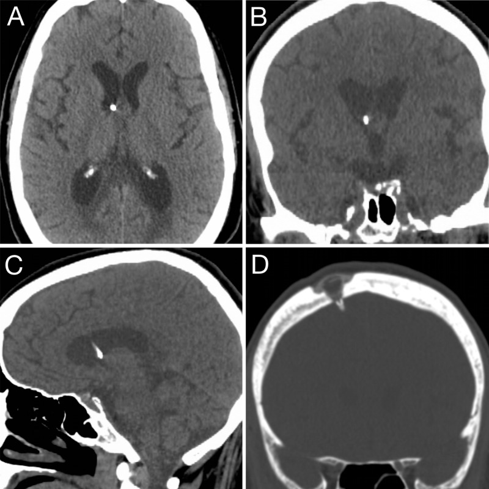
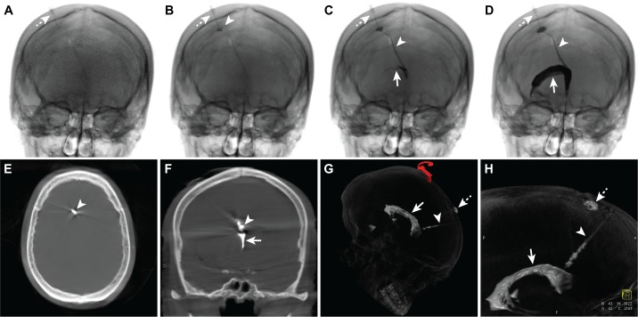
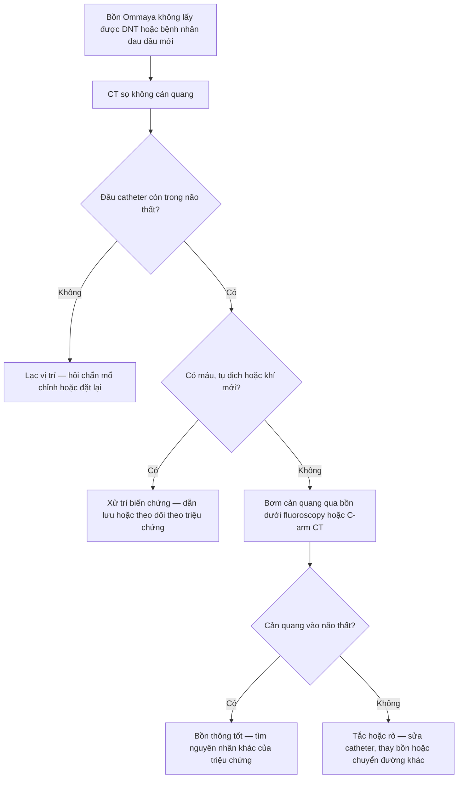
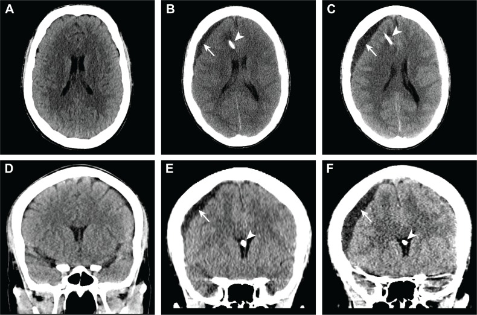
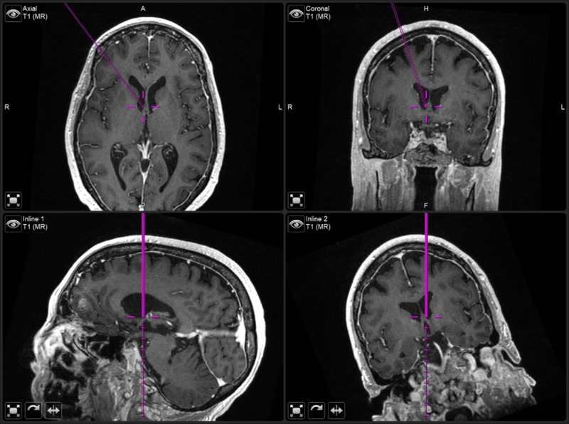

# 1676 — Đặt bồn Ommaya & điều trị nội tủy: vị trí đầu catheter, biến chứng và theo dõi / Ommaya reservoir placement: catheter tip, complications and imaging follow-up

**Tags:** `pattern:vi-tri-dung-cu` `pattern:bien-chung-dung-cu` `vung:nao` `vung:nao-that` `protocol:CT-so-nao` `protocol:kiem-tra-bon-can-quang` `protocol:neuronavigation` `incidentaloma:khong`

**Mức chắc chắn (certainty):** tổng hợp y văn (literature synthesis) — biên từ **toàn văn** các bài mở: kỹ thuật đặt bồn có neuronavigation với **27 ca liên tiếp** (*Cureus* 2020, **PMC7234073**, CC BY), ca nguyên văn **tụ dịch dưới màng cứng sau đặt bồn** được chẩn đoán bằng **fluoroscopy + C-arm CT sau bơm cản quang vào bồn** (*Cureus* 2017, **PMC5392038**, CC BY 3.0), đoàn hệ **68 bệnh nhân** điều trị nội tủy qua bồn (*J Clin Med* 2026, **PMC13705536**, CC BY 4.0) và tổng quan có hệ thống về đường đưa thuốc nội tủy (*Front Oncol* 2026, **PMC13227113**, CC BY 4.0). Số liệu lấy từ toàn văn/bảng, không viết từ abstract gián tiếp.

> **Câu chốt:** Bồn Ommaya chỉ hữu ích khi **đầu catheter nằm trong não thất bên, ngay sau lỗ Monro**, và **không có biến chứng chèn ép**. Ba câu hỏi của mọi phim sau đặt: **(1) đầu catheter ở đâu? (2) có máu/tụ dịch/khí mới? (3) bồn có thông với não thất hay đang rò ra khoang dưới màng cứng?** — câu (3) **không thể trả lời bằng "hút ra được dịch trong"**, mà phải bằng **bơm cản quang qua bồn dưới fluoroscopy/C-arm CT**.

## 1. Tổng quan — dụng cụ, mục đích và vì sao vị trí đầu catheter quyết định tất cả

### 1.1. Dụng cụ và sinh lý

- **Bồn Ommaya** = một buồng nhỏ dưới da đầu nối với **catheter não thất**, cho phép **lấy dịch não tủy (DNT) lặp lại** và **bơm thuốc nội tủy** mà không phải chọc thắt lưng mỗi lần (PMC5392038).
- **Vì sao không dùng chọc thắt lưng thay thế:** trong di căn màng não, **dòng DNT có thể bị tắc một phần** và áp lực trong khoang dưới nhện không đồng nhất; bơm qua thắt lưng có thể **không đạt nồng độ thuốc ở não thất**, đồng thời chọc lặp lại gây đau đầu, tụ máu, nhiễm trùng. Bồn cho **đường vào trực tiếp vào não thất**, phân bố thuốc theo dòng DNT (PMC13227113).
- **Vì sao vị trí quan trọng:** đầu catheter đặt **just dorsal to foramen of Monro** trong **sừng trán não thất bên cùng bên** có hai lợi ích: (a) thuốc vào **dòng DNT chính** và phân bố hai bán cầu; (b) **tránh đám rối mạch mạc** và **tránh xuyên quá sâu vào não thất ba** — nơi catheter dễ gây tổn thương trục dưới đồi/trung não (PMC7234073).

### 1.2. Vì sao nhìn thấy catheter trên CT — và giới hạn của nó

- Catheter và bồn **cản quang nhẹ** (vật liệu silicone pha cản quang) nên **hiện trắng trên CT cửa sổ nhu mô**; cửa sổ xương cho thấy **bồn được khoét lõm vào xương** (recessed) và **độ dày da trên bồn**.
- **TẠI SAO CT là bước đầu, không phải MRI:** CT **nhanh, rẻ, ít nhiễu kim loại**, đủ trả lời "đầu catheter ở đâu, có máu/khí/dịch mới?". MRI cần khi nghi **viêm màng não – não thất**, **tổn thương quanh catheter**, hoặc **di căn màng não tiến triển**; nhưng **catheter tạo nhiễu từ** và có thể che tổn thương nhỏ.
- **TẠI SAO phải chụp lại ngay sau đặt:** catheter có thể **lạc vào nhu mô, khoang dưới màng cứng, não thất ba hoặc khe liên bán cầu** mà **không gây triệu chứng ngay**; chỉ phát hiện trên ảnh. Tỉ lệ đặt đúng trong loạt có neuronavigation: **96% sừng trán, 4% thân não thất bên** (27 ca, PMC7234073). Đặt **freehand** (không định vị) có tỉ lệ thành công kỹ thuật thấp hơn: **88%** so với **96%** (neuronavigation) và **97%** (nội soi) — nhưng đây là số **minh họa từ các loạt khác nhau, không phải gộp** (PMC13227113).

### 1.3. Con số phải nhớ

| Chỉ số | Số liệu | Nguồn |
|---|---|---|
| Biến chứng liên quan dụng cụ (y văn chung) | **~15%** bệnh nhân | PMC5392038 |
| Nhiễm trùng bồn | **5–8%**, thường **cầu khuẩn Gram dương ở da**; loạt 27 ca: **7% (2/27)**, cả hai **> 60 ngày** sau mổ | PMC7234073 |
| Biến chứng dụng cụ trong đoàn hệ 68 ca | **8,8% (6/68)**, trong đó **3 ca lạc catheter sau đặt freehand** | PMC13705536 |
| Độ chính xác đầu catheter (có định vị) | **96% sừng trán**, **4% thân não thất bên** | PMC7234073 |
| Thời gian mổ trung vị | **36 phút** (17–63) | PMC7234073 |
| Chảy máu nhu mô/dưới nhện trong loạt 27 ca | **0 ca** | PMC7234073 |
| Tỉ lệ thành công kỹ thuật (minh họa) | freehand **88%** · neuronavigation **96%** · nội soi **97%** | PMC13227113 |
| Biến chứng do thuốc nội tủy | **5,9% (4/68)** | PMC13705536 |
| Nhiễm trùng / trục trặc catheter / độc thần kinh (minh họa) | **7% / 5% / 2%** — **không phải số gộp** | PMC13227113 |

- **Phản biện:** con số **15%** là trích dẫn cũ trong bài ca, còn **8,8%** là đoàn hệ 68 ca hiện đại; **7%/5%/2%** của tổng quan 2026 là **"illustrative"**, tác giả tự ghi **không phải pooled estimate**. Vì vậy khi tư vấn, nên nói **"khoảng 1/10 bệnh nhân có biến chứng dụng cụ, phần lớn xử lý được"** thay vì trích một con số tuyệt đối.

## 2. Mẫu hình + gamut theo thời điểm và theo vị trí đầu catheter

### 2.1. Gamut theo thời điểm — hỏi "bao lâu sau đặt?"

- **Ngay sau đặt – 72 giờ:** **lạc vị trí** (nhu mô, dưới màng cứng, não thất ba, khe liên bán cầu), **chảy máu** (nhu mô/dưới màng cứng/não thất), **tràn khí não**, **rò DNT qua vết mổ**, **đau đầu do giảm áp**.
- **1–4 tuần:** **nhiễm trùng vết mổ/bồn**, **viêm màng não – não thất**, **tụ dịch dưới màng cứng** (hygroma/hematoma) — thường biểu hiện **đau đầu, buồn nôn, ngủ gà, khó chọc bồn**.
- **> 1 tháng – nhiều tháng:** **tắc catheter** (mô xơ, protein, tế bào u), **di trú catheter**, **nhiễm muộn** (thường sau 60 ngày), **tái phát u dọc đường catheter**, **độc thần kinh do thuốc** (bạch cầu chất trắng, hoại tử).

### 2.2. Gamut theo vị trí đầu catheter trên CT

- **Đúng:** sừng trán não thất bên **cùng bên** với tổn thương/đường vào, **ngay sau lỗ Monro**, đầu catheter **không chạm thành não thất**.
- **Sai nhưng còn dùng được (tùy):** **thân não thất bên**, **sừng thái dương** (xa dòng DNT, dễ tắc), **não thất ba** (nguy cơ tổn thương trục dưới đồi, khó lấy DNT đại diện).
- **Sai hoàn toàn:** **trong nhu mô** (không lấy được DNT, thuốc vào mô → độc), **khoang dưới màng cứng** (thuốc không vào DNT, gây tụ dịch), **khe liên bán cầu**, **trong ổ dịch/u nang** (chỉ dùng khi chủ đích đặt vào nang).

## 3. Bảng so sánh phân biệt (ma trận đối chiếu)

| Thực thể (entity) | Hình ảnh điển hình | Chốt vào (rule-in) | Chốt loại (rule-out) | Gợi ý xác nhận |
|---|---|---|---|---|
| **Lạc catheter trong nhu mô** | Đầu catheter **không nằm trong khoang dịch não tủy**, surrounded by mô não | **Không thấy đầu catheter trong não thất** trên ≥ 2 bình diện | Đầu catheter trong não thất trên mọi bình diện → không lạc | CT 3 bình diện; nếu còn nghi → bơm cản quang qua bồn |
| **Lạc catheter dưới màng cứng** | Catheter chạy **dưới xương, ngoài nhu mô**; có thể kèm tụ dịch dưới màng cứng | **Đường catheter nằm giữa xương và nhu mô**, không vào não thất | Catheter xuyên qua nhu mô vào não thất → không lạc dưới màng cứng | CT cửa sổ nhu mô + xương; bơm cản quang |
| **Chảy máu sau đặt** | **Tăng tỷ trọng cấp** quanh đường catheter/não thất; có thể thấy mức máu–dịch trong não thất | **Máu mới dọc đường catheter** hoặc trong não thất, **không có trên phim trước** | Tăng tỷ trọng do **vôi hóa/artifact kim loại** → không phải máu | So phim trước; đo HU; MRI/SWI nếu cần |
| **Nhiễm trùng bồn/não thất** | Dày, ngấm thuốc **màng não thất**; **mủ lắng trong não thất** (DWI sáng/ADC tối); phù quanh đường catheter | **Ngấm thuốc màng não thất + DWI hạn chế trong não thất** | Chỉ có phản ứng màng não mỏng, không sốt, DNT bình thường → chưa chốt nhiễm | MRI có cản quang + DWI; chọc DNT qua bồn |
| **Tắc catheter** | Đầu catheter đúng vị trí nhưng **không lấy được DNT**, bơm thấy **căng** | **Bơm cản quang: thuốc dừng ở catheter, không vào não thất** | Thuốc vào não thất bình thường → không tắc | Fluoroscopy/C-arm CT sau bơm cản quang |
| **Tụ dịch dưới màng cứng sau đặt** | **Tụ dịch thấu kính dưới xương**, trên nhu mô, **dưới bồn**; có thể tăng kích thước | **Tụ dịch mới, tăng kích thước, kèm đau đầu/ngủ gà** | Tụ dịch nhỏ, ổn định, không triệu chứng → theo dõi | CT so sánh; **bơm cản quang để loại rò** (ca dưới) |
| **Di trú bồn/catheter** | Bồn **xoay/lật** dưới da; catheter **rút ra** khỏi não thất | **Bồn đổi hướng/lật** trên ảnh bề mặt + mất chức năng | Bồn cố định, chức năng tốt → không di trú | CT cửa sổ xương + ảnh da đầu; X-quang sọ |

*Đầu catheter cản quang nằm trong **sừng trán não thất bên**, ngay sau lỗ Monro, thấy trên **axial (A)**, **coronal (B)** và **sagittal (C)**; **(D)** cửa sổ xương coronal cho thấy **bồn được khoét lõm vào xương** và da phủ phẳng. Đây là "phim chuẩn" để so mọi ca sau đặt. Nguồn: *Cureus* 2020 (PMC7234073), CC BY 4.0; dùng nguyên bản.*

### 3.1. Ba dấu hiệu chốt trên CT sau đặt

1. **Đầu catheter trong não thất trên cả 3 bình diện** — không chỉ trên axial (axial dễ "trông như" trong não thất khi catheter nằm ở khe liên bán cầu).
2. **Không có máu mới dọc đường catheter** — so với phim trước đặt; đo HU nếu tăng tỷ trọng nhẹ.
3. **Không có tụ dịch/khí mới đáng kể** — tụ dịch **dưới bồn** là vị trí hay bị bỏ qua nhất.

## 4. Protocol + kiểm tra chức năng bồn

### 4.1. Trước đặt (phía hình ảnh)

- **MRI có cản quang** (T1) hoặc **CT** để chọn **đường vào sừng trán**, đo **khoảng cách từ giữa xương hai lớp (diploe) đến đáy sừng trán gần lỗ Monro** — đây là **chiều dài catheter dự kiến** (PMC7234073).
- Ví dụ trong bài kỹ thuật: chiều dài dự kiến **61 mm**, trừ **7 mm** khoảng cách từ vành bồn đến điểm nối catheter → **cắt catheter còn 54 mm**.
- **Neuronavigation** giúp chọn **đường đi qua nhu mô ít mạch máu**, tránh xoang màng cứng và **không xuyên qua vùng eloquence**; với bồn đặt **lõm vào xương**, đường hầm ngắn hơn và da phủ phẳng.

### 4.2. Sau đặt

- **CT sọ không cản quang ≤ 24 giờ**: xác nhận vị trí đầu catheter, loại trừ chảy máu/tràn khí/tụ dịch; đọc **cửa sổ xương** để xem bồn có lõm và đường hầm.
- **Chụp lại ngay** nếu: đau đầu mới, tri giác giảm, co giật, **không lấy được DNT**, hoặc có dấu thần kinh khu trú.
- **MRI có cản quang + DWI** khi nghi **nhiễm trùng** hoặc **tổn thương quanh catheter**; **DWI** là chuỗi chốt cho mủ trong não thất.
- **Kiểm tra chức năng bằng bơm cản quang qua bồn** (dưới fluoroscopy/C-arm CT) khi: không lấy được DNT, nghi rò dưới màng cứng, nghi tắc catheter, hoặc cần chứng minh bồn còn nguyên trước khi tiếp tục hóa trị nội tủy (PMC5392038).
- **Kỹ thuật chọc bồn:** vô khuẩn như thủ thuật trong màng cứng; dùng kim nhỏ (butterfly 25G), **bỏ 1–2 mL DNT đầu** (thường có thuốc nồng độ cao), gửi tế bào học/sinh hóa/cấy theo chỉ định; **không bơm mạnh** nếu cảm giác căng.

*Bơm cản quang i-ốt qua bồn dưới fluoroscopy (A–D): thuốc đi từ bồn → catheter → **não thất bên phải (G, H)**, **không thấy cản quang ngoài hệ thống** — không rò, không tắc. C-arm CT (E, F) và tái tạo 3D (G, H) xác nhận toàn bộ đường đi. Đây là cách trả lời câu hỏi "bồn còn thông không" mà không cần mổ. Nguồn: *Cureus* 2017 (PMC5392038), CC BY 3.0; dùng nguyên bản.*

### 4.3. Luồng quyết định khi bồn "không hoạt động"

## 5. Biến thể bình thường và cạm bẫy

- **Cạm bẫy 1 — tụ dịch dưới màng cứng bị đọc là "bồn bị rò".** Ca nguyên văn: bệnh nhân **24 tuổi**, bạch cầu cấp dòng tủy tái phát có tổn thương thần kinh trung ương, đặt bồn Ommaya. **Ngày 7** sau đặt: đau đầu, buồn nôn, ngủ gà, **khó chọc bồn**; CT thấy **đầu catheter đúng trong sừng trán não thất bên phải** nhưng có **tụ dịch thấu kính 5 mm dưới màng cứng trên thùy trán phải**, và **tăng kích thước** ở lần chụp sau. Bơm **cản quang i-ốt qua bồn dưới fluoroscopy + C-arm CT**: thuốc **chỉ đi trong catheter và não thất**, **không ra khoang dưới màng cứng** → bồn **nguyên vẹn**, không rò. Bệnh nhân được **mở cửa sổ sọ trán phải riêng** để **lấy khối tụ dịch** (dịch trong, có hemosiderin), **giữ nguyên bồn**, hồi phục tốt (PMC5392038).
  - **Bài học:** (1) **khó chọc bồn không đồng nghĩa bồn hỏng** — tụ dịch dưới bồn làm lệch vị trí chọc; (2) **tụ dịch dưới màng cứng sau đặt bồn có thể tiến triển** dù đầu catheter đúng; (3) **bơm cản quang là tiêu chuẩn vàng tại giường** để phân biệt **rò/tắc** với **bồn nguyên vẹn**.

*Trước đặt (A, D). Sau đặt: catheter (đầu mũi tên) đi qua thùy trán phải vào sừng trán; **tụ dịch giảm tỷ trọng 5 mm** dưới màng cứng (mũi tên) ở (B, E); **tăng kích thước** ở lần chụp sau (C, F). Đầu catheter vẫn **đúng vị trí** — nguyên nhân triệu chứng là **khối tụ dịch**, không phải lạc catheter. Nguồn: *Cureus* 2017 (PMC5392038), CC BY 3.0; dùng nguyên bản.*

- **Cạm bẫy 2 — "hút ra dịch trong là bồn đúng".** Dịch trong có thể là **DNT từ đường hầm dưới da** hoặc **dịch dưới màng cứng**; chỉ **bơm cản quang thấy thuốc vào não thất** mới chứng minh thông.
- **Cạm bẫy 3 — tràn khí não sinh lý.** Một lượng khí nhỏ trong não thất sau mổ **thường tự hết**; chỉ lo khi **tăng thể tích, có mức khí–dịch hoặc triệu chứng**.
- **Cạm bẫy 4 — axial đánh lừa.** Catheter nằm ở **khe liên bán cầu** hoặc **rãnh** có thể "trông như" trong não thất trên một lát axial; luôn xem **coronal + sagittal**.
- **Cạm bẫy 5 — nhiễu kim loại của bồn.** Bồn và đầu nối tạo **vệt giả** trên CT/MRI, che mô xung quanh; đọc trên nhiều cửa sổ và so phim trước.
- **Cạm bẫy 6 — nhiễm muộn.** Trong loạt 27 ca, **cả 2 ca nhiễm đều xuất hiện sau 60 ngày** (PMC7234073) — **không được kết luận "sạch" chỉ vì mổ đã lâu**; sốt/đau đầu muộn vẫn phải chọc DNT qua bồn.
- **Cạm bẫy 7 — bỏ qua "đường hầm".** Đau/tấy dọc đường hầm dưới da có thể là **nhiễm đường hầm** trước khi có viêm màng não; khám da đầu là một phần của đọc phim.

## 6. Tự lượng giá — Blind Quiz

**Ca 1 — CT sau đặt bồn ở một bệnh nhân di căn màng não. Trước khi đọc đáp án, hãy trả lời 3 câu: đầu catheter ở đâu, có biến chứng gì, và cần làm gì tiếp.**

- Bối cảnh: đặt bồn qua đường trán phải, chỉ định điều trị nội tủy.
- Câu hỏi: (1) Đầu catheter nằm ở đâu? (2) Vì sao phải xem cả 3 bình diện? (3) Cửa sổ xương (D) dùng để đánh giá gì?

<b>Bấm để hiện đáp án (findings + chẩn đoán)</b>

- **Findings:** đầu catheter cản quang nằm trong **sừng trán não thất bên**, **ngay sau lỗ Monro**; không có máu, khí hay tụ dịch đáng kể; **(D)** bồn **lõm vào xương**, da phủ phẳng.
- **Vì sao 3 bình diện:** trên **axial** đơn thuần, catheter ở **khe liên bán cầu** hoặc **rãnh** có thể trông như trong não thất; **coronal** chứng minh catheter **xuyên qua nhu mô vào não thất**, **sagittal** chứng minh **độ sâu** so với lỗ Monro.
- **Cửa sổ xương:** đánh giá **độ lõm của bồn**, **độ dày da trên bồn**, và **vị trí lỗ khoan**; bồn nhô cao dễ **loét da, nhiễm, lộ bồn**.
- **Nguồn:** *Cureus* 2020 (PMC7234073), CC BY 4.0.

**Ca 2 — Ngày 7 sau đặt bồn: đau đầu, buồn nôn, ngủ gà, chọc bồn khó. CT cho hai thời điểm.**

- Bối cảnh: bạch cầu cấp dòng tủy tái phát, đặt bồn để hóa trị nội tủy.
- Câu hỏi: (1) Đầu catheter có lạc không? (2) Tổn thương mới là gì, nằm ở đâu? (3) Làm thế nào **chứng minh bồn không rò** mà không mổ?

<b>Bấm để hiện đáp án</b>

- **Đầu catheter:** **đúng vị trí** — sừng trán não thất bên phải, gần lỗ Monro (đầu mũi tên).
- **Tổn thương mới:** **tụ dịch dưới màng cứng giảm tỷ trọng 5 mm** trên thùy trán phải, **tăng kích thước** ở lần chụp sau; đây là nguyên nhân đau đầu/ngủ gà và **khó chọc bồn** (bồn bị đẩy lệch).
- **Chứng minh bồn nguyên vẹn:** bơm **cản quang i-ốt qua bồn dưới fluoroscopy + C-arm CT** — thuốc đi **trong catheter và não thất**, **không thấy cản quang ngoài hệ thống** → **không rò, không tắc**; sau đó **dẫn lưu khối tụ dịch qua cửa sổ sọ riêng**, **giữ nguyên bồn**, hồi phục tốt.
- **Nguồn:** *Cureus* 2017 (PMC5392038), CC BY 3.0.

**Ca 3 — Trước mổ: chọn đường vào và chiều dài catheter. Ảnh neuronavigation cho thấy gì?**

- Bối cảnh: lập kế hoạch đặt bồn ở bệnh nhân cần điều trị nội tủy lặp lại.
- Câu hỏi: (1) Đích của đầu catheter là gì? (2) Đo chiều dài catheter từ đâu đến đâu? (3) Vì sao phải trừ 7 mm?

<b>Bấm để hiện đáp án</b>

- **Đích:** **sừng trán não thất bên**, **ngay sau (dorsal) lỗ Monro** — nơi dòng DNT phân bố thuốc tốt và tránh đám rối mạch mạc.
- **Đo chiều dài:** từ **giữa xương hai lớp (diploe)** đến **đáy sừng trán gần lỗ Monro** trên **coronal** — không đo từ mặt da, vì bồn được **khoét lõm** vào xương.
- **Trừ 7 mm:** khoảng cách **từ vành bồn đến điểm nối catheter**; ví dụ dự kiến **61 mm → cắt 54 mm** để đầu catheter dừng đúng đích mà không quá sâu.
- **Nguồn:** *Cureus* 2020 (PMC7234073), CC BY 4.0.

## Bài liên quan chéo

- [1659 – Điều trị nội tủy & di căn màng não: chọn đường đưa thuốc, liều và theo dõi](../1659-di-can-mang-nao-noi-tuy/lesson.md) (lý do và phác đồ dùng bồn)
- [3037 – Nhiễm trùng não thất & nhiễm trùng EVD](../3037-nhiem-trung-nao-that-evd/lesson.md) (cùng nguyên lý "dụng cụ trong não thất + nhiễm")
- [3039 – Nhiễm trùng shunt não thất–phúc mạc & nang giả phúc mạc](../3039-nhiem-trung-shunt-nao-that-phuc-mac/lesson.md) (nhiễm màng sinh học trên dụng cụ)
- [3026 – Chọc dò tủy sống ở bệnh nhân có shunt và sau mở sọ giảm áp](../3026-tut-nao-nghich-ly-sau-choc-do-shunt-mo-so/lesson.md) (thay đổi áp lực khi lấy DNT)
- [214 – Nhiễm trùng thần kinh trung ương](../214-nhiem-trung-tktw/lesson.md) (phân biệt viêm màng não – não thất với tổn thương do dụng cụ)

> Không dùng để chẩn đoán độc lập khi chưa có người hướng dẫn.
