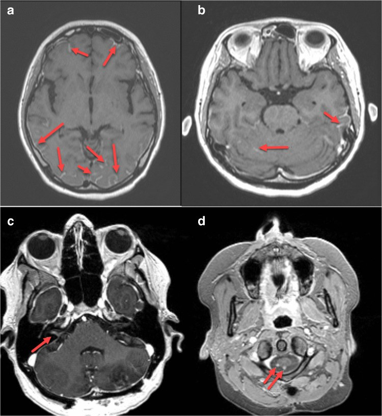
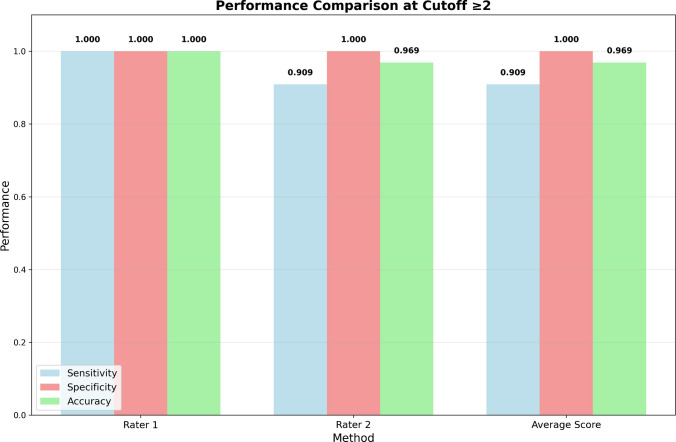
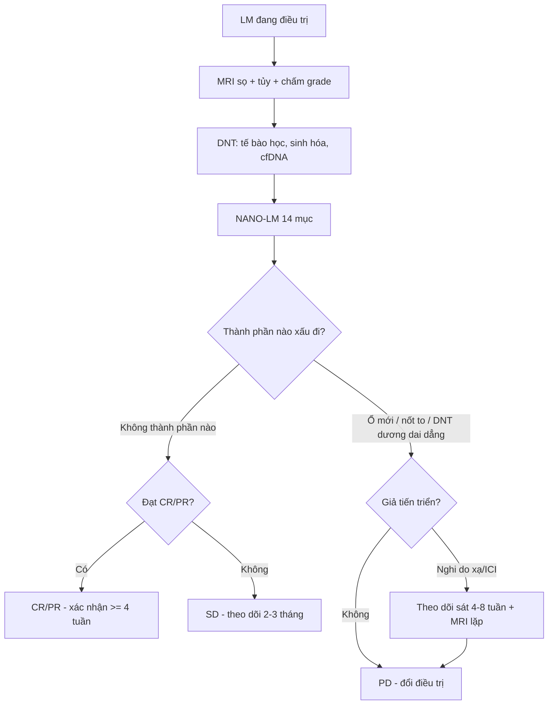
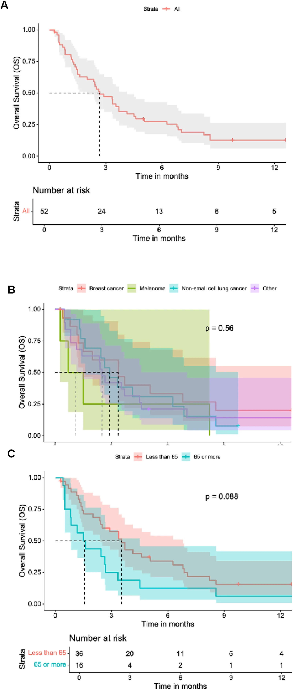

# 1677 — RANO-LM: đánh giá đáp ứng di căn màng não trên MRI + dịch não tủy

**Tags:** `pattern:di-can-mang-nao` `pattern:ngam-mang-nao` `vung:nao` `vung:tuy-song` `protocol:MRI-so-co-gadolinium` `protocol:choc-do-tuy-song` `score:RANO-LM`
**Mức chắc chắn (certainty):** tổng hợp y văn — tiêu chuẩn RANO-LM/NANO-LM là **đồng thuận chuyên gia**, chưa có thử nghiệm xác nhận tiên lượng; số liệu đáp ứng lấy từ các nghiên cứu pha I/II riêng lẻ.

## 1. Tổng quan — vì sao "đáp ứng" ở màng não không thể đo bằng RECIST

**Bệnh học:** di căn màng não (leptomeningeal metastasis, LM) lan trong **khoang dịch não tủy** — một **ngăn riêng** sau hàng rào máu–não. Thuốc có thể đạt nồng độ tốt trong máu mà **không đủ trong DNT**; ngược lại, đáp ứng trong DNT có thể **không đi kèm** đáp ứng ngoài sọ.

**Hệ quả về đo lường:**

- **RECIST không dùng được**: tổn thương màng não là **mờ/ngấm theo đường viền**, không có "đường kính lớn nhất" rõ ràng; nhiều ổ không đo được trên mặt phẳng.
- **MRI và DNT có thể lệch nhau**: một bên cải thiện, bên kia xấu đi — vì vậy RANO-LM đề xuất **đánh giá tổng hợp 3 thành phần**: **khám thần kinh chuẩn hóa (NANO-LM)**, **tế bào học DNT**, và **bảng điểm MRI**.
- **Thời điểm**: MRI định kỳ **2–3 tháng** ở bệnh nhân có di căn não (hướng dẫn hiện hành); LM thường theo dõi sát hơn khi đổi điều trị.

**TẠI SAO phải chuẩn hóa:** nếu mỗi thầy đọc một kiểu, "đáp ứng 50%" trong nghiên cứu không so được với thực hành. NANO-LM ra đời để **giảm bất đồng giữa người đánh giá**, gồm **14 lĩnh vực**, mỗi lĩnh vực **0–2 điểm**, kèm ghi nhận **steroid, giảm đau, chống nôn** và di chứng cũ lúc nền (PMC11812256).

## 2. Mẫu hình trên MRI & phân loại DNT

**Bốn kiểu hình màng não cần mô tả riêng (đừng gộp):**

1. **Ngấm màng não – màng nhện dạng đường (linear):** mờ theo rãnh, bề mặt não, dây thần kinh sọ.
2. **Dạng nốt (nodular):** nốt ngấm rời, có thể ở rãnh, bề mặt tiểu não, rễ thần kinh.
3. **Thể não – tủy:** nốt trong ống sống, dày rễ đuôi ngựa, ngấm màng tủy.
4. **Giãn não thất do tắc hấp thu** — thường là dấu hiệu **nặng lên**, không phải "biến chứng riêng".

**Phân độ MRI-LMD (đề xuất 2026):** thang **grade 1–6** dựa trên **kiểu ngấm màng não**, kèm **Evans index** (giãn não thất), đặc điểm di căn não và **tổn thương tủy**. Hai bác sĩ độc lập: **ICC = 0,953**; ngưỡng **≥ 2 điểm** cho hiệu năng chẩn đoán tốt (PMC13323362).

| Grade | Nhóm nguy cơ | Tử vong trong nghiên cứu |
|---|---|---|
| **1–2** | Thấp | **8,6%** |
| **3–4** | Trung bình | **50%** |
| **≥ 5** | Cao | **80,0%** (p = 0,00011) |

**DNT — 3 mức:** **dương tính** (có tế bào ác), **không xác định** (nghi ngờ/tế bào không điển hình), **âm tính**. Kỹ thuật quyết định độ nhạy:

- Lấy **≥ 10 mL** (tối thiểu **5 mL**), xử lý trong **30 phút**, tránh lẫn máu.
- Nếu lần đầu âm: **chọc lại** trong điều kiện tối ưu — độ nhạy tăng từ **~50–60%** lên **~80%** (PMC13360412).
- Chọc **đồng thời não thất + thắt lưng**: bất đồng **32%**; âm tính giả **17%** (thắt lưng) và **20%** (não thất) — bệnh ở bể nền có thể **không thấy** trên DNT thắt lưng.

## 3. Ma trận đối chiếu 3 thành phần đáp ứng

| Thành phần | Đo cái gì | Chốt vào (gợi ý đáp ứng) | Chốt loại (gợi ý tiến triển) | Cạm bẫy |
|---|---|---|---|---|
| **MRI (bảng điểm RANO-LM)** | Ngấm màng não dạng đường/nốt, nốt trong ống sống, giãn não thất | Giảm ≥ 1 bậc hoặc mất nốt; không ổ mới; não thất không tăng | **Ổ mới**, nốt to lên, ngấm lan rộng, não thất tăng | **Giả tiến triển** sau xạ/immunotherapy; ngấm do viêm màng não – tăng áp lực nội sọ |
| **DNT** | Tế bào học, tế bào, protein, glucose, cfDNA | Chuyển **dương → âm** ở ≥ 2 lần liên tiếp | Dương tính dai dẳng hoặc tế bào tăng | Âm tính giả 17–20%; lẫn máu; 1 lần âm **không** loại trừ |
| **Khám thần kinh (NANO-LM)** | 14 lĩnh vực, 0–2 điểm + steroid/giảm đau | Điểm giảm, chức năng cải thiện | Điểm tăng, xuất hiện dấu hiệu mới | Steroid che triệu chứng; di chứng cũ lúc nền không trừ được |
| **Ngoài sọ (RECIST)** | Tổn thương ngoài TKTW | Theo RECIST | Theo RECIST | **Đáp ứng trong/ngoài sọ thường lệch nhau** — không dùng cái này để suy cái kia |

**Định nghĩa tổng hợp (theo khung RANO):**

- **Đáp ứng hoàn toàn (CR):** MRI không còn bệnh, DNT âm, thần kinh ổn định/ cải thiện, **không dùng steroid tăng liều**.
- **Đáp ứng một phần (PR):** cải thiện có ý nghĩa ở ≥ 1 thành phần, **không xấu đi** ở thành phần khác, không ổ mới.
- **Bệnh ổn định (SD):** không đạt CR/PR, không đạt PD.
- **Tiến triển (PD):** **ổ mới**, tăng rõ trên MRI, DNT dương dai dẳng kèm xấu thần kinh, hoặc xuất hiện biến chứng (giãn não thất tăng, liệt chi mới).
- CR/PR nên **xác nhận lại ≥ 4 tuần** nếu là tiêu chí chính của nghiên cứu (theo khung RANO-BM).

## 4. Protocol & ngưỡng

**Quy trình đánh giá 1 chu kỳ:**

1. **MRI sọ + toàn bộ tủy** (T1 sau gadolinium, mặt phẳng 3 chiều; FLAIR; DWI khi cần) — **cùng máy, cùng độ dày lát** giữa các lần để so sánh.
2. **Chấm điểm MRI-LMD** (grade 1–6) + mô tả riêng: linear/nodular, não thất (Evans), tủy.
3. **DNT**: thể tích, tế bào học, sinh hóa, cfDNA nếu có; lặp lại nếu lần đầu âm mà nghi ngờ cao.
4. **NANO-LM**: 14 mục 0–2, ghi rõ steroid/giảm đau/chống nôn.
5. **Phân loại CR/PR/SD/PD** theo tổng hợp; ghi rõ thành phần nào **quyết định**.
6. **Lịch**: MRI **2–3 tháng/lần** khi ổn định; sớm hơn nếu xấu thần kinh.

**Số liệu tham chiếu về đáp ứng (để hiểu vì sao cần chuẩn hóa):**

| Nghiên cứu | Thuốc | Đáp ứng theo RANO-LM |
|---|---|---|
| BLOOM (pha I, 41 ca) | osimertinib 160 mg | **ORR 62%**, DoR **15,2 tháng**, PFS **8,6**, OS **11,0 tháng** |
| Ahn 2020 (22 ca) | osimertinib 80 mg | **ORR 55%**, DCR 91%, PFS **11,1**, OS **18,8 tháng** |
| Park 2020 (40 ca) | osimertinib 160 mg | DCR 92,5% (CR 12,5%) |

→ Cùng bệnh, cùng tiêu chí, nhưng **ORR 55–62%** — nếu không chuẩn hóa thì không so được.

## 5. Biến thể & cạm bẫy

- **Giả tiến triển (pseudoprogression):** sau xạ hoặc ức chế miễn dịch, màng não có thể **ngấm mạnh hơn** do viêm; đừng gọi PD ngay nếu bệnh nhân **ổn định/ cải thiện lâm sàng** — lặp MRI sau **4–8 tuần**.
- **Ngấm màng não do nguyên nhân khác:** viêm màng não nhiễm khuẩn/vô khuẩn, tăng áp lực nội sọ, sau phẫu thuật, sau chọc dò — **không phải LM**; cần DNT và bối cảnh.
- **Giãn não thất:** tăng nhẹ có thể do **thuốc/steroid**, không luôn là tiến triển; nhưng giãn **nhanh + đau đầu** = PD/biến chứng.
- **DNT âm một lần:** không loại trừ (âm tính giả 17–20%, bất đồng 32% giữa não thất và thắt lưng). Nếu MRI nặng mà DNT âm → **chọc lại** hoặc lấy DNT não thất.
- **Steroid:** làm giảm ngấm màng não và giảm triệu chứng → có thể **che đáp ứng/tiến triển**; phải ghi liều steroid mỗi lần đánh giá.
- **So sánh ảnh khác máy/khác độ dày lát:** ngấm màng não rất nhạy với kỹ thuật; đổi protocol giữa 2 lần có thể tạo "đáp ứng" hoặc "tiến triển" giả.
- **Đừng dùng RECIST ngoài sọ để suy đáp ứng trong sọ:** hai ngăn có thể lệch hoàn toàn.

## 6. Tự lượng giá

**Câu 1.** Bệnh nhân LM đang osimertinib: MRI cải thiện, DNT vẫn dương, thần kinh ổn. Kết luận?

Đáp án

**Không thể gọi CR** — CR cần **cả 3**: MRI không bệnh, DNT âm, thần kinh ổn định. Đây là **đáp ứng một phần/ổn định tổng hợp** tùy mức cải thiện MRI; cần **lặp DNT** (thể tích ≥ 10 mL, xử lý ≤ 30 phút) vì âm tính giả/dương dai dẳng đều thường gặp.

**Câu 2.** MRI 6 tuần sau xạ toàn não: ngấm màng não tăng, bệnh nhân tỉnh táo hơn, không dấu hiệu mới. Xử trí?

Đáp án

**Nghi giả tiến triển**, không đổi điều trị ngay: lặp MRI sau **4–8 tuần**, kèm đánh giá NANO-LM và DNT. Ngấm màng não tăng đơn thuần sau xạ/immunotherapy không đủ gọi PD khi lâm sàng cải thiện.

**Câu 3.** Vì sao phải chấm điểm NANO-LM thay vì chỉ ghi "triệu chứng giảm"?

Đáp án

Vì "giảm" không đo được giữa các lần/người đánh giá. NANO-LM chuẩn hóa **14 lĩnh vực, 0–2 điểm**, kèm ghi nhận steroid/giảm đau/chống nôn và di chứng nền → giảm bất đồng, cho phép so sánh và phát hiện **xấu đi ở một lĩnh vực** mà cảm giác chung vẫn "ổn".

## Bài liên quan chéo

- **1659** — Di căn màng não – nội tủy: nền tảng hình ảnh và sinh học của bệnh màng não.
- **1676** — Đặt bồn Ommaya và điều trị nội tủy: đường lấy dịch não tủy/điều trị nội tủy khi theo dõi RANO-LM.
- **1678** — Đau do xâm lấn đám rối thần kinh: biến chứng thần kinh khác của ung thư lan, dễ nhầm với LM.

---

*Không dùng để chẩn đoán độc lập khi chưa có người hướng dẫn. RANO-LM/NANO-LM là đồng thuận đang hoàn thiện; số liệu đáp ứng từ các nghiên cứu riêng lẻ, không phải so sánh trực tiếp.*
