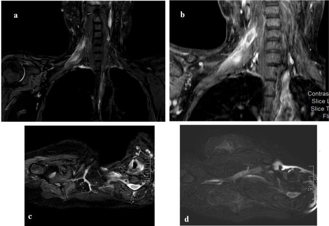
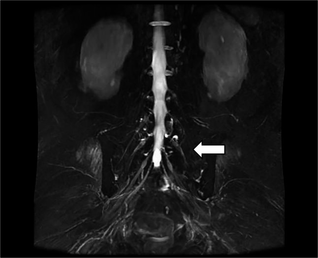
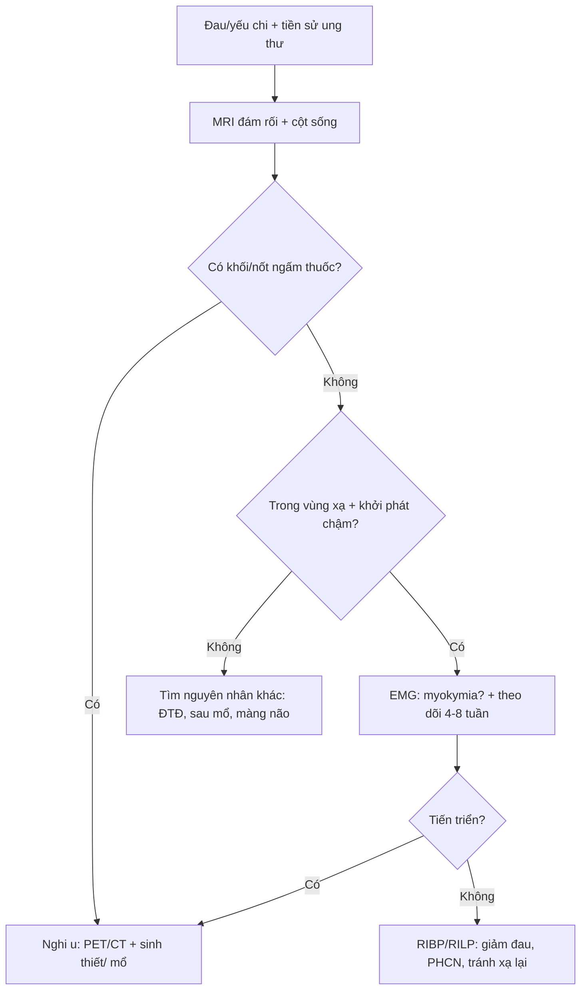
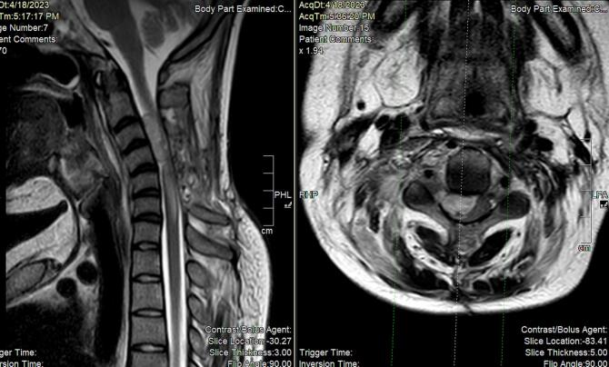

# 1678 — Đau do xâm lấn đám rối thần kinh ở bệnh nhân ung thư: u tái phát vs xạ trị

**Tags:** `pattern:dau-than-kinh` `pattern:dam-roi-day` `pattern:u-xam-lan` `vung:dam-roi-canh-tay` `vung:dam-roi-than-kinh` `protocol:MRI-neurography` `protocol:EMG`
**Mức chắc chắn (certainty):** tổng hợp y văn — chủ yếu ca lâm sàng, loạt hồi cứu và đồng thuận; **không** có thử nghiệm so sánh chiến lược chẩn đoán.

## 1. Tổng quan — vì sao "đau đám rối ở người ung thư" luôn là câu hỏi ung thư

**Giải phẫu – cơ chế:**

- **Đám rối cánh tay** (C5–T1) đi qua **khoang cổ sau, ngách trên đòn, nách** — đúng nơi có hạch, mô mềm, xương đòn, đỉnh phổi.
- **Đám rối thắt lưng–cùng** (L1–S4) nằm **sau phúc mạc và trong khung chậu** — nơi có chuỗi hạch chậu, tử cung, trực tràng, tiền liệt tuyến, xương cùng.
- **Xâm lấn u** gây đau do **chèn ép + xâm nhập bao dây thần kinh** (perineural spread), có thể lan **theo ống sống** gây chèn ép tủy (ca MPNST lan nội tủy — PMC11636133).
- **Xạ trị** gây **xơ hóa** mô quanh thần kinh, **mất myelin/thiếu máu vi mạch** → đau âm ỉ, yếu tiến triển **nhiều tháng–nhiều năm** sau xạ.

**Vì sao không được "đoán già":** hai bệnh cảnh **trùng triệu chứng** nhưng điều trị ngược nhau — u tái phát cần **chẩn đoán mô học/điều trị hệ thống hoặc xạ lại**; xạ trị tổn thương thì **không xạ thêm** (nguy cơ nặng thêm). Bỏ sót u = mất cửa sổ điều trị; xạ nhầm = làm tổn thương không hồi phục.

**Con số nền:**

| Bối cảnh | Số liệu | Nguồn |
|---|---|---|
| RIBP (đám rối cánh tay do xạ) | **~1,2%** bệnh nhân xạ vùng ngực–thành ngực–nách; thể **sớm thoáng qua** và **muộn mạn** | PMC12989313 / PMC12723156 |
| Đám rối thắt lưng–cùng (124 ca, 2000–2024) | Đái tháo đường **34,7%**, sau mổ **25,8%**, vô căn **14,5%**, **do xạ 12,1%**, tự miễn **6,5%**; hồi phục hoàn toàn/gần hoàn toàn **41,2%** | PMC13549159 |
| RILP khởi phát **rất sớm** (vài tuần) | Hiếm, **đáp ứng corticoid rõ** — dễ bị nhầm là tái phát | PMC12874662 |

## 2. Mẫu hình lâm sàng & hình ảnh

**Phân bố đau – yếu giúp định khu:**

- **Đám rối cánh tay:** đau vai → mặt trong cánh tay → ngón; yếu **cơ delta, cơ nhị đầu, cơ dạng ngón út**; **Horner** (xâm lấn hạch giao cảm) là dấu hiệu **ác tính** mạnh.
- **Đám rối thắt lưng:** đau **hông – mặt trước đùi**, yếu **cơ tứ đầu/ cơ thắt lưng chậu**.
- **Đám rối cùng:** đau **mông – mặt sau đùi – bàn chân**, yếu **cơ mác, cơ chày trước**, rối loạn cơ tròn.

**Bốn kiểu hình trên MRI cần phân biệt:**

1. **Khối/nốt xâm lấn** dọc đám rối, ngấm thuốc, có thể lan theo ống sống → **u**.
2. **Dày + T2 tăng lan tỏa, ngấm thuốc mờ, không khối** trong vùng chiếu xạ → **xạ trị** (nhưng vẫn có thể là u thâm nhiễm).
3. **Phù cơ do mất thần kinh (denervation edema)** — T2/STIR sáng ở cơ do tổn thương thần kinh cấp; **không** phải tổn thương cơ.
4. **Di căn màng não/ống sống** — nốt màng tủy, dày rễ, chèn ép tủy.

## 3. Ma trận đối chiếu

| Thực thể | Hình ảnh điển hình | Chốt vào (rule-in) | Chốt loại (rule-out) | Xác nhận |
|---|---|---|---|---|
| **U tái phát/xâm lấn đám rối** | Khối/nốt ngấm thuốc dọc đám rối, bờ không đều, có thể lan nội tủy | **Khối khu trú + ngấm mạnh**, đau dữ dội tăng dần, **Horner**, tiến triển nhanh vài tuần | Không có khối, chỉ T2 sáng lan tỏa **không** loại trừ u thâm nhiễm | Sinh thiết/ mô học; PET/CT hướng dẫn; theo dõi 4–8 tuần |
| **Xạ trị đám rối (RIBP/RILP)** | Dày lan tỏa, T2 sáng, ngấm mờ, **không khối**, trong **vùng chiếu xạ** | Tiền sử xạ đúng vùng; khởi phát **chậm** (tháng–năm); **myokymia** trên EMG | **Không** loại trừ u nếu có khối hoặc đau kiểu tăng dần | EMG (myokymia), MRI lặp; **không** xạ lại mù |
| **Di căn màng não** | Nốt màng tủy, dày rễ, ngấm màng não | DNT dương, nhiều mức rễ | DNT âm một lần không loại trừ | DNT lặp, MRI toàn trục |
| **Bệnh lý không do ung thư** (đái tháo đường, sau mổ, Parsonage–Turner) | Phù/thoái hóa dây, không khối | Bối cảnh, khởi phát cấp, hồi phục | Có khối/tiến triển | EMG, theo dõi |

## 4. Protocol & ngưỡng

**MRI đám rối (thay cho "MRI mềm" không đủ):**

1. **Coronal STIR/ T2 fat-sat** dày 3 mm từ **cột sống cổ đến ngực trên** (cánh tay) hoặc **L1–S4** (thắt lưng–cùng) — không cắt bớt.
2. **3D MR neurography** (MIP) để thấy đường đi và điểm chèn ép.
3. **T1 sau gadolinium** (fat-sat) — khối ngấm thuốc vs dày lan tỏa.
4. **DWI** khi nghi u; so sánh ADC với mô xơ.
5. **MRI cột sống cùng lúc** nếu có yếu chi/ rối cơ tròn (loại trừ chèn ép tủy).

**Điện cơ (EMG/NCS):** xác định **tổn thương trục vs myelin**, mức độ; **myokymia** (co giật cơ liên tục) gợi ý **xạ trị**; **mất dẫn truyền** một phần/ toàn bộ theo thân rễ gợi ý chèn ép.

**Chiến lược khi hình ảnh không phân định:**

**Ngưỡng thực hành:**

- **Theo dõi 4–8 tuần** với MRI lặp + EMG là **an toàn** khi không có khối, không Horner, không yếu tiến triển nhanh.
- **Corticoid**: ca RILP khởi phát sớm đáp ứng rõ (PMC12874662) — có thể dùng như **thử nghiệm chẩn đoán–điều trị** nhưng **không** thay thế việc loại trừ u.
- **PET/CT**: hữu ích khi MRI mơ hồ; **dương tính sau xạ có thể giả** (viêm/xơ) — không chẩn đoán u chỉ bằng SUV.
- **Sinh thiết thần kinh**: tránh; ưu tiên sinh thiết **khối** hoặc mô hạch.

## 5. Biến thể & cạm bẫy

- **RIBP thể sớm thoáng qua** — đừng gọi là u rồi xạ lại; thể muộn tiến triển chậm nhiều năm, không hồi phục hoàn toàn.
- **Myokymia** giúp nghiêng về xạ trị, nhưng **không đặc hiệu 100%**; u thâm nhiễm vẫn có thể gây co giật cơ.
- **"Không thấy khối" ≠ không có u**: u thâm nhiễm dọc bao dây thần kinh có thể chỉ là **dày + T2 sáng**; ca MPNST lan tới **nội tủy** cho thấy giới hạn của MRI thường quy (PMC11636133).
- **Phù cơ do mất thần kinh** bị đọc nhầm thành **viêm cơ/ di căn cơ** → sinh thiết cơ vô ích.
- **Sau mổ/ xạ**: thay đổi hậu phẫu và xơ hóa làm MRI khó đọc; luôn so **ảnh nền trước điều trị**.
- **Đau do ung thư không chỉ do chèn ép**: hội chứng đau sau xạ, đau thần kinh do thuốc (taxane, platinum), đau cơ–xương — đừng quy hết cho "tái phát".

## 6. Tự lượng giá

**Câu 1.** Bệnh nhân ung thư vú, 6 năm sau xạ, đau âm ỉ vai–cánh tay, yếu dần, MRI: dày lan tỏa đám rối, không khối, trong vùng xạ. Hướng đúng?

Đáp án

**Nghi RIBP muộn** (khởi phát chậm, không khối, đúng vùng xạ). Vẫn cần **EMG** (myokymia), **MRI lặp** và theo dõi; **không xạ lại**. Nếu đau tăng nhanh, xuất hiện khối/Horner → chuyển hướng u và sinh thiết.

**Câu 2.** Cùng bệnh nhân nhưng MRI có nốt ngấm thuốc 1,5 cm dọc đám rối, đau dữ dội 3 tuần. Xử trí?

Đáp án

**Coi là u cho tới khi chứng minh khác**: PET/CT + **sinh thiết/chẩn đoán mô học**, không theo dõi đơn thuần. Đau tăng nhanh + khối + có thể Horner là bộ ba gợi ý xâm lấn; xạ lại mù sẽ bỏ lỡ cửa sổ điều trị.

**Câu 3.** MRI thấy T2 sáng ở cơ delta và cơ nhị đầu, không thấy tổn thương dây thần kinh rõ. Kết luận?

Đáp án

Đó là **phù cơ do mất thần kinh (denervation)**, không phải viêm cơ/di căn cơ. Phải **truy tìm tổn thương thần kinh** dọc đám rối/ rễ (MRI neurography + EMG), và **không sinh thiết cơ**.

---

*Không dùng để chẩn đoán độc lập khi chưa có người hướng dẫn. Bài tổng hợp từ ca lâm sàng/loạt hồi cứu; quyết định sinh thiết hay theo dõi phải cá thể hóa theo tiền sử xạ và diễn tiến.*
