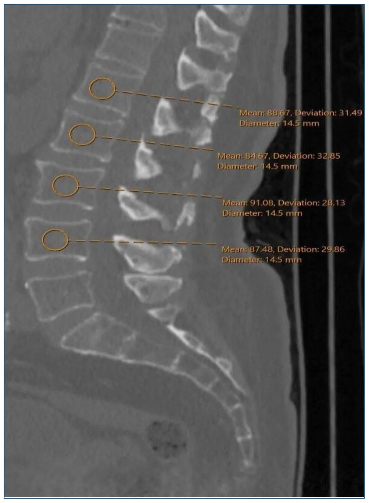
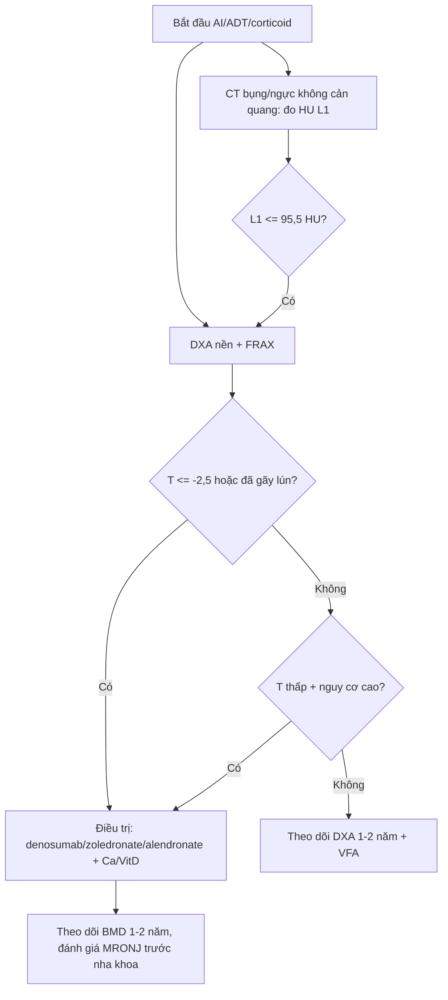
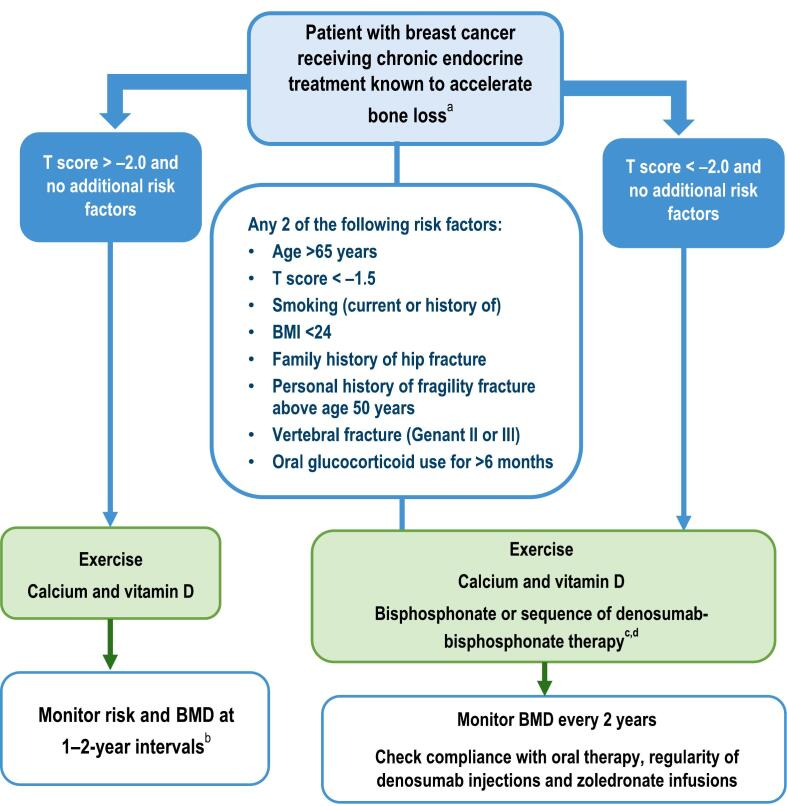
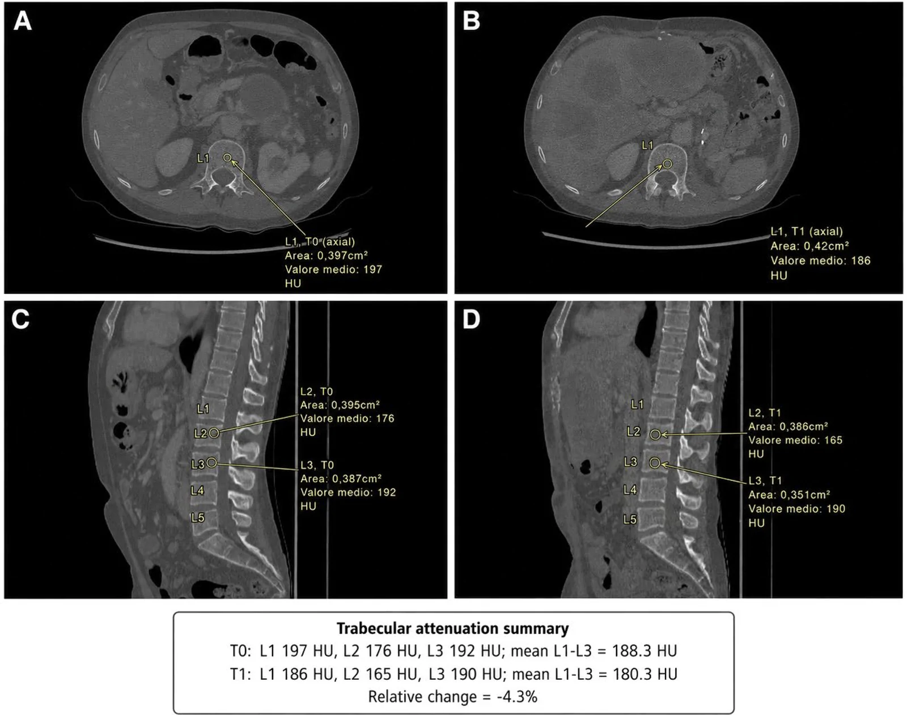

# 1679 — Loãng xương do điều trị ung thư (CTIBL): DXA, FRAX và "hút xương" trên CT

**Tags:** `pattern:loang-xuong` `pattern:gay-xuong-suy-yeu` `vung:cot-song` `protocol:DXA` `protocol:FRAX` `score:FRAX`
**Mức chắc chắn (certainty):** tổng hợp y văn — có đồng thuận chuyên khoa (AIBL) và loạt hồi cứu; **không** có thử nghiệm về việc "đo CT cơ hội có giảm gãy xương hay không".

## 1. Tổng quan — vì sao ung thư làm xương yếu, và vì sao hình ảnh phải "chủ động"

**Cơ chế:** nhiều điều trị ung thư tác động trực tiếp lên chuyển hóa xương:

- **Ức chế aromatase (AI)** ở ung thư vú: giảm estrogen → **tăng hủy xương** (tăng CTX, giảm BMD).
- **Ức chế androgen (ADT)** ở ung thư tiền liệt tuyến: giảm testosterone/estrogen → mất xương nhanh, tăng gãy.
- **Hóa trị, corticoid, xạ trị, TKI** — đều góp phần (PMC11384245).

**TẠI SAO hình ảnh quan trọng:** mất xương **không triệu chứng** cho tới khi gãy; gãy xương do suy yếu làm **tăng tử vong và tàn tật** ngay cả khi ung thư đã lui. Vì vậy phải **đo trước – theo dõi – can thiệp**, không chờ đau.

**Số liệu nền:**

| Bối cảnh | Thay đổi | Nguồn |
|---|---|---|
| ADT 12 tháng (40 nam) | Khối cơ **−6,0%**, mật độ cơ thắt lưng **−7,8%**, mỡ dưới da **+11,6%**, mỡ tạng **+6,2%**, **hút xương đốt sống −4,4%** (p = 0,006) | PMC13686873 |
| Đo HU trên CT bụng thường quy (350 ca) | Trung bình L1–L4: bình thường **149,0**, thiếu xương **120,4**, loãng xương **78,5 HU**; **L1 ≤ 95,5 HU**: Se **84,6%**, Sp **86,4%**, AUC **0,913** | PMC13711640 |
| AI + loãng xương (121 ca) | Denosumab 60 mg/6 tháng vs alendronate 70 mg/tuần: đáp ứng **91,2% vs 82,8%**; BMD tốt hơn và **ít gãy lún hơn** (p < 0,05) | PMC12613706 |

## 2. Mẫu hình: 3 nơi "thấy" xương yếu

1. **DXA (T-score)** — chuẩn chẩn đoán loãng xương; nhưng **không thấy** thay đổi sớm trong 6–12 tháng.
2. **CT thường quy (cơ hội)** — đo **HU đốt sống** trên CT bụng/ngực đã chụp vì lý do khác: không thêm liều, phát hiện sớm người chưa được DXA.
3. **Phim cột sống/ VFA** — phát hiện **gãy lún không triệu chứng** (yếu tố nguy cơ mạnh nhất của gãy tiếp theo).

**Hình thái cần mô tả trên CT:** mật độ tủy xương giảm (HU thấp), **đốt sống "ruột già"** (giảm tín hiệu xương xốp, vỏ mỏng), **lún đốt sống** (mất chiều cao, bờ đốt sống gãy), thay đổi song song với teo cơ và tăng mỡ sau ADT.

## 3. Ma trận đối chiếu

| Phương thức | Đo gì | Chốt vào (gợi ý nguy cơ cao) | Chốt loại (không loại trừ) | Cạm bẫy |
|---|---|---|---|---|
| **DXA** | BMD (g/cm²), T-score tại cột sống/hông | **T ≤ −2,5** = loãng xương; **−1,0 đến −2,5** = thiếu xương | **T bình thường vẫn có thể gãy** nếu có gãy lún/nguy cơ lâm sàng | Thoái hóa, vôi hóa, gãy cũ **làm T cao giả**; đo sai vị trí |
| **FRAX** | Nguy cơ gãy 10 năm (có/không BMD) | Nguy cơ cao → điều trị dù T chưa tới ngưỡng | Không dùng FRAX cho người **đã gãy lún** hoặc đang dùng thuốc xương | FRAX **không có** yếu tố "ung thư/AI/ADT" — dễ đánh giá thấp |
| **CT cơ hội (HU)** | Mật độ tủy xương L1 (và L1–L4) | **L1 ≤ 95,5 HU** (Se 84,6/Sp 86,4); L1–L4 ≤ 95 HU | HU cao **không loại trừ** gãy do chất lượng xương/vi cấu trúc | Phải dùng **CT không cản quang**, cửa sổ mềm, ROI trong tủy; tránh đốt sống gãy/vôi hóa |
| **X-quang/ VFA** | Chiều cao đốt sống, bờ | **Gãy lún ≥ 20% chiều cao** = gãy lún | Không thấy gãy sớm | Bỏ sót gãy nhẹ; khó phân biệt gãy cũ/mới |
| **MRI** | Phù tủy (STIR), gãy cấp vs cũ | Phù tủy = gãy **cấp**; ngấm thuốc | Không dùng để chẩn đoán loãng xương | Nhầm gãy lành với di căn (xem bài 3017) |

## 4. Protocol & ngưỡng

**Ai cần đánh giá xương (trước/trong điều trị):**

- Nữ **AI** hậu mãn kinh; nam **ADT**; người dùng **corticoid kéo dài**, ức chế aromatase + hóa trị, tiền sử gãy lún.
- **DXA nền** + **FRAX** trước hoặc ngay khi bắt đầu; lặp **1–2 năm/lần** (nhanh hơn nếu T thấp hoặc đang dùng thuốc).
- **Đo HU** trên mọi CT bụng/ngực không cản quang ở nhóm này — **miễn phí liều**.

**Ngưỡng thực hành (theo đồng thuận AIBL và dữ liệu trên):**

| Tình huống | Hành động |
|---|---|
| **T ≤ −2,5** hoặc **đã gãy lún** | Điều trị bằng thuốc xương + canxi/vitamin D |
| **−2,5 < T < −1,0** + nguy cơ cao (FRAX cao, corticoid, ADT/AI) | Cân nhắc thuốc; theo dõi 1–2 năm |
| **L1 ≤ 95,5 HU** trên CT | Chuyển **DXA** để xác nhận (không tự điều trị chỉ bằng HU) |
| **Đang dùng denosumab** | **Không ngừng đột ngột** (bùng phát mất xương/gãy lún) — cần liều cuối + thuốc nối |
| **Trước nhổ răng/ phẫu thuật hàm** | Đánh giá nguy cơ **MRONJ**; hoãn nếu có thể (bài 6108) |

**So sánh thuốc (dữ liệu AI + loãng xương):**

- **Denosumab 60 mg SC mỗi 6 tháng**: BMD tăng nhiều hơn, **ít gãy lún hơn** alendronate (p < 0,05), đáp ứng 91,2% vs 82,8% (PMC12613706).
- **Alendronate 70 mg/tuần**: rẻ, uống; cần tuân thủ (đứng 30 phút, uống nước).
- **Zoledronic acid 4 mg IV/năm**: lựa chọn khi không dung nạp đường uống; lưu ý MRONJ.

## 5. Biến thể & cạm bẫy

- **DXA ở cột sống bị thoái hóa/vôi hóa** → T cao giả; nên đọc **hông** hoặc chọn đốt sống ít tổn thương.
- **CT có cản quang** không dùng để đo HU xương (thuốc làm tăng HU) — chỉ dùng **không cản quang**.
- **Đốt sống đã gãy/vôi hóa** làm HU cao; đo **nhiều đốt** và tránh đốt bất thường.
- **FRAX không có AI/ADT** → đừng "yên tâm" khi FRAX thấp ở bệnh nhân đang ADT.
- **Gãy lún không triệu chứng** thường bị bỏ qua trên CT; phải **đo chiều cao đốt sống** khi đọc.
- **Denosumab ngừng đột ngột** gây gãy lún dồn dập — luôn có kế hoạch nối thuốc.
- **MRONJ**: nguy cơ thấp (< 1%) nhưng không bằng 0 ở liều thấp (PMC12615393); khám răng miệng trước khi bắt đầu.
- **Teo cơ – tăng mỡ** sau ADT đi kèm mất xương (SMI −6%, mỡ tạng +6,2%) — đừng chỉ nhìn BMI.

## 6. Tự lượng giá

**Câu 1.** Nam 70 tuổi bắt đầu ADT, CT bụng không cản quang vì lý do khác: L1 = 88 HU. Xử trí?

Đáp án

**Chuyển DXA** (L1 ≤ 95,5 HU gợi ý loãng xương, Se 84,6/Sp 86,4 nhưng **không phải chẩn đoán**). Kết hợp FRAX và đánh giá gãy lún; nếu T ≤ −2,5 hoặc có gãy lún → điều trị. Không tự điều trị chỉ dựa vào HU.

**Câu 2.** Nữ 62 tuổi dùng AI, DXA cột sống T = −1,8, hông T = −2,6. Kết luận?

Đáp án

**Loãng xương** (lấy **giá trị thấp nhất** — hông T ≤ −2,5). Cột sống có thể bị thoái hóa làm T cao giả. Điều trị + canxi/vitamin D; theo dõi BMD.

**Câu 3.** Bệnh nhân đang denosumab 60 mg/6 tháng, muốn ngừng vì "đỡ rồi". Tư vấn?

Đáp án

**Không ngừng đột ngột** — nguy cơ bùng phát mất xương và gãy lún dồn dập. Cần kế hoạch: liều cuối + thuốc nối (bisphosphonate) và theo dõi DXA; quyết định bởi bác sĩ chuyên khoa xương.

## Bài liên quan chéo

- **3017** — Gãy nén đốt sống do loãng xương — vertebroplasty: xử trí cấp khi đã có gãy lún.
- **1650** — Gãy xương sườn và xương đòn sau xạ trị: gãy do xạ, cần phân biệt với gãy suy yếu.
- **1639** — Đau xương do di căn — chọn xạ trị hay SBRT: kiểm soát đau, không nhầm đau di căn với gãy suy yếu.

---

*Không dùng để chẩn đoán độc lập khi chưa có người hướng dẫn. Ngưỡng HU/điều trị thay đổi theo hướng dẫn địa phương; bài không thay thế tư vấn chuyên khoa xương–nội tiết.*
