# 168 — U tủy thượng thận & u cận hạch (pheochromocytoma & paraganglioma — PPGL)

**Tags:** `pattern:khoi-thuong-than` `pattern:paraganglioma` `vung:thuong-than` `vung:paraganglia` `protocol:MIBG-DOTATATE` `incidentaloma:u-thuong-than`
**Mức chắc chắn (certainty):** tổng hợp y văn (literature synthesis) — nhóm tự biên từ y văn mở (Cureus 2026, J Clin Med 2026, Front Endocrinol 2026, Quant Imaging Med Surg 2023, Front Surg 2026, Endocr Connect 2025), số liệu lấy nguyên từ bài gốc.

> **Câu chốt:** "Pheochromocytoma là tắc kè hoa của hình ảnh (imaging chameleon)". Mọi khối **thượng thận hoặc cạnh động mạch chủ ngấm mạnh** — kể cả khi có thải thuốc "kiểu adenoma", kể cả khi MIBG và metanephrine **bình thường** — vẫn phải loại pheo **trước khi sinh thiết/mổ**, vì chọc vào u tủy thượng thận chưa chuẩn bị alpha-block có thể gây **cơn tăng huyết áp chết người**.

## 1. Tổng quan — vì sao khối u này ngấm mạnh, "sáng trên T2" và bị bỏ sót

- **Bệnh học (pathology):** pheo và paraganglioma (PGL) cùng xuất phát từ **tế bào ưa crôm (chromaffin cells)** — pheo ở **tủy thượng thận**, PGL ở **hạch cận giao cảm ngoài thượng thận** (Zuckerkandl, chuỗi paravertebral, bàng quang) hoặc **đối giao cảm đầu–cổ** (thân cảnh, đám rối tĩnh mạch, thần kinh lang thang, màng nhĩ). Cùng mô học → **khác vị trí là khác tên gọi**; chỉ tế bào lan tới ổ không ưa crôm (di căn) mới gọi là **ác tính** (WHO 2022) — không có tiêu chuẩn vi thể nào tự đủ để gọi "ác".
- **TẠI SAO ngấm mạnh trên CT/MRI:** u giàu **mạng mao mạch + xoang máu** giữa các ổ tế bào → **cản quang vào sớm ở thì động mạch** rồi ngấm bền; hoại tử/đôi khi **ung thư hóa (cystic/necrotic)** làm ngấm không đồng nhất. Đậm độ sau tiêm trung bình ~**109,93 ± 38,28 HU** (ca 47 u xác nhận mô bệnh) — gần như luôn **> 10 HU**, rất khác adenoma giàu mỡ.
- **TẠI SAO "sáng" trên T2 ("dấu bóng đèn" / light-bulb):** tế bào ưa crôm **giàu nước** trong bào tương → tín hiệu **T2 rất cao**; trên chuỗi **T1 in-phase/out-of-phase KHÔNG tụt tín hiệu** (không có mỡ vi thể — khác adenoma). Ngoài ra **hoại tử và tăng sinh mạch** làm u **không đồng nhất**.
- **TẠI SAO MIBG bắt xạ:** ¹²³I-MIBG vào tế bào qua **chất vận chuyển noradrenaline (NET)** → cần u còn biệt hóa/tổng hợp catecholamine; u **im lặng sinh hóa, kém biệt hóa** có thể **MIBG ÂM**.
- **TẠI SAO ⁶⁸Ga-DOTATATE và ¹⁸F-FDG bổ trợ nhau:** DOTATATE gắn **thụ thể somatostatin (SSTR)** (còn nhiều ở u biệt hóa, dùng cho PRRT); FDG phản ánh **chuyển hóa glucose/giảm biệt hóa** — tăng ở **SDHB đột biến, di căn, hung hãn**.

**Ngưỡng định lượng bắt buộc (mục 1 & 4):**
- **CT:** u **> 10 HU** khi không tiêm; ngấm mạnh khi động mạch (thường **> 100 HU**); **thải thuốc có thể đạt "chuẩn adenoma" (APW ≥ 60% / RPW ≥ 40%) → KHÔNG loại trừ pheo** (bài 155 có ca pheo ác thải 89%; ca MEN 2A dưới đây thải APW **50% và 58%**).
- **MRI — 4 dấu hiệu chìa khóa (tần suất trong 47 ca xác nhận mô bệnh):** **T2 rất sáng 97,7%** · **không đồng nhất nội tại 93,2%** · **ngấm sớm 95,4%** · **không tụt tín hiệu trên T2 fat-sat 94,5%**. T2 sáng **rất nhạy nhưng KHÔNG đặc hiệu** (u khác cũng sáng).
- **Sinh hóa:** plasma **free metanephrine/normetanephrine**; tăng metanephrine niệu/huyết 57–77% trong ca bệnh; **5–15% bệnh nhân KHÔNG tăng huyết áp** ("im lặng lâm sàng"). Quy tắc "10%" (10% ngoài thượng thận, 10% gia đình, 10% hai bên...) **đã lỗi thời** — nay **~40% PPGL mang đột biến dòng mầm**, SDHx chiếm ~15%.
- **Dịch tễ:** tần suất tăng từ ~0,2 (trước 2000) lên ~**0,6/100.000/người/năm** (sau 2010); pheo **75–95% lành**, PGL **nguy cơ ác cao hơn (tới ~50%** tùy vị trí/gene); tái phát sau cắt ~**10%**.
- **Phân tử:** **PASS > 4** (Pheochromocytoma of the Adrenal Gland Scaled Score, 12 đặc điểm vi thể) hoặc **GAPP** (Grading System for Adrenal Pheo/PGL) phân độ thấp/trung bình/cao; nhưng **chỉ di căn mới xác định "ác"**. Ca GAPP 4 (trung bình) + Ki-67 **1–3%**.

## 2. Mẫu hình + chẩn đoán phân biệt theo vị trí & sinh hóa (Gamut)

- **Mẫu hình A — khối THƯỢNG THẬN ngấm mạnh (+ "sáng" T2):** pheo (ưu thế **noradrenaline + adrenaline**); phân biệt **di căn** (kém ngấm hơn, tiền sử K), **ung thư vỏ thượng thận (ACC)** (to > 4–6 cm, bờ không đều, xâm lấn), **adenoma nghèo mỡ** (thải đạt — nhưng xem cạm bẫy!), **u mỡ cơ mạch (myelolipoma)** (mỡ < −30 HU).
- **Mẫu hình B — khối CẠNH ĐỘNG MẠCH CHỦ / cạnh sống ngấm mạnh:** **PGL giao cảm** (cơ quan Zuckerkandl, chuỗi giao cảm ngực–bụng). Thường **chỉ tiết noradrenaline/dopamine** → normetanephrine ± **3-methoxytyramine**.
- **Mẫu hình C — khối trong THÀNH BÀNG QUANG:** **PGL bàng quang** — **cơn tăng huyết áp khi đi tiểu (micturition attack)**, tiểu máu; **83% có chức năng**; đặc điểm "phẳng" hơn pheo (thường **không có dấu bóng đèn T2**), nằm **dưới niêm mạc** → thấy **"đường niêm mạc bàng quang"** bao quanh, chân rộng.
- **Mẫu hình D — khối ĐẦU–CỔ (khoang cảnh) ngấm mạnh ở chạc ba động mạch cảnh:** **PGL thân cảnh/đối giao cảm** — **dấu "tách/giãn chạc cảnh" (splaying of the carotid bifurcation)** trên CTA/MRI, **blush mạnh** trên DSA; thường **không tiết catecholamine**. Gợi nhớ vị trí theo **Shamblin I–III** (mức dính/nuốt động mạch cảnh) để lập kế hoạch mổ.
- **Gợi nhớ theo "chữ P" (Pheo/PGL):** **P**aroxysmal HTN · **P**alpitations · **P**erspiration · **P**allor/headache; **P**ost-micturition (PGL bàng quang); **P**aternal inheritance (**SDHD/SDHAF2** — di truyền theo cha).

## 3. Bảng so sánh phân biệt (ma trận đối chiếu)

| Thực thể (entity) | Hình ảnh điển hình | Chốt vào (rule-in) | Chốt loại (rule-out) | Gợi ý xác nhận |
|---|---|---|---|---|
| **Pheo thượng thận** | Khối thượng thận **ngấm mạnh thì ĐM, không đồng nhất** (hoại tử/nang); **T2 rất sáng**, không tụt tín hiệu trên T2 fat-sat | **Khối thượng thận > 10 HU + T2 "bóng đèn" + metanephrine tăng** | ≤ 10 HU không tiêm + tụt tín hiệu in/out-of-phase = adenoma giàu mỡ | Plasma free metanephrines; ¹²³I-MIBG / ⁶⁸Ga-DOTATATE / ¹⁸F-FDG |
| **PGL giao cảm ngoài thượng thận** | Khối **cạnh ĐMC/cạnh sống** ngấm mạnh, hình tròn–bầu dục | **Khối cạnh ĐMC ngấm mạnh + normetanephrine/3-methoxytyramine tăng** | Nốt mỡ đại thể (−10 đến −100 HU) → nghĩ u mỡ cơ mạch/hạch mỡ | CT/MRI bụng–chậu; DOTATATE PET/CT (đa ổ) |
| **PGL bàng quang** | Khối **dưới niêm mạc, chân rộng**, ngấm mạnh; **"đường niêm mạc"** bao quanh; thường **không có T2 bóng đèn** | **Cơn THA khi đi tiểu + khối thành bàng quang ngấm mạnh** | Ngấm tiến triển + bờ rau cải + ít mạch = ung thư biểu mô bàng quang | Siêu âm Doppler (RI thấp ~0,60) + MRI; metanephrine; cấm TURBT trước alpha-block |
| **PGL đầu–cổ (thân cảnh…)** | **Tách/giãn chạc ba cảnh**, ngấm mạnh, **flow void**; **blush** trên DSA | **Khối ở chạc cảnh + tách ĐM cảnh trong/ngoài** | Khối đẩy lệch nhưng không tách chạc = schwannoma/hạch khác | CTA/MRI ± DSA; DOTATATE PET/CT; Shamblin I–III |
| **Di căn thượng thận** | Khối ngấm mạnh **không đồng nhất**, thường **hai bên**, khối ngoài thượng thận cùng lúc | **Tiền sử K + hai bên + tổn thương ngoài thượng thận** | T2 bóng đèn + metanephrine tăng rõ = pheo | PET/CT, chọc hút chỉ khi đã loại pheo |
| **Adenoma nghèo mỡ** | Ngấm sớm rồi **thải nhanh**; **tụt tín hiệu chemical-shift** | **APW ≥ 60% / RPW ≥ 40% + tụt tín hiệu in/out-of-phase** | **Có T2 bóng đèn + không tụt tín hiệu + lâm sàng cơn** → **KHÔNG loại pheo dù thải đạt** | Washout 15 phút; metanephrine trước khi tin "adenoma" |

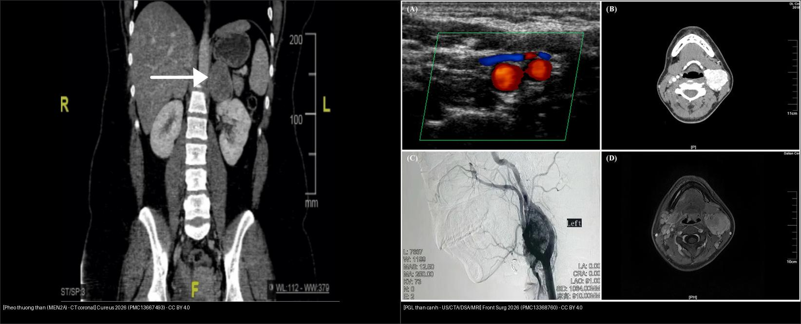
*Trái: **pheo thượng thận** (MEN 2A) — khối ngấm mạnh cạnh thận trên CT coronal. Phải: **PGL thân cảnh** — khối ngấm mạnh ở chạc ba cảnh với tách động mạch cảnh trong/ngoài (US/CTA/DSA/MRI). Chốt: **cùng mô học ưa crôm, khác vị trí → khác tên gọi và khác cách tiếp cận** (thượng thận = alpha-block trước mổ; đầu–cổ = Shamblin/vessel-preserving). Nguồn: Albugami S et al., Cureus 2026 (PMC13667493) + Zhou W et al., Front Surg 2026 (PMC13368760), CC BY 4.0. Ảnh ghép letterbox.*

## 4. Protocol chụp + phác đồ chức năng + sơ đồ ra quyết định

- **Sinh hóa TRƯỚC hình ảnh:** plasma **free metanephrines** (hoặc metanephrine niệu 24 giờ); thêm **3-methoxytyramine** khi nghi PGL (dopamine). **Không sinh thiết, không can thiệp** trước khi loại pheo.
- **CT:** bụng–chậu **có + không cản quang** (đo HU, washout 15 phút) khi cần phân biệt adenoma. **Lưu ý an toàn:** cản quang **không gây khủng hoảng** ở đa số ca (31/47 ca chụp cản quang không chuẩn bị alpha-block, không biến cố) — nhưng vẫn khuyến cáo **alpha-block trước mọi thủ thuật** nghi pheo.
- **MRI (ưu tiên ở người trẻ, thai, cần theo dõi lặp, dị ứng cản quang):** T1 in/out-of-phase + **T2 (fat-sat)** + **T1 fat-sat sau tiêm** + **DWI/ADC**; chú ý **4 dấu hiệu** ở mục 1.
- **Hình ảnh chức năng — chọn "bộ ba" theo mục tiêu:**

| Modality (bài này) | Cơ chế | Ưu điểm (số liệu n=38 ca ba phương thức) | Vai trò chính |
|---|---|---|---|
| **¹⁸F-FDG PET/CT–MRI** | Chuyển hóa glucose | **Phát hiện chung 94,7%**; **di căn 16/16 = 100%**; 100% ở SDHB/VHL | Đánh giá **toàn thân + độ hung hãn** ("FDG-first") |
| **⁶⁸Ga-DOTATATE PET/CT** | Thụ thể SSTR | Phát hiện chung 92,1%; di căn 92,3%; **ưu việt cho đầu–cổ** | Chọn **PRRT (¹⁷⁷Lu-DOTATATE)**; đa ổ |
| **¹²³I-MIBG SPECT/CT** | Chất vận chuyển noradrenaline | Phát hiện chung 89,5%; **di căn chỉ 84,6%** (di căn pheo 3/7 = 42,9%) | **Chọn bệnh nhân cho ¹³¹I-MIBG therapy** |

- **Ngưỡng SUV gợi ý:** PPGL **khó** khi **FDG SUVmax < 2,1** và **DOTATATE < 4,3**; **nhiều khả năng** khi **> 10,8** và **> 24,5**.
- **Sinh học:** **FDG SUVmax** tương quan với **3-methoxytyramine** (r = 0,56; p = 0,0034) — dấu ấn của u tiết dopamine/ngoài thượng thận/di căn.
- **Sàng lọc người mang đột biến SDHx (không triệu chứng):** bắt đầu **SDHB từ 6 tuổi**, các gen khác (**SDHD/SDHC/SDHA/SDHAF2**) **từ 10 tuổi**; ca SDHC trẻ nhất được báo cáo **8 tuổi**. **SDHD & SDHAF2 di truyền theo cha** (in dấu nguồn gốc — paternal).
- **Ngưỡng gen:** germline ~**40%** PPGL; **SDHB** → nguy cơ di căn cao nhất (**51,7%**); các SDHx khác **~29,4%**; **SDHAF2 penetrance 87,5%**.
- **MEN 2A (RET):** **MTC ~100%**, **pheo ~50%**, **cường cận giáp 10–20%**; **RET dương 98%**; phải **cắt thượng thận TRƯỚC tuyến giáp/cận giáp** để tránh khủng hoảng THA khi mổ.

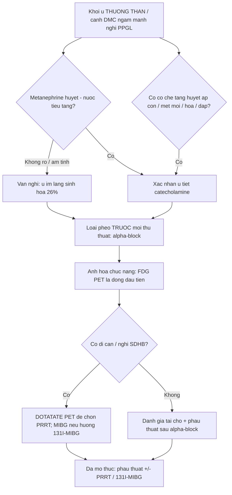

## 5. Biến thể bình thường và cạm bẫy

- **"Thải thuốc đạt chuẩn adenoma" không loại trừ pheo:** pheo (và di căn RCC/HCC giàu mạch) có thể thải APW ≥ 60% → luôn đối chiếu **T2 bóng đèn + không tụt tín hiệu chemical-shift + metanephrine** (nối bài 155).
- **MIBG âm KHÔNG loại trừ:** 3/47 ca **im lặng sinh hóa + MIBG âm**, chỉ chẩn đoán nhờ mô bệnh sau mổ (u nhỏ, kém biệt hóa). Có **T2 bóng đèn** vẫn phải chuyển sang DOTATATE/FDG.
- **T2 bóng đèn không đặc hiệu:** một số di căn và u khác cũng sáng T2 → cần kết hợp bối cảnh + sinh hóa.
- **Xuất huyết thượng thận che lấp u:** máu tụ lớn làm mờ u → **chụp lại sau khi máu tụ tiêu** để lộ khối ngấm mạnh (ca đau hông lưng cấp, thiếu máu, huyết áp bình thường vẫn có thể là pheo xuất huyết).
- **Bẫy bàng quang:** PGL bàng quang **không có dấu bóng đèn T2** điển hình; dễ bị đọc nhầm ung thư biểu mô bàng quang → **ngấm mạnh + đường niêm mạc bảo tồn + cơn THA khi tiểu** là chốt. **TURBT trước alpha-block có thể gây khủng hoảng THA**.
- **Bẫy giải phẫu (mặt cắt):** khối ngấm mạnh **cạnh ĐMC** dễ bị gọi "hạch to" hoặc "u mỡ cơ mạch" — nếu **không có mỡ (−10 đến −100 HU)** và **ngấm mạnh thì ĐM** → nghĩ PGL.
- **Lành/hóa trị "sớm":** u PGL giao cảm **có thể tiến triển ung thư hóa (dedifferentiation)** theo thời gian, biểu hiện bằng **mất ngấm DOTATATE + tăng FDG** → cần theo dõi.
- **Sai lầm nguy hiểm:** sinh thiết/đốt u thượng thận **> 10 HU** chưa loại pheo.

## 6. Tự lượng giá — Blind Quiz

**Ca 1 — Nữ 23 tuổi, đau đầu từng cơn + hồi hộp + vã mồ hôi 2 tháng, THA 178/97 mmHg; CT bụng cản quang (coronal). Đọc khối thượng thận trước khi xem đáp án.**

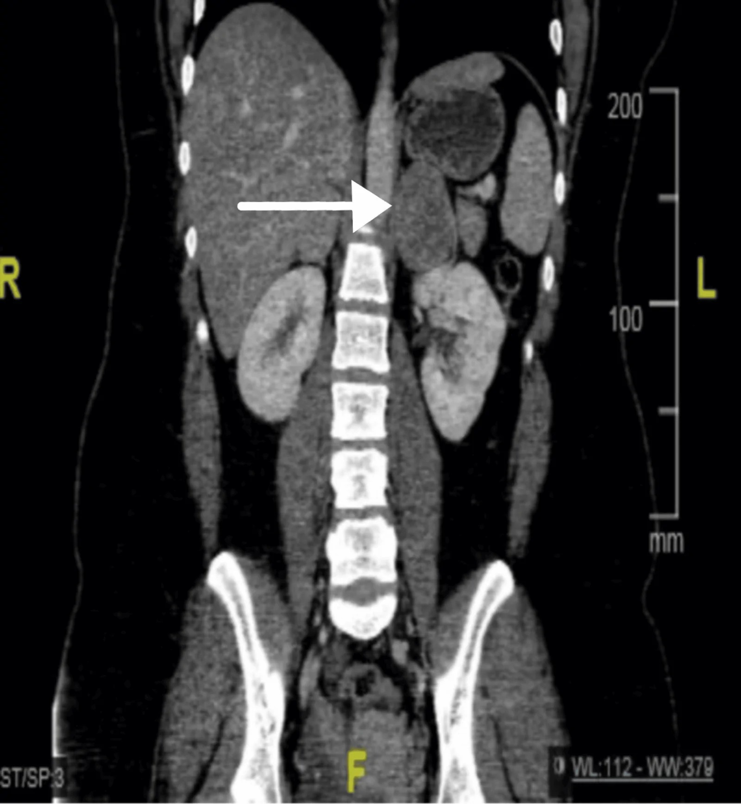

- Gợi ý lâm sàng: trẻ, THA kịch phát, có hạch giáp/thuốc.
- Câu hỏi: mô tả khối thượng thận hai bên? Vì sao phải kiểm tra tuyến giáp? Chẩn đoán hội chứng?

<b>Bấm để hiện đáp án (findings + chẩn đoán)</b>

- **Dấu hiệu (findings):** **khối thượng thận HAI BÊN** ngấm mạnh không đồng nhất (P: 4,2 × 3,6 cm; T: 5 × 3,8 cm), có **hoại tử**; CT còn thấy khối/tuyến giáp cần đánh giá.
- **Chẩn đoán:** **pheochromocytoma hai bên trong MEN 2A** (kèm **ung thư giáp thể tủy — MTC** và cường cận giáp có thể). Phân biệt: di căn hai bên, ACC, adenoma. **Chốt:** **u thượng thận hai bên ở người trẻ + MTC + RET dương = MEN 2A**.
- **Xử trí:** **alpha-block (phenoxybenzamine) trước mổ**; **cắt thượng thận trước tuyến giáp**; tầm soát gen RET cho gia đình. Tái phát sau cắt ~10% → theo dõi ≥ 10 năm. Ca này có **thải thuốc APW 50–58%** (gần "chuẩn adenoma") — minh họa cạm bẫy.
- Nguồn: Albugami S et al., Cureus 2026, Fig. 1, PMC13667493, CC BY 4.0.

**Ca 2 — Cùng bệnh nhân, theo dõi sau mổ: PET/CT phát hiện tổn thương tái phát. Bạn nhìn thấy gì?**

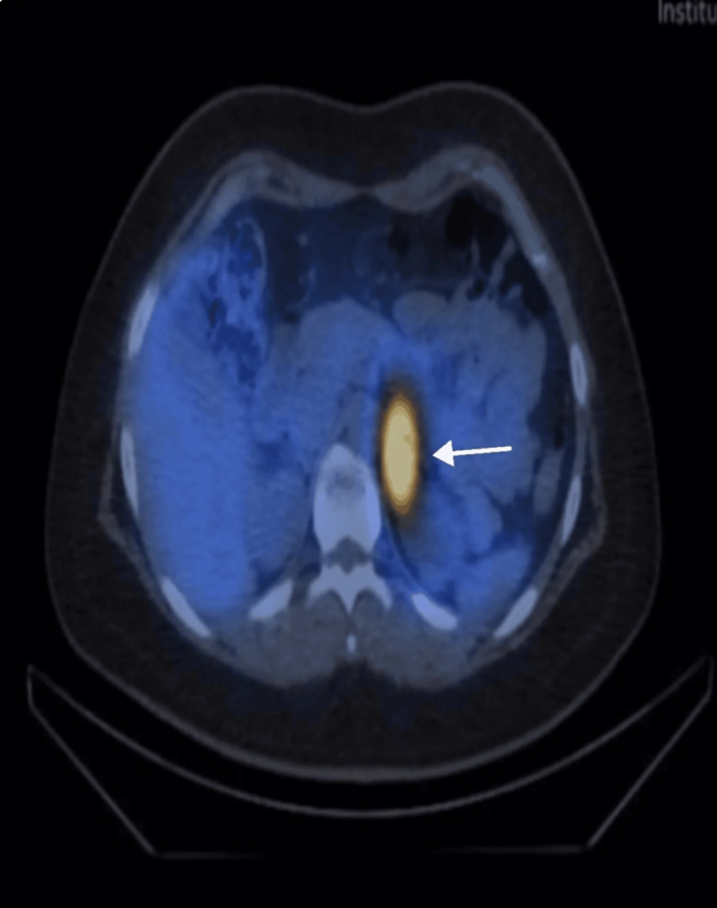

<b>Bấm để hiện đáp án (findings + chẩn đoán)</b>

- **Dấu hiệu:** **nhiều nốt ngấm FDG mạnh ở giường thượng thận trái** (khớp với MIBG trước đó) = **pheo tái phát/tồn dư**; khối dính tĩnh mạch thận khi mổ.
- **Chẩn đoán:** **pheo tái phát** (PASS 4 → xếp "ác tính"), được xử trí **cắt khối + xạ ¹³¹I-MIBG bổ trợ**. Chốt: **PET/CT bắt đúng di căn xương (ĐM sống T1, T7, sườn 8, khung chậu) khi hình cắt lớp bỏ sót**.
- Nguồn: Albugami S et al., Cureus 2026, Fig. 4, PMC13667493, CC BY 4.0.

**Ca 3 — Đau hông lưng phải cấp + thiếu máu (Hb 93 g/L), huyết áp BÌNH THƯỜNG. CT ban đầu có máu tụ lớn quanh thận. Nhìn hai lần chụp (ban đầu → theo dõi), có gì thay đổi?**

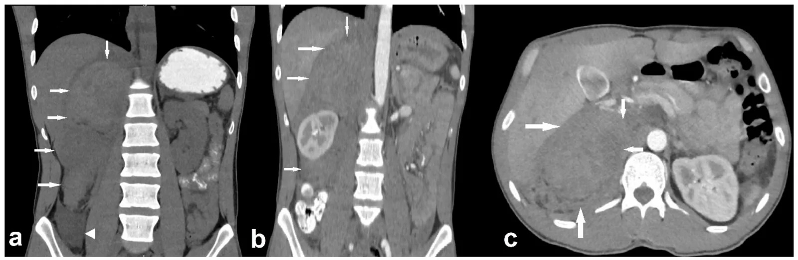

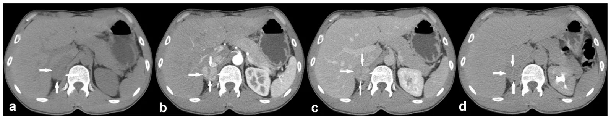

- Gợi ý: ban đầu đọc là "máu tụ sau phúc mạc"; MRI tiếp theo vẫn gợi "máu tụ bán cấp".
- Câu hỏi: vì sao phải chụp lại? Khối còn lại sau khi máu tụ tan gợi ý gì? Xét nghiệm nào xác nhận?

<b>Bấm để hiện đáp án (findings + chẩn đoán)</b>

- **Dấu hiệu:** ban đầu **máu tụ lớn ngấm hỗn hợp ở khoang sau phúc mạc phải** (che lấp u); theo dõi thấy khối **giảm kích thước nhưng còn nhân ngấm mạnh thì động mạch**. MRI còn gợi "máu tụ bán cấp", **¹²³I-MIBG sau đó DƯƠNG ở thượng thận phải**.

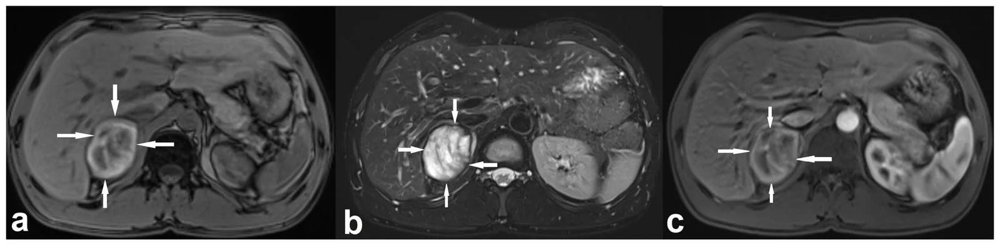

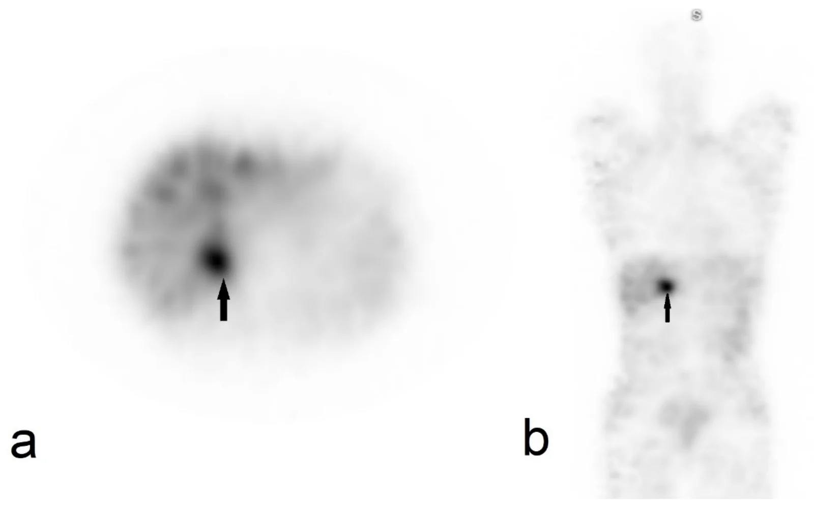

- **Chẩn đoán:** **pheo xuất huyết tự phát ở bệnh nhân KHÔNG tăng huyết áp** — **metanephrine tăng dần (normetanephrine 1,91 → 3,83 nmol/L) + MIBG dương** xác nhận; mổ sau **alpha-block (doxazosin)**, mô bệnh pheo GAPP 4, Ki-67 1–3%.
- **Chốt:** **máu tụ thượng thận "đơn thuần" phải theo dõi hình ảnh tới khi hết; khối còn lại ngấm mạnh = u nền**; pheo **có thể không THA** (5–15%).
- Nguồn: Ramanauskas J et al., J Clin Med 2026, Fig. 1, 2, 4 & 5, PMC13607346, CC BY 4.0.

**Ca 4 — (A–C) bệnh nhân pheo lành thượng thận trái; (D–F) bệnh nhân PGL bụng. So sánh ba phương thức chức năng.**

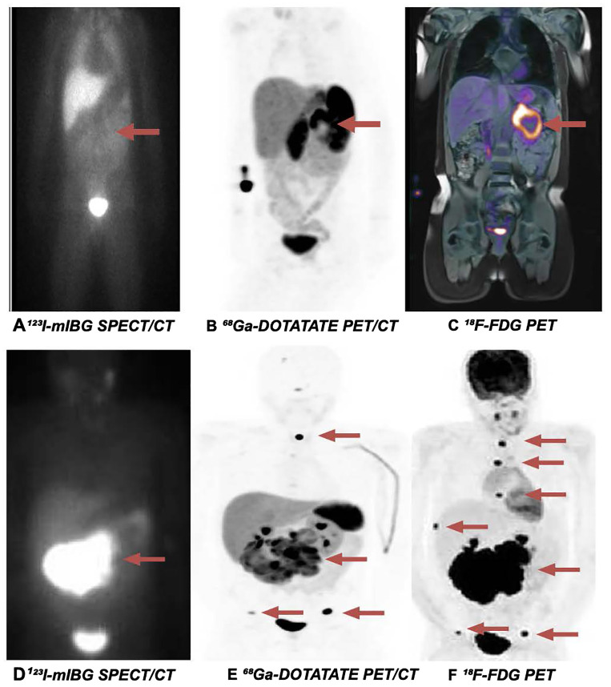

- Câu hỏi: ở hàng trên (A–C), phương thức nào dương/âm? Ở hàng dưới (D–F), phương thức nào bắt được di căn xương nhiều nhất?

<b>Bấm để hiện đáp án (findings + chẩn đoán)</b>

- **Hàng trên (pheo lành):** **(A) ¹²³I-MIBG ÂM** dù u ngấm mạnh trên **(B) DOTATATE** và **(C) FDG** (có **photopenia trung tâm** do hoại tử).
- **Hàng dưới (PGL bụng):** **(D) MIBG** chỉ thấy tổn thương nguyên phát; **(E) DOTATATE** thấy **di căn xương** (sọ, cột sống, khung chậu); **(F) FDG** thấy **gánh nặng di căn nhiều nhất** (mỏm gai T1 SUVmax 17,7; T7 9,1; sườn 8, khung chậu hai bên).
- **Chốt:** **FDG phát hiện chung 94,7% > DOTATATE 92,1% > MIBG 89,5%**; **FDG thắng rõ ở di căn** (100% vs 92,3% vs 84,6%). **MIBG vẫn cần** để chọn **¹³¹I-MIBG therapy**.
- Nguồn: Alhazzaa N et al., Front Endocrinol 2026, Fig. 2, PMC13433214, CC BY 4.0.

**Ca 5 — Nữ 40 tuổi, tiểu máu + tăng huyết áp khi đi tiểu; MRI khung chậu.**

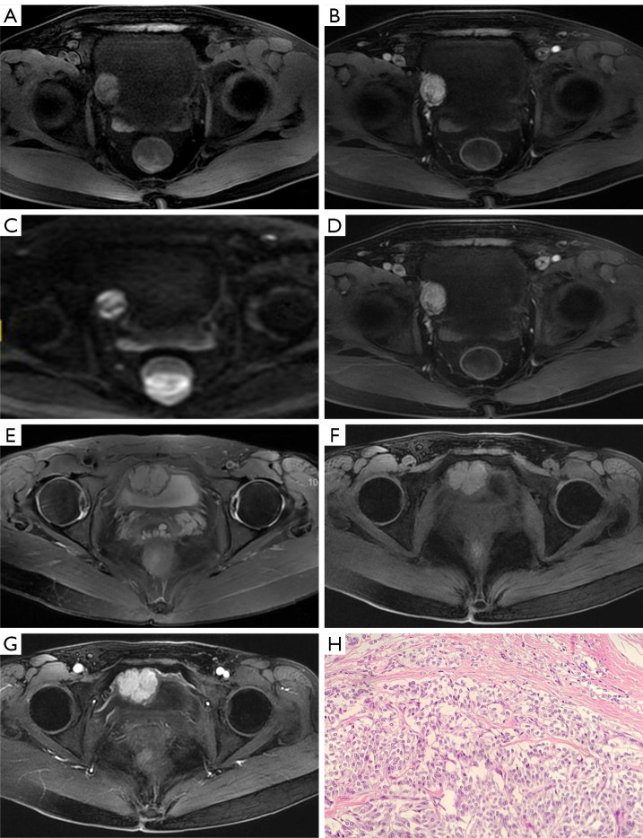

- Câu hỏi: khối ở lớp nào của thành bàng quang? Vì sao "đường niêm mạc" quanh khối là chốt? Chẩn đoán và xử trí bắt buộc trước mổ?

<b>Bấm để hiện đáp án (findings + chẩn đoán)</b>

- **Dấu hiệu:** khối **dưới niêm mạc (submucosal), chân rộng** trong thành bàng quang, **"đường niêm mạc bàng quang" bảo tồn bao quanh**, ngấm mạnh, DWI hạn chế; Doppler **RI thấp 0,60** (giàu mạch).
- **Chẩn đoán:** **paraganglioma bàng quang** (83% có chức năng). **Chốt vào:** cơn THA khi tiểu + khối dưới niêm mạc ngấm mạnh. **Chốt loại:** ung thư biểu mô bàng quang thường ngấm tiến triển, bờ rau cải, ít mạch.
- **Xử trí:** **alpha-block trước mọi can thiệp** — **TURBT chưa chuẩn bị có thể gây khủng hoảng THA tới 230/150 mmHg**; đây là lý do phải nghĩ PGL trước khi nội soi cắt.
- Nguồn: Yu W et al., Quant Imaging Med Surg 2023, Fig. 3, PMC10006104, CC BY-NC-ND 4.0 (giữ nguyên bản).

**Ca 6 — Nữ 20 tuổi, khối cổ bên trái không đau; đa phương thức hình ảnh.**

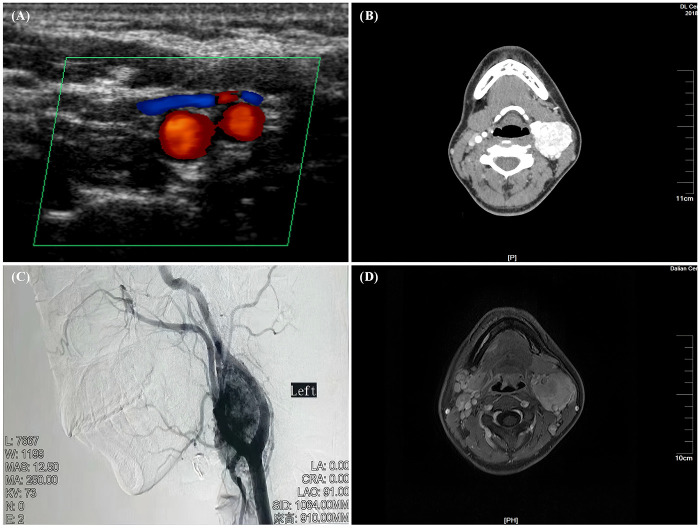

- Câu hỏi: dấu hiệu nào định vị khối ở **chạc ba cảnh** thay vì thần kinh khác? Shamblin đóng vai trò gì?

<b>Bấm để hiện đáp án (findings + chẩn đoán)</b>

- **Dấu hiệu:** khối **ngấm mạnh tập trung ở chạc ba động mạch cảnh**, **tách (splay) động mạch cảnh trong và ngoài**, **blush mạnh trên DSA**, **flow void** trong MRI → **PGL thân cảnh**.
- **Chẩn đoán:** **carotid body paraganglioma** (PGL đối giao cảm đầu–cổ, thường **không tiết catecholamine**). **Shamblin I–III** mô tả mức độ dính/nuốt mạch cảnh để dự liệu mổ (ca này ước Shamblin II, bảo tồn mạch).
- **Chốt:** **khối khoang cảnh tách chạc cảnh + ngấm mạnh + flow void = PGL thân cảnh**; người trẻ → **nên tầm soát gen SDHx** (bài này không có kết quả gen — điểm hạn chế của ca).
- Nguồn: Zhou W et al., Front Surg 2026, Fig. 1, PMC13368760, CC BY 4.0.

**Ca 7 — Bệnh nhân trẻ, đa u: ⁶⁸Ga-DOTATATE PET/CT (hàng trên) và MRI (hàng dưới). Tổn thương ở đâu, gợi ý gen/hội chứng nào?**

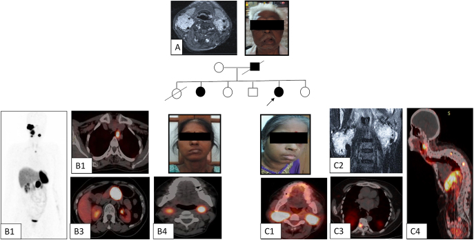

<b>Bấm để hiện đáp án (findings + chẩn đoán)</b>

- **Dấu hiệu:** **PGL đầu–cổ hai bên (HNPGL)**, **PGL trung thất và cạnh ĐMC**, kèm **di căn xương sống** trên **⁶⁸Ga-DOTATATE PET/CT**; bố và hai con cùng đột biến.
- **Chẩn đoán:** **hội chứng PGL di truyền gen SDHAF2** (di truyền **theo cha**, penetrance **87,5%**, thường HNPGL; hiếm khi di căn — ca chỉ điểm này có di căn xương).
- **Chốt:** **⁶⁸Ga-DOTATATE PET/CT nhạy nhất cho tổn thương nguyên phát và di căn SDHx** (di căn **98%** vs CECT 72% / FDG 67,8% / MIBG 70,2%); **hàng loạt HNPGL hai bên ở người trẻ = nghĩ SDHx, tầm soát gia đình**.
- Nguồn: Ambulkar KS et al., Endocr Connect 2025, Fig. 1, PMC12508308, CC BY-NC 4.0 (giữ nguyên bản).

**Ca 8 — Bệnh nhân pheo, MIBG ÂM, sinh hóa chỉ tăng nhẹ/bình thường. Nhìn T2 và MIBG, bạn kết luận thế nào?**

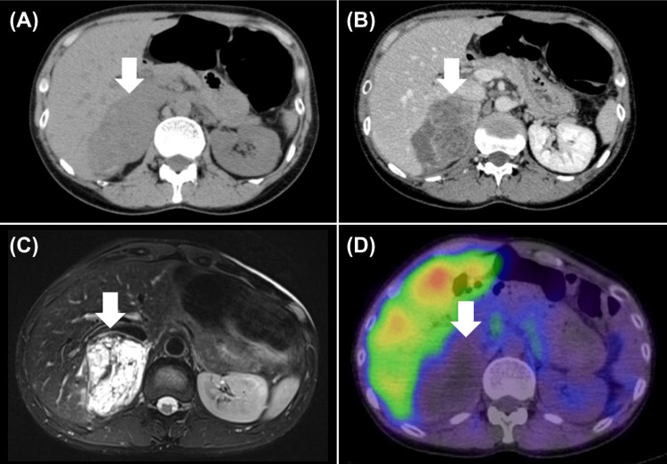

<b>Bấm để hiện đáp án (findings + chẩn đoán)</b>

- **Dấu hiệu:** (A) không tiêm, (B) cản quang ngấm nhẹ, (C) **T2 rất sáng**, (D) **¹²³I-MIBG ÂM**. Một trong 3 ca **im lặng sinh hóa + MIBG âm** chỉ chẩn đoán nhờ mô bệnh sau mổ.
- **Chẩn đoán:** **pheochromocytoma** — dù MIBG âm. Chốt: **MIBG dương chỉ 85,1% (40/47)**, u nhỏ/kém biệt hóa dễ âm; **T2 bóng đèn + không tụt tín hiệu fat-sat** hỗ trợ.
- **Nguồn/bài học:** MRI (đặc biệt T2) hữu ích khi sinh hóa và xạ hình không kết luận; **alpha-block vẫn phải chuẩn bị** trước mổ.
- Nguồn: Sekido T et al., Cureus 2026, Fig. 2, PMC13250717, CC BY 4.0.

**Ca 9 — Thuật toán: bệnh nhân nghi PPGL, nên chọn hình ảnh chức năng nào trước? Chỉ nhìn sơ đồ.**

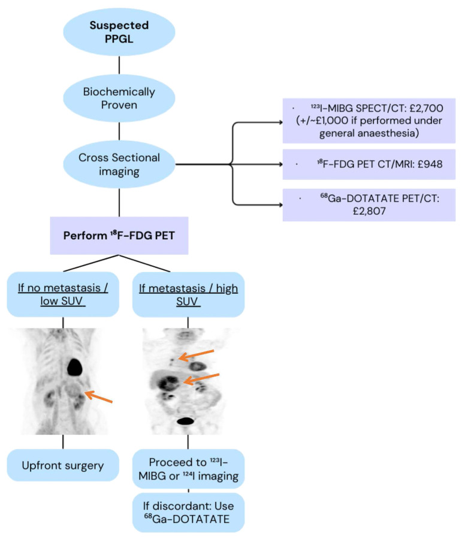

<b>Bấm để hiện đáp án (findings + chẩn đoán)</b>

- **Đáp án:** **¹⁸F-FDG PET/CT–MRI là bước chức năng đầu tay** (phát hiện cao nhất 94,7%, có sẵn, rẻ hơn); **nếu di căn/SUV cao/SDHB** → bổ sung **⁶⁸Ga-DOTATATE** (chọn PRRT) hoặc **¹²³I-MIBG** (chọn ¹³¹I-MIBG therapy).
- **Chốt:** **FDG để chẩn đoán/phân giai đoạn; MIBG & DOTATATE để chọn điều trị phóng xạ (theranostic)**.
- Nguồn: Alhazzaa N et al., Front Endocrinol 2026, Fig. 3, PMC13433214, CC BY 4.0.

## Bài liên quan chéo
- [100 – Tổng quan hệ Bụng](../100-tong-quan-he-bung/lesson.md) (bảng DDx bắt buộc)
- [155 – Khối thượng thận tình cờ & Washout](../155-thuong-than-tinh-co/lesson.md) (bẫy pheo thải thuốc "kiểu adenoma")
- [156 – Hội chứng di truyền u thận: VHL/BHD/HLRCC/TSC/SDH](../156-hoi-chung-di-truyen-u-than/lesson.md) (VHL/SDH → pheo/PGL; lịch tầm soát)
- [159 – Bàng quang: VI-RADS & UTUC](../159-bang-quang-virads-u-duong-nieu-tren/lesson.md) (phân biệt PGL bàng quang vs u biểu mô)
- [167 – Biến chứng tim mạch của pheo: bệnh cơ tim do catecholamine, takotsubo & khủng hoảng THA](../167-bien-chung-tim-mach-pheo-pgl/lesson.md)
- [177 – Điều trị & theo dõi PPGL: alpha-block, phẫu thuật, PRRT/MIBG](../177-dieu-tri-va-theo-doi-ppgl/lesson.md)
- [169 – PPGL ở trẻ em & thai kỳ](../169-ppgl-tre-em-va-thai-ky/lesson.md)

## Ảnh
- Tên file: `168_slug_Modality_SourceID.jpg`. Nguồn + giấy phép từng ảnh trong `images/CREDITS.md`.
- Ảnh **CC BY 4.0** (PMC13250717, PMC13607346, PMC13433214, PMC13368760, PMC13667493) có thể ghép letterbox.
- Ảnh **CC BY-NC-ND** (PMC10006104) và **CC BY-NC** (PMC12508308) giữ **nguyên bản**, không crop/ghép.
- AuntMinnie / Radiopaedia: chỉ dẫn link, chỉ tải từng case khi giấy phép cho phép.

> Không dùng để chẩn đoán độc lập khi chưa có người hướng dẫn.
