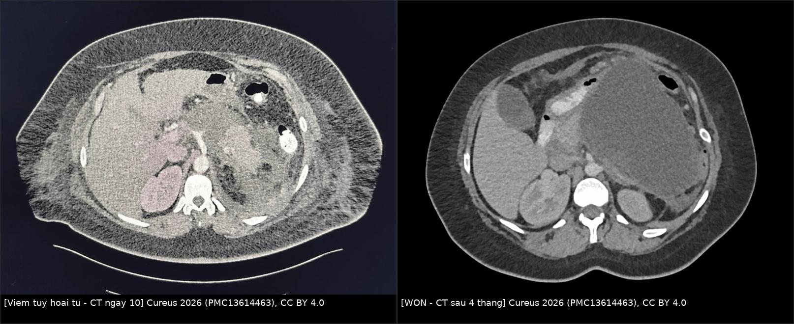
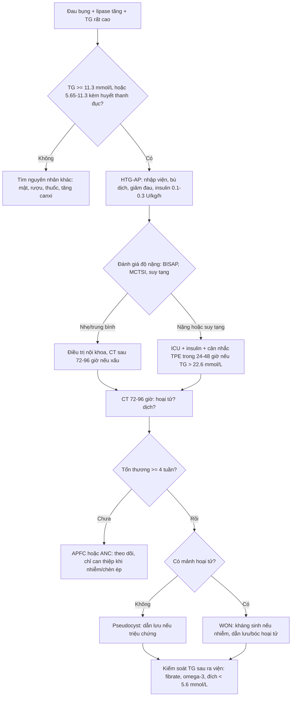
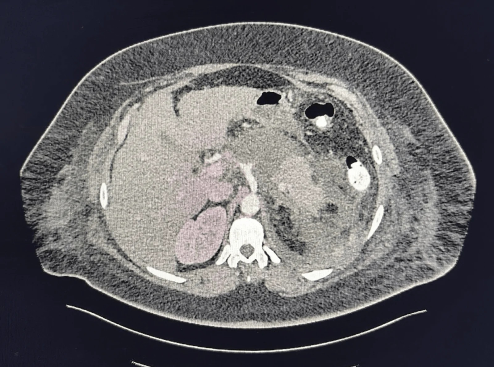
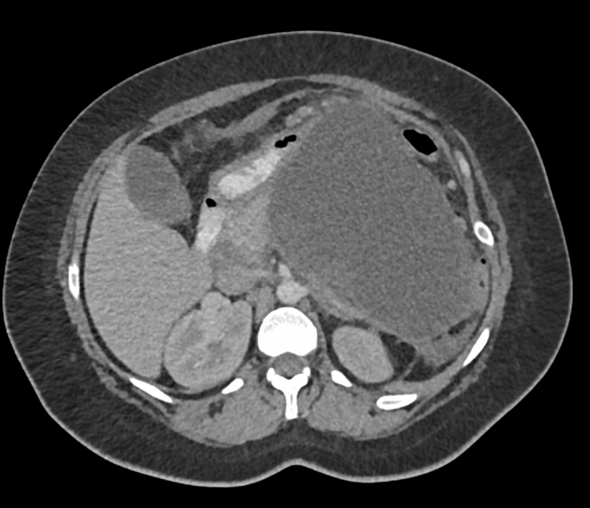
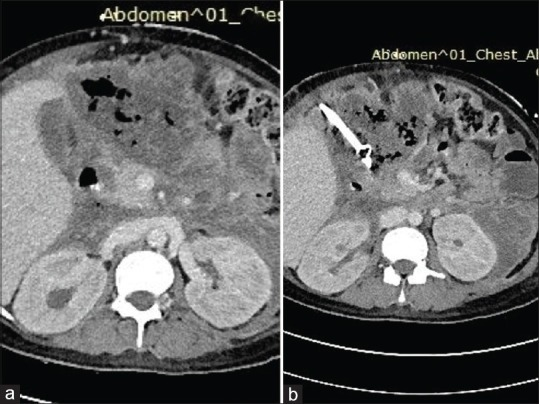

# 1680 — Viêm tụy cấp do tăng triglyceride ở người lớn / Hypertriglyceridaemia-induced acute pancreatitis (HTG-AP)

**Tags:** `pattern:hoai-tu-tuy` `pattern:dich-tu-tuy` `pattern:viem-tuy` `vung:tuy` `score:Atlanta-2012` `score:MCTSI` `score:BISAP` `protocol:CT-bung-co-can-quang` `protocol:MRI-tuy` `protocol:loc-huyet-tuong` `incidentaloma:khong`

**Mức chắc chắn (certainty):** tổng hợp y văn (literature synthesis) — tổng quan cập nhật HTG-AP (Front Med 2026, PMC13552488), so sánh nguyên nhân 242 ca (Frontiers in Endocrinology 2026, PMC13290542), phân tầng theo TG 211 ca (BMC Gastroenterol 2023, PMC9955530), đoàn hệ 296 ca với tràn dịch màng phổi sớm (Front Med 2026, PMC12876215), loạt 4 năm có ảnh CT (J Family Med Prim Care 2022, PMC9480712), **1 ca có ảnh CT tiến triển** (Cureus 2026, PMC13614463) + tổng quan TPE (Sci Prog 2026, PMC13562900). Không có thử nghiệm ngẫu nhiên lớn nào chứng minh lọc huyết tương cải thiện tử vong; chỗ suy luận được ghi rõ.

> **Câu chốt:** HTG-AP là **viêm tụy hoại tử do độc tính lipid**, không phải "viêm tụy do ăn mỡ". Ba ngưỡng phải thuộc: **(1) chẩn đoán khi TG ≥ 11,3 mmol/L (1.000 mg/dL), hoặc 5,65–11,3 mmol/L kèm huyết thanh đục như sữa** sau khi loại trừ nguyên nhân khác; **(2) TG ≥ 200 mg/dL đã làm tăng nguy cơ hoại tử (OR 3,27)** — hoại tử **29,5% → 52,3% → 85,7%** theo mức TG; **(3) ổ dịch < 4 tuần là tụ dịch, ≥ 4 tuần mới gọi nang giả/WON** (Atlanta 2012). Sai lầm chết người là **chụp CT quá sớm rồi kết luận "không hoại tử"**, **bỏ sót hoại tử nhiễm khuẩn có khí**, và **xuất viện mà không kiểm soát TG** — tái phát **64,8% trong 1 năm**.

## 1. Tổng quan bệnh học – cơ chế hình ảnh

### 1.1 Dịch tễ và vì sao đáng chú ý

- **Tỷ lệ HTG-AP trong viêm tụy cấp tăng nhanh:** từ **14,3% (2001)** lên **35,5% (2016)** trong một hệ thống Trung Quốc; bệnh nhân **trẻ hơn** (trung bình **41 vs 53 tuổi**), **nam 60,83%**, **béo và đái tháo đường nhiều hơn** (PMC13552488).
- **Nặng hơn viêm tụy mật:** thể nặng **46,9% vs 17,6%**, **MODS gấp 2,3 lần**, nhập ICU nhiều hơn (PMC13552488; PMC13290542).
- **Tái phát rất cao:** **64,8% trong 1 năm**; TG 1 tháng sau xuất viện **3,7 mmol/L ở nhóm tái phát vs 2,0 mmol/L ở nhóm không tái phát** (PMC13552488).
- **Cơ địa:** béo phì **BMI ≥ 30** làm tăng nguy cơ **2,5 lần**; **đột biến LPL dị hợp + béo phì** làm tăng **4,2 lần**; thai kỳ làm TG tăng **~3 lần**, **20% thai phụ vượt 1.000 mg/dL** (PMC13552488).

### 1.2 Sinh lý bệnh: từ chylomicron đến hoại tử tụy

1. **TG rất cao** → **chylomicron** lưu hành nhiều, máu nhớt → **giảm tưới máu mao mạch tụy** (thiếu máu cục bộ).
2. **Lipase tụy thủy phân TG** tại chỗ → **acid béo tự do (FFA)** quá mức → **độc tế bào nang tụy** (lipotoxicity), tổn thương màng ty thể, **toan chuyển hóa tại mô**.
3. **FFA + toan** hoạt hóa **trypsinogen**, bùng nổ cytokine (TNF-α, IL-6) → **SIRS, MODS**; mỡ quanh tụy bị **xà phòng hóa** (saponification) → hoại tử mỡ, canxi hóa.
4. **Hoại tử vi mạch + huyết khối** → **hoại tử tụy và mô quanh tụy**, dò dịch tụy, **nhiễm khuẩn thứ phát** từ ruột.

### 1.3 TẠI SAO hình ảnh trông như vậy (vật lý + mô bệnh)

- **Hoại tử không ngấm cản quang:** vùng tụy hoại tử mất mao mạch → **không có iod đến** → **giảm đậm độ so với nhu mô lành đang ngấm**. Vì vậy **chỉ thấy rõ trên thì tĩnh mạch cửa/có cản quang**, không thấy trên CT không tiêm.
- **Thời điểm:** hoại tử **tiến triển trong 72–96 giờ đầu**; CT sớm (< 72 giờ) có thể chỉ thấy phù và **đánh giá thấp hoại tử**. Đây là lý do **không chụp CT cản quang ngay ngày 1 để "loại trừ hoại tử"**.
- **Dịch quanh tụy:** viêm làm tăng tính thấm mao mạch → dịch giàu protein thoát vào **túi mạc nối, khoang cạnh thận trước, mạc treo**. Trên CT: **giảm đậm độ đồng nhất, thành chưa rõ** khi < 4 tuần; **vỏ xơ rõ** khi ≥ 4 tuần.
- **Hoại tử mỡ:** mô mỡ quanh tụy **tăng đậm độ nhẹ, không ngấm**, đôi khi **vôi hóa** — khác mỡ bình thường (âm).
- **Khí trong ổ:** **khí trong ổ hoại tử = nhiễm khuẩn cho tới khi chứng minh ngược** (không phải "khí từ ruột"). Trên CT thấy **bóng khí rải rác/mức khí–dịch** trong ổ hoại tử.
- **MRI:** dịch **T2 sáng**; **mảnh hoại tử/máu** có thể **T1 sáng**; **MRCP** đánh giá **rò ống tụy** và phân biệt **IPMN** (thông ống tụy chính) — hữu ích khi nang không điển hình.
- **Siêu âm:** nhạy với sỏi mật (loại trừ nguyên nhân) và dịch, nhưng **kém với hoại tử và khí**; béo phì/ruột hơi làm giảm giá trị.

### 1.4 Ngưỡng định lượng trụ cột

| Đại lượng | Con số | Nguồn |
|---|---|---|
| Chẩn đoán HTG-AP | **TG ≥ 11,3 mmol/L (1.000 mg/dL)**, hoặc **5,65–11,3 mmol/L + huyết thanh đục** | PMC13290542; PMC9955530 |
| Nguy cơ hoại tử theo TG | **29,5%** (bình thường) · **26,3%** (ranh giới) · **52,3%** (cao) · **85,7%** (rất cao); **TG ≥ 200 mg/dL: OR 3,27** | PMC9955530 |
| Thể nặng | **46,9% vs 17,6%** (viêm tụy mật); **MODS 2,3 lần** | PMC13552488 |
| Tái phát | **64,8%/1 năm**; TG 1 tháng **3,7 vs 2,0 mmol/L** | PMC13552488 |
| Tràn dịch màng phổi < 24 giờ | **OR 6,82** cho HTG-SAP; tương đương BISAP/MCTSI | PMC12876215 |
| Insulin tích cực | **0,1–0,3 U/kg/giờ** + glucose 10%; meta **12 nghiên cứu/1.505 ca**: TG 24/48/72 giờ **không khác**, nằm viện **ngắn hơn 3,6 ngày** so với lọc máu | PMC13626910 |
| TPE (lọc huyết tương) | **ASFA Category III**; 1 lần giảm TG **54,4%**, lần 2 xuống **79,4%** dưới baseline; cửa sổ **24–48 giờ** | PMC13562900 |
| Ngưỡng "rất nặng" để cân nhắc TPE | **TG > 22,6 mmol/L** hoặc suy tạng | PMC13562900; PMC11929198 |
| Mốc Atlanta 2012 | **< 4 tuần**: APFC/ANC; **≥ 4 tuần**: pseudocyst/WON | Atlanta 2012 (chuẩn quốc tế) |
| MCTSI | **0–10**; **0–2 nhẹ · 4–6 trung bình · 8–10 nặng** | Chuẩn thực hành |

## 2. Mẫu hình + chẩn đoán phân biệt theo vị trí (Gamut)

**Mẫu hình chốt:** *tụy to, phù, **vùng không ngấm cản quang** ở thân/đuôi hoặc toàn tụy; **dịch quanh tụy** lan vào túi mạc nối – khoang cạnh thận trước; có thể **khí trong ổ**; **không có sỏi mật/giãn đường mật**.*

Gamut theo **vị trí + thời gian**:

- **< 4 tuần, không hoại tử:** **APFC** (tụ dịch cấp quanh tụy) — dịch đồng nhất, không vỏ.
- **< 4 tuần, có hoại tử:** **ANC** (tụ dịch hoại tử cấp) — dịch + mảnh hoại tử, không vỏ.
- **≥ 4 tuần, không hoại tử:** **nang giả tụy (pseudocyst)** — vỏ xơ rõ, dịch đồng nhất, **không có mảnh hoại tử**.
- **≥ 4 tuần, có hoại tử:** **WON** (hoại tử có vỏ) — vỏ + **mảnh hoại tử lổn nhổn**, có thể **khí**.
- **Vị trí lan:** **túi mạc nối** (sau dạ dày) · **khoang cạnh thận trước** · **mạc treo đại tràng ngang** · **sau phúc mạc xuống hố chậu** · hiếm: **trung thất, cổ**.
- **Bắt chước (mimic) không do viêm tụy:** **u nhầy nhú nội ống tụy (IPMN)** — thông ống tụy chính; **u đặc–nhầy nhú (SPN)** — nữ trẻ, khối đặc–nang có vỏ; **u nang nhầy (MCN)** — thân/đuôi, vỏ dày; **u nang thanh dịch (SCN)** — nhiều vách nhỏ, trung tâm sẹo; **nang nhái tá tràng**; **nang thận/lách/thượng thận**.
- **Gợi nhớ 4T cho ổ dịch:** **T**ime (< hay ≥ 4 tuần) · **T**issue (có mảnh hoại tử hay không) · **T**hickness (vỏ mỏng/đều hay dày) · **T**rouble (khí, máu, vôi).

## 3. Bảng so sánh phân biệt (ma trận đối chiếu)

| Thực thể (entity) | Hình ảnh điển hình | Chốt vào (rule-in) | Chốt loại (rule-out) | Gợi ý xác nhận |
|---|---|---|---|---|
| **APFC** (tụ dịch cấp quanh tụy) | Dịch đồng nhất quanh tụy, **không vỏ**, < 4 tuần | **< 4 tuần + dịch đồng nhất + không mảnh hoại tử** | **Vỏ xơ rõ hoặc mảnh hoại tử** → ANC/pseudocyst/WON | Siêu âm/CT; theo dõi |
| **Nang giả tụy (pseudocyst)** | Ổ dịch **vỏ xơ rõ**, dịch đồng nhất, **không mảnh hoại tử**, ≥ 4 tuần | **≥ 4 tuần + vỏ + dịch trong + không hoại tử** | **Mảnh hoại tử/bọt khí trong ổ** → WON/nhiễm khuẩn | MRI/MRCP nếu cần; chỉ can thiệp khi triệu chứng |
| **ANC** (tụ dịch hoại tử cấp) | Dịch + **mảnh hoại tử**, **không vỏ**, < 4 tuần | **< 4 tuần + mảnh hoại tử + không vỏ** | **Vỏ rõ** → WON | CECT 72–96 giờ |
| **WON** (hoại tử có vỏ) | Ổ **vỏ xơ + mảnh hoại tử lổn nhổn**, ≥ 4 tuần, có thể khí | **≥ 4 tuần + mảnh hoại tử + vỏ** | **Dịch đồng nhất không mảnh** → pseudocyst | CECT; MRI; nội soi siêu âm khi dẫn lưu |
| **Hoại tử nhiễm khuẩn** | WON/ANC + **khí trong ổ**, thành dày, ngấm, lâm sàng nhiễm trùng | **Khí trong ổ + sốt/sepsis** (khí = nhiễm cho tới khi chứng minh ngược) | **Khí trong lòng ruột/dạ dày lân cận** → không phải khí trong ổ | Cấy dịch dẫn lưu; kháng sinh |
| **IPMN** | Nang thông với **ống tụy chính giãn**, không có viêm tụy cấp đi trước | **Thông ống tụy chính + ống giãn** | **Viêm tụy cấp + dịch quanh tụy, không thông ống** → ổ dịch | MRCP; EUS; theo dõi |
| **SPN** | Nữ trẻ, khối **đặc–nang** có vỏ, thường thân/đuôi, có thể vôi hóa | **Nữ < 30 tuổi + khối đặc–nang + vỏ** | **Bệnh cảnh cấp + TG cao + dịch quanh tụy** → ổ dịch viêm | MRI/EUS; mô bệnh sau mổ |
| **Hoại tử mỡ quanh tụy** | Mô mỡ quanh tụy **tăng đậm độ**, không ngấm, có thể vôi hóa | **Tăng đậm độ mỡ + không ngấm + bệnh cảnh viêm tụy** | **Mỡ âm thuần túy** → mỡ bình thường | CECT; theo dõi |

*Trái: CT có cản quang ngày 10 sau nhập viện — vùng tụy hoại tử không ngấm, dịch và hơi quanh tụy. Phải: CT sau 4 tháng — ổ dịch lớn có vỏ, mảnh hoại tử bên trong (WON). Nguồn: Cureus 2026 (PMC13614463), Fig. 2 và Fig. 3, CC BY 4.0. Ảnh ghép letterbox, không crop.*

### Nang giả vs WON — câu hỏi quyết định can thiệp

- **Có mảnh hoại tử trong ổ không?** Có → **WON** (cần nội soi/bóc hoại tử nếu nhiễm/triệu chứng); không → **pseudocyst** (dẫn lưu đơn thuần là đủ).
- **Vỏ đã rõ chưa?** Chưa và < 4 tuần → **đừng can thiệp** trừ khi nhiễm khuẩn/chèn ép; can thiệp sớm làm tăng chảy máu và rò.
- **Có khí không?** Khí trong ổ = **nhiễm khuẩn** → kháng sinh + dẫn lưu, không chờ đủ 4 tuần nếu sepsis.

## 4. Protocol chụp + hệ phân độ/điểm chuẩn hóa

### 4.1 Protocol CT/MRI

- **CT bụng có cản quang, lát mỏng 1–2 mm**, 3 thì: **không tiêm**, **thì tụy (late arterial 40–50 giây)**, **thì tĩnh mạch cửa (65–70 giây)**; đo **đậm độ tụy** và ghi rõ vùng không ngấm.
- **Thời điểm:** chụp lần đầu để chẩn đoán/biến chứng; **đánh giá hoại tử tốt nhất sau 72–96 giờ**; chụp lại khi **xấu đi, sốt, nghi nhiễm khuẩn, chảy máu**.
- **MRI tụy** khi: dị ứng iod, cần đánh giá **ống tụy/rò**, phân biệt **nang giả vs u nang**, hoặc tổn thương không điển hình; **MRCP** cho IPMN/rò.
- **Siêu âm:** sỏi mật, dịch, hướng dẫn can thiệp; **EUS** để dẫn lưu nang/WON và lấy mô khi nghi u.

### 4.2 Phân độ và điểm

- **Atlanta 2012 (sửa đổi):** thể **phù kẽ (interstitial oedematous)** vs **hoại tử (necrotizing)**; mức độ **nhẹ / trung bình / nặng** theo **suy tạng tạm thời (< 48 giờ) / kéo dài (> 48 giờ)** và biến chứng tại chỗ.
- **MCTSI (Modified CT Severity Index) 0–10:** viêm tụy 0–4 + hoại tử 0–4 (0: không; 2: ≤ 30%; 4: > 30%) + biến chứng ngoài tụy 0–2; **0–2 nhẹ, 4–6 trung bình, 8–10 nặng**.
- **BISAP** (BUN > 25 mg/dL, rối loạn tri giác, SIRS, tuổi > 60, tràn dịch màng phổi): **≥ 3 = nguy cơ cao**; **tràn dịch màng phổi < 24 giờ** là dấu hiệu sớm, **OR 6,82** cho HTG-SAP và tương đương BISAP/MCTSI (PMC12876215).
- **Xét nghiệm:** TG (lặp lại sau khi điều trị), lipase/amylase (**có thể bị nhiễu bởi mẫu mỡ**), **canxi** (giảm do xà phòng hóa), glucose, LDH, CRP, creatinine, khí máu; **tính lại TG hiệu chỉnh** nếu mẫu đục.

### 4.3 Điều trị — các ngưỡng thực hành

- **Bù dịch sớm** (lactated Ringer, 5–10 mL/kg/giờ trong giờ đầu, giảm dần), đau (opioid), chống nôn, **nuôi ăn đường ruột sớm** khi dung nạp; **không kháng sinh dự phòng**.
- **Insulin truyền tĩnh mạch liên tục 0,1–0,3 U/kg/giờ** + **glucose 10%** để tránh hạ đường huyết; theo dõi đường huyết mỗi 1–2 giờ; **ngừng khi TG < 5,6 mmol/L (500 mg/dL)** (PMC13626910; PMC9480712).
- **Lọc huyết tương (TPE) — chọn lọc, không thường quy:** **ASFA Category III**. Cân nhắc khi **thể nặng/suy tạng**, **TG > 22,6 mmol/L**, hoặc **thất bại với điều trị nội khoa 24–48 giờ**; **không khuyến cáo** cho MAP/MSAP có TG 11,3–22,6 mmol/L. Một lần giảm TG **54,4%**, hai lần **79,4%** dưới baseline; **TPE muộn > 48 giờ không cải thiện tử vong** (PMC13562900).
- **Sau ổn định:** **fibrate** (fenofibrate), **omega-3**, kiểm soát đường huyết, giảm cân, ngừng rượu; **đích TG < 5,6 mmol/L** (và thấp hơn nếu tái phát); **tầm soát nguyên nhân thứ phát** (suy giáp, nephrotic, thuốc: corticoid, estrogen/tamoxifen, asparaginase, chống loạn thần) và **gen LPL/APOA5/GPIHBP1** nếu trẻ/tái phát nặng.

## 5. Biến thể bình thường và cạm bẫy

- **CT quá sớm:** ngày 1–2 có thể chỉ thấy phù; **hoại tử hiện rõ sau 72–96 giờ**. Đừng ghi "không hoại tử" trên CT ngày đầu.
- **TG đã giảm khi nhập viện:** TG có thể tụt nhanh sau nhịn ăn/dịch truyền; **TG bình thường lúc chụp không loại trừ HTG-AP** — hỏi tiền sử, xem **huyết thanh đục**, TG trước đó, và đáp ứng với insulin.
- **Mẫu máu đục làm sai xét nghiệm:** **lipase/amylase có thể thấp giả**, natri thấp giả (pseudohyponatraemia), men gan/creatinine bị nhiễu — yêu cầu lab **ly tâm tốc độ cao/pha loãng** và **đọc bằng mắt mẫu huyết thanh**.
- **Khí trong ổ ≠ khí ruột:** khí trong ổ hoại tử là **dấu hiệu nhiễm khuẩn**, không phải "hơi từ tá tràng". So sánh vị trí với lòng ruột, tìm mức khí–dịch, thành ổ dày.
- **Nang giả "đơn thuần" có thể là WON:** nếu trong ổ có **mảnh tăng đậm độ không ngấm**, đừng dẫn lưu như nang giả — cần nội soi/bóc hoại tử.
- **Biến chứng mạch máu:** **huyết khối tĩnh mạch lách** (khuyết thuốc, lách to) và **giả phình động mạch lách** (chảy máu ồ ạt) — **CTA ngay khi có máu trong ổ/chảy máu tiêu hóa**.
- **Tái phát vì bỏ kiểm soát TG:** **64,8%/1 năm**; đừng chỉ điều trị cơn cấp — **fibrate + chế độ ăn + theo dõi TG 1–3 tháng**.
- **Bẫy "viêm tụy do rượu":** bệnh nhân uống rượu **và** TG cao — cả hai cùng góp; **không quy một nguyên nhân** khi TG ≥ 11,3 mmol/L, vì quyết định kiểm soát TG dài hạn khác nhau.

## 6. Tự lượng giá — Blind Quiz

**Ca 1 — Nam 41 tuổi, đau thượng vị dữ dội, TG 62 mmol/L, lipase tăng; CT ngày 10 vì sốt và đau tăng. Nhìn CT, mô tả trước.**

- Gợi ý: béo phì, đái tháo đường type 2; CRP tăng; không sỏi mật.
- Hỏi: (1) Vùng nào không ngấm cản quang? (2) Có khí/mảnh hoại tử không? (3) Chẩn đoán và bước tiếp theo?

<b>Bấm để hiện đáp án (findings + chẩn đoán)</b>

- **Findings:** tụy **không ngấm cản quang từng vùng lớn**, thay bằng **dịch và mô hoại tử** quanh tụy/túi mạc nối; **bóng khí** trong ổ; thâm nhiễm mỡ lan rộng.
- **Chẩn đoán:** **hoại tử tụy cấp (ANC) có khí — nghi nhiễm khuẩn**; thể **hoại tử** theo Atlanta 2012. Khí trong ổ là **dấu hiệu nhiễm khuẩn** cho tới khi chứng minh ngược.
- **Vì sao không thấy trên CT ngày 1:** hoại tử tiến triển sau 72–96 giờ; CT sớm chỉ thấy phù.
- **Xử trí:** ICU, kháng sinh theo ổ nhiễm, **dẫn lưu ổ nhiễm/chèn ép** (không chờ đủ 4 tuần nếu sepsis), insulin kiểm soát TG, nuôi ăn sớm khi dung nạp.
- **Nguồn:** Cureus 2026 (PMC13614463), Fig. 2, CC BY 4.0.

**Ca 2 — Cùng bệnh nhân, 4 tháng sau. Ổ dịch to, không sốt. Đây là nang giả hay WON?**

- Hỏi: (1) Vỏ ổ đã rõ chưa? (2) Bên trong ổ có gì? (3) Khi nào cần can thiệp?

<b>Bấm để hiện đáp án</b>

- **Findings:** ổ dịch lớn **có vỏ xơ rõ**, bên trong **không đồng nhất, có mảnh hoại tử và bóng khí nhỏ**; tụy teo/mất nhu mô; không giãn đường mật.
- **Chẩn đoán:** **WON (walled-off necrosis)** — không phải nang giả đơn thuần, vì **có mảnh hoại tử** và **vỏ** sau ≥ 4 tuần.
- **Can thiệp:** chỉ khi **nhiễm khuẩn, triệu chứng chèn ép, hoặc ổ tăng dần**; ưu tiên **dẫn lưu qua nội soi/qua da**, bóc hoại tử tối thiểu xâm lấn nếu cần. Nang giả không triệu chứng: theo dõi.
- **Nguồn:** Cureus 2026 (PMC13614463), Fig. 3, CC BY 4.0.

**Ca 3 — Bệnh nhân HTG-AP nặng, sốt 39 °C, CT có ổ hoại tử rải rác và khí; đã đặt pigtail. Nhìn hai ảnh trước/sau dẫn lưu.**

- Hỏi: (1) Dấu hiệu nào chốt nhiễm khuẩn? (2) Vì sao dẫn lưu thay vì mổ ngay? (3) Ngưỡng TG để ngừng insulin?

<b>Bấm để hiện đáp án</b>

- **Findings:** (a) trước dẫn lưu — **nhiều ổ hoại tử, bóng khí rải rác**, thâm nhiễm mỡ; (b) sau — **đầu pigtail trong ổ**, khí giảm.
- **Chốt nhiễm khuẩn:** **khí trong ổ hoại tử** + sốt/sepsis; cấy dịch dẫn lưu xác nhận.
- **Vì sao dẫn lưu trước:** **dẫn lưu tối thiểu xâm lấn** kiểm soát ổ nhiễm, ổn định bệnh nhân; **mổ bóc hoại tử** để sau nếu thất bại/ổ phức tạp. Can thiệp sớm < 4 tuần chỉ khi **nhiễm khuẩn/chèn ép**.
- **Ngưỡng insulin:** truyền **0,1–0,3 U/kg/giờ**, **ngừng khi TG < 5,6 mmol/L (500 mg/dL)**; sau đó chuyển fibrate/omega-3, đích dài hạn **< 5,6 mmol/L**.
- **Nguồn:** J Family Med Prim Care 2022 (PMC9480712), Figure 1, **CC BY-NC-SA 4.0** — dùng nguyên bản, không cắt/ghép.

## Bài liên quan chéo

- [100 – Tổng quan hệ Bụng](../100-tong-quan-he-bung/lesson.md) (bản đồ gamut ổ dịch quanh tụy)
- [135 – Viêm tụy cấp theo Atlanta](../135-viem-tuy-Atlanta/lesson.md) (định nghĩa, thể, biến chứng)
- [628 – Viêm tụy do tăng triglyceride ở TRẺ](../628-viem-tuy-tang-triglyceride-o-tre/lesson.md) (khác ngưỡng và sinh lý)
- [684 – Tăng triglyceride do asparaginase ở trẻ ALL](../684-tang-triglyceride-asparaginase-all-nhi/lesson.md) (nguyên nhân thuốc)
- [136 – U nang tụy](../136-u-nang-tuy/lesson.md) (phân biệt nang thật)
- [146 – Huyết khối tĩnh mạch lách & nhồi máu lách](../146-huyet-khoi-tm-lach-va-nhoi-mau-lach/lesson.md) (biến chứng mạch máu)
- [102 – Viêm tụy sau ERCP](../102-viem-tui-mat-va-viem-tuy-sau-stent-mat-ercp/lesson.md) (chẩn đoán phân biệt nguyên nhân)
- [160 – Bụng cấp GI](../160-bung-cap-GI/lesson.md) (tiếp cận đau bụng cấp)

## Ảnh

- `1680_hoai-tu-ngay10_CT_PMC13614463-F2.jpg` — CECT ngày 10, hoại tử tụy; Cureus 2026 (PMC13614463), **CC BY 4.0**.
- `1680_nang-won-4-thang_CT_PMC13614463-F3.jpg` — WON sau 4 tháng; Cureus 2026 (PMC13614463), **CC BY 4.0**.
- `1680_hoai-tu-nhiem-khi_CT_PMC9480712-F1.jpg` — hoại tử có khí trước/sau pigtail; J Family Med Prim Care 2022 (PMC9480712), **CC BY-NC-SA 4.0** (nguyên bản).
- `composite_hoai-tu-tien-trien.jpg` — ghép 2 ảnh CC BY của PMC13614463, letterbox, dải attribution.

> Không dùng để chẩn đoán độc lập khi chưa có người hướng dẫn.
