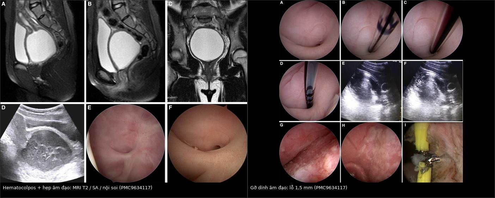
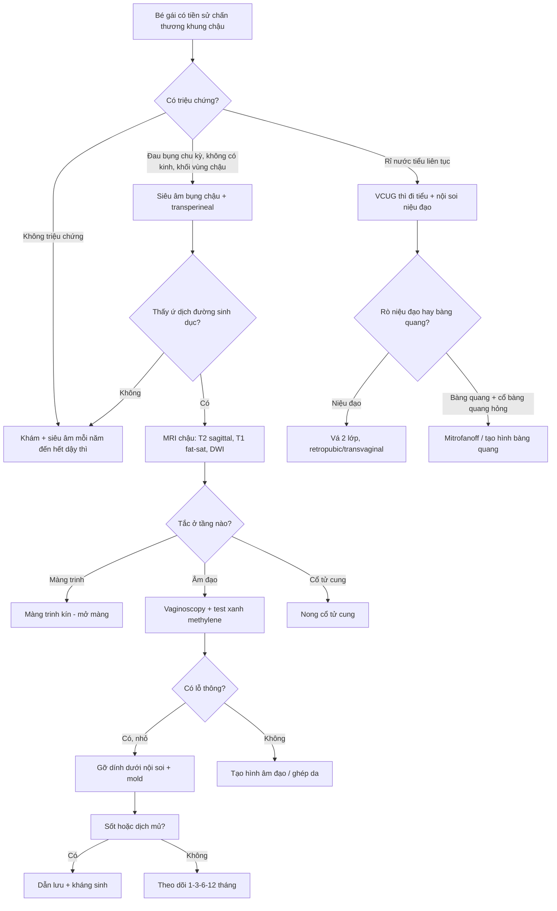
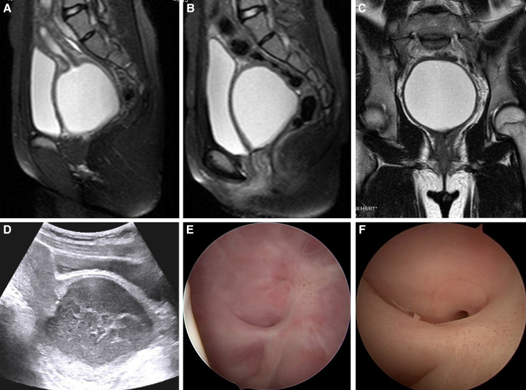
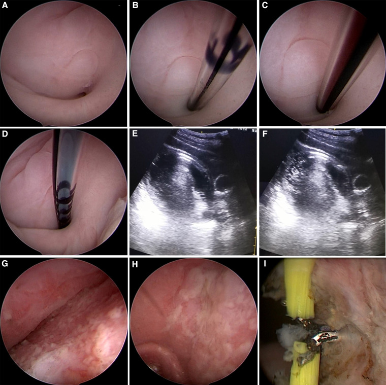
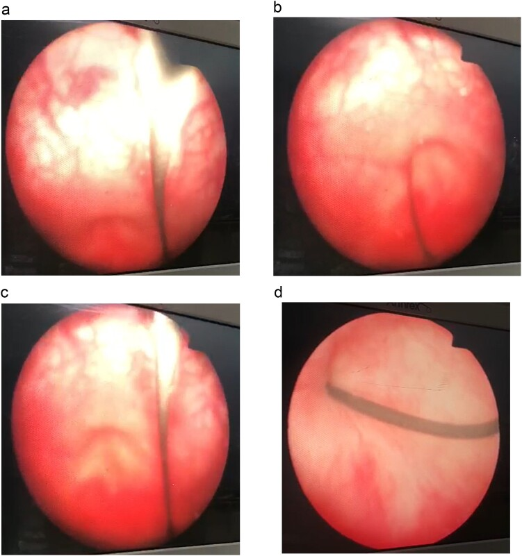

# 1681 — Di chứng muộn niệu–sinh dục ở bé gái sau chấn thương khung chậu / Late genitourinary sequelae of pelvic trauma in girls

**Tags:** `pattern:hep-am-dao` `pattern:u-dich` `pattern:hematocolpos` `pattern:ro` `vung:khung-chau` `vung:sinh-duc-nhi` `score:AAST-vagina` `protocol:MRI-chau` `protocol:VCUG` `protocol:noi-soi` `incidentaloma:khong`

**Mức chắc chắn (certainty):** tổng hợp y văn (literature synthesis) — ghép 2 ca nguyên văn có ảnh (bé gái 13 tuổi PMC9634117; bé gái 3 tuổi PMC11751361), 1 loạt 25 ca người lớn (PMC6806549) làm mốc tự nhiên học và số liệu dịch tễ từ các nguồn ghi ở `sources.md`. Không suy diễn ngoài nguồn.

## 1. Tổng quan bệnh học – cơ chế hình ảnh

**Vì sao chấn thương khung chậu để lại di chứng muộn ở bé gái?** Ba chuỗi bệnh học chạy song song, và cả ba đều **im lặng trước dậy thì**:

1. **Dính rồi hẹp âm đạo (adhesion → stenosis → atresia).** Mảnh xương chậu rách niêm mạc âm đạo; hai mặt niêm mạc non áp vào nhau, lành bằng ý định thứ hai tạo **cầu dính (synechia)** ngang lòng. Tổ chức xơ co rút dần → hẹp, rồi tắc hoàn toàn. Vì máu kinh chỉ xuất hiện sau dậy thì, **không có "đồng hồ" nào tố cáo** trong nhiều năm: ca 13 tuổi bị chấn thương năm 2015, đến 2018 mới có kinh, và **3,5 năm** sau chấn thương mới được chẩn đoán (PMC9634117).
2. **Rò niệu–sinh dục (fistula).** Hoại tử do áp lực của mảnh xương, của ống thông hoặc của máu tụ làm thủng vách niệu đạo–âm đạo hay bàng quang–âm đạo; đường rò biểu mô hóa và không tự đóng. Ca 13 tuổi: rò niệu đạo–âm đạo **5 mm** ngay sau lỗ niệu đạo trong (PMC9634117). Ca 3 tuổi: đứt hoàn toàn niệu đạo + rò bàng quang–âm đạo (PMC11751361).
3. **Sa tạng chậu (pelvic organ prolapse).** Rách/avulsion phức hợp **cardinal–uterosacral** và sàn chậu làm mất treo tử cung; POP xuất hiện ở người **chưa sinh** nhiều năm sau tai nạn (ca 29 tuổi, 5 năm sau chấn thương, sa tử cung độ 3 + cystocele + rectocele — PMC5895318).

**Vì sao dễ bỏ sót ngay từ đầu?** Cơ trơn âm đạo co lại sau chấn thương nên lượng máu chảy ít và tự cầm; ở bé gái không đặt mỏ vịt, không khám âm đạo thường quy. Trong loạt 25 ca, **24% (6/25) bị nhiễm trùng**, và **4/6** trong số đó là do **chẩn đoán muộn** (áp-xe chậu) — PMC6806549.

**Cơ chế hình ảnh — TẠI SAO tín hiệu như vậy:**

- **MRI T2:** máu kinh ứ là dịch giàu nước → **T2 rất sáng**. Tín hiệu T1 phụ thuộc "tuổi" hemoglobin: deoxyhemoglobin cấp (T1 đồng/tối, T2 tối) → methemoglobin nội bào (T1 sáng, T2 tối) → **methemoglobin ngoại bào muộn (T1 sáng, T2 sáng)**. Vì vậy hematocolpos điển hình **T1 sáng + T2 rất sáng**; ứ máu nhiều đợt cho **mức dịch–dịch** và **T2 shading** (giống endometrioma).
- **Mủ (pyocolpos):** protein và tế bào cao → T2 sáng vừa, **hạn chế khuếch tán** (DWI sáng, ADC thấp). Đây là lý do ca bệnh sốt **39,8 °C**, bạch cầu **13,6 × 10⁹/L** (neutrophil 85,2%), cấy máu *Bacteroides fragilis*, dịch âm đạo đục mùi hôi (PMC9634117).
- **Siêu âm:** dịch có **echo lơ lửng ("flocculent")**, không phải nang trống âm — dấu hiệu phân biệt hematocolpos với nang buồng trứng; ca bệnh đo được **7,5 × 7,2 × 6,5 cm**.
- **Xơ:** collagen → **T2 tối**; dải xơ co kéo và mất lớp niêm mạc sáng bình thường giúp nhận ra đoạn hẹp.
- **Rò:** chỉ thấy gián tiếp trên hình thái (mất liên tục thành, co kéo) — **chẩn đoán xác định bằng VCUG/RUG hoặc nội soi**, không bằng MRI đơn thuần.

**Ngưỡng định lượng cần nhớ:**

| Chỉ số | Số liệu | Nguồn |
|---|---|---|
| Tần suất thương tổn âm đạo sau chấn thương khung chậu | y văn **2–4%**; loạt Trung Quốc **7,9%** (27/341) | PMC6806549 |
| Phân độ nặng (AAST) | độ I 24% · độ II 48% · **độ III 28%** (4 rách âm đạo–trực tràng, 3 rách âm đạo–niệu đạo) | PMC6806549 |
| Thương tổn phối hợp | hậu môn–trực tràng 15/25 · tiết niệu 15/25 (12 đứt niệu đạo, 3 bàng quang) | PMC6806549 |
| Nhiễm trùng chậu | **24%** (6/25), 4 ca do chẩn đoán muộn | PMC6806549 |
| Hẹp âm đạo sau mổ | **8%** (2/25) ở theo dõi 17,7 tháng | PMC6806549 |
| Đau khi giao hợp | 4/25; 39,8% bệnh nhân chấn thương khung chậu có rối loạn tình dục (1364 ca, gộp 17 nghiên cứu) | PMC6806549, PMC8514382 |
| Đứt niệu đạo ở nữ | **0,15%** so với **1,54%** ở nam | PMC11751361 |

## 2. Mẫu hình + chẩn đoán phân biệt theo vị trí (gamut)

**Mẫu hình chung:** *ứ dịch một khoang ở đường sinh dục + không thấy cổ tử cung/đoạn âm đạo phía trên* ở bé gái có tiền sử chấn thương khung chậu. Ba câu hỏi phải trả lời trước khi đặt tên:

1. **Tắc ở tầng nào?** (màng trinh → 1/3 dưới → 1/3 giữa → fornix → cổ tử cung)
2. **Có rò không?** (nước tiểu rỉ liên tục ≠ tiểu không tự chủ)
3. **Có sa tạng chậu không?** (khối sa ra ngoài âm hộ, nhất là khi rặn)

**Gamut theo vị trí:**

- **Tiền đình – màng trinh:** màng trinh kín (imperforate hymen — bẩm sinh, màng căng phồng, không tiền sử chấn thương), dính môi bé sau viêm.
- **1/3 dưới âm đạo:** **dính/hẹp sau chấn thương** (ca điển hình: đáy mù cách màng trinh **4 cm**, lỗ thông **1,5 mm**), hẹp sau cắt bỏ/u xơ.
- **1/3 giữa:** vách ngăn âm đạo ngang (bẩm sinh, thường dày 1–3 cm), hẹp sau xạ trị.
- **1/3 trên – fornix:** dính tạo túi ứ máu, hẹp do viêm dính mạn.
- **Cổ tử cung:** hẹp cổ tử cung sau nạo/xạ → **hematometra** (tử cung căng, âm đạo có thể bình thường).
- **Niệu đạo:** hẹp/đứt niệu đạo nữ, **rò niệu đạo–âm đạo** (rỉ nước tiểu qua âm đạo nhưng vẫn tiểu được).
- **Bàng quang:** **rò bàng quang–âm đạo** (rỉ liên tục, không tiểu được nếu cổ bàng quang tổn thương).
- **Sàn chậu:** sa thành trước/sau, sa tử cung ở người chưa sinh.

## 3. Bảng so sánh phân biệt (ma trận đối chiếu)

| Thực thể (entity) | Hình ảnh điển hình | Chốt vào (rule-in) | Chốt loại (rule-out) | Gợi ý xác nhận |
|---|---|---|---|---|
| **Dính/hẹp âm đạo sau chấn thương** | MRI T2: đoạn âm đạo mất lớp niêm mạc sáng, dải xơ ngang; ứ dịch phía trên; đáy mù cách màng trinh vài cm | **Tiền sử chấn thương khung chậu + đáy mù + ứ máu trên ổ** | Màng trinh kín (màng căng, không tiền sử chấn thương) | Nội soi âm đạo/hysteroscopy; test methylene blue |
| **Hematocolpos ứ máu** | Khối dịch **T2 rất sáng**, T1 sáng, mức dịch–dịch, giãn âm đạo, tử cung đè lên trên | **Dịch trung tâm, liên tục với tử cung, không có nang buồng trứng** | Nang buồng trứng (lệch bên, không thông với âm đạo) | Siêu âm + MRI; đo 3 chiều |
| **Pyocolpos** | Dịch T2 sáng vừa, **DWI sáng/ADC thấp**, thành dày, bóng hơi | **Sốt + đau + dịch đục, hạn chế khuếch tán** | Hematocolpos vô khuẩn (không sốt, không hạn chế khuếch tán) | Cấy dịch, dẫn lưu |
| **Màng trinh kín** | Màng căng phồng, không lỗ; ứ dịch ngay sau màng; không có tiền sử chấn thương | **Màng căng + không lỗ + tuổi dậy thì** | Hẹp mắc phải (có sẹo xơ, tiền sử chấn thương) | Khám, siêu âm đầu dò màng trinh |
| **Vách ngăn âm đạo ngang** | Vách dày **1–3 cm**, không sẹo; ứ dịch trên vách; thường phát hiện khi dậy thì | **Vách đều, bẩm sinh, không tiền sử chấn thương** | Dính mắc phải (sẹo, co kéo, tiền sử chấn thương) | MRI T2 sagittal, nội soi |
| **Hẹp cổ tử cung** | Tử cung căng dịch (**hematometra**), âm đạo bình thường hoặc ít dịch | **Dịch trong buồng tử cung, cổ tử cung đóng** | Tắc âm đạo (dịch chủ yếu ở âm đạo) | MRI, nong cổ tử cung |
| **Rò niệu đạo–âm đạo** | Không thấy đường rò trên MRI thường quy; thành sau niệu đạo mất liên tục | **Rỉ nước tiểu qua âm đạo + vẫn tiểu được + tiền sử đặt ống thông/chấn thương** | Rò bàng quang–âm đạo (không tiểu được, rỉ liên tục) | VCUG thì đi tiểu, nội soi niệu đạo |
| **Rò bàng quang–âm đạo** | Mất liên tục thành sau bàng quang; bàng quang nhỏ, co thắt | **Rỉ nước tiểu liên tục + không tiểu được + bóng catheter** | Rò niệu đạo–âm đạo | VCUG, cystoscopy, xanh methylene |
| **Sa tạng chậu sau chấn thương** | Sa thành âm đạo, góc urethrovesical mở, khoảng trống sàn chậu; đo POP-Q | **Khối sa + tiền sử chấn thương + chưa sinh** | Sa do sản khoa (tiền sử sinh nhiều lần) | Khám POP-Q, MRI động |

*Trái: MRI T2 sagittal/coronal + siêu âm + nội soi — ứ dịch lớn ở 1/3 giữa và trên âm đạo, đoạn dưới dính vào cổ bàng quang. Phải: gỡ dính dưới nội soi — lỗ thông chỉ 1,5 mm ở vị trí 6 giờ. Nguồn: Front Pediatr 2022;10:966724 (PMC9634117), CC BY 4.0. Ảnh ghép letterbox, giữ nguyên tỷ lệ.*

### Ba dấu hiệu quyết định trên ảnh

- **Dấu "đáy mù" (blind pouch):** trên MRI sagittal, đoạn âm đạo dưới tận cùng bằng túi cùng không có lỗ — cần đo **khoảng cách từ màng trinh đến đáy mù** để chọn đường vào (ca bệnh: 4 cm).
- **Dấu "mức dịch–dịch" (fluid–fluid level):** máu cũ lắng dưới, huyết thanh trên — chứng tỏ nhiều đợt chảy, gợi ý tắc mạn.
- **Dấu "mất lớp niêm mạc sáng":** lớp niêm mạc âm đạo T2 sáng bị thay bằng dải xơ T2 tối tại đoạn hẹp — dùng để phân biệt hẹp mắc phải với vách bẩm sinh.

## 4. Protocol chụp + hệ phân độ/điểm chuẩn hóa

### 4.1 Protocol hình ảnh

- **Bước 1 — Siêu âm bụng–chậu (bàng quang đầy) ± đầu dò transperineal:** đo 3 chiều khối dịch, độ dày thành, chiều dài âm đạo; đánh giá tử cung và buồng trứng. Không cần đặt bất cứ gì qua âm đạo ở bé chưa dậy thì.
- **Bước 2 — MRI chậu 1,5 T hoặc 3 T, không cản quang:**
  - **T2 sagittal** theo trục tử cung–âm đạo (mặt phẳng quyết định);
  - **T2 axial oblique** vuông góc trục âm đạo (đo đường kính và độ dày thành);
  - **T2 coronal** và **T1 fat-sat** (xác nhận máu: T1 sáng, mất tín hiệu mỡ sau fat-sat);
  - **DWI/ADC** khi nghi pyocolpos.
- **Bước 3 — Chẩn đoán xác định bằng nội soi:** vaginoscopy/hysteroscopy 5 mm (Bettocchi) + **test xanh methylene** qua catheter epidural để chứng minh lỗ thông và loại trừ teo hoàn toàn.
- **Bước 4 — Đánh giá rò:** **VCUG thì đi tiểu** (không chỉ thì đổ đầy) + RUG; cystoscopy. Lưu ý ca 3 tuổi: cystogram đầu tiên **không thấy rò** dù đã có rò bàng quang–âm đạo — âm tính không loại trừ (PMC11751361).
- **CT chỉ dùng cho xương** (khung chậu, ổ cối) và **hạn chế tối đa** ở bé gái vì liều tuyến sinh dục; mọi câu hỏi mô mềm dùng siêu âm/MRI (ALARA).

### 4.2 Phân độ

| Hệ phân độ | Dùng để | Ngưỡng / ý nghĩa |
|---|---|---|
| **AAST thương tổn âm đạo I–V** | Mô tả mức nặng ban đầu | I–II: đụng dập, tụ máu, rách nông niêm mạc; III: rách vào mỡ/cơ; IV–V: rách vào cổ tử cung/phúc mạc hoặc cơ quan lân cận (nhóm nguy cơ hẹp/rò cao nhất) |
| **Young-Burgess** | Dự đoán mức nặng thương tổn âm đạo | **VS (vertical shear) nặng hơn APC** (p = 0,034); **vỡ khớp mu (compromised symphysis) nặng hơn** (p = 0,024) — PMC6806549 |
| **POP-Q** | Sa tạng chậu | Độ 2–3 ở ca 29 tuổi chưa sinh; theo dõi bằng điểm Ba, Bp, C, D |

### 4.3 Ngưỡng xử trí và lịch theo dõi

- **Pyocolpos/sốt:** dẫn lưu + kháng sinh (ca bệnh: sốt 39,8 °C, dịch mủ, *B. fragilis*).
- **Hẹp/dính:** gỡ dính dưới nội soi; **mold âm đạo** theo bậc — mold nhỏ ngày và đêm **1 tháng**, mold vừa ban đêm **2 tháng**, ngừng ở **12 tháng** nếu không tái hẹp (PMC9634117).
- **Rò:** vá **2 lớp** (niêm mạc + cân); niệu đạo gần/giữa qua đường **retropubic hoặc transvaginal**; sửa sớm **< 7 ngày** cho kết quả tốt nhất, sửa muộn > 7 ngày làm tăng tiểu không tự chủ và **hẹp âm đạo** (PMC12603872). Ở nữ, **transpubic urethroplasty đạt 100% (12 ca, 2008–2024)**.
- **Theo dõi:** khám + siêu âm **1–3–6–12 tháng**, sau đó **hàng năm đến hết dậy thì**; khám lại ngay trong **3 tháng đầu sau khi có kinh** (thời điểm hematocolpos xuất hiện).
- **Tư vấn sinh sản – chuyển tiếp:** trong loạt 25 ca, **9 người có ít nhất 1 con** (6 sinh mổ, 3 sinh thường); ở nhóm có ghim khung chậu, **46% (6/13) sinh mổ** nhưng biến chứng chu sinh hiếm (1 ca) — tư vấn trước khi mang thai, không cấm sinh thường tuyệt đối.

## 5. Biến thể bình thường và cạm bẫy

**Biến thể bình thường dễ nhầm:**

- **Nang Gartner (Gartner duct cyst)** dọc thành trước âm đạo: dịch T2 sáng, thành mỏng, **không thông với niệu đạo**, không ứ máu — đừng gọi là hẹp.
- **Túi cùng Douglas ứ dịch nhẹ** ở bé dậy thì sớm: không giãn âm đạo, không có mức dịch–dịch.
- **Màng trinh có lỗ nhỏ sinh lý** (microperforate hymen): có kinh, chỉ rỉ máu chậm — khác hẹp mắc phải ở chỗ **không sẹo xơ**.

**Cạm bẫy (pitfall):**

- **Bỏ sót ngay từ đầu:** 24% nhiễm trùng chậu, 4/6 do chẩn đoán muộn; ở bé gái chấn thương nặng, **"satisfaction of search"** — đã thấy vỡ xương chậu và rách trực tràng thì dừng lại, không khám âm đạo.
- **Chẩn đoán nhầm teo âm đạo bẩm sinh:** ca 13 tuổi từng được gọi là "vaginal atresia" vì lỗ thông 1,5 mm bị nếp ngang che; **MRI và siêu âm không phân biệt được dính – teo – vách ngăn khi chưa có ứ máu** → phải nội soi.
- **Hematocolpos bị đọc là nang buồng trứng:** khối dịch ở giữa, liên tục với tử cung, có echo lơ lửng; nang buồng trứng lệch bên và không thông.
- **Cystogram âm tính giả:** ca 3 tuổi có rò bàng quang–âm đạo nhưng cystogram đầu **không thấy** thoát chất — cần VCUG thì đi tiểu, nội soi, hoặc xanh methylene.
- **Catheter "chữa lành" giả tạo:** đặt ống thông niệu đạo lâu ngày làm triệu chứng rò tạm ổn, nhưng khi rút ống thì bí tiểu và hẹp — đừng kết luận ổn định khi chưa thử bỏ ống.
- **Đau khi giao hợp bị quy cho tâm lý:** 4/25 ca có đau thật; hỏi trực tiếp và khám khi cần.
- **Chiếu CT lặp lại:** mỗi lần đau bụng mà chụp CT là tích lũy liều tuyến sinh dục ở bé gái — ưu tiên siêu âm/MRI.

## 6. Tự lượng giá — Blind Quiz

**Ca 1 — Bé gái 13 tuổi, chấn thương bụng–khung chậu 3,5 năm trước, nay đau bụng dưới từng đợt 1 năm. Nhìn ảnh trước, mô tả rồi hãy mở đáp án.**

- Gợi ý lâm sàng: đã có kinh 1 năm, đau tăng dần, không sốt lúc chụp.
- Câu hỏi: Khối dịch nằm ở đâu và tín hiệu ra sao? Ba chẩn đoán phân biệt? Dấu hiệu nào chốt vị trí tắc?

<b>Bấm để hiện đáp án (findings + chẩn đoán)</b>

- Dấu hiệu: khối dịch lớn **T2 rất sáng** ở 1/3 giữa và trên âm đạo, giãn rộng, đè cổ bàng quang; đoạn âm đạo dưới **dính vào cổ bàng quang** (A–C). Siêu âm: dịch có **echo lơ lửng** (D). Nội soi: đáy mù cách màng trinh **4 cm** (E, F).
- Chẩn đoán: **hematocolpos do dính/hẹp âm đạo sau chấn thương**. Vì sao: máu kinh ứ lại sau đoạn hẹp → giãn âm đạo; T2 sáng do dịch giàu nước, phù hợp methemoglobin ngoại bào muộn.
- Phân biệt: màng trinh kín (ứ ngay sau màng, không sẹo), vách ngăn ngang (vách dày 1–3 cm, không tiền sử chấn thương), hẹp cổ tử cung (dịch trong buồng tử cung).
- Nguồn ảnh: Front Pediatr 2022;10:966724 (PMC9634117), CC BY 4.0.

**Ca 2 — Cùng bệnh nhân, ê-kíp quyết định can thiệp. Ảnh nội soi dưới đây chụp gì và vì sao phải dùng xanh methylene?**

- Gợi ý: bệnh nhân sốt **39,8 °C**, bạch cầu **13,6 × 10⁹/L**, dịch mủ hôi; siêu âm khối **7,5 × 7,2 × 6,5 cm**.
- Câu hỏi: Lỗ thông nằm ở vị trí nào, đường kính bao nhiêu? Làm sao chứng minh lỗ thông thông với khoang ứ dịch?

<b>Bấm để hiện đáp án</b>

- Dấu hiệu: đáy mù ở vị trí **6 giờ**, lỗ thông **1,5 mm** bị nếp ngang che (A); catheter epidural luồn qua lỗ (B), hút ra dịch đỏ sẫm (C); bơm **20 mL xanh methylene** thấy dòng chảy trong khối dịch trên siêu âm (D–F); sau đó nong Hegar đến số 7, dùng resectoscope 10 mm cắt dải dính bằng điện kim **80 W** (G–I).
- Chẩn đoán: **pyocolpos trên nền hẹp âm đạo** — tắc + nhiễm trùng. Vì sao dùng xanh methylene: chứng minh lỗ thông thật sự thông với khoang ứ máu, tránh mở nhầm vào túi cùng giả.
- Xử trí sau: mold âm đạo bậc thang (nhỏ ngày + đêm 1 tháng, vừa ban đêm 2 tháng, ngừng ở 12 tháng); 3 tháng sau nội soi thấy sẹo lành, **thấy được cổ tử cung**.
- Nguồn ảnh: Front Pediatr 2022;10:966724 (PMC9634117), CC BY 4.0.

**Ca 3 — Bé gái 3 tuổi, ngã từ ghế sofa, chấn thương khung chậu; sau rút ống thông 2 tháng thì không tiểu được, rỉ nước tiểu liên tục 4 tháng. Ảnh nội soi ngược dòng cho thấy gì?**

- Gợi ý: cystogram đầu tiên **không** thấy rò; siêu âm thận bình thường.
- Câu hỏi: Tổn thương ở đâu? Vì sao cystogram âm tính mà vẫn có rò? Hướng xử trí?

<b>Bấm để hiện đáp án</b>

- Dấu hiệu: nội soi ngược dòng và xuôi dòng thấy **niệu đạo tổn thương nặng, cổ bàng quang bị làm phẳng**, viêm bàng quang; không thấy lỗ rò rõ trên hình ảnh ban đầu.
- Chẩn đoán: **đứt hoàn toàn niệu đạo + rò bàng quang–âm đạo** (do ống thông/bóng gây hoại tử áp lực). Vì sao cystogram âm tính: lỗ rò nhỏ, có thể bị bóng catheter hoặc van niệu đạo che lúc bơm; **âm tính không loại trừ** — phải VCUG thì đi tiểu + nội soi (ca này chẩn đoán xác định bằng nội soi).
- Xử trí: dẫn lưu trên xương mu tạm thời, rồi **Mitrofanoff (appendicovesicostomy)** để bảo tồn khả năng kiểm soát tiểu; đây là ca trẻ nhất được báo cáo đứt niệu đạo hoàn toàn ở nữ.
- Nguồn ảnh: J Surg Case Rep 2025;2025(1):rjaf004 (PMC11751361), CC BY-NC 4.0.

## Bài liên quan chéo

- [643 – Chấn thương đáy chậu – sinh dục nhi](../643-chan-thuong-day-chau-sinh-duc-nhi/lesson.md) — thương tổn **cấp** (máu tụ, rách âm đạo), nơi phải nhận diện để phòng di chứng muộn.
- [645 – Vỡ khung chậu ở trẻ](../645-vo-khung-chau-o-tre/lesson.md) — phân loại khung chậu và xử trí ban đầu.
- [642 – Biến chứng muộn chấn thương niệu đạo nhi](../642-bien-chung-muon-chan-thuong-nieu-dao-nhi/lesson.md) — hẹp niệu đạo, tiểu không tự chủ sau chấn thương.
- [679 – Rò niệu đạo–da ở trẻ](../679-ro-nieu-dao-da-o-tre/lesson.md) — nguyên lý vá rò 2 lớp và thời điểm mổ lại.
- [678 – Cương – sinh sản sau chấn thương khung chậu ở trẻ](../678-cuong-sinh-san-sau-chan-thuong-khung-chau-o-tre/lesson.md) — đối xứng ở bé trai.
- [677 – Chăm sóc ống dẫn lưu trên xương mu ở trẻ](../677-cham-soc-ong-dan-luu-tren-xuong-mu-o-tre/lesson.md) — quản lý dẫn lưu tạm thời.
- [590 – Tạo hình âm đạo: kỹ thuật và biến chứng](../590-tao-hinh-am-dao-mrkh-ky-thuat-bien-chung/lesson.md) — kỹ thuật tạo hình khi không thể gỡ dính.
- [1701 – Đường mổ u quái cùng cụt](../1701-duong-mo-u-quai-cung-cut/lesson.md) — bảo tồn cơ thắt – thần kinh trong phẫu thuật vùng cùng cụt.

## Ảnh

- `1681_hep-co-tu-cung_MRI-PMC9634117-Fig1.jpg` — MRI + siêu âm + nội soi (CC BY 4.0).
- `1681_hep-co-tu-cung_noi-soi-PMC9634117-Fig2.jpg` — nội soi gỡ dính, lỗ 1,5 mm (CC BY 4.0).
- `1681_ro-nieu-dao-am-dao_noi-soi-PMC11751361-Fig1.jpg` — nội soi ngược dòng niệu đạo nữ tổn thương (CC BY-NC 4.0).
- `composite_1681_MRI-va-noi-soi.jpg` — ảnh ghép letterbox từ 2 ảnh cùng bài PMC9634117.
- Không tải được (chỉ dẫn link): Radiopaedia — vaginal trauma/stenosis (nội dung cần đăng nhập một phần), xem `sources.md`.

> Không dùng để chẩn đoán độc lập khi chưa có người hướng dẫn.
