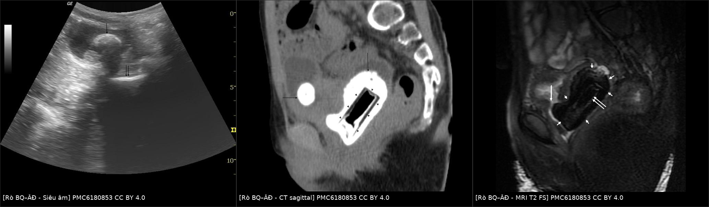
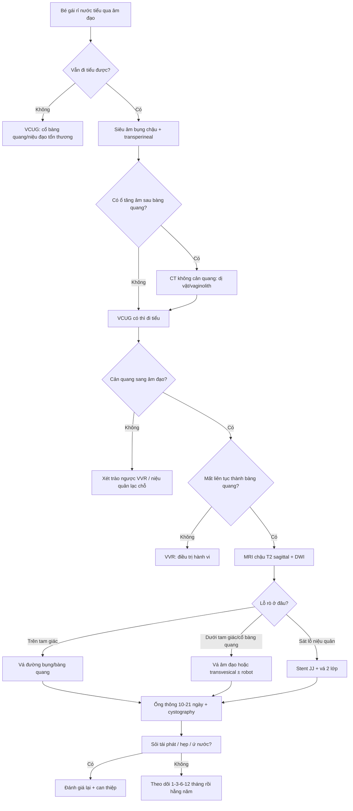
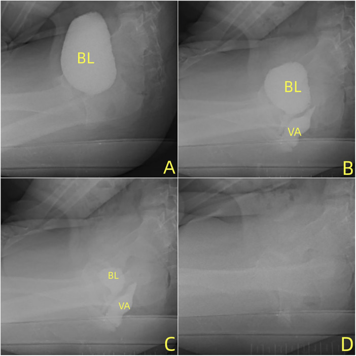
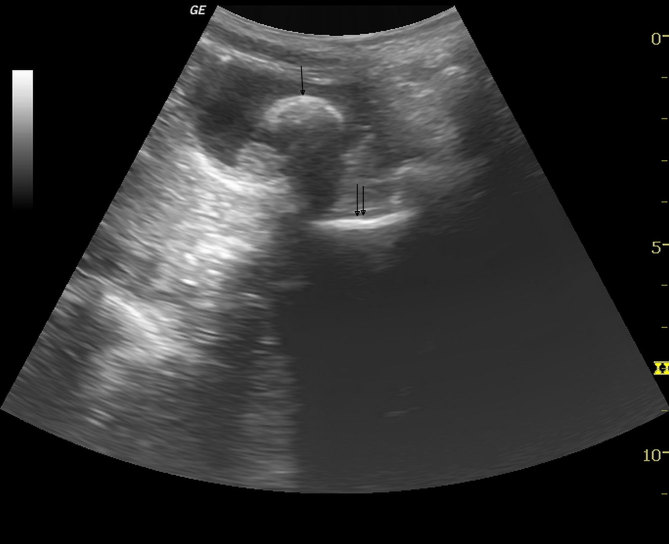
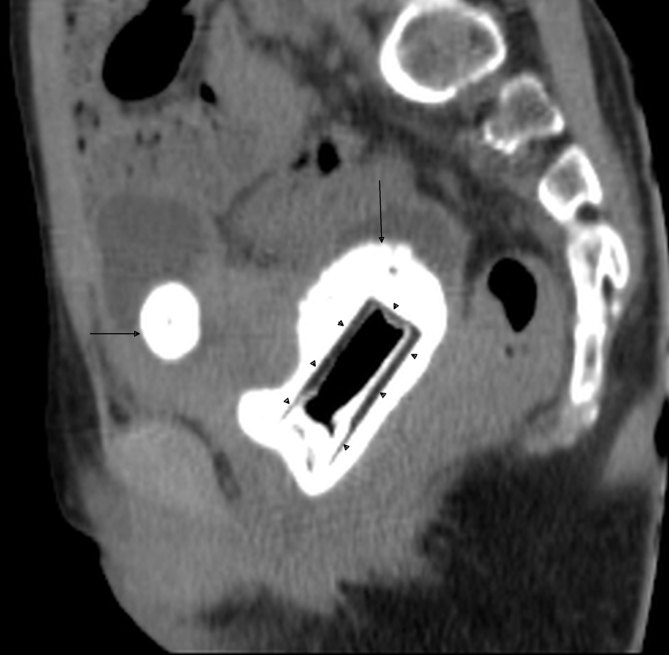
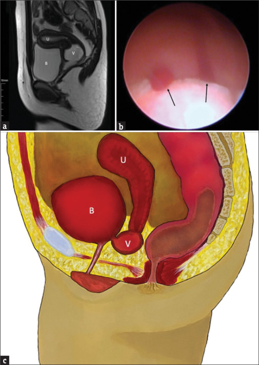

# 1682 — Rò bàng quang–âm đạo ở trẻ em / Vesicovaginal fistula in children

**Tags:** `pattern:ro` `pattern:mat-lien-tuc-thanh` `pattern:u-dich` `pattern:soi` `vung:bang-quang` `vung:am-dao` `vung:khung-chau` `vung:sinh-duc-nhi` `score:khong` `protocol:VCUG` `protocol:CT-cystography` `protocol:MRI-chau` `protocol:noi-soi` `incidentaloma:khong`

**Mức chắc chắn (certainty):** tổng hợp y văn (literature synthesis) — ghép 4 ca nguyên văn có ảnh (bé gái 12 tuổi PMC6180853; 8 tuổi PMC13199354; 11 tuổi → 14 tuổi PMC13127816; 14 tuổi PMC13481107), 2 ca nguyên văn định vị rò khó (10 tuổi PMC6031221; 13 tuổi PMC5823310), loạt 5 bé gái vỡ khung chậu (PMC7640385) và số liệu tổng quan người lớn dùng làm mốc tham chiếu có ghi rõ (PMC13337442, PMC11811971). Không suy rộng tỷ lệ người lớn cho trẻ.

## 1. Tổng quan bệnh học – cơ chế hình ảnh

**Rò bàng quang–âm đạo (vesicovaginal fistula, VVF)** là đường thông được biểu mô hóa giữa bàng quang và âm đạo. Nước tiểu chảy liên tục qua âm đạo trong khi bệnh nhân **vẫn đi tiểu bình thường** — vì lỗ niệu đạo và cổ bàng quang còn nguyên. Đây là điểm phân biệt với **đứt cổ bàng quang/niệu đạo** (không tiểu được) và với **trào ngược bàng quang–âm đạo** (chỉ rỉ sau khi đi tiểu, không có lỗ rò).

Ở trẻ em, VVF **hiếm** và cơ chế khác người lớn. Bốn đường sinh bệnh chính:

1. **Dị vật âm đạo bị bỏ quên (retained vaginal foreign body)** — nguyên nhân mắc phải hay gặp nhất ở trẻ tại nước phát triển. Dị vật (nắp chai, nắp sơn móng tay, đồ chơi nhỏ) gây **hoại tử do áp lực** và **cọ xát cạnh sắc** vào thành sau bàng quang → loét → rò. Đồng thời cặn urat lắng trên dị vật tạo **sỏi âm đạo (vaginolith)**, và dị vật chèn cổ bàng quang gây ứ nước tiểu → **sỏi bàng quang thứ phát**. Ca 12 tuổi: dị vật lưu **1 năm** → vaginolith **53 × 29 × 33 mm** + sỏi bàng quang **28 × 25 × 18 mm** + lỗ rò **6 × 5 mm** (PMC6180853). Ca 14 tuổi: sỏi bàng quang **30 mm** quanh vòng nhựa, rò **dưới tam giác** (infratrigonal), chờ **1 năm** vẫn không tự đóng (PMC13481107).
2. **Chấn thương khung chậu (pelvic fracture)** — vỡ khung chậu ở bé gái có thể làm **bong cổ bàng quang (bladder neck avulsion)** và đứt niệu đạo; VVF xuất hiện ở **1/5** ca trong loạt 5 bé gái, có ca đến muộn **7 tháng** sau tai nạn (PMC7640385). Đây là nhóm phải đặt ống trên xương mu và chờ mô lành trước khi tái tạo.
3. **Bẩm sinh (congenital VVF)** — cực hiếm, thường kèm **bất sản âm đạo đoạn xa (distal vaginal agenesis, DVA)** hoặc vách ngang. Bé **không có lỗ âm đạo**, máu kinh không ra ngoài mà **chảy vào bàng quang** → **menuria** (tiểu ra máu theo chu kỳ) và **ứ máu âm đạo (hematocolpos)**. Ca 1 tuổi → 11 tuổi: khối dịch sau bàng quang **58 × 53 × 70 mm** lúc nhỏ; đến 11 tuổi MRI thấy ứ máu **65 × 62 × 56 mm**, khoảng cách từ túi âm đạo đến tiền đình **58 mm** (PMC13127816). Ca 10 tuổi bị **chẩn đoán nhầm là ureterocele** vì đầu rò phồng vào lòng bàng quang (PMC6031221).
4. **Sau phẫu thuật/ống thông và sau xâm hại tình dục** — hoại tử do áp lực của bóng catheter, sau mổ vùng cổ bàng quang; hoặc chấn thương do vật lạ trong **xâm hại tình dục (child sexual abuse)**. Ca 11 tuổi rỉ nước tiểu **3 năm**, nhập viện nhiều lần vì "nhiễm trùng tiểu kháng trị", nội soi thấy VVF lớn kèm **dải xơ** và dị vật; triệu chứng tiết niệu gặp ở **2–9%** trẻ bị xâm hại (PMC9445866).

**Vì sao hình ảnh trông như vậy — giải thích bằng vật lý:**

- **MRI T2:** nước tiểu là nước tự do, thời gian T2 dài → **rất sáng**; cơ detrusor và thành âm đạo là cơ trơn, T2 ngắn → **tối**. Lỗ rò chứa nước tiểu tạo **đường sáng cắt ngang đường tối của thành bàng quang** — chỉ thấy rõ trên **mặt phẳng sagittal**, vì mặt phân cách bàng quang–âm đạo nằm đúng mặt phẳng này. Ca 12 tuổi: khuyết thành sau bàng quang **6 × 5 mm**, thấy rõ nhất trên T2 fat-sat sagittal (PMC6180853).
- **T1:** nước tiểu **tối**; methemoglobin (máu bán cấp) **sáng**. Vì vậy **menuria/hematocolpos** cho khối **T1 sáng + T2 sáng** kèm **mức dịch–dịch**; nếu chỉ có nước tiểu ứ thì T1 tối.
- **DWI/ADC:** mủ (pyocolpos) giàu tế bào và protein → **hạn chế khuếch tán** (DWI sáng, ADC thấp); nước tiểu tự do **không hạn chế**. Đây là cách phân biệt ứ mủ với ứ nước tiểu khi bệnh nhân sốt.
- **CT:** sỏi calci **> 200 HU** (thường 500–1.000 HU), dị vật nhựa **0–100 HU**, khí trong dị vật **−1.000 HU**. Vaginolith **53 × 29 × 33 mm** có viền calci dày, lõi nhựa **36 × 18 mm** chứa khí (PMC6180853). **CT cystography** bơm dung dịch cản quang pha loãng (**10–20%**, 50–100 mL) làm căng bàng quang; lỗ rò chỉ hiện khi **có chênh áp** — nên phải chụp **thì đi tiểu/ngay sau bơm**, không chỉ thì đổ đầy.
- **Siêu âm:** sỏi = **ổ tăng âm + bóng lưng sạch**; nước tiểu = **trống âm**. Ca 12 tuổi: sỏi bàng quang **~25 mm** và một **ổ tăng âm thứ hai sau bàng quang** (dị vật/vaginolith) — dấu hiệu này bị bỏ qua lúc đầu (PMC6180853).

**Ngưỡng định lượng cần nhớ:**

| Chỉ số | Số liệu | Nguồn |
|---|---|---|
| VVF sau cắt tử cung (mốc người lớn, KHÔNG suy cho trẻ) | **0,8–1,0/1.000** ca | PMC13337442 |
| Đóng kín sau mổ VVF lần đầu (người lớn) | **80–95%** | PMC13337442 |
| Tái phát/thất bại sau vá | **10–30%** | PMC13337442 |
| VVR ở bé gái trước dậy thì | **12–15%** các ca tiểu không tự chủ | PMC13199354 |
| Tiểu ướt ban ngày ở bé gái 6–12 tuổi | **3,1–9,5%** | PMC13199354 |
| Triệu chứng tiết niệu ở trẻ bị xâm hại tình dục | **2–9%** | PMC9445866 |
| VVF trong loạt 5 bé gái vỡ khung chậu | **1/5 (20%)** | PMC7640385 |
| Kích thước lỗ rò ca 12 tuổi | **6 × 5 mm** | PMC6180853 |
| Vaginolith / sỏi bàng quang ca 12 tuổi | **53 × 29 × 33 mm** / **28 × 25 × 18 mm** | PMC6180853 |
| Sỏi bàng quang ca 14 tuổi | **30 mm** | PMC13481107 |
| Ống thông sau vá / stent JJ | **22 ngày** / **34 ngày** | PMC13481107 |
| Thời gian theo dõi không tái phát | **3 tháng · 18 tháng · 2 năm** | PMC6180853 · PMC13481107 · PMC6031221 |

## 2. Mẫu hình + chẩn đoán phân biệt theo vị trí (gamut)

**Mẫu hình chung:** *rỉ nước tiểu liên tục qua âm đạo ở bé gái, đáy bàng quang/âm đạo có dịch, nhưng vẫn đi tiểu được* — kèm một trong ba bối cảnh: **dị vật/đi tiểu khó kéo dài**, **chấn thương khung chậu**, hoặc **không có lỗ âm đạo/menuria**.

Ba câu hỏi phải trả lời trước khi đặt tên:

1. **Rò ở tầng nào?** (bàng quang – niệu quản – niệu đạo – âm đạo)
2. **Có tắc nghẽn phía dưới không?** (dị vật, sỏi, bất sản âm đạo, hẹp niệu đạo)
3. **Có phải rò thật không?** (trào ngược âm đạo, niệu quản lạc chỗ, dính môi bé — không có lỗ thông)

**Gamut theo vị trí:**

- **Bàng quang, trên tam giác (supratrigonal):** VVF sau chấn thương/mổ; thường dễ vá qua đường bụng–bàng quang.
- **Tam giác – lỗ niệu quản:** VVF + rò niệu quản–âm đạo; nguy cơ làm tổn thương lỗ niệu quản khi vá.
- **Dưới tam giác/cổ bàng quang (infratrigonal):** VVF do dị vật, sau bong cổ bàng quang; khó vá, dễ tiểu không tự chủ sau mổ.
- **Niệu đạo:** rò niệu đạo–âm đạo (rỉ khi đi tiểu, vẫn kiểm soát được giữa các lần).
- **Niệu quản:** rò niệu quản–âm đạo (rỉ liên tục, ứ nước thận, không có khuyết thành bàng quang).
- **Âm đạo + dị vật:** vaginolith/sỏi âm đạo, có thể kèm rò; ổ tăng âm có bóng lưng.
- **Bẩm sinh + không có lỗ âm đạo:** VVF + DVA/vách ngang, ứ máu âm đạo, menuria.
- **Không có rò:** trào ngược bàng quang–âm đạo, niệu quản lạc chỗ đổ vào âm đạo, dính môi bé, bàng quang thần kinh.

**Gamut theo tuổi:**

| Nhóm tuổi | Nguyên nhân hay gặp | Dấu hiệu chốt |
|---|---|---|
| Sơ sinh – nhũ nhi | VVF bẩm sinh + DVA, ứ dịch âm đạo, niệu quản lạc chỗ | Không có lỗ âm đạo, khối dịch sau bàng quang, siêu âm trước sinh |
| Trước dậy thì | Dị vật âm đạo, chấn thương khung chậu, sau mổ/ống thông | Rỉ nước tiểu + sỏi/vaginolith, tiền sử chấn thương |
| Dậy thì | Menuria (VVF bẩm sinh), dị vật, xâm hại tình dục, sinh đẻ sớm | Máu kinh qua bàng quang, đau bụng chu kỳ, tiền sử xã hội |

## 3. Bảng so sánh phân biệt (ma trận đối chiếu)

| Thực thể (entity) | Hình ảnh điển hình | Chốt vào (rule-in) | Chốt loại (rule-out) | Gợi ý xác nhận |
|---|---|---|---|---|
| **Rò bàng quang–âm đạo (VVF)** | MRI T2 sagittal: **khuyết thành sau bàng quang** (6 × 5 mm), đường sáng nối bàng quang–âm đạo; CT cystography thì voiding thấy cản quang sang âm đạo | **Rỉ liên tục + vẫn tiểu được + khuyết thành bàng quang tại chỗ tiếp giáp âm đạo** | Thành bàng quang liên tục trên mọi mặt phẳng | Soi bàng quang + xanh methylene; CT cystography thì đi tiểu |
| **Rò niệu quản–âm đạo** | Ứ nước–niệu quản; khí trong hệ thống đài bể thận; không khuyết thành bàng quang | **Rỉ liên tục + ứ nước thận cùng bên + khí trong đài bể thận** | Không có khuyết thành bàng quang; lỗ niệu quản bình thường | CT urography/MR urography; soi niệu quản |
| **Rò niệu đạo–âm đạo** | Khuyết thành sau niệu đạo; cản quang vào âm đạo khi đi tiểu | **Rỉ khi đi tiểu, khô giữa các lần + khuyết niệu đạo** | Bàng quang và tam giác nguyên vẹn | RUG/VCUG thì voiding; nội soi niệu đạo |
| **Trào ngược bàng quang–âm đạo (VVR)** | VCUG: bàng quang giảm thể tích, **âm đạo đầy cản quang trong lúc đi tiểu**, sau đó cả hai rỗng; không có khuyết thành | **Rỉ trong 10 phút sau đi tiểu + không có lỗ rò + nghiệm pháp đi tiểu làm âm đạo rỗng** | Có khuyết thành hoặc cản quang tồn tại sau đi tiểu | VCUG động; siêu âm trước/sau đi tiểu; niệu dòng đồ hình chuông |
| **Niệu quản lạc chỗ đổ vào âm đạo** | Thận teo/lạc chỗ, niệu quản đổ vào thành âm đạo; không có lỗ rò bàng quang | **Rỉ liên tục từ nhỏ + thận cùng bên nhỏ/bất thường** | Bàng quang và niệu đạo bình thường | MR urography; soi âm đạo tìm lỗ niệu quản |
| **VVF bẩm sinh + bất sản âm đạo** | MRI: ứ máu âm đạo (T1 sáng, T2 sáng), túi cùng cách tiền đình **58 mm**; soi thấy lỗ ở **giữa tam giác** | **Menuria + không có lỗ âm đạo + ứ máu âm đạo** | Có lỗ âm đạo thông suốt, không ứ máu | Soi bàng quang **trong kỳ kinh**; MRI sagittal |
| **Bong cổ bàng quang/đứt niệu đạo sau chấn thương** | VCUG: **mất cổ bàng quang**, bàng quang hình cầu, niệu đạo gián đoạn; có thể kèm VVF | **Sau vỡ khung chậu + không tiểu được + ống trên xương mu** | Cổ bàng quang liên tục với niệu đạo | VCUG + soi bàng quang; đoạn thiếu **0,5–1,5 cm** |
| **Ứ mủ âm đạo (pyocolpos)** | Dịch âm đạo **hạn chế khuếch tán**, thành dày, bóng hơi; sốt | **Sốt + đau + DWI sáng/ADC thấp** | Dịch đơn thuần không hạn chế khuếch tán | Cấy dịch; dẫn lưu |
| **Dị vật/vaginolith** | Siêu âm: **ổ tăng âm + bóng lưng** sau bàng quang; CT: khối calci có lõi nhựa/khí | **Tiền sử dị vật/tiết dịch hôi + cấu trúc calci lõi khí** | Không có cấu trúc calci | CT không cản quang; MRI T2 (giảm tín hiệu mọi chuỗi) |

*Trái: siêu âm sagittal — sỏi bàng quang (mũi tên đơn) và ổ tăng âm sau bàng quang (mũi tên đôi). Giữa: CT sagittal — vaginolith viền calci bao quanh dị vật nhựa có khí bên trong. Phải: MRI T2 fat-sat sagittal — khuyết thành sau bàng quang nối với âm đạo. Nguồn: BJR Case Rep 2016;2:20150474 (PMC6180853), CC BY 4.0. Ảnh ghép letterbox, giữ nguyên tỷ lệ.*

### Ba dấu hiệu quyết định trên ảnh

- **Khuyết thành bàng quang (wall defect) trên T2 sagittal:** mất liên tục đường tối của detrusor, thay bằng đường sáng chứa nước tiểu; đo kích thước (ca điển hình **6 × 5 mm**). Đây là dấu **chốt vào** mạnh nhất.
- **Chênh áp mới thấy rò:** trên CT cystography/VCUG, lỗ rò có thể **không hiện ở thì đổ đầy** mà chỉ hiện **khi đi tiểu hoặc ngay sau bơm** — vì cần gradient áp lực bàng quang–âm đạo.
- **Dị vật + sỏi âm đạo:** ổ tăng âm có bóng lưng **phía sau bàng quang** (không phải trong lòng bàng quang) là dấu hiệu dị vật/vaginolith; bỏ qua dấu này dẫn tới chỉ điều trị sỏi bàng quang và bỏ sót nguyên nhân rò.

## 4. Protocol chụp + hệ phân độ/điểm chuẩn hóa

### 4.1 Protocol hình ảnh (thứ tự, ALARA)

1. **Siêu âm bụng–chậu (bàng quang đầy) ± transperineal:** đo thể tích nước tiểu tồn dư, độ dày thành bàng quang, tìm **ổ tăng âm có bóng lưng** (sỏi/dị vật), đánh giá ứ nước thận hai bên. Ở bé gái chưa dậy thì **không đặt gì qua âm đạo**.
2. **VCUG có thì đi tiểu (voiding cystourethrography):** đặt catheter, bơm cản quang đến dung tích bàng quang theo tuổi (**xấp xỉ (tuổi + 2) × 30 mL**), chụp thì đổ đầy, **thì đi tiểu** và **sau đi tiểu**. Bắt buộc có thì đi tiểu — đây là thì duy nhất phát hiện rò nhỏ và phân biệt VVR.
3. **CT cystography liều thấp** khi cần bản đồ 3D/ổ dị vật: pha loãng cản quang **10–20%**, 50–100 mL, lát **≤ 1 mm**, dựng sagittal/coronal; chụp **ngay sau bơm** và **thì đi tiểu**. Ở trẻ chỉ dùng khi siêu âm/VCUG chưa đủ, vì liều tuyến sinh dục.
4. **MRI chậu 1,5 T (không cản quang là đủ):** **T2 sagittal** (mặt phẳng quyết định), **T2 fat-sat sagittal**, **T1 sagittal**, **T2 axial/coronal**, **DWI/ADC** khi nghi ứ mủ; **MR urography** khi nghi rò niệu quản. Ca 12 tuổi MRI phát hiện khuyết **6 × 5 mm** mà CT không đo được chính xác (PMC6180853).
5. **Nội soi bàng quang + test xanh methylene (methylene blue):** bơm xanh vào bàng quang, đặt 3 swab từ cùng đồ đến tiền đình; **xanh ở swab trên cùng = rò niệu quản–âm đạo**, xanh lan xuống swab dưới = rò bàng quang–âm đạo. Nội soi cũng cho biết **vị trí lỗ so với lỗ niệu quản** — yếu tố quyết định đường mổ.
6. **Nội soi âm đạo/soi bàng quang trong kỳ kinh** khi nghi VVF bẩm sinh + DVA: chỉ lúc menuria mới thấy dòng máu từ lỗ rò vào bàng quang (PMC13127816).

### 4.2 Phân độ và ngưỡng xử trí

| Hệ phân độ | Dùng để | Ngưỡng / ý nghĩa |
|---|---|---|
| **Theo vị trí** | Chọn đường vào | **Trên tam giác** → đường bụng/bàng quang; **dưới tam giác/cổ bàng quang** → đường âm đạo hoặc transvesical; **sát lỗ niệu quản (< 5 mm)** → cân nhắc đặt stent JJ trước |
| **Theo kích thước** | Tiên lượng đóng kín | **≤ 1 cm** dễ đóng; **1–3 cm** trung bình; **> 3 cm** cần vá nhiều lớp ± vạt |
| **Theo số lỗ/số lần vá** | Nguy cơ tái phát | Nhiều đường rò, đã vá thất bại, mô xơ/thiếu máu → nguy cơ cao (tái phát chung **10–30%**) |
| **Goh 2004 (rò sản khoa, dùng cho vị thành niên sinh sớm)** | Mô tả và tiên lượng | Khoảng cách tới lỗ niệu đạo ngoài: **I ≥ 4 cm · II 3–4 cm · III < 3 cm**; kích thước: **a ≤ 1,5 cm · b 1,5–3 cm · c > 3 cm**; sẹo: **i không/nhẹ · ii vừa/nặng** |

### 4.3 Thời điểm và kỹ thuật (nguyên tắc)

- **Loại bỏ nguyên nhân trước:** lấy dị vật, sỏi âm đạo/bàng quang, điều trị nhiễm trùng. Ca 12 tuổi lấy dị vật + sỏi qua đường trên xương mu rồi vá thì sau; ca 14 tuổi lấy sỏi và **chờ 1 năm** — rò vẫn không tự đóng nên mới vá (PMC6180853, PMC13481107).
- **Chờ mô lành:** thường **6–12 tuần** sau khi hết viêm cấp; với chấn thương/hoại tử áp lực có thể **3–6 tháng** hoặc lâu hơn. Vá trên mô viêm làm tăng thất bại.
- **Đóng 2 lớp kín nước** (niêm mạc bàng quang + lớp cơ, rồi thành âm đạo) và **chèn vạt** (mạc nối/omental flap hoặc vạt Martius) khi mô xơ, xạ trị, tái phát. Ca 14 tuổi: 4 cổng robot + 1 cổng phụ, stent JJ hai bên, đóng 2 lớp + mạc nối, ra viện **ngày 2**, rút ống thông **ngày 22** sau cystography không rò, rút stent **ngày 34**, **18 tháng** không triệu chứng (PMC13481107).
- **Dẫn lưu sau mổ:** ống thông niệu đạo **10–21 ngày** (ca 14 tuổi: **22 ngày**), ống trên xương mu rút sau khi ống niệu đạo hoạt động; kiểm tra bằng **cystography trước khi rút**.
- **Theo dõi:** khám + siêu âm **1–3–6–12 tháng**, sau đó hằng năm; đánh giá **tiểu không tự chủ, hẹp niệu đạo/âm đạo, ứ nước thận, sỏi tái phát**. Với VVF bẩm sinh + DVA: theo dõi **chiều dài âm đạo** (ca điển hình **7 cm → 8 cm** lúc 14 tuổi) và kinh nguyệt.

## 5. Biến thể bình thường và cạm bẫy

**Biến thể bình thường / không phải rò:**

- **Trào ngược bàng quang–âm đạo (VVR):** bé gái **8 tuổi** rỉ nước tiểu sau đi tiểu, siêu âm thấy khối trống âm âm đạo **7,3 × 3,3 × 4,0 cm** khi bàng quang đầy, **mất sau khi đi tiểu**; VCUG cho cản quang vào âm đạo trong lúc đi tiểu rồi cả hai rỗng; không có khuyết thành. Điều trị **hướng dẫn đi tiểu + thay đổi hành vi**, không mổ (PMC13199354).
- **Dính môi bé (labial adhesion):** nước tiểu đọng ở tiền đình gây rỉ, nhưng không có dịch trong âm đạo và không có lỗ rò.
- **Niệu quản lạc chỗ:** rỉ liên tục từ nhỏ, thận cùng bên teo/lạc chỗ; không có khuyết thành bàng quang.
- **Nang Gartner/ứ dịch âm đạo nhẹ:** không rỉ nước tiểu, không thông với bàng quang.

**Cạm bẫy (pitfall):**

- **Bỏ sót dị vật vì bệnh nhân phủ nhận:** ca 12 tuổi và 13 tuổi đều **phủ nhận** dị vật lúc hỏi ban đầu; chỉ lộ khi thấy cấu trúc lạ trên siêu âm/CT. Ổ tăng âm **sau bàng quang** phải được coi là dị vật cho tới khi loại trừ.
- **Chẩn đoán nhầm VVF bẩm sinh là ureterocele:** ca 10 tuổi có khối phồng ở **tam giác trái** trên siêu âm, bị cắt nội soi với chẩn đoán ureterocele; sau đó **tiểu máu theo chu kỳ** = menuria. Đầu rò phồng vào bàng quang tạo hình ảnh giả ureterocele (PMC6031221).
- **Cystogram âm tính giả:** bóng catheter bít lỗ rò, bàng quang chưa căng, hoặc chỉ chụp thì đổ đầy → **âm tính không loại trừ**. Phải có thì đi tiểu + nội soi (ca 3 tuổi trong bài 1681).
- **Nhầm VVR với rò rồi mổ oan:** VVR không có khuyết thành và âm đạo rỗng sau đi tiểu; mổ sẽ tạo rò thật.
- **Bỏ sót rò niệu quản–âm đạo:** 13 tuổi rỉ liên tục **2 năm**, chẩn đoán nhầm "viêm âm đạo do vi khuẩn"; dấu hiệu gợi ý là **khí trong đài bể thận** và **dày thành niệu quản** trên siêu âm (PMC5823310).
- **Menuria bị gọi là "tiểu máu tái phát":** ở bé gái không có lỗ âm đạo, tiểu máu theo chu kỳ hằng tháng là **máu kinh qua bàng quang**, không phải nhiễm trùng.
- **Xâm hại tình dục bị bỏ qua:** rỉ nước tiểu mới ở trẻ trước đó bình thường, kèm dải xơ/dị vật âm đạo, cần đánh giá **bảo vệ trẻ** song song với chẩn đoán hình ảnh (PMC9445866).
- **Tổn thương lỗ niệu quản khi vá:** lỗ rò sát lỗ niệu quản (< 5 mm) → đặt stent JJ trước, tránh khâu hẹp gây ứ nước thận sau mổ.
- **Liều bức xạ:** mỗi lần đau bụng mà chụp CT là tích lũy liều tuyến sinh dục — ưu tiên siêu âm/MRI; CT chỉ khi cần bản đồ dị vật/xương.

*VCUG bốn thì ở bé gái 8 tuổi: (A) bàng quang đầy; (B–C) cản quang vào âm đạo trong lúc đi tiểu, bàng quang giảm dần; (D) sau đi tiểu cả bàng quang và âm đạo đều rỗng — không có khuyết thành, tức là trào ngược chứ không phải rò. Nguồn: Front Pediatr 2026;14:1849196 (PMC13199354), CC BY 4.0.*

## 6. Tự lượng giá — Blind Quiz

**Ca 1 — Bé gái 12 tuổi, rỉ nước tiểu liên tục 6 tháng, không có kinh, tiền sử ngã chấn thương khung chậu 3 năm trước. Nhìn ảnh trước, mô tả rồi hãy mở đáp án.**

- Gợi ý: da vùng đáy chậu bị lở loét do nước tiểu; siêu âm thận có ứ nước nhẹ hai bên.
- Câu hỏi: Có mấy ổ tăng âm, mỗi ổ ở đâu? Ba chẩn đoán phân biệt? Dấu hiệu nào chốt nguyên nhân?

<b>Bấm để hiện đáp án (findings + chẩn đoán)</b>

- Dấu hiệu: **ổ tăng âm ~25 mm trong lòng bàng quang** (mũi tên đơn) có bóng lưng = sỏi bàng quang; **ổ tăng âm thứ hai sau bàng quang** (mũi tên đôi) = dị vật/vaginolith.
- Chẩn đoán: **sỏi bàng quang + dị vật âm đạo bỏ quên gây rò bàng quang–âm đạo**. Vì sao: cặn urat lắng trên dị vật → vaginolith; dị vật chèn cổ bàng quang → ứ nước tiểu → sỏi thứ phát; cạnh sắc của dị vật gây loét thành sau bàng quang.
- Phân biệt: sỏi bàng quang đơn thuần (không có ổ tăng âm thứ hai, không rỉ nước tiểu), u bàng quang (không có bóng lưng sạch), máu cục (không có bóng lưng).
- Nguồn ảnh: BJR Case Rep 2016;2:20150474 (PMC6180853), CC BY 4.0.

**Ca 2 — Cùng bệnh nhân. CT sagittal không cản quang dưới đây đo được gì, và vì sao phải hỏi lại tiền sử dị vật?**

- Gợi ý: bệnh nhi và gia đình **phủ nhận** dị vật ở lần hỏi đầu.
- Câu hỏi: Hai cấu trúc calci là gì, kích thước bao nhiêu? Lõi bên trong có gì? Bước xử trí tiếp theo?

<b>Bấm để hiện đáp án</b>

- Dấu hiệu: **sỏi bàng quang 28 × 25 × 18 mm** (mũi tên ngang); **vaginolith 53 × 29 × 33 mm** (mũi tên dọc) với **viền calci dày** bao quanh **lõi nhựa 36 × 18 mm chứa khí** (đầu mũi tên).
- Chẩn đoán: **dị vật âm đạo (nắp sơn móng tay) lưu 1 năm → vaginolith + sỏi bàng quang + VVF**. Vì sao cần hỏi lại: trẻ thường giấu vì sợ; cấu trúc calci có lõi khí/khối hình chữ nhật là dấu hiệu dị vật, không phải sỏi thông thường.
- Xử trí: lấy dị vật + sỏi qua đường trên xương mu, điều trị nhiễm trùng, rồi vá rò khi mô lành; ca này vá bằng đường trên xương mu và không triệu chứng sau **3 tháng**.
- Nguồn ảnh: BJR Case Rep 2016;2:20150474 (PMC6180853), CC BY 4.0.

**Ca 3 — Bé gái 8 tuổi, tiểu buốt 3 ngày, sốt 38,5 °C, được cho là "túi thừa niệu đạo"; sau điều trị hết sốt nhưng vẫn rỉ nước tiểu sau khi đi tiểu. VCUG bốn thì dưới đây chẩn đoán gì?**

- Gợi ý: siêu âm thấy khối trống âm âm đạo **7,3 × 3,3 × 4,0 cm** khi bàng quang đầy, mất sau khi đi tiểu; niệu dòng đồ hình chuông.
- Câu hỏi: Cản quang đi đâu trong lúc đi tiểu? Có khuyết thành bàng quang không? Chẩn đoán và xử trí?

<b>Bấm để hiện đáp án</b>

- Dấu hiệu: (A) bàng quang đầy; (B–C) cản quang **vào âm đạo** khi đi tiểu, bàng quang nhỏ dần; (D) sau đi tiểu **cả hai rỗng**, **không có khuyết thành bàng quang**.
- Chẩn đoán: **trào ngược bàng quang–âm đạo (vesicovaginal reflux)** — rỉ trong 10 phút sau đi tiểu, không phải rò. Vì sao: cơ chế van/áp lực khi đi tiểu đẩy nước tiểu vào âm đạo; không có lỗ thông giải phẫu.
- Xử trí: hướng dẫn tư thế và kỹ thuật đi tiểu, giảm cân, theo dõi; ca này hết triệu chứng sau **6 tháng**, BMI **24,79 → 22,30**.
- Nguồn ảnh: Front Pediatr 2026;14:1849196 (PMC13199354), CC BY 4.0.

**Ca 4 — Bé gái 1 tuổi không có lỗ âm đạo, bụng chướng; đến 11 tuổi đau bụng và "tiểu ra máu" mỗi tháng. MRI và nội soi dưới đây cho thấy gì?**

- Gợi ý: MRI lúc 11 tuổi: khối ứ máu **65 × 62 × 56 mm**, khoảng cách từ túi âm đạo đến tiền đình **58 mm**; nội soi thực hiện **trong kỳ kinh**.
- Câu hỏi: Khối dịch nằm ở đâu, tín hiệu ra sao? Vì sao nội soi phải làm trong kỳ kinh? Chẩn đoán?

<b>Bấm để hiện đáp án</b>

- Dấu hiệu: (a) MRI sagittal: **ứ máu âm đạo (V)** giữa bàng quang (B) và tử cung (U), túi âm đạo tận cùng cách tiền đình **58 mm**; (b) nội soi: **dòng máu từ lỗ rò chảy vào bàng quang** ở giữa tam giác; (c) sơ đồ: đường thông giữa túi âm đạo và bàng quang.
- Chẩn đoán: **rò bàng quang–âm đạo bẩm sinh + bất sản âm đạo đoạn xa**. Vì sao soi trong kỳ kinh: chỉ khi có máu kinh ứ, dòng chảy qua lỗ rò mới hiện rõ; ngoài kỳ kinh lỗ rò có thể bị che.
- Xử trí: tách dính và **kéo âm đạo xuống (vaginal pull-through)** qua đường trước–cùng, tạo hình; nong Hegar **11 → 14**, âm đạo **7 cm → 8 cm**, có kinh bình thường, kiểm soát tiểu hoàn toàn.
- Nguồn ảnh: J Indian Assoc Pediatr Surg 2026;31:97–100 (PMC13127816), CC BY-NC-ND 4.0 — dùng nguyên bản, không chỉnh sửa.

## Bài liên quan chéo

- [1681 – Di chứng muộn niệu–sinh dục ở bé gái sau chấn thương khung chậu](../1681-di-chung-muon-nieu-sinh-duc-be-gai-sau-chan-thuong-khung-chau/lesson.md) — hẹp âm đạo, rò niệu đạo–âm đạo, hematocolpos sau chấn thương.
- [643 – Chấn thương đáy chậu – sinh dục ngoài ở trẻ](../643-chan-thuong-day-chau-sinh-duc-nhi/lesson.md) — nhận diện thương tổn cấp để phòng rò muộn.
- [645 – Vỡ khung chậu ở trẻ](../645-vo-khung-chau-o-tre/lesson.md) — phân loại và kiểm soát chảy máu ban đầu.
- [642 – Biến chứng muộn chấn thương niệu đạo nhi](../642-bien-chung-muon-chan-thuong-nieu-dao-nhi/lesson.md) — hẹp niệu đạo, tiểu không tự chủ.
- [679 – Rò niệu đạo–da ở trẻ](../679-ro-nieu-dao-da-o-tre/lesson.md) — nguyên lý vá rò 2 lớp và thời điểm mổ lại.
- [677 – Chăm sóc ống dẫn lưu trên xương mu ở trẻ](../677-cham-soc-ong-dan-luu-tren-xuong-mu-o-tre/lesson.md) — quản lý dẫn lưu tạm thời trước khi vá.
- [691 – Sỏi bàng quang và sỏi quanh catheter ở trẻ](../691-soi-bang-quang-va-soi-quanh-catheter-o-tre/lesson.md) — sỏi thứ phát do ứ trệ/dị vật.
- [671 – Nhiễm trùng tiểu bàng quang thần kinh ở trẻ](../671-nhiem-trung-tieu-bang-quang-than-kinh-o-tre/lesson.md) — phân biệt rỉ nước tiểu do rối loạn chức năng.
- [590 – Tạo hình âm đạo: kỹ thuật và biến chứng](../590-tao-hinh-am-dao-mrkh-ky-thuat-bien-chung/lesson.md) — khi phải tạo hình âm đạo kèm vá rò.
- [1701 – Đường mổ u quái cùng cụt](../1701-duong-mo-u-quai-cung-cut/lesson.md) — bảo tồn thần kinh – cơ thắt vùng cùng cụt.

## Ảnh

- `1682_ro-bang-quang-am-dao_US-PMC6180853-Fig1.jpg` — siêu âm sagittal: sỏi bàng quang + ổ tăng âm sau bàng quang (CC BY 4.0).
- `1682_ro-bang-quang-am-dao_CT-PMC6180853-Fig2.jpg` — CT sagittal: vaginolith có lõi nhựa/khí (CC BY 4.0).
- `1682_ro-bang-quang-am-dao_MRI-PMC6180853-Fig5.jpg` — MRI T2 fat-sat sagittal: khuyết thành sau bàng quang (CC BY 4.0).
- `composite_1682_US-CT-MRI.jpg` — ảnh ghép letterbox từ 3 ảnh cùng bài PMC6180853 (CC BY 4.0).
- `1682_ro-bang-quang-am-dao_VCUG-PMC13199354-Fig3.jpg` — VCUG bốn thì của trào ngược bàng quang–âm đạo (CC BY 4.0).
- `1682_ro-bang-quang-am-dao_MRI-noi-soi-PMC13127816-Fig1.jpg` — MRI + nội soi + sơ đồ VVF bẩm sinh kèm bất sản âm đạo (CC BY-NC-ND 4.0, nguyên bản).
- Không tải được (chỉ dẫn link): ca robot 14 tuổi chỉ có sơ đồ/hình mổ trong bài PMC13481107 (Thieme, không lấy được gói ảnh) — xem `sources.md`.

> Không dùng để chẩn đoán độc lập khi chưa có người hướng dẫn.
