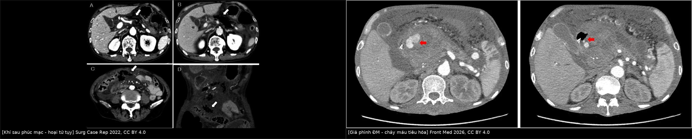
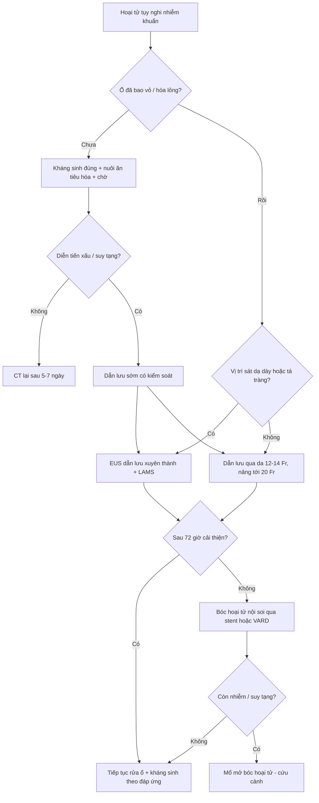
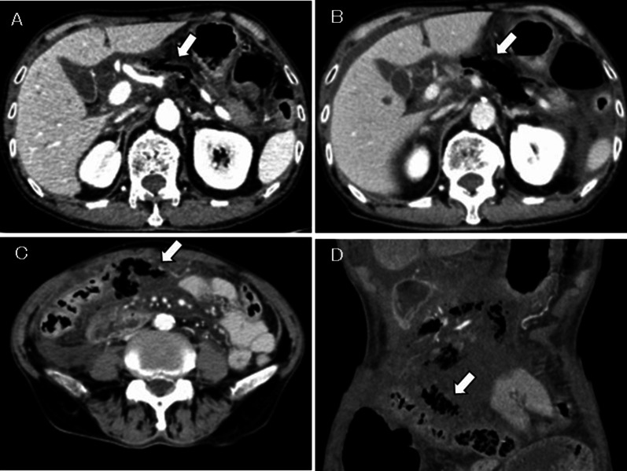
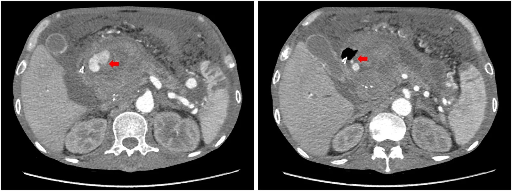
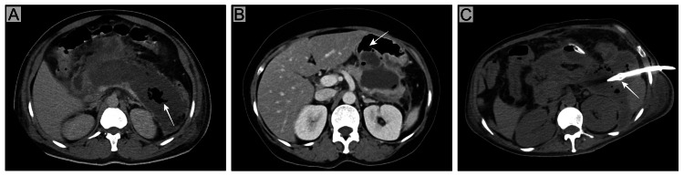

# 1683 — Hoại tử tụy nhiễm khuẩn & bóc hoại tử tối thiểu xâm lấn (infected pancreatic necrosis, step-up approach)

**Tags:** `pattern:hoai-tu-tuy` `pattern:khi-trong-o` `pattern:gia-phinh-dong-mach` `vung:tuy` `vung:sau-phuc-mac` `score:Atlanta-2012` `score:MCTSI` `protocol:CT-bung-co-can-quang` `protocol:dan-luu-qua-da` `protocol:EUS-LAMS` `incidentaloma:khong`

**Mức chắc chắn (certainty):** tổng hợp y văn (literature synthesis) — tổng quan điều trị hoại tử nhiễm khuẩn (Cureus 2025, PMC12104691), tổng quan kháng sinh – vi sinh – dược động học (J Antimicrob Chemother 2026, PMC13016968), mạng lưới so sánh 33 nghiên cứu (2026, PMC13356536), tổng quan thời điểm can thiệp (World J Emerg Surg 2023, PMC9883927), loạt step-up thực hành 41 ca (BMC Gastroenterol 2024, PMC11214239), phân tích gộp khí sau phúc mạc 60 ca (Surg Case Rep 2022, PMC9512950, **có ảnh CT**), ca giả phình động mạch tụy vỡ (Front Med 2026, PMC13689719, **có ảnh CT**) và ca hội chứng ống tụy đứt (Cureus 2026, PMC12998971). Không có thử nghiệm nào chứng minh một phác đồ kháng sinh tối ưu; chỗ suy luận được ghi rõ.

> **Câu chốt:** hoại tử nhiễm khuẩn **không phải** "ổ dịch có khí = mổ ngay", mà là **chuỗi quyết định theo thời gian**: (1) **không kháng sinh dự phòng**, chỉ điều trị khi **nghi nhiễm thật**; (2) **hoãn can thiệp tới khi ổ hoại tử bao vỏ / hóa lỏng (thường ≥ 4 tuần)** — 1/3–40% khỏi chỉ bằng kháng sinh; (3) **step-up**: dẫn lưu qua da/nội soi trước, **bóc hoại tử tối thiểu xâm lấn** sau, **mổ mở chỉ là cứu cánh**; (4) nâng bậc khi **sau 72 giờ dẫn lưu không cải thiện**. Ba bẫy chết người: **khí trong ổ không đồng nghĩa nhiễm khuẩn**, **bỏ sót giả phình động mạch**, và **gọi WON là "nang giả"** rồi can thiệp sai.

## 1. Tổng quan bệnh học – cơ chế hình ảnh

### 1.1 Dịch tễ và vì sao đáng chú ý

- **~20%** viêm tụy cấp tiến triển thành viêm tụy hoại tử; trong số đó **~30%** bị nhiễm khuẩn hoại tử (PMC12104691; PMC13016968).
- Tử vong hoại tử nhiễm khuẩn **15–35%**, so với **0–1%** ở viêm tụy nhẹ; có **suy tạng kèm theo thì tử vong gấp đôi** (PMC12104691; PMC13016968).
- Tử vong **sớm** do **suy tạng do SIRS (hoại tử còn vô khuẩn)**; tử vong **muộn** do **nhiễm khuẩn** — nên "chờ" không phải là "không làm gì", mà là **đợi đúng cửa sổ mô học** (PMC13016968).
- Nhiễm **nấm** gặp **26,6%** (gộp 22 nghiên cứu / 2.151 ca), gắn với nằm viện–ICU kéo dài và tử vong cao hơn (PMC12104691).
- **MDRO tăng theo thời gian nằm viện:** một loạt Trung Quốc 188 ca, tỷ lệ phân lập MDRO từ **16,7% (2010) lên 74,6% (2019)**; gần **50%** bệnh nhân có MDRO sau **150 ngày** nằm viện (PMC13016968).

### 1.2 Sinh lý bệnh: từ hoại tử vô khuẩn đến ổ nhiễm

1. **Thiếu máu vi mạch** + hoạt hóa enzyme tụy → **hoại tử mô tụy và mô mỡ quanh tụy** (hoại tử mỡ, xà phòng hóa).
2. Hoại tử là **môi trường nuôi cấy** hoàn hảo: **chuyển vị vi khuẩn từ ruột** (E. coli, Klebsiella spp. chiếm ưu thế; Enterococcus và Candida cũng thường gặp) (PMC13016968).
3. **Nhiễm khuẩn thường xuất hiện muộn (sau 2–4 tuần)**, nhưng **1/4** ca có thể nhiễm **sớm 7–14 ngày** ("early IPN") (PMC12104691).
4. Ổ hoại tử trải qua **hóa lỏng dần** rồi **bao vỏ xơ** — đây là cơ sở của **mọi ngưỡng thời gian** trong bài này.

### 1.3 TẠI SAO hình ảnh trông như vậy (vật lý + mô bệnh)

- **Hoại tử không ngấm cản quang:** vùng hoại tử **mất mao mạch** → không có iod tới → **giảm đậm độ so với nhu mô tụy lành đang ngấm** ở thì **tĩnh mạch cửa/muộn**. Vì vậy **CT không cản quang gần như vô dụng để đánh giá hoại tử**.
- **Thời điểm:** hoại tử **tiến triển trong 72–96 giờ đầu**; CT quá sớm **đánh giá thấp** hoại tử. Bắt đầu bằng **CT bụng có cản quang sau 72 giờ** khi bệnh nặng hoặc không cải thiện (PMC12104691).
- **Khí trong ổ (bubble sign):** khí **tự do trong mô hoại tử** tạo **đốm đen tuyệt đối (khoảng −1.000 HU)**, không ngấm, thường thành **bọng rải rác hoặc mức khí–dịch**. Khí xuất hiện vì **vi khuẩn sinh hơi**, **nhưng cũng có thể do rò vào ống tiêu hóa** hoặc **do can thiệp (catheter, stent)** — ba nguyên nhân này **không phân biệt được chỉ bằng khí** (PMC12104691, Figure 1).
- **Độ đặc hiệu vs độ nhạy:** khí là dấu hiệu **đặc hiệu cao nhưng độ nhạy thấp** — phần lớn ổ nhiễm khuẩn **không có khí**. Câu này là chốt để không "loại trừ nhiễm khuẩn vì không thấy khí" (PMC12104691).
- **Dịch – mảnh hoại tử:** < 4 tuần là **tụ dịch hoại tử cấp (ANC)** — chưa có vỏ, trong ổ có **mảnh đặc**; ≥ 4 tuần là **hoại tử có vỏ (WON)** — **vỏ xơ ngấm thuốc**, bên trong **mảnh hoại tử rắn** (khác **nang giả** chỉ có dịch, không có mảnh đặc).
- **MRI:** dịch **T2 rất sáng**; **mảnh hoại tử T2 trung bình–thấp**; **máu bán cấp T1 sáng** (methemoglobin); **khí là khoảng trống tín hiệu (signal void)** trên mọi chuỗi xung. **MRCP** phát hiện **rò ống tụy / ống tụy đứt (DPDS)** — thông tin quyết định có cần stent vĩnh viễn hay cắt tụy.
- **Siêu âm:** thấy dịch, hơi và sỏi mật, nhưng **kém với mảnh hoại tử và khí lan tỏa**; **EUS** lại là công cụ **dẫn đường can thiệp** (đo khoảng cách tới dạ dày/tá tràng, chọn vị trí đặt LAMS).

### 1.4 Ngưỡng định lượng trụ cột

| Đại lượng | Con số | Nguồn |
|---|---|---|
| Tỷ lệ hoại tử trong viêm tụy cấp | **~20%**; nhiễm khuẩn **~30%** của hoại tử | PMC13016968 |
| Tử vong hoại tử nhiễm khuẩn | **15–35%** (nhẹ **0–1%**); có suy tạng **gấp đôi** | PMC13016968; PMC12104691 |
| Mốc Atlanta 2012 | **< 4 tuần**: ANC · **≥ 4 tuần**: WON (vỏ xơ, có mảnh đặc) | Atlanta 2012 |
| Cửa sổ can thiệp | **hoãn tới khi bao vỏ/hóa lỏng**, thường **≥ 4 tuần** | PMC9883927 |
| Mổ mở quá sớm | mổ trong **47–72 giờ**: tử vong **58%** vs **27%** khi mổ muộn (≥ 12 ngày) | PMC13016968 |
| Không can thiệp được | **1/3–40%** khỏi chỉ bằng kháng sinh khi chờ bao vỏ | PMC12104691; PMC13016968 |
| POINTER (104 ca) | can thiệp **2,6 vs 4,4** lần (chênh **1,8**; KTC 0,6–3,0) khi hoãn | PMC12104691 |
| Dẫn lưu qua da (PCD) | bắt đầu **12–14 Fr** → nâng tới **20 Fr**; **~50%** khỏi chỉ với PCD; tử vong chung **18%** | PMC12104691 |
| Thất bại PCD | **BMI > 25, BISAP ≥ 4, nhiều mô hoại tử, ổ không đồng nhất, suy đa tạng** | PMC12104691 |
| Ngưỡng nâng bậc | sau **72 giờ** dẫn lưu **không cải thiện** → chụp lại/nâng cấp | PMC12104691 |
| Dự báo cần bóc hoại tử | ổ **≥ 10 cm**, lan **dọc đại tràng (paracolic)**, **≥ 30%** tụy hoại tử | PMC12104691 |
| Kháng sinh dự phòng | **KHÔNG** giảm nhiễm khuẩn/tử vong (12% vs 9%; 18% vs 12%) | PMC13016968 |
| PCT baseline | **≥ 1,0 ng/mL**: tử vong sau can thiệp **26% vs 7%** (p = 0,044) | PMC12104691 |
| Cấy máu dương | **~30%** ca hoại tử nhiễm khuẩn | PMC12104691 |
| Khí sau phúc mạc (60 ca) | tử vong **27%**; khí xuất hiện **< 7 ngày** → tử vong **44,1%** | PMC9512950 |
| Giả phình động mạch tụy vỡ | tử vong chung **> 50%**; nút mạch thành công ngay **85% (11/13)** | PMC13689719 |

## 2. Mẫu hình + chẩn đoán phân biệt theo vị trí (Gamut)

### 2.1 Mẫu hình chính

1. **Ổ dịch có khí trong/ quanh tụy** → gamut: **nhiễm khuẩn sinh hơi**, **rò tiêu hóa**, **sau can thiệp (dẫn lưu/stent)**, **khí sau phúc mạc do thủng tạng rỗng**, **viêm tụy khí thũng vô khuẩn**.
2. **Vùng tụy không ngấm thuốc, bờ rõ, không vỏ** → hoại tử; **không ngấm + vỏ xơ + mảnh đặc** → WON.
3. **Đốm tăng đậm độ trong ổ, ngấm đồng thì với động mạch** → **giả phình động mạch**; nếu **thoát mạch hoạt động** thì **máu tụ tăng đậm độ thì muộn**.
4. **Ổ dịch dai dẳng sau khi hết viêm, MRCP mất liên tục ống tụy** → **hội chứng ống tụy đứt (DPDS)**.

### 2.2 Gamut theo vị trí giải phẫu

- **Đầu tụy / rãnh tá–tụy:** giả phình **động mạch tá–tụy và gan**, rò **tá tràng**, ứ mật do chèn ép ống mật chủ.
- **Thân–đuôi tụy:** giả phình **động mạch lách** (hay gặp nhất), huyết khối **tĩnh mạch lách** → tăng áp cửa trái, rò **dạ dày**.
- **Khoang cạnh thận trước / sau phúc mạc:** khí lan theo **mạc treo đại tràng ngang**, **dọc đại tràng**, xuống **hố chậu** — đây là lý do ổ "xa dạ dày" **không đặt được LAMS**.

## 3. Bảng so sánh phân biệt (ma trận đối chiếu)

| Thực thể (entity) | Hình ảnh điển hình | Chốt vào (rule-in) | Chốt loại (rule-out) | Gợi ý xác nhận |
|---|---|---|---|---|
| **Hoại tử nhiễm khuẩn (IPN)** | ổ dịch + **mảnh hoại tử**, ± khí, vỏ xơ ngấm thuốc | **khí trong ổ** (đặc hiệu cao) + **sốt/diễn tiến xấu** + **PCT ≥ 1,0 ng/mL** | **không có khí KHÔNG loại trừ** nhiễm khuẩn | cấy dịch **lúc/ngay sau** dẫn lưu, không cấy muộn |
| **Hoại tử vô khuẩn** | cùng hình ảnh, **không khí**, không hội chứng nhiễm | diễn tiến ổn định, không tăng PCT/CRP | không dùng kháng sinh dự phòng | theo dõi lâm sàng + CT lại |
| **Viêm tụy khí thũng (emphysematous)** | **khí lan sau phúc mạc** rất sớm, có thể **trong ống tụy** | khí **< 7 ngày** từ khởi phát → tiên lượng xấu (tử vong **44,1%**) | khí muộn sau dẫn lưu **không** phải thể này | CT có cản quang + bệnh cảnh |
| **Nang giả tụy (pseudocyst)** | ổ dịch **đồng nhất**, vỏ mỏng, **không mảnh đặc** | ≥ 4 tuần, dịch thuần | **có mảnh hoại tử = WON**, không phải nang giả | MRI/MRCP, EUS |
| **Rò tiêu hóa vào ổ hoại tử** | khí + **mức khí–dịch thay đổi**, thành ổ dính quai ruột | khí **tái xuất** dù không can thiệp | không mặc định là nhiễm khuẩn | CT nhiều thì, nội soi/fluoroscopy |
| **Khí sau can thiệp** | khí **dọc đường catheter/stent**, ít, không lan | có **can thiệp trong 72 giờ** trước | không đổi kháng sinh chỉ vì khí | so sánh phim trước–sau |
| **Giả phình động mạch** | **nang tăng đậm độ thì động mạch**, ngấm **song hành ĐMC** | **ngấm đồng thì động mạch**, có **thoát mạch** | **không ngấm = không phải giả phình** | CTA/DSA, **nút mạch** |
| **Huyết khối tĩnh mạch lách/cửa** | khuyết thuốc trong lòng tĩnh mạch, lách to, tuần hoàn bàng hệ | khuyết thuốc **không ngấm** | không phải ổ dịch | CTV/MRV |
| **Hội chứng ống tụy đứt (DPDS)** | ổ dịch **dai dẳng**, tụy **teo phần đầu xa**, mất liên tục ống | **MRCP mất liên tục ống tụy chính** | ổ dịch đơn thuần tự khỏi | MRCP + dẫn lưu nội bộ lâu dài |

*Trái: khí sau phúc mạc quanh thân tụy (viêm tụy khí thũng) — Surg Case Rep 2022 (PMC9512950), CC BY 4.0. Phải: giả phình đầu tụy có thoát mạch vào tá tràng — Front Med 2026 (PMC13689719), CC BY 4.0. Cả hai đều là "khí/máu" trong ổ hoại tử, nhưng một bên đòi dẫn lưu – một bên đòi nút mạch cấp cứu.*

## 4. Protocol chụp + hệ phân độ/điểm chuẩn hóa

### 4.1 Protocol

- **CT bụng – khung chậu có cản quang, 3 thì (động mạch – tĩnh mạch cửa – muộn), lát ≤ 1–1,5 mm**, sau **72 giờ** từ khởi phát khi bệnh nặng/không cải thiện.
- **Thì động mạch** bắt buộc khi nghi **giả phình** hoặc **chảy máu**; **thì muộn** để thấy **thoát mạch hoạt động** (đốm tăng đậm độ **lan rộng** giữa các thì).
- **Đo và ghi:** kích thước ổ lớn nhất (3 chiều), **số ổ**, **% tụy hoại tử**, **vị trí so với dạ dày/tá tràng (mm)**, **lan dọc đại tràng/hố chậu**, **có mảnh đặc trong ổ**, **khí**, **giả phình**, **huyết khối tĩnh mạch**.
- **MRI/MRCP** khi cần phân biệt **WON vs nang giả**, tìm **rò ống tụy**, **DPDS**, hoặc bệnh nhân trẻ/tránh iod.
- **EUS** trước can thiệp nội soi: **khoảng cách thành dạ dày–ổ**, mạch máu **nằm trên đường chọc** (chống chỉ định đặt LAMS nếu có mạch xen giữa).

### 4.2 Phân độ

- **Atlanta 2012 (sửa đổi):** < 4 tuần → **ANC** (tụ dịch hoại tử cấp); ≥ 4 tuần → **WON** (hoại tử có vỏ). Viêm tụy **nhẹ / trung bình / nặng** theo **suy tạng > 48 giờ**.
- **MCTSI (CT severity index sửa đổi): 0–10**; **0–2 nhẹ · 4–6 trung bình · 8–10 nặng** (điểm **+2** cho hoại tử **> 30%** và **+2** cho biến chứng).
- **BISAP ≥ 4** = nguy cơ cao, đồng thời là **yếu tố dự báo thất bại dẫn lưu** (PMC12104691).

### 4.3 Thuật toán step-up

> Ghi chú: **"dẫn lưu sớm có kiểm soát"** chỉ dành cho **nhiễm khuẩn có hội chứng nhiễm nặng/suy tạng**; còn lại **hoãn tới khi bao vỏ** vì ít can thiệp hơn (POINTER).

### 4.4 Kháng sinh, vi sinh và thời gian điều trị

- **Không dự phòng**: hai RCT mù đôi (ciprofloxacin + metronidazol n = 114; meropenem n = 100) **không giảm** hoại tử nhiễm khuẩn (12% vs 9%; 18% vs 12%) hay tử vong (PMC13016968).
- **Lấy cấy đúng lúc**: cấy **dịch ổ trong/ngay sau** can thiệp; **cấy dịch dẫn lưu muộn không diễn giải được** — Enterococcus và nấm xuất hiện **sau vài tuần** thường là **cư trú (colonization)**, không phải nhiễm xâm lấn (PMC13016968).
- **Nấm**: **không điều trị theo kinh nghiệm** dù tỷ lệ cấy dương **10–20%**; cân nhắc khi **nằm viện lâu, nhiều kháng sinh, thất bại với kháng sinh phổ rộng**; nếu có **nhiễm nấm huyết** → **echinocandin** ưu tiên hơn azole (PMC13016968; PMC12104691).
- **Thời gian**: **cá thể hóa theo đáp ứng lâm sàng và mức độ kiểm soát ổ nhiễm** — **chưa có bằng chứng xác định thời gian tối ưu**; nguyên tắc là **ngừng sớm khi nguồn nhiễm đã được kiểm soát**, tránh "kháng sinh vô tận" vì **MDRO tăng theo ngày điều trị** (OR **1,08/ngày**, KTC 1,03–1,16) (PMC13016968).
- **De-escalation** khi có kết quả cấy; **Enterococcus** liên quan **suy tạng dai dẳng (OR 3,08)** và **tử vong (OR 5,78)** (PMC13016968).

### 4.5 Kết quả của step-up và các mốc can thiệp

- **PANTER (n = 88):** step-up giảm **biến chứng nặng, suy tạng, đái tháo đường, thoát vị vết mổ**; tử vong **tương đương** trong ngắn hạn; theo dõi **86 ± 11 tháng** tử vong **44% vs 73%** (p = 0,005) (PMC12104691).
- **Mạng lưới 33 nghiên cứu (2026):** bóc hoại tử **nội soi** so với **mổ mở**: tử vong **OR 0,24 (0,06–0,95)**; **biến chứng OR 0,11 (0,03–0,40)**; **suy đa tạng mới OR 0,05 (0,01–0,19)**; hạng điều trị **P-score 90,4%** so với **2,6%** của mổ mở (PMC13356536).
- **Gộp một nhánh:** tử vong **7,0%** (KTC 5,6–8,7), thành công lâm sàng **89,8%**, cần mổ thêm **7,1%** (PMC13356536).
- **Thực hành 41 ca:** step-up khả thi **100%**, khỏi nhiễm **80%**, **39%** cần bước 2 (bóc hoại tử), tử vong **6 tháng 19,5%**; biến chứng nội soi: **chảy máu 6%**, **di lệch stent 29,5%**, **tắc catheter 16%** (PMC11214239).
- **Thời điểm:** phân tích mạng Bayes 10 nghiên cứu / 570 ca — **step-up ngoại khoa trì hoãn** và **step-up nội soi trì hoãn** xếp hạng tốt nhất; **mổ mở sớm** xếp hạng xấu nhất (PMC9883927).

## 5. Biến thể bình thường và cạm bẫy

### 5.1 Biến thể / hình ảnh lành tính dễ nhầm

- **Mỡ quanh tụy thâm nhiễm** (stranding) không ngấm thuốc, **không có vỏ** — đừng gọi là "ổ dịch".
- **Dịch quanh tụy lượng nhỏ tự tiêu** trong 2–4 tuần; **không can thiệp** ổ < 3 cm, không triệu chứng.
- **Khí trong lòng ruột non kề ổ hoại tử** trên lát cắt mỏng — phân biệt bằng **tính liên tục với quai ruột** và **không có mức khí–dịch trong ổ**.
- **Giả phình nhỏ tự hết** đã được báo cáo — nhưng **không được chủ quan**: một ca giả phình **0,7 × 1,0 cm** ở rốn lách **to lên 2,5 × 2,0 cm trong 12 ngày** và **vỡ gây sốc mất máu** (PMC13689719).

### 5.2 Cạm bẫy (pitfall)

1. **"Có khí = nhiễm khuẩn = mổ"** — sai. Khí có **3 nguồn** (nhiễm, rò tiêu hóa, can thiệp) và **độ nhạy thấp**; ngược lại, hoại tử nhiễm khuẩn **thường không có khí** (PMC12104691).
2. **Viêm tụy khí thũng vô khuẩn**: khí **rất sớm (< 7 ngày)**, lan **sau phúc mạc** — tử vong **27%**, và **44,1%** nếu khí xuất hiện **< 7 ngày** (PMC9512950). Đừng chờ "đủ 4 tuần" một cách máy móc khi có **khí sớm + suy tạng**.
3. **Gọi WON là "nang giả"** rồi đặt stent vào ổ **đầy mảnh hoại tử rắn** → **tắc stent, nhiễm lại**. WON **có mảnh đặc**, nang giả **không** (bài 1680).
4. **Bỏ sót giả phình** khi ổ hoại tử "trông bình thường": giả phình **vỡ có tử vong > 50%**; phải **đọc thì động mạch** và **so sánh các thì** (PMC13689719).
5. **Can thiệp quá sớm** vì sốt/CRP cao: mổ trong **47–72 giờ** có tử vong **58% vs 27%** (PMC13016968).
6. **Cấy dịch dẫn lưu muộn rồi điều trị Enterococcus/nấm** → **điều trị cư trú**, làm tăng MDRO (PMC13016968).
7. **Satisfaction of search:** thấy ổ hoại tử to mà bỏ **huyết khối tĩnh mạch lách/cửa**, **rò ống tụy**, **DPDS** — những thứ quyết định tái phát sau 6 tháng.

## 6. Tự lượng giá — Blind Quiz

**Ca 1 — nam 76 tuổi, đau bụng, viêm tụy cấp, xấu đi trong 6 giờ**

- Bệnh cảnh: viêm tụy cấp, đau bụng tăng nhanh, CT lặp lại sau 6 giờ.
- Câu hỏi: (a) Mô tả dấu hiệu chính? (b) Khí này do nhiễm khuẩn hay còn nguyên nhân nào khác? (c) Có phải mổ ngay không?

<b>Bấm để hiện đáp án (findings + chẩn đoán)</b>

- Dấu hiệu: **khí (đen tuyệt đối) quanh thân tụy**, tăng nhanh sau 6 giờ; các lát sau cho thấy khí **lan vào mạc treo đại tràng ngang** — tức **khí sau phúc mạc**, không khu trú trong một ổ.
- Chẩn đoán: **viêm tụy hoại tử có khí sau phúc mạc (emphysematous pancreatitis)**. Trong loạt này bệnh nhân được **mở bụng + dẫn lưu sau phúc mạc**; khí xuất hiện **< 7 ngày** gắn với tử vong **44,1%**.
- Vì sao quan trọng: khí sớm, lan rộng, kèm xấu đi nhanh là **dấu hiệu nặng**, khác "khí sau đặt catheter".
- Nguồn ảnh: *Surgical Case Reports* 2022 (PMC9512950), Fig. 1, CC BY 4.0.

**Ca 2 — nam 53 tuổi, nghiện rượu, nôn máu + sốc mất máu**

- Bệnh cảnh: viêm tụy – nang giả 5 tháng trước, không theo dõi; nay **hematemesis + tụt huyết áp**.
- Câu hỏi: (a) Cấu trúc tăng đậm độ ở đầu tụy là gì? (b) Vì sao phải chụp **thì động mạch**? (c) Xử trí đầu tay?

<b>Bấm để hiện đáp án (findings + chẩn đoán)</b>

- Dấu hiệu: **nang tăng đậm độ đồng thì với động mạch** ở đầu tụy, kèm **thoát mạch hoạt động vào tá tràng** và **máu tụ quanh tụy**.
- Chẩn đoán: **giả phình động mạch (động mạch tá–tụy/gan) vỡ vào đường tiêu hóa** — biến chứng có tử vong **> 50%** nếu không can thiệp.
- Xử trí: **chụp mạch + nút mạch cấp cứu** (thành công ngay **85%** trong loạt 13 ca); **phải kiểm tra lại vì giả phình thứ hai có thể to nhanh** (ca này: **0,7 × 1,0 → 2,5 × 2,0 cm sau 12 ngày**).
- Nguồn ảnh: *Frontiers in Medicine* 2026 (PMC13689719), Fig. 1, CC BY 4.0.

**Ca 3 — bệnh nhân hoại tử tụy, ổ dịch có "khí"**

- Bệnh cảnh: ổ hoại tử đã dẫn lưu 3 ngày; CT kiểm tra thấy khí trong ổ.
- Câu hỏi: (a) Kể **ba** nguyên nhân của khí trong ổ? (b) Trong trường hợp này, khí có buộc phải leo thang kháng sinh/mổ không?

<b>Bấm để hiện đáp án (findings + chẩn đoán)</b>

- Dấu hiệu: ba ô (A) khí trong ổ do **nhiễm khuẩn sinh hơi**; (B) khí do **rò thông với lòng tiêu hóa**; (C) khí do **can thiệp – catheter xuyên qua ổ**.
- Chẩn đoán: khí **một mình không đủ** để gọi nhiễm khuẩn; phải ghép **bối cảnh lâm sàng + thời điểm + cấy dịch lúc dẫn lưu**.
- Chốt: **khí là dấu hiệu đặc hiệu nhưng độ nhạy thấp**; và **khí sau can thiệp không phải chỉ định nâng bậc**.
- Nguồn ảnh: *Cureus* 2025 (PMC12104691), Figure 1, CC BY 4.0.

## Bài liên quan chéo

- [1680 – Viêm tụy cấp do tăng triglyceride](../1680-viem-tuy-tang-triglyceride-nguoi-lon/lesson.md)
- [135 – Viêm tụy cấp Atlanta 2012 & Balthazar](../135-viem-tuy-Atlanta/lesson.md)
- [146 – Huyết khối tĩnh mạch lách & nhồi máu lách](../146-huyet-khoi-tm-lach-va-nhoi-mau-lach/lesson.md)
- [148 – Nhiễm trùng mảnh ghép nội mạch động mạch chủ](../148-nhiem-trung-manh-ghep-noi-mach-dmc/lesson.md)

## Ảnh

- `images/1683_hoai-tu-khi-sau-phuc-mac_CT_PMC9512950-F1.jpg` — CT khí sau phúc mạc (4 ô), CC BY 4.0.
- `images/1683_khi-trong-ong-tuy_CT_PMC9512950-F3.jpg` — CT khí trong ống tụy (mặt phẳng trục và vành), CC BY 4.0.
- `images/1683_gia-phinh-dong-mach_CT_PMC13689719-F1.jpg` — giả phình đầu tụy có thoát mạch, CC BY 4.0.
- `images/1683_khi-trong-o-ba-nguyen-nhan_CT_PMC12104691-F1.jpg` — ba nguyên nhân của khí, CC BY 4.0.
- `images/composite_khi-va-chay-mau.jpg` — ảnh ghép đối chiếu, ghép từ 2 nguồn CC BY 4.0.

> Không dùng để chẩn đoán độc lập khi chưa có người hướng dẫn.
