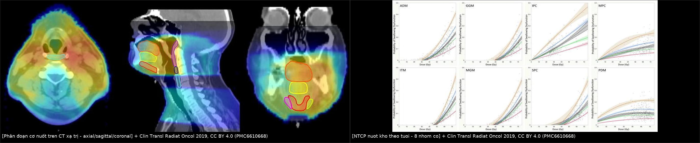
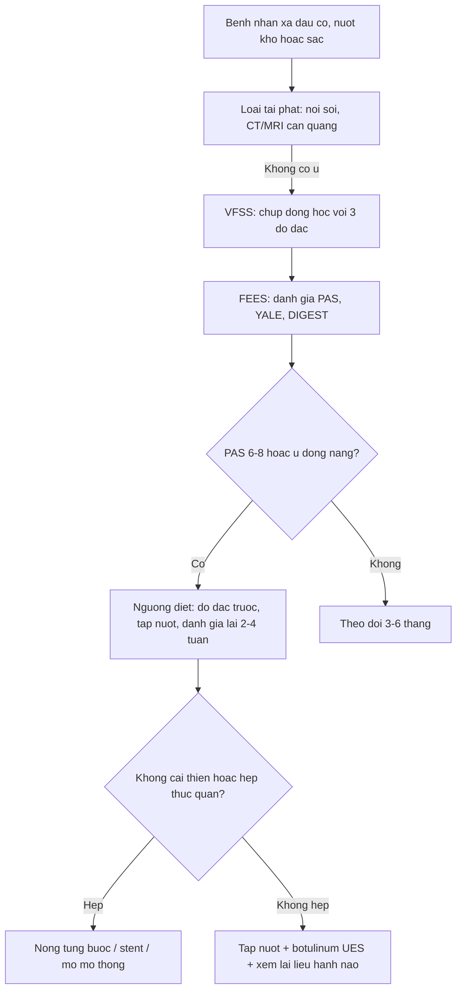
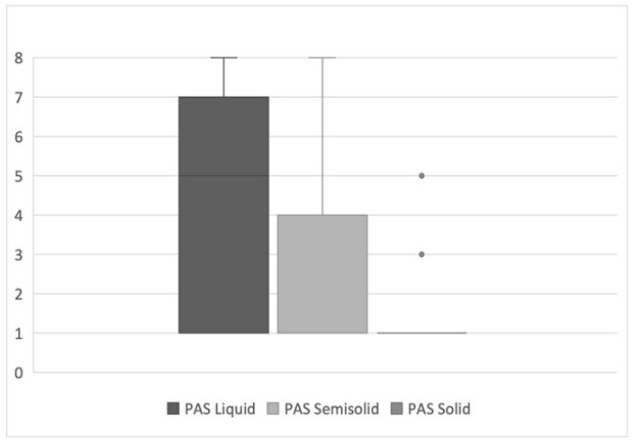
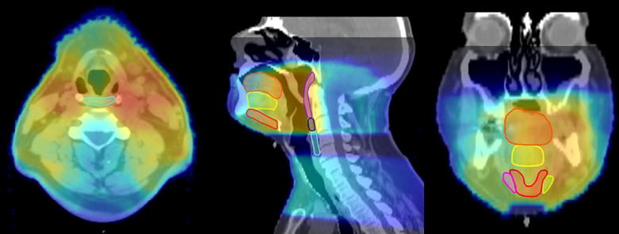
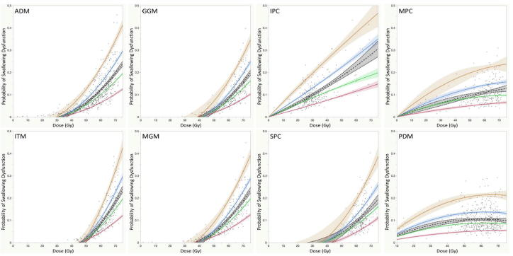

# 1684 — Nuốt khó sau xạ trị đầu cổ / Radiation-associated dysphagia (late RAD)

**Tags:** `pattern:nuot-kho` `pattern:sac` `pattern:xo-hoa` `pattern:hep-thuc-quan` `vung:dau-co` `vung:thanh-quan` `vung:duong-nuot` `protocol:VFSS` `protocol:FEES` `protocol:lieu-OAR` `score:DIGEST` `score:PAS` `incidentaloma:khong`

**Mức chắc chắn (certainty):** tổng hợp y văn (literature synthesis) — 1 đoàn hệ 300 bệnh nhân ung thư hầu họng xạ điều biến liều (IMRT) với **ngưỡng liều theo TUỔI** (Clin Transl Radiat Oncol 2019, PMC6610668, CC BY 4.0), 1 đoàn hệ FEES 24 bệnh nhân nuốt khó muộn (Curr Oncol 2025, PMC12025715, CC BY 4.0), 1 nghiên cứu bản đồ liều–vùng (Int J Radiat Oncol Biol Phys 2023, PMC10581448, CC BY 4.0), và số liệu thời điểm khởi phát từ 237 bệnh nhân (Dysphagia 2025, PMC12328464 — **bài không ghi giấy phép rõ**, chỉ dùng **số liệu**, không dùng ảnh). **Không có ca nguyên văn của nhóm**.

> **Câu chốt:** nuốt khó muộn sau xạ đầu cổ là **bệnh của LIỀU × TUỔI × THỜI GIAN**, không phải "di chứng chung chung". Ba con số phải thuộc: **11%** bệnh nhân IMRT hầu họng có nuốt khó mạn (sặc/hẹp ≥ 12 tháng); ngưỡng liều trung bình **cơ khít hầu DƯỚI** để giữ nguy cơ < 5% là **26 Gy (≤ 49 tuổi) → 17 Gy (50–59) → 10 Gy (60–69) → < 10 Gy (≥ 70)**; và **69,4%** bệnh nhân nuốt khó muộn **sặc/hít chất LỎNG**, trong khi chất đặc chỉ **8,3%** — nên **cho ăn đặc trước, đánh giá bằng FEES/VFSS trước khi kết luận "ăn được"**.

## 1. Tổng quan bệnh học – cơ chế hình ảnh

### 1.1 Hai cơ chế khác nhau, hai thời điểm khác nhau

- **Cấp (trong xạ, < 3 tháng):** **viêm niêm mạc + phù** → đau, không nuốt được; hồi phục sau xạ. Đây **không phải** nuốt khó muộn.
- **Muộn (≥ 12 tháng):** **xơ hóa cơ + mất mạch máu + tổn thương thần kinh** → cơ khít hầu **co cứng, giảm giãn**, thanh quản **giảm nâng**, **cơ nhẫn hầu không mở** (UES dysfunction); hậu quả là **ứ đọng, trào ngược vào đường thở, sặc im lặng, hẹp thực quản cổ**. Xơ hóa tiến triển **nhiều năm**, không hồi phục.
- **Cơ chế thứ ba mới được mô tả:** liều vào **phần dưới hành não (medulla)** — nơi có **trung tâm nuốt** — liên quan độc lập với nuốt khó 1 năm sau xạ; thêm liều vùng này cải thiện mô hình dự báo (p ≤ 0,006) so với chỉ dùng liều cơ khít hầu (PMC10581448). Đây là lý do **giảm liều cơ khít hầu đơn thuần không đủ** ở một số bệnh nhân.
- **Trên hình ảnh:** CT/MRI muộn có thể thấy **teo cơ khít hầu, mất mặt phẳng mỡ, dày–xơ hóa thành hầu**, hẹp lòng thực quản cổ; nhưng **chẩn đoán chức năng** nằm ở **VFSS/FEES**, không ở CT. CT có vai trò **loại trừ tái phát u/hẹp do u** và **lập kế hoạch liều**.

### 1.2 Số liệu định lượng phải thuộc

| Đại lượng | Con số | Nguồn |
|---|---|---|
| Nuốt khó mạn (sặc/hẹp ≥ 12 tháng) sau IMRT + hóa trị hầu họng | **11% (34/300)** | PMC6610668 |
| Nuốt khó có ý nghĩa lâm sàng sau hóa–xạ quy ước | **tới 20%**; **~50%** bệnh nhân tự báo nuốt khó sau xạ đầu cổ | PMC6610668 / PMC10581448 |
| Thời điểm khởi phát (237 bệnh nhân) | **3,8%** ở 6–12 tháng; **5,1%** 1–2 năm; **7,1%** > 2 năm → **16% khởi phát MUỘN** | PMC12328464 |
| Liều thanh quản trung bình | **43,8 ± 14,5 Gy**, khác biệt có ý nghĩa giữa các mốc thời gian (p = 0,018) | PMC12328464 |
| Ngưỡng liều theo tuổi, **cơ khít hầu dưới** (nguy cơ < 5%) | **26 Gy** (≤ 49 tuổi) · **17 Gy** (50–59) · **10 Gy** (60–69) · **< 10 Gy** (≥ 70) | PMC6610668 |
| Ngưỡng liều theo tuổi, **cơ khít hầu giữa** | **50 Gy** · **23 Gy** · **15 Gy** · **< 10 Gy** | PMC6610668 |
| Ngưỡng liều theo tuổi, **cơ khít hầu trên** | **62 Gy** · **54 Gy** · **50 Gy** · **44 Gy** | PMC6610668 |
| Cùng liều 60 Gy vào cơ khít hầu trên | nguy cơ **5% ở tuổi 50–59** nhưng **20% ở tuổi ≥ 70** | PMC6610668 |
| FEES ở nuốt khó muộn (24 bệnh nhân, trung vị **8 năm** sau chẩn đoán) | **92%** thiếu lực đẩy; **37,5%** chậm pha hầu; **25%** thiếu bảo vệ; **chỉ 1 ca bình thường** | PMC12025715 |
| Sặc/hít theo độ đặc | **chất lỏng 69,4%** · bán đặc **34,3%** · đặc **8,3%**; **sặc im lặng (PAS 8) 5,6%** với chất lỏng | PMC12025715 |
| Độ tin cậy FEES giữa 2 người đọc | **PAS κ > 0,88**; thang ứ đọng Yale **κ > 0,83–0,87** | PMC12025715 |

- **Đọc con số cho đúng:** "11%" là **sặc/hẹp/G-tube/viêm phổi hít sặc** — tức là **đầu băng của tảng băng**; nếu chỉ hỏi triệu chứng, tỉ lệ **~50%**. Đừng dùng 11% để nói "hiếm".
- **Phản biện:** bảng ngưỡng theo tuổi của PMC6610668 xây trên **300 bệnh nhân hầu họng, IMRT + hóa trị**, mô hình có **AUC 0,649–0,751** — tức **dự báo trung bình**, **chưa được ngoại kiểm**. Không được dùng như "ngưỡng tuyệt đối an toàn"; dùng để **ưu tiên giảm liều ở người lớn tuổi** và **giải thích nguy cơ cho bệnh nhân**.

## 2. Mẫu hình + chẩn đoán phân biệt theo vị trí (gamut)

- **Theo vị trí tổn thương:**
  - **Hầu–miệng (oropharynx):** ứ đọng xoang lê, giảm đẩy lưỡi → sặc **chất lỏng** nhiều hơn; thường sau xạ **hầu họng** (nơi có 300 ca của PMC6610668).
  - **Thanh quản – cơ nhẫn hầu:** **hít vào rít, giọng khàn, sặc khi nuốt nước bọt**; khám thấy **ứ nước bọt, ho yếu**.
  - **Thực quản cổ:** **hẹp** → nuốt nghẹn chất đặc, sụt cân, **ứ đọng trên chỗ hẹp**; cần nội soi/CT để loại u.
  - **Hành não (medulla):** **mất phối hợp các pha nuốt**, sặc nhiều độ đặc, không có hẹp giải phẫu — gợi ý liều vùng hành não (PMC10581448).
- **Theo thời gian:** < 3 tháng = viêm niêm mạc (hồi phục); 6–24 tháng = xơ hóa sớm; **> 2 năm vẫn có 7,1% ca mới** → **không được "ra viện là xong"**.
- **Gamut theo cơ chế:** xơ hóa cơ · hẹp thực quản · rối loạn mở UES (cơ nhẫn hầu) · tổn thương thần kinh (X, XII) · tái phát u · **nhiễm nấm/viêm thực quản** · **sarcopenia/presbyphagia** (người già, sụt cân).

## 3. Bảng so sánh phân biệt (ma trận đối chiếu)

| Thực thể (entity) | Hình ảnh / nội soi điển hình | Chốt vào (rule-in) | Chốt loại (rule-out) | Gợi ý xác nhận |
|---|---|---|---|---|
| **Xơ hóa cơ khít hầu do xạ** | FEES/VFSS: **ứ đọng xoang lê, giảm đẩy, giảm nâng thanh quản**; CT: teo cơ, không khối | **Tiền sử xạ + ứ đọng/giảm đẩy không có hẹp** | Không có ứ đọng, không sặc → loại | FEES + VFSS; đo liều cơ khít hầu |
| **Hẹp thực quản cổ do xạ** | VFSS: **cột thuốc hẹp, ứ đọng trên hẹp, chậm thoát**; nội soi thấy hẹp | **Hẹp lòng có ứ đọng trên + không có u** | Lòng rộng, thuốc xuống nhanh → loại | Nội soi + sinh thiết nếu nghi u; CT |
| **Rối loạn mở cơ nhẫn hầu (UES)** | **Hình ảnh "thanh chắn" (bar) ở mặt sau sụn nhẫn**, thuốc ứ trên UES | **Bar + ứ đọng + giảm mở UES** | UES mở tốt → loại | VFSS động; đo áp lực; thử nong/botulinum |
| **Tái phát/u tiến triển** | **Khối ngấm thuốc, bất đối xứng, xâm lấn**, hạch mới | **Khối mới + ngấm thuốc + hạch** | Không khối, không hạch, hình ảnh ổn định nhiều năm | MRI/CT cản quang ± PET; **sinh thiết** |
| **Tổn thương thần kinh X/XII do xạ** | **Lưỡi teo một bên, lệch lưỡi, giọng mũi, sặc**; MRI teo cơ lưỡi | **Teo + lệch lưỡi + sặc không có hẹp** | Lưỡi bình thường, không lệch | Khám thần kinh + MRI nền sọ |
| **Presbyphagia/sarcopenia** | Không có tổn thương khu trú; **giảm khối cơ toàn thân**, ăn chậm | **Già + sụt cân + không có ứ đọng khu trú** | Có ứ đọng khu trú rõ → nghĩ xơ hóa | Đánh giá dinh dưỡng, FEES |
| **Viêm thực quản do nấm/thuốc** | **Loét nông rải rác**, không hẹp | **Đau sau xương ức + loét trên nội soi** | Niêm mạc bình thường → loại | Nội soi + nấm/HSV; thử PPI |

*Trái: phân đoạn cơ khít hầu/thanh quản trên CT lập kế hoạch (axial–sagittal–coronal). Phải: 8 nhóm cơ nuốt, đường NTCP theo **tuổi** — cùng liều, người lớn tuổi có nguy cơ cao hơn. Nguồn: Clin Transl Radiat Oncol 2019, CC BY 4.0 (PMC6610668); ảnh ghép letterbox.*

## 4. Protocol chụp/đánh giá + ngưỡng liều

### 4.1 Lập kế hoạch xạ — "dự phòng bằng liều theo tuổi"

- **OAR bắt buộc:** **cơ khít hầu trên – giữa – dưới**, **thanh quản**, **cơ nhẫn hầu/UES**, **tuyến dưới hàm**, **phần dưới hành não**; ghi **Dmean** từng cấu trúc.
- **Bảng ngưỡng Dmean để giữ nguy cơ nuốt khó mạn < 5%** (PMC6610668, Bảng 3):

| Cơ | ≤ 49 tuổi | 50–59 | 60–69 | ≥ 70 |
|---|---|---|---|---|
| Cơ khít hầu **dưới** | **26 Gy** | **17 Gy** | **10 Gy** | **< 10 Gy** |
| Cơ khít hầu **giữa** | **50 Gy** | **23 Gy** | **15 Gy** | **< 10 Gy** |
| Cơ khít hầu **trên** | **62 Gy** | **54 Gy** | **50 Gy** | **44 Gy** |
| Cơ nhị thân trước | 55 Gy | 49 Gy | 45 Gy | 40 Gy |
| Cơ hàm–móng/lưỡi | 57 Gy | 52 Gy | 49 Gy | 45 Gy |
| Lưỡi trong | 60 Gy | 56 Gy | 54 Gy | 52 Gy |

- **Vì sao cơ khít hầu DƯỚI quan trọng nhất:** đây là nơi **UES mở**, liều thấp hơn nhiều so với 50–60 Gy "kinh điển"; ở người ≥ 70 tuổi, **giữ < 10 Gy** — thực tế nhiều kế hoạch IMRT vượt xa ngưỡng này.
- **Không bỏ qua hành não:** nếu vẫn nuốt khó dù liều cơ khít hầu đạt ngưỡng, xem lại **liều trung bình phần dưới hành não** (chưa có ngưỡng cụ thể — PMC10581448 chỉ chứng minh liên quan, cần ngoại kiểm).

### 4.2 Đánh giá chức năng — VFSS và FEES

- **Thang dùng trong báo cáo:** **PAS 1–8** (1 = không vào đường thở; 2–5 = hít vào thanh môn; 6–8 = sặc; **8 = sặc im lặng**) và **DIGEST 0–4** (0 = không; 1 = nhẹ; 2 = trung bình phải đổi độ đặc; 3 = nặng/phụ thuộc ống nuôi; 4 = đe dọa tính mạng).
- **Vì sao phải thử CẢ 3 độ đặc:** sặc chất lỏng **69,4%** nhưng chất đặc **8,3%** — nếu chỉ thử một độ đặc, sẽ **bỏ sót sặc im lặng** hoặc **cấm ăn quá mức** (PMC12025715).
- **Thời điểm:** đánh giá **nền trước xạ**, **3 tháng**, **6 tháng**, **12 tháng**, sau đó **hằng năm ≥ 5 năm**; bất kỳ **sụt cân, ho khi ăn, viêm phổi tái diễn** → FEES ngay.

### 4.3 Xử trí theo mức độ

- **Nhẹ–trung bình:** **tập nuốt chủ động** (Mendelsohn, Masako, nâng thanh quản) trong và sau xạ; đổi độ đặc; vệ sinh miệng.
- **Hẹp thực quản cổ:** **nong bóng từng bước**; nếu tái hẹp nhanh → **stent** hoặc **mở thông dạ dày** để nuôi dưỡng; **không nong mù khi chưa loại tái phát**.
- **Rối loạn mở UES:** **botulinum toxin cơ nhẫn hầu** hoặc **cắt cơ nhẫn hầu** (myotomy) khi thất bại tập nuốt.
- **Sặc nặng, tái diễn viêm phổi, không hồi phục:** cân nhắc **ống nuôi**, **van thanh quản**, và **cắt thanh quản** như biện pháp cuối để bảo vệ đường thở.
- *(Tỉ lệ thành công từng can thiệp: chưa có số liệu thống nhất trong các nguồn đã đọc — cần tra thêm, không bịa.)*

## 5. Biến thể bình thường và cạm bẫy

- **"Uống nước bình thường" không loại trừ sặc:** sặc im lặng (PAS 8) gặp ở **5,6%** với chất lỏng; bệnh nhân **không ho** vì phản xạ đã mất.
- **Chỉ thử chất đặc:** bỏ sót sặc chất lỏng — độ đặc **lỏng** là nơi sặc cao nhất (69,4%).
- **Đọc "hẹp" trên CT mà bỏ nội soi:** hẹp do xạ và **tái phát u** có thể cùng hình ảnh; luôn **nội soi + sinh thiết** khi có bất đối xứng/khối.
- **Quy mọi nuốt khó cho xơ hóa:** ở người già, **presbyphagia + sarcopenia** làm nặng thêm; ở người trẻ, xem **liều hành não**.
- **Bỏ qua sụt cân:** **> 10% cân nặng trong 6 tháng** hoặc **BMI < 18,5** là chỉ định **đánh giá dinh dưỡng + FEES**, không chờ "khám lại định kỳ".
- **Kết luận từ một lần FEES bình thường:** phù nề co cứng có thể dao động; nếu triệu chứng vẫn còn, **lặp FEES/VFSS** sau 2–4 tuần.
- **Viêm phổi hít sặc bị chẩn đoán là "viêm phổi cộng đồng":** ở bệnh nhân đã xạ đầu cổ, **mọi viêm phổi tái diễn ở đáy phổi phải** gợi ý sặc — hỏi lại triệu chứng khi ăn.

## 6. Tự lượng giá — Blind Quiz

**Ca 1 — Nam 62 tuổi, 8 năm sau hóa–xạ hầu họng; khó nuốt nước, ho khi uống, đã 2 lần viêm phổi.**

- Hỏi: hình gợi ý điều gì về độ đặc nguy hiểm nhất? Cần làm gì trước khi kết luận? Vì sao "ăn cháo được" chưa đủ?

<b>Bấm để hiện đáp án (findings + chẩn đoán)</b>

- **Findings:** PAS cao nhất ở **chất lỏng** (trung vị ~7), thấp hơn ở bán đặc (~4), **thấp nhất ở đặc**; trong đoàn hệ 24 ca, **69,4% sặc/hít với lỏng**, **34,3%** bán đặc, **8,3%** đặc; **5,6% sặc im lặng** (PAS 8).
- **Chẩn đoán:** **nuốt khó muộn do xạ (late RAD)** — xơ hóa cơ khít hầu/giảm nâng thanh quản; sặc chất lỏng là biểu hiện chính.
- **Việc cần làm:** **FEES/VFSS đủ 3 độ đặc**, đổi độ đặc (làm đặc chất lỏng), tập nuốt, và **loại tái phát u** trước khi can thiệp hẹp.
- **Bẫy:** "ăn cháo được" chỉ chứng minh **bán đặc** an toàn; chất lỏng vẫn có thể sặc im lặng → viêm phổi tái diễn.
- Nguồn ảnh: Gitto M và cs., *Curr Oncol* 2025, CC BY 4.0 (PMC12025715).

**Ca 2 — Bệnh nhân 72 tuổi, ung thư hầu họng, đang lập kế hoạch IMRT; bác sĩ định giới hạn cơ khít hầu dưới ≤ 50 Gy "như các ca khác".**

- Hỏi: ngưỡng 50 Gy có phù hợp? Nên đặt ngưỡng nào cho cơ khít hầu dưới và giữa? Vì sao tuổi làm thay đổi ngưỡng?

<b>Bấm để hiện đáp án</b>

- **Không phù hợp:** ở **≥ 70 tuổi**, ngưỡng Dmean để giữ nguy cơ < 5% là **< 10 Gy cho cơ khít hầu dưới** và **< 10 Gy cho cơ khít hầu giữa**; 50 Gy tương ứng nguy cơ **cao hơn nhiều**.
- **Cơ chế:** dự trữ nuốt giảm theo tuổi (**presbyphagia**), nên **cùng một liều gây mất bù nhiều hơn** — mô hình cho thấy 60 Gy vào cơ khít hầu trên: **5% nguy cơ ở 50–59 tuổi** nhưng **20% ở ≥ 70 tuổi**.
- **Thực hành:** ưu tiên giảm liều **cơ khít hầu dưới/giữa** ở người lớn tuổi, chấp nhận liều cao hơn ở cơ khít hầu trên (62 Gy ở ≤ 49 tuổi).
- Nguồn ảnh: MD Anderson Head and Neck Cancer Symptom Working Group, *Clin Transl Radiat Oncol* 2019, CC BY 4.0 (PMC6610668).

**Ca 3 — Bệnh nhân 55 tuổi, 3 năm sau xạ, nuốt nghẹn chất đặc tăng dần, sụt 8 kg; FEES thấy ứ đọng lớn, VFSS thấy cột thuốc hẹp.**

- Hỏi: 2 chẩn đoán phân biệt chính? Bước nào bắt buộc trước khi nong? Dấu hiệu nào trên hình buộc phải sinh thiết?

<b>Bấm để hiện đáp án</b>

- **Phân biệt:** **hẹp thực quản cổ do xạ** vs **tái phát u** (và **rối loạn mở UES** nếu hẹp ở ngang sụn nhẫn).
- **Bắt buộc trước khi nong:** **nội soi + sinh thiết** vùng hẹp (loại u), CT/MRI cản quang; nong mù có thể làm **thủng** hoặc **bỏ sót ung thư**.
- **Chỉ định sinh thiết:** **bất đối xứng, khối ngấm thuốc, hạch mới, hẹp dài tiến triển nhanh**; hẹp nhẵn, đối xứng, ổn định nhiều năm thì nghi xơ hóa.
- **Hướng xử trí:** nong từng bước ± stent; nếu thất bại → mở thông dạ dày; đánh giá lại dinh dưỡng (**sụt 8 kg** là chỉ định can thiệp).
- Nguồn ảnh: MD Anderson Head and Neck Cancer Symptom Working Group, *Clin Transl Radiat Oncol* 2019, CC BY 4.0 (PMC6610668).

## Bài liên quan chéo
- [081 – Sặc & rối loạn nuốt: VFSS/FEES, viêm phổi hít sặc](../081-sac-va-roi-loan-nuot/lesson.md)
- [1641 – OPMD & OPDM so với CPEO: nuốt khó do bệnh cơ](../1641-opmd-opdm-va-cpeo/lesson.md)
- [1683 – Hoại tử tụy nhiễm khuẩn & step-up](../1683-hoai-tu-tuy-nhiem-khuan-step-up/lesson.md) *(ví dụ biến chứng muộn sau can thiệp — đối chiếu cách đọc "di chứng muộn")*
- [268 – Bệnh tủy do xạ trị](../268-benh-tuy-do-xa-tri/lesson.md)
- [261 – Bệnh não chất trắng do xạ trị](../261-benh-nao-chat-trang-do-xa-tri/lesson.md)

## Ảnh
- `1684_oar-delineation_CT_PMC6610668.jpg`, `1684_ntcp-age_DVH_PMC6610668.jpg` — *Clin Transl Radiat Oncol* 2019, **CC BY 4.0** (PMC6610668).
- `1684_pas-distribution_FEES_PMC12025715.jpg` — *Curr Oncol* 2025, **CC BY 4.0** (PMC12025715).
- `composite_oar-va-ntcp.jpg` — ghép 2 ảnh CC BY 4.0 của PMC6610668 bằng `tools/make_composite.py`.

> Không dùng để chẩn đoán độc lập khi chưa có người hướng dẫn.
