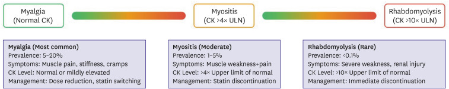
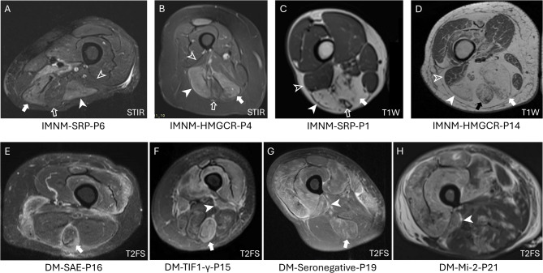
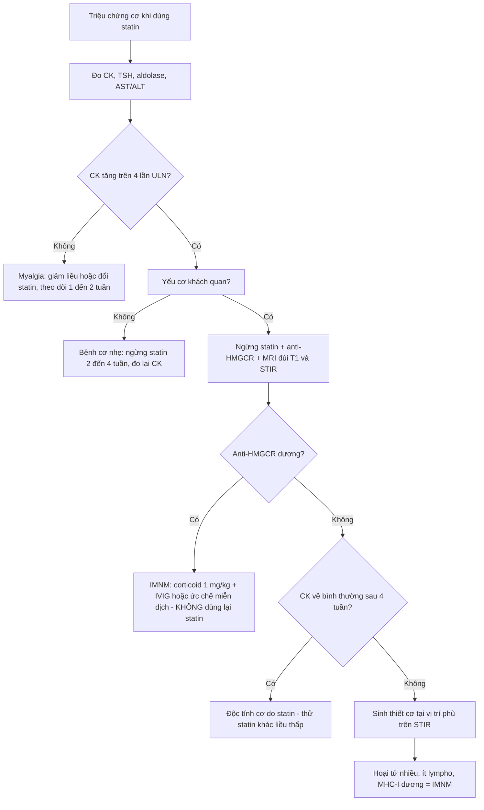
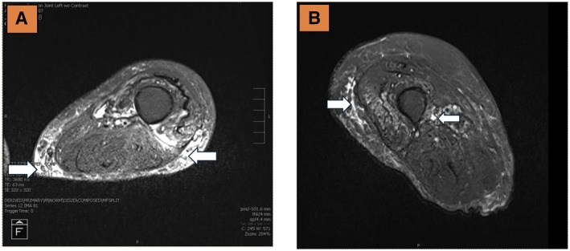
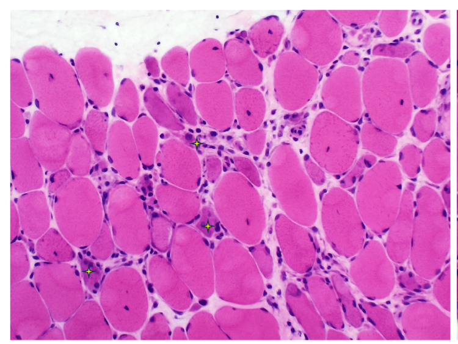

# 1685 — Bệnh cơ do statin & bệnh cơ hoại tử tự miễn / Statin-associated muscle symptoms & anti-HMGCR immune-mediated necrotizing myopathy

**Tags:** `pattern:phu-co` `pattern:thay-mo-co` `pattern:yeu-co-goc-chi` `pattern:doi-xung` `vung:co` `vung:chi-duoi` `vung:chi-tren` `protocol:MRI-co` `protocol:STIR` `protocol:sinh-thiet-co` `protocol:EMG` `incidentaloma:khong`

**Mức chắc chắn (certainty):** tổng hợp y văn (literature synthesis) — 1 đoàn hệ đa quốc gia 109 ca anti-HMGCR (*Rheumatology* 2025, PMC12407235, CC BY), 1 tổng quan có sơ đồ phổ bệnh và ngưỡng CK (*Korean Circ J* 2025, PMC12614426, CC BY-NC), 1 tổng quan hệ thống 88 nghiên cứu/~230 ca IMNM (*Cureus* 2025, PMC12743563, CC BY), 1 nghiên cứu MRI đùi so sánh IMNM với DM (*BMC Rheumatol* 2025, PMC12010673, CC BY-NC-ND), 1 tổng quan vai trò MRI trong bệnh cơ viêm (*Front Immunol* 2025, PMC11808160, CC BY), 1 meta-analysis 41 thử nghiệm/64.728 người (*PMC12173554*, CC BY) và 3 ca lâm sàng có ảnh (*Clin Case Rep* 2026, PMC13239778, CC BY-NC-ND; *Cureus* 2026, PMC13108367, CC BY; *Cureus* 2025, PMC12405958, CC BY). **Không có ca nguyên văn của nhóm**.

> **Câu chốt:** đau cơ khi dùng statin **hầu như không phải bệnh cơ viêm** — nhưng **một nhóm nhỏ** lại là **bệnh cơ hoại tử tự miễn do kháng thể kháng HMGCR**, một bệnh **khác hẳn về cơ chế, hình ảnh và điều trị**. Ba con số phải thuộc: **đa số người đau cơ có CK bình thường** (myalgia **5–20%**, CK bình thường); **bệnh cơ thật (CK > 4 × ULN) chỉ 1–5%**, **tiêu cơ vân (CK > 10 × ULN) < 0,1%**; và **anti-HMGCR gặp 2,9 ca/triệu người–năm**, tức **20,4–24,1 ca/triệu người dùng statin/năm**, với **CK đỉnh trung vị 7.020 U/L** và **chỉ 46,2% hồi phục sức cơ** sau 2,3 năm.

## 1. Tổng quan bệnh học – cơ chế hình ảnh

### 1.1 Hai bệnh khác nhau nằm dưới cùng một triệu chứng

- **Độc tính cơ trực tiếp (myotoxicity):** statin ức chế **HMG-CoA reductase** → giảm **mevalonate** → giảm các **isoprenoid** (GGPP, FPP) → giảm **prenyl hóa** các GTPase nhỏ → **rối loạn chức năng ty thể, tăng stress oxy hóa, giảm khả năng sửa chữa sợi cơ**. Đây là tổn thương **phụ thuộc liều, hồi phục sau ngừng thuốc**, **không có kháng thể**.
- **Bệnh cơ hoại tử tự miễn (immune-mediated necrotizing myopathy, IMNM):** cơ chế **miễn dịch dịch thể** — statin làm **tăng biểu hiện HMGCR** trong sợi cơ tái tạo; cơ địa thuận lợi sinh **kháng thể anti-HMGCR**; kháng thể gắn enzyme trên màng sợi cơ → **hoạt hóa bổ thể, hoại tử sợi cơ**, **rất ít tế bào lympho xâm nhập**. Vì vậy mô bệnh là **hoại tử + tái tạo**, không phải "viêm cơ" điển hình.
- **Điểm khác gốc:** **anti-HMGCR đặc hiệu cao cho IMNM và KHÔNG có ở người chỉ bị độc tính cơ do statin** (PMC12407235). Nghĩa là **một xét nghiệm máu tách được hai bệnh** — nhưng chỉ làm khi có **yếu cơ + CK tăng kéo dài**, không làm sàng lọc tràn lan.
- **Vì sao gọi là "hoại tử" trên MRI:** sợi cơ hoại tử **mất ổn định màng**, nước **vào nội bào và khoảng gian bào** → **phù cơ**. Phù = **tăng nước tự do** → **T2 dài** → **sáng trên STIR/T2 fat-sat**; mỡ bị triệt tín hiệu trên STIR nên **chỉ nước còn sáng**. Ở giai đoạn muộn, sợi cơ chết được thay bằng **mỡ** → **T1 ngắn** → **sáng trên T1**, **tối trên STIR** — hai thì của cùng một quá trình: **phù (hoạt động) → thay mỡ (di chứng)**.
- **Vì sao MRI không đặc hiệu:** phù cơ chỉ là "nước trong cơ", gặp ở **vận động mạnh, chấn thương, thiếu máu, nhiễm trùng, chèn ép thần kinh, tiêu cơ vân**; độ nhạy của MRI cho phù cơ trong bệnh cơ viêm **80–90%**, nhưng **độ đặc hiệu thấp** (PMC11808160). Giá trị thật của MRI là **phân bố cơ** (gợi ý thể bệnh) và **chọn chỗ sinh thiết**.

*Ba mức của cùng phổ: **đau cơ (myalgia) — CK bình thường, 5–20%**; **bệnh cơ/viêm cơ (myositis) — CK > 4 × ULN, 1–5%**; **tiêu cơ vân (rhabdomyolysis) — CK > 10 × ULN, < 0,1%**, có tổn thương thận. Nguồn: Cha JJ, Hong SJ, *Korean Circ J* 2025 (PMC12614426), CC BY-NC.*

### 1.2 Phân bố cơ trên MRI: "bản đồ" tách IMNM khỏi viêm da cơ

- Thang điểm hay dùng là **Fischer cải biên**: **0** bình thường, **1** < 30% thể tích cơ, **2** 31–75%, **3** > 75% — chấm trên **11 cơ đùi** ở **lát cắt ngang T1** (thay mỡ) và **STIR/T2 fat-sat** (phù).
- **IMNM (14 bệnh nhân, PMC12010673):** nặng nhất ở **cơ bán màng (semimembranosus) 3,0 (2,7–3,0)**, **đầu dài cơ nhị đầu đùi (biceps femoris long head, BF-LH) 2,7 (2,0–3,0)**, **nhóm cơ khép 2,5 (2,0–3,0)**; **spared: đầu ngắn cơ nhị đầu đùi (BF-SH) và cơ bán gân (semitendinosus)**. Tức **khoang sau đùi + khoang khép**.
- **Viêm da cơ (DM, 11 bệnh nhân):** nặng nhất ở **cơ rộng giữa (vastus intermedius) 2,9**, **cơ rộng ngoài (vastus lateralis) 2,7**, **cơ rộng trong 2,3** — tức **khoang trước (cơ tứ đầu)**; khác biệt có ý nghĩa ở **10/11 cơ (p < 0,01)**, chỉ **cơ thẳng đùi** là không (p = 0,19).
- **Vì sao phân bố này quan trọng:** cùng "yếu cơ gốc chi + CK cao", **khoang sau đùi + cơ khép** đẩy chẩn đoán về **IMNM**, **khoang trước** về **DM** — giúp chọn **vị trí sinh thiết** và **ưu tiên xét nghiệm kháng thể** trước khi làm thủ thuật.

*So sánh trực tiếp. (A–D) IMNM: **phù khoang sau và cơ khép** trên STIR (A, B — mũi tên/đầu mũi tên), **thay mỡ hoàn toàn cơ bán màng và BF-LH** trên T1 ở bệnh kéo dài (C, D), **BF-SH và cơ bán gân còn spared**. (E–H) DM: **phù khoang trước, cơ bán gân, BF-SH và mạc** trên T2 fat-sat. Nguồn: Wilks AW et al., *BMC Rheumatol* 2025 (PMC12010673), CC BY-NC-ND — ảnh nguyên bản, không crop/ghép.*

### 1.3 Số liệu định lượng phải thuộc

| Đại lượng | Con số | Nguồn |
|---|---|---|
| Đau cơ do statin trong thử nghiệm ngẫu nhiên so với quan sát | **~5%** (RCT) vs **10–20%** (quan sát/registry); không dung nạp statin gộp ở **> 4 triệu người: 9,1%** | PMC12614426 |
| Phổ bệnh: myalgia / myopathy / rhabdomyolysis | **5–20%** (CK bình thường) / **1–5%** (CK > 4 × ULN) / **< 0,1%** (CK > 10 × ULN + tổn thương thận) | PMC12614426 |
| Meta-analysis 41 RCT, 64.728 người | **CK < 3 × ULN: 0,43%** (0,11–0,75); **bệnh cơ cao hơn với simvastatin 80 mg**; **tiêu cơ vân phụ thuộc liều (p < 0,01)** | PMC12173554 |
| Thời gian cải thiện triệu chứng sau ngừng statin | **1–2 tuần** (đa số), một số kéo dài hơn | PMC12614426 |
| Anti-HMGCR IMNM — tỉ lệ mắc | **2,9 ca/triệu người–năm**; **20,4 (Anh) – 24,1 (Úc)/triệu người dùng statin/năm** | PMC12407235 |
| Đoàn hệ 109 ca: tuổi, giới, thời gian theo dõi | trung vị **66 tuổi** (58–72,2); nữ **51%**; theo dõi **2,3 năm** (1,5–4,2) | PMC12407235 |
| Phơi nhiễm statin | **101/109 = 92,7%**; **atorvastatin 76,2% (77/101)**; thời gian dùng trung vị **3 năm** (1 tháng–23 năm) | PMC12407235 |
| Nhóm **chưa từng dùng statin** | **8/109 = 7,5%**; trẻ hơn (**46,1 vs 67 tuổi**, p = 0,02); nhiều người không phải da trắng (5/8 vs 20/77, p = 0,04); **nuốt khó 4/8 vs 14/94** (p = 0,03) | PMC12407235 |
| CK đỉnh trung vị | **7.020 U/L** (964–39.076) | PMC12407235 |
| Điều trị và kết cục sau 2,3 năm | **IVIG 45,7% (48/105)**; **CK bình thường chỉ 47,6% (50/105)**; **sức cơ bình thường chỉ 46,2% (48/104)** | PMC12407235 |
| Tổng quan 88 nghiên cứu (~230 ca) | tái phát **25–35%**; **rituximab đạt lui bệnh 60–70%** ở ca khó trị | PMC12743563 |
| MRI: độ nhạy phát hiện phù cơ trong bệnh cơ viêm | **80–90%**, độ đặc hiệu **thấp** | PMC11808160 |
| Thang Fischer cải biên (11 cơ đùi) | **0** bình thường · **1** < 30% · **2** 31–75% · **3** > 75% | PMC12010673 |
| IMNM: 3 cơ nặng nhất (trung vị [IQR]) | **cơ bán màng 3,0 (2,7–3,0)** · **BF-LH 2,7 (2,0–3,0)** · **cơ khép 2,5 (2,0–3,0)** | PMC12010673 |
| DM: 3 cơ nặng nhất | **cơ rộng giữa 2,9 (2,2–3,0)** · **cơ rộng ngoài 2,7 (2,3–3,0)** · **cơ rộng trong 2,3 (1,7–2,7)** | PMC12010673 |
| Khác biệt giữa IMNM và DM | có ý nghĩa ở **10/11 cơ** (p < 0,01); **cơ thẳng đùi** không (p = 0,19) | PMC12010673 |
| Ca anti-HMGCR điển hình: CK lúc vào | **9.460 U/L** (nữ 70 tuổi), đáp ứng **rituximab** | PMC13249640 |

## 2. Mẫu hình + chẩn đoán phân biệt theo vị trí (Gamut)

- **Cách đọc:** trả lời **4 câu** trước khi gọi tên: **(1) phù cơ đối xứng hai bên hay một bên? (2) khoang nào — trước, sau, khép, mông? (3) có thay mỡ/teo (mạn) hay chỉ phù (hoạt động)? (4) có tổn thương mạc (fascia) hay không?**
- **Gamut theo vị trí:**
  - **Khoang sau đùi (bán màng, BF-LH) + cơ khép, spared BF-SH và bán gân** → **IMNM (anti-HMGCR/anti-SRP)**; cũng gặp ở **viêm đa cơ (PM)** nhưng ít đặc trưng hơn.
  - **Khoang trước (tứ đầu) + mạc + cơ bán gân/BF-SH** → **viêm da cơ (DM)**.
  - **Tứ đầu + cơ gấp cổ tay, không đối xứng, người > 50 tuổi** → **viêm cơ thể vùi (IBM)** — **teo nhiều hơn phù**, **không đáp ứng corticoid**.
  - **Một bên, đau nhiều, phù lan ra mô dưới da** → **viêm cơ khu trú, áp-xe, nhồi máu cơ, chèn ép thần kinh**.
  - **Teo + thay mỡ lan tỏa, không phù** → **bệnh cơ do corticoid, bất động, suy dinh dưỡng, IMNM mạn**; **CK bình thường hoặc chỉ tăng nhẹ**.
  - **Phù cơ lan tỏa + CK rất cao + suy thận** → **tiêu cơ vân** (statin liều cao + tương tác thuốc, động kinh, nhiễm trùng, hội chứng chèn ép).

## 3. Bảng so sánh phân biệt (ma trận đối chiếu)

| Thực thể (entity) | Hình ảnh điển hình (MRI đùi T1 + STIR) | Chốt vào (rule-in) | Chốt loại (rule-out) | Gợi ý xác nhận |
|---|---|---|---|---|
| **Đau cơ do statin (myalgia)** | **MRI bình thường** hoặc phù nhẹ, rải rác, không theo khoang | **Triệu chứng cơ khi dùng statin, CK bình thường**, hết sau **1–2 tuần** ngừng thuốc | **CK > 4 × ULN kéo dài** hoặc **yếu cơ khách quan** → không phải myalgia đơn thuần | Ngừng statin 2–4 tuần, đánh giá lại; không cần MRI |
| **Bệnh cơ do statin (độc tính)** | Phù **nhẹ, đối xứng, rải rác**, có thể bình thường; **không thay mỡ** | **CK tăng khi dùng statin, giảm sau ngừng**; **không có kháng thể** | **CK vẫn cao + yếu cơ tiến triển sau 4 tuần** → nghĩ IMNM | CK trước/sau ngừng; anti-HMGCR nếu không hồi phục |
| **IMNM do anti-HMGCR** | **Phù khoang sau đùi + cơ khép** (bán màng 3,0; BF-LH 2,7), **spared BF-SH/bán gân**; mạn: **thay mỡ** các cơ đó | **Yếu cơ gốc chi tiến triển + CK rất cao (trung vị ~7.000 U/L) + anti-HMGCR dương** | **Anti-HMGCR âm** (nhưng 10–12% IMNM không có kháng thể) và **CK bình thường** → ít khả năng | Anti-HMGCR (ELISA), CK, sinh thiết có **hoại tử + MHC-I** |
| **Viêm da cơ (DM)** | **Phù khoang trước + mạc** (rộng giữa 2,9; rộng ngoài 2,7); ban da, yếu cơ gốc chi | **Ban Gottron/heliotrope + yếu cơ gốc chi + CK tăng**; **phù mạc** trên STIR | **Không có tổn thương da + phân bố khoang sau** → nghĩ IMNM | Kháng thể myositis (Mi-2, MDA5…); sinh thiết có **viêm quanh mạch + teo quanh thùy** |
| **Viêm đa cơ (PM)** | Phù đối xứng, có thể **khoang sau** như IMNM nhưng **có xâm nhập lympho** | **Yếu cơ + CK tăng + sinh thiết có lympho CD8+ xâm nhập sợi cơ** | **Hoại tử nhiều mà rất ít lympho** → IMNM, không phải PM | Sinh thiết; anti-HMGCR/SRP âm |
| **Viêm cơ thể vùi (IBM)** | **Teo + thay mỡ** tứ đầu và **cơ gấp cổ tay**, **không đối xứng**, phù ít | **Yếu tứ đầu + gấp ngón, tuổi > 50, CK < 10 × ULN**, **không đáp ứng corticoid** | **CK rất cao + phù khoang sau đối xứng** → không phải IBM | EMG, sinh thiết (**viêm quanh nội mạc, không hoại tử**) |
| **Bệnh cơ do tuyến giáp** | Phù cơ nhẹ, đối xứng; có thể phì đại cơ | **TSH cao + CK tăng + yếu cơ**, hồi phục khi bù giáp | **TSH bình thường** | TSH/FT4 trước khi quy mọi CK cao cho statin |
| **Bệnh cơ do corticoid** | **Teo + thay mỡ**, **không phù**, hay ở **tứ đầu và cơ mông** | **Dùng corticoid kéo dài + yếu cơ gốc chi + CK bình thường** | **CK tăng mạnh + phù cơ** → không phải do corticoid | Ngừng/giảm corticoid thử; MRI không có phù |

- **Không tạo ảnh ghép** cho bài này: các ảnh khác bệnh nhân và khác chuỗi xung; hai ảnh `CC BY-NC-ND` phải giữ **nguyên bản**.

## 4. Protocol chụp + hệ phân độ/điểm chuẩn hóa

### 4.1 Protocol MRI cơ

- **Vị trí:** **đùi hai bên** (từ gai chậu trước trên đến khớp gối), thêm **mông/đai vai** nếu yếu vùng đó; **đặt cùng một tư thế, cùng mặt phẳng** để so sánh phải–trái.
- **Chuỗi xung tối thiểu:**
  - **T1 mặt phẳng cắt ngang** (không fat-sat) — **thay mỡ, teo, mất mặt phẳng mỡ**; đây là chuỗi **bắt buộc** để chấm điểm mạn.
  - **STIR hoặc T2 fat-sat mặt phẳng cắt ngang** — **phù cơ, phù mạc**; **STIR ưu tiên** vì triệt mỡ đồng đều và nhanh (PMC11808160).
  - **Lát cắt 4–5 mm, khoảng cách 0–1 mm**; trường nhìn đủ cả hai đùi.
- **Không cần gadolinium** cho mục đích phát hiện phù/hoại tử; **không dùng gadolinium ở bệnh nhân suy thận nặng** (nguy cơ xơ hóa hệ thống do gadolinium).
- **Chấm điểm:** **Fischer cải biên 0–3** cho **11 cơ đùi** (rộng ngoài, rộng giữa, rộng trong, thẳng đùi, may, bán màng, bán gân, nhị đầu đùi dài/ngắn, khép dài, khép ngắn) trên **từng chuỗi**; ghi **phù** và **thay mỡ** riêng.

### 4.2 Quy trình chẩn đoán và ngưỡng xử trí

- **Ngưỡng CK theo hội chứng:** **< 4 × ULN** — myalgia/bệnh cơ nhẹ; **> 4 × ULN** — bệnh cơ; **> 10 × ULN** — tiêu cơ vân, phải **ngừng statin ngay, bù dịch, theo dõi thận** (PMC12614426).
- **Ngưỡng thời gian:** triệu chứng điển hình cải thiện **1–2 tuần** sau ngừng; **CK không giảm sau 4 tuần** là **cờ đỏ** cho IMNM (khuyến cáo thực hành, xây từ kết cục của PMC12407235).
- **Điều trị IMNM (không có RCT):** **prednisone 1 mg/kg/ngày** ± **IVIG** (dùng ở **45,7%** đoàn hệ) → giảm liều chậm; **methotrexate/azathioprine/mycophenolate** tiết kiệm corticoid; **rituximab** cho ca khó trị (**lui bệnh 60–70%**); **tái phát 25–35%** khi giảm liều (PMC12743563).
- **Không dùng lại statin ở IMNM** — khác với độc tính cơ, nơi **đổi statin/giảm liều** là lựa chọn hợp lý.

## 5. Biến thể bình thường và cạm bẫy

- **CK bình thường không loại trừ đau cơ do statin:** **đa số myalgia có CK bình thường** (PMC12614426) — chẩn đoán dựa **triệu chứng + diễn biến khi ngừng/thử lại**, không dựa CK.
- **MRI bình thường không loại trừ bệnh cơ:** ca PMC12880835 có **T1 đai vai giữ nguyên khối cơ và tín hiệu đồng nhất** dù bệnh nhân bị IMNM; **phù có thể khu trú hoặc đã qua giai đoạn cấp**. Luôn **chụp cả đùi và cả hai bên**, đừng chỉ chụp vùng đau.
- **Tăng AST/ALT bị đọc là "bệnh gan":** AST và ALT có nguồn gốc cơ; ca PMC12880835 được theo dõi **tăng transaminase kéo dài** trước khi phát hiện IMNM. **CK + aldolase** phải nằm trong bộ xét nghiệm gan "không rõ nguyên nhân".
- **IMNM không cần statin:** **7,5%** ca **chưa từng dùng statin**, **trẻ hơn** và **thường không phải da trắng** (PMC12407235) — **không có tiền sử statin không loại trừ IMNM**.
- **Bệnh cơ do corticoid vs IMNM:** cả hai **teo + thay mỡ**; khác ở **phù** (IMNM còn hoạt động) và **CK** (corticoid: bình thường; IMNM: rất cao).
- **Sinh thiết sai chỗ:** lấy vào **cơ đã thay mỡ hoàn toàn** sẽ chỉ thấy mỡ → **âm tính giả**. Chọn cơ **có phù trên STIR nhưng chưa thay mỡ hoàn toàn**, ưu tiên **khoang sau đùi** ở IMNM.
- **Satisfaction of search:** đã thấy "statin" trong bệnh án rồi **ngừng tìm nguyên nhân khác** — luôn loại **suy giáp, thiếu vitamin D, bệnh cơ di truyền, bệnh thần kinh ngoại biên** ([1641](../1641-opmd-opdm-va-cpeo/lesson.md)).

*STIR lát cắt ngang hai cẳng chân của bệnh nhân IMNM do statin: **tăng tín hiệu lan tỏa trong các khoang cơ** (mũi tên) — phù cơ đang hoạt động. (A) so với (B) cho thấy **mức độ không hoàn toàn đối xứng**, điều hay gặp trong thực tế. Nguồn: Shrestha N, Hassan A, Evans JA, *Clin Case Rep* 2026 (PMC13239778), CC BY-NC-ND — ảnh nguyên bản, không crop/ghép.*

## 6. Tự lượng giá — Blind Quiz ngay trên trang tĩnh

**Ca 1 — Nam 68 tuổi, atorvastatin 40 mg 4 năm, 6 tuần nay yếu cơ đùi, không đau, không sốt. CK 8.900 U/L, AST 210 U/L, ALT 160 U/L. MRI cẳng chân dưới đây (STIR).**

- Gợi ý lâm sàng: yếu cơ gốc chi tiến triển, men gan tăng nhẹ, không vàng da.
- Câu hỏi: Mô tả phân bố phù. Vì sao men gan tăng? Ba chẩn đoán phân biệt và xét nghiệm nào tách được chúng?

<b>Bấm để hiện đáp án (findings + chẩn đoán)</b>

- Dấu hiệu: **tăng tín hiệu STIR lan tỏa trong các khoang cơ cẳng chân/đùi**, mức độ không hoàn toàn đối xứng; **không có khối, không có ổ dịch**.
- Chẩn đoán: **bệnh cơ hoại tử tự miễn do anti-HMGCR** (thể do statin).
- Vì sao men gan tăng: **AST/ALT có nguồn gốc cơ** — phải đo **CK và aldolase** trước khi quy cho gan.
- Phân biệt: **độc tính cơ do statin** (CK giảm sau ngừng), **viêm đa cơ** (sinh thiết có lympho), **bệnh cơ do suy giáp** (TSH).
- Xét nghiệm tách: **anti-HMGCR** — đặc hiệu cao cho IMNM, **không có** ở độc tính cơ do statin (PMC12407235).
- Nguồn ảnh: Shrestha N et al., *Clin Case Rep* 2026 (PMC13239778), CC BY-NC-ND.

**Ca 2 — Nữ 62 tuổi, yếu cơ đùi 3 tháng, CK 6.200 U/L, anti-HMGCR dương. Ảnh MRI đùi dưới đây gồm nhiều bệnh nhân.**

- Câu hỏi: Hàng nào là IMNM, hàng nào là DM? Cơ nào nặng nhất ở mỗi thể? Hai cơ nào "spared" trong IMNM?

<b>Bấm để hiện đáp án (findings + chẩn đoán)</b>

- Dấu hiệu: (A–D) **phù khoang sau (bán màng, BF-LH) và cơ khép** → **IMNM**; (E–H) **phù khoang trước (tứ đầu), cơ bán gân, BF-SH và mạc** → **DM**.
- Cơ nặng nhất: IMNM — **cơ bán màng 3,0 (2,7–3,0)**, BF-LH 2,7; DM — **cơ rộng giữa 2,9**, rộng ngoài 2,7.
- Sparing trong IMNM: **đầu ngắn cơ nhị đầu đùi (BF-SH)** và **cơ bán gân** — dấu hiệu phân biệt hữu ích.
- Ý nghĩa: phân bố này giúp **chọn chỗ sinh thiết** và **ưu tiên xét nghiệm kháng thể** trước thủ thuật.
- Nguồn ảnh: Wilks AW et al., *BMC Rheumatol* 2025 (PMC12010673), CC BY-NC-ND.

**Ca 3 — Nam 55 tuổi, yếu cơ gốc chi + CK 5.000 U/L, anti-HMGCR dương. Sinh thiết cơ dưới đây (H&E).**

- Câu hỏi: Mô tả bất thường chính. Có nhiều tế bào viêm không? Vì sao điều này quan trọng với chẩn đoán?

<b>Bấm để hiện đáp án (findings + chẩn đoán)</b>

- Dấu hiệu: **kích thước sợi cơ thay đổi rõ**, **các sợi hoại tử** (dấu sao), **rất ít tế bào viêm** quanh sợi cơ; nhuộm **MHC-I dương** ở nhiều sợi.
- Chẩn đoán: **IMNM** — hoại tử sợi cơ **với xâm nhập lympho tối thiểu**.
- Vì sao quan trọng: đây là điểm khác **viêm đa cơ** (lympho CD8+ xâm nhập sợi cơ) và **viêm da cơ** (teo quanh thùy, viêm quanh mạch); **hoại tử nhiều + ít viêm** là chìa khóa.
- Nguồn ảnh: Ong JT, Jamil TR, Loo SY, *Cureus* 2026 (PMC13108367), CC BY.

**Ca 4 — Bệnh nhân đau cơ khi dùng rosuvastatin 10 mg, CK 210 U/L (ULN 190). Hình dưới đây là phổ bệnh cơ do statin.**

- Câu hỏi: Bệnh nhân thuộc mức nào của phổ? Có cần ngừng statin vĩnh viễn không? Ngưỡng CK nào đổi thái độ xử trí?

<b>Bấm để hiện đáp án (findings + chẩn đoán)</b>

- Mức: **myalgia** — đau cơ **không tăng CK đáng kể** (CK 210 chỉ hơn 1 × ULN), **không yếu cơ**.
- Xử trí: **giảm liều hoặc đổi statin**, theo dõi **1–2 tuần**; **không** ngừng vĩnh viễn.
- Ngưỡng đổi thái độ: **> 4 × ULN** → bệnh cơ, ngừng và đo lại; **> 10 × ULN** → tiêu cơ vân, ngừng ngay + bù dịch + theo dõi thận.
- Cạm bẫy: **CK bình thường/ít tăng không loại trừ** đau cơ do statin, và **không được quy mọi đau cơ cho statin** (đau cơ do nguyên nhân khác rất phổ biến).
- Nguồn ảnh: Cha JJ, Hong SJ, *Korean Circ J* 2025 (PMC12614426), CC BY-NC.

## Bài liên quan chéo
- [1641 – OPMD, OPDM và CPEO: bệnh cơ di truyền & teo cơ mắt–hầu](../1641-opmd-opdm-va-cpeo/lesson.md) (phân biệt thoái hóa cơ với bệnh cơ viêm)
- [1615 – Di căn xương ở ung thư vú](../1615-di-can-xuong-ung-thu-vu-lanh-hoa-vs-tien-trien/lesson.md) (đau xương–cơ ở người lớn tuổi, phân biệt với bệnh cơ)
- [370 – Nhiễm trùng cơ – xương – khớp](../370-nhiem-trung-msk/lesson.md) (viêm cơ nhiễm khuẩn/áp-xe cơ — phân biệt với bệnh cơ viêm vô khuẩn)
- [375 – U phần mềm](../375-u-phan-mem/lesson.md) (khối mô mềm/teo cơ một bên — phân biệt với phù cơ đối xứng)

## Ảnh
- 5 ảnh; nguồn và giấy phép từng ảnh trong `images/CREDITS.md`.
- **CC BY-NC-ND** (`MRI-T1`, `MRI-STIR`, `MRI-doi-chieu`): dùng **nguyên bản, không crop, không ghép, không đổi màu**.
- Không tạo composite: ba ảnh MRI thuộc **ba bộ bệnh nhân khác nhau**, chuỗi xung khác nhau; ghép sẽ gợi ý so sánh không có thật.
- Không có ảnh open-access của **ca IMNM có tổn thương da/ban** → bài **không bịa ảnh**, chỉ dùng ảnh MRI, mô bệnh và sơ đồ.

> Không dùng để chẩn đoán độc lập khi chưa có người hướng dẫn.
