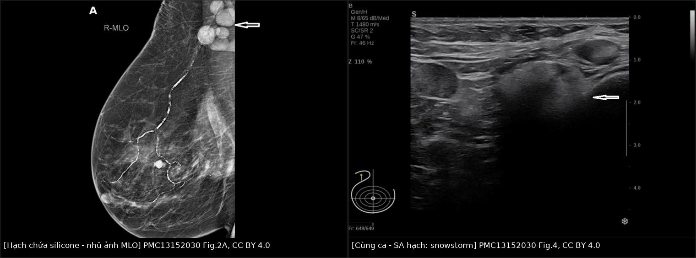
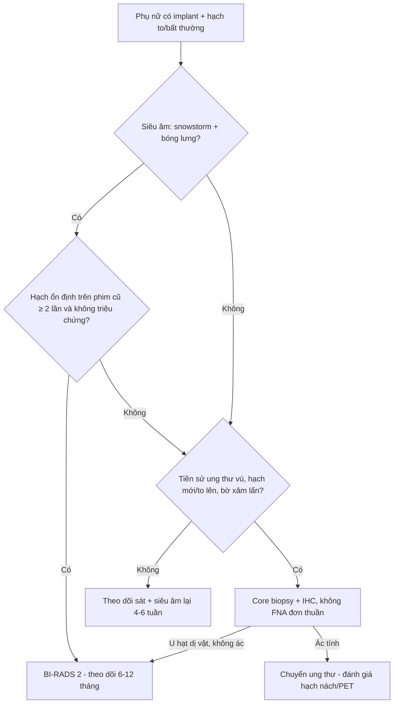
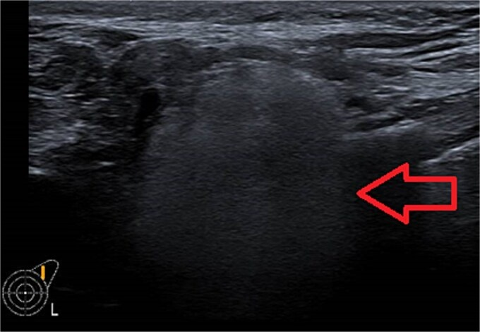
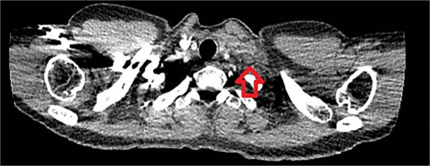
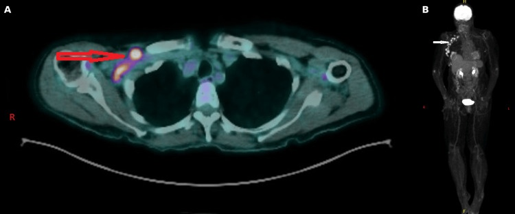
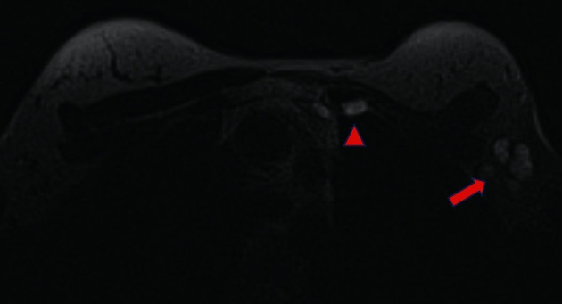
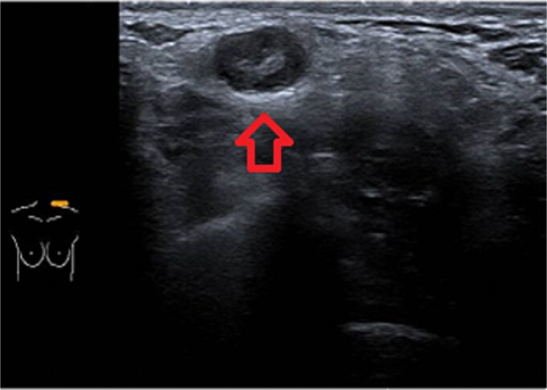

# 1686 — Hạch nách chứa silicone & siliconoma / Silicone lymphadenopathy and siliconoma

**Tags:** `pattern:snowstorm` `pattern:hach-tang-hoi-am` `vung:vu` `vung:hach-nach` `protocol:sieu-am-vu` `protocol:MRI-vu` `incidentaloma:hach-nach` `score:BI-RADS`
**Mức chắc chắn (certainty):** tổng hợp y văn (literature synthesis) — ghép 1 đoàn hệ 10 năm về tỉ lệ lưu hành (Berben JA và cs, *JPRAS Open* 2025, PMC11894321, CC BY 4.0), 1 ca nguyên văn hạch thượng đòn (Elayyan R và cs, *J Surg Case Rep* 2025, PMC12069027, CC BY 4.0), 1 ca nguyên văn tăng canxi do u hạt silicone (Alfaour A và cs, *Cureus* 2026, PMC13152030, CC BY 4.0), 1 tổng quan cơ chế – chuỗi xung (de Faria Castro Fleury E và cs, *Int J Inflam* 2022, PMC9392643, CC BY 4.0) và 1 pictorial review về khối tăng hồi âm của vú (Journo G và cs, *Insights Imaging* 2018, PMC5893486, CC BY 4.0). Bài 1656 đã phủ **vỏ gãy/gel bleed**; bài này chỉ đi sâu **silicone đã ra khỏi vỏ và tới hạch**.

## 1. Tổng quan — silicone đi tới hạch bằng đường nào và vì sao nó "sáng" trên siêu âm

- **Cơ chế:** gel silicone thoát qua vỏ (rách vỏ hoặc **gel bleed** – thấm vi thể qua vỏ còn nguyên) bị **đại thực bào** bắt và mang theo dòng bạch huyết tới hạch vùng; tại đó hình thành **u hạt phản ứng dị vật (foreign-body granuloma)** với tế bào khổng lồ đa nhân, đại thực bào chứa giọt silicone, lympho và xơ hóa. Khối u hạt trong nhu mô vú gọi là **siliconoma**, trong hạch gọi là **hạch chứa silicone / silicone lymphadenopathy (SLA)**.
- **TẠI SAO siêu âm thấy "bão tuyết" (snowstorm):** tốc độ âm trong silicone **≈ 1.000–1.100 m/s**, thấp hơn mô mềm (**≈ 1.540 m/s**). Chênh trở kháng âm rất lớn ở mặt phân cách silicone–mô → **hồi âm mạnh (tăng hồi âm) + suy giảm chùm tia phía sau rất mạnh ("bóng lưng bẩn")**, và các giọt gel nhỏ phản xạ lặp lại tạo hình ảnh lấp lánh. Hệ quả thực hành: **vùng sau "bão tuyết" bị che mờ**, nên dễ **bỏ sót hạch thứ hai** hoặc tổn thương nằm sâu hơn.
- **TẠI SAO nhũ ảnh thấy hạch "đặc, mất rốn mỡ":** silicone **đồng đậm với vỏ implant** và đậm hơn mỡ; hạch mất phần rốn mỡ sáng → trông như **hạch di căn đặc**. Giá trị chốt nằm ở **so sánh với phim cũ**: hạch đậm, **không đổi qua nhiều năm** là dấu hiệu lành tính mạnh.
- **TẠI SAO MRI là "chuẩn vàng" cho vỏ nhưng KHÔNG phải cho hạch:** chuỗi **chỉ hiện silicone (silicone-only / silicone-sensitive)** tách tần số silicone khỏi mỡ–nước → silicone sáng rực, tổ chức xơ quanh tối; nhưng hạch nhỏ nằm sát implant/mô xơ dễ bị che, nên **MRI kém nhạy hơn siêu âm với SLA**, trong khi **nhạy hơn hẳn với rách vỏ** (PMC11894321).
- **TẠI SAO PET dương giả:** đại thực bào và tế bào khổng lồ trong u hạt **tăng chuyển hóa glucose**, nên hạch chứa silicone **bắt FDG** — không có ngưỡng SUV nào tách được với di căn (chưa có trong y văn đã đọc); ca 77 tuổi dưới đây có **hạch nách phải bắt FDG mạnh** trên PET/CT.
- **Số liệu nằm lòng:**
  - **Tỉ lệ lưu hành SLA 5,83%** (71/1.217 nữ có implant silicone, 10 năm, một trung tâm): **3,86%** (47) có implant còn nguyên, **1,97%** (24) kèm rách vỏ (PMC11894321).
  - Trong nhóm **đã rách vỏ**, **15,0%** (24/160) có SLA; trong nhóm **implant còn nguyên**, **4,4%** — tức **gel bleed một mình cũng đủ gây SLA** (PMC11894321). Y văn trước đó có báo tỉ lệ **13,6%**.
  - **Phân bố vùng hạch** (tổng quan 190 vùng hạch đã báo cáo): **nách 72%** (136), **trung thất trong 21%** (40), **cổ/thượng đòn 19%** (36), **trung thất 13%** (24), **nhiều vùng cùng lúc 23%** (43) — nách là nơi hay gặp nhưng **không được bỏ qua chuỗi trung thất trong và thượng đòn** (PMC12069027).
  - **55%** trong 279 ca y văn **không đau hoặc không triệu chứng**; **10%** có triệu chứng toàn thân (PMC11894321).
  - **Siêu âm (dấu snowstorm): độ nhạy 87,5%, độ đặc hiệu 100%** (PMC12069027). **MRI phát hiện rách vỏ: Se 91,7%/Sp 66,7%** so với **siêu âm Se 76,2%/Sp 53,8%** (PMC11894321).
  - Bối cảnh: rách vỏ **tới 55%** với **tuổi rách trung vị 10,8 năm**, **22%** có silicone lan ngoài bao, sống implant 10 năm **83–85%**; implant **PIP** có tỉ lệ rách **cao tới 30 lần** (PMC11894321, PMC12069027).
  - **Ca thượng đòn (39 tuổi, implant 16 năm, PIP):** khối **2 × 3 cm** không đau, **CT 25 × 9 mm**, chọc hút **180 mL** dịch — tế bào học chỉ có **tế bào mỡ lành, lympho, mảnh vụn**, không ác tính; **theo dõi** vì không triệu chứng (PMC12069027).
  - **Ca tăng canxi (77 tuổi, implant đã tháo):** canxi hiệu chỉnh **3,32 mmol/L**, **PTH 0,6 pmol/L** (bị ức chế), **1,25-(OH)₂ vitamin D 86 pmol/L** ("bình thường không hợp lý"), **ACE 100 IU/L**; core biopsy hạch nách → **phản ứng dị vật silicone + hoại tử mỡ, không ác tính** (PMC13152030).

## 2. Mẫu hình + chẩn đoán phân biệt theo vị trí (Gamut)

- **Mẫu hình cốt lõi (nhớ "SNOW"):**
  - **S**nowstorm — hạch **tăng hồi âm**, có **bóng lưng mạnh** che mờ phía sau.
  - **N**odes đúng chuỗi dẫn lưu — **nách → thượng đòn → trung thất trong/trung thất**, có thể **đối bên** sau tái tạo vú (dẫn lưu bị đổi hướng).
  - **O**ld & stable — **không đổi hình dạng/kích thước trên phim cũ nhiều năm**.
  - **W**ithout malignant feature — **giữ hình bầu dục, bờ nhẵn**, không xâm lấn mô mỡ xung quanh.
- **Gamut theo vị trí:**
  - **Nách:** SLA (hay gặp nhất), di căn ung thư vú/tái phát, lymphoma, hạch phản ứng sau tiêm vaccine/viêm, lao, sarcoid, hạch lành có rốn mỡ.
  - **Thượng đòn/cổ:** SLA (bắt chước **di căn hạch cổ** — ca nguyên văn), di căn ung thư vú/đầu cổ/phổi, lymphoma, lao hạch, sarcoid, tuyến giáp lạc chỗ.
  - **Trung thất trong (internal mammary):** SLA, **di căn chuỗi trung thất trong** (ung thư vú), hạch phản ứng sau xạ, u trung thất.
  - **Nhu mô vú/thành ngực:** **siliconoma** (u hạt trong mô mỡ, có thể xơ cứng như ung thư), rách vỏ ngoài bao, tái phát tại vị trí mổ, hoại tử mỡ (bài 1687).
  - **Ngoài vùng vú:** cánh tay, bụng, chi dưới (báo cáo ca) — nhớ hỏi tiền sử implant **hoặc tiêm silicone tự do**.

## 3. Bảng so sánh phân biệt (ma trận đối chiếu)

| Thực thể (entity) | Hình ảnh điển hình (US/CT/MRI) | Chốt vào (rule-in) | Chốt loại (rule-out) | Gợi ý xác nhận |
|---|---|---|---|---|
| **Hạch chứa silicone (SLA)** | US: hạch bầu dục, **tăng hồi âm trong lòng + bóng lưng "bão tuyết"**; nhũ ảnh: hạch **đặc, mất rốn mỡ, không đổi nhiều năm**; MRI silicone-only: hạch **sáng** | **Tiền sử implant + snowstorm + hạch ổn định trên phim cũ** | **Không có snowstorm, hạch to nhanh, bờ xâm lấn, xuất hiện mới sau ung thư** → không loại trừ di căn | US là first-line; so phim cũ; **core biopsy** nếu còn nghi |
| **Di căn hạch (tái phát ung thư vú)** | US: **vỏ dày > 3 mm** hoặc **mất rốn mỡ**, bờ không đều, có thể dính; MRI: hạch **bắt thuốc**, DWI hạn chế | **Hạch mới/to lên, vỏ dày lệch, bờ thùy múi, tiền sử ung thư đang theo dõi** | **Snowstorm điển hình + ổn định nhiều năm + implant rách cùng bên** → ít khả năng | Core biopsy có IHC; PET/CT chỉ để tìm ổ khác |
| **Lymphoma** | Hạch rất lớn, nhiều hạch, **đồng nhất, giảm hồi âm**, có thể đẩy mạch; PET dương mạnh | **Nhiều hạch to, không đau, LDH tăng, B symptoms** | **Hạch nhỏ, tăng hồi âm, có bóng lưng** → không điển hình lymphoma | Sinh thiết hạch (không FNA đơn thuần) |
| **Lao/sarcoid hạch** | Hạch giảm hồi âm, **hoại tử trung tâm**, có thể vôi hóa; sarcoid: nhiều hạch hai bên + tổn thương phổi | **Bối cảnh dịch tễ/lao phổi, hoại tử trung tâm, ACE tăng** (sarcoid) | **Tăng hồi âm + bóng lưng mạnh** → nghiêng silicone | AFB/PCR, nội soi phế quản, sinh thiết |
| **Hạch phản ứng (sau tiêm/viêm)** | Hạch bầu dục, **giữ rốn mỡ**, vỏ mỏng đều, giảm dần theo thời gian | **Mới tiêm vaccine/viêm cùng bên, hạch < 1–2 cm, tự nhỏ lại** | **Không nhỏ sau 4–6 tuần, mất rốn mỡ** | Theo dõi 4–6 tuần; siêu âm lại |
| **Siliconoma trong nhu mô vú** | US: **khối tăng hồi âm + suy giảm chùm tia**; nhũ ảnh: khối **đồng đậm với silicone**, không có vôi hóa; MRI: sáng trên chuỗi silicone | **Vị trí quanh implant/đường di chuyển, tăng hồi âm, tiền sử rách vỏ** | **Bờ gai, xâm lấn, ngấm thuốc kiểu khối** → nghi ung thư/tái phát | Core biopsy nếu không điển hình |
| **Hạch "bình thường" nhưng đặc** | Hạch nhỏ, **rốn mỡ còn**, vỏ mỏng, không bóng lưng | **Rốn mỡ rõ, kích thước ổn định** | **Mất rốn mỡ hoàn toàn + bóng lưng** → không gọi lành | Không cần can thiệp |

*Trái: MLO — chùm hạch nách **đặc, mất rốn mỡ** (mũi tên), tồn tại trên phim cũ. Phải: siêu âm cùng ca — hạch **tăng hồi âm với suy giảm chùm tia mạnh**. Nguồn: Alfaour A và cs, *Cureus* 2026, PMC13152030 Fig. 2A + Fig. 4, CC BY 4.0. Ảnh ghép letterbox, không crop nội dung.*

### Ba dấu hiệu quyết định "theo dõi hay sinh thiết"
- **Snowstorm + hạch ổn định nhiều năm + không triệu chứng** → **theo dõi** (ca thượng đòn 2 × 3 cm đã chọn theo dõi — PMC12069027).
- **Có tiền sử ung thư vú, hạch mới/to lên, hoặc bất kỳ dấu hiệu xâm lấn** → **core biopsy**, không dựa vào "implant history" để bỏ qua (chính tác giả PMC11894321 nêu đây là tình huống khó nhất trong chiến lược mổ nách).
- **FNA đơn thuần dễ "âm tính giả"**: dịch hút ở ca trên chỉ có **tế bào mỡ lành, lympho, mảnh vụn**; muốn thấy **phản ứng dị vật/tế bào khổng lồ** phải **core biopsy** (PMC13152030).

## 4. Protocol chụp + cách phân tầng nguy cơ

- **Siêu âm là first-line** (đầu dò thẳng 12–15 MHz): quét **nách + hạch trung thất trong (cạnh ức) + thượng đòn** ở mọi phụ nữ có implant, kể cả khi khám vú vì lý do khác. Ghi: kích thước, **rốn mỡ còn/mất**, hồi âm, có/không **bóng lưng**, so sánh hai bên.
- **Nhũ ảnh:** luôn kèm **view implant (Eklund)**; đối chiếu phim cũ là bước **bắt buộc** — hạch đậm không đổi qua **≥ 2 lần chụp** là chốt lành tính mạnh.
- **MRI vú + chuỗi chỉ hiện silicone** khi: nghi rách vỏ, đau/cứng, hạch không điển hình, hoặc cần đánh giá toàn bộ bao xơ. Không dùng MRI để "loại trừ" hạch chứa silicone (kém nhạy hơn SA).
- **CT/PET không phải công cụ chẩn đoán SLA**: CT chỉ thấy hạch đặc; PET có thể **dương giả do u hạt**. Nếu PET dương ở người có implant → **đọc lại tiền sử + siêu âm trước khi kết luận di căn**.
- **Không có RADS riêng cho hạch chứa silicone.** Phân tầng theo 3 bậc (đề xuất của bài, dựa trên dữ liệu trên):

- **Khi nào tháo implant:** rách vỏ đã xác nhận + triệu chứng/lo lắng, hoặc hạch không điển hình cần mô học. Không tháo implant chỉ vì có hạch chứa silicone không triệu chứng (PMC12069027 chọn theo dõi, sau đó tháo vì rách vỏ).

## 5. Biến thể bình thường và cạm bẫy

- **Hạch nhỏ tăng hồi âm do mỡ (fatty hilum)**: hồi âm cao nhưng **không có bóng lưng mạnh** và **rốn mỡ trung tâm rõ** → không phải silicone.
- **"Bão tuyết" che mờ hậu trường**: luôn quét **vuông góc** và đổi góc, ghi thêm **hạch thứ hai** phía sau; đây là cạm bẫy bỏ sót thật.
- **Hạch đối bên sau tái tạo vú**: dẫn lưu bị đổi hướng → **SLA có thể xuất hiện ở nách đối bên**; đừng mặc định "không cùng bên thì không liên quan implant".
- **PET dương giả**: đã có ca hạch nách bắt FDG mạnh vì u hạt silicone; **không chẩn đoán di căn chỉ bằng PET** khi có implant.
- **Tăng canxi do u hạt**: hạch silicone có thể là ổ u hạt toàn thân → **canxi cao, PTH bị ức chế, 1,25-(OH)₂D "bình thường không hợp lý"**; đừng bỏ qua tiền sử implant khi tìm nguyên nhân tăng canxi.
- **Silicone tự do (tiêm) ≠ implant**: cùng hình ảnh nhưng **không có vỏ** để đánh giá; hỏi kỹ thủ thuật làm đẹp.
- **"Implant còn nguyên thì không thể có SLA"** — sai: **4,4%** nữ có implant nguyên vẫn có SLA (gel bleed).

## 6. Tự lượng giá — Blind Quiz

**Ca 1 — hạch nách ở người có implant 11 năm**

- Gợi ý: nữ 39 tuổi, implant ngực 16 năm, vú trái to lên 1 tuần, sờ thấy hạch nách.
- Câu hỏi: Mô tả hồi âm và hiện tượng phía sau hạch? Hai chẩn đoán phân biệt chính? Dấu hiệu nào khiến bạn **không** sinh thiết ngay?

<b>Bấm để hiện đáp án</b>

- Dấu hiệu: hạch **tăng hồi âm toàn bộ**, mất cấu trúc rốn mỡ, **bóng lưng mạnh ("bão tuyết")** che mờ mô phía sau.
- Chẩn đoán: **hạch chứa silicone** do rách vỏ/gel bleed — cơ chế: chênh trở kháng âm silicone–mô tạo phản xạ mạnh và suy giảm chùm tia.
- Không sinh thiết ngay khi: snowstorm điển hình + không triệu chứng + hạch ổn định trên phim cũ. Ca gốc vẫn **tháo implant vì rách vỏ**, hạch **theo dõi**.
- Nguồn: Elayyan R và cs, *J Surg Case Rep* 2025, PMC12069027 Fig. 2, CC BY 4.0.

**Ca 2 — khối thượng đòn mới xuất hiện**

- Gợi ý: cùng bệnh nhân, 1 tuần sau thấy khối **2 × 3 cm** vùng thượng đòn trái, không đau; khó thở nhẹ.
- Câu hỏi: Khối nằm ở khoang nào? Vì sao CT "không giúp" chốt bản chất? Bước tiếp theo?

<b>Bấm để hiện đáp án</b>

- Dấu hiệu: khối **25 × 9 mm** cạnh bó mạch cảnh–thượng đòn, **đồng đậm với cơ**, không hoại tử, không xâm lấn.
- Vì sao: silicone **đậm hơn mỡ nhưng không có ngưỡng HU chuẩn hóa**; CT chỉ loại trừ chèn ép/khối lớn, **không phân biệt được u hạt với di căn**.
- Bước tiếp: **siêu âm đích** vùng thượng đòn → thấy snowstorm là chốt; nếu không điển hình → core biopsy.
- Nguồn: Elayyan R và cs, *J Surg Case Rep* 2025, PMC12069027 Fig. 5 (CT) + Fig. 4 (SA), CC BY 4.0.

**Ca 3 — PET dương ở người có tiền sử ung thư vú**

- Gợi ý: nữ 77 tuổi, implant đã tháo, canxi máu cao tái diễn, gầy sút; PET/CT vì tìm ổ ác tính.
- Câu hỏi: Vì sao hạch nách bắt FDG mạnh mà vẫn có thể lành? Bộ ba xét nghiệm nào hướng tới u hạt? Làm gì để chốt?

<b>Bấm để hiện đáp án</b>

- Dấu hiệu: hạch nách phải **bắt FDG mạnh** (A: mặt phẳng trục, B: MIP toàn thân); trên nhũ ảnh là **chùm hạch đặc tồn tại trên phim cũ**; siêu âm có snowstorm.
- Bộ ba: **PTH bị ức chế (0,6 pmol/L), canxi 3,32 mmol/L, 1,25-(OH)₂D 86 pmol/L "bình thường không hợp lý"** + ACE 100 IU/L → u hạt chuyển hóa vitamin D ngoài thận.
- Chốt: **core biopsy** → phản ứng dị vật silicone + hoại tử mỡ, không ác tính; điều trị bằng dịch, bisphosphonate, corticoid ngắn ngày.
- Nguồn: Alfaour A và cs, *Cureus* 2026, PMC13152030 Fig. 3, CC BY 4.0.

**Ca 4 (ảnh ghép) — hạch nách trong chuỗi trung thất trong**

- Gợi ý: nữ 62 tuổi, implant silicone 11 năm, không triệu chứng; MRI vì đánh giá vỏ implant.
- Câu hỏi: Hai ổ sáng trên chuỗi silicone nằm ở đâu? Vì sao không được gọi là "di căn chuỗi trung thất trong"?

<b>Bấm để hiện đáp án</b>

- Dấu hiệu: **hạch nách (mũi tên)** và **hạch trung thất trong (tam giác)** đều **sáng trên chuỗi chỉ hiện silicone**; implant phải còn nguyên vỏ.
- Vì sao: silicone đi theo bạch huyết tới **cả hai chuỗi**; hạch trung thất trong là vị trí đã báo cáo **21%** trong 190 vùng hạch. Bản chất là u hạt, không phải tế bào u.
- Nguồn: de Faria Castro Fleury E và cs, *Int J Inflam* 2022, PMC9392643 Fig. 9, CC BY 4.0.

**Ca 5 — siliconoma trong mô vú**

- Gợi ý: khối cứng cạnh implant, không đau, tiền sử rách vỏ.
- Câu hỏi: Dấu hiệu siêu âm nào tách siliconoma khỏi ung thư? Khi nào vẫn phải sinh thiết?

<b>Bấm để hiện đáp án</b>

- Dấu hiệu: khối **tăng hồi âm chứa hạt mịn**, **suy giảm mạnh chùm tia**, không có bờ gai xâm lấn; siliconoma "bắt chước" khối đặc và có thể tăng FDG.
- Vẫn sinh thiết khi: bờ không đều, ngấm thuốc kiểu khối trên MRI, hoặc xuất hiện mới trong vùng đã xạ/mổ u.
- Nguồn: Elayyan R và cs, PMC12069027 Fig. 4; đặc điểm khối tăng hồi âm theo Journo G và cs, *Insights Imaging* 2018, PMC5893486 Fig. 11, CC BY 4.0.

## Bài liên quan chéo
- [1656 – Rách vỏ implant & gel bleed: linguine/stepladder/snowstorm, trong–ngoài bao](../1656-rach-vo-implant-nguc-va-gel-bleed/lesson.md)
- [1653 – Co rút bao xơ implant & xơ hóa cơ ngực lớn](../1653-co-rut-bao-xo-implant-nguc-xo-hoa-co-nguc/lesson.md)
- [1654 – Dịch quanh implant muộn & BIA-ALCL](../1654-dich-quanh-implant-nguc-va-bia-alcl/lesson.md)
- [1687 – Hoại tử mỡ sau tái tạo vú, vạt và ghép mỡ](../1687-hoai-tu-mo-sau-tai-tao-vu-vat-ghep-mo/lesson.md)
- [510 – BI-RADS: nhũ ảnh, siêu âm, MRI](../510-vu-BIRADS-nhu-anh-sieu-am-MRI/lesson.md)

> Không dùng để chẩn đoán độc lập khi chưa có người hướng dẫn.
