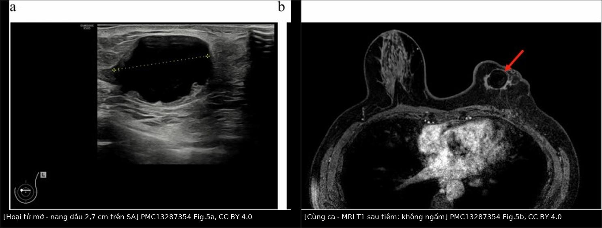
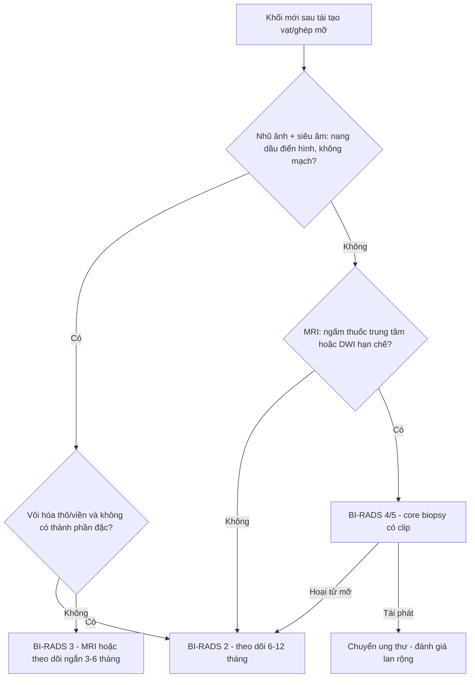
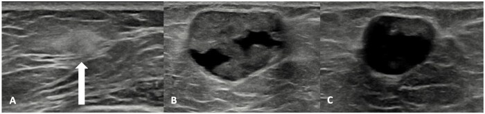
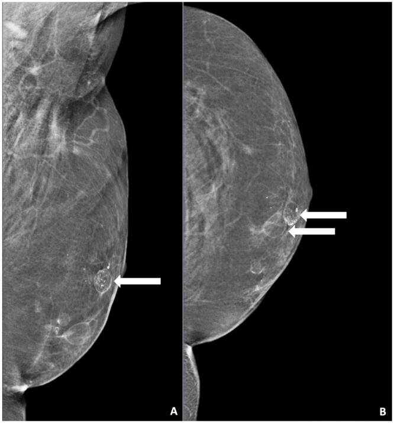
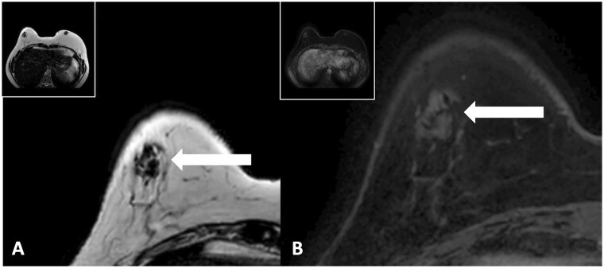
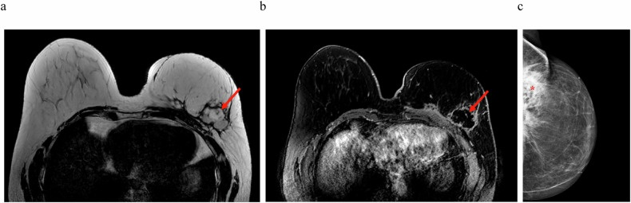

# 1687 — Hoại tử mỡ sau tái tạo vú, vạt và ghép mỡ / Fat necrosis after breast reconstruction, flap and fat grafting

**Tags:** `pattern:hoai-tu-mo` `pattern:nang-dau` `pattern:voi-hoa-vien` `vung:vu` `protocol:sieu-am-vu` `protocol:nhu-anh-phong-dai` `protocol:MRI-vu` `score:BI-RADS` `incidentaloma:hoai-tu-mo`
**Mức chắc chắn (certainty):** tổng hợp y văn (literature synthesis) — dựa trên 1 tổng quan hệ thống 17 nghiên cứu về đặc điểm hình ảnh hoại tử mỡ sau các kỹ thuật tái tạo tự thân (Smeins NNPM và cs, *Insights Imaging* 2026, PMC13287354, CC BY 4.0), 1 bài tổng quan hình ảnh sau tái tạo toàn bộ bằng ghép mỡ (Rijkx MEP và cs, *BJR Open* 2024, PMC11128096, CC BY 4.0), và 1 đoàn hệ 10 năm về diễn tiến tự nhiên (Lee J và cs, *BMC Cancer* 2021, PMC7885495, CC BY 4.0).

## 1. Tổng quan — vì sao mỡ chết đi lại tạo ra "nang dầu" và vôi hóa viền

- **Bệnh học:** hoại tử mỡ (fat necrosis) là **viêm vô khuẩn** của tế bào mỡ sau **thiếu máu cục bộ** (vạt cuống hẹp, ghép mỡ thể tích lớn, xạ trị, chấn thương, sinh thiết). Tế bào mỡ vỡ → giải phóng triglyceride → **phản ứng viêm + đại thực bào** → bao xơ bao quanh khối mỡ lỏng = **nang dầu (oil cyst)**; canxi xà phòng hóa lắng ở vỏ xơ = **vôi hóa viền/cuống (rim, coarse)**.
- **Ba giai đoạn (theo Rijkx 2024):** **tăng cấp (hyperacute)** — phù, tăng hồi âm lan tỏa; **viêm (inflammatory)** — nang dầu hình thành, vỏ xơ mỏng; **xơ hóa (fibrotic)** — vỏ dày, có thể **co kéo/gai**, vôi hóa viền.
- **TẠI SAO mỡ "sáng" trên T1–T2 và "tối" trên T1 fat-sat:** mỡ là mô có thời gian T1 ngắn, T2 dài; xung ức chế mỡ đặt tần số mỡ về 0 → khối mỡ **mất tín hiệu**, trong khi **vỏ xơ (collagen, ít proton tự do)** vẫn tối trên T2 và **ngấm thuốc** ở thì muộn. Vì vậy nang dầu điển hình = **lõi tối trên T1 fat-sat + viền sáng mỏng + không ngấm trung tâm**.
- **TẠI SAO siêu âm đổi hình dạng theo thời gian:** giai đoạn sớm mô phù → **tăng hồi âm, bờ mờ**; khi hóa lỏng → **vùng trống âm, tăng hồi âm phía sau**; khi xơ hóa → **bờ dày, có bóng lưng** — chính là lúc dễ **bắt chước ung thư tái phát**.
- **TẠI SAO chẩn đoán khó sau tái tạo:** vạt tự thân **không có giải phẫu tuyến bình thường**, mô mỡ hoại tử nằm ngay **vùng tiếp giáp vạt–thành ngực** — cũng là nơi tái phát hay xuất hiện; và **vôi hóa hoại tử mỡ có thể là cụm đa hình** trông y như DCIS.
- **Số liệu nằm lòng:**
  - **Tỉ lệ hoại tử mỡ:** **12,5–23,6%** sau vạt (4 nghiên cứu); **7,3–82,9%** sau ghép mỡ tự thân (AFT) (PMC13287354). Đoàn hệ có xác nhận mô học: **11,6%** (42/362) sau tái tạo vú; **TRAM cuống 57,2%** so với **vạt vi phẫu 9,5%** (PMC7885495).
  - **Kích thước:** vạt **0,3 đến > 3 cm**; AFT **5–46 mm** (PMC13287354).
  - **Thời điểm:** phát hiện trung bình **21,1 ± 17,2 tháng** sau mổ, kích thước trung bình **2,5 ± 1,5 cm** (PMC7885495); nang dầu hình thành trong **391 ngày**, vôi hóa trong **491 ngày**; vôi hóa có thể xuất hiện **sớm nhất 11 tháng**; vôi hóa thô–dạng đường **2–3 năm** sau mổ, **grade 1 ≈ 30 tháng → grade 3 ≈ 65 tháng** (PMC13287354).
  - **Diễn tiến tự nhiên:** tan trung bình **45,9 ± 42,1 tháng**; **61,9%** gần như tan hoàn toàn (**< 5 mm**) sau 10 năm; **hơn nửa tan trong 2–3 năm** (PMC7885495).
  - **Một lần ghép mỡ có thể tích tới ~250 mL mỗi vị trí** → thể tích càng lớn, nguy cơ hoại tử mỡ càng cao (PMC11128096).
  - **Nguy cơ bỏ sót tái phát:** trong 6 ca tái phát của một nghiên cứu, **1 ca được gọi là "hoại tử mỡ" trên siêu âm** trước đó (PMC13287354 dẫn Fracol). Vôi hóa cụm đa hình **tới 9 mm** xuất hiện **12 tháng** sau lần ghép mỡ cuối đã bị chấm **BI-RADS 4** (PMC11128096).
  - **Giá trị của "không ngấm thuốc":** khối **không có mạch** tại đúng vị trí ghép mỡ có **giá trị tiên đoán âm 100%** cho ác tính (Parikh, dẫn trong PMC11128096) → có thể **BI-RADS 2**; trên MRI, **không ngấm thuốc trung tâm** cho phép **bỏ sinh thiết** (PMC11128096).

## 2. Mẫu hình + chẩn đoán phân biệt theo vị trí (Gamut)

- **Mẫu hình cốt lõi (nhớ "OIL"):**
  - **O**il cyst — khối **tròn/bầu dục, đồng âm với mỡ**, vỏ mỏng; nhũ ảnh: **vùng sáng (radiolucent)** có **viền mảnh**; MRI: **tối trên T1 fat-sat**, viền sáng.
  - **I**maging stable / benign calcification — vôi hóa **thô, cuống, viền** ("shell"), nhiều ổ, đối xứng, **kèm nang dầu**.
  - **L**ack of enhancement — **không ngấm thuốc trung tâm** trên MRI, **không có mạch** trên Doppler.
- **Gamut theo vị trí/bối cảnh:**
  - **Vạt tự thân (DIEP/TRAM/PAP):** hoại tử mỡ ở **phần ngoại vi vạt** và **vùng tiếp giáp với diện cắt tuyến** — trùng vị trí tái phát → **không được loại trừ chỉ vì "đúng chỗ hay gặp hoại tử mỡ"**.
  - **Ghép mỡ (AFT) toàn bộ hoặc làm đầy khuyết:** tổn thương ở **mọi lớp** (dưới da, tuyến, dưới tuyến, trước/trong cơ ngực), nhiều ổ, có thể **lan vào cơ ngực** (mỡ trong cơ ngực là lành tính).
  - **Sau bảo tồn + xạ trị:** hoại tử mỡ **4–25%**, thường kèm co kéo da và vôi hóa; phân biệt với **tái phát tại giường u**.
  - **Sau sinh thiết/mổ:** hoại tử mỡ dạng **khối có gai** ở đường vào kim — bẫy kinh điển của "khối mới sau sinh thiết".
  - **Trong hạch/ngoài vú:** hiếm — hoại tử mỡ trong hạch nách, hoặc mỡ lạc chỗ; đừng nhầm với hạch di căn hoại tử.

## 3. Bảng so sánh phân biệt (ma trận đối chiếu)

| Thực thể (entity) | Hình ảnh điển hình (MG/US/MRI) | Chốt vào (rule-in) | Chốt loại (rule-out) | Gợi ý xác nhận |
|---|---|---|---|---|
| **Hoại tử mỡ / nang dầu** | MG: **vùng sáng + viền mảnh**, vôi hóa thô/viền; US: **khối đồng âm mỡ, không mạch**, vỏ mỏng hoặc dày; MRI: **tối T1 fat-sat, không ngấm** | **Đúng vị trí ghép/vạt + không mạch + vôi hóa điển hình + ổn định/teo dần** | **Bờ gai dày không đều + ngấm thuốc kiểu khối + vôi hóa đa hình phân nhánh** → không loại trừ tái phát | So phim cũ; MRI; **core biopsy** nếu còn nghi |
| **Tái phát ung thư vú** | Khối **giảm hồi âm, bờ gai**, ngấm thuốc nhanh–thoát (Type III), DWI hạn chế; vôi hóa **đa hình/phân nhánh** | **Khối mới/to lên, ngấm thuốc, ADC thấp, vôi hóa đa hình** | **Lõi tối T1 fat-sat + không ngấm + vôi hóa thô/viền** → ít khả năng | Core biopsy có clip; đối chiếu xạ trị trường chiếu |
| **Seroma** | US: **trống âm**, không vỏ đặc; MRI: **rất sáng T2**, tối T1, **không ngấm**; xuất hiện **tuần đầu** sau mổ | **Xuất hiện sớm (< 1 tuần), trống âm, không vỏ xơ** | **Vỏ dày + hồi âm trong lòng + vôi hóa** → không phải seroma đơn thuần | Siêu âm lại sau 1 tuần; chọc hút vô khuẩn |
| **Máu tụ** | US: hồi âm hỗn hợp, có mức; MRI: tín hiệu máu theo thì (T1 sáng bán cấp) | **Sau chấn thương/mổ gần, có mức dịch–máu, không mạch** | **Tối T1 fat-sat + đồng âm mỡ** → mỡ, không phải máu | Theo dõi 4–6 tuần; MRI nếu không tan |
| **Áp-xe** | US: **dịch đặc, vỏ dày, tăng sinh mạch quanh**; MRI: **DWI sáng/ADC tối** trong lòng | **Sốt, đau, đỏ, CRP tăng; hạn chế khuếch tán trong lòng** | **Không sống, không hạn chế khuếch tán, không mạch** | Chọc hút/cấy; dẫn lưu |
| **Galactocele** | Khối **đồng âm mỡ sữa**, có mức; thường **sau sinh/cho con bú** | **Bối cảnh tiết sữa, mức dịch–mỡ, không mạch** | **Vôi hóa viền dày + tiền sử ghép mỡ** → hoại tử mỡ | Chọc hút (sữa); theo dõi |
| **Siliconoma** | US: **tăng hồi âm + suy giảm chùm tia ("bão tuyết")**; MRI: sáng trên chuỗi silicone | **Tiền sử implant/rách vỏ, snowstorm** | **Đồng âm mỡ, tối T1 fat-sat** → mỡ, không phải silicone | Xem bài 1686 |

*Trái: siêu âm — **nang dầu 2,7 cm**, lòng trống âm, vỏ mỏng, đo đường kính. Phải: MRI T1 sau tiêm cùng ca — khối **không ngấm thuốc**, viền sáng mảnh. Nguồn: Smeins NNPM và cs, *Insights Imaging* 2026, PMC13287354 Fig. 5a + 5b, CC BY 4.0. Ảnh ghép letterbox.*

### Ba câu hỏi quyết định "theo dõi hay sinh thiết"
1. **Có đúng vị trí và đúng "tuổi" không?** Nang dầu/vôi hóa viền trong **6–36 tháng** đầu sau ghép/vạt là điển hình.
2. **Có mạch/ngấm thuốc không?** **Không mạch + không ngấm trung tâm** = lành tính mạnh (NPV 100% theo Parikh).
3. **Vôi hóa thuộc loại nào?** **Thô, cuống, viền, nhiều ổ** = lành; **đa hình, phân nhánh, cụm** = **BI-RADS 4/5 → sinh thiết**.

## 4. Protocol chụp + theo dõi

- **Bước 1 — nhũ ảnh + siêu âm** cho mọi khối sờ thấy sau tái tạo (MRI chỉ là "problem-solving"). Nhũ ảnh phải **so phim trước ghép/vạt**; ghi rõ **vị trí tương quan với vạt và diện cắt**.
- **Siêu âm:** đánh giá **có mạch/không mạch** bằng Doppler màu, **vỏ dày hay mỏng**, **có thành phần đặc bên trong**; khối **không mạch tại đúng vị trí ghép** được coi là lành tính (BI-RADS 2).
- **MRI vú** khi: nhũ ảnh/SA không kết luận, khối nằm sâu cạnh implant/vạt, hoặc cần phân biệt tái phát. Bắt buộc có **T1 fat-sat trước–sau tiêm** + **DWI/ADC**; đọc theo **BI-RADS MRI** (hình thái, đường cong động học).
- **Theo dõi sau khi đã xác nhận mô học:** chỉ cần theo dõi hình ảnh; **hơn nửa tan trong 2–3 năm**, trung bình **45,9 tháng**, **61,9% < 5 mm sau 10 năm** (PMC7885495). Lịch gợi ý: **6 tháng/lần trong 2 năm đầu, sau đó 1 năm/lần** (theo lịch theo dõi ung thư vú của đoàn hệ trên).

- **Ngưỡng BI-RADS áp dụng:** vôi hóa **thô/viền** = BI-RADS 2; **cụm đa hình/ phân nhánh** = BI-RADS 4–5; khối có **bờ gai + ngấm thuốc** = tối thiểu BI-RADS 4.

## 5. Biến thể bình thường và cạm bẫy

- **"Gai" của hoại tử mỡ giai đoạn xơ hóa:** vỏ xơ dày co kéo tạo **bờ gai** sau **≥ 1,5 năm** — trên nhũ ảnh trông như ung thư; chốt bằng **MRI không ngấm** hoặc so phim cũ.
- **Vôi hóa cụm đa hình sau ghép mỡ:** có thể tới **9 mm**, xuất hiện **12 tháng** sau lần ghép cuối → **không được gọi là "vôi hóa lành" chỉ vì có tiền sử ghép mỡ**.
- **Vị trí "hay gặp hoại tử mỡ" chính là vị trí tái phát:** vùng tiếp giáp vạt–diện cắt và ngoại vi vạt; **không loại trừ tái phát bằng vị trí**.
- **Mỡ trong cơ ngực sau ghép:** mỡ lạc chỗ trong cơ ngực là **lành tính**, đừng gọi là xâm lấn cơ; phân biệt bằng T1 fat-sat (mất tín hiệu) và không ngấm.
- **Seroma mạn > 4 tuần:** không đáp ứng chọc hút/đốt xơ → **MRI** để loại trừ tái phát/hoại tử mỡ có thành phần đặc; seroma đơn thuần rất sáng T2, tối T1, **không ngấm**.
- **Chụp MRI sau ghép mỡ trong vòng vài tuần:** phù và viêm làm **tăng tín hiệu T2 và ngấm viền** → dễ chấm BI-RADS 4 oan; nên chờ **≥ 3 tháng** nếu không cấp.
- **Bỏ sót "satisfaction of search":** thấy nang dầu điển hình rồi dừng, không đọc **phần vạt còn lại** và **hạch nách**.

## 6. Tự lượng giá — Blind Quiz

**Ca 1 — ba giai đoạn của hoại tử mỡ**

- Gợi ý: nữ 46 tuổi, tái tạo toàn bộ vú trái bằng ghép mỡ 1 năm trước, khám vì một vùng cứng.
- Câu hỏi: Xếp A–B–C theo thứ tự thời gian? Dấu hiệu nào cho biết đã hình thành nang dầu?

<b>Bấm để hiện đáp án</b>

- Dấu hiệu: **A** — vùng **tăng hồi âm** lan tỏa (giai đoạn tăng cấp); **B** — bắt đầu **hóa lỏng**, vỏ xơ phía trước (giai đoạn viêm); **C** — **nang dầu gần hoàn chỉnh**, lòng trống âm, vỏ mỏng.
- Chẩn đoán: hoại tử mỡ tiến triển theo **3 giai đoạn**; không cần sinh thiết khi điển hình.
- Nguồn: Rijkx MEP và cs, *BJR Open* 2024, PMC11128096 Fig. 3A–C, CC BY 4.0.

**Ca 2 — vôi hóa viền quanh nang dầu**

- Gợi ý: cùng bệnh nhân, 2 năm 10 tháng sau lần ghép mỡ cuối; khối cứng vùng sau núm.
- Câu hỏi: Mô tả hai nang dầu và kiểu vôi hóa? Chấm BI-RADS?

<b>Bấm để hiện đáp án</b>

- Dấu hiệu: **khối sáng đồng mỡ có viền đậm mảnh** (mũi tên), kèm **vôi hóa viền/thô**; hai nang dầu ở vùng sau núm (A: MLO, B: CC).
- Chấm: **BI-RADS 2** — vôi hóa viền/thô + nang dầu điển hình.
- Nguồn: Rijkx MEP và cs, *BJR Open* 2024, PMC11128096 Fig. 4A–B, CC BY 4.0.

**Ca 3 — MRI: khối tối T2, không ngấm**

- Gợi ý: cùng bệnh nhân; MRI 2 năm 10 tháng sau ghép mỡ, đánh giá khối góc trên ngoài vú phải.
- Câu hỏi: Tín hiệu T2 và đặc điểm ngấm thuốc nói gì? Có cần sinh thiết?

<b>Bấm để hiện đáp án</b>

- Dấu hiệu: **khối tối trên T2** (A), **không ngấm thuốc** sau tiêm (B) — tương ứng vỏ xơ + mỡ hoại tử.
- Kết luận: hoại tử mỡ; **không ngấm trung tâm** cho phép bỏ sinh thiết (BI-RADS 2), theo dõi.
- Nguồn: Rijkx MEP và cs, *BJR Open* 2024, PMC11128096 Fig. 5A–B, CC BY 4.0.

**Ca 4 — hoại tử mỡ sau vạt DIEP**

- Gợi ý: nữ 67 tuổi, cắt tuyến vì DCIS, tái tạo bằng vạt DIEP; 8 tháng sau sờ thấy khối góc dưới ngoài.
- Câu hỏi: Khối 4,2 cm có đặc điểm gì trên MRI? Vì sao vẫn chấm BI-RADS 2 dù kích thước lớn?

<b>Bấm để hiện đáp án</b>

- Dấu hiệu: **khối thùy múi 4,2 cm**, mô quanh **ngấm nhẹ**, bờ "gương" (specular); nhũ ảnh có **vôi hóa thô** cùng vùng.
- Vì sao BI-RADS 2: hình thái điển hình hoại tử mỡ + vôi hóa thô + không có đặc điểm ác tính; **kích thước không quyết định BI-RADS**.
- Nguồn: Smeins NNPM và cs, *Insights Imaging* 2026, PMC13287354 Fig. 3a–c, CC BY 4.0.

**Ca 5 (ảnh ghép) — nang dầu "không ngấm" trên MRI**

- Gợi ý: nữ 61 tuổi, tái tạo toàn bộ vú trái bằng ghép mỡ, khối sờ thấy 21 tháng sau lần ghép thứ 4.
- Câu hỏi: Hai đặc điểm nào trên hai phương thức khẳng định đây là nang dầu?

<b>Bấm để hiện đáp án</b>

- Dấu hiệu: siêu âm — **nang 2,7 cm, lòng trống âm, vỏ mỏng, không có thành phần đặc**; MRI — **khối không ngấm, viền sáng mảnh**.
- Kết luận: nang dầu (hoại tử mỡ), **BI-RADS 2**.
- Nguồn: Smeins NNPM và cs, *Insights Imaging* 2026, PMC13287354 Fig. 5a–b, CC BY 4.0.

## Bài liên quan chéo
- [1656 – Rách vỏ implant & gel bleed](../1656-rach-vo-implant-nguc-va-gel-bleed/lesson.md)
- [1686 – Hạch nách chứa silicone & siliconoma](../1686-hach-nach-chua-silicone-va-siliconoma/lesson.md)
- [1653 – Co rút bao xơ implant & xơ hóa cơ ngực lớn](../1653-co-rut-bao-xo-implant-nguc-xo-hoa-co-nguc/lesson.md)
- [516 – Hình ảnh vú sau điều trị](../516-hinh-anh-vu-sau-dieu-tri/lesson.md)
- [510 – BI-RADS: nhũ ảnh, siêu âm, MRI](../510-vu-BIRADS-nhu-anh-sieu-am-MRI/lesson.md)

> Không dùng để chẩn đoán độc lập khi chưa có người hướng dẫn.
