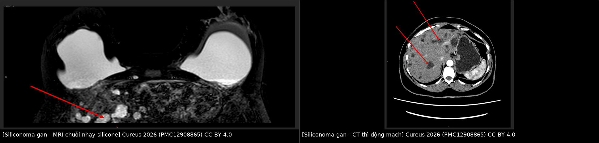
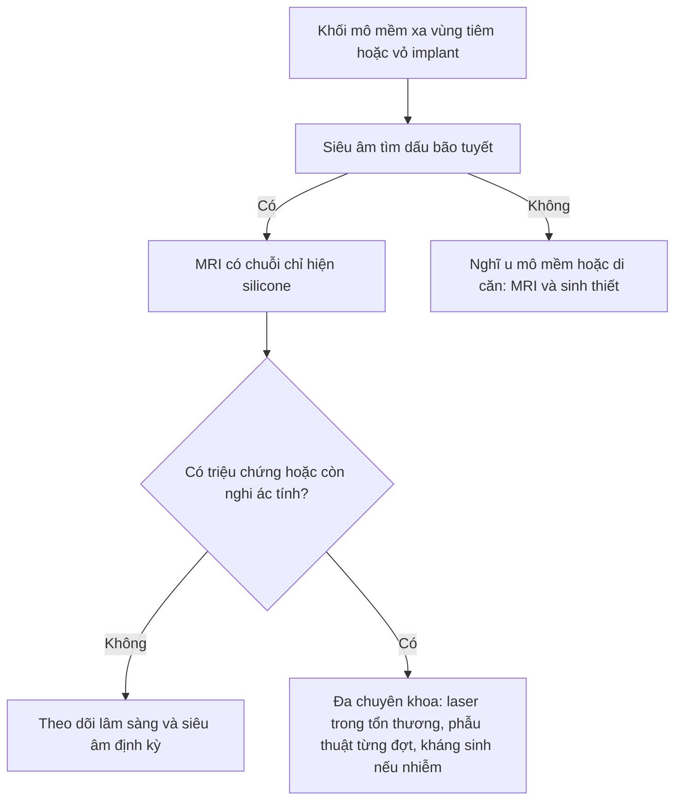
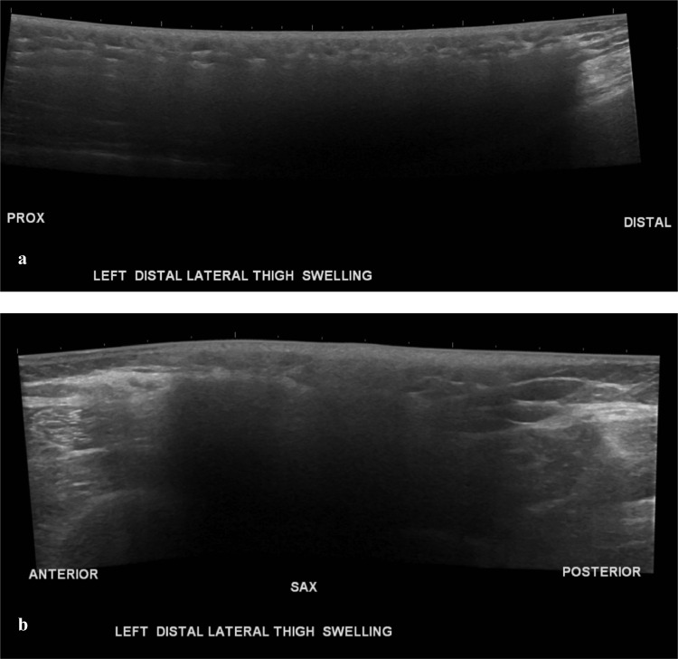
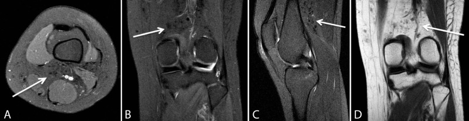

# 1688 — Siliconoma lan xa ngoài vùng vú & silicone tự do sau tiêm / Distant siliconoma and free-silicone migration

**Tags:** `pattern:snowstorm` `pattern:khoi-mo-mem` `vung:vu` `vung:thanh-nguc` `vung:bung` `vung:chi-duoi` `vung:gan` `protocol:sieu-am-mo-mem` `protocol:MRI-chi-hien-silicone` `incidentaloma:siliconoma`
**Mức chắc chắn (certainty):** tổng hợp y văn (literature synthesis) — ghép 1 ca nguyên văn siliconoma đùi–gối sau tiêm mông (Soliman SB, *Radiol Case Rep* 2023, PMC9829554, CC BY-NC-ND), 1 ca nguyên văn di chuyển tới khớp gối (Leyva A và cs, *Cureus* 2018, PMC6235646, CC BY 4.0), 1 ca nguyên văn siliconoma GAN sau vỡ vỏ implant (Win M và cs, *Cureus* 2026, PMC12908865, CC BY 4.0), 1 đoàn hệ 72 bệnh nhân chất làm đầy vĩnh viễn vùng mông (Decates TS và cs, *Plast Reconstr Surg Glob Open* 2025, PMC12144638, CC BY-NC-ND), 1 tổng quan scoping 142 bài về tiêm silicone công nghiệp (Gerk A và cs, *Acta Cir Bras* 2024, PMC11457952, CC BY 4.0) và 1 nghiên cứu 77 người chuyển giới nam→nữ tiêm silicone số lượng lớn (Bertin C và cs, *Medicine* 2019, PMC6358378, CC BY-NC). Bài 1686 đã phủ **hạch chứa silicone**; bài này đi sâu **silicone đã rời khỏi vùng tiêm/vỏ implant và gây khối ở nơi khác**, nơi nó thường bị gọi nhầm là sarcoma hoặc di căn.

## 1. Tổng quan bệnh học – cơ chế hình ảnh

- **Bản chất:** silicone lỏng dùng trong thẩm mỹ là **polydimethylsiloxane (PDMS)**. Ở Mỹ, tiêm silicone số lượng lớn để độn mông/vú **bị FDA cấm**; chỉ còn được phép dùng **trong nhãn khoa** (bơm dầu trong bong võng mạc) — mọi ca "độn mông bằng silicone" là thủ thuật ngoài luồng (PMC6235646).
- **Vì sao vẫn phổ biến:** giá thành tiêm silicone lậu chỉ bằng **10–30%** một ca đặt implant mông hợp pháp, và một bộ phận người chuyển giới nữ hóa chọn biện pháp này vì rào cản chi phí/kỳ thị (PMC9829554).
- **Dịch tễ (số nằm lòng):**
  - Tổng quan scoping **142 bài, 28 quốc gia**: vùng tiêm hay gặp nhất là **mông 35%**, **vú 13,3%**; biến chứng được báo cáo: **u hạt 41,5%**, **vấn đề da 41,5%**, **nhiễm trùng 35,9%**, **biến chứng phổi 34,5%**; **49,9%** là nữ chuyển giới, **40,8%** là nữ cisgender (PMC11457952).
  - Đoàn hệ **77 người chuyển giới nam→nữ** tiêm trung bình **4 L** (0,5–15 L): **di chuyển silicone 59%**, **viêm 50%**, **giãn tĩnh mạch 39%**, **tăng sắc tố sau viêm 20%**, **nhiễm trùng 14%**, **áp-xe 4%**; **100%** có **không bào silicone trong bạch cầu đơn nhân** trên tiêu bản máu — bằng chứng silicone lưu hành toàn thân mạn tính (PMC6358378).
  - Đoàn hệ **72 bệnh nhân** (69 nữ, 3 nam; tuổi trung bình **39**) sau độn mông/hông bằng chất vĩnh viễn: biến chứng thường gặp nhất là **viêm mô dưới da (panniculitis)**; **36/42** người trả lời có giảm đau (PMC12144638).
- **Cơ chế di chuyển (4 đường, quyết định vị trí khối):**
  1. **Theo mặt phẳng dưới da/mạc cân + trọng lực**: silicone chảy xuống dưới dọc theo đùi → **khối ở đùi xa, khoeo, cẳng chân**; đây là đường hay gặp nhất của "siliconoma lan xa" (PMC9829554, PMC6235646).
  2. **Theo dây chằng/khe giải phẫu**: từ mông qua **dây chằng bẹn** vào **môi lớn** hai bên (PMC12390852); qua **lỗ trocar** ra **thành bụng** sau mổ nội soi (PMC8515398).
  3. **Đường bạch huyết**: tới **hạch nách, hạch trung thất trong, hạch bẹn** (bài 1686).
  4. **Đường máu**: tới **gan, lách, phổi** — hiếm nhưng là nơi dễ bị gọi nhầm nhất là **di căn** (PMC12908865).
- **Vì sao tiềm tàng 5–30 năm:** silicone không phân hủy; đại thực bào bắt giọt silicone, hợp bào hóa thành **tế bào khổng lồ đa nhân**, bao quanh bằng xơ → khối **u hạt dị vật (foreign-body granuloma)** lớn dần rất chậm. Bài gốc ghi khoảng **5–30 năm** từ lúc tiêm đến lúc có triệu chứng (PMC9829554); các ca đơn lẻ: **11 năm** (PMC10513289), **15 năm** (PMC12390852), **25 năm** với loét chân hoại tử (PMC6195932).
- **TẠI SAO siêu âm thấy "bão tuyết":** tốc độ âm trong silicone chỉ **≈ 1.000–1.100 m/s** so với **≈ 1.540 m/s** của mô mềm; chênh trở kháng âm ở mặt phân cách silicone–mô rất lớn → **hồi âm mạnh không đều + suy giảm chùm tia phía sau ("bóng lưng bẩn")**, các giọt nhỏ phản xạ lặp lại tạo hình "bão tuyết" và **che mờ mô phía dưới** (PMC9829554, PMC6195932).
- **TẠI SAO MRI là chìa khóa nhưng ảnh thường "nghèo":** tùy độ nhớt và độ tinh khiết, silicone điển hình **đẳng–giảm tín hiệu trên cả T1 và T2**; silicone **ít nhớt có thể tăng tín hiệu trên T2**. Chuỗi **chỉ hiện silicone ("silicone-only")** dùng **ức chế mỡ kiểu STIR + ức chế tín hiệu nước chọn tần số**, nên chỉ còn proton của silicone → các ổ silicone **sáng rực** (PMC9829554). Hệ quả: trên ảnh thường khối giống mô xơ/u đặc; **chỉ chuỗi chuyên biệt mới chứng minh được silicone**.
- **TẠI SAO CT dễ bị đọc thành u đặc:** silicone có **đậm độ mô mềm hoặc hơi tăng đậm**, kèm **phù dưới da, dải xơ và dày da** quanh đó; **không phải đậm độ mỡ** nên không được gọi là lipoma (PMC9829554). *Lưu ý trung thực: bài gốc không đưa ngưỡng HU cụ thể — dùng so sánh tương đối với mỡ/cơ, chưa có ngưỡng HU chuẩn hóa (chưa rõ — cần tra).*
- **Vì sao PET dương giả:** đại thực bào/tế bào khổng lồ trong u hạt tăng chuyển hóa glucose. Ca 59 tuổi có ung thư vú đa ổ **SUVmax 15,0**, hạch di căn **6,7**, di căn xương **7,6**, trong khi **ổ silicone ở mông–dây chằng bẹn–môi lớn có SUVmax 7,0** — **chồng lấp hoàn toàn** với hạch di căn (PMC12390852).

## 2. Mẫu hình + chẩn đoán phân biệt theo vị trí (gamut)

- **Đùi xa – khoeo – cẳng chân (dưới nơi tiêm mông):** khối dưới da **chắc, đau, da phù nhẹ**, tiến triển nhiều tháng–nhiều năm; siêu âm **bão tuyết**, MRI khối **đẳng–giảm T1/T2 trong mỡ dưới da**, không ngấm đáng kể. Đây là vị trí **dễ bị chẩn đoán sarcoma phần mềm nhất** (PMC9829554: bệnh nhân được **hội chẩn ung thư cơ xương** và **sinh thiết dưới siêu âm** mới chốt; PMC6235646: khối ở **khoeo và mặt sau đùi**, lan tới **khớp gối**).
- **Thành ngực/vú (nơi tiêm hoặc vỡ vỏ implant):** nhiều ổ silicone trong mô tuyến/dưới da, có thể **vôi hóa viền** sau nhiều năm; phân biệt u hạt do **vỡ implant** (dấu "linguine"), tái phát u, hoại tử mỡ (bài 1687).
- **Thành bụng (sau mổ nội soi/transabdominoplasty):** silicone từ implant vỡ **theo đường trocar** ra thành bụng → khối/nốt dọc lỗ trocar nhiều năm sau mổ; ca 69 tuổi có silicone **rỉ ra từ các lỗ trocar** khi rút trocar, dù các lỗ đều dưới bờ sườn (PMC8515398).
- **Tiểu khung – môi lớn – bẹn:** silicone từ mông **theo dây chằng bẹn** → môi lớn hai bên; trên PET là ổ FDG nhẹ, dễ bị gọi là **hạch chậu di căn** (PMC12390852).
- **Gan (và lách):** tổn thương **giảm đậm độ, nhiều ổ, bờ không đều** trên CT thì động mạch; trên MRI là ổ **chứa silicone** (sáng trên chuỗi nhạy silicone). Y văn mới có **5 ca** (bài này + 4 ca trước, đều sau **vỡ implant**); **3/4 ca trước không cần điều trị** (PMC12908865). Đây là **kẻ bắt chước di căn gan** điển hình.
- **Hạch vùng:** xem bài 1686 (SLA 5,83%; "snowstorm" Se 87,5%/Sp 100%).
- **Phổi:** phân biệt **siliconoma mạn** (không triệu chứng, tổn thương xơ hóa) với **hội chứng tắc mạch silicone (silicone embolism syndrome, SES)** — cấp tính sau tiêm, sốt–khó thở–ho máu–co giật, có ca tử vong (PMC11166068); SES là **cấp cứu**, không phải khối u hạt mạn.

## 3. Bảng so sánh phân biệt (ma trận đối chiếu)

| Thực thể (entity) | Hình ảnh điển hình (US/CT/MRI) | Chốt vào (rule-in) | Chốt loại (rule-out) | Gợi ý xác nhận |
|---|---|---|---|---|
| **Siliconoma sau tiêm tự do** | US: **"bão tuyết"** hồi âm mạnh + bóng lưng bẩn; CT: đậm độ mô mềm, phù/dải xơ quanh; MRI: đẳng–giảm T1/T2, **sáng trên chuỗi chỉ hiện silicone** | **Bão tuyết + sáng trên chuỗi chỉ hiện silicone**, phân bố **theo trọng lực/mặt phẳng cân** dưới nơi tiêm, tiền sử tiêm nhiều năm | Khối **ngấm thuốc mạnh, hoại tử trung tâm, xâm lấn cân sâu** → nghĩ sarcoma; **không có tín hiệu silicone** | Hỏi tiền sử tiêm (nhiều lần bệnh nhân giấu); US + MRI chuỗi silicone |
| **Siliconoma do vỡ vỏ implant** | Ổ silicone quanh implant ± xa; MRI có **linguine sign**, silicone ngoài bao | **Dấu linguine/inverted loop** + silicone ngoài vỏ + ổ xa (gan/lách/hạch) | Vỏ implant nguyên vẹn, không silicone ngoài bao → không phải nguồn | MRI vú có chuỗi silicone; đối chiếu ảnh cũ |
| **Sarcoma mô mềm** | Khối **> 5 cm**, sâu dưới cân, không đồng nhất, **hoại tử**, ngấm thuốc không đều, **hạn chế khuếch tán** | **Tăng sinh nhanh, xâm lấn cân/cơ, hoại tử, DWI tối – ADC thấp** | Bão tuyết + chuỗi silicone dương → không phải sarcoma | MRI + sinh thiết core có hóa mô miễn dịch |
| **Di căn mô mềm/hạch** | Nhiều nốt, **FDG mạnh**, hạch to, có ung thư nguyên phát | **Nhiều ổ + FDG cao + hạch > 1 cm, mất rốn mỡ** | **SUVmax 7,0 của ổ silicone trùng lấp với hạch 6,7** → **một mình PET không loại trừ/không chốt** | Đối chiếu MRI, sinh thiết hạch nghi ngờ |
| **Áp-xe/nhiễm khuẩn** | Ổ dịch có **viền ngấm thuốc**, khí trong ổ, phù mô mềm nhiều, sốt | **Sốt + đau cấp + ổ dịch viền ngấm + cấy dương** | Đau mạn nhiều năm, không sốt, không ổ dịch → không phải áp-xe thuần | Siêu âm/CT, cấy dịch, kháng sinh |
| **Chất làm đầy khác (PMMA, polyacrylamide)** | PMMA: hạt **tăng đậm/vôi hóa**; polyacrylamide: **dịch T2 rất sáng**, di chuyển theo mô; HA: **tự tiêu** theo tháng | Tiền sử chất cụ thể + hình thái đặc trưng của chất đó | **Không sáng trên chuỗi chỉ hiện silicone** | Hỏi loại chất, hồ sơ thủ thuật; MRI |
| **Hoại tử mỡ/nang dầu** | Nang **T1 sáng, T2 sáng**, viền mỏng, **tắt tín hiệu trên fat-sat**, có thể vôi hóa viền | **Tín hiệu mỡ thật (tắt trên fat-sat)** + viền mỏng | Không tắt trên fat-sat, sáng trên chuỗi silicone → silicone | MRI fat-sat; theo dõi (bài 1687) |

*Trái: ổ tăng tín hiệu trong gan trên MRI (chuỗi nhạy silicone). Phải: các ổ giảm đậm độ bờ không đều trên CT thì động mạch — trông như di căn gan. Nguồn: Win M và cs, Cureus 2026 (PMC12908865), CC BY 4.0; ảnh ghép letterbox của `tools/make_composite.py`.*

## 4. Protocol chụp + hệ phân độ/điểm chuẩn hóa

- **Siêu âm (đầu tay):** đầu dò linear **12–18 MHz**, chế độ **panoramic/extended field-of-view** cho tổn thương dài; ghi **kích thước 3 chiều (cm)**, độ sâu, có/không phù da; mô tả **"bão tuyết" + bóng lưng bẩn**. Cảnh báo: vùng bóng lưng **che mờ tổn thương thứ hai** — phải quét lân cận và đối bên.
- **MRI (chốt bản chất):** 1,5 T hoặc 3 T; **T1W, T2W, T2W fat-sat/STIR, DWI (b = 800–1.000), T1W sau gadolinium fat-sat**, và **chuỗi chỉ hiện silicone (silicone-only)** khi nghi silicone. Chuỗi này cần **cài đúng tần số trung tâm của silicone** và **ức chế nước chọn tần số** — nếu cài sai, ổ silicone sẽ mất tín hiệu và bị đọc là xơ.
- **CT:** lát mỏng **1–2 mm**, cửa sổ mô mềm, trước và sau cản quang; đo đậm độ tương đối so với mỡ và cơ; tìm **dày da, dải xơ, phù dưới da** và **vôi hóa** (vôi hóa xuất hiện muộn, không loại trừ silicone).
- **PET/CT:** **không dùng một mình** để phân biệt siliconoma với di căn — ổ silicone có **SUVmax tới 7,0** trong khi hạch di căn **6,7**; nếu cần theo dõi ung thư, ưu tiên **MRI vú có DWI + chuỗi silicone** (PMC12390852).
- **Sinh thiết:** chỉ khi **không loại được sarcoma/di căn** hoặc cần cấy khi nghi nhiễm; dùng **core needle 14–16 G**, tránh vùng da loét; mô học: **không bào trống, đại thực bào, tế bào khổng lồ đa nhân, xơ**. Không chọc hút/dẫn lưu mù một "áp-xe" không có sốt vì có thể tạo **đường rò silicone mạn**.
- **Xử trí (khung quyết định):**

- **Số liệu xử trí:** đoàn hệ 72 bệnh nhân — **36/42** giảm đau; **laser trong tổn thương (intralesional laser treatment, ILT)** gắn với **mềm nốt: OR 20,25** (PMC12144638). Phẫu thuật thường **nhiều đợt** vì silicone thấm lan không có vỏ rõ; ca 31 tuổi sau 11 năm phải **nhiều lần mổ** mới hết tái phát (PMC10513289). Siliconoma gan **không triệu chứng: chỉ theo dõi**, không cần điều trị (PMC12908865).
- **Không có hệ phân độ chuẩn hóa** cho siliconoma (không có RADS); phân tầng thực hành dựa trên **vị trí – kích thước – triệu chứng – nguy cơ ác tính**, không dựa vào một thang điểm.

## 5. Biến thể bình thường và cạm bẫy

- **Bệnh nhân thường KHÔNG khai tiền sử** — vì sợ kỳ thị/pháp lý. Khối xuất hiện **xa cả về vị trí lẫn thời gian** (5–30 năm) nên không ai nghĩ tới. Đây là lý do số 1 khiến ca bị chẩn đoán sarcoma và mổ oan (PMC9829554).
- **Cạm bẫy "bão tuyết" che khuất:** bóng lưng bẩn làm mờ mô phía sau → **bỏ sót tổn thương thứ hai** hoặc hạch bên dưới (satisfaction of search). Luôn quét rộng và đối chiếu MRI.
- **Đọc MRI theo phản xạ "sáng = máu/mỡ":** silicone **không tắt trên fat-sat** và có thể sáng trên T2 nếu ít nhớt; đừng gọi là **máu bán cấp** hay **nang dầu** khi chưa chạy chuỗi chỉ hiện silicone (PMC9829554).
- **CT: "đậm độ mô mềm" ≠ mỡ:** khối silicone không phải lipoma; nếu chỉ đo HU thấy quanh **0–40 HU** càng dễ nhầm u đặc. Bối cảnh (nhiều ổ, dưới da, theo đường trọng lực) quan trọng hơn một con số.
- **PET dương giả:** hạch/ổ silicone **bắt FDG**; đừng nâng giai đoạn ung thư chỉ vì hạch bắt xạ khi bệnh nhân có tiêm silicone — sinh thiết hạch mới quyết định (PMC12390852).
- **Chọc/dẫn lưu "áp-xe" không sốt:** dịch silicone không tự lành; dẫn lưu có thể để lại **đường rò và loét mạn**. Chỉ can thiệp khi có bằng chứng nhiễm hoặc chèn ép.
- **Phân biệt với cấp cứu:** khó thở–sốt–co giật–xuất huyết trong **vài giờ đến vài ngày** sau tiêm là **SES**, không phải siliconoma; SES có tử vong (ca 28 tuổi tử vong sau tiêm mông) (PMC11166068). Siliconoma mạn tính **không gây suy hô hấp cấp**.
- **Tăng canxi do u hạt silicone** đã được báo cáo (bài 1686: canxi **3,32 mmol/L**, PTH bị ức chế) — khi gặp tăng canxi không rõ nguyên nhân, hỏi tiền sử silicone.
- **Loét mạn trên nền silicone** có thể bị nhiễm và hiếm khi **ung thư biểu mô vảy** phát triển trên nền viêm mạn — không được theo dõi vô hạn một vết loét không lành.

## 6. Tự lượng giá — Blind Quiz

**Ca 1 — 35 tuổi, nữ chuyển giới, đau và khối chắc mặt ngoài–xa đùi trái 6 tháng, không sốt, không chấn thương. Trước khi xem đáp án, hãy mô tả siêu âm.**

- Hỏi: (1) Dấu hiệu siêu âm chính là gì? (2) Nó che lấp gì? (3) Ba chẩn đoán phân biệt và xét nghiệm chốt?

<b>Bấm để hiện đáp án (findings + chẩn đoán)</b>

- **Findings:** vùng hồi âm mạnh không đều, có **bóng lưng bẩn**, che mờ mô dưới — **dấu "bão tuyết" (snowstorm)** của silicone tự do trong mô dưới da; kèm dày da/phù nhẹ quanh đó.
- **Chẩn đoán:** **siliconoma do silicone tiêm tự do di chuyển xuống đùi xa** nhiều năm sau độn mông. Ba phân biệt: **sarcoma mô mềm**, **di căn mô mềm**, **áp-xe/viêm mô tế bào**. Chốt: **MRI có chuỗi chỉ hiện silicone** (ổ sáng rực) ± sinh thiết core khi còn nghi ác tính. Ca gốc đã được **hội chẩn ung thư cơ xương** và **sinh thiết dưới siêu âm** mới chốt.
- **Nguồn ảnh:** Soliman SB, *Radiol Case Rep* 2023, Fig. 1, PMC9829554, **CC BY-NC-ND 4.0** (nguyên bản, không chỉnh sửa).

**Ca 2 — 28 tuổi, nữ, đau gối trái; tiền sử tiêm mông và ngực nhiều năm trước. MRI gối có các nốt nhỏ sau khoeo. Nhìn ảnh, mô tả tín hiệu và nghĩ tới đường lan nào.**

- Hỏi: (1) Các nốt nằm ở khoang nào? (2) Tín hiệu ra sao? (3) Vì sao silicone từ mông tới được gối?

<b>Bấm để hiện đáp án (findings + chẩn đoán)</b>

- **Findings:** nhiều nốt nhỏ, bờ rõ trong **mô dưới da mặt sau đùi xa và khoeo**, **giảm tín hiệu trên PD, T1 và T2** (mũi tên) — không phải mỡ, không phải máu.
- **Chẩn đoán:** **silicone tự do di chuyển theo trục giải phẫu xuống khớp gối**, kèm u hạt phản ứng. Đường lan: **mặt phẳng dưới da/mạc cân + trọng lực và vận động cơ** (không phải di căn theo đường bạch huyết). CT ngực của cùng bệnh nhân cho thấy **ổ silicone trong hai vú và thành ngực** — bằng chứng đa ổ.
- **Nguồn ảnh:** Leyva A và cs, *Cureus* 2018, Fig. 3, PMC6235646, **CC BY 4.0**.

**Ca 3 — 53 tuổi, nữ, sưng đau vú trái 4 tuần, có đặt implant silicone hai bên từ trước. MRI vú phát hiện vỡ bao và tình cờ thấy tổn thương gan. Nhìn ảnh ghép, mô tả gan trước khi kết luận.**

- Hỏi: (1) Mô tả tổn thương gan trên hai modality? (2) Chẩn đoán phân biệt bắt buộc? (3) Có cần sinh thiết gan không?

<b>Bấm để hiện đáp án (findings + chẩn đoán)</b>

- **Findings:** nhiều ổ **tăng tín hiệu trong gan** trên MRI (chuỗi nhạy silicone) và **giảm đậm độ, bờ không đều** trên CT thì động mạch — hình ảnh **giống di căn gan**.
- **Chẩn đoán:** **siliconoma gan do silicone từ implant vỡ lan theo đường máu**. Phân biệt: **di căn gan**, **nang/hemangioma không điển hình**, **áp-xe**. Bệnh nhân **không triệu chứng về gan** → **không sinh thiết, không điều trị**, chỉ theo dõi; đây là ca thứ 5 trong y văn, 3/4 ca trước cũng không cần điều trị.
- **Nguồn ảnh:** Win M và cs, *Cureus* 2026, Fig. 7 + Fig. 8, PMC12908865, **CC BY 4.0** (ảnh ghép letterbox).

## Bài liên quan chéo
- [1686 – Hạch chứa silicone & siliconoma: snowstorm, phân bố hạch, PET dương giả](../1686-hach-nach-chua-silicone-va-siliconoma/lesson.md)
- [1656 – Rách vỏ implant ngực & gel bleed: dấu linguine, MRI chuỗi silicone](../1656-rach-vo-implant-nguc-va-gel-bleed/lesson.md)
- [1687 – Hoại tử mỡ sau tái tạo vú: nang dầu, vôi hóa viền, không ngấm thuốc](../1687-hoai-tu-mo-sau-tai-tao-vu-vat-ghep-mo/lesson.md)
- [375 – U phần mềm: tiếp cận khối mô mềm, ngưỡng kích thước & sinh thiết](../375-u-phan-mem/lesson.md)
- [331 – U ác xương người lớn: phân biệt sarcoma xương–mô mềm](../331-u-ac-nguoi-lon/lesson.md)
- [121 – Khối gan theo LI-RADS: bắt thuốc động mạch, thải thuốc, phân biệt di căn](../121-khoi-gan-LIRADS/lesson.md)
- [500 – Tổng quan Vú & Sản phụ khoa](../500-tong-quan-vu-san-phu-khoa/lesson.md)

## Ảnh
- 6 ảnh nguồn + 1 ảnh ghép; nguồn, giấy phép và phái sinh từng ảnh ghi trong `images/CREDITS.md` và `sources.md`.
- Ảnh CC BY-NC-ND (PMC9829554) dùng **nguyên bản**, không crop/ghép; ảnh ghép chỉ dùng ảnh **CC BY** cùng một bài (PMC12908865).

> Không dùng để chẩn đoán độc lập khi chưa có người hướng dẫn.
