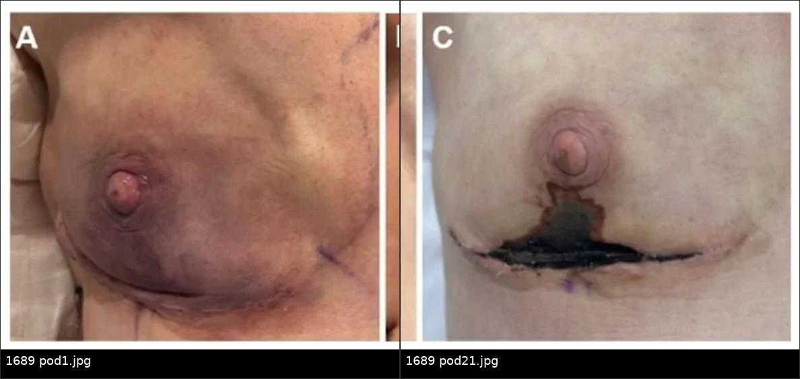
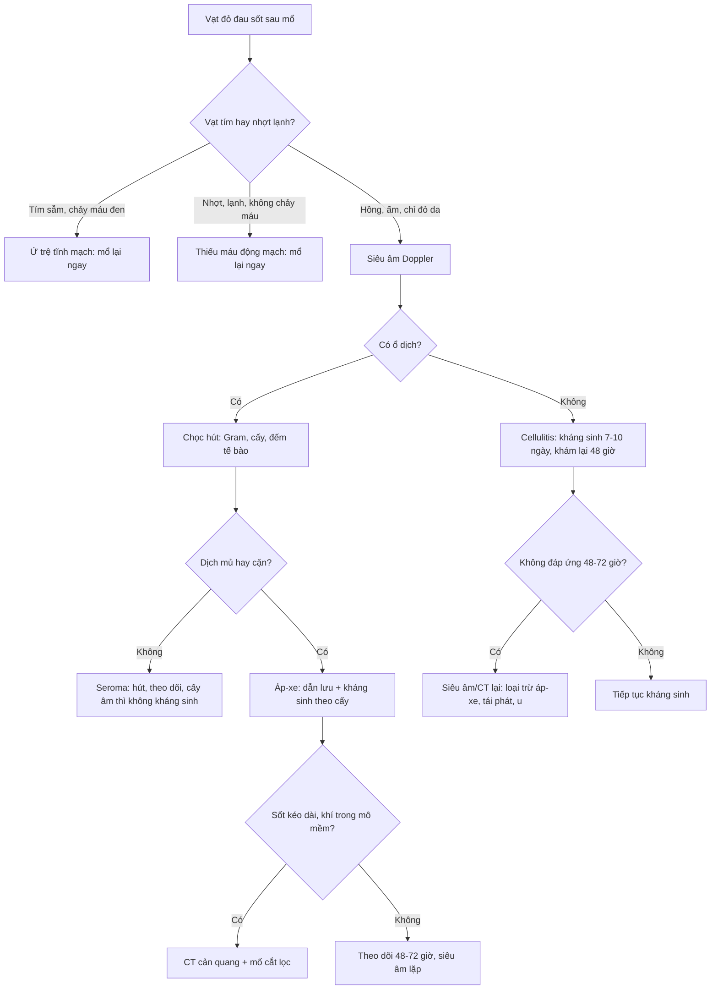
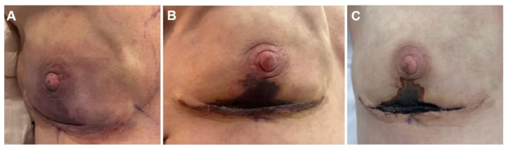
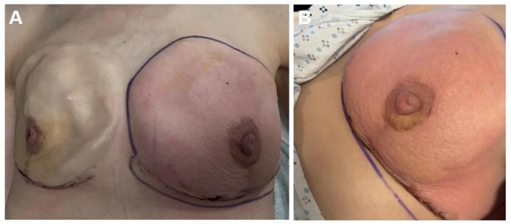
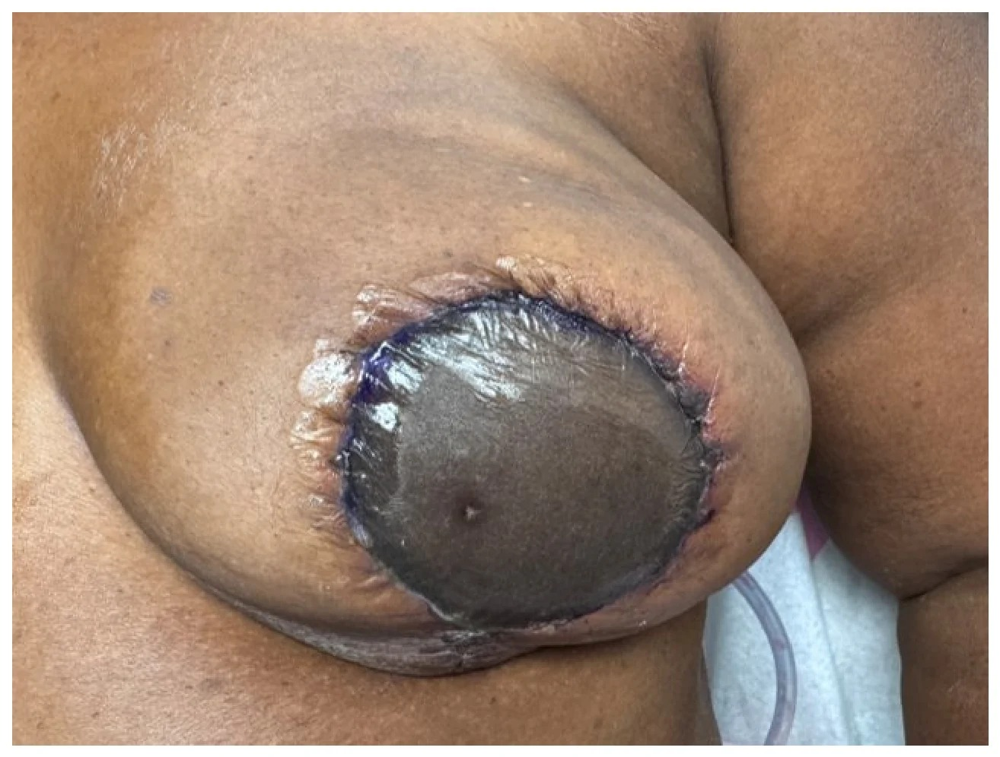

# 1689 — Nhiễm trùng vạt tự thân & hoại tử vạt sau tái tạo vú / Infection and necrosis of autologous breast flaps

**Tags:** `pattern:nhiem-trung` `pattern:hoai-tu-vat` `pattern:hoai-tu-mo` `pattern:tu-dich` `pattern:viem-mo-te-bao` `pattern:mat-tuoi-mau` `vung:vu` `vung:thanh-nguc` `protocol:sieu-am-vu` `protocol:CT-nguc` `protocol:MRI-vu` `protocol:choc-hut` `score:Clavien-Dindo` `incidentaloma:tu-dich-sau-vat`
**Mức chắc chắn (certainty):** tổng hợp y văn (literature synthesis) — dựa trên 1 tổng quan hệ thống về hoại tử vạt (68 nghiên cứu, PMC12376823), 1 phân tích gộp nhiễm trùng vùng mổ (1.400 vạt, PMC10355167), 1 đoàn hệ tái thám sát vạt tự do (PMC13563678), 2 phân tích gộp về ICG và xạ trị (PMC12281818, PMC13315313), và 1 tổng quan hình ảnh biến chứng tái tạo tức thì (PMC13607601).

## 1. Tổng quan — vì sao vạt tự thân vừa dễ nhiễm vừa dễ hoại tử

- **Hai vạt chồng lên một vết mổ:** vú tái tạo bằng vạt tự thân gồm **vạt da – mỡ của bệnh nhân (skin paddle)** được nuôi bằng **một cuống mạch** nối vi phẫu, áp vào **vạt da thành ngực còn lại sau cắt tuyến (mastectomy skin flap)** — vạt thứ hai chỉ nuôi bằng tuần hoàn dưới da ngẫu nhiên. Hai vạt gặp nhau ở đường khâu T, nơi mô mỡ lộ ra, dịch tiết tích lại và vi khuẩn từ nang lông/ống tuyến có sẵn đường vào.
- **Vì sao thiếu máu lại thành hoại tử mỡ vô khuẩn:** tế bào mỡ chết do thiếu oxy → giải phóng triglyceride → đại thực bào dọn dẹp, tạo **nang dầu (oil cyst)** và vôi hóa xà phòng ở vỏ xơ, **không có vi khuẩn**. Vì vậy hoại tử mỡ điển hình **không sốt, không tăng CRP nhiều, không mủ**; nhưng mô chết là **môi trường nuôi cấy** — khi bội nhiễm thì hoại tử mỡ "lành" biến thành **áp-xe**.
- **Vì sao nhiễm trùng bắt chước ứ trệ tĩnh mạch:** cả hai đều làm da **đỏ, căng, đau**. Ứ trệ tĩnh mạch làm tăng áp lực mao mạch → hồng cầu thoát ra mô → da **tím sẫm, chảy máu đen khi chích**; thiếu máu động mạch → da **nhợt, lạnh, không chảy máu**. Nhiệt độ và màu da phân biệt nhanh hơn xét nghiệm, nhưng **không thay thế được** đánh giá mạch và siêu âm Doppler.
- **TẠI SAO CT phân biệt được dịch – mỡ – khí:** dịch (nước) **0–20 HU**, mỡ **−50 đến −100 HU**, máu tụ cấp **50–70 HU**, khí **−1.000 HU**. Khí trong mô mềm quanh vạt **không phải** khí trong ruột thừa lưu — đó là dấu hiệu **nhiễm trùng sinh khí/viêm cân mạc hoại tử**, cần mổ ngay.
- **TẠI SAO MRI T1 fat-sat là chốt của hoại tử mỡ:** mỡ có T1 ngắn nên rất sáng; xung ức chế mỡ đưa tín hiệu mỡ về 0 → **lõi nang dầu tối**, trong khi **vỏ xơ (collagen ít proton tự do) vẫn tối trên T2 và ngấm thuốc ở thì muộn**. Áp-xe thì ngược lại: **lòng dịch tăng tín hiệu T2, hạn chế khuếch tán (DWI sáng/ADC thấp) và vỏ dày ngấm thuốc**.
- **Số liệu nằm lòng:**
  - **Nhiễm trùng vùng mổ (surgical site infection, SSI)** sau tái tạo vú tự thân: **7,2%** gộp trên **1.400 vạt**; **6,6%** khi kháng sinh dự phòng **≤ 24 giờ** so với **8,1%** khi **> 24 giờ**, **OR 1,434 (95% CI 0,906–2,269), p = 0,124, I² = 0%** → **kéo dài kháng sinh dự phòng không giảm SSI** (PMC10355167).
  - **Tái thám sát (re-exploration)** vạt tự do: **5–14%**; **thất bại vạt 2–5%**; phần lớn **huyết khối động mạch/tĩnh mạch xảy ra trong 48 giờ đầu** (PMC13563678).
  - **Cửa sổ cứu vạt hẹp:** tỉ lệ cứu sống giảm từ **~62% xuống ~21%** khi phát hiện thiếu tưới máu **sau 16 giờ** (PMC13563678 dẫn Yang 2007).
  - **Hoại tử mỡ** sau vạt: **12,5–23,6%** (4 nghiên cứu); sau ghép mỡ tự thân: **7,3–82,9%** (PMC13287354, bài 1687).
  - **Ngưỡng mổ lại:** diện hoại tử da **> 10 cm²** là mốc quyết định phẫu thuật; vết thương **> 3 tuần** mới liền làm tăng nguy cơ **sẹo biến dạng** (PMC12376823).
  - **ICG huỳnh quang trong mổ:** giảm hoại tử da **OR 0,60 (0,44–0,81)**, hoại tử nặng **OR 0,37 (0,22–0,63)**, mổ lại **OR 0,49 (0,33–0,73)** trên **1.252 bệnh nhân** (PMC12281818).
  - **Xạ trị làm nặng thêm:** **4.447 bệnh nhân/4.478 vạt DIEP** — mất một phần vạt **RR 1,69 (0,99–2,90)**, sửa vết thương **RR 1,23 (1,01–1,50)**, xạ **trước** DIEP làm rối loạn liền thương **RR 1,62 (1,06–2,49)**; **không** khác biệt có ý nghĩa về mất toàn bộ vạt hay nhiễm trùng diện nhận (PMC13315313).
  - **Theo dõi:** kiểm tra vạt **mỗi 1–4 giờ** trong **1–5 ngày** đầu; huyết khối hay gặp **< 48 giờ** (PMC13563678).

## 2. Mẫu hình + chẩn đoán phân biệt theo thời điểm và theo khoang (Gamut)

- **Mẫu hình cốt lõi — hỏi 3 câu trước khi gọi tên:**
  1. **Bao nhiêu ngày sau mổ?** (0–3 ngày = mạch máu; 3–14 ngày = nhiễm trùng; 2 tuần–6 tháng = hoại tử mỡ; > 6 tháng = tái phát/u).
  2. **Có dịch khu trú không?** (siêu âm: ổ trống âm có vách, cặn; CT: ổ giảm tỷ trọng có vỏ).
  3. **Có khí hoặc da chết toàn bộ không?** (khí → mổ ngay; da đen, lạnh, cứng → hoại tử toàn bộ).
- **Gamut theo thời điểm:**
  - **POD 0–3:** ứ trệ tĩnh mạch (vạt tím, chảy máu đen), thiếu máu động mạch (vạt nhợt, lạnh), **máu tụ** chèn ép cuống, xoắn/gập cuống.
  - **POD 3–14:** **viêm mô tế bào (cellulitis)**, **áp-xe vạt/diện nhận**, **nhiễm trùng mảnh ghép da**, **nhiễm trùng màng lưới nhân tạo (ADM)** với đường rò nhỏ, nhiễm trùng **vùng cho** (bụng).
  - **Tuần 2 – tháng 6:** **hoại tử mỡ**, nang dầu, **nhiễm trùng muộn do chỉ khâu/sinus**, tụ dịch mạn.
  - **Sau 6 tháng:** vôi hóa hoại tử mỡ, **tái phát ung thư tại giường vạt**, xơ hóa do xạ, (nếu có implant) BIA-ALCL.
- **Gamut theo khoang:**
  - **Vạt da bệnh nhân (skin paddle):** hoại tử bờ, tím do ứ trệ, nhiễm trùng bề mặt.
  - **Vạt da thành ngực (mastectomy skin flap):** hoại tử thiếu máu, thường ở **đường khâu chữ T** và quanh núm.
  - **Lớp mỡ – diện nhận:** hoại tử mỡ, áp-xe sâu, tụ dịch.
  - **ADM/implant (nếu tái tạo hỗn hợp):** nhiễm ADM, dò dịch, nhiễm implant.
  - **Vùng cho bụng:** nhiễm vết mổ, tụ dịch, thoát vị — nhưng **không** gây sốt cao đơn thuần mà không có dấu hiệu tại chỗ.

## 3. Bảng so sánh phân biệt (ma trận đối chiếu)

| Thực thể (entity) | Hình ảnh điển hình (US/CT/MRI) | Chốt vào (rule-in) | Chốt loại (rule-out) | Gợi ý xác nhận |
|---|---|---|---|---|
| **Áp-xe vạt / nhiễm trùng vạt** | US: ổ **trống âm có cặn/vách, dày vỏ**, tăng sinh mạch quanh; CT: ổ **giảm tỷ trọng, vỏ ngấm thuốc**, ± khí; MRI: **DWI sáng/ADC thấp**, vỏ dày ngấm | **Sốt + đau + đỏ khu trú + ổ dịch có vỏ**; cấy dịch dương | **Không có ổ dịch, không sốt, không hạn chế khuếch tán** → không phải áp-xe | **Chọc hút dưới siêu âm** + Gram/cấy hiếu-kỵ khí; dẫn lưu |
| **Hoại tử mỡ vô khuẩn** | US: khối **đồng âm mỡ**, không mạch; CT: **−50 đến −100 HU**, vỏ mỏng; MRI: **tối T1 fat-sat, không ngấm trung tâm**, vỏ xơ mỏng | **Đúng vị trí vạt/ghép mỡ + không sốt + không ngấm trung tâm + ổn định/teo dần** | **Vỏ dày không đều + ngấm kiểu khối + DWI hạn chế** → không loại trừ áp-xe/tái phát | So phim cũ; MRI; **không sinh thiết** nang dầu điển hình |
| **Seroma** | US: **trống âm**, có thể có vách mảnh, **không mạch**; CT: dịch **0–20 HU**; MRI: **rất sáng T2, tối T1**, không ngấm | **Xuất hiện 1–3 tuần sau mổ, không sốt, dịch trong**; hút ra dịch vàng | **Vỏ dày + cặn + khí + sốt** → không phải seroma đơn thuần | Siêu âm; hút chẩn đoán (đếm tế bào, cấy) |
| **Viêm mô tế bào (cellulitis)** | US: **dày da – tăng hồi âm dưới da**, **không ổ dịch**; CT: dày da, phù dưới da, không vỏ | **Đỏ lan tỏa, ấm, sốt, không ổ dịch**; đáp ứng kháng sinh 48–72 giờ | **Có ổ dịch/khí** → đã chuyển sang áp-xe/hoại tử | Theo dõi 24–48 giờ; siêu âm lặp |
| **Ứ trệ tĩnh mạch (venous congestion)** | Doppler: **phổ tĩnh mạch mất/đảo**, vạt tím; CT/MRI không cần nếu lâm sàng rõ | **Vạt tím sẫm, căng, chảy máu đen, mao mạch đầy nhanh**, **không sốt** lúc đầu | **Vạt nhợt, lạnh, không chảy máu** → thiếu máu động mạch | **Mổ lại ngay** (tháo chỉ, nới cuống, kiểm tra nối); không chờ hình ảnh |
| **Thiếu máu động mạch** | Doppler: **mất phổ động mạch**, vạt nhợt/lạnh; CTA: tắc cuống | **Vạt nhợt, lạnh, không chảy máu khi chích, không đầy mao mạch** | **Vạt hồng, ấm, chảy máu đỏ** → không phải thiếu máu động mạch | **CTA/duplex khẩn** nếu chưa mổ ngay; mổ lại < 6 giờ càng tốt |
| **Máu tụ (hematoma)** | US: hồi âm hỗn hợp, có mức; CT: **50–70 HU**, tăng tỷ trọng so với mỡ; MRI: T1 sáng bán cấp | **Sưng căng nhanh vài giờ, đau, thiếu máu da thứ phát**, không sốt | **Tối T1 fat-sat + −50 đến −100 HU** → mỡ, không phải máu | Siêu âm cấp; dẫn lưu nếu chèn ép |
| **Tái phát ung thư tại vạt** | US: khối **giảm hồi âm, bờ gai**, có mạch; MRI: **ngấm kiểu khối, ADC thấp**, ± co kéo da | **Khối mới/to lên sau 6 tháng + ngấm thuốc + ADC thấp** | **Lõi mỡ tối T1 fat-sat, không ngấm** → hoại tử mỡ | Core biopsy có clip; đối chiếu trường xạ |
| **Viêm cân mạc hoại tử (necrotizing fasciitis)** | CT: **khí trong mô mềm**, dày cân, **không ngấm cân**; US: khí dạng "bóng bẩn" | **Đau ngoài mức, sốc nhiễm trùng, khí trong mô mềm, da hoại tử lan nhanh** | **Không khí, đau khu trú, không độc** → cellulitis | **Mổ cắt lọc ngay** + cấy; không chờ MRI |

*Trái: POD 1 — da vạt tím sẫm, ứ trệ tĩnh mạch. Phải: POD 21 — vùng hoại tử toàn bộ đã ranh giới rõ, phải mổ cắt lọc. Nguồn: Coyle L và cs, *J Clin Med* 2026, PMC13607601 Fig. 3A + 3C, CC BY 4.0. Ảnh ghép letterbox, cùng một bệnh nhân.*

### Ba dấu hiệu đọc trên ảnh lâm sàng (trước khi cần đến CĐHA)
1. **Màu:** tím sẫm = ứ trệ; nhợt trắng = thiếu máu động mạch; đen khô = hoại tử toàn bộ; đỏ lan = viêm.
2. **Nhiệt độ và mao mạch:** vạt ấm + mao mạch đầy nhanh = còn tưới máu; lạnh + mao mạch > 3 giây = nguy cơ.
3. **Chảy máu khi chích kim 18 G ở bờ vạt:** máu đỏ tươi = động mạch còn; máu đen chảy chậm = ứ trệ; không chảy = thiếu máu nặng. Đây là nghiệm pháp **tại giường**, không thay thế Doppler.

## 4. Protocol chụp + phân độ và thuật toán xử trí

- **Siêu âm là bước 1** (đầu dò thẳng 12–15 MHz): đánh giá **da – mô dưới da – lớp mỡ vạt – diện nhận**, tìm ổ dịch, vách, cặn, khí; **Doppler màu** xem mạch trong vạt và quanh ổ dịch. So sánh với bên đối diện/vùng lành.
- **CT có cản quang** khi: sốt + đau không rõ ổ, nghi **dịch sâu/ADM**, nghi **khí trong mô mềm**, hoặc cần xem **cuống mạch**. Lát **1–2 mm**, cửa sổ mô mềm + xương, dựng MPR theo trục cuống.
- **CTA** khi nghi **huyết khối cuống** mà chưa mổ ngay: tắc/không thấy thuốc ở động mạch hoặc tĩnh mạch nối; nhưng **không được trì hoãn mổ lại** để chụp nếu vạt đang tím/nhợt rõ.
- **MRI vú** (T1, T2 fat-sat, DWI/ADC, T1 sau tiêm): dùng cho **khối không rõ sau 6 tháng**, nghi tái phát, hoặc phân biệt **hoại tử mỡ – áp-xe – u**. Hoại tử mỡ = **không ngấm trung tâm**; áp-xe = **vỏ dày + hạn chế khuếch tán**; tái phát = **ngấm kiểu khối + ADC thấp**.
- **Chọc hút dưới siêu âm** là vừa chẩn đoán vừa điều trị với ổ dịch: gửi **Gram, cấy hiếu khí + kỵ khí, đếm tế bào**; nếu mủ đặc/quánh → đặt dẫn lưu. **Không tiêm corticoid** vào ổ dịch nghi nhiễm.
- **Kháng sinh:** dự phòng **≤ 24 giờ** (cefazolin 2 g, thêm metronidazole nếu vạt lấy từ bụng) — bằng chứng **không ủng hộ kéo dài** (PMC10355167); nhiễm trùng da không ổ dịch: kháng sinh theo kinh nghiệm **7–10 ngày**; áp-xe: **dẫn lưu + kháng sinh theo cấy**, không chỉ kháng sinh.
- **Phân độ biến chứng:** **Clavien-Dindo** — độ I–II (chăm sóc tại giường/kháng sinh), **độ IIIa** (can thiệp không gây mê: chọc hút/dẫn lưu), **độ IIIb** (mổ lại: cắt lọc, sửa vạt), **độ IV** (suy cơ quan), **độ V** (tử vong).
- **Ngưỡng mổ lại tại giường:** diện hoại tử **> 10 cm²**, hoại tử **toàn bộ độ dày**, hoặc vết thương **> 3 tuần** không liền → **cắt lọc + đóng lại** để tránh sẹo biến dạng và trì hoãn hóa/xạ (PMC12376823).

## 5. Biến thể bình thường và cạm bẫy

- **Seroma "giả cellulitis":** tụ dịch dưới vạt gây **đỏ, căng, đau** nhưng **không sốt**; siêu âm thấy ổ trống âm — **hút ra là hết đau**, không cần kháng sinh kéo dài. Ảnh Fig. 6 của PMC13607601 là ví dụ điển hình.
- **Hoại tử mỡ sau ghép mỡ:** khối chắc, có thể **co kéo da và vôi hóa cụm** — dễ bị chấm **BI-RADS 4**. Chốt an toàn là **không ngấm trung tâm trên MRI** và **ổn định/teo dần**; nhưng khối **mới, to lên, ngấm thuốc** vẫn phải **core biopsy** (bài 1687).
- **Vạt da đen khô:** da chết **không đồng nghĩa nhiễm trùng** — nhưng là môi trường cho vi khuẩn; cần **cắt lọc sớm** khi đã ranh giới, tránh chờ tự bong (nguy cơ nhiễm trùng sâu, mất vạt).
- **Nhiễm ADM:** biểu hiện **đường rò nhỏ, chảy dịch tái diễn** ở bờ dưới vạt; trong mổ bơm **xanh methylene** vào đường rò thấy ADM bắt màu lan tỏa → **phải lấy bỏ ADM** + rửa (PMC13607601 Fig. 5). Đây là bẫy hay bị bỏ qua vì siêu âm chỉ thấy "dịch ít".
- **Không phải cứ đỏ là nhiễm:** vạt sau xạ có thể đỏ mạn do **giãn mạch dưới da (telangiectasia)** và xơ hóa; đỏ **mới, lan nhanh, ấm, đau** mới đáng lo.
- **Tái phát ung thư "kiểu viêm":** đỏ da khu trú **không đáp ứng kháng sinh sau 1–2 tuần** ở vú đã tái tạo → **chụp MRI + sinh thiết da/dưới da**, đừng tiếp tục kháng sinh mù.
- **Khí trong mô mềm không phải lúc nào cũng là nhiễm trùng:** khí có thể vào từ **đường kim, dẫn lưu, hoặc hở vết thương**; nhưng khí **lan theo cân, kèm đau ngoài mức và độc** = **viêm cân mạc hoại tử** cho đến khi loại trừ — mổ ngay.

## 6. Tự lượng giá — Blind Quiz

**Ca 1 — Nữ 48 tuổi, sau cắt tuyến bảo tồn núm + đặt túi giãn mô. POD 1 da vạt tím; POD 12 sẫm màu; POD 21 vùng đen ranh giới rõ.**

- Gợi ý: ba mốc ảnh là **POD 1 – POD 12 – POD 21**.
- Câu hỏi: Dấu hiệu ở POD 1 là gì? Vì sao đến POD 21 lại phải mổ? Phân biệt với nhiễm trùng dựa vào đâu?

<b>Bấm để hiện đáp án (findings + chẩn đoán)</b>

- Findings: POD 1 **tím sẫm toàn bộ vạt da, căng** = **ứ trệ tĩnh mạch**; POD 12 **sẫm màu + ranh giới** = hoại tử một phần độ dày; POD 21 **vùng đen, khô, ranh giới rõ** = **hoại tử toàn bộ độ dày**, cần **mổ cắt lọc và đóng lại**.
- Chẩn đoán: **hoại tử da vạt do thiếu tưới máu**, không phải áp-xe (không ổ dịch, không sốt trong mô tả). Điểm chốt: **màu da + nhiệt độ + chảy máu khi chích**, không chờ cấy.
- Nguồn ảnh: Coyle L và cs, *J Clin Med* 2026, PMC13607601 Fig. 3A–C, CC BY 4.0.

**Ca 2 — Nữ 52 tuổi, 10 ngày sau cắt tuyến bảo tồn núm + tái tạo bằng túi giãn mô: đỏ toàn bộ vú, đau, sốt, CRP tăng.**

- Câu hỏi: Hình ảnh gợi ý gì? Cần làm gì tiếp theo? Khi nào phải lấy bỏ túi?

<b>Bấm để hiện đáp án</b>

- Findings: **đỏ lan tỏa toàn bộ vú + đau + sốt** = **viêm mô tế bào (cellulitis)** quanh túi giãn mô; không thấy ổ dịch khu trú trên ảnh lâm sàng.
- Diễn tiến nguồn: bệnh nhân **không đáp ứng** kháng sinh, phải **rửa mổ + lấy bỏ túi giãn mô**; **cấy dịch mọc *E. coli***.
- Bài học: cellulitis quanh implant/túi giãn mô **có thể do vi khuẩn đường ruột**, không chỉ *S. aureus*; **không đáp ứng 48–72 giờ** → chụp lại + cân nhắc **rửa và lấy bỏ thiết bị**.
- Nguồn ảnh: Coyle L và cs, *J Clin Med* 2026, PMC13607601 Fig. 4A–B, CC BY 4.0.

**Ca 3 — Nữ 57 tuổi, 4 ngày sau DIEP: vạt da bụng đen, lạnh, cứng, không chảy máu khi chích; bệnh nhân sốt nhẹ.**

- Câu hỏi: Chẩn đoán? Có nên chờ kháng sinh? Xử trí?

<b>Bấm để hiện đáp án</b>

- Findings: **da vạt đen, lạnh, cứng, không tưới máu** = **mất toàn bộ vạt (total flap loss)**; sốt nhẹ có thể do hoại tử mô, không loại trừ nhiễm trùng.
- Xử trí: **mổ lại lấy bỏ vạt**; nếu thấy huyết khối khi mổ có thể dùng **tPA đường động mạch** hoặc **heparin toàn thân 4–7 ngày** sau mổ lại (thời gian neo nội mạc hóa miệng nối ~**6 ngày**).
- Bài học: vạt **đen + lạnh + cứng** là **chỉ định mổ**, không phải chỉ định kháng sinh; chờ đợi làm mất cơ hội cứu vạt và tăng nhiễm trùng.
- Nguồn ảnh: Coyle L và cs, *J Clin Med* 2026, PMC13607601 Fig. 8, CC BY 4.0.

## Bài liên quan chéo
- [1687 – Hoại tử mỡ sau tái tạo vú, vạt & ghép mỡ](../1687-hoai-tu-mo-sau-tai-tao-vu-vat-ghep-mo/lesson.md) (nang dầu, vôi hóa viền, BI-RADS)
- [1686 – Hạch nách chứa silicone & siliconoma](../1686-hach-nach-chua-silicone-va-siliconoma/lesson.md)
- [1688 – Siliconoma lan xa ngoài vùng vú](../1688-siliconoma-lan-xa-ngoai-vu/lesson.md)
- [1656 – Rách vỏ implant & gel bleed](../1656-rach-vo-implant-nguc-va-gel-bleed/lesson.md)
- [1655 – Ung thư biểu mô vảy trong bao implant](../1655-ung-thu-vay-trong-bao-implant-nguc-bia-scc/lesson.md)
- [516 – Hình ảnh vú sau điều trị](../516-hinh-anh-vu-sau-dieu-tri/lesson.md)
- [936 – Phản ứng da muộn nặng sau cản quang](../936-phan-ung-da-muon-nang-sau-can-quang/lesson.md)

> Không dùng để chẩn đoán độc lập khi chưa có người hướng dẫn.
