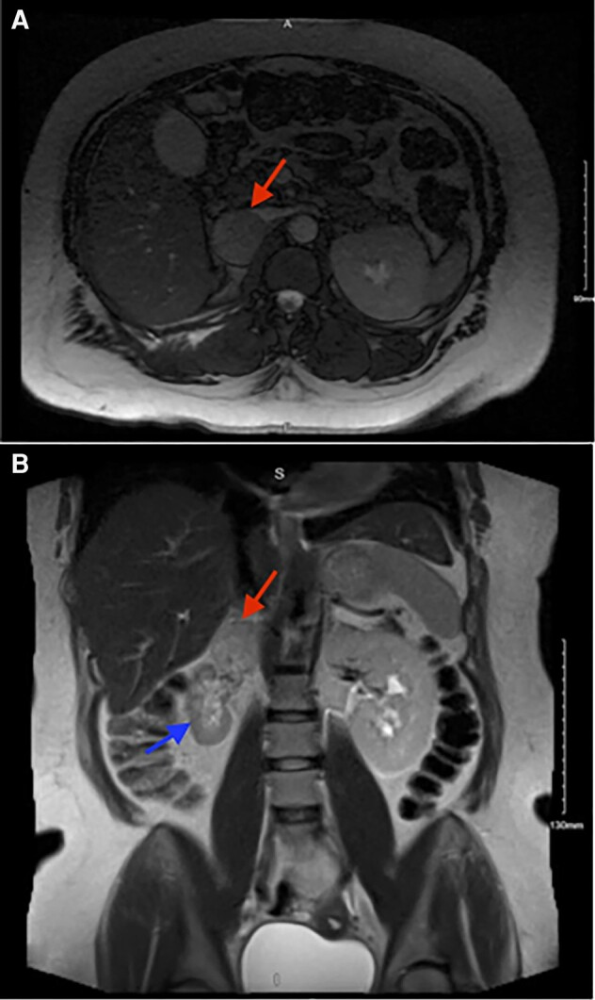
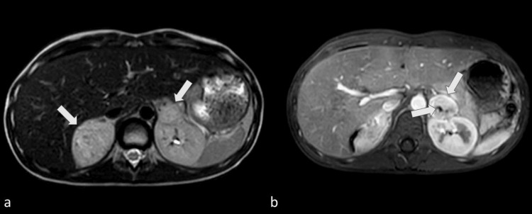
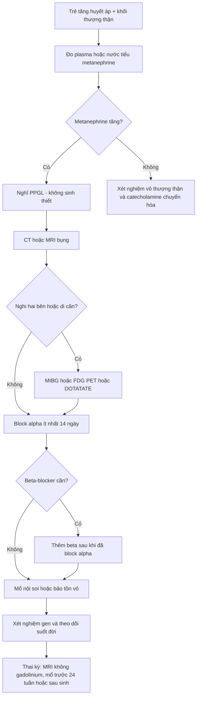
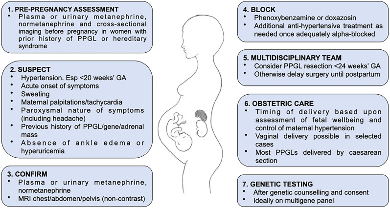
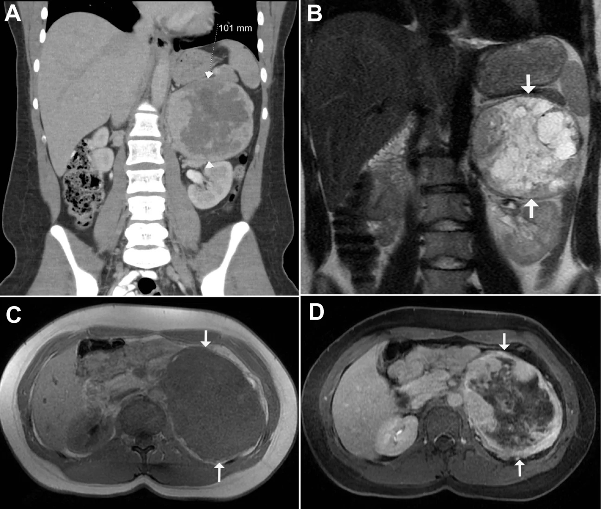
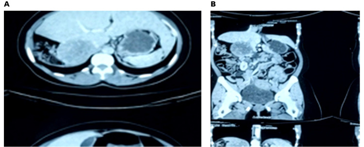

# 169 — U tủy thượng thận & paraganglioma (PPGL) ở trẻ em và trong thai kỳ: di truyền, bảo tồn vỏ thượng thận, alpha-block và thời điểm mổ / Pediatric and pregnancy pheochromocytoma–paraganglioma

**Tags:** `pattern:khoi-thuong-than` `pattern:u-tang-mach` `pattern:di-truyen` `vung:thuong-than` `vung:o-bung-nhi` `score:PASS` `protocol:MRI-khong-gadolinium-thai` `incidentaloma:u-thuong-than`
**Mức chắc chắn (certainty):** tổng hợp y văn (literature synthesis) — đoàn hệ nhi khoa Pháp 81 ca (de Tersant M et al., J Endocr Soc 2020, PMC7217277), đoàn hệ Nhật 28 ca (Kimura N et al., Endocr J 2025, PMC11997271), tổng quan quản lý nhi (Michalczewska A et al., Med Sci Monit 2025, PMC11977429), tổng quan PPGL trong thai kỳ (Clifton-Bligh RJ, Rev Endocr Metab Disord 2023, PMC9884650) + ca nguyên văn song thận ở trẻ 12 tuổi (Moya Ochoa C et al., Cureus 2026, PMC13135459).

## 1. Tổng quan bệnh học – cơ chế hình ảnh

- **Định nghĩa:** **pheochromocytoma (PCC)** phát sinh từ **tế bào chromaffin tủy thượng thận**; **paraganglioma (PGL)** từ **chuỗi giao cảm ngoài thượng thận** (bụng, khung chậu, trung thất) hoặc **đối giao cảm** (đầu–cổ). Cả hai tiết catecholamine (không phải tất cả) → **tăng huyết áp (THA)**, cơn tim đập nhanh, vã mồ hôi, đau đầu.
- **Dịch tễ nhi khoa:** **1–2 ca/triệu trẻ/năm** (khoảng **20%** tỷ lệ người lớn); PCC chiếm **80–85%**, PGL **15–20%**. PPGL gây **~1,7%** các ca THA ở trẻ (so với 0,2–0,6% ở người lớn THA). Tuổi chẩn đoán trung bình **11–13 tuổi**; đoàn hệ Nhật: **12,8 ± 4,5 tuổi**.
- **Vì sao trẻ khác người lớn:** **70–80%** PPGL ở trẻ có **đột biến dòng mầm (germline)** — so với **30–40%** ở người lớn. Hệ quả: **đa ổ**, **hai bên (20–40%)**, tái phát và di căn cao hơn. Các gen hay gặp: **VHL, SDHB, SDHD, SDHC, RET, NF1, MAX, TMEM127**. Đoàn hệ Nhật 28 trẻ: **VHL 50%**, **SDHx 35,7%**, **MAX 3,6%**, chưa rõ 10,7%.
- **Vì sao khối tăng mạch:** tế bào chromaffin giàu mạng lưới mao mạch → **ngấm thuốc mạnh thì động mạch**, có thể **thoát thuốc**; khối lớn thường **hoại tử/nang hóa trung tâm** (đặc điểm của PCC lớn). Trên MRI, mô u giàu nước và hạt neurosecretory → **T2 tăng tín hiệu** ("light bulb"), nhưng **không đặc hiệu**; **không có mỡ nội bào** nên không giảm tín hiệu như adenoma.
- **Vì sao không vôi hóa nhiều:** khác **neuroblastoma** (vôi hóa thô **80–90%**), PCC chỉ vôi hóa **lẻ tẻ**; đây là một trong các điểm phân biệt trên CT.
- **Số liệu đoàn hệ Pháp 81 trẻ (2000–2016):** tuổi trung vị **13,3** (2,2–18); **41** u thượng thận / **40** ngoài thượng thận; **11** di căn đồng thời lúc chẩn đoán; theo dõi trung vị **53 tháng**, **27** biến cố (7 PPGL thứ hai, 8 tái phát tại chỗ, 10 tái phát di căn), **2** tử vong. **EFS 3/5/10 năm = 80% / 61% / 39%**; **OS = 97%**. **Phẫu thuật không hoàn toàn** và **di căn lúc chẩn đoán** là yếu tố nguy cơ biến cố (p = 0,011 và 0,004). **77%** (53/68) có đột biến dòng mầm.
- **Vì sao theo dõi suốt đời:** biến cố đầu tiên có thể xuất hiện **trung vị 48 tháng** (1–133 tháng), và **8/30** biến cố xảy ra **sau 5 năm**; EFS giảm từ 80% (3 năm) xuống **39%** (10 năm) dù OS vẫn 97% — nghĩa là **kiểm soát được nhưng không khỏi hẳn**.

### 1.1. PPGL trong thai kỳ — vì sao là cấp cứu sản khoa

- **Tần suất:** **1/15.000 đến 1/300.000** thai kỳ; chiếm khoảng **1/450–15.000** ca THA thai kỳ. Đa số gặp ở **con so**.
- **Tử vong:** trước đây **~50%** (1971); hiện còn **mẹ 4–9%**, **thai 7–14%**. Nếu **chẩn đoán trước sinh**, tử vong mẹ **< 1%** và tử vong thai thấp hơn rõ — **chẩn đoán muộn là yếu tố quyết định**.
- **Vì sao dễ bỏ sót:** hình ảnh lâm sàng **giống tiền sản giật (preeclampsia)** — THA, đau đầu, tim đập nhanh, vã mồ hôi. Gợi ý PPGL: **THA xuất hiện trước 20 tuần**, **cơn THA kịch phát**, **hạ huyết áp tư thế**, **không phù cổ chân**, **acid uric không tăng**. Khoảng **20%** ca có THA là biểu hiện đầu tiên; **~30%** chỉ được chẩn đoán **sau sinh**.
- **Sinh lý bệnh trong thai:** tử cung to chèn ép u + cơn catecholamine khi chuyển dạ; ngoài ra một số PPGL **biểu hiện thụ thể LH/hCG (LHCGR)** → thai kỳ làm u "thức giấc". Catecholamine **> 10 lần giới hạn trên** gắn với kết cục mẹ–thai xấu.
- **Số liệu u:** trung vị **> 5 cm**; **60–70%** một bên, **8%** hai bên, **18%** PGL đơn độc, **2,5–5%** nhiều PGL. **66%** ca được xét nghiệm gen có **đột biến dòng mầm** (SDHB 19%, VHL 13%, RET 19%).
- **Nguyên tắc hình ảnh:** **MRI bụng–khung chậu không gadolinium** là lựa chọn; **MIBG/PET chống chỉ định trong thai** (có thể làm sau sinh nếu nghi hai bên/đa ổ/di căn).

#### 1.1b. Số liệu cập nhật 2021–2025 (bổ sung, đã đối chiếu PMCID)

- **Tần suất theo sổ bộ dân số (chính xác hơn "1/15.000–1/300.000"):** **UKOSS 10/2.852.099 = 0,000351%**; **Thụy Điển 21/4.390.869 = 0,000478%**; **Mayo Clinic 2/30.246 = 0,006612%** — tức khoảng **1/15.000 đến 1/285.000 thai kỳ**, dao động theo cách chọn mẫu (PMC12312014). Một số bài vẫn dùng **1/15.000–1/54.000 thai kỳ/năm** (PMC10941258).
- **Tử vong theo thời điểm chẩn đoán (Bancos 2021, *Lancet Diabetes Endocrinol*, 232 nữ/249 thai, 1980–2019):** tử vong mẹ **1%**, tử vong thai **9%**, **6,5%** mẹ có biến chứng tim nặng do catecholamine. **31,3%** chỉ được chẩn đoán **sau sinh**; trong nhóm đó tử vong mẹ **3,9%** so với **0%** khi chẩn đoán trước sinh — chẩn đoán trước sinh là yếu tố quyết định nhất. Tổng quan 135 ca: tử vong mẹ **8%**, thai **17%** (PMC10990643).
- **Giá trị hình ảnh (số cụ thể):** **MRI phát hiện u thượng thận ở cuối thai kỳ 90–100%**, **siêu âm chỉ 54%** — vì thế **không được "yên tâm" khi siêu âm bình thường** ở tam cá nguyệt 3 (PMC12312014).
- **Thời điểm mổ (số cụ thể):** **~70%** ca được cắt u **lúc sinh hoặc sau sinh**; nếu chẩn đoán **trước 24 tuần** và u không kiểm soát được bằng thuốc → **mổ nội soi 14–23 tuần**; biến cố mẹ–thai ở nhóm mổ trước sinh **3,8% (3/78) đến 4,5% (4/88)** (PMC12312014).
- **Chẹn alpha trong thai:** **doxazosin** có tỉ lệ nồng độ thai/mẹ **0,8** và **chưa có ca hạ huyết áp sơ sinh** nào được báo cáo; **phenoxybenzamine** qua nhau thai rõ hơn (có ca hạ HA/suy hô hấp sơ sinh) — vẫn dùng được nhưng phải báo sơ sinh. Đích huyết áp theo ESC/ESH trong thai: **< 140/90 mmHg**.
- **Mô hình bệnh án trong thực hành (ca PMC10941258):** nữ 33 tuổi, **11 tuần 5 ngày**, khối cạnh thượng thận phải **4 cm** sát tĩnh mạch chủ dưới, **normetanephrine huyết tương 2.141,8 pg/mL** (giới hạn 0–150,6), normetanephrine niệu **1.739 µg/24 giờ**; phenoxybenzamine **10 mg × 2/ngày** không đủ → chuyển **doxazosin 2 mg + metoprolol 12,5 mg × 2/ngày**, **cắt nội soi ở 18 tuần 1 ngày**.

*Hình A (axial): khối 4 cm cạnh thượng thận phải (mũi tên đỏ) **sát tĩnh mạch chủ dưới**. Hình B (coronal): khối nằm **trên thận phải teo** (mũi tên xanh) — gợi ý u cận hạch/khối chèn ép lâu ngày. Đây là **MRI không gadolinium** ở tam cá nguyệt 1, đúng là modality nên dùng. Nguồn: JCEM Case Reports 2024 (PMC10941258), CC BY 4.0, nguyên bản.*

## 2. Mẫu hình + chẩn đoán phân biệt theo vị trí (Gamut)

- **Khối thượng thận ở trẻ — 6 nhóm chính:**
  - **PCC** (thượng thận): T2 sáng, ngấm mạnh, có thể nang/hoại tử; **hai bên** khi có đột biến (VHL, RET, MAX, NF1).
  - **Neuroblastoma:** tuổi nhỏ (**trung vị 2 tuổi**), **vôi hóa thô 80–90%**, **vượt đường giữa**, **bọc mạch**, MIBG dương; catecholamine chuyển hóa (HVA/VMA) tăng.
  - **Ganglioneuroma:** trẻ lớn, **không tiết catecholamine**, vôi hóa lẻ tẻ, cấu trúc **dạng cuộn chỉ**, T2 sáng.
  - **Ung thư vỏ thượng thận (ACC):** Cushing/nam hóa, khối lớn không đồng nhất, **vôi hóa**, có thể **huyết khối tĩnh mạch**; cortisol/androgen tăng.
  - **Adenoma vỏ thượng thận:** nhỏ, **giàu mỡ (< 10 HU không cản quang)**, ngấm nhanh và thoát nhanh.
  - **Xuất huyết thượng thận sơ sinh:** khối không ngấm, thay đổi theo thời gian, **tự thoái triển**; không sốt, catecholamine bình thường.
- **Khối thượng thận ở thai phụ:** PPGL (cơn THA, u lớn), adenoma (tình cờ), **xuất huyết thượng thận**, **di căn** (phổi/vú), và **tiền sản giật** — bệnh cảnh phổ biến nhất nhưng **không có khối**.
- **Mẹo nhớ "PHEO vs NET":** **P**harochromocytoma (T2 sáng, ngấm mạnh), **H**emorrhage (không ngấm), **E**ndocrine adenoma (giàu mỡ), **O**ther tumor/metastasis; **N**euroblastoma (vôi hóa, trẻ nhỏ), **E**xtra-adrenal PGL (chuỗi giao cảm), **T**hyroid/other neck mass nếu ở đầu–cổ.

## 3. Bảng so sánh phân biệt (ma trận đối chiếu)

| Thực thể (entity) | Hình ảnh điển hình (CT/MRI) | Chốt vào (rule-in) | Chốt loại (rule-out) | Gợi ý xác nhận |
|---|---|---|---|---|
| **Pheochromocytoma** | Khối thượng thận **ngấm mạnh**, T2 sáng, có thể **nang/hoại tử trung tâm**, vôi hóa lẻ tẻ | **Metanephrine/normetanephrine tăng** + ngấm mạnh + T2 sáng; **hai bên** gợi ý di truyền | Mỡ nội bào (< 10 HU) + không tiết catecholamine → adenoma | Plasma free metanephrines; MIBG/DOTATATE; **không sinh thiết trước khi block** |
| **Neuroblastoma** | Trẻ **< 5 tuổi**, **vôi hóa thô 80–90%**, vượt đường giữa, bọc mạch, di căn xương | **Vôi hóa + bọc mạch + HVA/VMA tăng + MIBG dương** | U nhỏ, T2 sáng, không vôi hóa, ngấm mạnh → nghĩ PCC | MIBG, NSE, sinh thiết tủy xương |
| **Ganglioneuroma** | Trẻ lớn, bờ rõ, **cuộn chỉ**, vôi hóa lẻ tẻ, T2 sáng, ngấm chậm | **Không tiết catecholamine** + cấu trúc cuộn chỉ | Catecholamine tăng + ngấm mạnh → PCC | Theo dõi/sinh thiết nếu to |
| **ACC** | Khối lớn, **không đồng nhất**, vôi hóa, **huyết khối TM** | **Cushing/nam hóa** + cortisol/androgen tăng | Metanephrine bình thường + mỡ nội bào → adenoma | Nội tiết + CT/MRI bụng–ngực |
| **Adenoma vỏ** | Nhỏ, **< 10 HU** không cản quang, ngấm nhanh–thoát nhanh | **Giàu mỡ + không triệu chứng** | T2 rất sáng + ngấm mạnh → PCC | CT mô tả mỡ; theo dõi |
| **Xuất huyết thượng thận** | Sơ sinh, khối **không ngấm**, viền/không đồng nhất, tự nhỏ | **Không ngấm + catecholamine bình thường + tự thoái triển** | Ngấm mạnh, T2 sáng, to lên → u | Siêu âm/CT theo dõi 2–4 tuần |
| **PPGL thai kỳ** | MRI **không gadolinium**: khối thượng thận T2 sáng, ngấm mạnh (nếu có gadolinium thì tránh) | **THA trước 20 tuần + cơn kịch phát + metanephrine tăng** | Phù + acid uric tăng + protein niệu → tiền sản giật | MRI; **không MIBG/PET khi đang thai** |

*MRI bụng: (a) T2-weighted turbo spin-echo và (b) T1 sau gadolinium — **hai khối thượng thận** (mũi tên), phải 5,4 × 4,0 × 5,0 cm, trái 3,0 × 2,5 × 3,3 cm, không xâm lấn tại chỗ. Moya Ochoa C et al., Cureus 2026 (PMC13135459, Fig. 2), CC BY 4.0.*

## 4. Protocol chụp + hệ phân độ/điểm chuẩn hóa

### 4.1. Chẩn đoán sinh hóa trước, hình ảnh sau
- **Plasma free metanephrines**: độ nhạy **97–100%**; **24 giờ nước tiểu metanephrine**: nhạy **~97%**, đặc hiệu **~91%**. Ở trẻ nhỏ, lấy máu thường dễ hơn lưu nước tiểu 24 giờ.
- **Trước khi lấy máu:** ngừng/ghi nhận thuốc gây dương tính giả (chẹn beta, chống trầm cảm 3 vòng, **metoclopramide**, steroid, sympathomimetic); tư thế nằm, nhịn ăn theo quy trình.
- **Cảnh báo:** **không sinh thiết khối thượng thận trước khi có kết quả sinh hóa và block alpha** — nguy cơ **cơn tăng huyết áp kịch phát** khi chọc.

### 4.2. Hình ảnh
- **CT bụng–khung chậu có cản quang** (thì động mạch + tĩnh mạch cửa): đánh giá kích thước, hoại tử, xâm lấn, hạch.
- **MRI bụng** (ưu tiên trẻ nhỏ, thai phụ): T2, T1 trước/sau gadolinium, DWI. **Thai kỳ: không gadolinium**.
- **Hình ảnh chức năng** khi sinh hóa không kết luận, nghi đa ổ/di căn, hoặc trước liệu pháp phóng xạ:
  - **¹²³I-MIBG**: tốt cho PCC/PGL biệt hóa, dùng khi dự kiến **¹³¹I-MIBG** điều trị.
  - **¹⁸F-FDG PET/CT**: nhạy với **SDHB**, u kém biệt hóa, di căn xương.
  - **⁶⁸Ga-DOTATATE**: độ đặc hiệu cao, bộc lộ **thụ thể somatostatin**, đặc biệt hữu ích cho **VHL/SDHx** và tìm đa ổ.
- **Thai kỳ:** **MRI không gadolinium** là chốt; **MIBG/PET chống chỉ định**; sau sinh mới làm chức năng nếu nghi hai bên/đa ổ/di căn.

### 4.3. Chuẩn bị trước mổ — "alpha trước, beta sau"
- **Block alpha ít nhất 14 ngày** ở trẻ (người lớn 7–14 ngày; trẻ cần **≥ 14 ngày** vì liều thấp, chuẩn độ chậm): **phenoxybenzamine** (không chọn lọc) hoặc **doxazosin** (chọn lọc α1).
- **Beta-blocker chỉ thêm sau khi đã block alpha** (thường sau ≥ 1 tuần) để kiểm soát nhịp nhanh; **không bao giờ bắt đầu beta trước** — sẽ gây co mạch và cơn THA.
- **Tránh:** **metoclopramide, steroid, sympathomimetic** — có thể kích hoạt cơn catecholamine.
- **Thai kỳ:** block alpha **≥ 2 tuần** trước mổ/sinh; phenoxybenzamine qua được nhau thai → có thể gây **hạ huyết áp và suy hô hấp sơ sinh**, cần báo sơ sinh.

### 4.4. Phẫu thuật và theo dõi
- **Nội soi là lựa chọn ưu tiên** cho PCC đơn độc; u lớn/xâm lấn có thể mổ mở.
- **Bảo tồn vỏ thượng thận (cortical-sparing)** ở trẻ có **đột biến dòng mầm/hai bên** để tránh suy thượng thận suốt đời; nhưng **nguy cơ tái phát tại phần vỏ giữ lại** (ca MAX tái phát sau 1 năm) → theo dõi sinh hóa chặt.
- **Cắt hai bên toàn bộ** → **thay thế glucocorticoid + mineralocorticoid suốt đời**, huấn luyện **cơn suy thượng thận cấp**.
- **Nút mạch trước mổ** có thể là biện pháp hỗ trợ ở u lớn/hai bên (ca 12 tuổi dưới đây), nhưng **không thay thế block alpha** và có thể gây **cơn THA trong lúc chụp mạch**.
- **Theo dõi sau mổ:** sinh hóa + huyết áp; **theo gen**:
  - **RET (MEN2) / VHL:** sinh hóa hằng năm **từ 5 tuổi**.
  - **NF1:** mỗi **3 năm**, từ **10–14 tuổi**.
  - **SDHB:** từ **5 tuổi**; **SDHA/SDHC/SDHD:** từ **10 tuổi**; theo dõi **suốt đời** vì có thể muộn > 5 năm.

### 4.5. Thai kỳ — trình tự xử trí (theo Clifton-Bligh 2023)
1. **Nghi ngờ** (THA < 20 tuần, cơn kịch phát, không phù) → **xác nhận sinh hóa**.
2. **MRI không gadolinium**; **không MIBG/PET**.
3. **Block alpha ≥ 2 tuần** + kiểm soát THA; thêm beta sau.
4. **Mổ cắt u trước 24 tuần** nếu chẩn đoán sớm; nếu chẩn đoán **tam cá nguyệt 3** → **sinh trước, mổ sau sinh**.
5. **Sinh:** **> 2/3 ca mổ lấy thai**; sinh ngả âm đạo được ở ca chọn lọc với **gây tê ngoài màng cứng** và **không rặn tích cực**.
6. **Sau sinh:** xét nghiệm gen (panel gồm **RET, SDHB, SDHC, SDHD, SDHA, VHL, TMEM127, MAX**), theo dõi suốt đời.

*Sơ đồ 7 bước: tầm soát trước mang thai → nghi ngờ → xác nhận → block alpha → đội đa chuyên khoa → chăm sóc sản khoa → xét nghiệm gen. Clifton-Bligh RJ, Rev Endocr Metab Disord 2023 (PMC9884650, Fig. 1), CC BY 4.0.*

## 5. Biến thể bình thường và cạm bẫy

- **Sinh thiết trước block = nguy hiểm:** chọc khối PCC có thể gây **cơn THA kịch phát, xuất huyết, vỡ u**. Chỉ sinh thiết khi đã loại trừ PPGL bằng sinh hóa hoặc đã block đầy đủ.
- **Beta trước alpha:** gây **co mạch không đối kháng** → cơn THA nặng. Luôn **alpha trước ≥ 1 tuần**, rồi mới beta.
- **Thai kỳ:** **không dùng gadolinium/MIBG/PET**; **không nhầm với tiền sản giật** — THA **trước 20 tuần**, **hạ HA tư thế**, **không phù/acid uric bình thường** là các mảnh ghép gợi ý. **Metoclopramide** và steroid có thể khởi phát cơn.
- **T2 sáng không đồng nghĩa PCC:** neuroblastoma, ganglioneuroma, nang/xuất huyết cũng T2 sáng. **Vôi hóa thô + trẻ < 5 tuổi** nghiêng neuroblastoma; **mỡ nội bào** nghiêng adenoma.
- **SDHB và MIBG âm:** PPGL do **SDHB** có thể **không bắt MIBG**; dùng **¹⁸F-FDG PET** hoặc **DOTATATE**. Đừng kết luận "không có u" chỉ vì MIBG âm.
- **"Quy tắc 10%" đã lỗi thời:** ở trẻ, **70–80%** có đột biến; không dùng "10% hai bên/10% ác tính" để loại trừ.
- **U nhỏ vẫn có thể nguy hiểm:** u < 2 cm có thể chỉ tăng metanephrine **nhẹ trên giới hạn**; vẫn cần block trước mọi can thiệp.
- **Sau cắt hai bên toàn bộ:** nguy cơ **suy thượng thận cấp** nếu không tăng liều khi stress/phẫu thuật; bệnh nhân phải mang **thẻ cảnh báo** và biết tự tiêm hydrocortisone.
- **Bảo tồn vỏ không miễn tái phát:** ca **MAX** tái phát sau 1 năm ở phần vỏ giữ lại — theo dõi sinh hóa **hằng năm**, không chỉ hình ảnh.

## 6. Tự lượng giá — Blind Quiz

**Ca 1 — Bé trai 12 tuổi, tình cờ phát hiện hai khối thượng thận khi khám THA. Xem MRI và PET.**

- Gợi ý: huyết áp dao động, vã mồ hôi; 24 giờ metanephrine **24.150 µg/24 giờ**.
- Câu hỏi: Hai khối là gì? Có cần sinh thiết trước mổ không? Vì sao phải block alpha trước?

<b>Bấm để hiện đáp án (findings + chẩn đoán)</b>

- **Findings:** (a) T2: hai khối thượng thận tăng tín hiệu, bờ rõ; (b) T1 sau gadolinium: ngấm thuốc mạnh, không xâm lấn cơ hoành/chân thận. Kích thước **5,4 × 4,0 × 5,0 cm** (phải) và **3,0 × 2,5 × 3,3 cm** (trái).
- **Chẩn đoán:** **pheochromocytoma hai bên** ở trẻ — cần **xét nghiệm gen** (VHL/RET/MAX/NF1) và tầm soát đa ổ.
- **Không sinh thiết:** sinh hóa đã xác nhận + nguy cơ cơn THA khi chọc. Block alpha + beta trước, sau đó **nút mạch trước mổ** (ca này) và **cắt nội soi hai bên**; xuất viện ngày 7, **thay thế glucocorticoid + mineralocorticoid suốt đời**.
- **PET DOTATATE** (ảnh dưới) xác nhận hai ổ bắt xạ mạnh, không di căn xa.
- Nguồn: Moya Ochoa C et al., Cureus 2026 (PMC13135459, Fig. 2–3), CC BY 4.0.

**Ca 2 — Bé gái 17 tuổi, khó thở và tim đập nhanh, huyết áp bình thường. CT bụng có cản quang.**

- Gợi ý: khối **10 cm** ở thượng thận trái, có vùng trung tâm giảm đậm độ.
- Câu hỏi: Mô tả dấu hiệu? Chẩn đoán phân biệt? Có nên chọc hút chẩn đoán?

<b>Bấm để hiện đáp án (findings + chẩn đoán)</b>

- **Findings:** khối **101 mm** thượng thận trái, **ngấm thuốc dạng nốt ở ngoại vi**, **trung tâm giảm đậm độ** do **hoại tử/nang** (mũi tên); (B) T2 coronal và (C/D) T1 fat-sat trước/sau gadolinium cho thấy **thành phần nang trong u**.
- **Chẩn đoán:** **pheochromocytoma** (dù bệnh nhân **không tăng huyết áp** — PPGL có thể không điển hình). Phân biệt: ACC, neuroblastoma (ở tuổi này ít), ganglioneuroma, di căn.
- **Không chọc hút** trước khi có metanephrine và block alpha; xét nghiệm gen vì u lớn ở người trẻ.
- Nguồn: Shatadal A et al., Pediatr Radiol 2026 (PMC13271840, Fig. 10), CC BY 4.0.

**Ca 3 — Thai phụ 27 tuổi, 26 tuần, tim đập nhanh, đau đầu, huyết áp dao động. Siêu âm thấy khối thượng thận phải; 24 giờ metanephrine tăng.**

- Gợi ý: trước đó được chẩn đoán "tiền sản giật" nhưng không phù, acid uric bình thường.
- Câu hỏi: Chẩn đoán? Dùng hình ảnh gì để theo dõi thai kỳ? Khi nào mổ? Nguy cơ cho mẹ và thai nếu bỏ sót?

<b>Bấm để hiện đáp án (findings + chẩn đoán)</b>

- **Findings:** (A) CT axial và (B) coronal: **khối lớn thượng thận phải**, không xâm lấn rõ; bối cảnh lâm sàng + metanephrine tăng.
- **Chẩn đoán:** **pheochromocytoma trong thai kỳ**. Theo dõi bằng **MRI không gadolinium**; **không MIBG/PET** khi đang thai.
- **Xử trí:** block alpha **≥ 2 tuần**, kiểm soát cơn THA; trong ca này phải **mổ lấy thai cấp cứu ở 31 tuần** (bé 1,8 kg), **cắt u nội soi sau sinh 10 tuần**.
- **Nếu bỏ sót:** tử vong mẹ **4–9%**, tử vong thai **7–14%**; chẩn đoán trước sinh làm giảm tử vong mẹ xuống **< 1%**.
- Nguồn: Bashir M et al., Int Med Case Rep J 2026 (PMC13360954, Fig. 2), CC BY-NC 4.0 — dùng nguyên bản, không crop/ghép.

## Bài liên quan chéo
- [168 – Pheochromocytoma & paraganglioma: chẩn đoán và phân loại](../168-pheo-paraganglioma/lesson.md)
- [170 – Phình động mạch chủ bụng & biến chứng](../170-phinh-DMC-bung/lesson.md) (THA thứ phát ở người lớn)
- [650 – Thần kinh nhi: xuất huyết mầm & u hố sau](../650-than-kinh-nhi-xuat-huyet-mam-va-u-ho-sau/lesson.md) (tiếp cận khối u nhi)
- [667 – U mạch máu gan ở trẻ & điều trị](../667-u-mach-mau-gan-o-tre-va-dieu-tri/lesson.md) (nhóm u mạch máu nhi)

> Không dùng để chẩn đoán độc lập khi chưa có người hướng dẫn.
