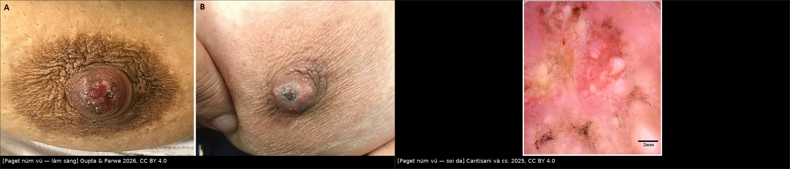
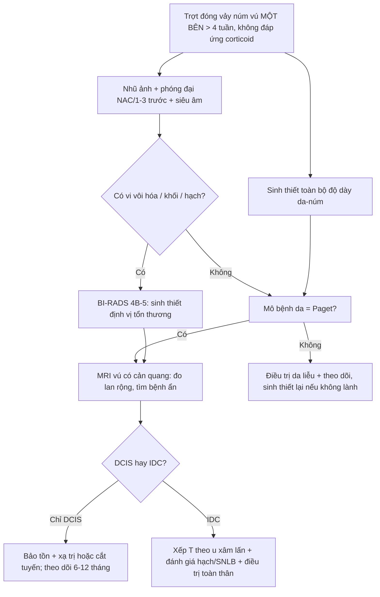
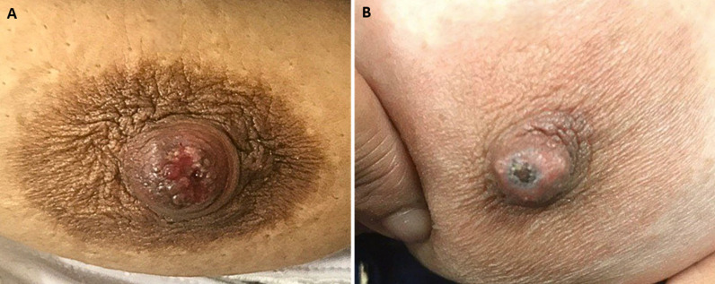
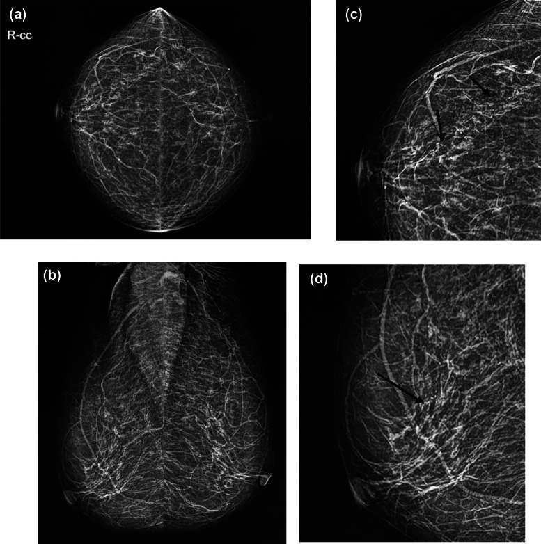
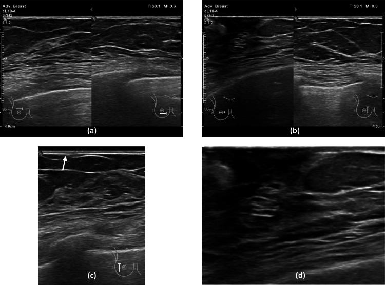
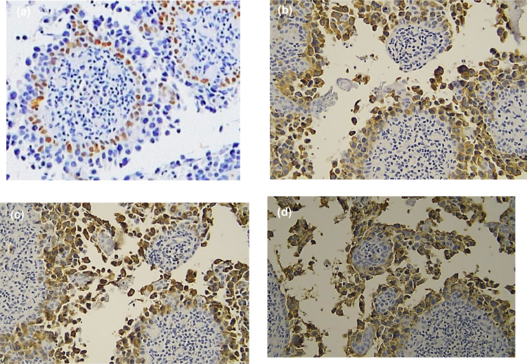

# 1690 — Bệnh Paget của núm vú / Mammary Paget disease (MPD)

**Tags:** `pattern:trot-num-vu` `pattern:day-da-num-vu` `pattern:vi-voi-hoa` `pattern:ngam-num-vu` `vung:vu` `vung:num-vu` `score:BI-RADS` `score:TNM-AJCC8` `protocol:nhu-anh-phong-dai` `protocol:MRI-vu` `protocol:sinh-thiet-da-num-vu` `incidentaloma:day-da-num-vu`
**Mức chắc chắn (certainty):** tổng hợp y văn (literature synthesis) — số liệu đọc trực tiếp từ toàn văn 3 bài mở qua Europe PMC (*Radiology Case Reports* 2025, *Diagnostics* 2025, *Pan African Medical Journal* 2026) + 1 bài tổng quan (*Cureus* 2025); có **ca nguyên văn** dùng cho quiz (ảnh CC BY / CC BY-NC-ND).

## 1. Tổng quan — vì sao "chàm núm vú" lại là ung thư, và vì sao hình ảnh hay âm tính

- **Bệnh học:** tế bào Paget là **tế bào tuyến ác tính lớn, bào tương sáng, nhân lớn, nucleolus rõ**, nằm **rải rác/đám trong biểu bì núm vú–quầng vú** (không phải tế bào da tại chỗ). Chúng thường **di chuyển theo kiểu hướng biểu bì (epidermotropism)** từ **DCIS trong ống tuyến dưới quầng** ra da — vì vậy MPD là **dấu hiệu bề mặt của một bệnh ống tuyến nằm sâu**.
- **Tần suất (định lượng):** MPD chiếm **1–3%** tổng số ung thư vú; tỷ lệ mắc theo dân số **0,42/100.000** (đô thị Trung Quốc 2016), tài liệu chung ghi **< 5%** ung thư vú. **> 93%** (một số tổng quan: **> 90%**, **80–90%** khi gộp DCIS + IDC) MPD có **ung thư vú nằm dưới**; chỉ **< 10%** có khối sờ thấy.
- **Vì sao nhũ ảnh hay ÂM TÍNH (tới ~50%):** tổn thương nằm **trong lòng ống + trong biểu bì**, không tạo khối. Nhũ ảnh chỉ thấy khi có **vôi hóa do hoại tử comedonecrosis** (canxi lắng trên mảnh tế bào chết) → **vi vôi hóa đa hình (fine pleomorphic) / phân nhánh tuyến tính** — tức là dấu hiệu của **DCIS**, không phải của da. Vì vậy **"nhũ ảnh bình thường" KHÔNG loại trừ MPD**; cần **phóng đại núm vú + 1/3 trước tuyến vú**.
- **Vì sao MRI nhạy hơn:** DCIS tân mạch hóa + viêm/ngấm ở núm → **ngấm thuốc dạng không khối (non-mass enhancement)** và **ngấm thuốc núm vú** — những thay đổi **chưa đủ canxi để thấy trên nhũ ảnh**. Một loạt **34 ca**: sau nhũ ảnh âm, **MRI phát hiện bệnh ẩn ở 50%**.
- **Vì sao siêu âm thấy "dày da núm":** phù + tế bào u + xơ ở trung bì → **dày da ≥ 2 mm** (da thành ngực bình thường **1–2 mm**) và **mất phân lớp**; kèm **giãn ống tuyến** dưới quầng và **tăng tưới máu núm** (một loạt: dòng máu núm phong phú **24,66%**, tổn thương ác ở nơi khác **67,12%**).
- **Thời gian chẩn đoán muộn là quy luật:** triệu chứng **kéo dài nhiều tháng đến nhiều năm** vì bị điều trị như chàm; ca nguyên văn **~1 năm**, ca soi da **6 tháng** không đáp ứng corticoid bôi.
- **Điểm phản biện (trung thành nguồn):** một loạt mổ **417 ca** báo **95% IDC, 3,4% DCIS, 1,7% không có ung thư dưới**; con số **IDC trội** này **ngược với đa số y văn** (DCIS là nền tảng sinh bệnh học) → nhiều khả năng do **chọn bệnh nhân đã mổ**. Không dùng tỷ lệ đó để lập luận "MPD thường có khối xâm lấn"; dùng **> 90% có ung thư dưới, trong đó DCIS là thể nền** là an toàn hơn.

## 2. Mẫu hình + chẩn đoán phân biệt theo vị trí và hình thái (Gamut)

- **Khuôn 1 — Trợt/đóng vảy/ẩm ướt MỘT BÊN ở núm–quầng, ngứa rát, không đáp ứng corticoid.** Gamut: **MPD** vs **chàm/viêm da tiếp xúc** vs **u tuyến núm (nipple adenoma)** vs **Bowen/SCC tại chỗ** vs **bệnh Paget hắc tố (pigmented Paget, nhầm hắc tố ác)** vs **BCC**. Chốt: **sinh thiết toàn bộ độ dày da–núm**, không phải "thử thuốc thêm 1 tháng".
- **Khuôn 2 — Núm vú TỤT + dày da quầng, không sờ thấy khối.** Gamut: **MPD + DCIS dưới quầng** vs **giãn ống tuyến (duct ectasia)** vs **áp-xe dưới quầng tái phát/Zuska** vs **ung thư thể viêm (T4d)**. Chốt: **vi vôi hóa tuyến tính trên nhũ ảnh phóng đại** hoặc **non-mass enhancement quanh núm trên MRI**.
- **Khuôn 3 — Chỉ có VI VÔI HÓA dưới quầng/ngoại vi, KHÔNG có tổn thương da.** Gamut: **DCIS thường** vs **MPD không có ban (Paget không tổn thương núm — đã có báo cáo)** vs vôi hóa lành (mạch máu, sữa). Chốt: hình thái **đa hình/tuyến tính + phân bố theo ống** → sinh thiết định vị.
- **Khuôn 4 — Mảng/nốt SẪM MÀU ở núm.** Gamut: **Paget hắc tố** vs **hắc tố ác (melanoma)** vs **nốt ruồi**. Chốt miễn dịch: **CK7(+) / S100(−) / HMB-45(−)** = Paget; đảo lại = melanoma.
- **Gợi nhớ "PAGET":** **P**hải là **một bên** (unilateral) · **A**reola bị **gặm mòn** · **G**iống chàm nhưng **G**iả (pseudo-eczema) · **E**czema **không đáp ứng** thuốc · **T**est = **punch/sinh thiết toàn bộ độ dày** (không phải "thử thêm steroid").

## 3. Bảng so sánh phân biệt (ma trận đối chiếu)

| Thực thể (entity) | Hình ảnh điển hình (nhũ ảnh / SA / MRI) | Chốt vào (rule-in) | Chốt loại (rule-out) | Gợi ý xác nhận |
|---|---|---|---|---|
| **MPD (bệnh Paget núm vú)** | Nhũ ảnh: **vi vôi hóa đa hình/tuyến tính 62,5%**, khối 56,25%, bất đối xứng 31,25%, hạch nách 25%, thay đổi NAC 18,75%, dày da 12,5%; **âm tính tới ~50%**. SA: **dày da núm**, ống giãn, tăng tưới máu núm. MRI: **ngấm thuốc núm + non-mass enhancement** | **Trợt–đóng vảy một bên + sinh thiết da có tế bào Paget (CK7+, p63−)** | Nhũ ảnh âm **không** loại trừ; "chàm" đáp ứng corticoid nhanh → nghĩ viêm da | Punch/sinh thiết toàn bộ độ dày; IHC **CK7, p63, HER2** |
| Chàm / viêm da tiếp xúc | Da **hai bên** hay tái phát theo mùa, **không có vi vôi hóa**, không khối | Ngứa đối xứng, đáp ứng corticoid **trong 1–2 tuần** | **Một bên kéo dài > 4 tuần, không đáp ứng** → loại chàm, phải sinh thiết | Theo dõi ngắn + sinh thiết nếu thất bại điều trị |
| U tuyến núm (nipple adenoma) | Nốt/trợt ở núm, có thể **chảy dịch**, nhũ ảnh thường âm; SA: nốt giảm âm trong núm | Nốt đặc trong núm + mô tuyến lành, **không có tế bào Paget** | **CK7(−) tế bào sáng trong biểu bì** → không phải Paget | Sinh thiết/cắt u để mô bệnh |
| Bowen / SCC tại chỗ | Mảng đỏ–vảy, **không liên quan ống tuyến**; không vi vôi hóa | Tế bào vảy không điển hình **toàn bộ độ dày**, p63 **dương** | **p63(−) trong tế bào u** + CK7(+) → Paget | IHC p63, CK5/6 |
| Paget hắc tố / melanoma núm | Sẫm màu; nhũ ảnh âm; MRI có thể ngấm núm | **S100+/HMB-45+/CK7−** | **CK7+ và S100−** → Paget hắc tố | IHC bộ đôi CK7 – S100/HMB-45 |
| BCC núm–quầng | Loét bờ cuộn, chậm; hiếm | Đám tế bào đáy, **khe co rút**, BerEP4+ | Không có tế bào Paget, không vi vôi hóa | Sinh thiết + IHC |

*Trái: trợt–đóng vảy núm vú một bên. Giữa: tổn thương loét–vảy. Phải: soi da — đa màu, trợt, vảy, chấm/mảng sắc tố và kiểu mạch đa thành phần (không đặc hiệu, nhưng đủ để bỏ giả thuyết "chàm đơn thuần"). Nguồn: Gupta & Parwe 2026 (CC BY 4.0); Cantisani và cs. 2025 (CC BY 4.0). Ảnh ghép letterbox.*

### Dấu hiệu then chốt đọc đúng
- **Nhũ ảnh:** luôn chụp **phóng đại núm vú + 1/3 trước tuyến** — nhiều ca chỉ có **vi vôi hóa ngoại vi** ngoài vùng núm (đúng ca trong quiz 2). Đừng dừng ở "da dày" trên phim.
- **Siêu âm:** dày da núm **khu trú**; **ống tuyến giãn chứa hồi âm** dưới quầng; **Doppler thấy tăng tưới máu núm**. Nếu thấy tổn thương ác ở phần tuyến khác (**67,12%** trong một loạt) thì đó chính là ung thư nền.
- **MRI:** hai dấu cần tìm — **ngấm thuốc núm–quầng** và **non-mass enhancement** dọc ống; MRI dùng để **đo lan rộng trước mổ** khi bảo tồn, không dùng để "loại trừ" khi đã có mô bệnh.

## 4. Protocol chụp + phân độ (BI-RADS / AJCC)

**Quy trình khi bệnh nhân có "chàm núm vú" một bên:**
1. **Khám + soi da** (không thay thế sinh thiết) → nghi ngờ thì **sinh thiết ngay**, không chờ đáp ứng corticoid.
2. **Nhũ ảnh 2 bình diện + phóng đại NAC/1/3 trước** (CC, MLO, phóng đại 1,5–2×) — tìm **vi vôi hóa, khối, bất đối xứng, hạch nách**.
3. **Siêu âm đầu dò thẳng tần số cao (12–18 MHz)** toàn bộ vú + núm + nách: đo **độ dày da**, tìm ống giãn, khối, hạch.
4. **MRI vú có cản quang (1,5–3 T, nằm sấp, trừ ảnh)** khi: nhũ ảnh/SA không kết luận, mô bệnh đã là MPD, hoặc cân nhắc bảo tồn để đo lan rộng. Đọc **ảnh trừ (subtraction) + MIP**, tìm ngấm núm và non-mass enhancement.
5. **Sinh thiết:** **punch da toàn bộ độ dày qua núm–quầng** hoặc **sinh thiết mở hình nêm** lấy cả ống tuyến dưới quầng; có thể cần **nhiều lần/nhiều vị trí** (ca soi da: nhiều mẫu mới xác nhận).
6. **Định vị + sinh thiết vi vôi hóa** (nhũ ảnh có định vị/dưới hướng dẫn SA) — **không bỏ qua** vì "đã có chẩn đoán da".

**Phân độ & giai đoạn (AJCC 8):**
- **MPD đơn thuần, không DCIS/không xâm lấn = Tis (Paget)** — tiên lượng tốt.
- Có **DCIS** dưới → xếp theo DCIS; có **IDC** → xếp theo **kích thước/u xâm lấn** (T), **hạch (N)**; MPD **không tự nâng giai đoạn** nếu không xâm lấn.
- **BI-RADS (nhũ ảnh/SA):** vi vôi hóa **đa hình/tuyến tính** → tối thiểu **BI-RADS 4B**, điển hình **4C–5**; **dày da núm đơn độc** → **4** (cần tương quan lâm sàng); MRI **non-mass enhancement** → **4–5**.

## 5. Biến thể bình thường và cạm bẫy

- **Nhũ ảnh âm tới ~50%, SA âm giả 13%** — "hình ảnh sạch" **không** loại trừ MPD; sai lầm hay gặp là **cho về "chàm" sau 1 phim bình thường**.
- **U tuyến núm (nipple adenoma)** là kẻ bắt chước số 1: trợt, chảy dịch, đau — chỉ mô bệnh phân biệt; đừng cắt "u lành" mà bỏ qua vi vôi hóa dưới quầng.
- **Paget hắc tố** bị nhầm thành melanoma (và ngược lại): bắt buộc **CK7 + S100/HMB-45**; thiếu IHC là nguồn sai chẩn đoán.
- **MPD không có tổn thương núm vú** (đã báo cáo) — biểu hiện chỉ là **vi vôi hóa**; do đó bất kỳ vi vôi hóa **đa hình/tuyến tính** đều phải sinh thiết, **không** suy luận "núm bình thường nên không phải Paget".
- **Soi da/RCM/LC-OCT không thay thế mô bệnh:** tác giả bài soi da nêu rõ **thiếu dữ liệu độ nhạy/độ đặc hiệu** và **có thể âm tính trong thể vi xâm lấn**; ca của họ cần **nhiều mẫu sinh thiết** mới xác nhận.
- **Cạm bẫy giai đoạn:** MPD + DCIS **không** phải bệnh giai đoạn IV; ngược lại **di căn da** (bài 1618) mới là M1 — phân biệt bằng **tính liên tục** với khối và mô bệnh, không bằng "đỏ da".
- **Tránh "overcall" viêm:** dày da núm **đối xứng hai bên** sau xạ/mang thai/nhiễm nấm là lành tính; MPD gần như **luôn một bên**.

## 6. Tự lượng giá — Blind Quiz

**Ca 1 — Nữ 58 tuổi, "chàm" núm vú phải 1 năm, đã bôi corticoid nhiều đợt.**

- Hỏi: mô tả tổn thương? 3 chẩn đoán phân biệt? Bước tiếp theo **bắt buộc** là gì?

<b>Bấm để hiện đáp án (findings + chẩn đoán)</b>

- **Dấu hiệu:** (A) trợt đỏ, đóng vảy, bờ không đều **giới hạn ở núm–quầng phải**; (B) núm loét–vảy trung tâm, da quầng dày nhẹ. Tổn thương **một bên**, không sốt.
- **Chẩn đoán:** **bệnh Paget núm vú** — phải **sinh thiết toàn bộ độ dày da–núm**; nếu dương tính, chụp **nhũ ảnh phóng đại + SA**, rồi **MRI** để tìm DCIS/IDC ẩn.
- **Vì sao:** tế bào Paget nằm trong biểu bì nên **bề mặt trông như chàm**, còn bệnh thật ở **ống tuyến dưới quầng** → hình ảnh có thể âm tính.
- Nguồn ảnh: Gupta G, Parwe S., *Pan Afr Med J* 2026, Fig. 1 (CC BY 4.0).

**Ca 2 — Nữ 78 tuổi, trợt núm vú phải ~1 năm; nhũ ảnh và siêu âm dưới đây.**

- Hỏi: tìm dấu hiệu **quyết định** trên nhũ ảnh? Siêu âm thấy gì? Vì sao không được kết luận "âm tính"?

<b>Bấm để hiện đáp án</b>

- **Nhũ ảnh:** (a,b) CC/MLO; (c,d) ảnh phóng đại — **vi vôi hóa đa hình nhỏ, xếp thành đường/tuyến tính ở 1/4 trên–ngoài vú phải** (mũi tên đen); (d) cũng thấy **dày da vùng núm**. Vú trái: vôi hóa mạch máu lành.
- **Siêu âm:** (c,d) **dày da vùng núm phải** (mũi tên trắng), **không có khối trong tuyến**.
- **Chẩn đoán:** MPD + **DCIS** (vi vôi hóa tuyến tính = BI-RADS 4C). Bệnh nhân từ chối sinh thiết vôi hóa → mất cơ hội chẩn đoán mô học của phần bệnh nằm sâu.
- **Vì sao:** vôi hóa là **canxi trên mảnh hoại tử trong lòng ống**, không phải tổn thương da → **da dày trên SA không thay thế** việc sinh thiết vôi hóa.
- Nguồn ảnh: Darmiati S, Heryanto AE, Rustamadji P., *Radiol Case Rep* 2025, Fig. 2 và Fig. 3 (CC BY-NC-ND 4.0, nguyên bản).

**Ca 3 — Cùng bệnh nhân ca 2: hồ sơ miễn dịch của tổn thương núm.**

- Hỏi: bộ dấu ấn này nói gì? Còn phải loại trừ chẩn đoán nào bằng IHC?

<b>Bấm để hiện đáp án</b>

- **Kết quả:** (a) **p63 ÂM** trong tế bào u (biểu bì/adnex vẫn dương — chứng nội kiểm); (b) **CK7 DƯƠNG**; (c) **CAM5.2 DƯƠNG**; (d) **HER2 2+**.
- **Diễn giải:** tế bào **CK7+/p63−** trong biểu bì = **tế bào Paget**; **p63 âm** loại **SCC/Bowen** (p63 dương); cần **S100/HMB-45 âm** để loại hắc tố ác.
- **Liên quan điều trị:** HER2 dương (**~78,2%** MPD trong tổng quan) mở đường **kháng HER2** khi có bệnh xâm lấn/tái phát.
- Nguồn ảnh: Darmiati S và cs., *Radiol Case Rep* 2025, Fig. 5 (CC BY-NC-ND 4.0, nguyên bản).

## Bài liên quan chéo
- [510 – BI-RADS: nhũ ảnh, siêu âm, MRI](../510-vu-BIRADS-nhu-anh-sieu-am-MRI/lesson.md)
- [517 – Sinh thiết định vị vú & quản lý clip](../517-sinh-thiet-dinh-vi-vu-va-quan-ly-clip/lesson.md)
- [1613 – Viêm tuyến vú u hạt & áp-xe vú](../1613-viem-tuyen-vu-u-hat-va-ap-xe-vu/lesson.md) (bệnh cảnh "vú viêm" lành tính)
- [1616 – Ung thư vú thể viêm (T4d)](../1616-ung-thu-vu-the-viem/lesson.md) (dày da lan tỏa, khác MPD khu trú ở NAC)
- [1618 – Di căn da & thành ngực của ung thư vú](../1618-di-can-da-thanh-nguc-ung-thu-vu/lesson.md) (M1, không phải Paget)
- [576 – Bệnh Paget âm hộ & VIN](../576-paget-am-ho-va-VIN/lesson.md) (Paget ngoài vú — cùng tế bào, khác tiên lượng)
- [522 – Theo dõi sau điều trị ung thư vú](../522-theo-doi-sau-dieu-tri-ung-thu-vu/lesson.md)

> Không dùng để chẩn đoán độc lập khi chưa có người hướng dẫn.
