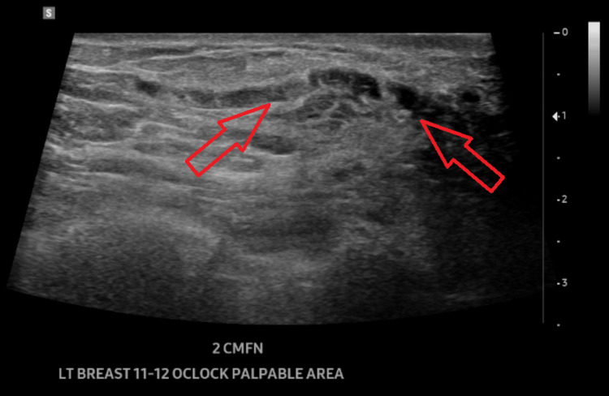
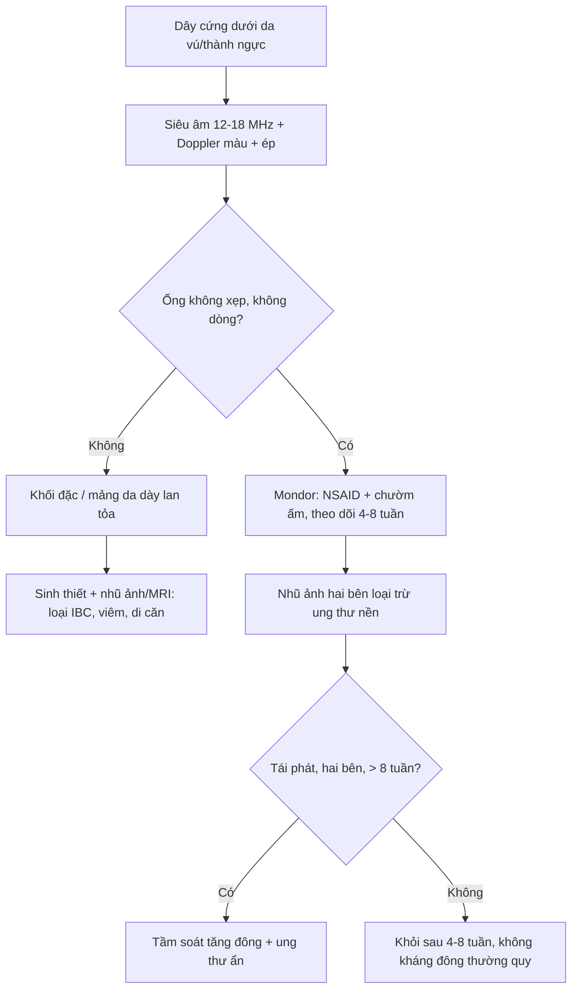
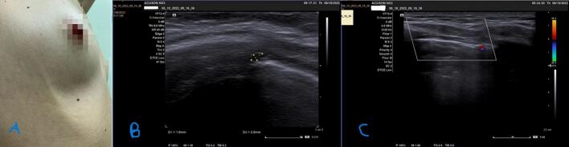
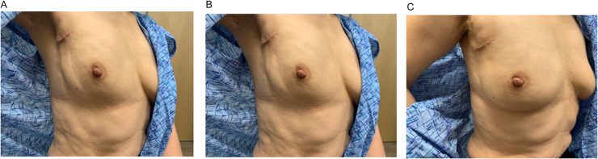
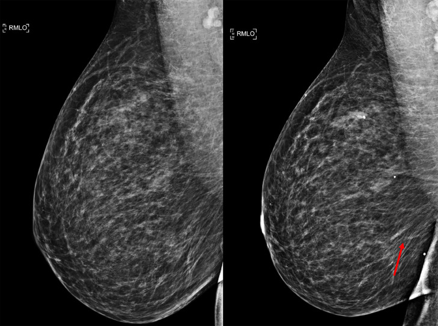
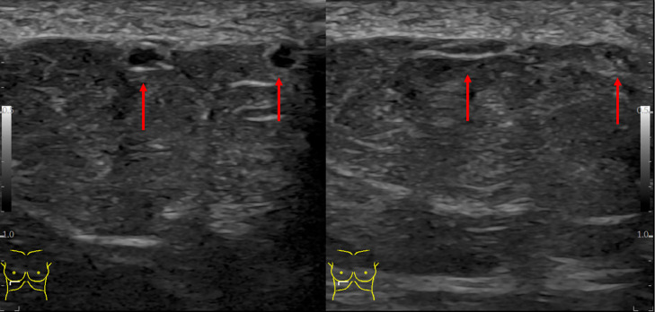

# 1691 — Bệnh Mondor: huyết khối tĩnh mạch nông vú – thành ngực / Mondor disease (superficial thrombophlebitis of the breast and chest wall)

**Tags:** `pattern:day-cung-duoi-da` `pattern:huyet-khoi-tinh-mach-nong` `pattern:day-da` `pattern:lot-da` `vung:vu` `vung:thanh-nguc` `score:BI-RADS` `protocol:sieu-am-mach-nong` `protocol:nhu-anh` `protocol:Doppler-mau` `incidentaloma:day-cung-thanh-nguc`
**Mức chắc chắn (certainty):** tổng hợp y văn (literature synthesis) — số liệu đọc trực tiếp từ toàn văn 4 bài mở qua Europe PMC (*Radiology Case Reports* 2025, *International Journal of Surgery Case Reports* 2024, *Advances in Radiation Oncology* 2023, *Cureus* 2026) + 1 tổng quan về huyết khối tĩnh mạch nông (*J Clin Med* 2026); có **ca nguyên văn** cho quiz.

## 1. Tổng quan — "dây cứng" hình thành thế nào và vì sao siêu âm là chốt

- **Định nghĩa:** Mondor là **viêm–huyết khối tĩnh mạch NÔNG dưới da** ở vú/thành ngực (thường là **tĩnh mạch ngực–bụng** hoặc **tĩnh mạch ngực bên**), mô tả lần đầu bởi Henri Mondor 1939. Đây là **tĩnh mạch nông**, **không phải** huyết khối tĩnh mạch sâu và **không phải** viêm mô tế bào.
- **Sinh lý bệnh (vì sao thành "dây"):** huyết khối lấp lòng mạch + **viêm quanh tĩnh mạch (periphlebitis)** + xơ hóa → mạch **cứng, dính vào mô dưới da** thành **dây (cord)** sờ rõ; sau đó **tái thông (recanalization)** hoặc **xơ hóa tắc** dần → dây mềm và biến mất. Một số ít ca được cho là **viêm bạch mạch** chứ không phải tĩnh mạch.
- **Vì sao da trên dây bị LÕM/kéo (dimpling):** dây xơ dính vào **dây chằng Cooper** → rút da vào trong, tạo **dấu lõm khu trú** — đây chính là lý do Mondor bị nhầm với **ung thư vú có co kéo da** (đặc biệt thể viêm/di căn da).
- **Tần suất (định lượng):** ca **có triệu chứng ước tính 0,5–0,8%**, nói chung **< 1%**; tại một phòng khám vú, **0,94% (7/748)** bệnh nhân tự đến khám; y văn chỉ có **khoảng 400 ca** được báo cáo. **50–60% vô căn**; phần còn lại sau **chấn thương/áo ngực chật/vận động mạnh**, **phẫu thuật – sinh thiết – đặt kim**, **tăng đông**, và **ung thư vú (tới 12,7%)**.
- **Dịch tễ:** nữ **gấp 3 lần** nam; tuổi hay gặp **30–60**, đỉnh **~43 tuổi** trong một loạt tổng quan.
- **Diễn tiến tự nhiên:** **tự khỏi 4–8 tuần** (một số nguồn 4–6 tuần; ca nguyên văn hết hoàn toàn trên siêu âm ở **12 tuần**). **Kháng đông KHÔNG dùng thường quy** — chỉ khi có **DVT/PE kèm theo** hoặc nguy cơ cao.
- **TẠI SAO siêu âm là chốt (vật lý):** huyết khối + tế bào viêm lấp lòng mạch làm **lòng mạch KHÔNG xẹp khi ép** (khác tĩnh mạch bình thường xẹp hoàn toàn), trong lòng có **hồi âm** (thrombus), và **không có dòng trên Doppler màu**. Đo được **đường kính và chiều dài** huyết khối, và **theo dõi theo tuần**: ca được đo **1,0 và 2,0 mm → 0,7 mm sau 14 ngày**. Trên **nhũ ảnh**, huyết khối chỉ hiện thành **đường đậm/tubular density hoặc bất đối xứng tuyến tính nông** — dễ bị chấm BI-RADS 4 oan.
- **Bối cảnh quan trọng — huyết khối tĩnh mạch nông KHÔNG do giãn tĩnh mạch (non-varicose SVT):** đây là nhóm **gần với huyết khối tĩnh mạch sâu** hơn: **DVT đồng thời 24,6%**, **PE 4,7%**; **tỷ lệ tăng đông tới 76%** trong một số loạt; **không có giãn tĩnh mạch** là yếu tố nguy cơ độc lập cho biến cố huyết khối **HR 2,06** ở 3 tháng. Vì vậy Mondor **không đồng nghĩa "luôn lành, không cần làm gì"**.

## 2. Mẫu hình + chẩn đoán phân biệt theo vị trí (Gamut)

- **Khuôn 1 — Dây cứng dọc thành ngực/vú, da trên dây lõm nhẹ, đau khi giơ tay.** Gamut: **Mondor** vs **ung thư vú thể viêm/da cam** vs **viêm mô tế bào** vs **viêm bạch mạch** vs **di căn da dạng dây**. Chốt: **cấu trúc dạng ống không xẹp, không có dòng** — không phải mảng da dày lan tỏa.
- **Khuôn 2 — "Dây" ở nách/chi trên sau mổ nách, xạ trị, hoặc tự phát.** Gamut: **hội chứng dây nách (axillary web syndrome, AWS)** vs **Mondor** vs **phù bạch mạch chi trên (BCRL)** vs **huyết khối tĩnh mạch nông do catheter**. AWS gặp **48,3% – tới 72%** sau mổ hạch nách; dây **nhiều sợi**, chạy từ nách xuống cánh tay, **cải thiện khi vận động**; hai bệnh có thể **cùng tồn tại**.
- **Khuôn 3 — Dây xuất hiện sau sinh thiết/kim/mổ ngực.** Gamut: **Mondor sau thủ thuật** vs **tụ máu** vs **nhiễm trùng vết mổ** vs **huyết thanh tụ**. Chốt: dây **dọc theo đường tĩnh mạch**, không phải khối; xuất hiện **~7 tuần sau sinh thiết** trong ca nguyên văn.
- **Khuôn 4 — Nhiều dây, tái phát, hoặc hai bên.** Gamut: **tăng đông (yếu tố V Leiden, protein S/C, APS)** vs **ung thư ẩn** vs **bệnh viêm hệ thống** vs **thrombophlebitis migrans (Trousseau)**. Chốt: **không tìm được nguyên nhân cục bộ → tầm soát tăng đông + tầm soát ung thư**, không chỉ theo dõi.
- **Khuôn 5 — Dây ở vị trí khác (dương vật, bụng, chi).** Cùng cơ chế, khác vị trí; Mondor dương vật thường sau giao hợp/thắt chặt, cũng tự khỏi.
- **Gợi nhớ "CORD":** **C**ord (dây cứng dọc) · **O**ne side – một bên, một dây · **R**esolution 4–8 tuần · **D**oppler: **không dòng, không xẹp**.

## 3. Bảng so sánh phân biệt (ma trận đối chiếu)

| Thực thể (entity) | Hình ảnh điển hình (SA / nhũ ảnh / MRI) | Chốt vào (rule-in) | Chốt loại (rule-out) | Gợi ý xác nhận |
|---|---|---|---|---|
| **Mondor (huyết khối TM nông)** | SA: **cấu trúc dạng ống dưới da, không xẹp khi ép**, lòng có hồi âm, **không dòng Doppler**; đo được đường kính **1–2 mm**, dài vài cm. Nhũ ảnh: **đường đậm/tubular density nông**, có thể **bất đối xứng tuyến tính**; thường không có vi vôi hóa | **Dây cứng + ống không xẹp, không dòng** | **Mảng da dày lan tỏa** + không thấy ống → nghĩ IBC/viêm; **khối đặc** → không phải Mondor | SA đầu dò thẳng tần số cao + Doppler màu; đo đường kính/chiều dài; theo dõi 4–8 tuần |
| AWS (dây nách) | Dây **nhiều sợi** từ nách xuống cánh tay, giới hạn động tác; SA có thể thấy **tĩnh mạch/bạch mạch nông** | **Sau mổ hạch nách** + nhiều dây + cải thiện với vật lý trị liệu | **Một dây đơn độc dọc thành ngực, không liên quan mổ** → nghĩ Mondor | Khám lâm sàng + SA; điều trị bảo tồn |
| Viêm mô tế bào / áp-xe vú | Dày da **lan tỏa**, tăng sinh mạch, có thể **ổ dịch**; sốt, đau, nóng đỏ | **Sốt + bạch cầu tăng + ổ dịch/khí** | **Không sốt, chỉ một dây cứng** → không phải nhiễm | SA + lâm sàng; dẫn lưu nếu có ổ |
| Ung thư vú thể viêm (T4d) | **Da cam, dày da lan tỏa > 1/3 vú**, mạch bạch huyết giãn; có thể có khối | **Da cam lan rộng + dày da lan tỏa + sinh thiết da có tế bào u** | **Chỉ một dây khu trú, da ngoài dây bình thường** → không phải IBC | Punch da + nhũ ảnh/MRI (bài 1616) |
| Viêm bạch mạch | Đường đỏ **nóng, đau, lan nhanh**, thường có ổ nhiễm vào | **Sốt + đường đỏ lan + ổ nhiễm nguyên phát** | **Dây cứng không đỏ nóng lan** → Mondor | Lâm sàng; kháng sinh |
| Huyết khối nông do catheter/kim | Ống không xẹp **tại đúng vị trí kim/catheter**, có tiền sử đặt | **Vị trí trùng điểm chọc + không dòng** | Không có can thiệp tại chỗ → nguyên phát | SA tại chỗ + đánh giá catheter |

*Cấu trúc dạng ống (mũi tên đỏ) chạy trong mô dưới da, **thô dần về phía núm**, lòng chứa vật liệu hồi âm — hình thái kinh điển của tĩnh mạch nông huyết khối. Nguồn: Escudero IA, *Cureus* 2026, Fig. 1 (CC BY 4.0).*

## 4. Protocol chụp + theo dõi

**Khi bệnh nhân có "dây cứng" ở vú/thành ngực:**
1. **Siêu âm là bước đầu tiên** (đầu dò thẳng **12–18 MHz**): quét **dọc theo dây** và **cắt ngang**, **ép nhẹ** để xem xẹp; bật **Doppler màu/công suất**. Ghi: đường kính (mm), chiều dài, khoảng cách tới núm, có/không dòng, có huyết khối trong lòng.
2. **Nhũ ảnh chẩn đoán hai bên** (không chỉ "chụp vùng dây") để **loại trừ ung thư nền** — vì **tới 12,7%** ca Mondor có ung thư vú; nhũ ảnh trong ca nguyên văn **âm tính**.
3. **MRI vú** không thường quy; dùng khi nhũ ảnh/SA nghi ngờ hoặc cần đánh giá lan rộng.
4. **Điều trị:** NSAID + chườm ấm, giảm vận động mạnh; **không kháng đông thường quy**. Cân nhắc kháng đông khi: **DVT/PE đồng thời**, huyết khối **lan tới gần tĩnh mạch sâu**, **tái phát/nhiều dây**, hoặc **tăng đông đã biết**.
5. **Theo dõi:** khám/SA lại sau **4–8 tuần**; nếu **không giảm sau 8 tuần**, **tái phát**, hoặc **hai bên** → **tầm soát tăng đông + tầm soát ung thư ẩn**.
6. **BI-RADS:** dây đơn thuần, không khối, không vi vôi hóa → **BI-RADS 2 (lành tính)** sau khi đã đối chiếu SA; **chỉ nâng BI-RADS** khi có tổn thương kèm theo (khối, vi vôi hóa, non-mass enhancement).

*(A) dây cứng thành ngực phải được đánh dấu; (B) cắt ngang tĩnh mạch nông huyết khối — **không xẹp**, đường kính đo **1,0 mm và 2,0 mm**; (C) Doppler màu không thấy dòng trong lòng. Sau **14 ngày** NSAID, đường kính còn **0,7 mm**. Nguồn: Shabani Z, Pllumi Guli A., *Int J Surg Case Rep* 2024, Fig. 1 (CC BY-NC-ND 4.0, nguyên bản).*

## 5. Biến thể bình thường và cạm bẫy

- **Tĩnh mạch nông bình thường XẸP hoàn toàn khi ép**; chỉ khi **không xẹp + có hồi âm trong lòng** mới gọi huyết khối. Ép quá mạnh hoặc đầu dò góc nghiêng làm **mất dấu** → luôn quét **hai bình diện**, so sánh bên đối diện.
- **Dòng Doppler có thể vẫn còn** ở nhánh bên/đoạn tái thông — **không loại trừ** huyết khối; dấu chốt là **không xẹp** và **hồi âm trong lòng**, không phải "không thấy màu".
- **Đừng chấm BI-RADS 4 chỉ vì "bất đối xứng tuyến tính"** trên nhũ ảnh khi lâm sàng và SA điển hình Mondor — nhưng **cũng đừng bỏ qua ung thư nền**: tỷ lệ ung thư vú kèm theo **tới 12,7%**, và ca bệnh trong quiz 2 xuất hiện **sau sinh thiết** vì một tổn thương non-mass enhancement.
- **Da lõm không đồng nghĩa ung thư:** Mondor kéo **dây chằng Cooper** → lõm khu trú; ung thư thể viêm gây **da cam lan tỏa**. Vị trí và **tính lan tỏa** phân biệt, không phải "có lõm hay không".
- **AWS ≠ Mondor:** AWS thường **nhiều dây, sau mổ hạch nách**, đáp ứng vật lý trị liệu; nhưng đã có ca **AWS + viêm tắc tĩnh mạch nông đồng thời** → thấy ống không xẹp thì gọi đúng tên.
- **Kháng đông không phải điều trị của Mondor:** dùng thường quy chỉ thêm nguy cơ chảy máu; ngoại lệ là **DVT/PE kèm theo** hoặc huyết khối lan sát tĩnh mạch sâu.
- **PE từ dây thành ngực là hiếm nhưng có thật:** một ca **varicosity thành ngực** huyết khối là nguồn **PE hai bên**; nếu có khó thở/đau ngực, đừng coi Mondor là "chắc chắn lành".

## 6. Tự lượng giá — Blind Quiz

**Ca 1 — Nữ 45 tuổi, đau dọc thành ngực phải 1 tuần, da hơi lõm; giơ tay thấy rõ dây.**

- Hỏi: mô tả dấu hiệu? 3 chẩn đoán phân biệt? Cần chụp gì **trước tiên** và **vì sao vẫn phải chụp vú**?

<b>Bấm để hiện đáp án (findings + chẩn đoán)</b>

- **Dấu hiệu:** (A) đường dây **vẽ màu xanh** chạy dọc thành ngực bên phải từ nách xuống dưới vú, **da lõm nhẹ dọc dây**; (B,C) dây **nổi rõ khi giơ tay**, không đỏ nóng lan tỏa.
- **Chẩn đoán:** **bệnh Mondor** (viêm–huyết khối tĩnh mạch ngực bên). Bước đầu: **siêu âm + Doppler** (xác nhận ống không xẹp, không dòng) — **vẫn phải nhũ ảnh hai bên** vì **tới 12,7%** có ung thư vú kèm.
- **Vì sao:** dây xơ dính dây chằng Cooper → lõm da giống ung thư; phân biệt bằng **cấu trúc ống** trên SA, không bằng "da lõm".
- Nguồn ảnh: Lin K, MacDonald HR, Tetef ML, Coleman CL., *Adv Radiat Oncol* 2023, Fig. 2 (CC BY-NC-ND 4.0, nguyên bản).

**Ca 2 — Nữ 51 tuổi, 7 tuần sau sinh thiết 2 vị trí vú phải, đau lan xuống dưới vú.**

- Hỏi: có gì mới trên phim sau sinh thiết? Đây có phải dấu hiệu ung thư? Bước tiếp theo?

<b>Bấm để hiện đáp án</b>

- **Dấu hiệu:** hai phim **RMLO trước (trái) và sau (phải) sinh thiết**; phim sau xuất hiện **bất đối xứng tuyến tính nông ở phần dưới vú** (mũi tên đỏ) — tương ứng **tĩnh mạch nông huyết khối**, không phải khối.
- **Chẩn đoán:** **Mondor sau sinh thiết**. Không phải ung thư mới, nhưng ca này **sau đó bị DVT và huyết khối tĩnh mạch nông ở tay** → cần **đánh giá yếu tố tăng đông**, không chỉ theo dõi tại chỗ.
- **Vì sao:** sinh thiết gây chấn thương nội mạc + bất động ngắn → huyết khối tĩnh mạch nông; bất đối xứng **dạng đường** khác **khối đặc**.
- Nguồn ảnh: Tavana A, Letter H., *Radiol Case Rep* 2025, Fig. 2 (CC BY-NC-ND 4.0, nguyên bản).

**Ca 3 — Cùng bệnh nhân ca 2: siêu âm vùng đau, không ép và có ép.**

- Hỏi: dấu hiệu chốt trên siêu âm là gì? Nếu ống **vẫn xẹp khi ép** thì nghĩ gì? Có cần kháng đông?

<b>Bấm để hiện đáp án</b>

- **Dấu hiệu:** cấu trúc **dạng ống nông** (mũi tên đỏ) trong mô dưới da; nghiệm pháp **ép** để đánh giá khả năng xẹp và tương quan với điểm đau.
- **Chốt:** huyết khối = **không xẹp + hồi âm trong lòng + không dòng Doppler**. Nếu **xẹp hoàn toàn** → tĩnh mạch bình thường, tìm nguyên nhân khác (cơ, cân, bạch mạch).
- **Điều trị:** NSAID + chườm ấm; **không kháng đông thường quy** — ca này được kháng đông vì **có DVT/huyết khối nông tái diễn**, không phải vì Mondor đơn thuần.
- Nguồn ảnh: Tavana A, Letter H., *Radiology Case Reports* 2025, Fig. 3 (CC BY-NC-ND 4.0, nguyên bản). Ghi chú phản biện: chú thích gốc dùng chữ "compressible", trong khi tiêu chuẩn chẩn đoán là **không xẹp** — đọc theo **hình ảnh + Doppler**, không theo một từ trong chú thích.

## Bài liên quan chéo
- [510 – BI-RADS: nhũ ảnh, siêu âm, MRI](../510-vu-BIRADS-nhu-anh-sieu-am-MRI/lesson.md)
- [599 – Dây nách (axillary web syndrome)](../599-day-nach-axillary-web-syndrome/lesson.md)
- [593 – Phù bạch mạch chi trên sau điều trị ung thư vú](../593-phu-bach-mach-chi-tren-sau-dieu-tri-ung-thu-vu/lesson.md)
- [1613 – Viêm tuyến vú u hạt & áp-xe vú](../1613-viem-tuyen-vu-u-hat-va-ap-xe-vu/lesson.md)
- [1616 – Ung thư vú thể viêm (T4d)](../1616-ung-thu-vu-the-viem/lesson.md)
- [1618 – Di căn da & thành ngực của ung thư vú](../1618-di-can-da-thanh-nguc-ung-thu-vu/lesson.md)
- [1690 – Bệnh Paget của núm vú](../1690-benh-paget-num-vu/lesson.md)

> Không dùng để chẩn đoán độc lập khi chưa có người hướng dẫn.
