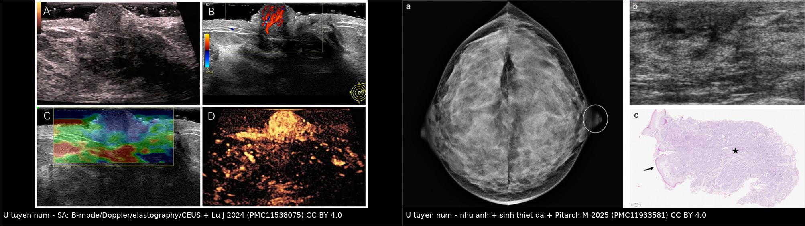
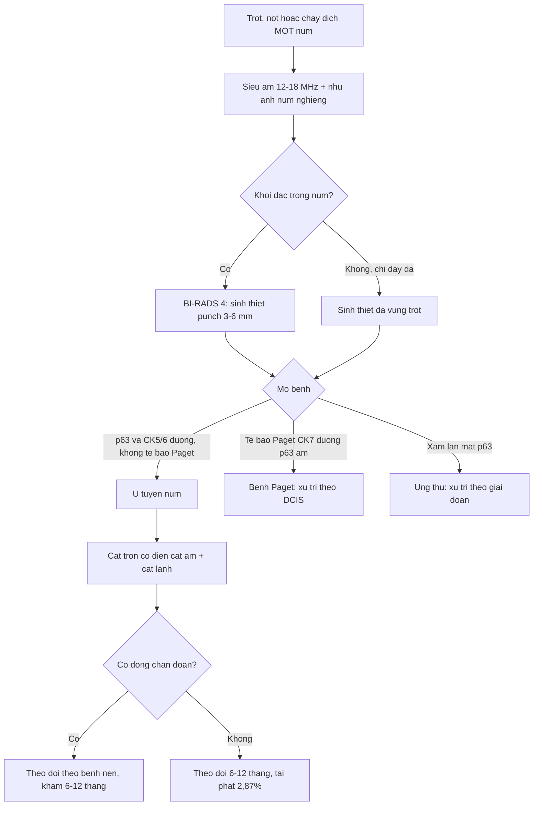
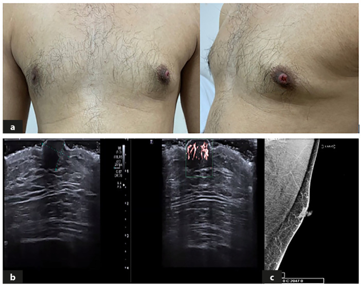
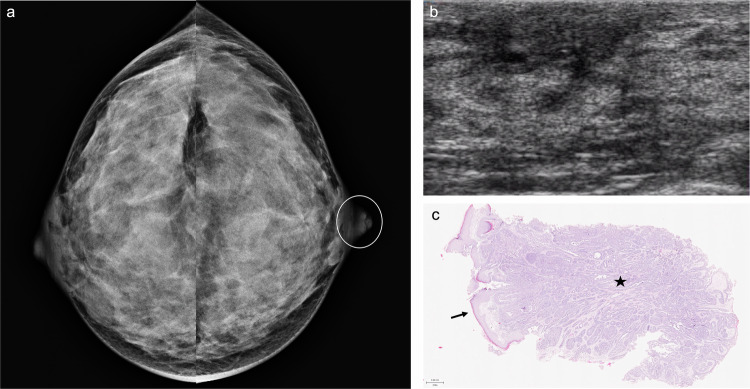
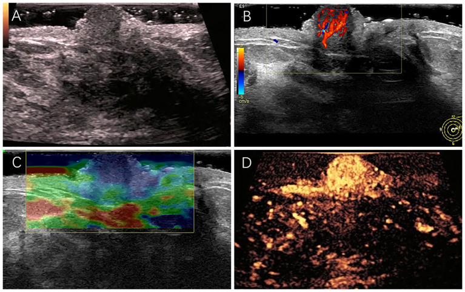
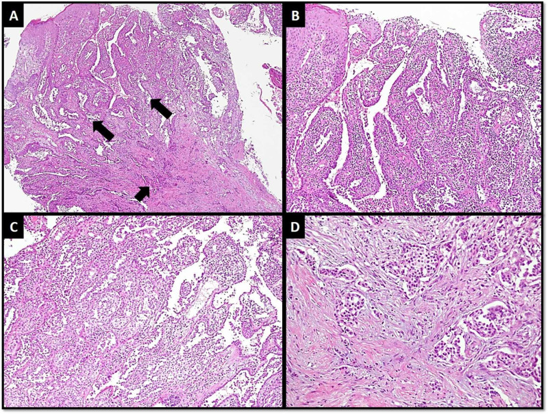

# 1692 — U tuyến núm vú và erosive adenomatosis của núm / Nipple adenoma (florid papillomatosis, erosive adenomatosis of the nipple)

**Tags:** `pattern:trot-num-vu` `pattern:not-trong-num` `pattern:chay-dich-num` `pattern:day-num` `pattern:hong-da-num` `vung:vu` `vung:num-vu` `score:BI-RADS` `protocol:sieu-am-tan-so-cao` `protocol:nhu-anh-phong-dai` `protocol:sinh-thiet-da-punch` `incidentaloma:ton-thuong-num-vu`
**Mức chắc chắn (certainty):** tổng hợp y văn (literature synthesis) — số liệu đọc trực tiếp từ toàn văn: tổng quan hệ thống **387 ca** (*Plast Reconstr Surg Glob Open* 2024, PMC11124597), tổng quan hình ảnh chảy dịch núm (*Insights Imaging* 2025, PMC11933581), ca đa phương thức (*Front Oncol* 2024, PMC11538075), loạt nam giới + ung thư xâm lấn (*Turk J Surg* 2025, PMC12687395), ung thư trong u tuyến núm (*Cureus* 2020, PMC7358932); có **ca nguyên văn** cho quiz.

## 1. Tổng quan bệnh học – cơ chế hình ảnh

- **Bản chất:** u tuyến núm (nipple adenoma, NA) là **tăng sinh lành tính của các ống tuyến sữa NÔNG nằm ngay trong núm** — biểu mô ống + lớp **tế bào cơ biểu mô (myoepithelial) còn nguyên vẹn**, có/không tăng sinh biểu mô quanh ống góp. Các tên đồng nghĩa trong y văn — **florid papillomatosis, erosive adenomatosis, subareolar papillomatosis, syringomatous adenoma** (thực thể sau là biến thể hiếm, xâm lấn tại chỗ) — chính là lý do một tổn thương "trợt núm" có thể mang **4–5 tên** trong 4 bài báo khác nhau.
- **Vì sao quan trọng hơn một "nốt lành":** NA **bắt chước Paget số 1** (trợt + rỉ dịch + đóng vảy một bên) và **đồng thời có thể chứa ung thư**: trong **387 ca** hệ thống, **40 ca (10,34%)** có **đồng chẩn đoán ác tính/tiền ác tính**, trong đó **ung thư biểu mô ống xâm lấn (IDC) 21 ca (5,43%)**, **DCIS 4 (1,03%)**, **ung thư thể hủy (metaplastic) 3 (0,78%)**, **LCIS 3 (0,78%)**, **ILC 2 (0,52%)**, **Paget 1 (0,26%)**.
- **Dịch tễ (định lượng):** tỷ lệ mắc **0,0025%/năm**, **0,45%** các tổn thương vú lành tính, **< 1%** mẫu bệnh phẩm vú; một đơn vị giải phẫu bệnh gặp **~1 ca/năm**; tuổi trung bình **44** (y văn **36–47**), đa số nữ; **< 5%** ở nam. **Thời gian từ triệu chứng đến chẩn đoán trung bình 24 tháng** (nhóm chỉ NA **25,84 tháng**, nhóm có đồng chẩn đoán **33,36 tháng**) — nghĩa là **hai năm "chung sống" với tổn thương** mới được chẩn đoán đúng.
- **Triệu chứng:** khối/nốt/tăng thể tích núm **35,4%** (nhóm có đồng chẩn đoán **80%** vs **41,76%**); **trợt + chảy dịch tới 83%**; khám: **sẩn/nốt 37,54%**, trợt–loét–vảy, co kéo núm.
- **TẠI SAO hình ảnh khó và vì sao siêu âm là chốt (vật lý):** tổn thương nằm **trong núm, cách da 0–10 mm**, kích thước thường **≤ 10 mm** — dưới ngưỡng không gian của nhũ ảnh thường quy và nằm trong vùng có **mô tuyến dày đặc cộng hưởng**. Siêu âm đầu dò thẳng **12–18 MHz** cho **trục ngang 0,1–0,2 mm**, nên thấy được cả **ống tuyến giãn 2,2 mm có chất đặc bên trong**. Cấu trúc là **tăng sinh tuyến + xơ đệm** → **giảm âm đồng nhất**, **không có bóng lưng** (khác ung thư xâm lấn), **mạch máu tăng rõ trên Doppler** (viêm + tăng sinh), **đàn hồi cứng hơn mô mỡ quanh** (xơ đệm), và **ngấm mạnh, bờ ngấm rõ** trên CEUS.
- **Vì sao nhũ ảnh hay "âm tính":** dấu hiệu duy nhất thường chỉ là **núm to ra/bất đối xứng**, **dày da–quầng khu trú** hoặc **khối nông trong núm**; muốn thấy phải **chụp núm ở tư thế nghiêng (nipple in profile) ± phóng đại**. Trong 387 ca, chỉ **16,8%** được chụp nhũ ảnh, **23,51%** siêu âm, **5,17%** MRI — tức phần lớn ca được **sinh thiết da thẳng** mà không qua hình ảnh.

## 2. Mẫu hình + chẩn đoán phân biệt theo vị trí (Gamut)

- **Khuôn 1 — Trợt/loét núm MỘT bên + rỉ dịch + đóng vảy, kéo dài nhiều tháng.** Gamut: **u tuyến núm (NA)** vs **bệnh Paget** vs **ung thư biểu mô vảy của núm** vs **chàm/Darier** vs **ung thư tế bào đáy** vs **di căn da**. Chốt: **Paget có tế bào Paget (CK7+, p63−)**, NA **không có tế bào Paget, p63/CK5/6 dương ở lớp cơ biểu mô**.
- **Khuôn 2 — Nốt trong núm, da trên còn nguyên, không chảy dịch.** Gamut: **NA** vs **nhú ống trong (intraductal papilloma) trung tâm** vs **u tuyến syringomatous** vs **giãn ống (duct ectasia)** vs **áp-xe sau quầng**. Chốt: NA **nằm trong chính núm, không có cuống ống dẫn về sau**; papilloma **trong ống giãn sau quầng**.
- **Khuôn 3 — Núm to nhanh, đỏ, đau, có khi chảy máu.** Gamut: **NA** vs **DCIS/Paget lan ra núm** vs **ung thư thể viêm (T4d) có da cam** vs **viêm mô tế bào**. Chốt: NA **giới hạn trong núm–quầng**, không có **da cam lan > 1/3 vú**.
- **Khuôn 4 — Nam giới, núm to + trợt.** Gamut: **NA (rất hiếm, < 5%)** vs **ung thư vú nam** vs **gynecomastia** vs **nang biểu bì**. Không được "trấn an" chỉ vì nam giới: ca 41 tuổi dưới đây có **NA trên sinh thiết punch nhưng ung thư xâm lấn ở sâu**.
- **Khuôn 5 — Tái phát nhiều lần sau cắt.** Gamut: **NA tái phát do diện cắt dương** vs **ung thư bị bỏ sót trong u** vs **u tuyến syringomatous (xâm lấn tại chỗ, tái phát cao hơn)**. Chốt: **xem lại toàn bộ tiêu bản + p63**, không chỉ cắt lại.
- **Gợi nhớ "NIPPLE":** **N**úm một bên · **I**HC bắt buộc (p63/CK5/6) · **P**unch biopsy (không FNA) · **P**aget là hàng DDx số 1 · **L**ành tính nhưng **đồng chẩn đoán 10,3%** · **E**xcision có diện cắt âm.

## 3. Bảng so sánh phân biệt (ma trận đối chiếu)

| Thực thể (entity) | Hình ảnh điển hình (SA / nhũ ảnh / MRI) | Chốt vào (rule-in) | Chốt loại (rule-out) | Gợi ý xác nhận |
|---|---|---|---|---|
| **U tuyến núm (NA)** | SA 12–18 MHz: **khối giảm âm đồng nhất TRONG núm**, **mạch máu tăng**, ± **ống giãn chứa chất đặc**, không bóng lưng; đàn hồi **cứng hơn**; CEUS **ngấm mạnh bờ rõ**. Nhũ ảnh: **núm to/bất đối xứng**, dày da–quầng, hoặc **khối nông trong núm** | **Tổn thương khu trú đúng trong núm** + **p63/CK5/6 dương (cơ biểu mô còn)** | **Tế bào Paget (CK7+, p63−)** → không phải NA; **xâm lấn qua màng đáy** → không phải NA đơn thuần | **Sinh thiết punch 3–6 mm** đúng vùng trợt + **cắt trọn**; đo kích thước trên SA |
| Bệnh Paget của núm | Nhũ ảnh: **dày da–quầng**, ± vi vôi hóa/khối DCIS phía sau; SA: dày da, **không khối trong núm** | **Tế bào Paget lớn, bào tương sáng trong biểu bì**, **CK7+ / p63−** | **p63 dương ở lớp cơ biểu mô + không có tế bào Paget** → NA | Punch da + IHC (bài 1690) |
| DCIS/Paget lan ra núm | Vi vôi hóa **đa hình, xếp tuyến tính**, có thể sau quầng; MRI **non-mass enhancement** | **Vi vôi hóa ác tính** hoặc **NME** + tế bào ác trong ống | **Không vi vôi hóa, tổn thương giới hạn trong núm** → nghĩ NA | Nhũ ảnh phóng đại + MRI + sinh thiết |
| Nhú ống trong (intraductal papilloma) | Ống giãn **sau quầng**, trong lòng có **khối giảm âm có cuống**, **mạch máu trong cuống** | **Nằm trong ống dẫn, có cuống mạch**, chảy dịch một ống | **Nằm trong chính núm, không cuống** → NA | SA + cắt ống dẫn/soi ống dẫn |
| U tuyến syringomatous | Khối **giảm âm bờ không rõ**, có thể **xâm lấn mô mỡ sau quầng** | **Nang sừng + ống nhỏ xâm lấn đệm**, **p63 dương nhưng cấu trúc xâm lấn** | **Cấu trúc ống tròn đều, giới hạn rõ** → NA điển hình | Cắt trọn + mô bệnh học; tái phát cao hơn NA |
| Ung thư biểu mô vảy / tế bào đáy của núm | Khối **loét, bờ cứng**, có thể **vôi hóa/hủy xương** nếu lan sâu | **Tế bào vảy ác, keratin hóa**, p63 dương lan tỏa **mất cấu trúc ống** | **Cấu trúc ống + cơ biểu mô bao quanh** → NA | Sinh thiết + IHC |
| Chàm / Darier / vảy phấn | **Hai bên**, đáp ứng corticoid, **không khối** | **Đối xứng, ngứa, thay đổi theo mùa** | **Một bên + khối/nốt cố định** → phải sinh thiết | Lâm sàng + sinh thiết nếu không đáp ứng |
| Ung thư trong NA (NA + IDC) | **Như NA** trên hình ảnh; **không phân biệt được bằng SA** | **Mô bệnh: ổ xâm lấn mất p63 + mất CK5/6** | **Không thể loại bằng hình ảnh** | **Cắt trọn, cắt lạnh diện cắt**, không chỉ punch |

*Trái: **siêu âm đa phương thức** — (A) khối giảm âm **8 × 6 mm** trong núm trái, (B) **mạch máu phong phú**, (C) đàn hồi **cứng hơn mô quanh**, (D) CEUS **ngấm mạnh, bờ ngấm rõ**. Phải: **nhũ ảnh hai vú** (a, vòng tròn: núm trái to/bất đối xứng), (b) siêu âm không thấy ổ khu trú, (c) **sinh thiết punch**: biểu bì còn nguyên (mũi tên) + **tăng sinh tuyến đặc, lớp cơ biểu mô còn (sao)**. Nguồn: Lu J và cs., *Front Oncol* 2024, Fig. 1 (CC BY 4.0); Pitarch M và cs., *Insights Imaging* 2025, Fig. 7 (CC BY 4.0).*

## 4. Protocol chụp + phân độ BI-RADS + xử trí

**Khi bệnh nhân có trợt/nốt/chảy dịch ở MỘT núm:**
1. **Siêu âm đầu dò thẳng 12–18 MHz là bước đầu** — đặt đầu dò **trực tiếp lên núm** (không cần gel dày), quét **dọc trục ống và cắt ngang**, so sánh hai bên. Ghi: kích thước (mm), vị trí **trong núm / sau quầng**, bờ, mạch máu, có ống giãn, khoảng cách tới da.
2. **Nhũ ảnh chẩn đoán hai bên + phim núm nghiêng (nipple in profile) ± phóng đại 1,5–2×.** Đừng chấp nhận "nhũ ảnh bình thường" khi núm bất đối xứng — dấu hiệu chỉ là **núm to ra**.
3. **MRI vú không thường quy**; dùng khi nhũ ảnh/SA nghi ngờ lan rộng, hoặc có **NME** cần đối chiếu.
4. **Sinh thiết: punch da 3–6 mm** đúng vùng trợt/loét (không FNA, không chỉ chải tế bào) + **cắt trọn tổn thương** để có **diện cắt âm**. Với tổn thương trong núm, **cắt lạnh (frozen section) diện cắt** giúp phát hiện ổ xâm lấn sâu.
5. **BI-RADS:** trước mô bệnh, khối đặc trong núm → **BI-RADS 4** (không được 2 chỉ vì "nghĩ lành"); sau khi có mô bệnh NA + hình ảnh phù hợp → hạ **BI-RADS 2** và theo dõi.
6. **Xử trí:** **cắt trọn có diện cắt âm là đủ**; các lựa chọn ít xâm lấn đã báo cáo: **Mohs, áp lạnh, PDT 5-ALA** (chỉ ở nhóm NA đơn thuần). Không mổ rộng/đoạn tuyến "phòng xa" vì **tái phát chỉ 2,87%** và **không có bằng chứng NA là tổn thương tiền ung**.
7. **Theo dõi:** khám lại **6–12 tháng** trong năm đầu; nhóm có **đồng chẩn đoán** theo dõi như bệnh nền. Số liệu: **279/387 ca (72,09%)** có theo dõi, trung bình **56,73 ± 28,2 tháng** (0,5–283); **biến cố 13/279 (4,66%)**: **tái phát 8 (2,87%)** — **4 sau cắt, 4 sau chỉ sinh thiết** (p = 0,035) — và **5 ca (1,79%) phát triển ung thư, tất cả nằm trong nhóm có đồng chẩn đoán**.

*(a) Nam 41 tuổi: **núm trái to, đỏ, trợt, rỉ dịch trong 9 tháng**; (b) siêu âm: núm **6 × 9 mm**, **ống giãn 2,2 mm có chất đặc** bên trong; (c) nhũ ảnh: **chỉ thấy vùng đậm khu trú trong núm**. Sinh thiết punch = NA (CK5/6+, p63+, **Ki-67 10%**), nhưng **cắt lạnh diện cắt phát hiện ung thư xâm lấn 0,6 × 0,5 × 0,4 cm (pT1b pN0)**. Nguồn: Güzelyüz B và cs., *Turk J Surg* 2025, Fig. 1 (CC BY-NC 4.0).*

## 5. Biến thể bình thường và cạm bẫy

- **Núm bình thường trên siêu âm KHÔNG phải "khối giảm âm":** mô tuyến trong núm đã **giảm âm sẵn**; chỉ gọi bất thường khi **mất cấu trúc ống đều**, có **khối tròn/không đồng nhất**, **mạch máu tập trung**, hoặc **ống giãn có chất đặc**. So sánh **hai bên cùng độ sâu** là bắt buộc.
- **Tuyến Montgomery quanh quầng** tạo **sẩn nhỏ đối xứng** — không phải nốt u; chỉ sinh thiết khi **một bên, to nhanh, loét**.
- **CẠM BẪY SỐ 1 — punch biopsy "lành" không loại trừ ung thư ở sâu:** ca nam 41 tuổi có **NA đúng trên punch**, nhưng **ung thư xâm lấn nằm dưới**; vì vậy tổn thương trong núm phải **cắt trọn ± cắt lạnh**, không dừng ở punch.
- **NA không phải tổn thương tiền ung** nhưng **đồng chẩn đoán 10,34%** và **tăng theo tuổi** (hồi quy logistic: estimate 0,0398; P = 0,014) — tuổi càng cao càng phải **cắt trọn và đọc kỹ**.
- **Dấu hiệu "đỏ" của NA không phải viêm:** trợt + rỉ dịch + đóng vảy kéo dài vài tháng, **không sốt, không đau tăng** — nếu có **sốt/áp-xe**, nghĩ nhiễm và dẫn lưu trước.
- **Tăng thể tích do hormone:** có ca NA **to lên rõ sau liệu pháp estrogen** và ca **tiến triển trong thai kỳ** — không mặc định "to lên = ung thư", nhưng vẫn phải **đánh giá mô bệnh**.
- **Đừng chấm BI-RADS 2 cho "nốt nhỏ trong núm"** khi chưa có mô bệnh; ngược lại, **đừng mổ đoạn tuyến** khi đã có NA + hình ảnh phù hợp — hậu quả thẩm mỹ lớn hơn lợi ích.
- **Sai lầm thỏa mãn tìm kiếm (satisfaction of search):** thấy NA rồi bỏ qua **ổ vi vôi hóa/NME** ở phần tuyến phía sau — luôn đọc **toàn bộ nhũ ảnh + MRI nếu có**.

## 6. Tự lượng giá — Blind Quiz

**Ca 1 — Nữ 33 tuổi, chảy máu đầu núm trái + đau, đỏ, sưng núm 3 tháng.**

- Hỏi: dấu hiệu chính trên nhũ ảnh? Siêu âm "không thấy ổ khu trú" có loại trừ tổn thương? Bước tiếp theo?

<b>Bấm để hiện đáp án (findings + chẩn đoán)</b>

- **Dấu hiệu:** (a) nhũ ảnh: **núm trái to và bất đối xứng** (vòng tròn) — không có khối/vi vôi hóa trong tuyến; (b) siêu âm: **không thấy ổ khu trú trong núm**; (c) sinh thiết punch: **biểu bì còn nguyên** (mũi tên), bên dưới **tăng sinh tuyến đặc** với **lớp cơ biểu mô còn** (sao).
- **Chẩn đoán:** **u tuyến núm** — chẩn đoán bằng **mô bệnh học**, không bằng hình ảnh.
- **Vì sao:** tổn thương nằm **trong núm**, dưới ngưỡng nhũ ảnh; "siêu âm âm tính" chỉ có nghĩa **không có khối đặc**, còn tăng sinh tuyến có thể **đồng âm** với mô núm. Điều trị: **cắt trọn có diện cắt âm**.
- Nguồn ảnh: Pitarch M và cs., *Insights Imaging* 2025, Fig. 7 (CC BY 4.0).

**Ca 2 — Nữ 45 tuổi, nốt 8 × 6 mm trong núm trái, không chảy dịch.**

- Hỏi: mô tả 4 chế độ siêu âm? Chẩn đoán phân biệt 3 khả năng? Dấu hiệu nào **không** giúp loại ung thư?

<b>Bấm để hiện đáp án</b>

- **Dấu hiệu:** (A) **khối giảm âm 8 × 6 mm** trong núm trái; (B) **mạch máu phong phú** trong khối; (C) đàn hồi **cứng hơn mô quanh** (xanh); (D) CEUS **ngấm mạnh, bờ ngấm rõ**.
- **Chẩn đoán:** **u tuyến núm** (mô bệnh: tăng sinh nhú + CK5/6, p63 dương ở lớp cơ biểu mô).
- **Vì sao:** NA là **tăng sinh tuyến + xơ đệm** nên **giảm âm, tăng sinh mạch, cứng, ngấm mạnh** — **cả 4 dấu hiệu này đều dương ở ung thư**, nên **không dấu hiệu nào loại trừ được ung thư**. Chỉ **p63/CK5/6 còn nguyên** mới chốt lành tính.
- Nguồn ảnh: Lu J và cs., *Front Oncol* 2024, Fig. 1 (CC BY 4.0).

**Ca 3 — Nam 41 tuổi, núm trái đỏ–trợt–rỉ dịch 9 tháng; punch = u tuyến núm.**

- Hỏi: có được dừng ở chẩn đoán "u tuyến núm lành tính" và theo dõi? Vì sao?

<b>Bấm để hiện đáp án</b>

- **Dấu hiệu:** (a) núm trái **to, đỏ, trợt, rỉ dịch**; (b) siêu âm: núm **6 × 9 mm**, **ống giãn 2,2 mm** chứa chất đặc, có mạch máu; (c) nhũ ảnh: vùng đậm khu trú trong núm, không tổn thương tuyến khác.
- **Chẩn đoán:** **u tuyến núm + ung thư biểu mô ống xâm lấn** (0,6 × 0,5 × 0,4 cm; **pT1b pN0**, độ 1, ER 70%, HER2 0, Ki-67 20%) — phát hiện nhờ **cắt lạnh diện cắt** sau khi punch chỉ ra NA.
- **Vì sao:** NA **không loại trừ** ung thư đi kèm (**10,34%** đồng chẩn đoán, IDC **5,43%**); tổn thương trong núm phải **cắt trọn + cắt lạnh**, đặc biệt khi **núm to, có ống giãn, nam giới**.
- Ghi chú phản biện: đây là **ca hiếm** (nam giới + ung thư trong NA) — không suy ra "mọi NA đều có ung thư", nhưng đúng là lý do **không theo dõi đơn thuần**.
- Nguồn ảnh: Güzelyüz B và cs., *Turk J Surg* 2025, Fig. 1 (CC BY-NC 4.0).

**Ảnh mô bệnh tham chiếu:** 
*(A) NA ở nông (mũi tên dài) và **ung thư xâm lấn ở sâu** (mũi tên ngắn); (B) hình nhú; (C) tăng sinh; (D) ổ xâm lấn. Nguồn: Abdulwaasey M và cs., *Cureus* 2020, Fig. 1 (CC BY 4.0).*

## Bài liên quan chéo
- [1690 – Bệnh Paget của núm vú](../1690-benh-paget-num-vu/lesson.md)
- [1691 – Bệnh Mondor: huyết khối tĩnh mạch nông vú – thành ngực](../1691-benh-mondor-huyet-khoi-tinh-mach-nong/lesson.md)
- [510 – BI-RADS: nhũ ảnh, siêu âm, MRI](../510-vu-BIRADS-nhu-anh-sieu-am-MRI/lesson.md)
- [1613 – Viêm tuyến vú u hạt & áp-xe vú](../1613-viem-tuyen-vu-u-hat-va-ap-xe-vu/lesson.md)
- [1616 – Ung thư vú thể viêm (T4d)](../1616-ung-thu-vu-the-viem/lesson.md)
- [1618 – Di căn da & thành ngực của ung thư vú](../1618-di-can-da-thanh-nguc-ung-thu-vu/lesson.md)

> Không dùng để chẩn đoán độc lập khi chưa có người hướng dẫn.
