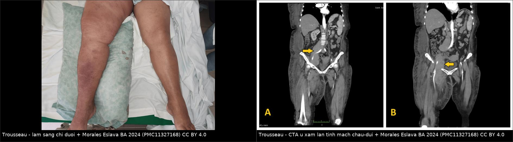
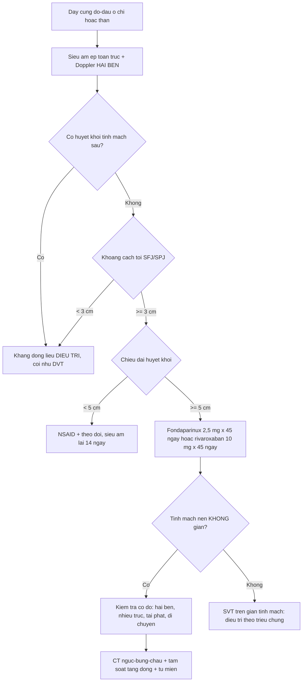
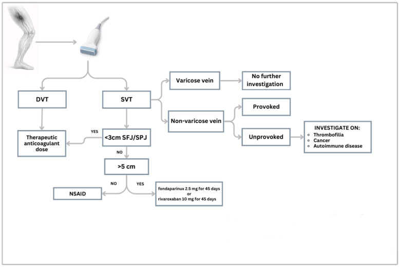
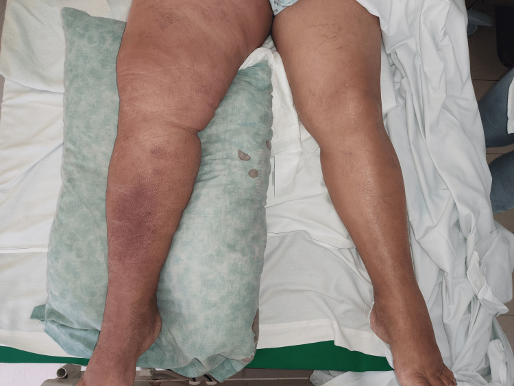
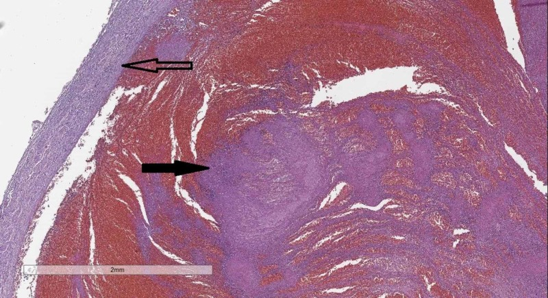

# 1693 — Thrombophlebitis migrans (hội chứng Trousseau) & huyết khối tĩnh mạch nông KHÔNG do giãn tĩnh mạch / Migratory thrombophlebitis (Trousseau syndrome) and non-varicose superficial vein thrombosis

**Tags:** `pattern:day-cung-duoi-da` `pattern:di-chuyen-tai-phat` `pattern:huyet-khoi-tinh-mach-nong` `pattern:khong-gian-tinh-mach` `vung:chi-duoi` `vung:thanh-nguc` `vung:toan-than` `protocol:sieu-am-ep-tinh-mach` `protocol:Doppler-mau` `protocol:CTA-nguc-bung-chau` `incidentaloma:ung-thu-an`
**Mức chắc chắn (certainty):** tổng hợp y văn (literature synthesis) — số liệu đọc trực tiếp từ toàn văn: tổng quan SVT không giãn tĩnh mạch (*J Clin Med* 2026, PMC12897798), đoàn hệ SVT đơn trung tâm (*Res Pract Thromb Haemost* 2024, PMC10770555), 2 ca Trousseau có ảnh (*Cureus* 2024 PMC11327168; *Life* 2024 PMC11433426), ca thrombophlebitis migrans tiền triệu (*Ann Dermatol* 2022 PMC9365648), tiêu bản tĩnh mạch chậu có huyết khối (*Cureus* 2019 PMC6819058); có **ca nguyên văn** cho quiz.

## 1. Tổng quan bệnh học – cơ chế hình ảnh

- **Ba khái niệm phải tách rời:**
  1. **Huyết khối tĩnh mạch nông (superficial vein thrombosis, SVT)** — huyết khối + viêm thành tĩnh mạch **nông**, thường ở chân, sờ thành **dây cứng đỏ–đau**.
  2. **SVT trên nền giãn tĩnh mạch (varicose, VV)** — cơ chế **ứ trệ + thay đổi cấu trúc thành**, tiên lượng tương đối lành.
  3. **SVT KHÔNG do giãn tĩnh mạch (non-varicose, NVV) — gồm thể DI CHUYỂN/TÁI PHÁT = thrombophlebitis migrans, tức hội chứng Trousseau** — cơ chế **tăng đông hệ thống** (u, tăng đông di truyền, bệnh tự miễn), **tiên lượng nặng hơn hẳn**.
- **Vì sao "di chuyển" lại là dấu hiệu báo động:** huyết khối **không phải do ứ trệ tại chỗ** mà do **máu tăng đông toàn thân** → huyết khối **xuất hiện ở đoạn này, tự tan, rồi mọc ở đoạn khác** theo chu kỳ. Ca nguyên văn: **nốt đỏ–đau ở hai cổ tay, chi dưới và tinh hoàn, mỗi đợt tự thoái triển rồi tái phát theo chu kỳ ~1 tháng, kéo dài 4 tháng**; sinh thiết da = **huyết khối tĩnh mạch trung bì** không viêm mạch, không hoại tử fibrinoid.
- **Cơ chế tăng đông do u (định lượng cơ chế):** tế bào u **tăng biểu hiện yếu tố mô (tissue factor, TF)** — chất khởi động con đường ngoại sinh; **vi hạt (microparticle) mang TF**; **mucin** của u gắn selectin trên tiểu cầu và nội mô; **bẫy ngoại bào bạch cầu trung tính (NETs)** hoạt hóa yếu tố XII. Vì vậy Trousseau gắn với **u tụy, phổi, não, dạ dày, đường mật**, và **JAK2 V617F** ở bệnh tăng sinh tủy.
- **TẠI SAO siêu âm ép (compression ultrasound) là chốt (vật lý):** tĩnh mạch nông bình thường **xẹp hoàn toàn** dưới lực ép của đầu dò; khi có huyết khối, **lòng mạch không xẹp**, trong lòng có **hồi âm**, **không có dòng** trên Doppler màu. Siêu âm còn đo được **chiều dài huyết khối** và **khoảng cách tới ngã ba hiển–đùi/khển–khoeo** — hai con số quyết định điều trị (ngưỡng **3 cm** và **5 cm**).
- **Tần suất (định lượng):** SVT có triệu chứng **0,64%/năm** (KTC 0,55–0,74), từ **0,04%** ở nam 18–39 tuổi tới **2,19%** ở nữ ≥ 75 tuổi; **NVV chiếm 20–60%** tổng số SVT (STEPH **24%** = 41/171; POST **20%**; Utrecht **60,5%**; INSIGHTS-SVT **24,4%**).
- **Vì sao NVV không phải "bệnh nhẹ":** tại lúc chẩn đoán SVT, **DVT đồng thời 24,6%**, **PE 4,7%** (STEPH); OPTIMEV: NVV-SVT có DVT/PE đồng thời **39,4% vs 23,3%** so với SVT trên giãn tĩnh mạch (p < 0,001); **không có giãn tĩnh mạch là yếu tố nguy cơ ĐỘC LẬP** cho VTE có triệu chứng ở 3 tháng (**HR 2,06**; KTC 1,01–4,25; p = 0,049); hồi cứu STEFLUX: NVV **OR 2,6** (1,3–5,0; p = 0,007) cho VTE sau ngừng điều trị.
- **Tăng đông di truyền/mắc phải:** tỷ lệ **cao gấp 2–3 lần** so với người không có SVT; trong một loạt **73 ca NVV-SVT**, **76% có tăng đông**, **51% yếu tố V Leiden** (khoảng nửa đồng hợp tử); một loạt khác: **74,2%** ca SVT là NVV, sàng lọc tăng đông dương **53,4%** (protein C 2,1%, protein S 6,2%, AT III 6,25%, FV 46,4%, prothrombin G20210A 21,4% — chỉ thể dị hợp).
- **Ung thư:** tỷ lệ ung thư **8,7%** ở bệnh nhân SVT; **16,6%** bệnh nhân SVT trong đoàn hệ 632 ca VTE có **ung thư đang hoạt động**; meta-analysis IROVAM-ISVT (**8 nghiên cứu, 5.998 ca SVT**): **448 ca (7,47%)** có ung thư hoạt động, VTE **18,2/100 người–năm** (**RR 2,57** so với không ung thư), chảy máu nặng **2,0/100 người–năm**, tử vong do mọi nguyên nhân **22,8/100 người–năm**.
- **Sinh tồn khi SVT có ung thư (OPTIMEV):** tử vong **23,2%/người–năm** (so với **2,0%/người–năm** ở SVT không ung thư; **aHR 0,1**), **tương đương** ung thư có DVT (**27,2%/người–năm**); nếu **ung thư + SVT + DVT đồng thời: 57,4%/người–năm**. **44,3%** bệnh nhân ung thư có SVT **đã có DVT kèm theo** → **siêu âm tĩnh mạch sâu là bắt buộc**.

## 2. Mẫu hình + chẩn đoán phân biệt theo vị trí (Gamut)

- **Khuôn 1 — Dây cứng đỏ–đau ở chân, KHÔNG có giãn tĩnh mạch, tái phát hoặc nhiều dây.** Gamut: **SVT không giãn tĩnh mạch / Trousseau** vs **SVT trên giãn tĩnh mạch** vs **DVT lan theo tĩnh mạch nối** vs **viêm mô tế bào** vs **nhiễm trùng mô mềm**. Chốt: **không xẹp + hồi âm trong lòng**, đo **khoảng cách tới SFJ/SPJ**.
- **Khuôn 2 — Dây di chuyển, nhiều đợt, hai bên, nhiều vị trí (chân + tay + thân).** Gamut: **Trousseau (u tạng)** vs **bệnh Behçet** vs **viêm tắc động mạch (Buerger)** vs **hội chứng kháng phospholipid** vs **tăng đông di truyền**. Chốt: **tổn thương ở nhiều vùng giải phẫu cùng lúc + không giãn tĩnh mạch**; Behçet có **loét sinh dục/miệng, viêm màng bồ đào**; Buerger ở **nam hút thuốc nhiều**.
- **Khuôn 3 — Dây ở thành ngực/vú, một bên, tự khỏi 4–8 tuần.** Gamut: **bệnh Mondor** vs **thể di chuyển của Trousseau** vs **viêm bạch mạch** vs **di căn da**. Chốt: Mondor **một dây, một bên, tự khỏi**; **tái phát/hai bên → tầm soát hệ thống**.
- **Khuôn 4 — Dây ở tay/cẳng tay, có catheter/kim truyền.** Gamut: **SVT do catheter (hóa chất, TPN, vancomycin, KCl đậm đặc)** vs **SVT nhiễm khuẩn có mủ (suppurative SVT)** vs **Trousseau**. Chốt: **vị trí đúng đường truyền**; **sốt + mủ + cấy máu dương** → suppurative SVT, phải **cắt đoạn tĩnh mạch nhiễm**.
- **Khuôn 5 — Dây ở dương vật/thân mình.** Gamut: **Mondor dương vật** vs **viêm xơ bạch mạch (sclerosing lymphangitis)** vs **di căn/u**. Chốt: vị trí giải phẫu + **không đáp ứng kháng sinh**.
- **Khuôn 6 — SVT + đau ngực/khó thở.** Gamut: **PE từ SVT** vs **nhồi máu phổi** vs **viêm màng phổi**. Chốt: **CTPA**; PE **4,7%** ngay lúc chẩn đoán SVT.
- **Gợi nhớ "MIGRANS":** **M**ột bên rồi đổi bên · **I**diopathic/không giãn tĩnh mạch (**NVV**) · **G**iãn tĩnh mạch KHÔNG có · **R**ecur (tái phát theo chu kỳ) · **A**ge > 60 · **N**eoplasia (u ẩn) · **S**àng lọc tăng đông + tự miễn.

## 3. Bảng so sánh phân biệt (ma trận đối chiếu)

| Thực thể (entity) | Hình ảnh điển hình (SA ép / Doppler / CT) | Chốt vào (rule-in) | Chốt loại (rule-out) | Gợi ý xác nhận |
|---|---|---|---|---|
| **SVT không giãn tĩnh mạch / Trousseau** | Ống nông **không xẹp**, hồi âm trong lòng, **không dòng**; **nhiều đoạn, nhiều trục, hai bên**; tĩnh mạch nền **không giãn, thành mỏng** | **NVV + tái phát/di chuyển/multi-vein**; **huyết khối dài ≥ 5 cm** hoặc **cách SFJ/SPJ < 3 cm** | **Có giãn tĩnh mạch rõ, một dây đơn độc, tự khỏi** → SVT trên VV | SA ép toàn trục + đo chiều dài/khoảng cách; **siêu âm lặp trong 14 ngày**; tầm soát u/tăng đông có chọn lọc |
| SVT trên giãn tĩnh mạch | Tĩnh mạch **giãn, thành dày, dòng trào ngược**; huyết khối trong nhánh giãn | **Tiền sử giãn tĩnh mạch + trào ngược trên Doppler** | **Tĩnh mạch nền bình thường** → nghĩ NVV | SA + Doppler; điều trị theo triệu chứng |
| DVT lan từ SVT | Huyết khối **liên tục** từ tĩnh mạch nông vào **tĩnh mạch sâu** qua ngã ba; tĩnh mạch sâu **không xẹp** | **Huyết khối trong lòng tĩnh mạch sâu** (đùi/khoeo) | **Tĩnh mạch sâu xẹp hoàn toàn, có dòng** | SA ép tĩnh mạch sâu **cùng lúc**; CTPA nếu có triệu chứng |
| Behçet | Huyết khối **nhiều ổ, hai bên, tái phát**, có thể **phình mạch**; viêm **toàn thành 3 lớp** | **Loét miệng/sinh dục tái phát + tổn thương mắt/da** + huyết khối nhiều ổ | **Không có loét niêm mạc, không viêm mắt** | Khám lâm sàng + HLA-B51; **kháng đông + ức chế miễn dịch** |
| Viêm tắc động mạch (Buerger) | Tắc **động mạch nhỏ–vừa** ngọn chi + **SVT di chuyển 40%** | **Nam trẻ, hút thuốc nặng** + thiếu máu ngón + SVT di chuyển | **Mạch ngoại vi bình thường, không hút thuốc** | Chụp mạch (dấu "bậc thang"/corckscrew); **bắt buộc bỏ thuốc** |
| SVT nhiễm khuẩn (suppurative) | Ống nông **không xẹp** + **dịch/mủ quanh tĩnh mạch**, khí trong mô | **Sốt + mủ + cấy máu dương** (S. aureus/MRSA) | **Không sốt, không mủ** | Cấy máu + SA; **kháng sinh + cắt đoạn tĩnh mạch** |
| SVT do catheter | Ống **không xẹp đúng vị trí catheter**, đoạn ngắn | **Tiền sử truyền hóa chất/TPN/dung dịch > 800–900 mOsm/L** | **Không can thiệp tại chỗ** | SA tại chỗ; rút/thay đường truyền |
| Bệnh Mondor | Một dây **thành ngực/vú**, không xẹp, không dòng; nhũ ảnh có thể bất đối xứng tuyến tính | **Một bên, một dây, tự khỏi 4–8 tuần** | **Nhiều dây, hai bên, tái phát** → không phải Mondor đơn thuần | SA + nhũ ảnh (bài 1691); tầm soát nếu tái phát |

*Trái: **chi dưới phải sưng, đỏ, đau** — dấu hiệu "gửi" (sentinel). Phải: **CTA bụng–chậu**: khối u **xâm lấn trực tiếp tĩnh mạch chậu ngoài và tĩnh mạch–động mạch đùi phải** (mũi tên) — nguyên nhân gây huyết khối do **chèn ép + tổn thương nội mạc**, không phải do ứ trệ. Nguồn: Morales Eslava BA, Becerra Bello J., *Cureus* 2024, Fig. 1–2 (CC BY 4.0).*

## 4. Protocol chụp + thuật toán điều trị

**Bước 1 — Siêu âm ép toàn bộ trục tĩnh mạch nông, HAI BÊN (bắt buộc):**
- Đầu dò thẳng **7–12 MHz**, quét từ **mắt cá** lên **bẹn** theo **hiển lớn** và từ **khoeo** theo **hiển bé**, cộng các nhánh; luôn quét **tĩnh mạch sâu cùng lúc** (đùi, khoeo) vì **DVT đồng thời 8,7% ngay cả khi không triệu chứng** (11/19 ca là **DVT gần**).
- Ghi **4 con số quyết định**: chiều dài huyết khối (cm) · khoảng cách tới **SFJ/SPJ** (cm) · số trục tĩnh mạch bị huyết khối · có/không huyết khối tĩnh mạch sâu.
- **Siêu âm lặp lại trong 14 ngày** (huyết khối lan là biến cố sớm, **71,4%** biến cố xảy ra trong tháng đầu).

**Bước 2 — Phân tầng theo 2 ngưỡng 3 cm và 5 cm:**
- **< 3 cm tới SFJ/SPJ** hoặc **có DVT** → coi như **DVT**: **kháng đông liều ĐIỀU TRỊ**.
- **> 3 cm và chiều dài ≥ 5 cm** → **fondaparinux 2,5 mg/ngày × 45 ngày** hoặc **rivaroxaban 10 mg/ngày × 45 ngày**; LMWH **liều trung gian 30 ngày** là lựa chọn thay thế.
- **< 5 cm, nguy cơ thấp** → **NSAID + theo dõi** là đủ (không kháng đông).

**Bước 3 — Có tầm soát ung thư không? (câu hỏi hay bị làm sai cả hai phía):**
- **KHÔNG tầm soát ung thư toàn diện cho mọi SVT đơn độc, không rõ nguyên nhân:** nghiên cứu bệnh–chứng **277 ca SVT vs 553 chứng**, theo dõi 24 tháng → ung thư mới **2% (5/250) vs 2% (10/504)**, **SMR 1,1** (KTC 0,5–2,7) — không tăng có ý nghĩa.
- **CÓ tầm soát khi có "cờ đỏ":** **hai bên (RR 8,38)** · **nhiều trục (RR 2,42)** · **gần ngã ba < 3 cm (RR 2,01)** · **SVT gần gốc (proximal) (RR 1,54)** · **huyết khối lan nhanh (RR 5,75)** · **tái phát/di chuyển** · **tuổi cao** · **nam**. Khi đó: **CT ngực–bụng–chậu có cản quang + xét nghiệm máu + tầm soát theo triệu chứng**.
- **Tầm soát tăng đông** (theo hướng dẫn Brazil và Hội Angiology quốc tế): **SVT không giãn tĩnh mạch sau khi loại trừ u**, **tiến triển dù đã điều trị đủ**, **tái phát**, **nghi bệnh tự miễn** → yếu tố V Leiden, prothrombin G20210A, protein C/S, AT III, kháng phospholipid.
- **Không quên Behçet/Buerger:** tổn thương mạch gặp **tới 40%** ca Behçet và có thể **xuất hiện trước khi đủ tiêu chuẩn chẩn đoán**; **40%** ca Buerger có SVT, thường **di chuyển**.

**Bước 4 — Điều trị và theo dõi (số liệu thử nghiệm):**
- **CALISTO (n = 3.002):** fondaparinux 2,5 mg × 45 ngày — biến cố chính **0,9% vs 5,9%** (giảm nguy cơ tương đối **85%**, p < 0,001); chảy máu nặng **0,7% vs 1,1%**.
- **SURPRISE (n = 472):** **rivaroxaban 10 mg không thua kém** fondaparinux 2,5 mg ở 45 ngày; **không có chảy máu nặng** ở cả hai nhánh.
- **STEFLUX (n = 664):** LMWH **liều trung gian 30 ngày** cho biến cố **1,8%**, so với **15,6%** (10 ngày) và **7,3%** (liều dự phòng 30 ngày).
- **INSIGHTS-SVT (n = 1.159):** 3 tháng — SVT lan/tái phát **4,7%**, DVT **1,7%**, PE **0,8%**; fondaparinux **≥ 38 ngày** tốt hơn LMWH (**3,7% vs 10,5%**, HR 0,37).
- **Vì sao KHÔNG dùng warfarin đơn thuần ở ung thư:** ca 72 tuổi dưới đây được **enoxaparin 1 mg/kg mỗi 12 giờ + warfarin**, ra viện chỉ với **warfarin**, và **tử vong do thuyên tắc phổi 2 tháng sau** — ung thư cần **LMWH hoặc DOAC**, không phải kháng vitamin K đơn độc.
- **Theo dõi:** khám + siêu âm lại ở **2 tuần, 3 tháng**; ở bệnh nhân ung thư, nguy cơ VTE **vẫn cao suốt 1 năm** (HR 2,40; KTC 1,30–4,45; p = 0,005) — cân nhắc **kéo dài kháng đông** theo từng ca.

*Thuật toán: SVT → kiểm tra **< 3 cm tới SFJ/SPJ** (→ kháng đông liều điều trị) → **chiều dài ≥ 5 cm** (→ fondaparinux 2,5 mg hoặc rivaroxaban 10 mg × 45 ngày) → nếu **tĩnh mạch không giãn** và **không rõ nguyên nhân** → **tầm soát tăng đông, ung thư, bệnh tự miễn**. Nguồn: Mangiafico M, Di Pino FL, Costanzo L., *J Clin Med* 2026, Fig. 2 (CC BY 4.0).*

## 5. Biến thể bình thường và cạm bẫy

- **Tĩnh mạch nông bình thường xẹp hoàn toàn khi ép** — nếu ống **vẫn xẹp** thì không phải huyết khối, dù sờ thấy "dây". Dây có thể là **cân cơ, gân, thần kinh, bạch mạch**.
- **Đừng đoán "giãn tĩnh mạch" bằng mắt:** NVV nghĩa là **tĩnh mạch nền không giãn/không trào ngược** trên Doppler — nhiều ca "chân bình thường" vẫn là NVV, và chính **không có giãn tĩnh mạch mới là yếu tố nguy cơ**.
- **Chỉ siêu âm đoạn đau là sai:** huyết khối **lan theo trục** và có thể **đã vào tĩnh mạch sâu** ở đoạn không đau; **8,7%** ca không triệu chứng DVT, trong đó **11/19 là DVT gần**.
- **Hai bên hoặc nhiều trục = đừng dừng ở "SVT":** **RR 8,38** (hai bên) và **RR 2,42** (nhiều trục) cho ung thư hoạt động — đây là **chỉ định tầm soát**, không phải "thể nặng của cùng bệnh".
- **Warfarin đơn thuần ở bệnh nhân ung thư là bẫy:** ca nguyên văn tử vong do PE sau 2 tháng; ưu tiên **LMWH/DOAC**, và **điều trị kéo dài** khi u còn hoạt động.
- **Không phải mọi SVT đều cần kháng đông:** **< 5 cm, > 3 cm cách ngã ba, không ung thư** → **NSAID** là đủ; kháng đông thêm nguy cơ chảy máu mà không giảm biến cố.
- **"Di chuyển" không đồng nghĩa ung thư:** Behçet, Buerger, APS, tăng đông di truyền đều cho hình ảnh giống; **không được mặc định "chắc chắn có u"** rồi bỏ qua bệnh tự miễn — và ngược lại, **không được trấn an** khi tổn thương hai bên/tái phát.
- **Suppurative SVT dễ bị gọi là "viêm mô tế bào":** nếu **sốt + mủ dọc tĩnh mạch + cấy máu dương**, phải **cắt đoạn tĩnh mạch nhiễm** — kháng sinh đơn thuần sẽ tái phát và có nguy cơ **tắc mạch nhiễm khuẩn**.

## 6. Tự lượng giá — Blind Quiz

**Ca 1 — Nữ 72 tuổi, chi dưới phải sưng–đỏ–đau 1 tuần, hạch bẹn 3–6 cm cố định.**

- Hỏi: mô tả dấu hiệu? Cần chụp gì ngoài siêu âm tĩnh mạch? Chẩn đoán có thể là gì và vì sao "hạch bẹn" lại quan trọng?

<b>Bấm để hiện đáp án (findings + chẩn đoán)</b>

- **Dấu hiệu:** chi dưới phải **sưng to, đỏ, tăng nhiệt**, so với bên trái; đau khi sờ nông và sâu; mạch mu chân còn nhưng yếu. Kèm **nhiều hạch bẹn 3–6 cm, cố định, không đau**.
- **Chẩn đoán:** **hội chứng Trousseau** do **lymphoma không Hodgkin độ cao (Burkitt)** — siêu âm Doppler: **huyết khối tĩnh mạch đùi lan tới tĩnh mạch chậu chung**; CTA: **u xâm lấn tĩnh mạch chậu ngoài và tĩnh mạch/động mạch đùi phải**.
- **Vì sao:** huyết khối do **u chèn ép + tổn thương nội mạc**, không do ứ trệ → phải **chụp CTA/MRI vùng chậu** khi thấy hạch hoặc SVT không giải thích được. Điều trị: **enoxaparin 1 mg/kg mỗi 12 giờ**; ca này ra viện chỉ với **warfarin** và **tử vong do PE 2 tháng sau** → bài học: ung thư cần **LMWH/DOAC**.
- Nguồn ảnh: Morales Eslava BA, Becerra Bello J., *Cureus* 2024, Fig. 1 (CC BY 4.0).

**Ca 2 — Nam 70 tuổi, nốt đỏ–đau ở hai cổ tay, hai chân và tinh hoàn, mỗi đợt tự khỏi rồi tái phát sau ~1 tháng, kéo dài 4 tháng.**

- Hỏi: mô bệnh học (ảnh) cho thấy gì? Chẩn đoán? Cần tầm soát gì và vì sao **không** chỉ theo dõi?

<b>Bấm để hiện đáp án</b>

- **Dấu hiệu (mô bệnh, ảnh minh họa cơ chế):** thành tĩnh mạch (mũi tên rỗng) và **huyết khối hỗn hợp lấp lòng** (mũi tên đặc) — hình thái của **huyết khối tĩnh mạch kèm xâm nhập tế bào**; ở ca gốc, sinh thiết da cho **huyết khối tĩnh mạch trung bì, không viêm mạch, không hoại tử fibrinoid**.
- **Chẩn đoán:** **thrombophlebitis migrans** — ở ca gốc là **tiền triệu của ATL thể smoldering** (HTLV-1): bạch cầu 9.580/µL với **3% tế bào lympho bất thường**, LDH/IL-2R tăng (2.498 U/mL), **provirus HTLV-1 đơn dòng**.
- **Vì sao không chỉ theo dõi:** tổn thương **di chuyển, tự khỏi rồi tái phát theo chu kỳ** = tăng đông hệ thống. Ca gốc được đổi sang **rivaroxaban** → huyết khối **hết, không tái phát**; nhưng bệnh nền (ATL) tiến triển và tử vong sau **39 tháng** — điều trị kháng đông **che triệu chứng**, không thay điều trị u.
- Nguồn ảnh: Stoyanov GS, Dzhenkov DL, Tzaneva M., *Cureus* 2019, Fig. 3 (CC BY 4.0) — ảnh minh họa cơ chế huyết khối trong lòng tĩnh mạch, **không phải** tiêu bản của ca ATL.

**Ca 3 — Nam 44 tuổi, tiền sử 6 tháng DVT + viêm tắc tĩnh mạch nông tái diễn, nay đau hạ sườn phải.**

<b>Bấm để hiện đáp án</b>

- **Dấu hiệu:** siêu âm bụng: **khối giảm âm 8,5 × 5,5 cm thùy phải gan**, bờ không rõ + **nốt giảm âm có quầng**; CEUS: **ngấm thì động mạch sớm**; CT: **khối 12 cm**, xâm lấn; mô bệnh: **adenocarcinoma, hoại tử, phản ứng xơ hóa mạnh**.
- **Chẩn đoán:** **ung thư đường mật trong gan (intrahepatic cholangiocarcinoma)** biểu hiện bằng **huyết khối tĩnh mạch nông + DVT tái diễn 6 tháng trước đó** — tức **Trousseau là dấu hiệu đi trước chẩn đoán u**.
- **Vì sao:** CCA bài tiết mucin + TF → tăng đông; **SVT không giãn tĩnh mạch, tái phát** là "cờ đỏ" đòi hỏi **CT ngực–bụng–chậu**. Bài gốc tìm được **20 ca** ung thư đường mật có huyết khối xa trong 19 bài — mức bằng chứng rất thấp, nhưng **hướng đi là rõ**.
- Nguồn: Ciobica ML và cs., *Life* 2024 (PMC11433426).

## Bài liên quan chéo
- [1691 – Bệnh Mondor: huyết khối tĩnh mạch nông vú – thành ngực](../1691-benh-mondor-huyet-khoi-tinh-mach-nong/lesson.md)
- [1692 – U tuyến núm vú & erosive adenomatosis](../1692-u-tuyen-num-vu/lesson.md)
- [070 – Thuyên tắc phổi & nhồi máu phổi cấp](../070-thuyen-tac-phoi-dmc-cap/lesson.md)
- [163 – Pylephlebitis & huyết khối tĩnh mạch mạc treo](../163-pylephlebitis-huyet-khoi-tm-mac-treo/lesson.md)
- [1697 – Hội chứng tăng đông của Cushing: VTE chu phẫu](../1697-cushing-tang-dong-vte/lesson.md)
- [170 – Phình động mạch chủ bụng](../170-phinh-DMC-bung/lesson.md)

> Không dùng để chẩn đoán độc lập khi chưa có người hướng dẫn.
