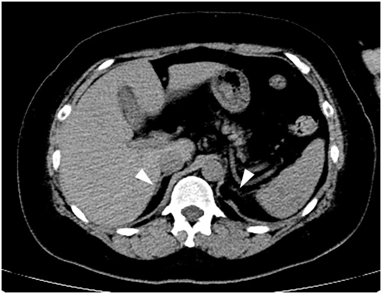
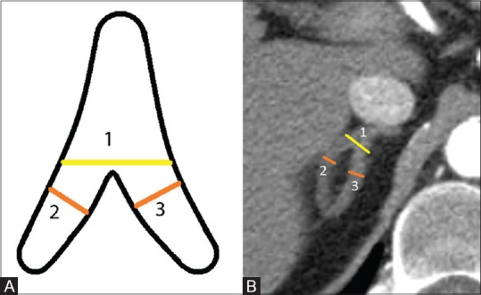
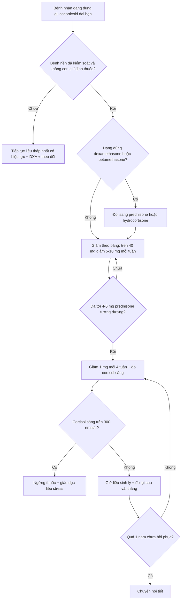
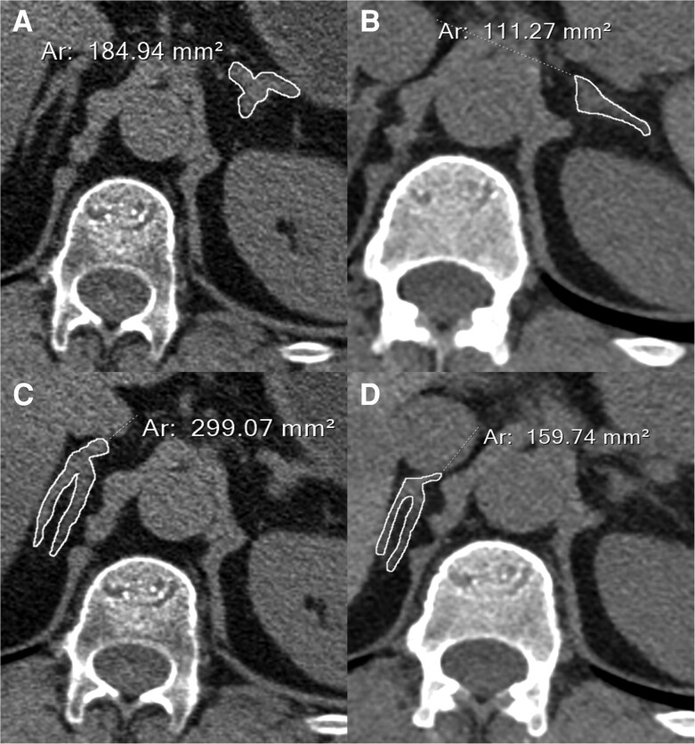

# 1694 — Cushing do glucocorticoid ngoại sinh: thượng thận hai bên teo, cai thuốc và suy thượng thận cấp / Iatrogenic (exogenous) Cushing syndrome

**Tags:** `pattern:teo-thuong-than` `pattern:cushing` `pattern:suy-thuong-than` `vung:thuong-than` `vung:o-bung` `protocol:CT-bung` `protocol:DXA` `score:cortisol-sang` `score:ACTH-stimulation` `incidentaloma:u-thuong-than`

**Mức chắc chắn (certainty):** tổng hợp y văn (literature synthesis) — hướng dẫn chung ESE/Endocrine Society 2024 về suy thượng thận do glucocorticoid (Beuschlein F và cộng sự, *J Clin Endocrinol Metab* 2024, PMC11180513) + ngưỡng kích thước thượng thận bình thường trên CT (John R và cộng sự, *Indian J Radiol Imaging* 2018, PMC6319091) + 2 ca nguyên văn có ảnh (Cushing + suy thượng thận do corticoid bôi ngoài da, Iwamoto Y và cộng sự, *Endocr J* 2025, PMC12702672; teo thượng thận do ức chế tổng hợp cortisol kéo dài, Sofer Y và cộng sự, *JCEM Case Rep* 2026, PMC13392468).

> **Câu chốt:** Cushing ngoại sinh là **thể Cushing phổ biến nhất**, và trên hình ảnh nó **ngược hoàn toàn** với Cushing nội sinh: **hai thượng thận teo đều, không có khối**, ACTH bị ức chế. Nghĩa là **"không thấy u" chính là dấu hiệu**, không phải "bình thường". Cái chết không đến từ cortisol cao mà từ **cai thuốc sai**: trục HPA bị ức chế mất **nhiều tháng tới nhiều năm** để hồi phục, và **13,75%** bệnh nhân suy thượng thận do glucocorticoid nhập viện có cơn suy thượng thận cấp, với tử vong **62,75% so với 44,06%** ở nhóm không có cơn.

## 1. Tổng quan bệnh học – cơ chế hình ảnh

- **Dịch tễ:** glucocorticoid là nguyên nhân **thường gặp nhất** của hội chứng Cushing nói chung (thuốc dùng ở mọi chuyên khoa: hô hấp, da liễu, mắt, khớp, tiêu hóa). Suy thượng thận do glucocorticoid (glucocorticoid-induced adrenal insufficiency — GIAI) sau **corticoid hít: 7,8% (CI 4,2–13,9)**, tăng theo thời gian — **dùng > 12 tháng: 27,4% (17,7–39,8)**, **liều cao: 21,5% (12,0–35,5)** (ESE/ES 2024, Bảng 6). Đường **bôi ngoài da** cũng đủ gây Cushing + suy thượng thận khi diện rộng, da tổn thương, hoặc dùng **clobetasol tới 50 g/ngày** (ca PMC12702672).
- **TẠI SAO thượng thận teo — cơ chế nội tiết:** cortisol ngoại sinh liều trên sinh lý ức chế ngược **CRH và ACTH** → **zona fasciculata và zona reticularis teo** vì không còn ACTH kích thích; **zona glomerulosa tương đối được bảo tồn** (phụ thuộc renin–angiotensin) nên **aldosterone thường còn**, giải thích vì sao bệnh nhân **không tăng kali** cho tới khi có cơn suy thượng thận nặng. Hệ quả trên CT: **hai thượng thận nhỏ đều, mất hình "chữ V/Y" mập**, không nốt, không vôi hóa.
- **TẠI SAO "không có khối" lại là chốt:** Cushing nội sinh **phụ thuộc ACTH** (bệnh Cushing do u tuyến yên, ACTH lạc chỗ) → ACTH cao → **tăng sản thượng thận hai bên đều**; Cushing nội sinh **không phụ thuộc ACTH** (adenoma, ACC, PPNAD/AIMAH) → **một khối** hoặc **hai bên nhiều nốt**, còn bên đối diện **teo vì ACTH bị ức chế**. Vì vậy bộ ba **kích thước + đối xứng + ACTH** phân loại được gần hết các thể.
- **Ngưỡng kích thước bình thường (đo trên CT lát ≤ 2,5 mm, vuông góc trục dài, cửa sổ mô mềm WL 40–60/WW 400, n = 586 người trưởng thành):** thân **7,2 ± 1,8 mm (phải)** và **8,8 ± 1,9 mm (trái)**; nhánh trong **4,1 ± 1,1 / 4,7 ± 1,1 mm**; nhánh ngoài **4,3 ± 1,1 / 4,9 ± 1,3 mm**; tổng độ dày thân + hai nhánh **15,6 ± 3,7 mm (phải)** và **18,4 ± 3,8 mm (trái)**; **27%** người bình thường có thân ≥ 10 mm (PMC6319091).
- **Ngưỡng "teo" (suy luận từ phân bố trên — ghi rõ là suy luận):** nhánh **≤ 2–3 mm** và thân **< 5 mm** nằm dưới **2 SD** của người bình thường; đáng tin hơn là **so chuỗi ảnh theo thời gian** — ca PMC13392468: diện tích thượng thận trái **184,9 → 111,3 mm²**, phải **299,1 → 159,7 mm²** sau nhiều năm ức chế trục.
- **TẠI SAO nguy hiểm khi cai:** nửa đời sinh học của **dexamethasone 36–72 giờ** (so với prednisone 12–36 giờ và hydrocortisone 8–12 giờ) làm trục HPA bị ức chế sâu và lâu; **hồi phục ghi nhận 17–100% trong khoảng 4 ngày đến 3 năm** (ESE/ES 2024) — tức là **không thể hẹn ngày chắc chắn**, phải đo lại.
- **TẠI SAO phải chụp xương:** cortisol làm **giảm tạo xương, tăng hủy xương**; ngay **prednisone 2,5–7,5 mg/ngày** đã tăng nguy cơ loãng xương, gãy xương, đái tháo đường, tăng huyết áp, biến cố tim mạch (ESE/ES 2024 dẫn các đoàn hệ lớn).

## 2. Mẫu hình + chẩn đoán phân biệt theo vị trí (Gamut)

- **Hai thượng thận NHỎ đều:** Cushing ngoại sinh (thuốc uống/bôi/hít/tiêm khớp/nhỏ mắt) — hàng đầu; **suy tuyến yên** (ACTH thiếu, sau xạ/mổ u tuyến yên, Sheehan — bài 246); **suy thượng thận nguyên phát giai đoạn muộn** (Addison: teo + **vôi hóa**, ACTH rất cao); **thiểu sản bẩm sinh**; **sau cắt thượng thận hai bên**.
- **Hai thượng thận TO đều, giữ hình:** bệnh Cushing do u tuyến yên (bài 1696), **ACTH lạc chỗ**, **CRH lạc chỗ** (rất hiếm).
- **Hai thượng thận TO và có NỐT:** PPNAD (Carney, nốt nhỏ < 1 cm), **AIMAH** (nốt lớn hai bên), di căn, lymphoma, lao/nấm, xuất huyết hai bên.
- **MỘT BÊN có khối:** adenoma vỏ (bên đối diện teo), ACC, pheochromocytoma (bài 168), di căn, myelolipoma, máu tụ.
- **Gợi nhớ STEROID** cho Cushing ngoại sinh: **S**uppressed ACTH, **T**opical/inhaled/ocular/intra-articular (đường dùng "vô hại"), **E**xogenous, **R**apid weight gain + striae, **O**steoporosis, **I**atrogenic, **D**ose supraphysiologic kéo dài.

## 3. Bảng so sánh phân biệt (ma trận đối chiếu)

| Thực thể (entity) | Hình ảnh điển hình | Chốt vào (rule-in) | Chốt loại (rule-out) | Gợi ý xác nhận |
|---|---|---|---|---|
| **Cushing ngoại sinh (thuốc)** | **Hai thượng thận teo đều, không nốt**; có thể bình thường nếu dùng ngắn/liều thấp | **Tiền sử glucocorticoid (kể cả bôi/hít/nhỏ mắt/tiêm khớp) + ACTH bị ức chế + hai bên teo** | **Có khối một bên** hoặc **tăng sản hai bên** → không phải ngoại sinh đơn thuần | Hỏi thuốc theo từng đường, cortisol sáng + ACTH, test 250 µg ACTH |
| **Bệnh Cushing (u tuyến yên)** | Tăng sản **đều hai bên** (nhánh > 5 mm, thân > 10 mm); u tuyến yên ± | **ACTH cao/không bị ức chế + tăng sản hai bên đều + MRI tuyến yên** | ACTH < 5–10 pg/mL → loại trừ phụ thuộc ACTH | MRI 3T động học, BIPSS nếu MRI âm (bài 1696) |
| **ACTH lạc chỗ** | Tăng sản **rất mạnh**, đôi khi có nốt; hạ kali, kiềm chuyển hóa | **ACTH rất cao + hạ K + ổ u phổi/tuyến ức/tụy** | Hai thượng thận teo → loại trừ | CT ngực–bụng, BIPSS để phân biệt |
| **Adenoma vỏ thượng thận** | **Một khối**, bên đối diện **teo**; ≤ 10 HU, washout > 60% | **Khối một bên + bên đối diện teo + ACTH thấp** | Hai bên teo đều, không khối → loại trừ | CT 2 thì + washout; MIBG/PET nếu nghi ACC |
| **PPNAD / AIMAH** | Hai bên **nhiều nốt** (PPNAD nốt nhỏ, AIMAH nốt lớn), thượng thận không teo | **Nốt hai bên + ACTH thấp + bối cảnh Carney/người lớn** | Teo đều, không nốt → loại trừ | CT/MRI, mô bệnh sau mổ |
| **Suy thượng thận nguyên phát (Addison)** | Teo muộn, **vôi hóa** thượng thận, hai bên | **ACTH rất cao + hạ Na/tăng K + vôi hóa** | ACTH thấp → loại trừ | ACTH, renin/aldosterone, kháng thể 21-hydroxylase |

*CT bụng mặt cắt ngang: hai thượng thận teo (tam giác trắng), không thấy khối. Nguồn: Iwamoto Y và cộng sự, Endocrine Journal 2025, PMCID PMC12702672, CC BY-NC-ND 4.0 — nguyên bản, không crop/ghép.*

## 4. Protocol chụp + hệ phân độ/điểm chuẩn hóa

### 4.1. Đo thượng thận trên CT (phải làm đúng kỹ thuật)
- **Lát ≤ 2,5 mm** (lý tưởng **1–2 mm**), cửa sổ mô mềm; đo **độ dày tối đa của thân và hai nhánh, vuông góc trục dài**, ghi **mm** cho từng bên — không ước lượng "to/nhỏ" bằng mắt.
- Chỉ đo trên **lát cắt qua cả thân và hai nhánh** (hình chữ V/Y); lát quá cao/thấp sẽ cắt ngang nhánh → **giả teo**; lát dày → **hiệu ứng thể tích** làm thân dày giả.
- **Đối chiếu chuỗi ảnh cũ** — teo "mới" có giá trị hơn teo "đoán"; ca PMC13392468 định lượng **diện tích** (mm²) theo thời gian.

*(A) Sơ đồ và (B) CT: 1 = thân, 2 = nhánh ngoài, 3 = nhánh trong; đo vuông góc trục dài. Nguồn: John R và cộng sự, Indian J Radiol Imaging 2018, PMCID PMC6319091, CC BY-NC-SA 4.0.*

### 4.2. Sinh hóa — ngưỡng dùng trong thực hành (ESE/ES 2024)
- **Cortisol huyết tương buổi sáng (lúc 8 giờ, trước uống thuốc):** **< 150 nmol/L (< 5 µg/dL)** → tiếp tục liều sinh lý, đo lại sau vài tháng; **150–300 nmol/L (5–10 µg/dL)** → vùng xám, giữ liều sinh lý, đo lại sau vài tuần–tháng; **> 300 nmol/L (> 10 µg/dL)** → có thể ngừng an toàn.
- **Test 250 µg ACTH(1-24) (short synacthen):** đỉnh cortisol **< 500 nmol/L (< 18 µg/dL)** = suy thượng thận (tùy assay); test chỉ đánh giá **đáp ứng của vỏ thượng thận**, không đánh giá trục hồi phục hoàn toàn.
- **Không test khi còn dùng liều trên sinh lý** hoặc còn cần glucocorticoid để kiểm soát bệnh nền (R 2.4) — kết quả sẽ vô nghĩa.
- **Đổi thuốc tác dụng dài → ngắn** (dexamethasone/betamethasone → prednisone/hydrocortisone) trước khi cai, để có **bước giảm 1 mg** (R 2.5).

### 4.3. Lịch cai thuốc (Bảng 4, ESE/ES 2024)

| Liều prednisone hiện tại | Bước giảm | Khoảng cách |
|---|---|---|
| **> 40 mg** | **5–10 mg** | mỗi tuần |
| **20–40 mg** | **5 mg** | mỗi tuần |
| **10–20 mg** | **2,5 mg** | mỗi 1–4 tuần |
| **5–10 mg** | **1 mg** | mỗi 1–4 tuần |
| **5 mg** (liều sinh lý ≈ **4–6 mg** prednisone / **15–25 mg** hydrocortisone) | **1 mg** (hoặc 20 mg hydrocortisone, giảm 5 mg) | mỗi 4 tuần nếu không triệu chứng và test âm tính |

- **Không cai** nếu thời gian dùng **< 3–4 tuần**, bất kể liều (R 2.1); chỉ cai khi **bệnh nền đã kiểm soát** và không còn chỉ định glucocorticoid (R 2.2).
- **Không hồi phục sau 1 năm** ở liều sinh lý → chuyển chuyên khoa nội tiết (R 2.11).
- **Liều stress (Bảng 8):** ốm nhẹ cần nằm giường/sốt/kháng sinh ngoại trú → **hydrocortisone 40 mg/ngày chia 3 lần** (hoặc prednisone 10 mg/ngày) trong **2–5 ngày**; **nôn/tiêu chảy không uống được** → **hydrocortisone 100 mg tiêm bắp**, lặp sau 6 giờ nếu cần; **nhập viện/nhiễm trùng nặng** → **100 mg IV bolus + truyền 200 mg/24 giờ** (hoặc 50 mg IV mỗi 6 giờ).
- **Cơn suy thượng thận cấp (Bảng 9):** **sốc không tương xứng với yếu tố khởi phát**, **kháng vận mạch và kháng bù dịch** cho tới khi được tiêm glucocorticoid; kèm ≥ 1 trong: nôn, mệt lả, sốt, rối loạn ý thức. Xét nghiệm gợi ý (không bắt buộc): hạ Na (kèm Na niệu cao), tăng K, tăng urê/creatinine, hạ đường huyết.
- **Xương:** **DXA cột sống + cổ xương đùi** ngay khi bắt đầu glucocorticoid liều ≥ 5 mg prednisone/ngày dự kiến ≥ 3 tháng (hoặc đã dùng dài hạn), lặp sau 12 tháng; đánh giá **gãy đốt sống (VFA)** vì có thể không triệu chứng.

## 5. Biến thể bình thường và cạm bẫy

- **Thượng thận bình thường không loại trừ Cushing ngoại sinh:** dùng ngắn, liều thấp, hoặc corticoid tại chỗ ít hấp thu → **kích thước có thể bình thường**; chốt bằng bệnh sử + ACTH/cortisol.
- **Teo hai bên không đồng nghĩa "do thuốc":** suy tuyến yên, sau xạ/mổ, Addison muộn, thiểu sản bẩm sinh đều teo — **ACTH là mấu chốt** (thấp = trung ương, rất cao = nguyên phát).
- **Thuốc "ẩn" là cạm bẫy số một:** corticoid trong **thực phẩm chức năng/đông dược**, thuốc bôi trộn, thuốc nhỏ mắt, thuốc xịt mũi, tiêm khớp — bệnh nhân thường **không coi đó là "thuốc"**; hỏi theo **từng đường dùng** và xem vỏ hộp.
- **Suy thượng thận do corticoid bôi ngoài da ở trẻ nhỏ** (viêm da tã lót) là nhóm nguy cơ cao: da mỏng, diện rộng, băng kín → hấp thu toàn thân lớn.
- **Hội chứng cai glucocorticoid ≠ suy thượng thận:** triệu chứng **chồng lấp** (mệt, đau khớp/cơ, buồn nôn), nhưng cai thuốc hay xảy ra khi **prednisone < 15 mg/ngày**, **điện giải bình thường**, cortisol không thấp; suy thượng thận có **hạ Na/tăng K/hạ đường huyết**. Điều trị khác nhau: **giữ liều sinh lý** thay vì tăng liều cao.
- **Không đọc "teo" trên một lát:** nhánh thượng thận chỉ 4 mm, lát 5 mm cắt chéo có thể làm **mất hình nhánh** → luôn đọc **chuỗi lát mỏng** và so phim cũ.
- **Cơn suy thượng thận có thể xảy ra khi đang cai "đúng phác đồ":** nhiễm trùng, phẫu thuật, nôn — không chờ xét nghiệm, **tiêm glucocorticoid trước**.
- **Đừng ngừng kháng đông/điều trị khác vì Cushing ngoại sinh:** bệnh nhân vừa **tăng đông** (bài 1697) vừa **loãng xương** vừa **dễ nhiễm trùng** — quyết định phải cân từng mặt.

## 6. Tự lượng giá — Blind Quiz

**Ca 1 — Nữ 50 tuổi, bệnh Hailey–Hailey 10 năm, bôi clobetasol/betamethasone tới 50 g/ngày. Mặt tròn, gù trâu, rạn da đỏ; ACTH < 1,5 pg/mL, cortisol < 1,0 µg/dL.**

- Câu hỏi: Mô tả hai tuyến thượng thận? Vì sao ACTH lại thấp? Test nào chứng minh suy thượng thận và ngưỡng bao nhiêu?

<b>Bấm để hiện đáp án (findings + chẩn đoán)</b>

- **Dấu hiệu (findings):** hai thượng thận **teo đều** (tam giác trắng), không khối, không vôi hóa.
- **Chẩn đoán:** **Cushing do corticoid bôi ngoài da + suy thượng thận trung ương** — ACTH < 1,5 pg/mL, cortisol < 1,0 µg/dL, **DHEA-S 4 µg/dL**; test 250 µg ACTH đỉnh **2,7 µg/dL** (< 18 µg/dL) → trục HPA bị ức chế, vỏ thượng thận không đáp ứng.
- **Bài học:** đường **bôi ngoài da** đủ gây Cushing toàn thân khi da tổn thương/diện rộng; **teo hai bên + ACTH thấp** là chữ ký hình ảnh của thể ngoại sinh.
- **Nguồn ảnh:** Iwamoto Y và cộng sự, *Endocrine Journal* 2025, PMCID PMC12702672, **CC BY-NC-ND 4.0** (nguyên bản).

**Ca 2 — Nam 56 tuổi, bệnh Cushing do u tuyến yên kháng trị (2 lần mổ + xạ phẫu), dùng osilodrostat. So sánh CT 2012 và 2023.**

- Câu hỏi: Có phải Cushing ngoại sinh không? Điều gì giải thích thượng thận nhỏ đi? Bài học về "teo thượng thận" trên hình ảnh?

<b>Bấm để hiện đáp án (findings + chẩn đoán)</b>

- **Dấu hiệu:** thượng thận **trái 184,9 → 111,3 mm²**, **phải 299,1 → 159,7 mm²** trên lát tương đương.
- **Chẩn đoán:** **không phải Cushing ngoại sinh** — đây là **ức chế tổng hợp cortisol kéo dài do thuốc (osilodrostat)**, kèm suy thượng thận toàn bộ và **kéo dài 2,5 năm sau ngừng thuốc**.
- **Bài học:** **giảm kích thước thượng thận không đặc hiệu cho corticoid ngoại sinh** — bất kỳ nguyên nhân nào làm ACTH/cortisol trục bị ức chế lâu đều gây teo; phải đọc **cùng bệnh sử và trục HPA**, và **đo diện tích/độ dày trên lát tương đương** khi so chuỗi ảnh.
- **Nguồn ảnh:** Sofer Y và cộng sự, *JCEM Case Reports* 2026, PMCID PMC13392468, **CC BY 4.0** (nguyên bản, giữ nhãn A–D).

## Bài liên quan chéo
- [1697 – Hội chứng tăng đông của Cushing: VTE chu phẫu và dự phòng kháng đông](../1697-cushing-tang-dong-vte/lesson.md)
- [1696 – Bệnh Cushing do u tuyến yên: MRI 3T động học, BIPSS, Nelson](../1696-benh-cushing-u-tuyen-yen/lesson.md)
- [1699 – Bệnh Cushing ở trẻ em: chậm tăng trưởng + tăng cân](../1699-benh-cushing-tre-em/lesson.md)
- [1700 – Hội chứng Cushing chu kỳ: dao động cortisol và bẫy xét nghiệm âm giả](../1700-cushing-chu-ky/lesson.md)
- [155 – Thượng thận tình cờ](../155-thuong-than-tinh-co/lesson.md)
- [194 – Cushing do u vỏ thượng thận ở trẻ: chuẩn bị chu phẫu](../194-cushing-u-vo-thuong-than-tre-chu-phau/lesson.md)
- [246 – Hội chứng Sheehan: hoại tử tuyến yên sau sinh](../246-hoi-chung-sheehan-hoai-tu-tuyen-yen-sau-sinh/lesson.md)
- [100 – Tổng quan hệ Bụng](../100-tong-quan-he-bung/lesson.md)

> Không dùng để chẩn đoán độc lập khi chưa có người hướng dẫn.
