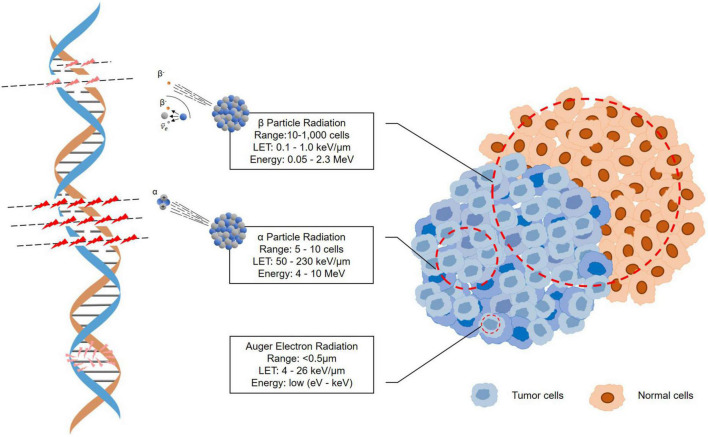
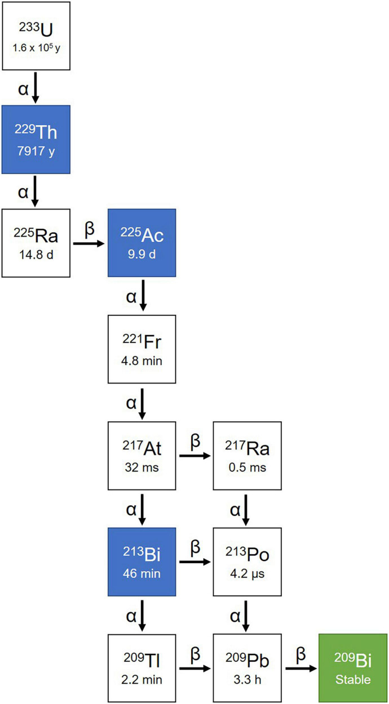
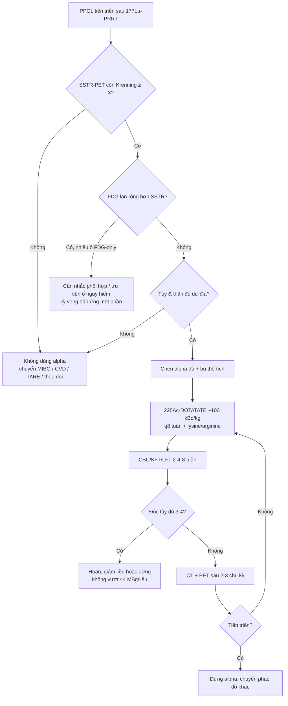
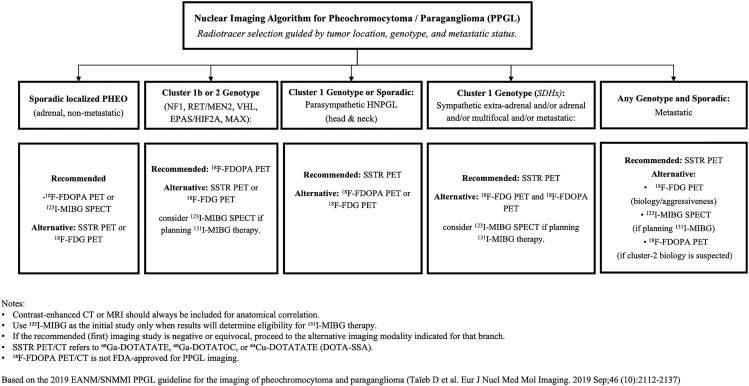
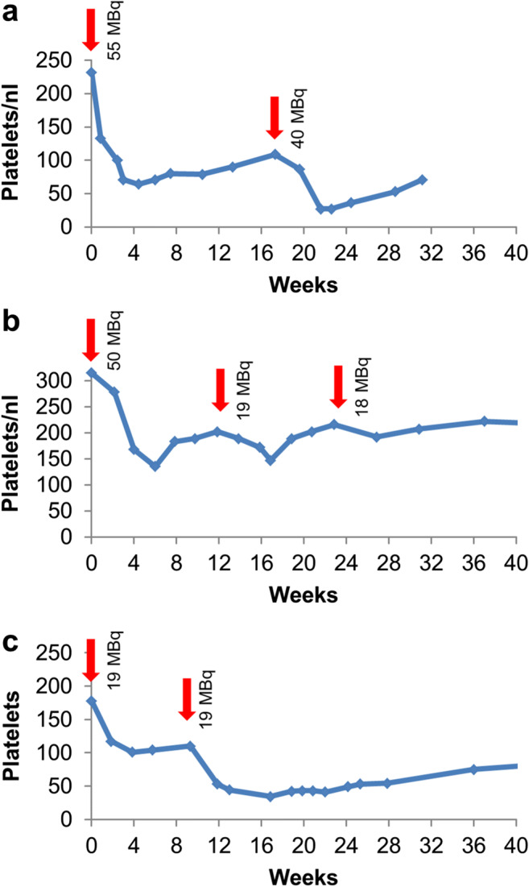
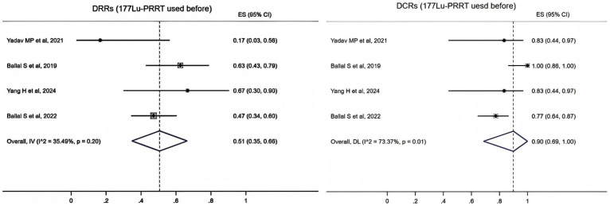

# 1695 — ²²⁵Ac-DOTATATE (xạ trị hạt alpha) sau thất bại ¹⁷⁷Lu ở PPGL: chọn bệnh nhân theo SSTR/FDG, liều, độc thận–tủy và khi nào chuyển / ²²⁵Ac-DOTATATE targeted alpha therapy after ¹⁷⁷Lu-PRRT failure in pheochromocytoma–paraganglioma

**Tags:** `pattern:ppgl-di-can` `pattern:xa-tri-hat-alpha` `pattern:khang-lu177` `vung:thuong-than` `vung:paraganglia` `score:RECIST` `protocol:PRRT-alpha` `protocol:dosimetry` `incidentaloma:khong`

**Mức chắc chắn (certainty):** tổng hợp y văn (literature synthesis) — tự biên từ 1 phi cứu (pilot) 9 ca PPGL dùng ²²⁵Ac-DOTATATE (PMC8626283), 1 phân tích gộp 5 nghiên cứu/153 bệnh nhân NEN (PMC12615221), 1 nghiên cứu liều – độc tính 5 năm trên 39 bệnh nhân (PMC8712294), 1 tổng quan cơ chế hạt alpha (PMC9767967) và 1 tổng quan PPGL 2026 (PMC13428017). **Chưa có RCT**; mọi con số đáp ứng là của loạt nhỏ, phần chưa có bằng chứng ghi rõ "chưa rõ".

> **Câu chốt:** hạt alpha không phải "¹⁷⁷Lu mạnh hơn" — nó là **một liệu pháp khác về mặt vật lý**: quãng chạy **47–85 µm** (5–10 đường kính tế bào) nên **không có hiệu ứng cross-fire**, diệt được tế bào **đói oxy và kháng xạ**, nhưng **không "phủ" được u lớn không đồng nhất** và **không có liều an toàn tuyệt đối cho thận/tủy**. Ở PPGL, chỉ định hợp lý là **u còn bắt SSTR mạnh sau khi ¹⁷⁷Lu thất bại**, và quyết định phải trả lời được 3 câu: **SSTR còn không? Đã chặn alpha đủ chưa? Còn dư địa tủy–thận không?**

## 1. Tổng quan bệnh học – cơ chế hình ảnh

- **Vì sao ¹⁷⁷Lu thất bại (β-PRRT resistance):** ¹⁷⁷Lu phát hạt β với quãng chạy trong mô mềm **0,28 mm (trung bình) đến 1,8 mm (tối đa)**, **LET 0,1–1 keV/µm** — tức là **10.000–1.000.000 "đường kính tế bào"** (Hình 1, PMC9767967). Muốn diệt u, β phải **bắt đủ liều qua cross-fire** từ các tế bào lân cận bắt thuốc; khi u **giảm biểu hiện SSTR không đồng nhất**, **giảm tưới máu**, hoặc **đã nhận liều tích lũy cao** (4 chu kỳ 7,4 GBq = **29,6 GBq**), các ổ **thiếu thuốc** trở thành nơi tái phát. Ở PPGL, PRRT β cho **DCR ~80–90%, PFS trung vị ~17–39 tháng**; trong pha II tại NIH (n = 36 đánh giá được): **PFS 6 tháng 86%, PFS trung vị 20 tháng, PR 14% lúc kết thúc điều trị → 28% khi theo dõi**, **thể lẻ tẻ 24,3 tháng vs SDHx 12,9 tháng** (PMC13428017).
- **Vì sao hạt alpha khác về bản chất:** ²²⁵Ac có **T½ = 9,9 ngày**, phát hạt alpha **5,8–8,4 MeV**, **quãng chạy 47–85 µm**, **LET ~50–230 keV/µm (≈100)** — **gấp hàng trăm lần LET của β** (PMC12615221, PMC9767967). Hệ quả lâm sàng:
  - **Diệt cả tế bào đang đói oxy** và tế bào **không phân chia** — vì tổn thương DNA là **đứt sợi đôi (DSB) không sửa được**, không phụ thuộc chu kỳ tế bào.
  - **Không cross-fire:** 1 tế bào bắt thuốc chỉ "cứu" được vùng **5–10 tế bào** quanh nó → **hiệu quả phụ thuộc mật độ biểu hiện SSTR**, và **u lớn/hoại tử trung tâm có thể chỉ "sạch" ở viền**.
  - **Chuỗi phân rã có 4 hạt alpha** (²²⁵Ac → ²²¹Fr → ²¹⁷At → ²¹³Bi → ²⁰⁹Pb → ²⁰⁹Bi, Hình 2) — nghĩa là **mỗi phân tử thuốc bắn 4 lần**, nhưng cũng là nguồn độc tính ngoài u (xem dưới).
  - **Hiệu ứng giật lùi (recoil):** năng lượng giật lùi của hạt nhân con **lớn hơn năng lượng liên kết hóa học hàng nghìn lần**, nên **²²¹Fr/²¹³Bi bị bắn khỏi chelate** rồi **tái phân bố vào thận và xương** — đây là lý do **không thể chỉ dựa vào "độ bền chelate"** để bảo vệ cơ quan đích (PMC9767967, PMC12176933, PMC13428017).
- **Ngưỡng định lượng nằm lòng:**
  - **Điều kiện vào (Yadav 2022, PMC8626283):** SSTR-PET **Krenning > 3** (độ bắt **> gan**); **Hb ≥ 9,5 g/dL**, **tiểu cầu ≥ 60.000/µL**, **TLC ≥ 3.000/µL**, **creatinin ≤ 1,4 mg/dL**, **bilirubin ≤ 1,2 mg/dL**, **KPS ≥ 40**, **ECOG ≤ 3**.
  - **Liều trong phi cứu:** **100 kBq/kg (≈ 2,7 µCi/kg) mỗi chu kỳ**, cách nhau **8 tuần**, tổng tích lũy **42,4 ± 27 MBq (15,54–86,6 MBq)**, trung vị **3 chu kỳ (2–9)**; dừng khi **tiến triển** hoặc đạt **86,6 MBq (2,34 mCi)**.
  - **Ngưỡng độc tủy (Kratochwil 2021, n = 39, PMC8712294):** liều đơn **≤ 44 MBq chỉ gây độc độ 0–2**; **> 45 MBq xuất hiện độ 3**; **độ 4 đầu tiên ở ~60 MBq**. **Nadir tiểu cầu/bạch cầu 4–6 tuần**, hồi phục **~12 tuần**. Liều **~20 MBq/chu kỳ, lặp mỗi 4 tháng, tổng 60–80 MBq** "tránh được độc tủy độ 3/4".
  - **Ngưỡng độc thận:** **eGFR giảm 8,4 mL/phút (9,9%) mỗi năm** — **tương đương β-PRRT**, **không theo quan hệ liều – đáp ứng rõ**; **2/39 ca suy thận sau > 4 năm**, nhưng **đều có yếu tố nguy cơ thận sẵn có** (PMC8712294). Nghĩa là **không có "liều thận an toàn" chung**, chỉ có **liều cá thể hóa + theo dõi**.
  - **Hiệu quả (số nhỏ, đọc thận trọng):** phi cứu 9 ca PPGL — **PR 50% (4/8), SD 37,5% (3/8), PD 12,5% (1/8), DCR 87,5%**; **ở nhóm kháng ¹⁷⁷Lu: DCR 66,6%**; **KPS 60 ± 7 → 85 ± 5 (p = 0,0050)** ở nhóm PR; **thuốc hạ áp ngừng hoàn toàn 25% (2/8), giảm liều 37,5% (3/8)**, trung vị **6 tháng** mới giảm được liều (PMC8626283). Phân tích gộp 5 nghiên cứu/153 bệnh nhân NEN: **DRR 52% (95% CI 43–61), DCR 88% (81–94)**, độc tủy **2%**, **không có độ 3/4**; **nhóm đã dùng ¹⁷⁷Lu: DRR 51% (35–66), DCR 90% (69–100)** (PMC12615221).

## 2. Mẫu hình + chẩn đoán phân biệt theo "kiểu thất bại" của ¹⁷⁷Lu (gamut)

- **Nhóm A — tiến triển nhưng SSTR còn mạnh (Krenning ≥ 3, FDG thấp/vừa):** ứng viên tốt nhất cho alpha; u **chậm phát triển** nhưng **không kiểm soát được bằng β**.
- **Nhóm B — bắt thuốc không đồng nhất (SSTR+ ở một số ổ, FDG+ ở ổ khác):** alpha có thể kiểm soát ổ SSTR+, nhưng **ổ FDG-only sẽ tiếp tục tiến triển** → phải **đo tổn thương đích riêng từng ổ**, không đọc "đáp ứng chung".
- **Nhóm C — PPGL có chức năng, huyết áp không kiểm soát dù đã chặn alpha:** alpha có thể **giảm tiết catecholamine** (25% ngừng thuốc hạ áp trong phi cứu), nhưng **nguy cơ cơn catecholamine khi truyền 17–18%** — phải **tối ưu chẹn alpha trước**, và **tránh dexamethasone** ở ca tiết mạnh.
- **Nhóm D — tổn thương lớn, hoại tử, gan > 50%:** **không phải ứng viên tốt** (thiếu cross-fire, nguy cơ hoại tử/ly giải, chức năng gan–thận hạn chế) → cân nhắc **TARE/đốt**, **CVD**, hoặc **theo dõi**.
- **Gamut "không phải alpha":** ¹⁷⁷Lu **re-challenge** (khi PFS đầu > 12–18 tháng và SSTR còn), **¹³¹I-MIBG hoạt độ cao** (khi MIBG+ và SSTR yếu), **CVD (cyclophosphamide–vincristine–dacarbazine)** khi tiến triển nhanh, **sunitinib**, **TARE** cho gan ưu thế, **xạ trị ngoài** cho ổ đau/đe dọa tủy.
- **Gợi nhớ 4 câu hỏi trước khi ký chỉ định:** **S**STR còn? **F**DG lan rộng? **H**ormone kiểm soát? **R**eserve tủy–thận còn? (S-F-H-R).

## 3. Bảng so sánh phân biệt (ma trận đối chiếu)

| Thực thể (entity) | Hình ảnh / dữ liệu điển hình | Chốt vào (rule-in) | Chốt loại (rule-out) | Gợi ý xác nhận |
|---|---|---|---|---|
| **²²⁵Ac-DOTATATE** | SSTR-PET còn **Krenning ≥ 3** sau ¹⁷⁷Lu; CT: **giảm kích thước tổn thương đích** dần sau 2–3 chu kỳ; PET có thể **giảm bắt thuốc mạnh hơn mức co nhỏ trên CT** | **Tiến triển trên ¹⁷⁷Lu + SSTR còn mạnh + tủy–thận đủ dư địa** | **SSTR âm/FDG-only**, **tủy hoặc thận đã cạn dự trữ**, **u hoại tử lớn chiếm ưu thế** | SSTR-PET + FDG-PET, CBC/eGFR, RECIST 1.1 mỗi 2–3 chu kỳ |
| **¹⁷⁷Lu re-challenge** | Bắt thuốc đồng nhất, **PFS đầu dài**; đáp ứng chậm | **PFS đầu > 12–18 tháng, SSTR còn, chưa chạm trần liều β** | **Tiến triển nhanh trong 6–12 tháng đầu**, SSTR giảm | Đối chiếu liều tích lũy β đã nhận, thời gian PFS |
| **¹³¹I-MIBG hoạt độ cao** | **MIBG+ / SSTR yếu**; bắt thuốc ở gan–tủy; phải phong bế giáp | **MIBG dương mạnh, SSTR âm hoặc đã kháng β** | **MIBG âm**, suy tủy nặng, cần cách ly không khả thi | ¹²³I-MIBG SPECT/CT; TSH trước–sau |
| **CVD (hóa trị)** | Tiến triển **nhanh**, u **kém biệt hóa**, FDG rất cao | **Tiến triển trong vài tháng + FDG cao + SSTR yếu** | SSTR còn mạnh, bệnh chậm → ưu tiên RLT | CT 2–3 chu kỳ; độc tủy, buồn nôn |
| **Sunitinib** | U tiến triển, nhiều ổ; đáp ứng chủ yếu **ổn định bệnh** | **SSTR yếu + không dung nạp hóa trị** | Suy giáp/tăng HA khó kiểm soát, hội chứng bàn tay–chân nặng | CT 3 tháng; TSH, HA |
| **Tổn thương "bùng" sau chu kỳ 1** (giả tiến triển/hoại tử) | CT: **ổ tăng kích thước nhưng giảm tỷ trọng**, PET giảm bắt thuốc | **PET giảm trong khi CT tăng** | **CT và PET cùng tăng** → tiến triển thật | Lặp CT+PET sau 6–8 tuần, không đổi phác đồ sớm |

*Hình 1 — ba loại bức xạ: **β** đi qua **10.000–1.000.000 đường kính tế bào** (LET 0,1–1 keV/µm, cần cross-fire); **α** chỉ **5–10 đường kính tế bào** (LET 50–230 keV/µm) nên diệt tại chỗ nhưng không "phủ" u lớn; **electron Auger** < 0,5 µm. Nguồn: Shi M et al., *Front Med* 2022 (PMC9767967) Fig. 3, CC BY.*

*Hình 2 — chuỗi phân rã ²²⁵Ac → ²²¹Fr (4,8 phút) → ²¹⁷At (32 ms) → ²¹³Bi (46 phút) → ²⁰⁹Pb (3,3 giờ) → ²⁰⁹Bi bền: **4 hạt alpha mỗi chuỗi**, nhưng hạt nhân con **giật lùi khỏi chelate** rồi tái phân bố vào thận/xương. Nguồn: Shi M et al., *Front Med* 2022 (PMC9767967) Fig. 4, CC BY.*

## 4. Protocol chụp – điều trị – theo dõi + phân độ

- **Trước chỉ định (bắt buộc):** **SSTR-PET/CT** (⁶⁸Ga-DOTATATE/DOTATOC) **+ ¹⁸F-FDG-PET/CT** cùng đợt — SSTR để chọn thuốc, FDG để biết **u nào sẽ không đáp ứng**; theo genotype: **SDHx → SSTR mạnh + FDG mạnh**, **VHL/EPAS1 & cluster 2 → ¹⁸F-FDOPA ưu tiên** (PMC13428017, Hình 5).
- **Sàng lọc trước mỗi chu kỳ:** CBC, creatinin/eGFR, điện giải, AST/ALT/bilirubin, **metanephrine tự do**, **thử thai**; **chẹn alpha đủ 1–2 tuần** (phenoxybenzamine/doxazosin) + **bù thể tích**.
- **Bảo vệ thận:** **lysine 23,3 g + arginine 8 g trong 1 L**, truyền **4 giờ**, **bắt đầu 30 phút trước** ²²⁵Ac-DOTATATE (PMC8626283); chống nôn **ondansetron ± dexamethasone** — **cân nhắc bỏ dexamethasone ở PPGL có chức năng** (phi cứu đã bỏ ở 3 ca thể giao cảm).
- **Trong truyền:** theo dõi HA/nhịp **mỗi 15 phút**; ngưỡng dừng/giảm tốc: **HA tâm thu > 200 mmHg dù đã chặn alpha**, loạn nhịp, phù phổi; sẵn sàng **phentolamine/nicardipine**; truyền chậm nếu có tim đập nhanh (đã gặp 1 ca, xử trí bằng chẹn beta + giảm tốc độ).
- **Sau chu kỳ:** CBC + KFT + LFT ở **2, 4, 8 tuần** (nadir **4–6 tuần**); đánh giá hình ảnh **sau 2–3 chu kỳ** và **mỗi 3 tháng** sau kết thúc; **RECIST 1.1 trên CT không cản quang + PET cùng lúc**.
- **Trần liều thực dụng (từ dữ liệu hiện có):** **≤ 44 MBq/liều đơn**, **~20 MBq/chu kỳ mỗi 4 tháng**, **tổng 60–80 MBq** nếu mục tiêu là tránh độc tủy độ 3/4; **không có trần thận tuyệt đối** — quyết định theo **eGFR nền và tốc độ giảm** (mất **8,4 mL/phút/năm** là mức tham chiếu).
- **Phân độ:** dùng **CTCAE v5.0** cho tủy/thận/gan và **RECIST 1.1** cho đáp ứng; **không dùng thay đổi SUV trên PET làm tiêu chuẩn đáp ứng duy nhất** (SSTR có thể giảm do hiệu ứng điều trị, không đồng nghĩa u chết).

*Hình 5 — chọn thuốc theo **vị trí – genotype – giai đoạn**: thể lẻ tẻ tại tuyến thượng thận → **¹⁸F-FDOPA/MIBG**; **SDHB** và thể lan tỏa → **SSTR-PET là nền tảng**, FDG bổ trợ; chỉ khi **SSTR dương** mới có cửa cho PRRT (β hoặc α). Nguồn: Hernandez-Felix JH et al., *Endocr Relat Cancer* 2026 (PMC13428017) Fig. 1, CC BY 4.0.*

## 5. Biến thể bình thường và cạm bẫy

- **Cạm bẫy 1 — "alpha mạnh hơn nên thay β ở mọi ca":** sai. Không có cross-fire → **u lớn, hoại tử, bắt thuốc không đồng nhất đáp ứng kém hơn β**; alpha hợp với **ổ nhỏ, lan tỏa, đã kháng β**.
- **Cạm bẫy 2 — đọc đáp ứng chỉ bằng PET:** **SUV giảm không đồng nghĩa u chết** (giảm biểu hiện SSTR sau điều trị), và **CT tăng trong 6–8 tuần đầu có thể là hoại tử/giả tiến triển**. Luôn **đối chiếu CT + PET cùng thời điểm**.
- **Cạm bẫy 3 — bỏ qua "con gái" của ²²⁵Ac:** **²²¹Fr/²¹³Bi thoát chelate** → **thận và xương** nhận liều ngoài dự kiến; **không thể suy ra liều thận từ hoạt độ tiêm** — cần **dosimetry** nếu có, và **theo dõi eGFR hằng năm** dù bệnh nhân "ổn".
- **Cạm bẫy 4 — dùng dexamethasone "cho chắc" ở PPGL tiết catecholamine:** có thể **làm nặng cơn tăng huyết áp**; ưu tiên **chẹn alpha đủ + chống nôn không steroid**.
- **Cạm bẫy 5 — coi "không độc độ 3/4" trong loạt nhỏ là bằng chứng an toàn:** phi cứu 9 ca **không ghi nhận độ 3/4**, nhưng loạt 39 ca của ²²⁵Ac-DOTATOC cho thấy **độ 3 xuất hiện khi > 45 MBq/liều** và **độ 4 ở ~60 MBq** — an toàn phụ thuộc **liều và khoảng cách**, không phải bản chất thuốc.
- **Cạm bẫy 6 — bỏ qua nguồn cung:** **²²⁵Ac khan hiếm**, chuỗi cung ứng giới hạn; **đừng hứa "sẽ có thuốc"** khi chưa xác nhận lịch sản xuất (PMC13428017).
- **Biến thể bình thường dễ nhầm:** **bắt thuốc sinh lý ở lách, gan, tuyến yên, tuyến thượng thận còn lại** trên SSTR-PET; **tăng bắt thuốc ở thận** sau truyền acid amin; **hoạt độ trong bàng quang** — không đọc là di căn.

## 6. Tự lượng giá — Blind Quiz

**Ca 1 — BN 41 tuổi, PGL thể cảnh trái đã mổ + xạ trị, tiến triển sau 6 chu kỳ ¹⁷⁷Lu-DOTATATE. Nhìn Hình 1, giải thích vì sao chuyển hạt alpha.**

- Gợi ý: u đã nhận **34,5 GBq** ¹⁷⁷Lu và vẫn tiến triển.
- Câu hỏi: vì sao β thất bại dù SSTR còn? Alpha giải quyết được gì và **không** giải quyết được gì?

<b>Bấm để hiện đáp án (findings + chẩn đoán)</b>

- **β cần cross-fire:** quãng chạy 10.000–1.000.000 đường kính tế bào, LET 0,1–1 keV/µm → ổ **thiếu thuốc/đói oxy** sống sót và tái phát.
- **α diệt tại chỗ:** 47–85 µm, LET ~100 keV/µm → hiệu quả cả trên tế bào **đói oxy, không phân chia**.
- **Nhưng α không phủ u lớn:** chỉ 5–10 đường kính tế bào → **phải còn SSTR đồng nhất**; u hoại tử lớn vẫn là giới hạn.
- Nguồn ảnh: Shi M et al., *Front Med* 2022, PMC9767967 Fig. 3, CC BY.

**Ca 2 — Cùng bệnh nhân, sau 3 chu kỳ ²²⁵Ac-DOTATATE: creatinin tăng nhẹ, tiểu cầu 88 G/L. Nhìn Hình 2 và Hình 3, quyết định chu kỳ 4?**

- Gợi ý: panel (a) là các liều **55 → 40 MBq**, panel (b) **50 → 19 → 18 MBq** cách 3–4 tháng, panel (c) **19 → 19 MBq** cách 2 tháng.
- Câu hỏi: panel nào cho thấy **độc tính cộng dồn**? Ngưỡng hoạt độ nào làm xuất hiện độ 3?

<b>Bấm để hiện đáp án</b>

- **Panel (a):** 55 MBq → tiểu cầu **235 → ~55 G/L** ở tuần 4–5, rồi 40 MBq → nadir **~30 G/L** = **cộng dồn**.
- **Panel (b):** các liều **< 25 MBq cách 3–4 tháng** dung nạp được, không cộng dồn; **panel (c):** **cách 2 tháng** thì **< 25 MBq vẫn cộng dồn**.
- **Ngưỡng:** liều đơn **≤ 44 MBq → độ 0–2**; **> 45 MBq → độ 3**; **~60 MBq → độ 4**. Nadir **4–6 tuần**, hồi phục **~12 tuần**.
- **Quyết định:** tiểu cầu **88 G/L (độ 1)** + creatinin tăng nhẹ → **hoãn 2–4 tuần, giữ liều ≤ 20–25 MBq, giãn khoảng cách ≥ 4 tháng**, kiểm tra nguyên nhân thận khác (mất nước, cản quang, thuốc) trước khi quy cho phóng xạ.
- Nguồn ảnh: Kratochwil C et al., *Eur J Nucl Med Mol Imaging* 2021, PMC8712294 Fig. 1, CC BY 4.0.

**Ca 3 — Hội chẩn: "Bệnh nhân đã kháng ¹⁷⁷Lu, cho alpha thì bao nhiêu % đáp ứng?" Nhìn Hình 4.**

- Gợi ý: 4 nghiên cứu, nhóm **đã dùng ¹⁷⁷Lu trước đó**.
- Câu hỏi: DRR và DCR gộp là bao nhiêu? Vì sao **DCR cao hơn DRR nhiều**?

<b>Bấm để hiện đáp án</b>

- **DRR 51% (95% CI 35–66)**, **DCR 90% (69–100)** ở nhóm đã dùng ¹⁷⁷Lu; toàn bộ 153 bệnh nhân: **DRR 52% (43–61), DCR 88% (81–94)**, độc tủy **2%**, **không độ 3/4**.
- **Vì sao DCR ≫ DRR:** PPGL **phát triển chậm**, phần lớn đạt **ổn định bệnh** — lợi ích thật nằm ở **kiểm soát bệnh + triệu chứng** (KPS, đau, huyết áp), không phải co nhỏ khối.
- **Phản biện nguồn:** phi cứu PPGL báo **DCR 66,6% (2/3)** ở nhóm kháng ¹⁷⁷Lu trong phần tóm tắt, nhưng phần kết quả lại mô tả **1 PR + 2 SD + 1 PD trong 4 ca** — **nội bộ bài gốc không nhất quán**; trích nguyên văn, không "làm tròn" thành 75%.
- Nguồn ảnh: Ma J et al., *Front Oncol* 2025, PMC12615221 Fig. 3, CC BY.

## Bài liên quan chéo
- [177 – Điều trị & theo dõi PPGL: chẹn alpha, phẫu thuật, PRRT/MIBG](../177-dieu-tri-va-theo-doi-ppgl/lesson.md)
- [185 – Độc tính & theo dõi sau PRRT/¹³¹I-MIBG ở PPGL](../185-doc-tinh-va-theo-doi-sau-prrt-mibg-ppgl/lesson.md)
- [168 – U tủy thượng thận & u cận hạch](../168-pheo-paraganglioma/lesson.md)
- [100 – Tổng quan hệ Bụng](../100-tong-quan-he-bung/lesson.md)

## Ảnh
- 5 ảnh lấy từ **Europe PMC/PMC** bản open access, giữ **nguyên bản** (không crop, không ghép); nguồn – giấy phép từng file trong `images/CREDITS.md`.
- Tên file: `1695_ac225_<nội dung>_<loại>_PMC<ID>-Fig<k>.jpg`.

> Không dùng để chẩn đoán độc lập khi chưa có người hướng dẫn.
