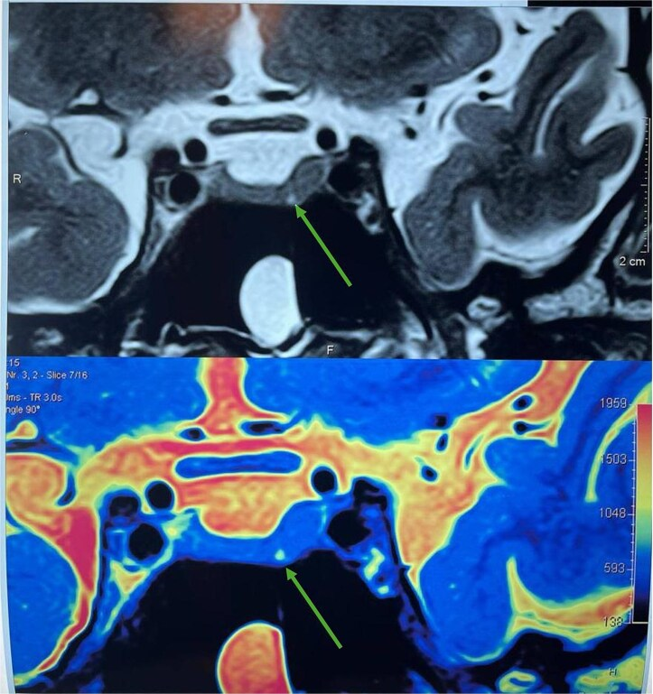
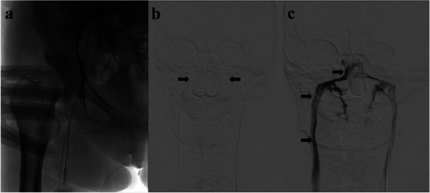
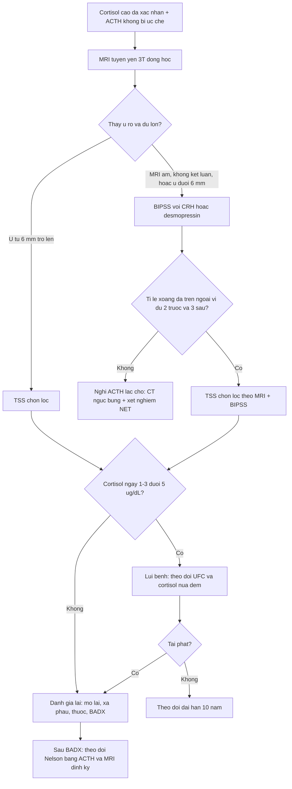

# 1696 — Bệnh Cushing do u tuyến yên: MRI 3T động học, BIPSS, tiêu chuẩn lui bệnh và hội chứng Nelson / Cushing disease

**Tags:** `pattern:microadenoma-tuyen-yen` `pattern:cushing` `pattern:khong-khoi` `vung:tuyen-yen` `vung:ho-yen` `protocol:MRI-3T-dong-hoc` `protocol:BIPSS` `score:IPS-P-gradient`

**Mức chắc chắn (certainty):** tổng hợp y văn (literature synthesis) — hướng dẫn đồng thuận về lấy máu xoang đá dưới (Siddiq F và cộng sự, *Stroke Vasc Interv Neurol* 2026, PMC13138407) + so sánh BIPSS với MRI (Mao JN và cộng sự, *BMC Endocr Disord* 2023, PMC9933337) + nghiên cứu tiến cứu PET/MRI (Flaus A và cộng sự, *J Nucl Med* 2025, PMC12487729) + 2 ca nguyên văn có ảnh (u **1,2 mm**, Qasim BA và cộng sự, *Oxford Med Case Reports* 2026, PMC13403550; BIPSS, PMC9933337).

> **Câu chốt:** Bệnh Cushing do tuyến yên là **nguyên nhân thường gặp nhất của Cushing nội sinh**, nhưng u chỉ **trung bình 5 mm** và **hơn 90% là microadenoma** — nên **MRI âm tính không loại trừ bệnh**, và **≥ 30% ca MRI không kết luận được**. Hai ngưỡng phải thuộc: **u < 6 mm → chỉ định BIPSS** (vì MRI ở cỡ này không đủ đặc hiệu), và **tỉ lệ ACTH xoang đá/xoang đá : ngoại vi ≥ 2 trước, ≥ 3 sau kích thích**. Sai ở bước định vị = **mổ nhầm bên** hoặc **cắt tuyến yên bình thường**.

## 1. Tổng quan bệnh học – cơ chế hình ảnh

- **Vị trí trong phổ Cushing:** Cushing do u tuyến yên (Cushing disease — CD) là **nguyên nhân thường gặp nhất của Cushing nội sinh**; u bài tiết ACTH → ACTH cao → **tăng sản thượng thận hai bên** (đối chiếu bài 1694: thể ngoại sinh có **thượng thận teo**).
- **Kích thước là vấn đề:** **> 90%** u corticotroph là **microadenoma (< 10 mm)**, đường kính trung bình **5 mm**; u < 5 mm thường **không thấy trên MRI 1,5T** nhưng thấy trên **3T** (2 ca nhi trong PMC6868556); ca cực đoan đã báo cáo: u **1,2 mm** gây Cushing nặng (PMC13403550).
- **TẠI SAO MRI hay âm tính (cơ chế vật lý):** adenoma corticotroph **nhỏ, đẳng–giảm tín hiệu T1**, mô tuyến yên bình thường **ngấm thuốc sớm và mạnh** hơn u → trên **chuỗi động học sau tiêm** u hiện **giảm tín hiệu so với nhu mô lành** ở thì sớm, rồi **đẳng tín hiệu** ở thì muộn. Vì vậy **MRI động học** tăng độ nhạy chẩn đoán **50–60%** so với MRI không động học (PMC9933337), nhưng **vẫn không kết luận được tới 30% ca** và độ nhạy cho u corticotroph chỉ **~70%** (PMC12487729).
- **Vì sao cần BIPSS:** khi MRI **âm tính, không kết luận, hoặc u < 6 mm**, phải chứng minh **nguồn ACTH là trung ương** và **bên nào** bằng **lấy máu xoang đá dưới hai bên (BIPSS)**. Với adenoma **≥ 6 mm**, độ đặc hiệu của MRI đủ cao (**~96%**) nên một số trung tâm bỏ qua BIPSS (PMC13138407).
- **Vì sao phải theo dõi sau mổ:** lui bệnh sớm **72%** toàn loạt và **84%** ở nhóm có u chứng minh bằng mô bệnh (105 ca, PMC8684536); lui bệnh phẫu thuật nói chung **65–85%**; **tái phát ~25% trong 10 năm** (PMC13392468 dẫn nguồn). Sau **cắt thượng thận hai bên**, **30% (9/30)** tiến triển u tuyến yên — **hội chứng Nelson**, trung vị **60 tháng** (PMC12474698).

## 2. Mẫu hình + chẩn đoán phân biệt theo vị trí (Gamut)

- **ACTH phụ thuộc (ACTH cao/không bị ức chế):** **bệnh Cushing do u tuyến yên** (phổ biến nhất); **ACTH lạc chỗ** (ung thư phổi tế bào nhỏ, carcinoid phế quản, ung thư giáp thể tủy, NET tụy, pheochromocytoma); **CRH lạc chỗ** (rất hiếm); **macroadenoma tuyến yên**.
- **Theo kích thước u trên MRI:** **< 6 mm** → giá trị định vị thấp, **chỉ định BIPSS**; **6–10 mm** → microadenoma, MRI có giá trị; **≥ 10 mm** → macroadenoma, đánh giá xâm lấn xoang hang, chèn ép giao thoa thị.
- **Khối hố yên KHÔNG phải adenoma:** nang Rathke, nang pars intermedia, craniopharyngioma, u màng não, **phình động mạch** (flow void, canxi hóa viền), di căn, viêm tuyến yên, **tăng sản tuyến yên** (suy giáp nguyên phát, CRH lạc chỗ).
- **Cushing không phụ thuộc ACTH:** adenoma/ACC thượng thận, PPNAD/AIMAH, **Cushing ngoại sinh** (bài 1694) — ACTH thấp, thượng thận **một khối** hoặc **teo hai bên**.
- **Gợi nhớ "MICRO":** **M**RI 3T động học trước, **I**PSS khi MRI âm hoặc u < 6 mm, **C**ortisol tự do nước tiểu/nửa đêm để xác nhận, **R**epeat MRI + theo dõi Nelson sau khi cắt thượng thận, **O**peration (TSS) là điều trị đầu tay.

## 3. Bảng so sánh phân biệt (ma trận đối chiếu)

| Thực thể (entity) | Hình ảnh điển hình | Chốt vào (rule-in) | Chốt loại (rule-out) | Gợi ý xác nhận |
|---|---|---|---|---|
| **Bệnh Cushing (u tuyến yên)** | U **< 10 mm**, giảm tín hiệu thì động học sớm, **tăng sản thượng thận hai bên đều** | **ACTH cao + MRI thấy u + tỉ lệ xoang đá ≥ 2/≥ 3 + tăng sản hai bên** | MRI âm **không** loại trừ; BIPSS âm mới loại trừ mạnh | MRI 3T động học, BIPSS, mô bệnh sau TSS |
| **ACTH lạc chỗ** | Không u tuyến yên; **u phổi/tụy/tuyến ức**; tăng sản thượng thận rất mạnh; **hạ K** | **ACTH rất cao + hạ K + ổ u ngoài sọ + BIPSS không có gradient trung ương** | Có gradient trung ương rõ → loại trừ | CT ngực–bụng, BIPSS, xét nghiệm NET |
| **Giả Cushing (pseudo-Cushing)** | Không u; MRI bình thường; thượng thận bình thường | **Bối cảnh nghiện rượu/trầm cảm/béo + test Dex-CRH âm** | Cortisol nửa đêm **không ức chế** + u rõ → loại trừ | Dex-CRH, cortisol nửa đêm lặp |
| **U tuyến yên KHÔNG chức năng (tình cờ)** | Khối hố yên **bất kỳ**, có ở **~10% dân số**; không tăng sản thượng thận | **Tình cờ trên MRI + ACTH/cortisol bình thường + thượng thận bình thường** | **Tăng sản thượng thận hai bên + ACTH cao** → loại trừ | Xét nghiệm trục HPA, theo dõi MRI |
| **Tăng sản tuyến yên** | Tuyến yên **to đều**, không ổ khuyết; kèm bệnh nền | **Suy giáp nguyên phát/CRH lạc chỗ + không ổ khuyết trên động học** | Ổ khuyết rõ thì động học → loại trừ | TSH/FT4, điều trị bệnh nền rồi chụp lại |
| **Hội chứng Nelson** | Sau **cắt thượng thận hai bên**: u tuyến yên **to ra**, xâm lấn xoang hang; da sẫm màu | **ACTH tăng dần + u to ra sau BADX + sắc tố da tăng** | U không đổi sau nhiều năm → theo dõi | MRI định kỳ, ACTH, đánh giá thị trường |

*MRI tuyến yên 3T: ổ giảm tín hiệu **1,2 mm** ở bên trái tuyến yên (mũi tên) — microadenoma nhỏ bất thường. Nguồn: Qasim BA và cộng sự, Oxford Medical Case Reports 2026, PMCID PMC13403550, CC BY-NC 4.0.*

## 4. Protocol chụp + hệ phân độ/điểm chuẩn hóa

### 4.1. MRI tuyến yên (làm đúng thì mới thấy u)
- **3T**, lát mỏng **≤ 1,5 mm** (u 1,2 mm cần lát mỏng dưới mm + 3T), trường nhỏ **FOV 16–20 cm**, ma trận cao.
- **Chuỗi bắt buộc:** T1W trước tiêm sagittal + coronal; **T1W sau tiêm động học coronal** (nhiều thì, bắt đầu ngay sau tiêm, cách nhau **15–30 giây** trong 60–90 giây đầu); T2W coronal; thì muộn sagittal/coronal.
- **Đọc:** tìm **ổ giảm tín hiệu ở thì sớm**, lệch đường giữa tuyến, vồng bờ trên, lệch cuống tuyến yên (**không đặc hiệu**); ghi **kích thước 3 chiều tính bằng mm** và vị trí theo **bên + phần (trước/sau, trong/ngoài)**.
- **Không dùng MRI để "loại trừ"**: MRI âm/không kết luận **tới 30%**, độ nhạy **~70%** cho u corticotroph (PMC12487729).

### 4.2. BIPSS — ngưỡng và kỹ thuật
- **Chỉ định:** MRI **âm tính, không kết luận, hoặc u < 6 mm**; nghi ACTH lạc chỗ cần phân biệt; một số trung tâm vẫn làm khi u nhỏ dù MRI dương.
- **Ngưỡng chốt (ACTH xoang đá : ngoại vi — IPS:P):** **≥ 2 trước kích thích**, **≥ 3 sau kích thích** (CRH ưu tiên; **desmopressin** là thay thế có bằng chứng).
- **Kiểm tra đặt catheter:** tỉ lệ **prolactin IPS:P ≥ 1,8** (cùng bên gradient ACTH mạnh nhất); **< 1,8** = đặt sai vị trí.
- **Hiệu năng:** độ nhạy **96–97%**, độ đặc hiệu **~100%** khi làm chuẩn (PMC13138407); gộp trước hiệu chỉnh PRL **90%/74%**, sau hiệu chỉnh **96%/68%**; **trước kích thích 86%/98%**, **sau kích thích 97%/100%**.
- **Biến chứng:** **~4% nhẹ** (máu tụ bẹn), **0,2% (1/508)** biến chứng thần kinh nặng tại NIH, **0,5% (1/184)** với catheter chuyên dụng (PMC13138407).
- **Định bên:** BIPSS **kém hơn MRI** trong dự đoán bên (độ nhạy **55,6% vs 96,3%**, PMC9933337) và **12% định sai bên**; trong nhóm **dẫn lưu tĩnh mạch chéo trội**, sai tới **27% (3/11)** (PMC12640372) — **không mổ chỉ dựa vào BIPSS khi MRI nói bên khác**.

*(a) chọc tĩnh mạch đùi; (b) hai catheter trong xoang đá dưới (mũi tên đen); (c) chụp tĩnh mạch xoang đá dưới bơm thuốc cản quang. Nguồn: Mao JN và cộng sự, BMC Endocrine Disorders 2023, PMCID PMC9933337, CC BY 4.0.*

### 4.3. Tiêu chuẩn lui bệnh và theo dõi
- **Lui bệnh sớm:** cortisol huyết thanh **< 5 µg/dL** trong **ngày 1–3 sau mổ** (định nghĩa dùng trong loạt 105 ca); lui bệnh sớm **72%** chung, **84%** khi có u chứng minh mô bệnh; lui bệnh phẫu thuật **65–85%** (PMC8684536).
- **Lui bệnh duy trì:** cần **glucocorticoid thay thế ≥ 6 tháng** rồi eucortisol; đánh giá lại bằng **UFC 24 giờ + cortisol nửa đêm** ở **3 tháng**, sau đó mỗi 6–12 tháng.
- **Tái phát ~25% trong 10 năm** (PMC13392468 dẫn nguồn) → theo dõi lâm sàng + xét nghiệm dài hạn, không chỉ 1 năm.
- **Sau cắt thượng thận hai bên (BADX):** theo dõi **hội chứng Nelson** bằng **ACTH + MRI tuyến yên định kỳ**; **30% (9/30)** tiến triển, trung vị **60 tháng**; xạ phẫu tuyến yên **trước** BADX gặp nhiều hơn ở nhóm **không** tiến triển (**52%**), gợi ý có thể dự phòng (PMC12474698, cỡ mẫu nhỏ).

## 5. Biến thể bình thường và cạm bẫy

- **U tuyến yên không chức năng có ở ~10% dân số** (PMC12487729): một "ổ khuyết" tình cờ trên MRI **không** chứng minh là nguồn ACTH — phải có **tăng sản thượng thận hai bên + ACTH cao** và/hoặc **gradient BIPSS**.
- **MRI âm tính không loại trừ bệnh Cushing:** tới **30%** không kết luận, độ nhạy **~70%**; **không** kết luận "không có bệnh" rồi bỏ theo dõi.
- **BIPSS không dùng để chọn bên mổ khi MRI nói khác:** độ nhạy định bên **55,6%** (so với MRI **96,3%**, PMC9933337); **12% định sai bên**, **27%** khi có dẫn lưu chéo trội (PMC12640372) — ưu tiên MRI, dùng BIPSS để **xác nhận nguồn trung ương**.
- **BIPSS âm giả:** đặt catheter sai (kiểm bằng **PRL IPS:P ≥ 1,8**), dẫn lưu bất thường, hoặc **hội chứng Cushing chu kỳ** (cortisol thay đổi theo chu kỳ → làm xét nghiệm lúc "pha thấp").
- **U quá nhỏ (< 2 mm):** mổ có thể **không tìm thấy u**; ca 1,2 mm đã chọn **xạ phẫu (GKRS) đầu tay** vì sợ không định vị được khi mổ — nhưng lui bệnh sau GKRS **chậm 6 tháng–2 năm**, tỉ lệ **28–73%**, cần thuốc hỗ trợ (PMC13403550).
- **Sau mổ:** hội chứng cai glucocorticoid (mệt, đau khớp, buồn nôn) **chồng lấp** với suy thượng thận và với tái phát — dựa vào **cortisol/UFC**, không dựa vào triệu chứng.
- **Sau BADX:** da sẫm màu + ACTH tăng + u to lên = **Nelson**, không phải "hiệu ứng bình thường của cắt thượng thận".
- **Tăng sản tuyến yên** do suy giáp nguyên phát có thể giả u — điều trị bệnh nền rồi chụp lại trước khi can thiệp.

## 6. Tự lượng giá — Blind Quiz

**Ca 1 — Nam 27 tuổi, béo trung tâm, rạn da tím rộng, huyết áp cao; cortisol/UFC tăng, ACTH không bị ức chế.**

- Câu hỏi: Mô tả tổn thương? Vì sao u nhỏ vậy vẫn gây bệnh nặng? Bước tiếp theo nên làm gì và bẫy nào cần tránh?

<b>Bấm để hiện đáp án (findings + chẩn đoán)</b>

- **Dấu hiệu:** ổ **giảm tín hiệu 1,2 mm** ở phần trái tuyến yên trên MRI **3T** (mũi tên) — microadenoma rất nhỏ; không xâm lấn xoang hang.
- **Chẩn đoán:** **bệnh Cushing do microadenoma tuyến yên**; kích thước **không tương quan với mức độ nặng** vì cortisol do khối u bài tiết, không do thể tích.
- **Xử trí trong ca này:** vì u **1,2 mm** khó định vị khi mổ, nhóm tác giả chọn **Gamma Knife** đầu tay → lui bệnh **chậm**, phải dùng **ketoconazole** hỗ trợ; đây là **lựa chọn cá biệt**, không phải chuẩn (TSS vẫn là đầu tay, lui bệnh **65–85%**).
- **Phản biện:** ca này là **ngoại lệ cực đoan** (1,2 mm); đừng lấy làm quy luật rằng "u nhỏ thì xạ phẫu". Với u < 6 mm và MRI không rõ, **BIPSS** vẫn là bước chuẩn.
- **Nguồn ảnh:** Qasim BA và cộng sự, *Oxford Medical Case Reports* 2026, PMCID PMC13403550, **CC BY-NC 4.0**.

**Ca 2 — Bệnh nhân Cushing phụ thuộc ACTH, MRI tuyến yên âm tính. Hình dưới là gì và đọc kết quả thế nào?**

- Câu hỏi: Kỹ thuật gì, catheter nằm ở đâu? Ngưỡng ACTH nào xác nhận nguồn trung ương? Nếu tỉ lệ thấp thì nghĩ gì?

<b>Bấm để hiện đáp án (findings + chẩn đoán)</b>

- **Dấu hiệu:** (a) chọc **tĩnh mạch đùi** theo Seldinger; (b) **hai catheter** đặt trong **xoang đá dưới hai bên** (mũi tên đen); (c) **chụp tĩnh mạch xoang đá dưới** trong lúc bơm cản quang — xác nhận vị trí và dẫn lưu.
- **Chẩn đoán:** **BIPSS** (bilateral inferior petrosal sinus sampling) để chứng minh nguồn ACTH trung ương khi MRI âm.
- **Ngưỡng:** **ACTH IPS:P ≥ 2 trước kích thích, ≥ 3 sau kích thích** (CRH hoặc desmopressin); kiểm tra đặt catheter bằng **prolactin IPS:P ≥ 1,8**.
- **Nếu tỉ lệ thấp:** nghĩ **ACTH lạc chỗ** — nhưng trước khi kết luận phải loại **đặt sai catheter/dẫn lưu bất thường**; và nhớ BIPSS **chỉ định bên kém** (55,6% trong loạt này) nên **không mổ theo BIPSS khi MRI nói bên khác**.
- **Nguồn ảnh:** Mao JN và cộng sự, *BMC Endocrine Disorders* 2023, PMCID PMC9933337, **CC BY 4.0** (nguyên bản, giữ nhãn a–c).

## Bài liên quan chéo
- [1694 – Cushing do glucocorticoid ngoại sinh: thượng thận teo hai bên và cai thuốc](../1694-cushing-do-glucocorticoid-ngoai-sinh/lesson.md)
- [1697 – Hội chứng tăng đông của Cushing: VTE chu phẫu](../1697-cushing-tang-dong-vte/lesson.md)
- [1699 – Bệnh Cushing ở trẻ em: chậm tăng trưởng + tăng cân, MRI 3T, BIPSS](../1699-benh-cushing-tre-em/lesson.md)
- [1700 – Hội chứng Cushing chu kỳ: dao động cortisol và bẫy xét nghiệm âm giả](../1700-cushing-chu-ky/lesson.md)
- [245 – U tuyến yên chảy máu/nhồi máu (pituitary apoplexy)](../245-u-tuyen-yen-chay-mau-nhoi-mau-pituitary-apoplexy/lesson.md)
- [246 – Hội chứng Sheehan: hoại tử tuyến yên sau sinh](../246-hoi-chung-sheehan-hoai-tu-tuyen-yen-sau-sinh/lesson.md)
- [155 – Thượng thận tình cờ](../155-thuong-than-tinh-co/lesson.md)
- [200 – Tổng quan hệ Thần kinh](../200-tong-quan-he-than-kinh/lesson.md)

> Không dùng để chẩn đoán độc lập khi chưa có người hướng dẫn.
