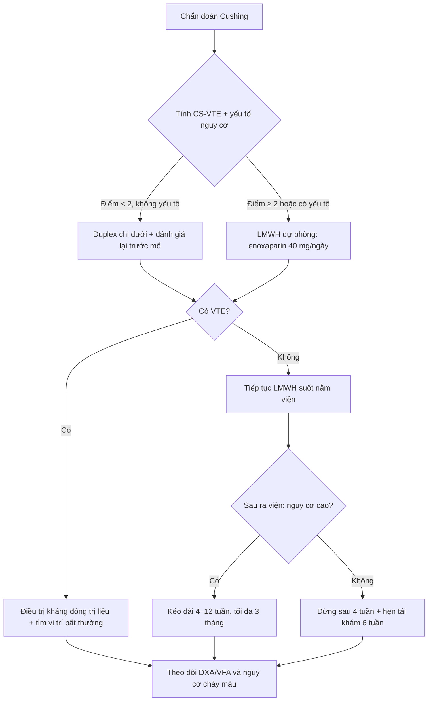
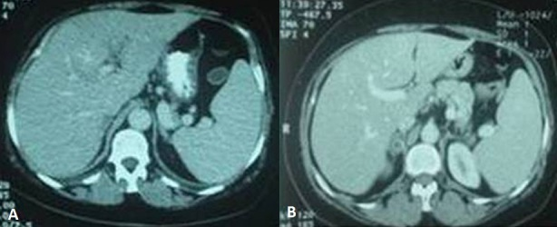
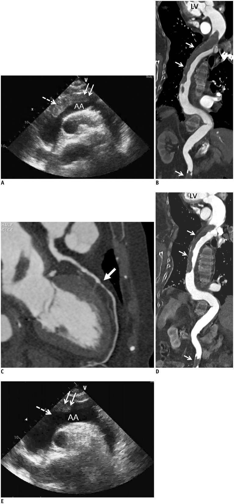

# 1697 — Hội chứng tăng đông của Cushing: huyết khối tĩnh mạch sâu, thuyên tắc phổi chu phẫu và dự phòng kháng đông / Hypercoagulability of Cushing syndrome

**Tags:** `pattern:huyet-khoi-tinh-mach` `pattern:tang-dong` `pattern:khoi-thuong-than` `vung:thuong-than` `vung:phoi` `vung:o-bung` `protocol:sieu-am-Doppler` `protocol:CTA-nguc` `protocol:CT-bung-co-can-quang` `score:CS-VTE` `score:Padua` `incidentaloma:u-thuong-than`

**Mức chắc chắn (certainty):** tổng hợp y văn (literature synthesis) — ghép tổng quan có thuật toán dự phòng (Kuca P và cộng sự, *Frontiers in Endocrinology* 2026, PMC13659295) + mô hình điểm CS-VTE nguyên bản (Zilio M và cộng sự, *Endocrine* 2016, PMID 26113424) + 2 ca nguyên văn có ảnh (huyết khối tĩnh mạch cửa do adenoma vỏ thượng thận, PMC4237579; huyết khối động mạch chủ lan rộng do Cushing do thuốc, PMC4170165).

> **Câu chốt:** **Cushing là trạng thái tăng đông thật**, không phải "rối loạn chuyển hóa đơn thuần". Nguy cơ huyết khối tĩnh mạch (VTE) cao gấp **10–20 lần** dân số chung, **7,7%** bệnh nhân có VTE trong quá trình bệnh, và **một nửa số biến cố xảy ra SAU khi ra viện** — nghĩa là **"mổ xong, cortisol về bình thường" không phải là điểm kết thúc của dự phòng**. Trên hình ảnh: huyết khối ở vị trí **bất thường** (tĩnh mạch cửa, tĩnh mạch thận, xoang tĩnh mạch não, động mạch chủ) ở người **béo trung tâm + tăng huyết áp + đường huyết cao** phải làm ta đi tìm **khối thượng thận** và **cortisol**.

## 1. Tổng quan bệnh học – cơ chế hình ảnh

- **Dịch tễ Cushing:** tần suất mới mắc nội sinh **0,7–2,4 ca/triệu dân/năm**; Cushing do thuốc (ngoại sinh) phổ biến hơn nhiều và **cũng gây tăng đông** (ca PMC4170165: huyết khối động mạch chủ lan rộng ở bệnh nhân 82 tuổi dùng glucocorticoid kéo dài).
- **Tần suất VTE (số liệu chốt):** các đoàn hệ cũ **2–8%** bệnh nhân Cushing hoạt động có VTE lâm sàng; **ERCUSYN (n ≈ 1.500)**: **7,7%** có VTE trong quá trình bệnh, tương ứng **14,6 biến cố/1.000 người–năm**, cao gấp **10–20 lần** so với nhóm chứng ghép cặp; gộp phân tích cho **OR ~18**. Tổng quan Pháp của ca PMC4237579 nêu **7–25%**.
- **Vì sao tăng đông (cơ chế — phải hiểu, không học vẹt):** cortisol liều cao làm gan **tăng tổng hợp yếu tố VIII, yếu tố IX, yếu tố von Willebrand (vWF)** và **PAI-1** (chất ức chế tiêu sợi huyết) → **tăng sinh thrombin** (TAT, prothrombin fragment 1+2), **giảm phân hủy fibrin**, kèm **rối loạn chức năng nội mô** và **tăng tiểu cầu hoạt hóa**. Hệ quả xét nghiệm: **aPTT ngắn lại**, fibrinogen và D-dimer tăng — **không phải "xét nghiệm bình thường thì loại trừ"**.
- **Vì sao nguy cơ cao nhất quanh mổ:** phẫu thuật (transsphenoidal surgery — TSS, hay cắt thượng thận) cộng **bất động + tăng đông tồn tại** tạo cửa sổ nguy cơ **4–6 tuần đầu sau mổ**; biến cố đã ghi nhận tới **3 tháng** sau mổ; **~một nửa VTE xảy ra sau khi ra viện**, phần lớn trong **6 tuần**.
- **Vì sao tăng đông kéo dài:** các thông số tiêu sợi huyết **chuẩn hóa chậm hơn cortisol** — tổng quan ghi nhận nguy cơ còn cao **3–6 tháng sau khi sinh hóa lui bệnh**. Đây là lý do các phác đồ mới **kéo dài dự phòng ra ngoài viện**, khác hoàn toàn thói quen "dừng heparin khi ra viện".
- **Vì sao ảnh hưởng tới hình ảnh (imaging mechanism):** huyết khối cấp là **khối đặc trong lòng mạch** → trên **siêu âm Duplex** mất khả năng xẹp lòng tĩnh mạch khi ép (non-compressibility), mất dòng chảy theo pha, tăng hồi âm theo thời gian (thrombus mới giảm âm); trên **CT có cản quang** là **khuyết thuế (filling defect)** trong lòng mạch, **không ngấm thuốc**, có thể thấy **viền thành mạch ngấm** (dấu hiệu "target"); trên **CTA phổi** là khuyết thuế trong động mạch phổi, **phân bố theo nhánh**, khác **mô giả/tạo ảnh do thở** (thường không tròn, không thấy trên mọi thì).
- **Ngưỡng hình ảnh của adenoma vỏ thượng thận (nguồn gây Cushing):** **≤ 10 HU** trên CT không cản quang, **washout tuyệt đối > 60%** / **tương đối > 40%** ở thì muộn 15 phút — ca PMC4237579: adenoma phải **2 cm, washout > 50%**; MRI **mất tín hiệu ở pha ngược (out-of-phase)** do mỡ nội bào. U không điển hình/tăng đông bất thường → mới cần **MRI, BIPSS** (Cushing phụ thuộc ACTH).
- **Vì sao phải chụp xương:** cortisol làm **giảm tạo xương, tăng hủy xương** → **DXA** (T-score **≤ −2,5** = loãng xương) + **đánh giá gãy đốt sống bằng hình ảnh (VFA)**. Đây là mâu thuẫn điều trị kinh điển: bệnh nhân **vừa tăng đông vừa dễ gãy xương vừa dễ chảy máu** — quyết định kháng đông phải cá thể hóa.

## 2. Mẫu hình + chẩn đoán phân biệt theo vị trí (Gamut)

- **Huyết khối ở vị trí bất thường + khối thượng thận:** Cushing (adenoma/ACC) là hàng đầu; phân biệt **hội chứng tăng đông di truyền** (yếu tố V Leiden, prothrombin G20210A, thiếu protein C/S/antithrombin), **kháng thể kháng phospholipid**, **bệnh ác tính (Trousseau)**, **bệnh tủy sinh tăng**, **bệnh Behçet** (huyết khối + loét miệng), **bạch cầu ái toan**.
- **VTE thông thường (chi dưới, phổi) ở người béo + THA + ĐTĐ:** Cushing là nguyên nhân **ẩn** cần tầm soát; đồng thời phân biệt **phù hai chân do cortisol** (không đau, không đỏ, siêu âm ép được) với **DVT** — bẫy hay gặp vì béo + phù làm siêu âm khó.
- **Thuyên tắc phổi ở Cushing — gamut theo hình ảnh:** huyết khối **cấp** (khuyết thuế trung tâm, giãn nhánh), **bán cấp/mạn** (dải xơ, hẹp lòng, tuần hoàn bàng hệ), **nhồi máu phổi** (đám mờ hình nêm ngoại vi), **viêm phổi cơ hội** do suy giảm miễn dịch (không phải PE nhưng cùng cảnh "khó thở + sốt"), và **suy tim do Cushing** (tim giãn, không tăng áp phổi).
- **Nguồn huyết khối "không điển hình" cần nhớ:** **tĩnh mạch cửa/thân tạng** (ca PMC4237579), **tĩnh mạch thận** (đau hông lưng + tiểu máu), **xoang tĩnh mạch não** (đau đầu + nhìn đôi ở người trẻ béo), **động mạch chủ** (ca PMC4170165: thiếu máu chi, đau lưng), chi trên sau catheter.
- **Gợi nhớ CUSHING-VTE:** **C**ortisol cao (UFC, cortisol nửa đêm), **U**FC cao + **S**triae đỏ + **H**uyết áp cao, **I**mmobility, **N**hiễm trùng cấp nặng, **G**ià (≥ 69 tuổi), **V**TE trước đó, **T**ăng đông xét nghiệm (aPTT ngắn, FVIII cao), **E**ctopic/ACC.

## 3. Bảng so sánh phân biệt (ma trận đối chiếu)

| Thực thể (entity) | Hình ảnh điển hình | Chốt vào (rule-in) | Chốt loại (rule-out) | Gợi ý xác nhận |
|---|---|---|---|---|
| **VTE do Cushing** | Khuyết thuế trong tĩnh mạch/động mạch, **vị trí có thể bất thường**; khối thượng thận **≤ 10 HU, washout > 60%** | **VTE + béo trung tâm + striae đỏ + THA/ĐTĐ**; **UFC tăng, cortisol nửa đêm > 3,15× ULN** | Xét nghiệm đông máu "bình thường" **không loại trừ**; thiếu khối thượng thận **không loại trừ** (Cushing do thuốc) | UFC/cortisol nửa đêm, CT/MRI thượng thận, siêu âm Duplex, CTPA |
| **Huyết khối do tăng đông di truyền** | Huyết khối **tái phát, nhiều vị trí, tuổi trẻ**, không khối thượng thận | **Tiền sử gia đình + huyết khối lúc < 45 tuổi + tái phát** | Cushing có **striae + THA + tăng đường huyết** → không quy cho di truyền đơn thuần | FV Leiden, PT G20210A, protein C/S, antithrombin |
| **Huyết khối do ung thư (Trousseau)** | Huyết khối **di chuyển/bất thường**, kèm khối u, sụt cân | **Ung thư đã biết + huyết khối tái phát dù kháng đông** | Huyết khối **đơn độc** + khối thượng thận lành tính → nghĩ Cushing | CT ngực–bụng–chậu, CA 19-9, nội soi |
| **Phù do Cushing (không huyết khối)** | Phù hai chân mềm, **không đau**, tĩnh mạch **ép được**, dòng chảy theo pha | **Béo + phù đối xứng + không đau + Duplex âm tính** | **Đau bắp chân một bên + chu vi chênh > 3 cm** → phải loại DVT | Siêu âm Duplex ép lòng mạch |
| **Cushing do thuốc (ngoại sinh)** | **Không có khối thượng thận**; huyết khối có thể **lan rộng, nhiều tầng** (ca PMC4170165) | **Tiền sử glucocorticoid + đặc điểm Cushing + VTE** | ACTH thấp + thượng thận **bình thường hai bên** | Ngừng thuốc, cortisol, siêu âm/CT mạch |

## 4. Protocol chụp + hệ phân độ/điểm chuẩn hóa

### 4.1. Chẩn đoán huyết khối (không bỏ sót vị trí bất thường)
- **Siêu âm Duplex tĩnh mạch chi dưới:** tiêu chuẩn chính là **mất khả năng ép xẹp (non-compressibility)**; bổ sung mất dòng theo pha, tăng hồi âm, không tăng dòng khi ép bắp chân. Độ nhạy cao cho **DVT gần (đùi–khoeo ~95%)**, **thấp hơn rõ cho DVT xa (bắp chân ~50–70%)** → **âm tính ở bắp chân chưa loại trừ**, cân nhắc lặp sau 5–7 ngày nếu lâm sàng thuyết phục.
- **CTA phổi (CTPA):** lát **≤ 1,25 mm**, cản quang **~300–350 mg I/kg**, bolus tracking; độ nhạy **~83%**, độ đặc hiệu **~96%** cho thuyên tắc phổi (PIOPED II). **Khuyết thuế trung tâm trên ≥ 2 lát liên tiếp** mới đọc là huyết khối.
- **CT bụng có cản quang** khi nghi huyết khối tĩnh mạch cửa/thận: **khuyết thuế trong lòng mạch + viền thành ngấm**; đánh giá **nhồi máu tạng** đi kèm (ca PMC4237579: nhánh trái tĩnh mạch cửa).
- **Siêu âm tim/CT mạch** khi nghi huyết khối động mạch lớn (ca PMC4170165: **siêu âm tim qua thành ngực** thấy huyết khối trong quai động mạch chủ, **CT xác nhận huyết khối lan toàn động mạch chủ ngực–bụng**, điều trị **chỉ bằng kháng đông** và huyết khối **giảm dần** trên CT theo dõi).

### 4.2. Chẩn đoán Cushing + đánh giá xương
- **Sinh hóa:** cortisol tự do nước tiểu 24 giờ (UFC), **cortisol nửa đêm** (nước bọt/huyết tương), **test ức chế dexamethasone 1 mg qua đêm**; sau đó ACTH để phân biệt phụ thuộc/không phụ thuộc; **BIPSS** khi MRI tuyến yên âm tính.
- **Hình ảnh thượng thận:** CT mỏng **≤ 2 mm** không cản quang (đo HU) + thì muộn 15 phút (washout); MRI in/out-phase khi adenoma giàu mỡ; **PET/CT, MIBG** khi nghi ACC/di căn.
- **Xương:** **DXA cột sống + cổ xương đùi** và **VFA** ngay khi chẩn đoán (gãy đốt sống có thể **không triệu chứng**); lặp lại sau 12 tháng.

### 4.3. Dự phòng kháng đông — thuật toán
- **Điểm CS-VTE (Zilio 2016, n = 176, 20 VTE trong đó 4 PE):** **tuổi ≥ 69** (2 điểm), **giảm vận động** (2), **nhiễm trùng cấp nặng** (1), **biến cố tim mạch trước đó** (1), **cortisol nửa đêm > 3,15 lần giới hạn trên** (1), **aPTT ngắn** (1). **< 2 điểm: không tăng nguy cơ; 2 điểm: 10%; 3 điểm: 46%; ≥ 4 điểm: 85%**; lấy **≥ 3** làm ngưỡng dự báo thì phân loại đúng **94%**. **Chưa được ngoại kiểm** → dùng hỗ trợ, không thay lâm sàng.
- **Thuốc:** **LMWH là lựa chọn ưu tiên chu phẫu** — **enoxaparin 40 mg dưới da/ngày** hoặc **dalteparin 5.000 IU/ngày**; chỉnh liều/theo dõi anti-Xa ở **béo phì nặng, suy thận**; **theo dõi tiểu cầu** nếu nguy cơ HIT.
- **Thời điểm và thời gian (Delphi 2025):** **khởi động ngay khi chẩn đoán hoặc muộn nhất trước mổ**, duy trì **suốt thời gian nằm viện**, **kéo dài 4–12 tuần sau ra viện**; nhóm nguy cơ rất cao (béo phì nặng, VTE trước đó, FVIII/PAI-1 tăng mạnh) **có thể tới 3 tháng**. DOAC **chưa có dữ liệu dự phòng** trong Cushing và **không ưu tiên chu phẫu**; cân nhắc **khi điều trị dài hạn** ở bệnh nhân chọn lọc (kiểm tra tương tác CYP3A4 với **osilodrostat/mifepristone**).
- **Sàng lọc trước mổ:** siêu âm Duplex chi dưới ở bệnh nhân Cushing nặng hoặc có thêm yếu tố nguy cơ — **DVT không triệu chứng gặp tới 8–10%** trước TSS khi sàng lọc hệ thống.
- **Khi có chống chỉ định kháng đông:** dự phòng **cơ học (băng chun y khoa + bơm khí áp lực ngắt quãng)**; đánh giá nguy cơ chảy máu bằng **IMPROVE** trước khi quyết định.
- **Mổ nội soi thượng thận** không làm giảm nhu cầu dự phòng: nguy cơ nằm ở **trạng thái tăng đông**, không ở độ lớn vết mổ.

## 5. Biến thể bình thường và cạm bẫy

- **D-dimer tăng do Cushing** (viêm mạn, béo, fibrinogen cao) → **không dùng D-dimer để loại trừ** VTE ở nhóm này; ngược lại **D-dimer bình thường ở bệnh nhân có huyết khối mạn** cũng không loại trừ.
- **aPTT ngắn** bị đọc là "tăng đông nhẹ, không cần làm gì" — thực tế là **một điểm trong CS-VTE score**; đừng bỏ qua khi kèm **cortisol nửa đêm cao**.
- **UFC bình thường trong Cushing chu kỳ/ngắt quãng** → nếu nghi cao, lặp xét nghiệm nước bọt nửa đêm nhiều lần; **không loại trừ bằng một lần xét nghiệm**.
- **Phù hai chân do cortisol** (dịch, không huyết khối) bị điều trị như DVT, hoặc ngược lại **DVT bị bỏ qua vì "chắc do Cushing gây phù"** — luôn **đo chu vi + siêu âm ép** khi đau/đỏ một bên.
- **VTE sau ra viện:** **~50% biến cố xảy ra sau xuất viện**, phần lớn trong **6 tuần** → dừng dự phòng ngay khi ra viện là **điểm mù lớn nhất**.
- **Khối thượng thận "tình cờ" ở bệnh nhân VTE:** đừng chỉ gọi là incidentaloma lành tính — **đo HU, washout, và hỏi triệu chứng Cushing**; ngược lại **Cushing do thuốc không có khối** nên thiếu khối **không loại trừ**.
- **Kháng đông ở người vừa loãng xương vừa tăng đông:** LMWH/DOAC **không gây loãng xương** (khác heparin không phân đoạn kéo dài) nhưng **nguy cơ chảy máu** vẫn phải cân với nguy cơ gãy xương do ngã; **không ngừng kháng đông chỉ vì DXA thấp**.
- **Tạo ảnh giả trên CTPA:** khuyết thuế do **thở/hòa trộn thuốc** thường **không tròn, không liên tục**, gặp ở nhánh đáy; **huyết khối thật** thấy trên **≥ 2 lát** và có **bờ lồi vào lòng mạch**.

## 6. Tự lượng giá — Blind Quiz

**Ca 1 — Nữ 66 tuổi, đau dữ dội hạ sườn phải khởi phát đột ngột. Béo trung tâm, huyết áp 150/90 mmHg, nhiều vết rạn da rộng màu tím ở bụng.**

- Câu hỏi: Mô tả 2 bất thường trên CT? Xét nghiệm đông máu "âm tính" có loại trừ nguyên nhân không? Cần làm thêm gì để chốt?

<b>Bấm để hiện đáp án (findings + chẩn đoán)</b>

- **Dấu hiệu (findings):** (A) **khuyết thuế trong nhánh trái tĩnh mạch cửa** — huyết khối tĩnh mạch cửa; (B) **adenoma thượng thận phải 2 cm**, tỷ trọng không cản quang thấp, **washout > 50%**.
- **Chẩn đoán:** **huyết khối tĩnh mạch cửa do hội chứng Cushing** (adenoma vỏ thượng thận). Bilan nguyên nhân huyết khối kinh điển **âm tính** (protein C/S, antithrombin, kháng phospholipid, không ổ nhiễm, không u gan) nhưng **UFC 233 µg/24 giờ** và **cortisol sau ức chế 1 mg = 76 ng/mL** xác nhận Cushing.
- **Bài học:** huyết khối tĩnh mạch cửa **không rõ nguyên nhân** phải tầm soát Cushing; **bilan đông máu bình thường không loại trừ** tăng đông do nội tiết.
- **Nguồn ảnh:** *Pan African Medical Journal* 2014, PMCID PMC4237579, **CC BY** (nguyên bản, giữ nhãn A–B).

**Ca 2 — Nữ 82 tuổi, dùng glucocorticoid kéo dài, nhập viện vì đau lưng và thiếu máu chi dưới.**

- Câu hỏi: Huyết khối nằm ở đâu, có phải "huyết khối tĩnh mạch" không? Vì sao Cushing do thuốc vẫn gây tăng đông? Hướng điều trị trong ca này?

<b>Bấm để hiện đáp án (findings + chẩn đoán)</b>

- **Dấu hiệu (findings):** (A, E) **siêu âm tim qua thành ngực**: khối huyết khối lớn trong **quai động mạch chủ**, đầu tự do; (B, D) **CT dựng hình động mạch chủ**: huyết khối **lan dọc toàn bộ động mạch chủ ngực–bụng**; (C) CT thì muộn: **khuyết thuế trong lòng mạch**.
- **Chẩn đoán:** **huyết khối động mạch chủ lan rộng do Cushing do thuốc (ngoại sinh)** — không phải huyết khối tĩnh mạch, và **không có bất thường đông máu kinh điển**.
- **Điều trị:** ca này **chỉ dùng kháng đông**, CT theo dõi cho thấy **huyết khối giảm dần** — minh họa rằng tăng đông do cortisol **đảo ngược được một phần** khi loại bỏ nguyên nhân, nhưng nguy cơ vẫn cần theo dõi.
- **Nguồn ảnh:** *Korean Journal of Radiology* 2014, PMCID PMC4170165, **CC BY-NC 3.0** (nguyên bản, giữ nhãn A–E).

## Bài liên quan chéo
- [194 – Cushing do u vỏ thượng thận ở trẻ: chuẩn bị chu phẫu](../194-cushing-u-vo-thuong-than-tre-chu-phau/lesson.md)
- [195 – Đột quỵ cấp ở bệnh nhân PPGL chưa cắt u](../195-dot-quy-cap-ppgl-tieu-soi-huyet/lesson.md)
- [193 – Ung thư vỏ thượng thận ở trẻ (ACC)](../193-ung-thu-vo-thuong-than-o-tre/lesson.md)
- [155 – Thượng thận tình cờ](../155-thuong-than-tinh-co/lesson.md)
- [163 – Pylephlebitis & huyết khối tĩnh mạch mạc treo](../163-pylephlebitis-huyet-khoi-tm-mac-treo/lesson.md)
- [104 – Nhiễm trùng nang gan trong PLD/ADPKD](../104-nhiem-trung-nang-gan-pld-adpkd/lesson.md)

> Không dùng để chẩn đoán độc lập khi chưa có người hướng dẫn.
