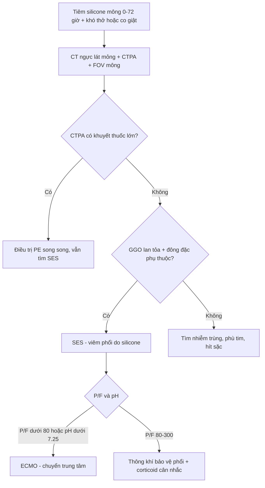
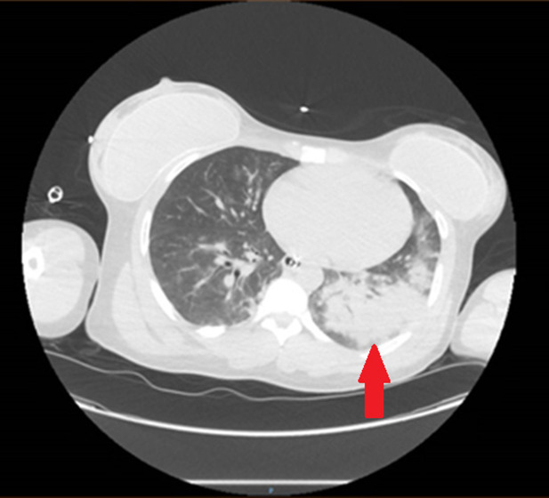
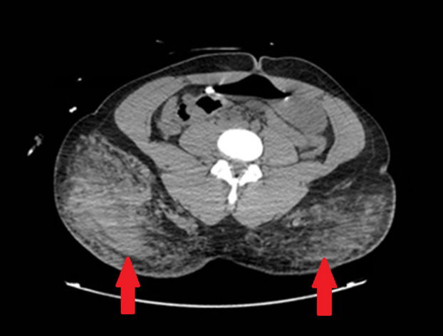
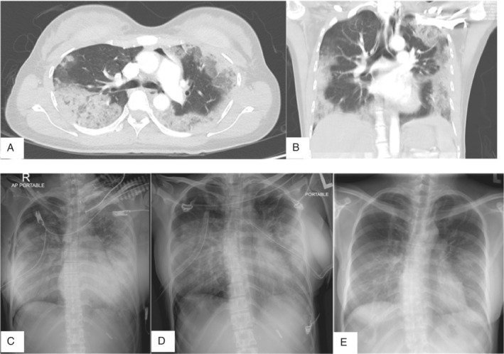
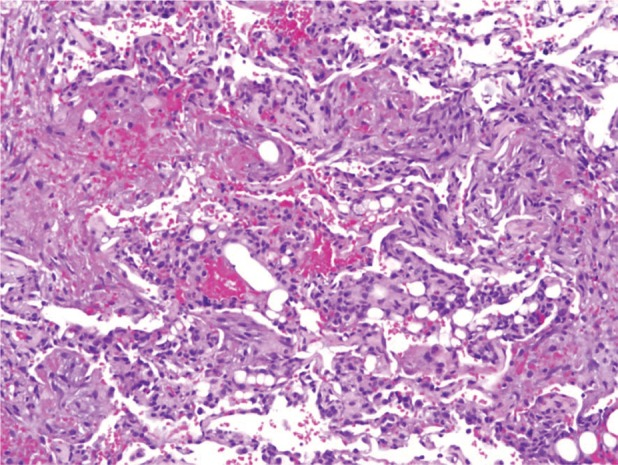

# 1698 — Hội chứng tắc mạch silicone (SES) sau tiêm mông: viêm phổi – xuất huyết phế nang – ARDS trong 72 giờ / Silicone embolism syndrome

**Tags:** `pattern:mo-kinh-lan-toa` `pattern:xuat-huyet-phe-nang` `vung:phoi` `vung:mo-mem` `protocol:CT-nguc` `protocol:CTA-phoi` `score:Berlin-ARDS`
**Mức chắc chắn (certainty):** tổng hợp y văn (literature synthesis) — ghép **1 ca tử vong sau tiêm silicone mông không phép** (Clin Pract Cases Emerg Med 2024, PMC11166068, CC BY 4.0), **1 ca tử vong sau tiêm chất làm đầy mông** (Egypt Heart J 2023, PMC10564681, CC BY 4.0), **1 ca sống sót + bảng 29 ca SES** (Respirol Case Rep 2020, PMC7028525, CC BY 4.0), **1 ca SES tái phát phải ECMO** (Respir Med Case Rep 2022, PMC8790489, CC BY-NC-ND) và **1 tổng quan scoping về silicone lỏng công nghiệp** (Acta Cir Bras 2024, PMC11457952, CC BY 4.0). Bài **1688** đã phủ siliconoma mạn; bài này phủ **biến chứng cấp trong 24–72 giờ**, khác hoàn toàn về cơ chế và xử trí.

## 1. Tổng quan bệnh học – cơ chế hình ảnh

- **Bản chất:** silicone lỏng dùng trong thẩm mỹ là **polydimethylsiloxane (PDMS)**. FDA **không phê duyệt** tiêm silicone khối lượng lớn để độn mông/vú; mọi ca "độn mông bằng silicone" trong y văn đều là thủ thuật **ngoài luồng, không phép** (PMC11166068, PMC11457952).
- **Vì sao tắc mạch:** kim tiêm đưa PDMS **dưới áp lực cao** vào mô mỡ mông — nơi có **đám rối tĩnh mạch lớn**. Khi đầu kim nằm trong lòng mạch (hoặc mô bị phá hủy tạo đường vào), silicone **vào thẳng tĩnh mạch → buồng tim phải → tuần hoàn phổi**. Giọt silicone **lớn hơn mao mạch phổi (~7–10 µm)** nên **bít cơ học** mao mạch, đồng thời hoạt hóa **bạch cầu trung tính và đại thực bào phế nang** → giải phóng protease, gốc tự do → **tổn thương nội mô mao mạch** → phù và **xuất huyết phế nang** (PMC7028525).
- **TẠI SAO hình ảnh là "mờ kính lan tỏa + đông đặc phụ thuộc":** phế nang bị lấp **một phần** bởi dịch phù/máu → tia X chỉ giảm attenuate một phần → **ground-glass**; vùng **phụ thuộc (thấp, sau)** ứ máu và dịch nhiều hơn do trọng lực và tưới máu cao hơn → **đông đặc (consolidation)**. Đây là **cùng một quá trình** với ARDS, không phải hai bệnh.
- **Đường đến não và mắt:** nếu có **shunt phải–trái (PFO hoặc shunt trong phổi)**, giọt silicone đi vào tuần hoàn hệ thống → **co giật, giảm tri giác** (PMC11166068) và **bệnh võng mạc kiểu Purtscher** (PMC8790489) — dấu hiệu ngoài phổi có thể là **manh mối duy nhất** khi phổi chưa mờ.
- **Thời gian khởi phát (số nằm lòng):**
  - Thể **tiêm** (injection): **4 giờ – 72 giờ**, đa số **trong 24 giờ đầu** (PMC7028525, PMC11166068, PMC10564681).
  - Thể **implant/vật liệu tồn lưu**: có thể **muộn 2 tháng – 18 năm** (bảng 29 ca, PMC7028525) — nên **không loại trừ SES vì "tiêm đã lâu"**.
- **Liều và độ nặng:** ca sống sót nhận **~500 mL mỗi bên mông** (PMC7028525); ca tử vong chỉ kịp nhận **6 lọ × 3–5 mL** rồi dừng vì triệu chứng (PMC10564681) — nghĩa là **không có ngưỡng thể tích an toàn**. Tỉ lệ tử vong trong bảng tổng hợp: **4/29 ca (~14%)**, nhưng các ca nặng được báo cáo chọn lọc nên **tỉ lệ thật còn cao hơn** (PMC7028525).
- **Sinh hóa – khí máu của ca điển hình:** PaO₂/FiO₂ **73** (ARDS nặng), pH **7.24**, lactate tăng (PMC11166068); ca thứ hai: SpO₂ **60%** khí trời, RVSP **53 mmHg**, CVP **18 mmHg**, sốc **70/40 mmHg** (PMC10564681).

## 2. Mẫu hình + chẩn đoán phân biệt theo vị trí (gamut)

- **Mẫu hình chính:** bệnh nhân **khỏe mạnh, sau thủ thuật thẩm mỹ 0–72 giờ** → khó thở – đau ngực – ho ra máu – sốt – **co giật/giảm tri giác**; CT ngực: **mờ kính lan tỏa hai bên + đông đặc phụ thuộc**, **không có bít tắc động mạch phổi lớn**; CT vùng tiêm: **dày/tụ dịch mỡ dưới da mông ± khí dưới da**.
- **Gamut theo cơ chế (bệnh nhân sau thủ thuật thẩm mỹ, khó thở cấp):**
  1. **Tắc mạch silicone (SES)** — tiêm silicone lỏng; khởi phát **giờ – 72 giờ**; GGO + xuất huyết phế nang.
  2. **Tắc mạch mỡ (fat embolism syndrome, FES)** — **mỡ tự thân** (hút mỡ, ghép mỡ mông); tam chứng **giảm oxy – rối loạn tri giác – ban xuất huyết điểm**; CT cũng GGO nhưng **có nguồn mỡ tự thân**, không có silicone.
  3. **ARDS do nhiễm trùng** — áp-xe mông, mô hoại tử, nhiễm khuẩn huyết sau tiêm không vô khuẩn; **sốt cao, bạch cầu/PCT tăng**, đông đặc **không đối xứng**.
  4. **Phù phổi cấp do tim** — truyền dịch quá nhiều, bệnh tim ẩn; **tim to, tràn dịch màng phổi, đường Kerley**, đáp ứng lợi tiểu.
  5. **Xuất huyết phế nang lan tỏa (DAH)** — viêm mạch, Goodpasture, kháng đông; **ho ra máu + thiếu máu**, không liên quan thủ thuật.
  6. **Thuyên tắc phổi (PE)** — huyết khối **thật**; CTPA có **khuyết thuốc trong lòng mạch**, phổi thường **ít thay đổi nhu mô**; SES có thể **kèm** PE nhỏ (PMC11166068) nên vẫn phải chụp CTPA.
  7. **Hít sặc / dập phổi** — bối cảnh khác, đông đặc theo thùy.

## 3. Bảng so sánh phân biệt (ma trận đối chiếu)

| Thực thể (entity) | Hình ảnh điển hình | Chốt vào (rule-in) | Chốt loại (rule-out) | Gợi ý xác nhận |
|---|---|---|---|---|
| **SES** | CT: **GGO lan tỏa hai bên + đông đặc phụ thuộc**; CT vùng tiêm: dày mỡ/dịch, **khí dưới da**; có thể **giãn thất phải** | **Tiêm silicone lỏng 0–72 giờ + giảm oxy + GGO lan tỏa**, không có ổ nhiễm khuẩn rõ | Đông đặc **một thùy** + sốt mủ + bạch cầu tăng nhiều → nghĩ nhiễm trùng; CTPA có **khuyết thuốc lớn** → PE là chính | BAL: **đại thực bào chứa thể vùi silicone**; sinh thiết: **lỗ hổng không khúc xạ trong phế nang** (PMC7028525) |
| **Tắc mạch mỡ (FES)** | GGO/đông đặc **hai bên, đối xứng**, thường **sau 24–72 giờ**; MRI não: **"starfield"** | **Gãy xương dài/hút mỡ + ban điểm + rối loạn tri giác** | Không có nguồn mỡ tự thân, chỉ có silicone | Lâm sàng (Gurd), không có xét nghiệm đặc hiệu |
| **ARDS nhiễm trùng** | Đông đặc **không đối xứng**, có **ổ áp-xe/hang**, tràn dịch | **Sốt + ổ nhiễm khuẩn tại chỗ tiêm + cấy máu/dịch dương** | GGO lan tỏa **đối xứng** sau tiêm < 72 giờ, không ổ mủ | Cấy máu, PCT, chọc hút ổ mủ |
| **Phù phổi do tim** | **Tim to, tràn dịch màng phổi hai bên, đường Kerley**, GGO **vùng rốn phổi** | **BNP tăng + đáp ứng lợi tiểu**, tiền sử suy tim | Phổi **bình thường kích thước tim**, không tràn dịch, khởi phát ngay sau tiêm | Siêu âm tim, BNP |
| **DAH** | GGO/đông đặc lan tỏa, **không đối xứng**, có thể **mờ mới – cũ chồng** | **Ho ra máu + Hb giảm**, bệnh hệ thống/kháng đông | Không thiếu máu, không ho máu, bối cảnh tiêm | BAL **hemosiderin**, kháng thể (ANCA, anti-GBM) |
| **PE** | **Khuyết thuốc** trong động mạch phổi; nhu mô **bình thường** hoặc nhồi máu hình nêm | **CTPA dương tính** | CTPA âm tính **không loại trừ SES** — SES là bệnh **vi mạch** | CTPA, D-dimer, siêu âm tim |

## 4. Protocol chụp + hệ phân độ/điểm chuẩn hóa

- **CT ngực không cản quang lát mỏng 1 mm** để đánh giá nhu mô (GGO, xuất huyết, tràn khí) — **không cần** cản quang để thấy tổn thương phổi.
- **CTPA** (bơm thuốc, 1–1,5 mm) **bắt buộc** khi nghi SES: vừa **loại trừ PE thật**, vừa đánh giá **giãn thất phải**. Ca SES có thể **kèm PE bán phần** (PMC11166068) nên CTPA âm tính **không** làm chẩn đoán SES sai.
- **Mở rộng FOV xuống mông** trong cùng lần chụp: tìm **dày mỡ, tụ dịch, khí dưới da, ổ áp-xe** tại chỗ tiêm — dấu hiệu **quyết định phân biệt SES với nhiễm trùng** và giải thích **khí dưới da** (PMC11166068).
- **Không có RADS riêng cho SES.** Phân độ theo **Berlin ARDS**: khởi phát **≤ 7 ngày**, mờ hai bên **không giải thích hoàn toàn bởi tim/phổi**, PEEP **≥ 5 cmH₂O**, và **P/F**: nhẹ **200–300**, trung bình **100–200**, nặng **< 100**.
- **Điều trị (để bác sĩ CĐHA trả lời đúng câu hỏi của hồi sức):** hỗ trợ là chính — **thông khí bảo vệ phổi** (Vt ~6 mL/kg cân nặng lý tưởng, PEEP đủ), **corticoid liều cao không có bằng chứng chắc** (bảng ca dùng methylprednisolone 125 mg mỗi 6 giờ, kết cục hỗn hợp), **ECMO** khi ARDS nặng **thất bại với thông khí** (PMC7028525, PMC8790489). **Không phẫu thuật lấy silicone trong pha cấp** — nguy cơ hệ thống cao, không cải thiện sống còn (PMC7028525).
- **Theo dõi:** tràn khí **tái phát** là biến chứng đã ghi nhận (2 lần trong 1 ca, PMC7028525) → X-quang/CT lặp khi xấu đi; theo dõi **thất phải** bằng siêu âm tim.

## 5. Biến thể bình thường và cạm bẫy

- **CT sớm có thể BÌNH THƯỜNG.** Ca 49 tuổi có CT ngực **âm tính hoàn toàn** lúc nhập viện, chỉ **giãn thất phải**; tổn thương phổi xuất hiện **sau đó** (PMC8790489). → **CT âm tính trong 24 giờ đầu không loại trừ SES**; phải lặp khi lâm sàng xấu.
- **Khí dưới da mông** do chính mũi tiêm (không vô khuẩn, bơm áp lực) **bắt chước viêm cân mạc hoại tử** → dễ bị mổ dẫn lưu vô ích. Phân biệt bằng **bối cảnh tiêm + không có mủ, không hoại tử da, không độc lực toàn thân kiểu nhiễm khuẩn** (PMC11166068).
- **Gọi nhầm là "viêm phổi cộng đồng"**: bệnh nhân sốt + thâm nhiễm hai bên → kháng sinh, bỏ qua **tiền sử thủ thuật**. Tiền sử **phải hỏi trực tiếp** ("có tiêm/độn mông ở đâu không?"), vì bệnh nhân **không tự khai** thủ thuật ngoài luồng (PMC11166068).
- **Bẫy "PE âm tính là yên tâm"**: SES là bệnh **vi mạch**, CTPA âm tính là **bình thường** trong SES; kết luận sai dẫn tới **không chuyển ECMO kịp**.
- **Tràn khí khi thở máy**: PEEP cao + tổn thương phế nang → **tràn khí màng phổi**, có ca **2 lần** (PMC7028525) → luôn so phim cũ và tìm tràn khí **mới** khi oxy hóa xấu đột ngột.
- **Thể muộn**: SES có thể xuất hiện **tháng – năm** sau implant/tiêm (bảng 29 ca: 2 tháng đến 18 năm) — **không loại trừ theo thời gian**.
- **Dấu hiệu ngoài phổi**: co giật, giảm tri giác, **giảm thị lực kiểu Purtscher** — nếu chỉ nhìn phổi sẽ bỏ sót chẩn đoán (PMC11166068, PMC8790489).

## 6. Tự lượng giá — Blind Quiz

**Ca 1 — Nữ 28 tuổi, khỏe mạnh, đột ngột đau bụng rồi co giật, SpO₂ 70% khí trời. Người nhà khai "đi dự tiệc làm đẹp" trong 24 giờ qua.**

- Câu hỏi: Mô tả tổn thương nhu mô? Cần chụp thêm vùng nào trong cùng lần chụp, và vì sao? Ba chẩn đoán phân biệt?

<b>Bấm để hiện đáp án (findings + chẩn đoán)</b>

- **Findings:** mờ kính + đông đặc **lan tỏa hai bên**, **nặng hơn bên trái**, vùng phụ thuộc; không có khuyết thuốc lớn kiểu PE.
- **Chẩn đoán:** **hội chứng tắc mạch silicone (SES)** sau tiêm mông không phép — cơ chế: silicone vào tĩnh mạch → bít mao mạch phổi → xuất huyết phế nang/ARDS.
- **Chụp thêm:** **mông trong cùng FOV** — thấy dày mỡ, tụ dịch và **khí dưới da** tại chỗ tiêm (dấu hiệu xác nhận bối cảnh).
- **Phân biệt:** ARDS nhiễm trùng (sốt, ổ mủ), tắc mạch mỡ (có nguồn mỡ tự thân), phù phổi do tim (tim to, BNP).
- Nguồn: Clin Pract Cases Emerg Med 2024, PMC11166068, **CC BY 4.0**.

**Ca 2 — Nữ 30 tuổi, 1 tuần sau tiêm ~500 mL silicone mỗi bên mông, ho – khó thở – sốt 3 ngày, SpO₂ 90%.**

- Câu hỏi: Vì sao đây vẫn là SES dù khởi phát **sau 1 tuần**? Dấu hiệu nào trên phim giúp loại trừ phù phổi do tim? Biến chứng nào phải cảnh báo trước khi thở máy?

<b>Bấm để hiện đáp án (findings + chẩn đoán)</b>

- **Findings:** (A, B) **mờ kính lan tỏa hai bên + đông đặc vùng phụ thuộc**; (C) X-quang mờ phế nang lan tỏa; (D) **tràn khí màng phổi phải đã đặt ống**; (E) cải thiện sau 6 tuần, còn **lưới mờ tồn dư**.
- **Vì sao vẫn SES:** thể tiêm khởi phát **4 giờ – 72 giờ** là điển hình, nhưng tổn thương có thể **tiến triển/đến muộn**; bảng 29 ca ghi nhận khởi phát **2 tháng đến 18 năm** ở thể implant. Bối cảnh tiêm + hình ảnh + sinh thiết (**lỗ hổng không khúc xạ trong phế nang**) là chốt.
- **Loại trừ phù tim:** **không tim to, không tràn dịch màng phổi, không đường Kerley**, tổn thương **lan tỏa đối xứng** — phù tim thường **vùng rốn phổi** và đáp ứng lợi tiểu.
- **Cảnh báo:** **tràn khí màng phổi** — ca này bị **2 lần** (phải rồi trái) trong 4 tuần thở máy; PEEP cao + phế nang tổn thương là nguy cơ.
- Nguồn: Respirol Case Rep 2020, PMC7028525, **CC BY 4.0**.

**Ca 3 — Mảnh sinh thiết phổi xuyên phế quản ở bệnh nhân SES.**

- Câu hỏi: Mô tả 3 dấu hiệu mô bệnh? Vì sao mô bệnh lại "vô khúc xạ" khi soi?

<b>Bấm để hiện đáp án (findings + chẩn đoán)</b>

- **Findings:** phế nang chứa **hồng cầu (xuất huyết trong phế nang)**, **đại thực bào**, và **cấu trúc dạng lỗ hổng không khúc xạ (non-refractile vacuole-like structures)** — silicone không nhuộm, không khúc xạ ánh sáng.
- **Ý nghĩa:** đây là **bằng chứng mô học** của viêm phổi do silicone; BAL tìm **đại thực bào chứa thể vùi** cũng có giá trị.
- **Cạm bẫy:** mô bệnh **không đặc hiệu** nếu chỉ thấy xuất huyết — phải **hỏi tiền sử** và đối chiếu hình ảnh.
- Nguồn: Respirol Case Rep 2020, PMC7028525, **CC BY 4.0**.

## Bài liên quan chéo
- [1688 – Siliconoma lan xa ngoài vùng vú](../1688-siliconoma-lan-xa-ngoai-vu/lesson.md) (thể **mạn**, khác SES cấp)
- [1686 – Hạch nách chứa silicone](../1686-hach-nach-chua-silicone-va-siliconoma/lesson.md)
- [033 – Phù phổi & ARDS](../033-phu-phoi-ards/lesson.md) (định nghĩa Berlin, hình ảnh ARDS)
- [098 – Barotrauma & tràn khí áp lực](../098-barotrauma-tran-khi-ap-luc-tho-may/lesson.md) (biến chứng thở máy)
- [090 – Bỏng hít đường thở](../090-bong-hit-duong-tho-o-tre/lesson.md) (chẩn đoán phân biệt tổn thương phổi do hít)
- [1720 – Ngộ độc cyanid do khói lửa](../1720-ngo-doc-cyanid-khoi-lua-o-tre/lesson.md) (bệnh cảnh "phổi bình thường + toan chuyển hóa")

> Không dùng để chẩn đoán độc lập khi chưa có người hướng dẫn.
