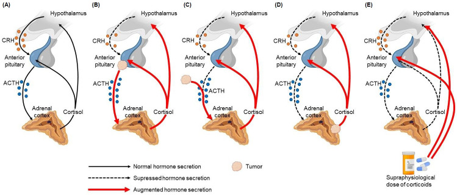
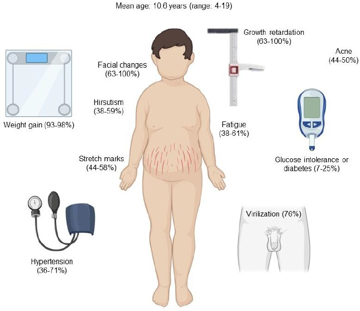
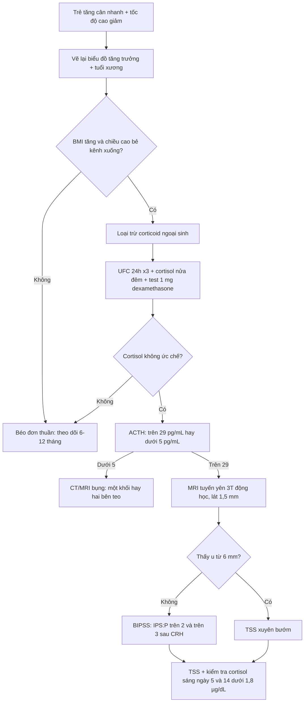
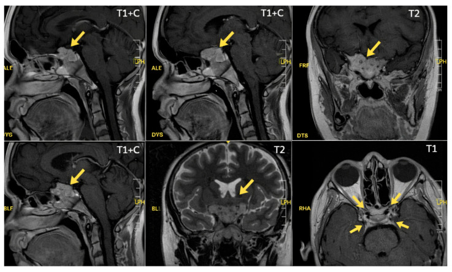
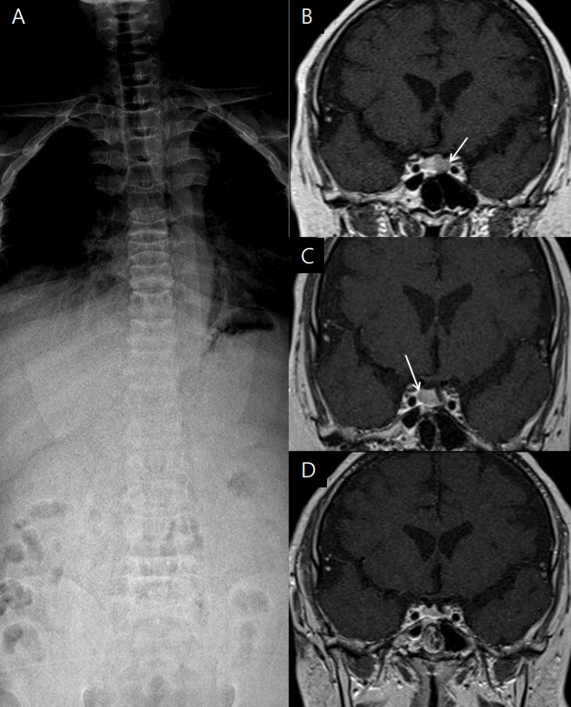

# 1699 — Bệnh Cushing ở trẻ em: chậm tăng trưởng + tăng cân, MRI 3T động học, BIPSS theo tuổi và tăng trưởng sau lui bệnh / Pediatric Cushing disease

**Tags:** `pattern:cushing` `pattern:microadenoma-tuyen-yen` `pattern:cham-tang-truong` `vung:tuyen-yen` `vung:ho-yen` `vung:cot-song` `protocol:MRI-3T-dong-hoc` `protocol:BIPSS`

**Mức chắc chắn (certainty):** tổng hợp y văn (literature synthesis) — tổng quan có hệ thống về Cushing do tuyến yên ở trẻ (Concepción-Zavaleta MJ và cộng sự, *Ann Pediatr Endocrinol Metab* 2023, PMC10329946) + 2 ca nguyên văn có ảnh (PMC13029999: nam 13 tuổi 8 tháng, u **3 × 2 mm**; PMC5642078: nam 17 tuổi, gãy 3 đốt sống) + bài tổng quan cùng hệ 1696/1694.

> **Câu chốt:** Ở trẻ, dấu hiệu sớm nhất **không phải** mặt tròn hay rạn da mà là **đường cong tăng trưởng đổi hướng**: **tăng cân nhanh + tốc độ cao gần như bằng 0**. Vì vậy câu hỏi hình ảnh không phải "có u không" mà là **"đứa trẻ này có mất chiều cao so với kênh của nó không"** — sau đó mới là **MRI 3T động học** (chỉ thấy u ở **16–71%** ca) và **BIPSS** (khi MRI âm và đã chứng minh ACTH phụ thuộc trung ương).

## 1. Tổng quan bệnh học – cơ chế hình ảnh

- **Dịch tễ (số phải nhớ):** Cushing nội sinh **0,7–2,4/1 triệu người/năm**, chỉ **~10%** ca mới ở trẻ em; Cushing do tuyến yên (Cushing disease — CD) ở trẻ có **tỉ lệ mắc 0,89–1/1 triệu trẻ/năm** và chiếm **75–80%** Cushing nội sinh. Ở trẻ **< 7 tuổi**, nguyên nhân **thượng thận** lại thường gặp hơn u tuyến yên; **> 7 tuổi** thì CD chiếm ưu thế. Tuổi trung bình trong một tổng quan lâm sàng: **10,6 tuổi (4–19)**.
- **TẠI SAO tăng cân mà KHÔNG cao (cơ chế mô học):** cortisol **ức chế trục GH–IGF-1** và **trực tiếp chống tăng sinh tế bào sụn sụn tiếp hợp** (ức chế chondrocyte ở vùng tăng trưởng), trong khi vẫn **tăng tân tạo mỡ và đề kháng insulin** → cân tăng, **tốc độ cao giảm**, **tuổi xương chậm** so với tuổi thực. Ca PMC5642078: **17 tuổi, cao 149,5 cm (−4,1 SDS)**, tăng **23 kg trong 4 năm mà không cao thêm**, **tuổi xương chậm 2 năm**.
- **TẠI SAO MRI hay âm tính (vật lý):** u corticotroph ở trẻ **thường < 6 mm**, **giảm tín hiệu T1**, và **ngấm thuốc chậm hơn** nhu mô tuyến yên lành (tuyến yên có hệ cửa mạch mạnh) → trên **chuỗi động học sau tiêm**, u hiện **giảm tín hiệu so với nhu mô ở thì sớm**, rồi đẳng tín hiệu. Vì thế MRI thường quy chỉ thấy u ở **16–71%** ca; lát cắt **≤ 1,5 mm** ở **3T** là điều kiện tối thiểu.
- **TẠI SAO xương gãy khi chỉ "béo":** cortisol **giảm tạo xương (ức chế osteoblast)** và **tăng hủy xương (tăng RANKL, giảm hấp thu canxi)** → mật độ xương giảm nhanh; ca PMC5642078 có **T-score −4,9 ở cột sống thắt lưng và −2,7 ở háng**, kèm **xẹp T9, L2, L3**. Trên X-quang: **loãng xương lan tỏa + xẹp thân đốt** — hình ảnh "người già" ở một thiếu niên.
- **Sinh hóa chốt:** cortisol tự do nước tiểu 24 giờ **> 70 µg/m²/24 giờ (193 nmol/24 giờ)**; cortisol huyết tương nửa đêm **> 4,4 µg/dL**; cortisol nước bọt nửa đêm **< 1,45 ng/mL là bình thường (Se 100%, Sp 95%)**; sau **1 mg dexamethasone (25 µg/kg, tối đa 1 mg)** cortisol **≥ 1,8 µg/dL = không ức chế**.
- **Vì sao phải định vị chứ không chỉ chẩn đoán:** ACTH **> 29 pg/mL** → phụ thuộc ACTH (tuyến yên hoặc lạc chỗ); ACTH **< 5 pg/mL** → phụ thuộc thượng thận. Test CRH: cortisol tăng **> 20%** và ACTH tăng **≥ 35%**; test dexamethasone liều cao (**80–120 µg/kg, tối đa 8 mg**) giảm cortisol **≥ 20%** tách tuyến yên khỏi lạc chỗ với **Se 97,5%/Sp 100%** — nhưng ở trẻ vẫn phải xác nhận bằng MRI/BIPSS vì test không định vị được bên.

## 2. Mẫu hình + chẩn đoán phân biệt theo vị trí (Gamut)

- **Theo trục (bắt buộc phân nhánh trước khi nghĩ tới u):**
  - **Phụ thuộc ACTH:** u tuyến yên (CD — phổ biến nhất ở trẻ > 7 tuổi); **ACTH lạc chỗ** (carcinoid phế quản/tuyến ức, NET tụy, u nguyên bào thần kinh, Wilms); **CRH lạc chỗ** (rất hiếm).
  - **Không phụ thuộc ACTH:** adenoma vỏ thượng thận (bài 194), **ung thư vỏ thượng thận** (bài 193), **PPNAD/AIMAH**, **McCune-Albright** (tăng sản nốt hai bên).
  - **Ngoại sinh (thường gặp nhất ở trẻ nói chung):** uống/hít/bôi/thuốc nhỏ mắt/tiêm khớp — **luôn loại trừ trước khi chụp** (bài 1694).
- **Theo hình thái tuyến yên trên MRI:** ổ **< 6 mm** (giá trị định vị thấp nhất → cân nhắc BIPSS); **6–10 mm** microadenoma; **≥ 10 mm** macroadenoma (xâm lấn xoang hang, chèn giao thoa thị); **tuyến yên bình thường/to đều** = tăng sản do CRH hoặc do suy giáp nguyên phát.
- **Theo bụng (khi ACTH thấp):** **một khối** thượng thận (adenoma/ACC) vs **hai thượng thận teo** (ngoại sinh) vs **hai bên to không đều, có nốt nhỏ** (PPNAD) — nhánh bình thường **4,1–4,9 mm**, thân **7,2–8,8 mm** (n = 586, bài 1694).
- **Gamut "béo + thấp" ở trẻ (không phải Cushing):** béo đơn thuần (cao bình thường hoặc **vượt kênh**, tuổi xương **đi trước**), suy giáp (chậm cao + chậm tuổi xương nhưng **không tăng cân nhanh kiểu Cushing**), thiếu GH, bệnh celiac/IBD, loạn sản xương, chậm phát triển thể chất – dậy thì muộn (chiều cao vẫn song song kênh).
- **Gợi nhớ "GROWTH":** **G**rowth chart trước tiên, **R**ạn da/tím + mặt tròn, **O**besity trung tâm, **W**eakness cơ gốc chi, **T**uổi xương chậm, **H**uyết áp cao + đường huyết rối loạn.

*Sơ đồ: (A) trục bình thường; (B) Cushing do u tuyến yên (ACTH cao, cortisol cao, tăng sản thượng thận hai bên); (C) ACTH lạc chỗ; (D) u thượng thận (ACTH bị ức chế); (E) Cushing ngoại sinh (thượng thận teo). Nguồn: Concepción-Zavaleta MJ và cộng sự, Ann Pediatr Endocrinol Metab 2023;28(2):87–97, PMCID PMC10329946, CC BY-NC 4.0.*

## 3. Bảng so sánh phân biệt (ma trận đối chiếu)

| Thực thể (entity) | Hình ảnh điển hình | Chốt vào (rule-in) | Chốt loại (rule-out) | Gợi ý xác nhận |
|---|---|---|---|---|
| **Cushing do u tuyến yên ở trẻ** | U **< 6 mm**, giảm T1, **giảm tín hiệu thì động học sớm**; hai thượng thận **to đều**; **tuổi xương chậm**, loãng xương | **Chậm cao + tăng cân + UFC cao + ACTH > 29 pg/mL + ức chế ≥ 20% với dex liều cao** | MRI âm **không** loại trừ (chỉ thấy u 16–71%); BIPSS không gradient mới loại trừ mạnh | MRI 3T động học ≤ 1,5 mm; BIPSS; mô bệnh sau TSS |
| **ACTH lạc chỗ** | Tuyến yên bình thường; **u phổi/tuyến ức/tụy/thượng thận**; thượng thận rất to; **hạ kali, tăng sắc tố** | **ACTH rất cao + hạ K + ổ ngoài sọ + BIPSS không gradient** | Có gradient trung ương rõ **và** ổ tuyến yên khớp bên → loại trừ | CT ngực–bụng, 68Ga-DOTATATE, BIPSS |
| **U vỏ thượng thận (adenoma/ACC)** | **Một khối thượng thận**, đối bên **teo**; trẻ nhỏ hơn, **nam hóa rõ** | **ACTH < 5 pg/mL + một khối + đối bên teo** | ACTH cao + hai bên to đều → loại trừ | CT bụng có cản quang, mô bệnh (bài 193/194) |
| **PPNAD / AIMAH** | Thượng thận **kích thước gần bình thường hoặc nhỏ, nhiều nốt nhỏ**, có thể **loạn sản xương dạng sợi** | **ACTH thấp + nhiều nốt nhỏ hai bên + bệnh cảnh gia đình (Carney)** | Một khối đơn độc → loại trừ | CT/MRI bụng lát mỏng, gen PRKAR1A |
| **Cushing ngoại sinh** | **Hai thượng thận teo đều, không khối**; có thể loãng xương nặng | **Tiền sử corticoid (kể cả hít/bôi) + ACTH bị ức chế + teo hai bên** | Không phơi nhiễm + ACTH cao → loại trừ | Hỏi thuốc kỹ, cortisol sáng, test ACTH |
| **Béo đơn thuần** | Chiều cao **bình thường hoặc trên kênh**, **tuổi xương đi trước**, không loãng xương | **Tăng cao song song/không giảm tốc độ cao + tuổi xương ≥ tuổi thực** | **Tốc độ cao giảm + tuổi xương chậm + UFC cao** → loại trừ | Theo dõi biểu đồ tăng trưởng 6–12 tháng |

*Tuổi trung bình 10,6 (4–19): **tăng cân 93–98%**, **chậm tăng trưởng 63–100%**, thay đổi mặt 63–100%, nam hóa 76%, rạn da 44–58%, tăng huyết áp 36–71%, rối loạn dung nạp glucose/đái tháo đường 7–25%. Nguồn: Concepción-Zavaleta MJ và cộng sự, Ann Pediatr Endocrinol Metab 2023, PMCID PMC10329946, CC BY-NC 4.0.*

### Ba dấu hiệu hình ảnh quyết định (đọc đúng thứ tự)
- **Biểu đồ tăng trưởng là "modality" đầu tiên:** vẽ lại chiều cao/theo tuổi và cân/theo chiều cao; tìm **bẻ kênh đi xuống** của chiều cao trong khi BMI đi lên. Đây là dấu **nhạy nhất** và rẻ nhất — bỏ qua bước này là lý do chẩn đoán muộn **1,7–2,5 năm**.
- **Tuổi xương (X-quang bàn tay trái):** chậm so với tuổi thực (ca điển hình **chậm 2 năm**) — ngược với béo đơn thuần (tuổi xương **đi trước**).
- **Cột sống + DXA:** đau lưng ở trẻ béo có Cushing = **phải chụp cột sống**, không được coi là "đau cơ do béo".

## 4. Protocol chụp + hệ phân độ/điểm chuẩn hóa

### 4.1. Chẩn đoán sinh hóa trước, chụp sau (thứ tự không được đảo)
- **Bước 1 — chứng minh tăng cortisol:** 3 mẫu UFC 24 giờ liên tiếp (biến thiên trong cùng bệnh nhân **~50%**, nên 1 mẫu âm không loại trừ); hoặc cortisol nửa đêm; hoặc test 1 mg dexamethasone qua đêm.
- **Bước 2 — ACTH:** **> 29 pg/mL** = phụ thuộc ACTH; **< 5 pg/mL** = phụ thuộc thượng thận.
- **Bước 3 — định vị:** MRI tuyến yên **3T, lát ≤ 1,5 mm, coronal T1 sau tiêm động học (15–30 giây/thì trong 60–90 giây đầu)** + T2 coronal; nếu MRI âm/không kết luận/u **< 6 mm** → **BIPSS**.

### 4.2. BIPSS ở trẻ — ngưỡng và khác biệt so với người lớn
- **Ngưỡng:** ACTH xoang đá : ngoại vi (IPS:P) **> 2** trước kích thích và **> 3** sau CRH; lấy mẫu **3, 6, 10 phút** sau CRH.
- **Desmopressin 10 µg IV** là thay thế khi không có CRH — độ nhạy BIPSS ở trẻ **thấp hơn người lớn** nhưng **tăng rõ sau desmopressin**.
- **Định bên:** gradient **giữa hai xoang ≥ 1,4** mới đủ gợi ý bên cho phẫu thuật viên; **kiểm tra đặt catheter bằng prolactin** (IPS:P prolactin **≥ 1,8**) — nếu thấp hơn thì kết quả âm là **giả** do đặt sai, không phải do ACTH lạc chỗ.

### 4.3. Điều trị — mốc thời gian ảnh hưởng tới hình ảnh theo dõi
- **TSS (xuyên bướm) là lựa chọn đầu tay:** lui bệnh sớm **94,8%** trong loạt 96 trẻ; **tái phát 21,9%**; tổng quan gộp **80%** lui bệnh (6.695 bệnh nhân, không khác biệt nội soi/vi phẫu về lui bệnh, nhưng nội soi ít tái phát hơn ở macroadenoma).
- **Tiêu chuẩn lui bệnh:** cortisol sáng sau mổ **< 1,8 µg/dL** (đo ≥ 2 lần trong 2 tuần, ngày 5 và 14) — **suy thượng thận sau mổ là dấu hiệu TỐT**, không phải biến chứng cần tránh.
- **Xạ trị:** chỉ khi mổ không khả thi/tái phát; liều **45 Gy/25 phân liều** (dải chung 8–45/50 Gy). Loạt 7 trẻ: **100% kiểm soát**, biến chứng chính **thiếu GH**; loạt 8 trẻ: **50% khỏi**, **5/8 suy sinh dục**, **tất cả không đạt chiều cao đích** → xạ trị là nguyên nhân **mất chiều cao** phải tư vấn trước.
- **Thuốc (khi chờ mổ/không mổ được):** ketoconazole **200–800 mg/ngày** (độc gan **0,5–4,2%**, kiểm tra men gan sau 3–4 tuần); metyrapone **720–1.500 mg/ngày**; mitotane khởi đầu **1 g/ngày**; mifepristone tối đa **20 mg/kg/ngày** (không dùng cortisol để theo dõi).
- **Cắt thượng thận hai bên:** biến chứng **suy thượng thận** và **hội chứng Nelson tới 25%** ở trẻ — cần MRI tuyến yên định kỳ sau mổ.

### 4.4. Theo dõi sau lui bệnh (phần quyết định tiên lượng)
- **Tăng trưởng:** dù lui bệnh hoàn toàn, nghiên cứu tiến cứu 13 trẻ cho thấy **mất −0,8 SD chiều cao người lớn** và **+0,9 SD cân/BMI**; **tăng bắt kịp chỉ một phần** — vì vậy chẩn đoán sớm chính là điều trị chiều cao.
- **Huyết áp:** huyết áp tâm trương/trung bình về bình thường trong **3 tháng**, tâm thu tới **1 năm**; **tới 20%** vẫn còn tăng huyết áp sau khi cortisol bình thường.
- **Xương:** mật độ xương hồi phục **một phần** sau điều trị (35 trẻ) — vẫn phải chụp/DXA lại, không "hết bệnh là hết loãng xương".
- **Tái phát 7–25%** ở 5/10/15 năm → MRI + xét nghiệm định kỳ; yếu tố nguy cơ: tuổi khởi phát lớn hơn, xâm lấn xoang hang/màng cứng, **đột biến USP8** (gặp **31–63%** adenoma corticotroph ở trẻ), không tìm thấy u lúc mổ, thay thế glucocorticoid **< 6 tháng**.

## 5. Biến thể bình thường và cạm bẫy

- **"Giả adenoma" trên MRI trẻ:** ổ giảm tín hiệu nhỏ có thể là **nang pars intermedia**, **vùng tuyến yên không đều**, hoặc **hiệu ứng thể tích** — ở trẻ, u **< 3 mm** trên một chuỗi không động học **không đủ** để mổ; phải khớp với sinh hóa và **bên** với BIPSS.
- **BIPSS âm khi đang "pha thấp":** nếu bệnh nhân đang ở giai đoạn cortisol bình thường (thể chu kỳ — bài 1700), gradient âm **không loại trừ** u tuyến yên. Luôn ghi lại **cortisol/ACTH tại thời điểm lấy mẫu**.
- **Cortisol sau mổ "bình thường" có thể là pha trũng** của bệnh chu kỳ, không phải lui bệnh — cần theo dõi dài, không giảm liều hydrocortisone quá nhanh.
- **Suy thượng thận cấp sau mổ** (buồn nôn, hạ HA, hạ Na) là biến chứng **đe dọa tính mạng** trong 1–2 tuần đầu; phải có kế hoạch liều stress và giáo dục gia đình.
- **Gãy đốt sống bị đọc là "chấn thương"** ở trẻ béo: nếu không có chấn thương tương xứng, phải nghĩ Cushing và đo cortisol — ca PMC5642078 đã bị bỏ sót **4 năm** vì quy cho béo và chậm phát triển.
- **Đừng dùng MRI để "loại trừ" Cushing:** MRI âm ở **29–84%** trẻ (chỉ thấy 16–71%); câu đúng là "MRI âm + sinh hóa dương → BIPSS", không phải "MRI âm → không Cushing".
- **Sai lầm thoả mãn tìm kiếm:** thấy u tuyến yên rồi dừng, không kiểm tra **thượng thận hai bên** — ở trẻ < 7 tuổi và trong PPNAD, tổn thương thượng thận mới là nguồn.

## 6. Tự lượng giá — Blind Quiz ngay trên trang tĩnh

**Ca 1 — Nam 13 tuổi 8 tháng, cao 5th percentile, tốc độ cao 0,8 cm/năm.**

- Gợi ý: tăng cân 2 năm, không đau đầu, không dậy thì sớm; cortisol tự do nước tiểu và ACTH tăng.
- Câu hỏi: ổ bất thường nằm ở đâu, kích thước bao nhiêu? Vì sao phải chụp **động học**? Nếu MRI âm thì bước tiếp theo?

<b>Bấm để hiện đáp án (findings + chẩn đoán)</b>

- Dấu hiệu: ổ **giảm tín hiệu T1, tăng nhẹ T2**, ở **bờ trái tuyến yên**, kích thước **~3 × 2 mm** (mũi tên); không xâm lấn xoang hang, không chèn giao thoa thị.
- Chẩn đoán: **microadenoma corticotroph (bệnh Cushing)** — u nhỏ nên chỉ hiện rõ khi so từng thì động học sau tiêm.
- Xử trí trong ca: **TSS nội soi**, sau mổ **đái tháo nhạt trung ương thoáng qua + suy thượng thận thứ phát**, trục HPA hồi phục sau **1 năm**.
- Nguồn ảnh: Ontoria Betancort MC và cộng sự, *Reports* (MDPI) 2026;9(1):70, PMCID **PMC13029999**, CC BY 4.0.

**Ca 2 — Nam 17 tuổi, đau lưng, béo trung tâm, 4 năm không cao thêm.**

- Gợi ý: cao 149,5 cm (−4,1 SDS), BMI 28,5 kg/m² (3,0 SDS), không chấn thương.
- Câu hỏi: có mấy đốt sống bị xẹp? Dấu hiệu X-quang nền là gì? Chẩn đoán phân biệt của "xẹp đốt sống ở thiếu niên"?

<b>Bấm để hiện đáp án (findings + chẩn đoán)</b>

- Dấu hiệu: **loãng xương lan tỏa** + **xẹp T9, L2, L3**; DXA **T-score −4,9 (cột sống) và −2,7 (háng)**. MRI tuyến yên: ổ giảm tín hiệu nhỏ ở tuyến yên (B, C), sau mổ không còn u (D).
- Chẩn đoán: **bệnh Cushing do u tuyến yên** — loãng xương do cortisol là nguyên nhân gãy, không phải chấn thương. Ca này còn có **nhiều adenoma tuyến yên** phát hiện ở lần mổ thứ hai.
- Bài học: trẻ béo + gãy xẹp đốt sống **không chấn thương** → đo cortisol trước khi quy cho "đau cơ".
- Nguồn ảnh: Song JY và cộng sự, *Ann Pediatr Endocrinol Metab* 2017;22(3):197, PMCID **PMC5642078**, CC BY-NC 4.0.

**Ca 3 — Trẻ 9 tuổi, béo trung tâm, mặt tròn, rạn da tím; cần giải thích cho gia đình vì sao phải chụp tuyến yên.**

- Câu hỏi: hình nào là Cushing do tuyến yên? Vì sao thượng thận lại to ở hình đó, còn ở hình E lại teo?

<b>Bấm để hiện đáp án</b>

- **Hình B** = Cushing do u tuyến yên: ACTH tăng → **tăng sản thượng thận hai bên** → cortisol tăng, mất nhịp ngày đêm.
- **Hình E** = Cushing ngoại sinh: cortisol ngoài **ức chế ACTH** → thượng thận **teo hai bên** (bài 1694).
- Hình C = ACTH lạc chỗ (không có u tuyến yên), D = u thượng thận (ACTH bị ức chế nhưng **một bên to, bên kia teo**).
- Nguồn ảnh: Concepción-Zavaleta MJ và cộng sự, *Ann Pediatr Endocrinol Metab* 2023, PMCID **PMC10329946**, CC BY-NC 4.0.

## Bài liên quan chéo
- [1696 – Bệnh Cushing do u tuyến yên ở người lớn: MRI 3T động học, BIPSS, Nelson](../1696-benh-cushing-u-tuyen-yen/lesson.md)
- [1700 – Hội chứng Cushing chu kỳ: dao động cortisol và bẫy xét nghiệm âm giả](../1700-cushing-chu-ky/lesson.md)
- [1694 – Cushing do glucocorticoid ngoại sinh: thượng thận teo hai bên](../1694-cushing-do-glucocorticoid-ngoai-sinh/lesson.md)
- [1697 – Hội chứng tăng đông của Cushing: VTE chu phẫu](../1697-cushing-tang-dong-vte/lesson.md)
- [194 – Cushing do u vỏ thượng thận ở trẻ: chuẩn bị chu phẫu](../194-cushing-u-vo-thuong-than-tre-chu-phau/lesson.md)
- [193 – Ung thư vỏ thượng thận ở trẻ: nam hóa/Cushing](../193-ung-thu-vo-thuong-than-o-tre/lesson.md)
- [600 – Tổng quan hệ Nhi khoa](../600-tong-quan-nhi-khoa/lesson.md)

## Ảnh
- Ảnh lấy từ **PMC** (Europe PMC/PMC OA), đúng file figure gốc; giấy phép từng ảnh trong `images/CREDITS.md`.
- Không tạo composite: 2 ảnh thuộc CC BY-NC (không ND nhưng khác bài/chuỗi xung), giữ nguyên bản để không sai lệch chú thích gốc.
- Số liệu chỉ trích (không dùng ảnh): PMC10329946, PMC13029999, PMC5642078, PMC10159280 — xem `sources.md`.

> Không dùng để chẩn đoán độc lập khi chưa có người hướng dẫn.
