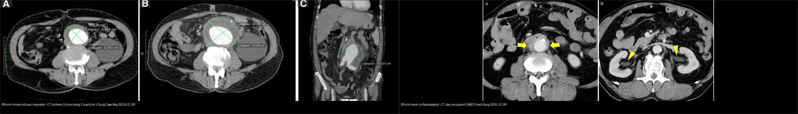
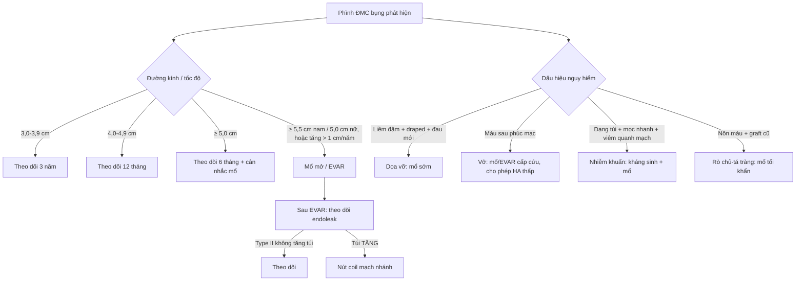
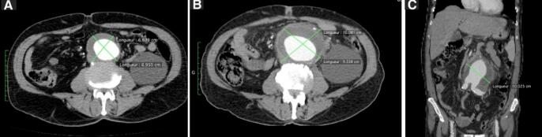
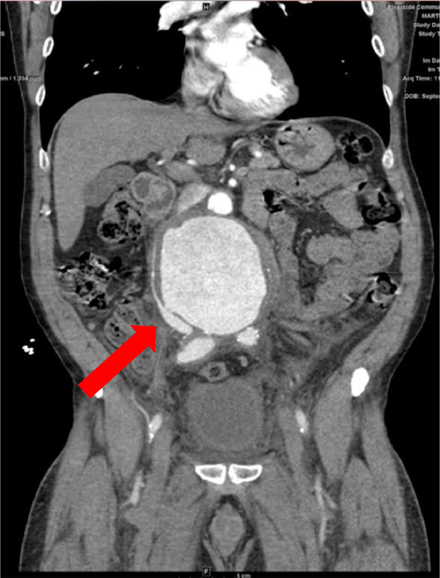
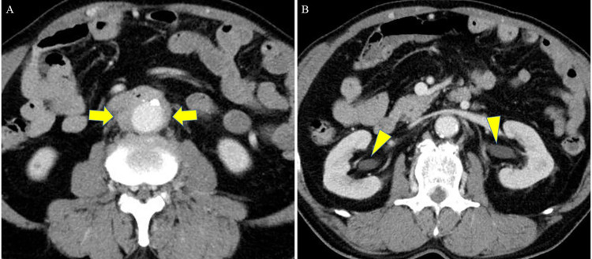
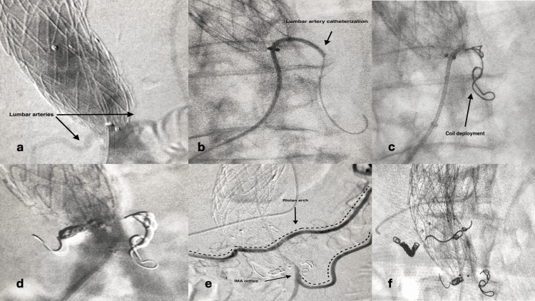

# 170 — Phình ĐMC bụng: dọa vỡ, vỡ, phình nhiễm khuẩn/viêm & rò / AAA: rupture, mycotic-inflammatory & fistula

**Tags:** `pattern:phinh-DMC` `vung:DMC-bung` `protocol:CTA-DMC` `incidentaloma:phinh-DMC`
**Mức chắc chắn (certainty):** tổng hợp y văn (literature synthesis) — tổng hợp guideline + ca nguyên văn có ảnh CC BY/BY-NC (ghi PMCID từng ảnh).

## 1. Tổng quan — đường kính, tốc độ tăng & cơ chế hình ảnh

- **AAA = đường kính ngoài-ngoài ≥ 3,0 cm** (hoặc > 50% đường kính đoạn chủ bình thường). Nguy cơ vỡ tăng theo đường kính; **mổ chương trình khi ≥ 5,5 cm (nam) / ≥ 5,0 cm (nữ)**, hoặc **tăng > 1 cm/năm**, hoặc phình có triệu chứng. Ca nguồn khổng lồ trong bài: **16,9 cm**.
- **Cơ chế hình ảnh (TẠI SAO):**
  - **Liềm tăng tỷ trọng (hyperdense crescent):** huyết khối **mới, cấp** đậm độ cao trong lòng túi — dấu hiệu **dọa vỡ**. Cần phân biệt với vôi hóa thành (đậm hơn, có bờ cứng, không theo hình liềm mềm).
  - **Draped aorta:** thành sau phình mất mặc định và **ôm theo cột sống** — dấu hiệu vỡ kín/dọa vỡ.
  - **Máu sau phúc mạc** đậm độ cao (40–70 HU) quanh ĐMC = vỡ; khoang sau phúc mạc kín nên **ép tạm** một lúc rồi mất bù đột ngột.
- **Phình nhiễm khuẩn (mycotic aortic aneurysm):** thường **dạng túi (saccular)**, **mọc rất nhanh**, dày mô mềm quanh ĐMC (**viêm quanh mạch**), khí trong thành (vi khuẩn sinh hơi), cấy máu dương. Ca nguồn: phình **to thêm 3,4 cm trong 2 tuần** + viêm quanh mạch mới xuất hiện → **mổ + kháng sinh dài**, không chờ đủ ngưỡng đường kính.
- **Phình viêm (inflammatory AAA):** thành dày **xơ hóa trắng như sứ (porcelain)**, **dày mô mỡ quanh ĐMC ("shaggy aorta")**, dính tạng lân cận, **hẹp/gãn niệu quản ứ nước**; nhiều ca liên quan **IgG4**.
- **Rò chủ–tĩnh mạch chủ (aortocaval fistula):** vỡ kín của túi phình **vào tĩnh mạch chủ dưới** → **suy tim cung lượng cao**, phù chi dưới, đau bụng, có khi tiêu chảy máu.
- **Rò chủ–tá tràng (aortoenteric fistula):** **nôn/máu trong phân + phình hoặc graft cũ**; có thể có **"xuất huyết báo trước" (herald bleed)** rồi ồ ạt — **mổ tối khẩn**.

## 2. Gamut đau bụng + khối đập + tụt HA (Gamut)

- **Vỡ AAA:** máu sau phúc mạc + phình + sốc — mổ/EVAR cấp cứu (cho phép HA thấp).
- **Dọa vỡ:** liềm tăng tỷ trọng + draped + đau mới, phình ≥ 5,5 cm — mổ sớm chương trình.
- **Phình nhiễm khuẩn (mycotic):** dạng túi + mọc nhanh + viêm quanh mạch ± khí + sốt/cấy máu — mổ + kháng sinh.
- **Phình viêm (inflammatory):** thành dày + dày mô mỡ quanh ĐMC + ứ nước thận — steroid rồi mổ.
- **Rò chủ–tĩnh mạch chủ:** phình + dòng rõ thông ĐMC–tĩnh mạch chủ + suy tim — mổ.
- **Rò chủ–tá tràng:** nôn máu + phình/graft cũ + khí quanh ĐMC — mổ tối khẩn.
- **Bóc tách lan xuống:** flap + 2 lòng (nối bài 070) — khác vỡ phình.

## 3. Bảng so sánh phân biệt (ma trận đối chiếu)

| Thực thể (entity) | Hình ảnh điển hình (CTA/CT) | Chốt vào (rule-in) | Chốt loại (rule-out) | Gợi ý xác nhận |
|---|---|---|---|---|
| Vỡ AAA | Máu sau phúc mạc đậm độ cao + túi phình + mất liên tục thành | **Tam chứng: đau + tụt HA + khối đập; máu sau phúc mạc cạnh phình** | **Không máu ngoài lòng + thành liên tục → chưa vỡ** (dọa vỡ) | CTA cấp cứu; mổ/EVAR |
| Dọa vỡ | **Liềm tăng tỷ trọng trong huyết khối** + draped aorta + gián đoạn vôi hóa thành | **Đau lưng/bụng MỚI + phình ≥ 5,5 cm + liềm** | **Vôi hóa thành mảnh (đậm, bờ cứng) không phải liềm máu** | CTA, mổ sớm |
| Phình nhiễm khuẩn (mycotic) | **Dạng túi, mọc nhanh (3,4 cm/2 tuần ca nguồn)**, dày mô mềm quanh ĐMC, có thể khí trong thành | **Mọc nhanh + viêm quanh mạch mới + sốt/cấy máu (+)** | **Phình dạng thoi ổn định, không viêm quanh mạch → thoái hóa** | Cấy máu, CTA theo dõi, mổ + kháng sinh |
| Phình viêm (inflammatory) | **Thành dày xơ hóa "sứ" + dày mô mỡ quanh ĐMC ("shaggy")** + ứ nước thận | **Dày mô mỡ quanh ĐMC đều + hẹp niệu quản/ứ nước + IgG4 (±)** | **Khối mô mềm quanh ĐMC có bờ không đều, lan rộng → nghĩ u/di căn** | CTA + IgG4; steroid rồi mổ |
| Rò chủ–tĩnh mạch chủ (aortocaval) | **Đường rò thông ĐMC–tĩnh mạch chủ dưới**, tĩnh mạch chủ dưới căng giãn sớm | **Suy tim cung lượng cao + phù chi + dòng rò trên CTA** | **Chỉ máu sau phúc mạc, không thấy đường thông → vỡ thường** | CTA; sửa mạch |
| Rò chủ–tá tràng (aortoenteric) | **Phình/graft cạnh D3–D4 + khí/dày mô mỡ quanh ĐMC**, thực quản–tá tràng bị kéo dính | **Nôn máu + phình/graft cũ + herald bleed** | **Chỉ loét dạ dày–tá tràng, ĐMC bình thường → bệnh tiêu hóa** | Nội soi (thấy rò), CTA; mổ tối khẩn |
| Bóc tách lan xuống | Flap nội mạc + **2 lòng**, có/không huyết khối lòng giả | **Flap + 2 lòng rõ** | **Lòng giả tắc hoàn toàn + không flap → phình dạng thoi** | CTA; xử trí theo Stanford (bài 070) |

### Dấu hiệu chốt cần đọc đúng trên CT/CTA
- **Liềm tăng tỷ trọng**: đám mờ đậm trong huyết khối ở **phía sau/ngoài** thành phình, có thể có kèm dày mô mỡ — dấu của **máu mới**, khác vôi hóa.
- **Đo đúng đường kính:** **ngoài-ngoài (outer-to-outer) trên mặt phẳng vuông góc trục mạch**, không đo nghiêng theo trục; **báo cáo cả đường kính ngang và trước-sau**.
- **Rò chủ–tĩnh mạch chủ:** tĩnh mạch chủ dưới **ngấm thuốc sớm và căng giãn** ở thì động mạch (do dòng rò) — dấu hiệu gián tiếp quan trọng khi đường rò nhỏ.

## 4. Protocol CTA + theo dõi

- **CTA cấp cứu:** cài đặt bolus-tracking tại ĐMC bụng; **lát mỏng ≤ 1 mm**, MPR theo trục mạch; **không dùng thụt cản quang** khi nghi phình. Ghi: đường kính, cổ phình (độ dài/đường kính/góc), có ảnh hưởng mạch thận–mạch tạng, dấu dọa vỡ, vôi hóa, huyết khối.
- **Tầm soát:** nam **65–75 tuổi có tiền sử hút thuốc** nên siêu âm bụng **một lần** (USPSTF).
- **Theo dõi (SVS 2018, Chaikof):** phình **3,0–3,9 cm mỗi 3 năm**; **4,0–4,9 cm mỗi 12 tháng**; **≥ 5,0 cm mỗi 6 tháng**; theo dõi sát hơn nếu có yếu tố nguy cơ vỡ.
- **EVAR vs mổ mở:** chọn theo hình thái cổ phình/tuổi bệnh nhân. Sau EVAR **theo dõi endoleak** — phân loại **I/V (dòng từ miệng nối/gắn kết)**, **II (mạch nhánh ngược dòng: thắt lưng, mạc treo dưới)**, **III (hở giữa mảnh ghép)**, **IV (độ thấm mảnh ghép)**, **V (căng túi không rõ nguồn)**. **Type II phần lớn theo dõi; can thiệp khi túi phình TĂNG** — nút coil mạch thắt lưng/Riolan (ca nguồn).
- **Sơ đồ quyết định:**

## 5. Biến thể bình thường và cạm bẫy

- **Đau lưng + phình chưa vỡ** dễ tưởng thoát vị đĩa đệm — sờ mạch đùi + CTA khi nghi ngờ.
- **Máu sau phúc mạc do nguyên nhân khác** (vỡ u thận, viêm tụy hoại tử, chấn thương) — luôn tìm túi phình/graft kèm.
- **Phình viêm giả u sau phúc mạc:** dày mô mềm quanh ĐMC dễ bị đọc là **u/di căn hạch** → nhận diện hình "shaggy" đều quanh mạch + IgG4.
- **Vôi hóa thành vs liềm máu:** vôi hóa đậm hơn, bờ cứng, thường nhiều ổ; liềm máu là dấu mềm, một dải, kèm dày mô mỡ mới.
- **Endoleak type II:** phần lớn lành tính — **đừng can thiệp chỉ vì có endoleak**, chỉ can thiệp khi **túi phình tăng dần** (ngưỡng trong ca nguồn: nút coil mạch nhánh).
- **Mycotic cần mổ sớm hơn ngưỡng đường kính** — chờ đủ 5,5 cm là sai lầm; hình dạng túi + tốc độ mọc là chốt.

## 6. Tự lượng giá — Blind Quiz

**Ca 1 — Nam 72 tuổi, đau bụng dữ + tụt HA + khối đập. Đọc CTA.**

- Gợi ý lâm sàng: sốc, khối đập vùng rốn.
- Câu hỏi: Đường kính bao nhiêu? Máu ở đâu? Mổ mở hay EVAR ở ca này? Vì sao?

<b>Bấm để hiện đáp án (findings + chẩn đoán)</b>

- Dấu hiệu (findings): **phình vỡ khổng lồ 16,9 cm + phình chậu 2 bên + máu sau phúc mạc**.
- Chẩn đoán (diagnosis): **vỡ AAA**. Ở ca này chọn **mổ mở** (phình chậu 2 bên mất vùng gắn kết an toàn cho EVAR + dính), cho phép huyết áp thấp đến khi kiểm soát chảy máu.
- Nguồn ảnh: Lee SS et al., Vasc Specialist Int 2026 (PMC13621216, Fig. 1), CC BY-NC 4.0.

**Ca 2 — Nam 68 tuổi, phình theo dõi, đau bụng mới. Hai lần CT cách 2 tuần. Đọc CT.**

- Gợi ý lâm sàng: phình đang theo dõi, xuất hiện đau + sốt nhẹ.
- Câu hỏi: Tốc độ mọc? Dấu hiệu nào gợi nhiễm khuẩn? Xử trí?

<b>Bấm để hiện đáp án (findings + chẩn đoán)</b>

- Dấu hiệu (findings): **(A)** phình lúc đầu không dấu viêm; **(B)** sau 2 tuần **to thêm 3,4 cm kèm viêm quanh mạch (dày mô mỡ quanh ĐMC)**; (C) ảnh dựng hình vành.
- Chẩn đoán (diagnosis): **phình nhiễm khuẩn (mycotic AAA)** — tốc độ mọc rất nhanh + viêm quanh mạch mới. Không chờ đủ ngưỡng đường kính: **mổ + kháng sinh dài**, cấy mô quanh mạch.
- Nguồn ảnh: Bashour G et al., Int J Surg Case Rep 2024 (PMC11284370, Fig. 1), CC BY 4.0.

**Ca 3 — Nam 70 tuổi, đau bụng + phù chi dưới + suy tim. Đọc CTA.**

- Gợi ý lâm sàng: phình 8 cm, phù hai chân, khó thở.
- Câu hỏi: Vì sao suy tim trong khi "chỉ có phình"? Tìm đường thông ở đâu?

<b>Bấm để hiện đáp án (findings + chẩn đoán)</b>

- Dấu hiệu (findings): túi phình lớn; ảnh axial CTA (Fig. 3 cùng bài) thấy **đường rò thông giữa ĐMC và tĩnh mạch chủ dưới**.
- Chẩn đoán (diagnosis): **phình viêm + rò chủ–tĩnh mạch chủ dưới (aortocaval fistula)** — dòng rò lớn gây **suy tim cung lượng cao**; phù chi do tăng áp tĩnh mạch. Cần sửa mạch để đóng dòng rò.
- Nguồn ảnh: Pham R et al., Radiol Case Rep 2024 (PMC10628783, Fig. 2), CC BY 4.0.

**Ca 4 — Nam 66 tuổi, nôn máu + có tiền sử phình ĐMC nhỏ 30 mm. Đọc CT.**

- Gợi ý lâm sàng: xuất huyết tiêu hóa, phình bé (30 mm) nhưng có viêm quanh mạch.
- Câu hỏi: Vì sao phình chỉ 30 mm mà đã gây triệu chứng? Chẩn đoán và xử trí?

<b>Bấm để hiện đáp án (findings + chẩn đoán)</b>

- Dấu hiệu (findings): phình dạng thoi dưới thận **30 mm** kèm **dày mô mỡ quanh ĐMC** (mũi tên vàng A, đầu mũi tên vàng B) — phình viêm; mổ thấy thành ĐMC cứng "như sứ", dính.
- Chẩn đoán (diagnosis): **phình viêm (IAAA) gây rò chủ–tá tràng nguyên phát** — dày thành/dính vào tá tràng tạo lỗ rò, gây nôn máu. **Ngưỡng đường kính không bảo vệ được**: mổ tối khẩn (sửa mạch + xử trí tá tràng).
- Nguồn ảnh: Akabane K et al., Front Surg 2025 (PMC12245851, Fig. 1), CC BY 4.0.

**Ca 5 — Bệnh nhân sau EVAR, túi phình tăng dần, CTA thấy endoleak. Đọc DSA can thiệp.**

- Gợi ý lâm sàng: sau EVAR nhiều tháng, túi phình không nhỏ lại mà tăng.
- Câu hỏi: Loại endoleak? Vì sao phải can thiệp ca này? Kỹ thuật?

<b>Bấm để hiện đáp án (findings + chẩn đoán)</b>

- Dấu hiệu (findings): DSA — mạch thắt lưng nuôi ngược dòng vào túi phình (a–d) và **vòm Riolan từ mạc treo tràng trên nuôi ngược mạch mạc treo tràng dưới** (e–f); thả coil vào các nhánh.
- Chẩn đoán (diagnosis): **endoleak type II** (dòng ngược từ nhánh mạch). Bình thường type II được theo dõi; **can thiệp vì túi phình TĂNG** — nút coil mạch thắt lưng và/hoặc mạch mạc treo dưới, có thể qua vòm Riolan.
- Nguồn ảnh: Giagtzidis I et al., Cureus 2024 (PMC11457928, Fig. 3), CC BY 4.0.

**Ca 6 — So sánh phình nhiễm khuẩn và phình viêm trên ảnh ghép.**
- Câu hỏi: Dấu hiệu nào chốt **nhiễm khuẩn**? Dấu hiệu nào chốt **viêm**? Vì sao xử trí khác nhau?

<b>Bấm để hiện đáp án (findings + chẩn đoán)</b>

- **Nhiễm khuẩn:** dạng túi + **mọc nhanh** (3,4 cm/2 tuần) + viêm quanh mạch mới → kháng sinh + mổ, không chờ ngưỡng đường kính.
- **Viêm:** thành dày xơ hóa "sứ" + **dày mô mỡ quanh ĐMC đều** + ứ nước thận → steroid trước, rồi mổ; hay liên quan IgG4.
- Nguồn ảnh: ghép từ ảnh trái — Bashour G et al., Int J Surg Case Rep 2024 (PMC11284370, Fig. 1), CC BY; ảnh phải — Akabane K et al., Front Surg 2025 (PMC12245851, Fig. 1), CC BY 4.0. Ảnh ghép letterbox giữ tỷ lệ.

## Bài liên quan chéo
- [100 – Tổng quan hệ Bụng](../100-tong-quan-he-bung/lesson.md)
- [070 – PE & ĐMC ngực](../070-thuyen-tac-phoi-dmc-cap/lesson.md) (bóc tách)
- [140 – Chấn thương tạng đặc](../140-lach-tang-dac/lesson.md) (máu sau phúc mạc)
- [205 – Can thiệp mạch (IR)](../901-ir-overview/lesson.md) (nút mạch/coil)

> Không dùng để chẩn đoán độc lập khi chưa có người hướng dẫn.
